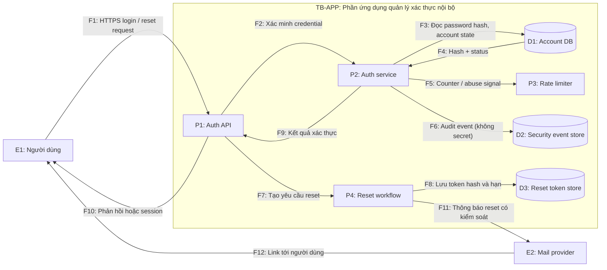

# Chính sách mật khẩu trong Security Assurance

## 1. Chính sách mật khẩu là gì và vì sao cần có bằng chứng?

**Chính sách mật khẩu (password policy)** là tập hợp những nguyên tắc, yêu cầu, trách nhiệm và quy tắc vận hành nhằm quản lý **việc tạo, sử dụng, xác minh, lưu trữ, khôi phục và xử lý mật khẩu** trong một hệ thống. Chính sách không chỉ yêu cầu người dùng “đặt mật khẩu mạnh”; nó quy định **hệ thống phải làm gì**, **ai chịu trách nhiệm** và **bằng chứng nào** đủ để xác nhận các kiểm soát đó hoạt động.

Trong chương **Security policy** của module **SECURITY_SECURITY_ASSURANCE**, chủ đề này kết nối các công việc: phân tích rủi ro, chuyển mục tiêu bảo mật thành yêu cầu và security controls, kiểm thử/audit, xử lý findings, và tổ chức security assurance liên tục trong phát triển, vận hành.

Ví dụ, nền tảng học tập viết bằng Java/Spring Boot có học viên, giáo viên, quản trị viên và dịch vụ tích hợp. Hệ thống có thể cho đăng nhập bằng mật khẩu nội bộ, qua Identity Provider (IdP) hoặc cả hai. Nếu chỉ viết trong tài liệu “Mật khẩu phải bảo mật” mà không biết đăng ký tài khoản có chặn mật khẩu bị lộ không, database có lưu hash đúng cách không, API đăng nhập có giới hạn thử sai không, hoặc luồng quên mật khẩu có thể bị lạm dụng không, thì **chưa thể kết luận mục tiêu bảo mật đạt yêu cầu**.

### Kết quả học tập

Sau bài này, người học có thể:

1. Giải thích mục tiêu, phạm vi và các vai trò liên quan đến password policy.
2. Xây dựng baseline chính sách dựa trên **rủi ro** và hướng dẫn xác thực hiện đại thay vì các quy tắc làm khó người dùng nhưng ít hiệu quả.
3. Phân biệt chính sách mật khẩu với **password hashing**, **MFA**, **session security**, **account recovery** và **quản lý secrets của máy**.
4. Chuyển một quy tắc chính sách thành **requirement → control → test/evidence → finding → quyết định rủi ro**.
5. Biết cách triển khai và kiểm chứng những điểm cốt lõi trong ứng dụng Java/Spring Boot.
6. Duy trì hiệu lực chính sách qua thay đổi, sự cố, kiểm toán và xử lý ngoại lệ.

> **Kết luận phải đúng phạm vi:** “Đối với bản release X và các luồng đăng ký/đăng nhập/đặt lại mật khẩu được kiểm tra, các bằng chứng E1–E5 cho thấy các yêu cầu P1–P5 đạt tiêu chí đã phê duyệt.” Không nên kết luận “tài khoản không thể bị chiếm đoạt” chỉ vì form đăng ký có bộ kiểm tra độ dài mật khẩu.

## 2. Phạm vi: mật khẩu nào và ai có trách nhiệm?

Không phải mọi chuỗi bí mật đều là “mật khẩu người dùng” và không phải mọi hệ thống xác thực đều do ứng dụng tự quản lý.

| Đối tượng hoặc cơ chế | Chính sách nên áp dụng thế nào? | Ranh giới trách nhiệm |
| --- | --- | --- |
| **Mật khẩu người dùng nội bộ (local accounts)** | Quy định độ dài, blocklist, quá trình xác minh, lưu trữ hash, đổi/khôi phục, giới hạn thử sai. | Ứng dụng và nền tảng xác thực nội bộ chịu trách nhiệm trực tiếp. |
| **Mật khẩu của admin/nhân sự đặc quyền** | Baseline mật khẩu cùng yêu cầu xác thực mạnh hơn theo rủi ro, MFA/phishing-resistant MFA khi phù hợp, reauthentication với thao tác nhạy cảm. | IAM, chủ sở hữu hệ thống và nhóm vận hành xác định đường quản trị. |
| **Tài khoản đăng nhập qua SSO/IdP** | Chính sách tạo và xác minh mật khẩu chủ yếu do IdP thực thi; ứng dụng phải kiểm tra token/assertion, mapping quyền và vòng đời phiên. | Cần **shared responsibility matrix** và bằng chứng từ IdP lẫn ứng dụng. |
| **Tài khoản hỗ trợ/khẩn cấp** | Xác định kiểm soát đặc biệt, quản lý quyền hạn tối thiểu, truy cập có phê duyệt và audit. | Cần owner và quy trình break-glass được kiểm tra định kỳ. |
| **Service account/API key/client secret** | Không áp dụng máy móc chính sách mật khẩu con người; dùng secret manager, workload identity, rotation/revocation và giới hạn scope. | Nên có **secrets management policy** riêng. |
| **Passkey/WebAuthn** | Không yêu cầu mật khẩu theo cách truyền thống cho authenticator không dùng mật khẩu; xem policy về xác thực, enrollment, recovery. | Password policy không đủ để quản trị toàn bộ passwordless authentication. |
| **Mã PIN mở khóa authenticator trên thiết bị** | Có thể là yếu tố kích hoạt khóa cục bộ; không tự động tương đương mật khẩu xác minh ở server. | Áp dụng tiêu chí riêng theo công nghệ và mô hình xác thực. |

### Tại sao xác định system boundary quan trọng?

Giả sử `learning-web` chuyển người dùng sang IdP để nhập mật khẩu. Khi đó ứng dụng **không nên nhận hoặc lưu mật khẩu IdP**, nhưng vẫn phải bảo vệ:

- Luồng đăng nhập OIDC/SAML được cấu hình đúng.
- Token được kiểm tra về chữ ký, issuer, audience, thời gian và ngữ cảnh theo giao thức.
- Session được tạo và vô hiệu hóa đúng mức rủi ro.
- Role của học viên/giáo viên được ánh xạ và thu hồi khi thay đổi quyền.
- Account recovery và policy thực thi **ở phía IdP** có evidence phù hợp.

Việc “IdP đã được chứng nhận” không tự chứng minh chính sách password hoặc session **trong tenant của tổ chức** đang đúng. Ngược lại, nếu hệ thống không dùng local passwords thì không được ghi một finding giả rằng ứng dụng không triển khai `PasswordEncoder`.

## 3. Tài sản, mối đe dọa và mục tiêu bảo mật

Password policy cần có lý do bắt nguồn từ **risk assessment**. Mật khẩu là một phương tiện xác thực; bản thân nó không ngăn được mọi hình thức chiếm tài khoản.

| Tài sản/mục tiêu | Kịch bản đe dọa | Hậu quả | Hướng kiểm soát |
| --- | --- | --- | --- |
| **Tài khoản học viên** | Credential stuffing sử dụng mật khẩu đã rò rỉ từ dịch vụ khác. | Đọc thông tin cá nhân, xem bài, thay đổi dữ liệu tài khoản. | Blocklist mật khẩu bị lộ, rate limiting, phát hiện bất thường, MFA phù hợp. |
| **Tài khoản giáo viên** | Phishing lấy mật khẩu, sau đó đăng nhập để xem/sửa dữ liệu lớp. | Rò rỉ bài thi, sai lệch điểm. | MFA chống phishing ở phạm vi cần thiết, session controls, audit, kiểm tra quyền theo đối tượng. |
| **Mật khẩu trong database** | Kẻ tấn công lấy bản sao database chứa mật khẩu được lưu ở dạng rõ hoặc hash yếu. | Phá mật khẩu offline, chiếm nhiều tài khoản. | Password hashing có salt và tham số đủ mạnh; bảo vệ DB và các bản sao lưu. |
| **Endpoint đăng nhập** | Thử nhiều mật khẩu cho một hoặc nhiều tài khoản. | Chiếm tài khoản, làm quá tải, khóa người dùng hợp lệ. | Throttling/rate limiting theo rủi ro, phát hiện password spraying, chống lạm dụng. |
| **Luồng quên mật khẩu** | Kẻ tấn công lợi dụng email enumeration hoặc token khôi phục yếu. | Chiếm tài khoản mà không cần biết mật khẩu cũ. | Token ngẫu nhiên, ngắn hạn, dùng một lần, giới hạn thử, phản hồi không lộ tài khoản. |
| **Phiên đã đăng nhập** | Session/token bị đánh cắp dù mật khẩu mạnh. | Chiếm phiên và thao tác trái phép. | Session protection, revocation, reauthentication cho thao tác nhạy cảm. |
| **Tài khoản quản trị** | Tài khoản đặc quyền bị phishing hoặc dùng lại mật khẩu. | Ảnh hưởng nhiều học viên, cấu hình, dữ liệu nhạy cảm. | Xác thực mạnh, giới hạn đặc quyền, log/audit và phê duyệt. |

### Ví dụ risk scenario

> **RISK-PWD-01:** Một học viên dùng mật khẩu trùng với mật khẩu từng bị lộ ở dịch vụ khác. Kẻ tấn công có được danh sách credential, thử đăng nhập qua `POST /auth/login` và truy cập tài khoản nếu không bị chặn hoặc phát hiện, làm lộ dữ liệu cá nhân và thông tin khóa học.

Một kịch bản khác:

> **RISK-PWD-02:** Kẻ tấn công có bản sao bảng `users` chứa password hash. Nếu ứng dụng dùng thuật toán băm nhanh không dành cho mật khẩu hoặc tham số quá yếu, kẻ tấn công có thể thử mật khẩu offline ở tốc độ cao, dẫn tới chiếm nhiều tài khoản.

Hai kịch bản **đòi hỏi control khác nhau**. Thêm ký tự đặc biệt trong mật khẩu không giải quyết được việc dùng hash nhanh; bổ sung Argon2id không ngăn toàn bộ credential stuffing trên các mật khẩu đã biết.

## 4. Phân biệt policy, standard, procedure và technical control

Tài liệu quản trị cần có các lớp để tránh vừa quá mơ hồ vừa không thực thi được.

| Lớp | Vai trò | Ví dụ |
| --- | --- | --- |
| **Security policy – chính sách** | Quyết định mục tiêu, nguyên tắc, trách nhiệm và điều kiện bắt buộc. | “Mật khẩu phải được bảo vệ khi truyền, khi lưu, khi xác minh và khi khôi phục.” |
| **Password standard / baseline** | Chuyển policy thành tiêu chí có thể kiểm tra và áp dụng đồng nhất. | “Mật khẩu cho phương thức một yếu tố tối thiểu 15 ký tự; hệ thống hỗ trợ ít nhất 64 ký tự.” |
| **Procedure – quy trình** | Hướng dẫn thực hiện khi tạo tài khoản, xử lý quên mật khẩu, sự cố, ngoại lệ. | “Sau yêu cầu reset hợp lệ, phát hành token dùng một lần, có hạn, gửi qua kênh xác minh đã duyệt.” |
| **Technical control** | Phần triển khai cụ thể trong ứng dụng/IdP/hạ tầng. | `PasswordEncoder`, blocklist, rate limiter, reset-token store. |
| **Assessment criteria** | Chỉ rõ như thế nào được coi là đạt. | “Mật khẩu trong blocklist bị từ chối ở server; password hash không phải plaintext.” |
| **Evidence** | Chứng cứ được ghi nhận và có thể truy vết. | Test report, config snapshot, review, log có kiểm soát, kết quả retest. |

Một quyết định quản trị như “yêu cầu MFA cho admin” có thể nằm trong **authentication policy** tổng thể và được tham chiếu từ password policy. Không nên ép mọi biện pháp về danh tính vào một danh sách quy tắc đặt mật khẩu.

## 5. Những nguyên tắc tạo mật khẩu phù hợp với thực tiễn hiện đại

Các khuyến nghị thực hành hiện đại, tiêu biểu từ dòng hướng dẫn **NIST SP 800-63B** và **OWASP**, ưu tiên mật khẩu đủ dài, chặn mật khẩu phổ biến/bị lộ, giảm thử đoán trực tuyến, hỗ trợ password managers và tránh các yêu cầu hình thức không có giá trị tương xứng. **Khi triển khai chính thức**, đội quản trị phải đối chiếu phiên bản hướng dẫn, nghĩa vụ áp dụng và mức rủi ro của tổ chức thay vì tự coi các con số dưới đây là quy định pháp luật chung.

### 5.1. Ưu tiên độ dài hơn “công thức ký tự phức tạp”

Độ dài hỗ trợ tăng không gian đoán mật khẩu, nhất là với passphrase có thành phần không dễ suy đoán. Một baseline minh họa phù hợp với xu hướng hướng dẫn hiện hành:

- **Mật khẩu dùng như một yếu tố xác thực duy nhất:** đặt **tối thiểu 15 ký tự** cho mật khẩu mới.
- **Mật khẩu dùng trong quy trình xác thực đa yếu tố:** hướng dẫn có thể cho phép mức tối thiểu thấp hơn, chẳng hạn **8 ký tự** theo điều kiện tương ứng; tổ chức có thể vẫn chọn chuẩn dài hơn để đồng nhất. Cần đánh giá MFA có thực sự bắt buộc trên **mọi đường đăng nhập và recovery** trước khi dựa vào điều kiện này.
- **Cho phép độ dài tối đa ít nhất 64 ký tự**; không cắt thầm mật khẩu dài, không đặt giới hạn nhỏ tùy tiện làm hỏng passphrase.
- **Cho phép khoảng trắng và ký tự có thể nhập hợp lệ**; hỗ trợ Unicode theo thiết kế/chuẩn áp dụng, nhất quán giữa đăng ký và xác minh.

Các ngưỡng là **baseline minh họa** cho bài học. Không được hiểu là “15 ký tự bất kỳ chắc chắn an toàn” hoặc “có MFA thì mật khẩu 8 ký tự luôn đủ cho mọi hệ thống”. Chất lượng còn phụ thuộc khả năng dự đoán, việc dùng lại, dữ liệu rò rỉ và các đường khôi phục.

**Ví dụ:** Một passphrase dài nhưng là câu nổi tiếng hoặc nằm trong danh sách mật khẩu bị lộ vẫn có thể bị đoán nhanh. Một chuỗi phức tạp nhưng ngắn và được dùng lại cũng có thể thất bại trước credential stuffing. Vì vậy, **độ dài + blocklist + rate limiting + MFA theo rủi ro** hiệu quả hơn yêu cầu người dùng luôn phải thêm một chữ hoa, một chữ số và một ký tự đặc biệt.

### 5.2. Không áp đặt quy tắc thành phần tùy ý

Tránh bắt buộc kết hợp chữ hoa, chữ thường, số, ký tự đặc biệt theo khuôn cứng khi không có lý do rủi ro rõ ràng. Quy tắc kiểu đó dễ dẫn đến mẫu dự đoán được như thêm `1!` ở cuối, đồng thời gây khó cho password manager và passphrase.

Thay vào đó, hệ thống nên kiểm tra **độ dài**, **danh sách mật khẩu bị cấm**, các ràng buộc kỹ thuật có căn cứ và có thể hiển thị hướng dẫn tạo mật khẩu dễ sử dụng. Nếu chính sách tổ chức có quy định bắt buộc khác, cần làm rõ căn cứ, phạm vi, thẩm quyền và cách kiểm tra thay vì tự ý bỏ qua.

### 5.3. Không bắt thay mật khẩu định kỳ nếu không có lý do

Ép đổi mật khẩu mỗi 30/60/90 ngày một cách máy móc có thể khuyến khích biến thể dễ đoán và làm tăng chi phí hỗ trợ. Ưu tiên **đổi hoặc vô hiệu hóa credential khi có bằng chứng/khả năng hợp lý bị lộ, dấu hiệu compromise, hoạt động bất thường hoặc yêu cầu đặc thù đã được phê duyệt**.

Điều này **không** có nghĩa mật khẩu tồn tại vĩnh viễn bất chấp sự cố. Khi có credential leak, nhân sự thay vai trò, khôi phục tài khoản đáng ngờ hoặc xác thực bị xâm phạm, phải có quy trình ứng phó, reset/revocation và kiểm tra các phiên đang hoạt động.

### 5.4. Hỗ trợ password manager và dán mật khẩu

- Cho phép **paste** ở ô mật khẩu; không cố chặn trình quản lý mật khẩu tự điền.
- Hỗ trợ nhập/xác nhận mật khẩu theo hướng dễ dùng; nút hiện/ẩn mật khẩu có thể hữu ích khi bảo đảm riêng tư trên thiết bị.
- Tránh hint tiết lộ cấu trúc mật khẩu hoặc câu hỏi bảo mật có đáp án dễ tra cứu.
- Không lưu mật khẩu trong URL/query string, analytics event, log, crash report hoặc email.
- Không tự “sửa” mật khẩu bằng việc xóa khoảng trắng đầu/cuối, chuyển chữ hoa/thường, cắt chuỗi hoặc loại bỏ ký tự mà không có quy tắc được công bố và áp dụng nhất quán.

### 5.5. Unicode và giới hạn kỹ thuật

Với Java, `String.length()` đếm **đơn vị mã UTF-16**, không hoàn toàn đồng nhất với số ký tự Unicode mà người dùng nhìn thấy. Khi áp dụng ngưỡng độ dài phải **định nghĩa phương pháp đếm**, kiểm tra trên server và thử các trường hợp emoji/ký tự kết hợp. Nếu dùng chuẩn hóa Unicode (ví dụ NFC), phải áp dụng nhất quán theo chuẩn đã chọn, tránh biến đổi bất ngờ khiến mật khẩu không thể xác minh.

Hệ thống cũng cần giới hạn input đủ lớn để chống **abuse/DoS** khi hàm băm tốn tài nguyên, nhưng vẫn **chấp nhận ít nhất ngưỡng tối đa đã công bố**. Không cắt ngầm mật khẩu quá dài rồi tiếp tục xác thực một chuỗi khác với chuỗi người dùng nhập.

## 6. Password blocklist: chặn những mật khẩu dễ bị tấn công

**Password blocklist** là tập mật khẩu không được chấp nhận khi **tạo mới hoặc thay đổi mật khẩu**, thường gồm những mật khẩu phổ biến, đã bị lộ, dễ đoán theo ngữ cảnh hoặc thuộc các mẫu không phù hợp. Mục tiêu không phải tính điểm “đẹp” cho mật khẩu, mà là từ chối các lựa chọn có rủi ro rõ ràng.

| Dạng cần xét | Ví dụ theo loại, không dùng làm mật khẩu thật | Lý do |
| --- | --- | --- |
| Mật khẩu phổ biến | Chuỗi quen thuộc xuất hiện trong danh sách bị lộ. | Dễ bị thử trước trong tấn công online/offline. |
| Mật khẩu nằm trong tập rò rỉ | Password đã xuất hiện trong nguồn dữ liệu compromise đáng tin. | Kẻ tấn công có thể thử lại trên dịch vụ khác. |
| Chuỗi dự đoán theo dịch vụ | Tên sản phẩm/tổ chức + năm + ký hiệu. | Đoán theo ngữ cảnh dễ dàng. |
| Giá trị mặc định | Mật khẩu tài khoản cài đặt hoặc môi trường thử nghiệm. | Kẻ tấn công có thể biết từ tài liệu công khai. |
| Biến thể đơn giản của username/thông tin tài khoản | Username lặp hoặc cộng hậu tố thường gặp. | Dễ bị đoán từ dữ liệu đã biết. |

**Kiểm tra tại server** cho đăng ký và đổi/reset mật khẩu. Client-side feedback giúp UX nhưng không phải hàng rào bảo mật: client có thể bỏ qua JavaScript và gọi API trực tiếp.

### Quy tắc bảo vệ dữ liệu khi kiểm tra blocklist

- Không gửi **plaintext password** tới bên thứ ba tùy ý để hỏi “có bị lộ không”. Có thể dùng danh sách nội bộ hoặc giao thức kiểm tra bảo vệ riêng tư được đánh giá phù hợp.
- Nếu dùng cơ chế k-anonymity hoặc API tra cứu tiền tố hash, phải xem **threat model của kênh tra cứu**, giới hạn dữ liệu lộ và tính xác thực kết quả.
- Không log giá trị mật khẩu bị từ chối để “phân tích người dùng”.
- Bản thân blocklist cần cập nhật, bảo đảm tính toàn vẹn và có phương án khi dịch vụ kiểm tra tạm thời không khả dụng.
- Không xem blocklist là thay thế MFA, throttling, kiểm tra bất thường hoặc xử lý sự cố credential stuffing.

Chính sách nên phân biệt **bằng chứng blocklist được cập nhật** và **bằng chứng toàn bộ mật khẩu hiện tại đều an toàn**. Chỉ kiểm tra blocklist khi đổi mật khẩu không tự chứng minh các mật khẩu tạo từ nhiều năm trước không còn yếu; việc đánh giá lại nhóm tài khoản cũ phải có phương án quản trị rủi ro thích hợp.

## 7. Lưu trữ và xác minh mật khẩu: server phải chịu trách nhiệm

Ngay cả mật khẩu dài cũng không an toàn nếu database lưu **plaintext** hoặc mã hóa có thể giải mã không cần thiết. Với hệ thống xác minh mật khẩu cục bộ, nguyên tắc nền tảng là:

1. **Không lưu mật khẩu ở dạng rõ** hoặc dạng có thể giải mã chỉ để phục vụ đăng nhập.
2. Dùng thuật toán **password hashing/KDF chuyên dụng** có salt và tham số đủ mạnh (ví dụ Argon2id trong môi trường hỗ trợ; scrypt, bcrypt hoặc PBKDF2 khi phù hợp yêu cầu, thư viện và ngữ cảnh).
3. Sử dụng **salt ngẫu nhiên riêng cho mỗi mật khẩu** theo khả năng thuật toán, không dùng một salt cố định toàn ứng dụng.
4. Chọn **work factor / memory/time cost** dựa trên hướng dẫn hiện hành, threat model và đo hiệu năng hạ tầng thực tế; không lấy một hằng số cũ làm chuẩn vĩnh viễn.
5. Lưu **định danh thuật toán và tham số** cùng hash theo định dạng được thư viện/ứng dụng hỗ trợ; thiết kế lộ trình nâng cấp khi thuật toán hoặc tham số không còn đủ.
6. Hạn chế quyền truy cập database, bản sao lưu và hệ thống hỗ trợ; hash vẫn là dữ liệu nhạy cảm, không nên xuất ra log hay dashboard.

### Hash, encryption, salt và pepper có khác nhau?

| Thuật ngữ | Vai trò | Lưu ý |
| --- | --- | --- |
| **Password hash / KDF** | Biến mật khẩu thành giá trị kiểm chứng bằng phép tính cố ý tốn tài nguyên. | Không dùng hash nhanh như SHA-256 đơn thuần để lưu mật khẩu. |
| **Salt** | Giá trị ngẫu nhiên riêng cho mật khẩu, giảm lợi thế khi nhiều người dùng có cùng mật khẩu và đối với bảng tra cứu dựng sẵn. | Không cần bí mật; thuật toán/thư viện thường quản lý cùng hash. |
| **Pepper** | Bí mật chung bổ sung ở tầng ứng dụng/KMS/HSM trong một thiết kế hashing nhất định. | Là control tùy chọn cần thiết kế và quản lý vòng đời; lưu tách database, có kế hoạch luân chuyển/khôi phục. |
| **Encryption** | Mã hóa dữ liệu có thể giải mã khi có khóa. | Phù hợp cho một số dữ liệu cần giải mã, **không thay** password hashing cho local authentication. |
| **Password manager** | Công cụ tạo, lưu và điền mật khẩu cho người dùng. | Nên hỗ trợ; khác với server password store. |

### Chọn thuật toán và tham số an toàn

**Argon2id** là lựa chọn phù hợp trong nhiều hệ thống hiện đại nhờ thiết kế hướng tới chống thử đoán offline dựa trên chi phí bộ nhớ và tính toán. Với môi trường có yêu cầu tương thích hoặc tuân thủ khác, có thể cần PBKDF2 hay lựa chọn được phê duyệt theo tiêu chuẩn áp dụng. **Bcrypt** vẫn thường gặp và có giới hạn input theo byte ở nhiều triển khai; không được âm thầm cắt mật khẩu dài. Khi nâng cấp hệ thống cũ, cần kiểm tra giới hạn này và chọn chiến lược chuyển đổi đúng, không tự phát minh một chuỗi băm nhiều lớp thiếu đánh giá.

Không thể kết luận “bcrypt an toàn vì dùng 10 rounds” hoặc “Argon2id an toàn vì thư viện trả về hash” mà chưa đo **tham số thực tế**, sức chịu tải, chính sách nâng cấp và mức rủi ro offline. Cần thiết kế chống **tấn công làm cạn CPU/RAM của login endpoint** đồng thời bảo đảm KDF đủ tốn kém để chống dò mật khẩu offline.

### Nâng cấp hash theo thời gian

Một cơ chế có thể lưu định dạng có prefix/version và kiểm tra khi người dùng đăng nhập:

- Xác minh bằng thuật toán/tham số tương ứng với hash cũ.
- Nếu xác minh thành công và cấu hình được phê duyệt yêu cầu nâng cấp, **hash lại mật khẩu vừa được chứng thực** bằng tham số mới, ghi thay thế an toàn.
- Không thực hiện nâng cấp bằng cách chuyển hash cũ qua KDF khác rồi tuyên bố tương đương việc hash lại mật khẩu.
- Nếu credential có nguy cơ đã lộ hoặc không còn xác minh an toàn, dùng luồng **reset/reauthentication** phù hợp thay vì cố giữ nguyên.

Những hành vi này phải có **test migration và rollback**; một thay đổi cấu hình password encoder không được gây khóa hàng loạt tài khoản ngoài ý muốn.

## 8. Đăng nhập: chống thử đoán và chiếm tài khoản

Một mật khẩu được lưu an toàn vẫn có thể bị **đoán trực tuyến**, **credential stuffing**, **password spraying**, **phishing** hoặc sử dụng lại khi bị lộ. Vì vậy password policy cần được hỗ trợ bằng **authentication controls**.

| Control | Mục đích | Điều cần đánh giá |
| --- | --- | --- |
| **Rate limiting / throttling** | Giảm khả năng thử nhiều mật khẩu trong thời gian ngắn. | Giới hạn theo tài khoản, IP/thiết bị/rủi ro; tránh bị bypass do phân tán request. |
| **Phát hiện bất thường** | Nhận biết login thất bại hàng loạt, password spraying, đăng nhập bất thường. | Tỷ lệ phát hiện, false positive, đường escalation và telemetry. |
| **MFA** | Giảm phụ thuộc vào một mật khẩu bị lộ. | Yếu tố thực sự độc lập? Các đường recovery/legacy login có bypass MFA không? |
| **Phishing-resistant authentication** | Giảm rủi ro đánh cắp credential qua trang giả. | Có thể dùng WebAuthn/passkey hoặc phương pháp phù hợp cho tài khoản rủi ro cao. |
| **Session management** | Bảo vệ quyền sau đăng nhập, không chỉ trước đăng nhập. | Cookie security, session expiration, revocation, CSRF theo mô hình, reauthentication. |
| **Generic error & timing hygiene** | Hạn chế tiết lộ tài khoản tồn tại qua response/timing. | Login và recovery không tạo đường enumeration rõ ràng. |
| **Authentication event logs** | Truy vết hoạt động lạ mà không lộ secret. | Actor/reference, kết quả, thời điểm, nguồn phù hợp, redaction và retention. |

**Khóa tài khoản vĩnh viễn sau vài lần sai** có thể tạo rủi ro denial-of-service do kẻ tấn công cố tình khóa tài khoản của người khác. Chính sách nên cân nhắc **throttling có giới hạn, backoff, đánh giá theo rủi ro và cơ chế tự phục hồi** thay vì xem account lockout là giải pháp duy nhất.

### Phân biệt các phương thức tấn công

- **Brute-force online:** thử nhiều ứng viên với một hoặc nhiều tài khoản tại hệ thống đăng nhập.
- **Password spraying:** thử một số mật khẩu phổ biến trên nhiều tài khoản để tránh chạm ngưỡng theo từng tài khoản.
- **Credential stuffing:** thử danh sách username/password đã lộ ở nơi khác.
- **Offline cracking:** kẻ tấn công có hash và thử ứng viên trên hệ thống của họ; rate limit login **không áp dụng** cho hoạt động offline.
- **Phishing / session theft:** đánh cắp credential hoặc phiên trực tiếp; độ dài password hay hash mạnh **không tự giải quyết**.

Do đó, một báo cáo “đã rate limit login” không phải bằng chứng rằng database hash đủ mạnh; và “hash bằng Argon2id” không phải bằng chứng chống credential stuffing.

## 9. Vòng đời mật khẩu: tạo, thay đổi, reset, thu hồi

Mỗi giai đoạn có mục tiêu và điểm yếu riêng. Chính sách phải bao phủ cả API công khai lẫn đường vận hành hỗ trợ, không chỉ trang web chính.

### 9.1. Tạo tài khoản và thiết lập mật khẩu

- Đưa ra hướng dẫn rõ về độ dài, blocklist, password manager.
- Kiểm tra ở **server**, không chỉ UI; không lưu giá trị mật khẩu trong request logs hoặc analytics.
- Nếu cấp tài khoản mới qua lời mời, dùng **invitation token ngẫu nhiên, ngắn hạn, ràng buộc mục đích**, thay vì email một mật khẩu mặc định lâu dài.
- Tránh để mọi tài khoản mới cùng một mật khẩu mặc định có thể dùng trực tiếp trong production.
- Xác minh quyền kiểm soát địa chỉ/kênh phục hồi phù hợp trước khi cho phép reset theo kênh đó.

### 9.2. Đổi mật khẩu khi đang đăng nhập

Với thao tác rủi ro phù hợp, yêu cầu **reauthentication** hoặc bước xác thực bổ sung theo chính sách. Mật khẩu mới phải qua cùng bộ quy tắc độ dài/blocklist; cần có thông báo an toàn về thay đổi thành công và cách báo cáo nếu người dùng không thực hiện. Phân biệt việc đổi mật khẩu với đổi email/MFA; mỗi thao tác có mức nguy hiểm và kiểm soát khác nhau.

### 9.3. Quên mật khẩu (account recovery)

Một luồng reset an toàn phải xem **người yêu cầu có quyền điều khiển tài khoản không**, chứ không mặc nhiên tin việc biết username/email:

1. Trả phản hồi đủ chung để không dễ đoán tài khoản có tồn tại hay không.
2. Giới hạn tần suất gửi reset và xác minh, chống lạm dụng kênh email/SMS.
3. Phát hành **reset token ngẫu nhiên, khó đoán, dùng một lần, hạn ngắn, gắn đúng user và mục đích**; lưu dạng an toàn phù hợp để giảm hậu quả khi token store bị truy cập.
4. Gửi reset qua kênh đã xác thực theo quy trình tổ chức; không đưa token vào log, analytics, referer hoặc URL chia sẻ công khai.
5. Khi token hợp lệ, tạo mật khẩu mới qua policy và lưu hash chuyên dụng; **tiêu thụ token một cách nguyên tử** để tránh dùng lại trong hai request đồng thời.
6. Thông báo thay đổi và xử lý các phiên hiện có theo policy, ưu tiên thu hồi phiên/credential bị nghi compromise.
7. Thiết lập luồng hỗ trợ cho người mất cả kênh phục hồi hoặc MFA mà không tạo **backdoor** dựa trên câu hỏi bí mật dễ tra cứu.

**Email reset link** là cơ chế khôi phục thường gặp nhưng không tự là bằng chứng bảo vệ mạnh ngang MFA chống phishing; phải đánh giá rủi ro chiếm email và phương án cho tài khoản đặc quyền.

### 9.4. Khi nghi ngờ lộ mật khẩu

Quy trình cần xác định **trigger** (thông báo rò rỉ, login bất thường, xác nhận compromise), người chỉ huy ứng cứu, cách yêu cầu reset/thu hồi session, kiểm tra credential dùng lại, điều tra hành động sau login, thông báo theo nghĩa vụ áp dụng và bằng chứng đóng sự cố.

Nếu có nguy cơ database hash bị lộ, ngoài yêu cầu reset khi cần, phải đánh giá **thuật toán và tham số** hash tại thời điểm lộ, quy mô tài khoản, backup, khả năng brute-force offline và trạng thái MFA. Không được tuyên bố “hash nên không có rủi ro” khi thông tin về cấu hình và dữ liệu chưa đủ.

## 10. Chính sách riêng cho quyền đặc biệt và tài khoản máy

Tài khoản có thể gây hậu quả lớn khi bị chiếm cần **mức assurance về xác thực cao hơn**, không đơn giản tăng thêm vài ký tự vào mật khẩu.

### Tài khoản admin và hỗ trợ

| Rủi ro | Biện pháp phù hợp theo chính sách | Bằng chứng có thể thu |
| --- | --- | --- |
| Phishing hoặc password reuse | MFA chống phishing khi khả thi, quản trị thiết bị và session. | IAM policy, kết quả kiểm tra đăng nhập, access review. |
| Đặc quyền quá mức | Least privilege, tách admin khỏi tài khoản dùng hằng ngày. | Role inventory, quyền production, approval record. |
| Lạm dụng chức năng nhạy cảm | Reauthentication, phê duyệt hai người khi phù hợp, audit. | Test negative/privileged paths, audit trail. |
| Tài khoản khẩn cấp bị bỏ quên | Cất giữ/kiểm soát truy cập đặc biệt, diễn tập và giám sát. | Break-glass register, exercise report và alert. |
| Không thu hồi quyền khi nhân sự rời đi | Lifecycle IAM: disable/deprovision và revoke session. | Offboarding record, access review, revocation test. |

### Service account, API keys và automation

Không ép hệ thống machine-to-machine phải “thay password bằng tay mỗi 90 ngày” khi có lựa chọn tốt hơn như **workload identity**, credential ngắn hạn và quy trình rotation tự động. Những tài khoản này cần chính sách riêng về provisioning, secret scope, lưu trong **secrets manager**, quyền truy cập, audit, xử lý lộ secret và decommission.

Nếu một database vẫn cần password cho service account, mật khẩu được sinh đủ entropy và quản lý như secret của hệ thống. Không dùng các phương pháp xác thực người dùng như câu hỏi bí mật hoặc email reset để quản lý secret máy.

## 11. Xây dựng password-policy baseline cho một nền tảng học tập

Bảng sau là **ví dụ baseline nội bộ phục vụ học tập**, không mặc định là chính sách đã được một tổ chức phê duyệt. Đặt tên `PWD-01`…`PWD-12` giúp truy vết assessment. Khi áp dụng cần điều chỉnh theo tính năng thực, IdP, rủi ro, hướng dẫn được lựa chọn và nghĩa vụ cụ thể.

| ID | Yêu cầu chuẩn minh họa | Tiêu chí kiểm chứng |
| --- | --- | --- |
| **PWD-01** | Local password dùng một yếu tố có **tối thiểu 15 ký tự**; nếu chính sách dùng ngưỡng khác cho MFA, phải có quyết định và kiểm tra không tồn tại bypass. | Test độ dài trên server ở đăng ký/đổi/reset, và chứng cứ MFA trong trường hợp có ngoại lệ. |
| **PWD-02** | Cho phép tối đa **ít nhất 64 ký tự**, hỗ trợ paste/password manager; không cắt ngầm input. | Test các độ dài biên và xác minh lại mật khẩu dài chính xác. |
| **PWD-03** | Không yêu cầu công thức thành phần chữ hoa/số/ký hiệu tùy ý; hỗ trợ passphrase/khoảng trắng và Unicode theo quy tắc đã công bố. | Test ký tự hợp lệ và đếm độ dài nhất quán client/server. |
| **PWD-04** | Mật khẩu mới được so với danh sách mật khẩu phổ biến, dễ đoán hoặc đã lộ theo phương pháp phù hợp. | Test blocked/allowed, review nguồn và cập nhật blocklist, bảo vệ mật khẩu trong quá trình tra cứu. |
| **PWD-05** | Không buộc thay theo chu kỳ chỉ vì thời gian trôi qua, trừ căn cứ/ràng buộc đã phê duyệt; bắt buộc xử lý khi có dấu hiệu compromise. | Đối chiếu IAM policy, reset triggers và change records. |
| **PWD-06** | Server lưu password verifier dưới dạng **salted password hash/KDF chuyên dụng**, tham số theo baseline được duyệt; không plaintext. | Review cấu hình encoder, mẫu hash giả, schema, code path, migration test. |
| **PWD-07** | Login có biện pháp hạn chế đoán mật khẩu và phát hiện tấn công credential stuffing/spraying phù hợp rủi ro. | Rate-limit/abuse tests, telemetry và alert exercise. |
| **PWD-08** | Đường admin và các hành vi nhạy cảm dùng xác thực bổ sung, MFA và kiểm tra quyền theo threat model. | Access-control tests, policy configuration, negative MFA/recovery tests. |
| **PWD-09** | Reset token khó đoán, đúng mục đích/tài khoản, có hạn, dùng một lần; khôi phục không tiết lộ tài khoản vô cớ. | Token lifecycle tests, concurrency test, enumeration review. |
| **PWD-10** | Mật khẩu/reset token không xuất hiện trong app logs, analytics, ticket, URL không phù hợp; kênh truyền được bảo vệ. | Redaction tests, access log review, TLS configuration assessment. |
| **PWD-11** | Sau compromise/đổi mật khẩu, xử lý session/token và thông báo theo policy được phê duyệt. | Revocation/reauthentication tests, audit samples, incident playbook. |
| **PWD-12** | Mọi yêu cầu có owner, bằng chứng đúng build/IdP version, finding/exception có thẩm quyền và lịch đánh giá lại. | Traceability matrix, risk decision, evidence register, review record. |

### Mẫu câu chính sách ngắn

> **POL-PWD (minh họa):** Mọi thành phần xác thực bằng mật khẩu thuộc phạm vi tổ chức phải áp dụng tiêu chí chất lượng mật khẩu được phê duyệt; mật khẩu phải được bảo vệ trong quá trình nhập, truyền, lưu trữ, xác minh và phục hồi. Không lưu mật khẩu dưới dạng rõ, không tiết lộ qua log hoặc hỗ trợ người dùng. Việc kiểm tra và xử lý hành vi đoán mật khẩu phải tương xứng với rủi ro. Ngoại lệ phải có căn cứ, người chấp thuận đúng thẩm quyền, thời hạn và biện pháp giám sát. Chủ sở hữu control có trách nhiệm cung cấp bằng chứng kiểm chứng khi phát hành và sau các thay đổi quan trọng.

Đoạn này **định hướng**, chưa đủ để phát hành độc lập nếu thiếu baseline và procedures. Người đánh giá cần nhìn thấy cả **chính sách, cấu hình thực tế và kết quả kiểm thử**.

## 12. DFD: ranh giới tin cậy của việc đăng nhập và khôi phục

Một sơ đồ luồng dữ liệu giúp tìm nơi password có thể bị lộ hoặc nơi một quyết định xác thực bị bỏ qua:



Sơ đồ được **đơn giản hóa** để minh họa. Luồng session/token, mail provider, rate limiter và reset store thực tế có thể triển khai theo cách khác. Các điểm cần đánh giá:

- **Client → Auth API:** HTTPS, yêu cầu không log password, input giới hạn hợp lý.
- **Auth service → Account DB:** quyền DB tối thiểu, hash và tham số, không có plaintext hoặc API đọc mật khẩu.
- **Auth service → Rate limiter:** tránh bypass giữa nhiều instance, chống lockout gây DoS; tín hiệu từ nhiều username/IP.
- **Reset workflow → Token store:** token an toàn, dùng một lần, hết hạn; xử lý atomicity.
- **Ứng dụng → Email provider:** nội dung email/link bảo mật, phạm vi dữ liệu, nghĩa vụ và đánh giá provider.
- **Session sau login/reset:** phải được mô hình hóa bổ sung khi đó là mục tiêu quan trọng, vì password policy không tự quản trị session.

**Không vẽ plaintext password vào kho dữ liệu**, chỉ mô tả luồng nhập password tới bộ xác minh. Khi tạo threat model, bổ sung giả định về network, token store, logs, support tool và các đường khôi phục phi chuẩn.

## 13. Ví dụ Java/Spring Boot: thực thi ở phía server

Giả sử `learning-platform-auth` có local account được bảo vệ bằng Spring Security. Ta cần tách **validation policy**, **password encoder**, **data store**, **throttling** và **recovery** để mỗi control có thể test riêng.

### 13.1. Cấu hình password hashing

Trong Spring Security, giao diện `PasswordEncoder` cung cấp `encode(...)` và `matches(...)`. Ví dụ:

```java
@Service
public final class LocalCredentialService {
    private final PasswordEncoder passwordEncoder;
    private final AccountRepository accounts;
    private final NewPasswordPolicy newPasswordPolicy;

    public LocalCredentialService(
            PasswordEncoder passwordEncoder,
            AccountRepository accounts,
            NewPasswordPolicy newPasswordPolicy) {
        this.passwordEncoder = passwordEncoder;
        this.accounts = accounts;
        this.newPasswordPolicy = newPasswordPolicy;
    }

    @Transactional
    public void createLocalAccount(String username, String rawPassword) {
        newPasswordPolicy.checkOrThrow(rawPassword);

        // Persist only a password verifier, never rawPassword.
        String encoded = passwordEncoder.encode(rawPassword);
        accounts.save(new Account(username, encoded));
    }

    public boolean matchesStoredCredential(Account account, String rawPassword) {
        return passwordEncoder.matches(rawPassword, account.getPasswordHash());
    }
}
```

Đây là **đoạn mã minh họa**, không phải luồng tạo tài khoản hoàn chỉnh. `AccountRepository`, `Account` và `NewPasswordPolicy` là các kiểu do dự án định nghĩa. Thực tế phải xử lý kiểm tra danh tính và tính duy nhất username, account state, transaction, email verification, KDF configuration, giới hạn login và error handling.

**Điểm assurance:** `passwordEncoder.encode(...)` chỉ có ý nghĩa nếu bean `PasswordEncoder` được cấu hình bằng **thuật toán/password hashing phù hợp**, tham số đủ mạnh, cách lưu hash có version và test thực sự xác nhận database không chứa plaintext. Không được mặc định rằng mọi implementation của interface đều an toàn; ví dụ encoder loại `NoOpPasswordEncoder` chỉ phục vụ các bối cảnh đặc biệt/test và **không được dùng cho password production**.

### 13.2. Phân tách kiểm tra chất lượng mật khẩu

Một bộ kiểm tra policy ở server có thể tách độ dài, input constraints và blocklist:

```java
public final class NewPasswordPolicy {
    private static final int MIN_CODE_POINTS = 15; // Example: password-only path
    private static final int MAX_CODE_POINTS = 1024; // Resource-abuse bound, not a truncation
    private final BlockedPasswordChecker blocklist;

    public NewPasswordPolicy(BlockedPasswordChecker blocklist) {
        this.blocklist = blocklist;
    }

    public void checkOrThrow(String password) {
        if (password == null) {
            throw new PasswordPolicyException("Invalid password");
        }

        int length = password.codePointCount(0, password.length());
        if (length < MIN_CODE_POINTS || length > MAX_CODE_POINTS) {
            throw new PasswordPolicyException("Password length outside policy");
        }

        if (blocklist.isBlocked(password)) {
            throw new PasswordPolicyException("Password is not allowed");
        }
    }
}
```

`BlockedPasswordChecker` và `PasswordPolicyException` cũng là **kiểu minh họa**. Mã chỉ biểu diễn **hai yêu cầu** trong password policy; không được coi là một password verifier hoàn chỉnh. Những điểm triển khai cần đánh giá thêm:

- `MIN_CODE_POINTS` là baseline **cho luồng một yếu tố trong ví dụ**, không áp dụng mặc nhiên cho mọi SSO/MFA.
- Việc đếm theo **Unicode code point** là một quy tắc kỹ thuật phải được **công bố và dùng nhất quán**; ký tự kết hợp có thể khiến số code point khác số ký tự người dùng cảm nhận.
- `MAX_CODE_POINTS=1024` là ngưỡng minh họa để hạn chế abuse, lớn hơn mức hỗ trợ tối thiểu 64; cần đánh giá bộ nhớ, transport size và độ phức tạp KDF.
- Nếu triển khai Unicode normalization, đặt quy tắc thống nhất trước blocklist/hashing/verification, tránh việc đăng ký và đăng nhập xử lý khác nhau.
- Không ghi password vào message của exception, log, metric labels hoặc tracing span.
- Kiểm tra blocklist không được gửi plaintext tới một dịch vụ tùy ý; có phương án hợp lệ khi checker unavailable.
- Không tạo hardcoded test password trong tài liệu như một credential thật rồi reuse ở production.

### 13.3. Đăng nhập không chỉ là `matches()`

Luồng xác thực an toàn phải đặt password verification trong **authentication pipeline**: quản lý account state, hạn chế thử sai, ghi nhận security event, MFA theo policy và tạo session an toàn. Không gọi `matches()` trên input tùy ý trong một endpoint công khai mà thiếu rate limiting, generic errors và giám sát.

Trong nhiều ứng dụng Spring Security, nên sử dụng **authentication framework/provider flow được cấu hình đúng** thay vì tự tái hiện toàn bộ xác thực trong controller. Cần kiểm tra các đường legacy API/mobile để không có endpoint bypass một phần policy.

### 13.4. Migration từ hash cũ

Nếu hệ thống đã sử dụng các định dạng hash khác nhau, có thể lưu algorithm/version prefix và dùng strategy phù hợp để kiểm chứng. Khi `matches(...)` thành công với cấu hình cũ, có thể nâng cấp hash bằng password đang có trong lần xác thực này theo cơ chế được thiết kế. Việc migration phải có test với tài khoản cũ/mới và dữ liệu giả; trong production không đọc ra plaintext để “chuyển đổi hàng loạt”.

## 14. Ma trận truy vết từ policy tới security assurance

Thay vì nói “đã triển khai password policy”, cần chỉ rõ **claim, criteria, controls, test và evidence**:

| Policy/requirement | Risk liên quan | Control owner / control | Kiểm chứng | Bằng chứng cần |
| --- | --- | --- | --- | --- |
| `PWD-01/02`: đủ độ dài và không cắt ngầm | Mật khẩu dễ đoán, mismatch xác minh | Auth engineering: validation server | Boundary tests 14/15/64/65 ký tự và input dài theo baseline | Report gắn build, policy/config snapshot |
| `PWD-03`: ký tự hợp lệ nhất quán | Người dùng bị khóa tài khoản do xử lý Unicode sai | Auth engineering: input handling | Test spaces, Unicode, normalization, paste path | API test, UX review |
| `PWD-04`: blocklist | Credential stuffing, mật khẩu phổ biến | Security/auth: blocklist checker | Test mật khẩu bị lộ và mật khẩu hợp lệ, availability của checker | Test report, nguồn cập nhật blocklist, error handling |
| `PWD-06`: hash có salt/KDF | Offline cracking sau lộ DB | Auth engineering: password encoder, DB controls | Code/config review, hash format, unique salt, migration, work factor | Secure review, test hash bằng dữ liệu giả, config |
| `PWD-07`: chống thử đoán | Brute force/spraying | IAM/platform: rate limiter và alert | Kiểm tra phân tán request, nhiều tài khoản, giới hạn/backoff | Load/security test, alert exercise |
| `PWD-08`: MFA cho đường cần thiết | Phishing/chiếm admin | IAM/security: MFA policy | Negative test bypass, admin login, recovery | IAM policy, access review, test artifacts |
| `PWD-09`: reset an toàn | Account takeover qua recovery | Auth engineering: reset workflow | Token expiry/replay, concurrency, enumeration, rate limit | Reset test report, token design review |
| `PWD-10`: secret không rò qua log | Token/password disclosure | SRE/security: logging/redaction | Test log khi login sai, reset, exception, tracing | Log sample đã ẩn dữ liệu và config |
| `PWD-11`: revoke khi compromise | Kẻ tấn công giữ session | IAM/auth: session revocation | Reset/compromise scenario, session invalidation | Integration test, incident runbook |
| `PWD-12`: governance | Control drift/ngoại lệ | Risk owner/GRC: assurance process | Kiểm tra risk register, owner, exception, freshness | Decision record và reassessment log |

**Pass của một test không chứng minh toàn bộ policy.** Ví dụ UI chặn mật khẩu dài 7 ký tự không chứng minh API bị chặn; có hash Argon2id không chứng minh reset token dùng một lần; có MFA không chứng minh luồng phục hồi không bypass MFA.

### Một assurance case rút gọn

**Claim:** Mật khẩu của local accounts không được lưu hoặc đưa ra ngoài dưới dạng rõ và không thể bị đoán trực tuyến với tốc độ tùy ý trong điều kiện thử nghiệm được duyệt.

**Argument:** Tại registration/reset, server chỉ lưu hash chuyên dụng với salt/parameter phù hợp; authentication endpoint dùng throttling và telemetry; secrets không được ghi vào log. **Evidence:** cấu hình encoder, review code, test hash và unique salt với dữ liệu giả, rate-limit tests, log redaction tests, build và environment reference.

**Limitations:** Kết quả không chứng minh mọi mật khẩu có entropy cao, không loại bỏ phishing, chưa bảo đảm rủi ro offline nếu hash DB bị lộ trong tương lai với năng lực tấn công thay đổi, và không tự xác nhận những dịch vụ IdP ngoài scope.

## 15. Bộ kiểm thử acceptance cho password policy

### 15.1. Tạo và đổi mật khẩu

| Test ID | Tình huống | Kết quả mong đợi |
| --- | --- | --- |
| `TC-PWD-01` | Đăng ký password-only bằng mật khẩu **14 ký tự** theo cách đếm đã công bố. | Server từ chối theo `PWD-01`. |
| `TC-PWD-02` | Đăng ký bằng passphrase đủ 15 ký tự, không trong blocklist. | Được xử lý đúng khi các điều kiện đăng ký khác hợp lệ. |
| `TC-PWD-03` | Mật khẩu **64 ký tự** và dài hơn trong phạm vi được hỗ trợ. | Không bị cắt ngầm; có thể đăng nhập lại bằng đúng mật khẩu. |
| `TC-PWD-04` | Dùng khoảng trắng, Unicode/ký tự kết hợp theo policy. | Chấp nhận hoặc từ chối nhất quán với chuẩn đã công bố, không biến đổi âm thầm. |
| `TC-PWD-05` | Password nằm trong blocklist dù dài/phức tạp. | Từ chối, không lưu secret trong log. |
| `TC-PWD-06` | Bỏ qua UI, gọi thẳng API tạo/đổi password. | Server vẫn thực thi cùng policy. |
| `TC-PWD-07` | Kiểm tra DB sau đăng ký/đổi bằng mật khẩu giả. | Chỉ lưu verifier phù hợp, không có plaintext; hash khác nhau khi salt khác. |
| `TC-PWD-08` | User cũ có hash legacy hợp lệ. | Có thể xác minh/migration theo policy mà không lộ password hoặc khóa tài khoản ngoài ý muốn. |

**Lưu ý về test số ký tự:** Dùng dữ liệu giả được sinh có kiểm soát, chủ động tính code points nếu đó là quy tắc của baseline; không dựa vào `String.length()` để kết luận độ dài Unicode theo cảm nhận người dùng.

### 15.2. Đăng nhập và chống lạm dụng

| Test ID | Tình huống | Kết quả mong đợi |
| --- | --- | --- |
| `TC-PWD-09` | Nhiều request sai password tới một tài khoản. | Throttling/backoff theo ngưỡng được duyệt, không rò secret. |
| `TC-PWD-10` | Thử một số password lên nhiều tài khoản (spraying simulation có kiểm soát). | Có điều kiện hạn chế/phát hiện phù hợp, không chỉ giới hạn theo username. |
| `TC-PWD-11` | Username tồn tại so với không tồn tại. | Response không dễ tiết lộ trạng thái qua nội dung/mã lỗi; đánh giá timing theo phạm vi khả thi. |
| `TC-PWD-12` | Account admin đăng nhập đúng password nhưng không có MFA bắt buộc. | Không cấp quyền theo luồng đó; kiểm tra đường legacy/recovery. |
| `TC-PWD-13` | Login thành công, logout, đổi password hoặc báo compromise. | Session/token được xử lý đúng chính sách và thời hạn. |

Khi kiểm thử khả năng chịu thử sai, chỉ thực hiện trong môi trường và phạm vi **được ủy quyền**, tránh gây khóa hàng loạt người dùng thật hoặc DoS lên production.

### 15.3. Reset và incident

| Test ID | Tình huống | Kết quả mong đợi |
| --- | --- | --- |
| `TC-PWD-14` | Yêu cầu reset tài khoản tồn tại và không tồn tại. | Tránh enumeration qua response/notification; vẫn có cơ chế chống abuse. |
| `TC-PWD-15` | Dùng reset token sai, hết hạn, đã tiêu thụ hoặc sai mục đích. | Bị từ chối, không đổi password. |
| `TC-PWD-16` | Gửi hai request reset đồng thời bằng cùng token. | Chỉ một request được phép tiêu thụ; không có race dẫn tới dùng lại. |
| `TC-PWD-17` | Reset thành công bằng mật khẩu mới trong blocklist. | Từ chối mật khẩu không hợp lệ; token/state xử lý theo thiết kế đã kiểm chứng. |
| `TC-PWD-18` | Quan sát app logs/traces/email và lỗi liên quan reset. | Không ghi password hay reset token tại nơi không được phép; kênh gửi được bảo vệ. |
| `TC-PWD-19` | Diễn tập xử lý khi nghi lộ credential. | Có owner, thông báo, revocation, bằng chứng và quyết định đóng. |

### Tiêu chí về evidence

Mỗi bài test nên lưu **requirement ID, build/commit, cấu hình IAM/encoder/rate limit, môi trường, phương pháp, dữ liệu giả, thời điểm, kết quả và người/công cụ thực hiện**. Không lưu plaintext password của người dùng thật hoặc reset token đang còn hiệu lực trong artifact. Một test report chỉ nói `18/19 PASS` là chưa đủ nếu trường hợp FAIL liên quan recovery của admin.

## 16. Audit và quan sát hiệu lực trong vận hành

Khi xác minh **operating effectiveness**, assessor cần thấy không chỉ code/config mà còn quy trình thực thi, log và cách đội vận hành phản ứng.

| Vùng kiểm toán | Câu hỏi | Bằng chứng phù hợp |
| --- | --- | --- |
| **Policy ownership** | Baseline nào đang có hiệu lực? Ai duyệt? Áp dụng cho local và IdP ở đâu? | Policy/version, scope, approval, exception register. |
| **Password hashing** | Thuật toán, tham số và migration đã được kiểm soát? | Code/config review, test, restricted config inventory. |
| **Registration/reset** | Tất cả API path có dùng chung validation? | Route inventory, negative tests, review luồng legacy/mobile. |
| **Login defense** | Rate-limit thực thi trên nhiều instance, chống spraying và tránh lockout gây hại thế nào? | Config, test, alert coverage, incident exercise. |
| **MFA/privileged** | Admin có đường bypass không? Ai quản lý break-glass? | IAM config, access reviews, drill results. |
| **Log hygiene** | Có password, reset token, token truy cập bị lộ vào SIEM/ticket/log không? | Log samples đã kiểm soát, redaction tests và review access. |
| **Incident handling** | Sự cố compromise đã được ghi nhận, xử lý và retest? | Incident ticket, decision record, evidence closure. |
| **Provider assurance** | IdP/email provider có đang đáp ứng phần trách nhiệm của họ? | Due diligence, scope của báo cáo, shared responsibility, contract requirements. |

Đánh giá **phải theo mẫu và thời gian quan sát được xác định**. Một audit độc lập có scope có thể tăng mức tin cậy nhưng không chứng minh mọi credential đều không thể bị lộ trong tương lai. Kết quả cần nêu rõ **ngoại lệ, rủi ro còn lại và những thành phần chưa được đánh giá**.

## 17. Quản trị trách nhiệm và ngoại lệ chính sách

| Vai trò | Trách nhiệm trong password-policy assurance |
| --- | --- |
| **Security policy owner / IAM owner** | Xây dựng baseline, phạm vi, phê duyệt cập nhật tiêu chuẩn trong thẩm quyền, theo dõi mức thực thi. |
| **Risk owner / business owner** | Đánh giá tác động chiếm tài khoản, quyết định phương án xử lý hoặc chấp nhận rủi ro trong quyền hạn. |
| **Application/auth engineering** | Triển khai validation, hashing, reset, login flow, session integration, test và sửa lỗi. |
| **Platform/SRE** | Quản trị IdP/rate limiting/secrets/telemetry và cấu hình production thuộc quyền; hỗ trợ incident. |
| **Security assessor/GRC** | Xác minh yêu cầu và control, thu evidence, báo finding, theo dõi ngoại lệ và chương trình assurance. |
| **Support/helpdesk** | Thực hiện luồng hỗ trợ xác thực đã được phê duyệt, tránh xác minh danh tính bằng thông tin dễ tra cứu. |
| **Privacy/legal/third-party owner** | Xem xét nghĩa vụ dữ liệu, provider trách nhiệm và tài liệu hợp đồng/đánh giá khi liên quan. |
| **Internal audit** | Đánh giá độc lập theo phạm vi được giao, báo cáo hiệu lực và sai lệch mà không tự vận hành control cần đánh giá. |

**Một ngoại lệ password policy** là trường hợp cụ thể không đáp ứng chuẩn, ví dụ hệ thống legacy chưa hỗ trợ hash migration hoặc một integration cũ yêu cầu giới hạn ký tự. Ngoại lệ không tự có hiệu lực chỉ vì nhóm kỹ thuật ghi “accepted” trong ticket.

Hồ sơ ngoại lệ tối thiểu gồm: system/account population, requirement/control chưa đạt, lý do, bằng chứng, risk scenario, mức rủi ro, biện pháp giảm thiểu tạm, owner, approver có thẩm quyền, hạn xử lý, ngày hết hạn, trigger đánh giá lại và cách xác minh closure.

**Nếu yêu cầu bắt buộc theo luật/hợp đồng/quy định nội bộ không cho phép ngoại lệ**, phải thực hiện biện pháp đáp ứng hoặc escalation theo chính sách; không tự bỏ yêu cầu vì chức năng khó sửa.

## 18. Ví dụ xuyên suốt: dịch vụ đăng nhập học tập gặp credential stuffing

### Bối cảnh

Một nền tảng học tập Spring Boot có local accounts cho học viên và giáo viên; tài khoản quản trị dùng SSO với MFA. Trong giờ đăng ký khóa học, SOC quan sát nhiều lần đăng nhập thất bại nhắm vào nhiều email người dùng từ nhiều nguồn mạng; một số tài khoản sau đó đăng nhập thành công từ ngữ cảnh bất thường.

**Không được suy đoán kết luận ngay:** nhiều login fail có thể là credential stuffing, password spraying, lỗi client hoặc một chiến dịch tấn công khác. Cần thu thập và đánh giá bằng chứng tương ứng.

### Risk assessment và control

| Thành phần | Ví dụ đánh giá |
| --- | --- |
| **Risk ID** | `RISK-PWD-01` |
| **Asset** | Local student accounts, dữ liệu cá nhân và quyền sử dụng khóa học. |
| **Threat scenario** | Kẻ tấn công dùng credential đã lộ để thử đăng nhập trên nhiều tài khoản. |
| **Existing controls** | Salted password hash, TLS, giới hạn thử sai theo từng tài khoản; chưa có blocklist cập nhật cho password mới. |
| **Evidence hiện có** | Audit login failures, mẫu phân bố username và nguồn truy cập, test rate limit trong scope. |
| **Điều chưa biết** | Có bao nhiêu tài khoản bị compromise? Thử sai có bị bypass khi phân tán IP? Session đã cấp có bị lạm dụng? |
| **Hậu quả** | Rò rỉ dữ liệu, thao tác trái quyền, khối lượng hỗ trợ lớn và mất niềm tin. |
| **Treatment gợi ý** | Điều tra session và audit, bảo vệ tài khoản có dấu hiệu compromise, tăng detection/throttling đa chiều, blocklist, MFA phù hợp. |

### Chuỗi hành động có thể kiểm chứng

1. **Phân loại sự kiện:** SOC và auth owner làm rõ nguồn tín hiệu; lưu bằng chứng đã bảo vệ, không chia sẻ log chứa secret.
2. **Giảm tác động:** throttle/limit theo rủi ro, kiểm soát hành vi bất thường, yêu cầu xác thực bổ sung hoặc reset có mục tiêu khi có cơ sở.
3. **Điều tra tài khoản:** so sánh tín hiệu login, session, thay đổi dữ liệu, role và tác động người dùng trong phạm vi được phép.
4. **Sửa control:** auth engineering bổ sung blocklist và giám sát chống credential stuffing đa chiều; kiểm tra không gây account lockout DoS.
5. **Kiểm thử:** chạy `TC-PWD-05`, `TC-PWD-09`, `TC-PWD-10`, `TC-PWD-13` và các test liên quan session/recovery trên bản build xác định.
6. **Đánh giá residual risk:** kiểm chứng kết quả control và phần còn thiếu; trình risk owner quyết định biện pháp tiếp theo.
7. **Duy trì:** theo dõi chỉ số, review policy, cảnh báo khi nguồn tấn công hoặc kiến trúc thay đổi.

**Một giới hạn quan trọng:** Nếu credential stuffing thành công do người dùng đã dùng mật khẩu rò rỉ, việc tăng tham số Argon2id **không trực tiếp làm tài khoản đó khó bị đăng nhập bằng đúng mật khẩu**. Mỗi control phải gắn với kịch bản rủi ro mà nó thực sự giảm.

## 19. Theo dõi chương trình password assurance liên tục

Password policy có thể mất hiệu lực khi sản phẩm thêm login path, đổi IdP, thêm tenant, thay Spring Security configuration hoặc hệ thống không còn duy trì blocklist.

| Thời điểm | Hành động | Evidence |
| --- | --- | --- |
| **Thiết kế** | Xác định account types, threat scenarios, MFA/recovery requirements, baseline. | Risk assessment, policy approval, architecture review. |
| **PR / implementation** | Review validation, encoder, error path, secret logging và session handling. | Code review, unit/integration tests, threat-model references. |
| **CI / security testing** | Chạy boundary/negative tests, migration, reset token, rate limiting. | Test artifacts theo build, security scan đã triage. |
| **Release gate** | Kiểm tra requirement trọng yếu, finding, exceptions, config tương đương production. | Assurance matrix, retest, release decision. |
| **Production** | Monitor guessing attacks, reset abuse, login anomalies, session revocation, config drift. | Security events, SLI/KRI, alert test, incident review. |
| **Định kỳ** | Rà soát thuật toán/tham số KDF, blocklist, evidence, provider, tiêu chí và UX. | Assessment update, exception recertification, policy version. |
| **Sau sự cố/thay đổi** | Xem lại giả định, mức rủi ro, tính đầy đủ của control và bằng chứng. | Reassessment record, remediation/retest, risk decision. |

### KPI/KRI có thể theo dõi

- **Tỷ lệ luồng tạo/đổi/reset password** được kiểm tra cùng baseline phía server.
- **Tỷ lệ local password verifier** đáp ứng KDF/parameter baseline đã duyệt; tình trạng hash legacy còn chờ migration.
- **Số tài khoản có dấu hiệu credential stuffing** được điều tra và phản ứng theo quy trình, không diễn giải trực tiếp là số compromise thật.
- **Tỷ lệ tài khoản đặc quyền có MFA và không có bypass ngoài policy**.
- **Số finding/exception** liên quan password, reset, login quá hạn theo mức rủi ro.
- **Độ phủ telemetry** của login, reset, session revocation và thời gian xử lý sự kiện quan trọng.
- **Tỷ lệ bằng chứng còn đúng build/config/IdP policy** và được review theo lịch.

Tránh đặt KPI kiểu “100% mật khẩu đều mạnh” nếu tổ chức không có cơ sở đáng tin để đo entropy của mọi mật khẩu. Không lưu plaintext hoặc đảo ngược mật khẩu chỉ để đo chỉ số.

### Trigger cần đánh giá lại

- Thay đổi bộ xác thực, IdP, phiên bản Spring Security, KDF library, thuật toán hoặc tham số.
- Thêm API login/registration/reset, ứng dụng mobile, social login hoặc tài khoản legacy.
- Phát hiện bypass MFA, lỗi session, reuse reset token, log lộ credential hoặc security incident.
- Provider mail/IdP thay đổi điều khoản, luồng recovery hoặc các control trọng yếu.
- Có nguồn dữ liệu mật khẩu bị lộ mới, phương pháp tấn công đáng kể mới, hoặc thay đổi độ nhạy tài sản.
- Chiến dịch login abuse cho thấy rate limiting/monitoring không còn đủ.
- Phát hành chức năng admin mới hoặc mở rộng quyền truy cập tài khoản đặc biệt.

Một trigger đòi hỏi **đánh giá tác động** rồi quyết định test/assessment nào phải làm lại; không nhất thiết mọi thay đổi đều cần lặp lại toàn bộ audit, nhưng cũng không được tái sử dụng evidence lỗi thời.

## 20. Sai lầm thường gặp

| Sai lầm | Hậu quả | Cách sửa |
| --- | --- | --- |
| “Mật khẩu phải có một chữ hoa, một số và một ký tự đặc biệt nên đã mạnh.” | Người dùng tạo mẫu dễ đoán, password reuse vẫn tồn tại. | Ưu tiên độ dài, blocklist, chống đoán và MFA theo rủi ro. |
| “Bắt đổi mỗi 30 ngày luôn tốt hơn.” | Dễ sinh biến thể tuần tự, tăng gánh nặng hỗ trợ. | Đổi khi có bằng chứng compromise hoặc yêu cầu đặc thù có căn cứ. |
| “Hash SHA-256 với salt là đủ.” | Hash nhanh dễ thử offline ở tốc độ cao. | Dùng password hashing/KDF chuyên dụng với tham số phù hợp. |
| “Mã hóa AES rồi giải mã khi login cũng là password hashing.” | Tạo khả năng giải mã tất cả mật khẩu nếu khóa bị lộ. | Lưu verifier bằng KDF không thể đảo ngược theo thiết kế. |
| “Có bcrypt/Argon2id là tự động an toàn.” | Tham số yếu, cấu hình sai, backup/log vẫn rò. | Review algorithm, cost, version, migration và đường dữ liệu. |
| “Chặn paste để tránh lộ mật khẩu.” | Cản password manager, khiến người dùng chọn mật khẩu yếu hơn. | Cho phép paste/autofill và bảo vệ form/kênh truyền. |
| “UI kiểm độ dài nên API không cần kiểm.” | Client có thể bỏ qua validation. | Thực thi server-side trên mọi đường tạo/đổi/reset. |
| “Có MFA cho admin, bỏ qua khôi phục là được.” | Recovery hoặc đường legacy có thể bypass MFA. | Threat model mọi đường xác thực và khôi phục. |
| “Khóa account sau vài lần sai giải quyết brute force.” | Kẻ xấu có thể gây denial-of-service. | Throttling/risk controls phù hợp, review lockout abuse. |
| “Password mạnh thì không lo phishing.” | Mật khẩu/phiên có thể bị đánh cắp trực tiếp. | Xác thực chống phishing khi cần và session controls. |
| “Đổi mật khẩu xong mọi session chắc chắn vô hiệu.” | Session/token có vòng đời riêng. | Kiểm thử revocation và chính sách reauthentication. |
| “Đã đạt audit thì không cần xem lại.” | Bằng chứng có thời gian, scope, build, provider và cấu hình cụ thể. | Continuous assurance, impact assessment và periodic review. |

## 21. Bài tập tự kiểm tra

### Tình huống 1: Quy định đổi mật khẩu 45 ngày

Đội IT đề xuất yêu cầu mọi học viên đổi mật khẩu mỗi 45 ngày vì “an toàn hơn”. Không có yêu cầu pháp lý/hợp đồng riêng và chưa có bằng chứng lộ mật khẩu.

**Câu hỏi:** Có nên chấp nhận mặc định?

**Định hướng:** Không nên áp dụng một cách máy móc. Phân tích nguy cơ password reuse và mẫu dễ đoán, trải nghiệm người dùng, các đường credential stuffing; ưu tiên blocklist, throttling, MFA theo rủi ro và reset có mục tiêu khi compromise. Nếu vẫn bắt rotation, phải ghi căn cứ và kiểm chứng hiệu quả.

### Tình huống 2: Hệ thống chấp nhận mật khẩu 80 ký tự nhưng login sai

Form đăng ký nhận 80 ký tự và lưu qua một bcrypt implementation có xử lý độ dài giới hạn theo byte; khi đăng nhập, hành vi có vẻ bất nhất với ký tự Unicode.

**Câu hỏi:** Risk và bằng chứng cần kiểm tra là gì?

**Định hướng:** Kiểm tra cách encode, Unicode normalization, byte/character boundary, truncate behavior, hash version và test registration–login với cùng input. Không âm thầm rút ngắn mật khẩu; cần chọn chiến lược KDF và migration phù hợp.

### Tình huống 3: Reset token dùng lại được

Reset password thành công, nhưng link cũ vẫn có thể dùng trong một khoảng thời gian.

**Câu hỏi:** Policy/requirement nào bị vi phạm?

**Định hướng:** Vi phạm yêu cầu token **dùng một lần** trong `PWD-09` của baseline minh họa. Mở finding, kiểm tra token store và concurrency, sửa cơ chế tiêu thụ nguyên tử, retest và đánh giá nguy cơ tài khoản đã bị thay đổi trái quyền.

### Tình huống 4: Đã triển khai Argon2id nhưng login bị tấn công

Database lưu Argon2id với tham số được phê duyệt, nhưng attacker sử dụng danh sách credential đã lộ và đăng nhập thành công.

**Câu hỏi:** Có phải password hashing thất bại?

**Định hướng:** Không nhất thiết. Hash chống dò offline sau khi mất password verifier; nó không ngăn attacker dùng **đúng mật khẩu** qua login. Cần tập trung credential stuffing, blocklist, detection, rate limit, MFA, session response và khắc phục tài khoản bị ảnh hưởng.

### Tình huống 5: Dùng IdP nên ứng dụng “không cần kiểm tra gì”

Ứng dụng không lưu password nhưng cho phép token của một client khác đăng nhập vì không kiểm `audience` đúng.

**Câu hỏi:** Password policy ở IdP có bảo vệ được ứng dụng này không?

**Định hướng:** Không. Mật khẩu và policy phía IdP có thể được kiểm soát, nhưng **xác minh token và session phía ứng dụng** vẫn là shared responsibility. Cần cập nhật threat model, yêu cầu và kiểm thử integration.

### Tình huống 6: Ngoại lệ không có hạn

Một API legacy đang dùng thuật toán hash không đủ mạnh. Risk owner ký “chấp nhận để xử lý sau”, nhưng không có hạn, phạm vi tài khoản hay control tạm.

**Câu hỏi:** Hồ sơ có đủ để bảo đảm không?

**Định hướng:** Chưa. Ghi scenario, phạm vi, đánh giá rủi ro, lựa chọn, biện pháp giảm exposure, người thực hiện migration, hạn, tiêu chí retest, phê duyệt đúng thẩm quyền, ngày xem lại và trigger sự cố; không tuyên bố đã đạt baseline.

## 22. Checklist trước khi kết luận password policy đạt yêu cầu

1. **Phạm vi:** Local account, SSO, admin, recovery, legacy API, mobile và service credentials đã được phân loại?
2. **Rủi ro:** Có scenario về guessing, credential stuffing, phishing, offline cracking, reset và session theft?
3. **Mục tiêu:** Tiêu chí bảo vệ tài khoản và dữ liệu quan trọng đã được viết thành requirement rõ ràng?
4. **Baseline:** Độ dài, blocklist, hỗ trợ password manager, Unicode, rotation và giới hạn kỹ thuật có căn cứ?
5. **Server-side validation:** Mọi đường tạo, đổi và reset đều thực thi chính sách, kể cả gọi API trực tiếp?
6. **Storage:** KDF chuyên dụng, salt riêng, cost phù hợp, version/migration và DB access có bằng chứng?
7. **Login:** Throttling, telemetry, generic errors, MFA cho phạm vi cần thiết và phương án chống lockout abuse?
8. **Recovery:** Token ngẫu nhiên, đúng mục đích, hết hạn, dùng một lần, chống enumeration và có kiểm thử race condition?
9. **Sessions:** Đổi password, reset hoặc compromise được kết nối với session revocation/reauthentication theo policy?
10. **Secret hygiene:** Không có mật khẩu/reset token trong log, URL không phù hợp, support ticket hoặc dữ liệu analytics?
11. **Responsibility:** IdP/provider/ứng dụng/platform có control owner và shared responsibility rõ ràng?
12. **Assurance:** Evidence có build, môi trường, thời điểm, phương pháp, hạn chế và mapping requirement?
13. **Findings:** Điểm chưa đạt có owner, kế hoạch, retest và ngoại lệ hợp lệ nếu được phép?
14. **Continuous:** Có lịch rà soát hash cost, threat model, login/recovery paths, provider và trigger đánh giá lại?

**Ghi nhớ:** Chính sách mật khẩu tốt là **quyết định bảo mật có thể kiểm chứng**, không phải bảng quy định làm khó người dùng. Nó kết hợp mật khẩu đủ khó đoán, kiểm tra mật khẩu phổ biến/bị lộ, lưu trữ và khôi phục an toàn, giới hạn tấn công trực tuyến, xác thực bổ sung theo rủi ro và giám sát trong vận hành. **Security assurance** chỉ có cơ sở khi từng yêu cầu được nối với control, phương pháp đánh giá, bằng chứng, phát hiện và quyết định xử lý rủi ro còn lại.

### Tài liệu tham khảo định hướng

- **NIST SP 800-63B – Digital Identity Guidelines: Authentication and Authenticator Management:** hướng dẫn kỹ thuật về password/memorized secrets, verifier, rate limiting và các authenticator. Khi áp dụng, kiểm tra **phiên bản và cấp độ assurance** thực tế.
- **OWASP Authentication Cheat Sheet:** kiểm soát đăng nhập, credential handling, MFA và bảo vệ luồng xác thực.
- **OWASP Password Storage Cheat Sheet:** lựa chọn KDF, salts, pepper, cost và migration.
- **OWASP Forgot Password Cheat Sheet:** token reset, chống enumeration, khôi phục tài khoản.
- **OWASP Credential Stuffing Prevention Cheat Sheet:** các lớp phòng vệ trước việc thử credential bị lộ.
- **OWASP ASVS:** các yêu cầu xác minh bảo mật ứng dụng, hữu ích khi xây acceptance criteria.
- **NIST SP 800-53 / SP 800-53A:** các security controls và phương pháp đánh giá hiệu lực trong tổ chức.
- **ISO/IEC 27001 và ISO/IEC 27002:** quản trị an toàn thông tin và các biện pháp kiểm soát truy cập, danh tính và xác thực theo phạm vi áp dụng.

Các trị số, mẫu policy, ID, API và đoạn mã trong bài là **minh họa phục vụ học tập**, không phải tuyên bố một hệ thống đang đáp ứng tiêu chuẩn hay một yêu cầu pháp lý cụ thể. Khi triển khai thực tế, cần tham chiếu phiên bản chính thức của tài liệu, xác định ngoại lệ/điều kiện theo rủi ro và đánh giá bằng chứng trên đúng hệ thống.
