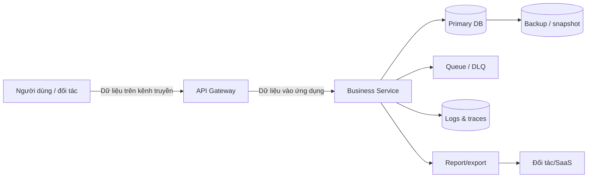
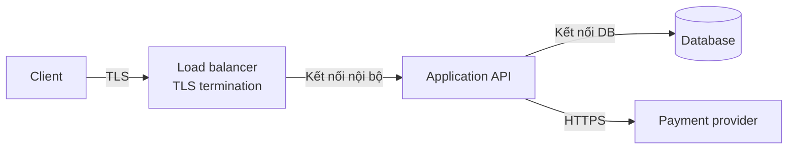
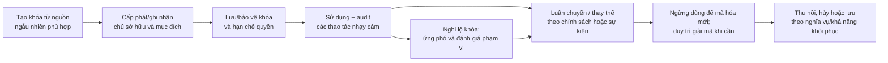
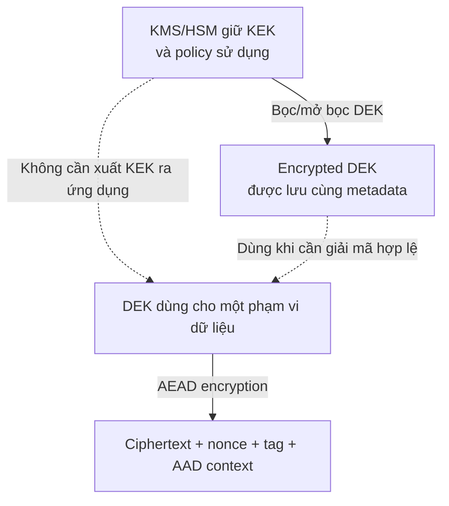
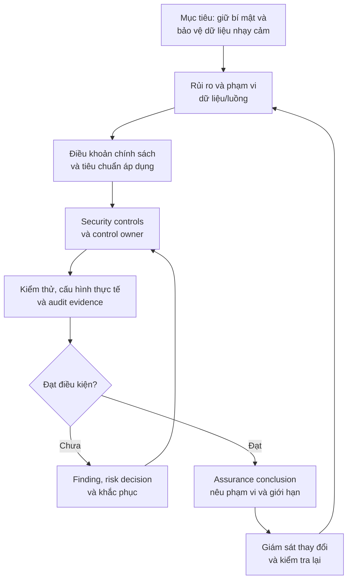
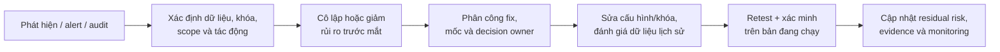

# Chính sách mã hóa: đặt yêu cầu, quản lý khóa và chứng minh hiệu quả bảo vệ

## Mục tiêu học tập

Sau bài này, người học có thể:

1. Giải thích **chính sách mã hóa (encryption policy)** trong hệ thống quản trị bảo mật, phân biệt chính sách với tiêu chuẩn kỹ thuật, hướng dẫn triển khai và bằng chứng kiểm soát.
2. Xác định **dữ liệu nào cần được mã hóa, ở trạng thái nào, qua ranh giới tin cậy nào**, dựa trên phân loại dữ liệu và đánh giá rủi ro.
3. Phân biệt bảo vệ dữ liệu **khi truyền, khi lưu trữ và khi xử lý**, cùng giới hạn thực tế của từng cơ chế.
4. Đặt yêu cầu có thể kiểm chứng cho **thuật toán, giao thức, mã hóa có xác thực, quản lý khóa và kiểm soát truy cập**.
5. Mô tả vòng đời khóa: tạo, sử dụng, phân quyền, lưu trữ, luân chuyển, thu hồi, khôi phục và hủy, kể cả trong hệ thống cloud hoặc có nhà cung cấp.
6. Thiết kế **security controls, kiểm thử, audit, xử lý phát hiện và bằng chứng** để đánh giá chính sách được thực thi liên tục.
7. Đánh giá ngoại lệ, rủi ro còn lại và tình huống mã hóa không đủ bảo đảm mục tiêu nghiệp vụ.

Trong module **SECURITY_SECURITY_ASSURANCE**, chính sách mã hóa là một phần của chuỗi **mục tiêu bảo mật → phân tích rủi ro → yêu cầu → security controls → triển khai → kiểm thử/audit → bằng chứng và khắc phục**. Kết luận “dữ liệu đã được mã hóa” chỉ đáng tin khi nêu rõ **dữ liệu nào, ở đâu, bằng cơ chế nào, ai quản lý khóa, kẻ tấn công được giả định có quyền gì, và bằng chứng nào xác minh điều đó**.

## 1. Chính sách mã hóa là gì và cần giải quyết điều gì?

**Chính sách mã hóa** là tập hợp nguyên tắc và yêu cầu được tổ chức phê duyệt nhằm bảo vệ thông tin bằng kỹ thuật mật mã trong phạm vi xác định. Chính sách xác lập **điều bắt buộc**, **trách nhiệm**, **ngoại lệ**, **cách chứng minh tuân thủ** và **chu kỳ rà soát**. Tiêu chuẩn kỹ thuật và quy trình triển khai cụ thể hóa chính sách thành lựa chọn thuật toán, cấu hình, thao tác và bài kiểm thử.

Ví dụ:

- **Chính sách:** “Dữ liệu khách hàng được phân loại nhạy cảm phải được bảo vệ khi truyền qua ranh giới mạng và khi lưu trữ ở những hệ thống thuộc phạm vi áp dụng.”
- **Tiêu chuẩn:** “Các kết nối này dùng bộ giao thức và mật mã đã được nhóm bảo mật phê duyệt; không cho phép phiên bản giao thức hoặc cipher suite bị loại bỏ theo baseline hiện hành.”
- **Quy trình:** “Nhóm nền tảng cấp chứng thư, cấu hình mTLS giữa các dịch vụ được xác định, luân chuyển khóa và kiểm tra hết hạn.”
- **Kiểm soát:** “Ingress/gateway từ chối kết nối không đạt cấu hình; storage bật chế độ mã hóa và khóa nằm trong dịch vụ quản lý khóa với quyền giới hạn.”
- **Bằng chứng:** “Kết quả kiểm tra cấu hình, handshake test, quyền KMS, kiểm thử giải mã trái quyền, bản ghi thay đổi và thông tin bản triển khai.”

Một chính sách viết “mọi dữ liệu đều phải được mã hóa bằng công nghệ mạnh” thiếu thông tin cần thiết để **thực hiện và đánh giá**: “mọi dữ liệu” gồm những gì, công nghệ nào đã được phê duyệt, ai chịu trách nhiệm, cách xử lý tương thích, ai duyệt ngoại lệ và kiểm thử ra sao?

### 1.1. Mã hóa bảo vệ được gì, không bảo vệ được gì?

Mã hóa chuyển **plaintext** thành **ciphertext** dưới quyền kiểm soát của khóa; bên có khóa hoặc khả năng giải mã phù hợp mới đọc được nội dung. Khi dùng cơ chế **mã hóa có xác thực (authenticated encryption)** đúng cách, hệ thống còn có thể phát hiện thay đổi trái phép đối với ciphertext và dữ liệu ngữ cảnh được xác thực.

Tuy vậy:

- Mã hóa **không thay thế authorization**: một API có quyền giải mã nhưng kiểm tra đối tượng sai vẫn có thể tiết lộ dữ liệu cho người không được phép.
- Mã hóa **không chứng minh dữ liệu đúng nghiệp vụ**: một giao dịch được mã hóa hợp lệ vẫn có thể chứa số tiền hoặc người nhận sai.
- Mã hóa **không tự bảo vệ endpoint đã bị chiếm quyền**: dữ liệu có thể bị đọc khi đang ở bộ nhớ hoặc sau khi ứng dụng giải mã.
- Mã hóa **không tự tạo khả năng sẵn sàng**: mất khóa giải mã có thể khiến backup không thể sử dụng.
- Mã hóa **không mặc nhiên xác thực người phát hành**: cần xác định mô hình khóa, đối tượng xác thực và ngữ cảnh; chữ ký số, MAC hay chứng thư có mục đích khác nhau.
- Mã hóa **không giải quyết việc thu thập hoặc giữ dữ liệu quá mức**: tối thiểu hóa và xóa dữ liệu vẫn cần được quản lý.

Vì vậy, chính sách mã hóa phải gắn với **mô hình đe dọa và các kiểm soát bổ trợ** như quản lý quyền, phân tách nhiệm vụ, logging, chống lặp, khôi phục và giám sát.

### 1.2. Thuật ngữ cần dùng chính xác

| Thuật ngữ | Ý nghĩa trong chính sách |
|---|---|
| **Plaintext / ciphertext** | Dữ liệu trước/sau phép mã hóa; ciphertext thường vẫn kèm metadata như nonce, key ID, version |
| **Encryption / decryption** | Mã hóa/giải mã bằng một cơ chế và khóa được quy định |
| **AEAD** | Mã hóa có xác thực: bảo vệ tính bí mật và cho phép kiểm tra tính toàn vẹn/xác thực theo mô hình khóa |
| **Nonce / IV** | Giá trị phục vụ thuật toán, có yêu cầu về tính duy nhất/không dự đoán được tùy chế độ; thường không phải bí mật |
| **AAD** | Dữ liệu ngữ cảnh được xác thực nhưng không mã hóa, ví dụ tenant ID hoặc record ID |
| **DEK (data encryption key)** | Khóa mã hóa trực tiếp dữ liệu |
| **KEK (key encryption key)** | Khóa dùng để bảo vệ/bọc khóa khác trong mô hình quản lý khóa |
| **KMS / HSM** | Dịch vụ quản lý khóa / mô-đun phần cứng chuyên dụng; mức bảo đảm phụ thuộc cấu hình, quyền và khả năng được dùng |
| **Key rotation / rekey / re-encryption** | Chuyển khóa đang dùng, thay khóa hoặc mã hóa lại dữ liệu; không phải lúc nào cũng đồng nghĩa |
| **Cryptographic agility** | Khả năng cập nhật thuật toán, thư viện, khóa và phiên bản mà vẫn bảo toàn truy cập dữ liệu hợp lệ |

## 2. Cấu trúc của một chính sách mã hóa có thể thực thi

Một chính sách nên được kiểm soát phiên bản, có người phê duyệt và kết nối tới những tiêu chuẩn chi tiết. Các thành phần thường cần có:

| Phần | Câu hỏi quản trị phải trả lời |
|---|---|
| **Mục đích và mục tiêu** | Dữ liệu hoặc giao dịch cần bảo vệ khỏi kiểu tổn thất nào? |
| **Phạm vi** | Đơn vị, ứng dụng, môi trường, tài khoản, nhà cung cấp và dữ liệu nào áp dụng? |
| **Phân loại dữ liệu** | Những mức phân loại nào bắt buộc cơ chế bảo vệ nào? |
| **Yêu cầu khi truyền/lưu/xử lý** | Ranh giới nào cần mã hóa, khi nào phải giải mã, có điểm ngoại lệ nào? |
| **Baseline mật mã** | Ai phê duyệt thuật toán, chế độ, giao thức, tham số và lịch loại bỏ cấu hình yếu? |
| **Quản lý khóa** | Ai có quyền tạo, dùng, thay, khôi phục, thu hồi, hủy và audit khóa? |
| **Chủ sở hữu** | Data owner, system owner, key/control owner, security assurance và risk owner phối hợp thế nào? |
| **Xác minh và giám sát** | Chứng cứ nào cần lưu, test nào bắt buộc và ai kiểm tra hiệu quả? |
| **Ngoại lệ, khắc phục và chuyển cấp** | Khi không đáp ứng chính sách, ai đánh giá/duyệt ngoại lệ, thời hạn và kiểm soát bù trừ ra sao? |
| **Duy trì** | Chính sách được rà soát theo chu kỳ/sự kiện nào, ai xác nhận áp dụng trên bản đang chạy? |

**Ngôn ngữ quy phạm** nên rõ: “phải” cho yêu cầu bắt buộc; “nên” cho khuyến nghị có thể điều chỉnh. Không nhầm một ví dụ về thuật toán trong tài liệu học với **baseline đã được tổ chức chính thức phê duyệt**.

## 3. Xác định phạm vi mã hóa từ dữ liệu và kịch bản rủi ro

### 3.1. Bắt đầu bằng phân loại thông tin

Trước khi chọn thuật toán, xác định **giá trị dữ liệu, nguồn tạo, nơi lưu, người được truy cập, thời hạn tồn tại và hậu quả nếu lộ hoặc bị sửa**.

| Loại dữ liệu | Kịch bản rủi ro ví dụ | Yêu cầu mã hóa cần xem xét |
|---|---|---|
| Thông tin khách hàng nhạy cảm | Bản backup bị sao chép hoặc object storage bị truy cập ngoài quyền | Mã hóa tại nơi lưu/bản sao, chính sách quyền giải mã, quản lý khóa riêng phù hợp |
| Dữ liệu thanh toán trong giao tiếp | Kẻ thứ ba quan sát/sửa payload khi đi qua mạng | Kênh được xác thực và bảo vệ mật mã tới endpoint đáng tin |
| Lệnh và trạng thái đã được duyệt | Nội dung bị sửa sau khi duyệt nhưng vẫn được thực thi | AEAD/MAC/chữ ký khi cần bảo vệ thông điệp **và** kiểm tra bất biến nghiệp vụ |
| Mật khẩu người dùng | Database tài khoản bị lộ | Dùng **hàm băm mật khẩu chuyên dụng có salt và tham số phù hợp**; thường không dùng mã hóa có thể đảo ngược để lưu mật khẩu |
| Access token, API secret | Secret bị ghi vào log, file cấu hình hoặc artifact | Kho secret có kiểm soát quyền, bảo vệ lúc lưu/truyền, tránh lộ qua log; thu hồi |
| Dữ liệu công khai | Kẻ tấn công sửa tài liệu tải về | Bảo vệ tính toàn vẹn và nguồn gốc; có thể cần chữ ký số hoặc HTTPS dù không cần giấu nội dung |
| Audit log chứa thông tin nhạy cảm | Log bị sao chép hoặc chỉnh sửa để che giấu hành vi | Bảo vệ bí mật, toàn vẹn và quyền quản trị log; lưu tách quyền |

Ví dụ trên không đồng nghĩa mọi tài sản đều phải dùng cùng một thuật toán hoặc khóa. **Phân loại dữ liệu phải dẫn tới quy tắc cụ thể cho từng luồng và bản sao**, không chỉ gắn nhãn lên database chính.

### 3.2. Theo dõi vòng đời dữ liệu

Đối với hồ sơ khách hàng, hãy lần theo:



Các câu hỏi cần trả lời tại từng điểm:

1. **Khi truyền:** Kênh nào được bảo vệ, nơi nào kết thúc TLS và có đoạn nội bộ hoặc đoạn tới vendor nào ngoài phạm vi?
2. **Khi lưu:** Dữ liệu ở DB, đĩa, object storage, cache, queue/DLQ, export, log, backup và môi trường test có được áp chính sách phù hợp?
3. **Khi sử dụng:** Ứng dụng được giải mã trong bộ nhớ ở đâu, quyền nào cho phép giải mã và plaintext có vô tình bị ghi ra log/telemetry?
4. **Khi kết thúc vòng đời:** Khóa và bản sao được thu hồi/xóa/giữ theo chính sách nào, có dữ liệu phải phục hồi hay lưu theo nghĩa vụ không?
5. **Tại ranh giới tin cậy:** Dữ liệu chuyển sang tài khoản, vùng, tổ chức hoặc dịch vụ nào, ai chịu trách nhiệm bảo vệ?

**Sai lầm thường gặp:** Chỉ xác nhận “DB encrypted at rest” rồi bỏ qua object storage chứa file export hoặc snapshot lưu ở tài khoản khác. Chính sách phải bám **đường đi và bản sao** của tài sản.

## 4. Yêu cầu mã hóa khi truyền (data in transit)

Mục tiêu là bảo vệ nội dung giao tiếp khỏi bị đọc hoặc sửa bởi các tác nhân có thể quan sát/can thiệp vào **đường truyền trong phạm vi mô hình đe dọa**; đồng thời xác minh đúng endpoint.

### 4.1. Thiết lập yêu cầu cụ thể

- Sử dụng giao thức và bộ mật mã **được tổ chức phê duyệt** cho giao tiếp có dữ liệu nhạy cảm; ưu tiên các cấu hình hiện đại như TLS 1.3 khi các hệ thống hỗ trợ.
- Nếu cần tương thích với TLS 1.2, chỉ sử dụng cấu hình đã được đánh giá và được chấp thuận; loại bỏ các phiên bản/cipher suite yếu theo baseline hiện hành.
- Xác minh chứng thư và tên endpoint; không bỏ qua kiểm tra certificate hoặc hostname trong mã ứng dụng.
- Khi mô hình đe dọa yêu cầu xác thực cả hai phía, cân nhắc **mTLS** với chính sách định danh service và quản lý chứng thư.
- Xác định rõ điểm **kết thúc và tái thiết lập TLS**: client → load balancer → gateway → service → database → provider là nhiều đoạn cần đánh giá riêng.
- Với message/webhook có thể đi qua nhiều hệ thống trung gian, cân nhắc **xác minh thông điệp ở lớp ứng dụng** (ví dụ HMAC hoặc chữ ký số) và chống replay nếu kênh truyền đơn lẻ không đủ.
- Quản lý vòng đời chứng thư, tự động theo dõi hết hạn và thử nghiệm luân chuyển để tránh gián đoạn.

**Không nên** mặc định rằng kênh nội bộ, service mesh hoặc VPN luôn là ranh giới tin cậy đủ mạnh. Cần kiểm tra đường thực tế, định danh endpoint, quyền mạng và hoạt động khi lỗi cấu hình.

### 4.2. Điểm kết thúc TLS quyết định phạm vi bảo vệ

Ví dụ:



Nhận định “client kết nối HTTPS” **chỉ chứng minh một đoạn** được bảo vệ. Đối với `LB → API`, `API → DB` và `API → provider` phải có yêu cầu, cấu hình và bằng chứng riêng. Nếu một đoạn được phép không mã hóa vì rủi ro được đánh giá là chấp nhận được, ngoại lệ và phạm vi mạng phải được ghi rõ; không tự coi nó an toàn chỉ vì “nội bộ”.

### 4.3. Kiểm thử cần thực hiện

| Kiểm thử | Kết quả mong đợi | Bằng chứng |
|---|---|---|
| Bắt tay bằng giao thức/cipher bị cấm | Kết nối bị từ chối | Kết quả scanner/handshake với endpoint và thời điểm |
| Chứng thư hết hạn hoặc hostname không khớp | Client từ chối endpoint không hợp lệ | Integration test và cấu hình client |
| Kiểm tra đường sau TLS termination | Đoạn nội bộ tuân theo yêu cầu đã ban hành | Sơ đồ network, gateway/service policy, cấu hình thực tế |
| Service không có chứng thư hợp lệ khi mTLS bắt buộc | Không được tạo kết nối đáng tin | Test âm, policy, log handshake |
| Hệ thống phát hành chứng thư mới | Không mất xác thực hợp lệ hoặc vượt ngưỡng gián đoạn | Kết quả rotation drill, cảnh báo và runbook |

## 5. Yêu cầu mã hóa khi lưu trữ (data at rest)

Mục tiêu chính thường là bảo vệ dữ liệu khi thiết bị, bản sao lưu, storage hoặc snapshot bị truy cập/thu thập **ngoài quyền của người có khóa hoặc quyền giải mã**.

### 5.1. Các lớp mã hóa khác nhau

| Lớp | Bảo vệ được trong trường hợp nào? | Giới hạn cần đánh giá |
|---|---|---|
| **Full-disk / volume encryption** | Thiết bị hoặc volume bị lấy/copy ngoài luồng truy cập hợp lệ | Khi volume đã được mở khóa, ứng dụng/tài khoản có quyền vẫn có thể đọc dữ liệu |
| **Storage/service-managed encryption** | Bảo vệ dữ liệu được lưu qua dịch vụ với khóa/chế độ của nhà cung cấp | Phải hiểu quyền quản trị storage, KMS, export, replication và trách nhiệm khách hàng |
| **Database TDE** | Mã hóa trang/bản dữ liệu trên lưu trữ theo cơ chế DB | Thường không bảo vệ trước truy vấn SQL hợp lệ của account quá quyền |
| **Application/field-level encryption** | Có thể hạn chế phạm vi plaintext được phép lộ cho những thành phần không có quyền giải mã | Phức tạp hóa tìm kiếm, indexing, rotation và xử lý nghiệp vụ; cần quản lý khóa/AAD kỹ |
| **Client-side/end-to-end encryption** | Có thể ngăn server trung gian đọc nội dung nếu thiết kế khóa thực sự đặt ngoài server | Giảm khả năng xử lý phía server, backup/khôi phục và hỗ trợ người dùng; metadata vẫn có thể lộ |

Không chọn mã hóa chỉ vì muốn “nhiều lớp càng tốt”: cần chỉ ra **tác nhân nào có thể đọc được dữ liệu ở mỗi lớp**. Ví dụ, field-level encryption thực hiện giải mã ngay trong API vẫn không ngăn API bị chiếm quyền đọc plaintext sau giải mã. Cần phân quyền, giám sát và giảm đặc quyền.

### 5.2. Đừng bỏ quên bản sao và metadata

Cần áp dụng chính sách tới:

- Bản backup, snapshot, bản sao đa vùng và dữ liệu thử phục hồi.
- Object storage, file export, attachment, cache, search index, log và message queue.
- Dữ liệu trên thiết bị đầu cuối hoặc thiết bị di động do tổ chức kiểm soát, khi thuộc phạm vi áp dụng.
- Các bản dữ liệu đưa tới nhà thầu/đối tác và môi trường không phải production.
- Metadata nhạy cảm như tenant ID, định danh tài khoản hoặc thông tin giao dịch, nếu metadata tự nó tạo rủi ro.

Mã hóa không thay thế **quy tắc retention và xóa dữ liệu**. Khi xóa một bản dữ liệu, phải xem có bản sao, backup, key version và nghĩa vụ lưu trữ nào còn hiệu lực.

### 5.3. Khi dữ liệu đang được xử lý (data in use)

Phần lớn hệ thống thông thường phải giải mã dữ liệu trong bộ nhớ để tính toán. Chính sách cần quy định **ai/tiến trình nào được giải mã, dùng dữ liệu trong phạm vi nào và giảm thời gian/phạm vi lộ plaintext ra sao**.

Các biện pháp có thể gồm: phân quyền chương trình, tách process, giới hạn debug dump, không ghi secrets vào log, giảm dữ liệu nhạy cảm trong bộ nhớ, kiểm soát admin, và đánh giá các công nghệ confidential computing nếu thực sự phù hợp với mô hình đe dọa. Không nên tuyên bố “mã hóa dữ liệu khi xử lý” chỉ vì bật TLS và mã hóa đĩa.

## 6. Thuật toán, chế độ mã hóa và quản lý thay đổi mật mã

Chính sách thường chỉ định **ai có quyền phê duyệt baseline mật mã**; tiêu chuẩn kỹ thuật chỉ định thuật toán, kích thước khóa, chế độ, giao thức và thông số phù hợp với hệ thống cụ thể.

### 6.1. Ví dụ về nguyên tắc lựa chọn

- Ưu tiên **cơ chế được phân tích rộng rãi, thư viện được bảo trì và cấu hình đã được phê duyệt**; không tự thiết kế thuật toán hoặc giao thức mã hóa.
- Đối với mã hóa đối xứng có yêu cầu bảo vệ tính toàn vẹn ciphertext, cân nhắc AEAD như **AES-GCM** hoặc **ChaCha20-Poly1305** theo điều kiện triển khai và baseline.
- Nếu dùng AES-GCM, phải bảo đảm **nonce/IV không bị tái sử dụng với cùng khóa** và xác minh tag; cách sinh, giới hạn số lần dùng khóa và quản lý nonce là một phần của yêu cầu thiết kế.
- Tránh lựa chọn có tính lỗi thời hoặc dễ cấu hình sai như ECB; không dùng mã hóa không xác thực khi bài toán đòi hỏi phát hiện sửa đổi mà thiếu cơ chế kiểm tra phù hợp.
- Mỗi ciphertext cần có thông tin định dạng để xác định **phiên bản dữ liệu, key ID/version và cách diễn giải nonce/AAD**, nhưng không được tiết lộ khóa.
- Thiết lập cơ chế thay thế thuật toán và khóa khi xuất hiện điểm yếu, thay đổi yêu cầu hoặc cần chuyển nền tảng.

**Lưu ý:** Cùng tên một thuật toán không tạo bảo đảm như nhau nếu nonce, khóa, chế độ, tham số, thư viện hoặc cách xử lý lỗi khác nhau. Đánh giá an toàn phải xét **toàn bộ cách dùng**.

### 6.2. Phân biệt encryption, hashing, MAC và signature

| Cơ chế | Mục đích phù hợp | Không tự bảo đảm |
|---|---|---|
| **Mã hóa (encryption)** | Giữ bí mật dữ liệu đối với bên không có quyền giải mã | Đúng quyền truy cập nghiệp vụ sau khi server giải mã |
| **AEAD** | Giữ bí mật và phát hiện sửa đổi payload/AAD theo mô hình khóa | Chống replay ở cấp nghiệp vụ, tính đúng của người nhập dữ liệu |
| **Hash mật mã** | So sánh dữ liệu với digest chuẩn đáng tin, phát hiện sai lệch | Chống người có thể sửa cả dữ liệu lẫn digest |
| **HMAC/MAC** | Xác minh thông điệp được tạo bởi bên giữ khóa bí mật chung và không bị sửa | Xác định duy nhất người gửi khi nhiều bên chia sẻ khóa |
| **Chữ ký số** | Cho phép xác minh thông điệp bằng public key và nguồn khóa ký tin cậy | Nội dung nghiệp vụ luôn đúng, khóa riêng chưa từng bị lộ |
| **Password hashing chuyên dụng** | Lưu giá trị kiểm tra mật khẩu theo cách chống đoán tốt hơn hash nhanh thông thường | Giải mã để lấy lại mật khẩu gốc; đây cũng không phải mục tiêu |

Đối với mật khẩu, chính sách nên yêu cầu **hàm băm mật khẩu chuyên dụng**, salt độc lập cho từng mật khẩu và tham số được quản trị phù hợp (ví dụ Argon2id khi môi trường cho phép; giải pháp được chấp nhận khác theo ràng buộc tổ chức). Không lưu mật khẩu bằng mã hóa có thể đảo ngược chỉ để “giữ bí mật”, trừ khi có một trường hợp đặc biệt được đánh giá rõ và không thể dùng cơ chế xác minh phù hợp hơn.

### 6.3. Cơ chế “crypto agility”

Tổ chức cần dự liệu khả năng **thuật toán bị loại bỏ, khóa phải thu hồi hoặc thư viện phải cập nhật**. Thiết kế nên có:

1. Phiên bản định dạng ciphertext và cơ chế xác định khóa đúng khi giải mã.
2. Hỗ trợ chuyển từ key version cũ sang mới với kế hoạch xử lý dữ liệu lịch sử.
3. Cách đánh giá tương thích với service, client, backup và đối tác.
4. Thử nghiệm rollback/khôi phục khi thay đổi thuật toán, đồng thời giới hạn khả năng hạ cấp cấu hình sang phiên bản không an toàn.
5. Inventory các vị trí dùng mật mã để biết nơi cần hành động khi có cảnh báo mới.

Không nên mặc định **“đã rotate key” đồng nghĩa mọi dữ liệu cũ đã được mã hóa bằng khóa mới**. Điều đó phụ thuộc kiểu rotation và key hierarchy.

## 7. Quản lý khóa: trọng tâm của chính sách mã hóa

Một cơ chế mã hóa mạnh vẫn thất bại nếu khóa bị đặt công khai, người không đúng quyền có thể gọi API giải mã hoặc tổ chức không thể phục hồi khóa khi cần.

### 7.1. Vòng đời khóa



**Tạo khóa:** Dùng nguồn ngẫu nhiên và cơ chế phù hợp; không tạo khóa từ mật khẩu đơn giản hoặc hằng số trong mã nguồn. Key ID không phải bí mật, nhưng **key material** và quyền dùng khóa phải được bảo vệ.

**Lưu và sử dụng:** Ưu tiên dịch vụ quản lý khóa hoặc HSM khi phù hợp yêu cầu; hạn chế chủ thể có quyền quản trị, bọc khóa, giải mã và xuất khóa. Kiểm soát **cả quyền cấu hình policy và quyền dùng dữ liệu**, vì người sửa policy có thể tự cấp quyền.

**Luân chuyển:** Có thể được kích hoạt bởi sự kiện như nghi lộ, thay người có quyền, thay đổi tiêu chuẩn, tuổi khóa hoặc đánh giá rủi ro. Chu kỳ định kỳ cần dựa trên yêu cầu được ban hành, khả năng vận hành và đặc tính thuật toán; không mặc định mỗi 30/90 ngày phù hợp mọi khóa.

**Thu hồi và hủy:** Cần phân biệt ngừng mã hóa dữ liệu mới với khóa phải còn tồn tại để giải mã backup hoặc hồ sơ được phép giữ lại. Hủy khóa quá sớm có thể gây mất dữ liệu không thể phục hồi.

**Khôi phục:** Phải có kế hoạch sao lưu/khôi phục khóa hoặc key hierarchy theo chính sách và kiểm tra trên dữ liệu đại diện. Bản backup được mã hóa mà khóa không thể truy xuất sẽ không đáp ứng mục tiêu phục hồi.

### 7.2. Mã hóa theo lớp khóa (envelope encryption)

Thay vì mã hóa mọi dữ liệu trực tiếp bằng một master key, một mô hình thường dùng:



- **DEK** mã hóa dữ liệu; có thể cấp theo tập bản ghi, đối tượng hoặc phạm vi bảo mật được chọn.
- **KEK** bảo vệ DEK; có thể được giữ trong KMS/HSM với chính sách giới hạn quyền.
- Hệ thống lưu **wrapped DEK** và metadata cần thiết, không lưu plaintext DEK lâu dài hay ghi nó vào log.
- **Rewrap** thay khóa bọc DEK có thể khác với **re-encryption** toàn bộ dữ liệu bằng DEK mới. Khi nghi lộ DEK, chỉ rewrap không loại bỏ khả năng giải mã của bên đã có DEK.
- Phân quyền dùng KEK/DEK và quyền đọc ciphertext phải được đánh giá cùng nhau: kẻ có cả hai khả năng có thể đọc plaintext.

Mô hình khóa phụ thuộc yêu cầu cách ly tenant, khối lượng dữ liệu, hiệu năng, khả năng khôi phục và vùng quản trị. Không tồn tại một cách phân chia DEK/KEK tối ưu cho mọi hệ thống.

### 7.3. Cần ghi gì vào hồ sơ khóa?

| Trường | Mục đích |
|---|---|
| **Key ID/version** | Nhận diện khóa đúng và theo dõi rotation |
| **Mục đích** | Mã hóa dữ liệu gì, môi trường nào, không được dùng sai mục đích |
| **Key owner / custodian** | Người chịu trách nhiệm chính sách và vận hành |
| **Thuật toán/độ dài/chế độ** | Cấu hình được phê duyệt |
| **Phạm vi và vùng quản trị** | Tenant, account, region, service, tập dữ liệu |
| **Quyền sử dụng/quản lý** | Ai có quyền encrypt, decrypt, wrap, rotate, revoke, update policy |
| **Ngày tạo, dùng, chuyển, ngừng và hủy** | Truy vết vòng đời |
| **Phụ thuộc khôi phục** | Backup/dữ liệu lịch sử còn cần phiên bản khóa nào |
| **Bằng chứng** | Access review, KMS policy, key use logs, rotation drill, restore test |

**Không đưa key material thực vào asset register, ticket, ảnh chụp cấu hình hoặc báo cáo audit.** Chứng minh quản lý khóa bằng policy, định danh, kết quả test có thể kiểm chứng và log đã loại bỏ thông tin nhạy cảm.

## 8. Ví dụ Java: mã hóa có xác thực bằng AES-GCM

Ví dụ dưới đây minh họa **mã hóa một payload nhỏ** với khóa AES đã được cấp hợp lệ, nonce mới và AAD để ràng buộc ngữ cảnh. Đây là **mẫu giáo dục**, chưa phải một thư viện mã hóa production hoàn chỉnh.

```java
import java.nio.charset.StandardCharsets;
import java.security.GeneralSecurityException;
import java.security.SecureRandom;
import javax.crypto.Cipher;
import javax.crypto.SecretKey;
import javax.crypto.spec.GCMParameterSpec;

public final class EncryptedRecord {
    private static final int NONCE_LENGTH = 12; // 96-bit nonce for GCM
    private static final int TAG_BITS = 128;
    private static final SecureRandom RNG = new SecureRandom();

    public record Payload(byte[] nonce, byte[] ciphertext) {}

    // key được cấp từ hệ thống quản lý khóa; không hardcode hoặc ghi log.
    public static Payload encrypt(byte[] plaintext, SecretKey key,
                                  String tenantId, String recordId)
            throws GeneralSecurityException {
        byte[] nonce = new byte[NONCE_LENGTH];
        RNG.nextBytes(nonce);

        Cipher cipher = Cipher.getInstance("AES/GCM/NoPadding");
        cipher.init(Cipher.ENCRYPT_MODE, key,
                    new GCMParameterSpec(TAG_BITS, nonce));
        cipher.updateAAD(context(tenantId, recordId));
        // Provider JCA thông thường trả ciphertext với authentication tag.
        return new Payload(nonce, cipher.doFinal(plaintext));
    }

    public static byte[] decrypt(Payload input, SecretKey key,
                                 String tenantId, String recordId)
            throws GeneralSecurityException {
        Cipher cipher = Cipher.getInstance("AES/GCM/NoPadding");
        cipher.init(Cipher.DECRYPT_MODE, key,
                    new GCMParameterSpec(TAG_BITS, input.nonce()));
        cipher.updateAAD(context(tenantId, recordId));
        // Sai khóa, nonce, AAD hoặc ciphertext/tag phải dẫn đến thất bại.
        return cipher.doFinal(input.ciphertext());
    }

    private static byte[] context(String tenantId, String recordId) {
        // Định dạng đơn giản để minh họa; production cần mã hóa
        // chuẩn, có phiên bản và phân biệt trường không nhập nhằng.
        return ("record-v1:" + tenantId.length() + ":" + tenantId
                + ":" + recordId.length() + ":" + recordId)
                .getBytes(StandardCharsets.UTF_8);
    }
}
```

**Những điều ví dụ minh họa:**

- Dùng primitive AES-GCM được cung cấp bởi thư viện chuẩn, có xác thực tag, thay vì tự xây thuật toán.
- Dùng **nonce mới cho lần mã hóa**; bên giải mã cần nhận đúng nonce và cùng AAD.
- Nếu payload bị sửa, tag không hợp lệ hoặc AAD khác, phải coi giải mã thất bại và **không sử dụng plaintext không được xác thực**.
- AAD có thể ràng buộc dữ liệu với tenant/record ID, nhưng phải xác định chính xác nguồn đáng tin và cách định danh ở phía server.

**Các nghĩa vụ còn thiếu nếu triển khai thực tế:**

1. **Bảo đảm nonce không bao giờ bị tái sử dụng với cùng khóa.** Việc sinh nonce ngẫu nhiên 96 bit trong ví dụ chỉ phù hợp trong giới hạn sử dụng đã đánh giá; hệ thống khối lượng lớn cần quản lý giới hạn và chiến lược nonce/key lifecycle thích hợp. GCM có thể mất bảo đảm nghiêm trọng khi reuse nonce với cùng khóa.
2. **Quản lý và phân phối khóa qua KMS/secret system**, đặt giới hạn quyền encrypt/decrypt, chọn phạm vi khóa, lưu key version và thử rotation/recovery.
3. **Dùng định dạng AAD/ciphertext chuẩn có version**, bao gồm mã hóa độ dài byte (không chỉ độ dài ký tự) và định nghĩa canonicalization rõ ràng khi có nhiều hệ thống/ngôn ngữ.
4. **Không tự tin dữ liệu đầu vào** chỉ vì giải mã thành công; cần validation, authorization, state machine, idempotency và chính sách dữ liệu riêng.
5. **Không để lộ plaintext/khóa trong log hoặc exception**; xử lý lỗi giải mã theo chính sách, không cho client lợi dụng thông tin lỗi.
6. **Thử nghiệm thay đổi key/algorithm và khả năng phục hồi** trước khi dùng cho dữ liệu quan trọng; bảo vệ tính toàn vẹn metadata và gắn key ID/nonce/AAD với đúng phiên bản.

**Đặc biệt:** AES-GCM giúp phát hiện ciphertext bị sửa trái phép trong phạm vi khóa, nhưng **không ngăn một chủ thể có quyền encrypt tạo một ciphertext hợp lệ cho số tiền sai**. Tính toàn vẹn nghiệp vụ vẫn cần các bất biến, phân quyền và kiểm thử riêng.

## 9. Chuyển chính sách thành controls và bằng chứng assurance

### 9.1. Chuỗi truy vết cần có



**Một tuyên bố chính sách chưa phải bằng chứng.** Cần xác minh đã triển khai trên bản đang chạy, kiểm soát có phạm vi đúng và chứng cứ đủ để lặp lại hoặc kiểm tra độc lập.

### 9.2. Ma trận yêu cầu – kiểm soát – bằng chứng

| ID | Yêu cầu có thể kiểm tra | Kiểm soát và người thực hiện | Cách kiểm tra / bằng chứng |
|---|---|---|---|
| **ENC-01** | Đường truyền chứa dữ liệu nhạy cảm dùng cấu hình TLS được phê duyệt và xác minh endpoint | Gateway/API owners, platform/network | Quét endpoint, cấu hình gateway và client, test certificate âm |
| **ENC-02** | Dữ liệu lưu trữ nhạy cảm và các bản sao thuộc scope được mã hóa theo baseline | Storage/DB owners | Kiểm tra DB, object store, backup, log/export; báo cáo inventory và cấu hình |
| **ENC-03** | Khóa không được hardcode/ghi log và chỉ chủ thể có quyền mới decrypt | Key custodian, IAM/KMS owner | Secret scan, kiểm thử truy cập trái quyền, KMS policy và key use log |
| **ENC-04** | AEAD được sử dụng đúng, nonce không được reuse theo quy tắc và tag được kiểm tra | Application crypto/control owner | Code review, negative test sửa tag/nonce/AAD, test giới hạn/tải |
| **ENC-05** | Khóa có vòng đời, rotation và khôi phục theo chính sách | KMS owner + service owner | Key inventory, access review, rotation/recovery drill, bản ghi thay đổi |
| **ENC-06** | Ciphertext/secret không thể giải mã ở môi trường hoặc tenant sai quyền | Service/data owner | Test cross-tenant, cross-environment, negative authorization |
| **ENC-07** | Khi nghi lộ khóa có runbook và cách giới hạn phạm vi ảnh hưởng | Security operations + key owner | Tabletop exercise, incident simulation, key revocation/rewrap test |
| **ENC-08** | Dữ liệu và khóa của nhà cung cấp được quản lý theo phân chia trách nhiệm | Vendor manager + system owner | Hợp đồng, shared responsibility, vendor assurance có scope, cấu hình của khách hàng |
| **ENC-09** | Những ngoại lệ có quyết định đúng thẩm quyền, thời hạn và kiểm soát bù trừ | Risk owner, người phê duyệt | Exception register, approval, theo dõi hạn, kiểm tra điều kiện |

Ma trận trên là **mẫu minh họa**. Tổ chức cần chuyển thành yêu cầu riêng cho từng phân loại dữ liệu, dịch vụ và tiêu chuẩn bắt buộc, với định nghĩa rõ điều kiện đạt/trượt.

### 9.3. Ví dụ hồ sơ chính sách cấu trúc

YAML bên dưới là **mô hình học tập**, không phải cấu hình có thể áp thẳng lên KMS, máy chủ TLS hoặc dịch vụ cloud. Các thuật toán và quyết định thực tế phải do tổ chức đánh giá, phê duyệt và duy trì.

```yaml
policy:
  id: POL-ENC-001
  title: Encryption Policy
  ownerRole: Security Governance Lead
  approvedByRole: Information Security Steering Committee
  version: 1
  scope:
    environments:
      - production
      - staging-with-sensitive-data
    assets:
      - customer-records
      - payment-instructions
      - encrypted-backups

requirements:
  inTransit:
    controlId: ENC-01
    rule: Use organization-approved authenticated transport
    verifyPeerIdentity: true
    ownerRole: Platform Networking Lead
  atRest:
    controlId: ENC-02
    rule: Encrypt classified sensitive data and copies
    includes:
      - database
      - object-storage
      - exports
      - backups
    ownerRole: Data Platform Lead
  keyManagement:
    controlId: ENC-03
    useApprovedKms: true
    separationOfDuties: true
    prohibitedStorage:
      - source-code
      - application-logs
    ownerRole: Key Management Lead

assurance:
  releaseId: refund-release-2026-11
  evidence:
    - TLS-CHECK-REFUND-11
    - STORAGE-CONFIG-CHECK-08
    - KMS-ACCESS-REVIEW-03
    - CRYPTO-NEGATIVE-TEST-RUN-17
  limitations:
    - Historical export files require separate verification
  exceptionsRegister: ENC-EXCEPTIONS
  nextReview: 2026-12-15
```

Một mục `evidence` chỉ là **tham chiếu**; auditor hoặc assurance reviewer cần xem được **kết quả kiểm tra, đối tượng, thời điểm, phiên bản, người thực hiện và giới hạn**. Việc ghi `useApprovedKms: true` trong hồ sơ cũng không chứng minh hệ thống đã sử dụng KMS đúng cách.

### 9.4. Đánh giá chất lượng bằng chứng

| Câu hỏi | Bằng chứng đủ chất lượng nên trả lời |
|---|---|
| **Đúng đối tượng?** | Tài sản, endpoint, bucket, DB, backup, tenant, vùng và môi trường nào? |
| **Đúng phiên bản?** | Release/build/config nào đang được kiểm tra? Có tương ứng production không? |
| **Đúng mối đe dọa?** | Ai bị ngăn đọc hoặc sửa dữ liệu, giả định quyền của attacker là gì? |
| **Đúng kiểm soát?** | Chế độ mã hóa, quyền khóa, certificate verification và điều kiện từ chối đã được thử chưa? |
| **Đủ mới?** | Cấu hình/khóa có thay sau ngày kiểm tra không? |
| **Có thể kiểm chứng lại?** | Có procedure, test input, expected/actual result, log và ID liên kết không? |
| **Độc lập phù hợp?** | Kết quả do chính người triển khai tự xác nhận hay có người đánh giá theo chính sách? |
| **Giới hạn gì?** | Luồng, bản sao, nhà cung cấp hoặc secret cũ nào còn ngoài phạm vi? |

## 10. Phân vai: ai chịu trách nhiệm cho chính sách mã hóa?

Một tổ chức có thể thay tên các vai trò, nhưng **quyền ra quyết định và nghĩa vụ cung cấp bằng chứng phải được phân công rõ**.

| Vai trò | Trách nhiệm điển hình |
|---|---|
| **Security governance / policy owner** | Soạn/duy trì chính sách, chuẩn hóa yêu cầu, tổ chức phê duyệt và rà soát |
| **Data / information owner** | Phân loại dữ liệu, xác định yêu cầu bảo vệ và nghĩa vụ lưu giữ/xóa |
| **System owner** | Nhận diện các nơi hệ thống lưu/truyền/xử lý dữ liệu, điều phối controls và bằng chứng |
| **Key owner / custodian** | Vận hành vòng đời khóa, quản lý quyền, rotation, recovery và báo cáo sử dụng khóa |
| **Control owner (platform / application)** | Triển khai TLS, storage encryption, API encryption, secret management và test tương ứng |
| **Risk owner** | Đánh giá tác động và rủi ro còn lại, lựa chọn phương án xử lý, chuyển cấp quyết định |
| **Security assurance / QA** | Thiết kế hoặc thực hiện xác minh, kiểm tra tính đủ của bằng chứng, ghi findings |
| **Internal audit** | Đánh giá độc lập chính sách, việc thực thi và hồ sơ ngoại lệ theo nhiệm vụ |
| **Người có thẩm quyền chấp nhận rủi ro** | Phê duyệt giữ rủi ro còn lại theo hạn mức và điều kiện đã ban hành |

**Ví dụ thực tế:** Data owner xác định dữ liệu đơn hàng là nhạy cảm. System owner xác định dữ liệu xuất hiện ở DB, CSV và backup. Storage control owner bật encryption và cung cấp cấu hình. Key custodian quản lý quyền KMS. Security assurance kiểm thử liệu service account ngoài scope có thể decrypt. Risk owner quyết định cách xử lý phát hiện nếu vẫn có luồng chưa đạt. Không một người/nhóm nào tự động thay thế toàn bộ những vai trò còn lại.

## 11. Ngoại lệ, rủi ro còn lại và xử lý phát hiện

### 11.1. Ngoại lệ là quyết định có điều kiện

Đôi khi hệ thống legacy hoặc thiết bị đối tác chưa hỗ trợ cấu hình đã phê duyệt. Một ngoại lệ phải ghi rõ:

1. **Yêu cầu nào không đáp ứng**, dữ liệu, hệ thống, môi trường và luồng nào bị ảnh hưởng.
2. **Mô hình đe dọa và rủi ro còn lại**: ai có thể đọc/sửa dữ liệu trong điều kiện nào và hậu quả gì.
3. **Các phương án đã cân nhắc**: nâng cấp, thay vendor, dừng chức năng, giảm phạm vi, bổ sung gateway/proxy được kiểm soát.
4. **Kiểm soát bù trừ** có căn cứ: giới hạn mạng, giảm dữ liệu nhạy cảm, cô lập, tạm dừng tính năng, giám sát tăng cường.
5. **Chủ sở hữu**, người có thẩm quyền phê duyệt, ngày hiệu lực và ngày hết hạn.
6. **Kế hoạch khắc phục**, action owner, các mốc đánh giá và trigger tái mở.
7. **Bằng chứng** để kiểm tra rằng những điều kiện của ngoại lệ thực sự được thực hiện.

Ví dụ giả định: Một kết nối tới thiết bị legacy chỉ hỗ trợ giao thức chưa đạt baseline. System owner đề xuất hạn chế thiết bị trong mạng cô lập, chỉ gửi tập dữ liệu không nhạy cảm nếu có thể, giám sát truy cập, và kế hoạch thay thiết bị. Risk owner đánh giá rủi ro còn lại; cấp có thẩm quyền **có thể từ chối** ngoại lệ nếu vượt khẩu vị rủi ro. Việc “đã hoạt động nhiều năm” không phải căn cứ đủ để chấp nhận.

**Ràng buộc:** Tổ chức không thể dùng việc ký ngoại lệ nội bộ để bỏ qua yêu cầu pháp lý hoặc hợp đồng bắt buộc nếu không có quyền miễn trừ hợp lệ.

### 11.2. Khi phát hiện mã hóa sai cấu hình

Một finding về thiếu encryption hoặc lộ khóa cần đi qua:



**Ví dụ:** Phát hiện một khóa giải mã có quyền quá rộng trong IAM. Chỉ thu hẹp quyền hôm nay chưa chứng minh dữ liệu đã không bị truy cập trước đó; cần xem KMS use log, phạm vi dữ liệu/phiên bản khóa, thời hạn lưu chứng cứ, dấu hiệu lạm dụng, và có cần thay khóa, re-encrypt hoặc thông báo theo quy trình hay không.

### 11.3. Nghi ngờ khóa bị lộ

Runbook cần quy định **ai kích hoạt sự cố, ai được phép khóa/rotate, cách cô lập quyền, cách xác định dữ liệu bị ảnh hưởng và cách khôi phục**. Tùy mô hình khóa, một khóa bị lộ có thể ảnh hưởng nhiều tenant hoặc nhiều năm dữ liệu; cần lập danh mục sử dụng khóa để xác định phạm vi.

Các biện pháp có thể gồm: thu hồi hoặc giới hạn quyền, cấp khóa thay thế, buộc mã hóa lại những dữ liệu còn nhạy cảm khi cần, cập nhật tích hợp đối tác, kiểm tra log và thực hiện bước truyền thông/thông báo theo chính sách pháp lý. Cần đánh giá rủi ro phát sinh do **hủy khóa khi dữ liệu/backup vẫn cần khôi phục**.

## 12. Kiểm thử và giám sát chính sách liên tục

### 12.1. Kiểm thử trước phát hành và sau thay đổi

| Tình huống cần thử | Bài kiểm tra phù hợp |
|---|---|
| Bật route/API mới | Kiểm tra TLS version, chứng thư, auth peer và đoạn kết thúc TLS |
| Tạo bucket hoặc DB mới | Xác minh encryption, quyền đọc dữ liệu, quyền KMS, bản sao/backup |
| Thêm tenant hoặc service account | Kiểm tra cross-tenant decrypt, quyền KMS, phân tách môi trường |
| Thay thuật toán/định dạng ciphertext | Test tương thích, dữ liệu cũ, migration và từ chối ciphertext không hợp lệ |
| Luân chuyển khóa | Kiểm thử decrypt dữ liệu lịch sử, encrypt dữ liệu mới và khôi phục backup |
| Thay thư viện crypto | Negative test sửa nonce/AAD/ciphertext/tag; kiểm tra không xử lý plaintext chưa xác thực |
| Thêm vendor hoặc vùng cloud | Soát shared responsibility, quyền quản trị khóa, vùng lưu dữ liệu, evidence vendor |
| Nghi lộ khóa | Thực hành giới hạn quyền, rotate/re-encrypt theo risk assessment, khôi phục có kiểm soát |

### 12.2. Chỉ số vận hành gợi ý

- Tỷ lệ **tài sản nhạy cảm và các bản sao** được nhận diện, có owner và có bằng chứng mã hóa phù hợp.
- Số endpoint đang cho phép giao thức/cấu hình không đạt baseline, phân theo mức rủi ro.
- Số **certificate/key sắp hết hạn**, đã hết hạn hoặc thiếu người quản lý.
- Tỷ lệ KMS key được rà soát quyền đúng kỳ và số trường hợp quyền decrypt quá rộng.
- Số phát hiện **hardcoded secret, secret trong log/artifact** và thời gian khắc phục.
- Số ngoại lệ mã hóa **quá hạn hoặc không có điều kiện kiểm soát bù trừ**.
- Tỷ lệ dữ liệu quan trọng có **rotation và restore test** được xác minh; các trường hợp không thể giải mã dữ liệu lịch sử.
- Tỷ lệ security controls có bằng chứng **khớp với phiên bản production** sau release.

Một dashboard hiển thị “100% encrypted” **có thể gây hiểu nhầm** nếu chỉ đo primary database mà bỏ qua file export và backup, hoặc không kiểm tra ai có quyền giải mã. Chỉ số phải có định nghĩa mẫu số, scope, người chịu trách nhiệm và nguồn dữ liệu.

### 12.3. Khi nào cần rà soát lại chính sách?

- Xuất hiện thuật toán/giao thức mới được phê duyệt hoặc cấu hình cũ bị loại khỏi baseline.
- Có sự cố lộ khóa, mã hóa lỗi, mất khả năng phục hồi hoặc phát hiện audit nghiêm trọng.
- Mở rộng xử lý dữ liệu nhạy cảm, triển khai dịch vụ ở vùng mới hoặc thêm nhà cung cấp.
- Thay đổi mô hình quản trị khóa, IAM, CI/CD, ứng dụng hoặc môi trường.
- Chứng thư hết hạn, thay trách nhiệm vận hành, hợp nhất/giải thể hệ thống.
- Nghĩa vụ pháp lý, hợp đồng hoặc phân loại dữ liệu thay đổi.

Chính sách cần có lịch rà soát định kỳ **và** trigger theo sự kiện. Không nên đợi tới kỳ audit nếu hệ thống vừa đưa một loại dữ liệu nhạy cảm mới vào queue hoặc export.

## 13. Tình huống tổng hợp: “Đã mã hóa DB” nhưng dữ liệu vẫn bị lộ

Một nền tảng thương mại điện tử lưu thông tin khách hàng và đơn hàng trong cơ sở dữ liệu có **encryption at rest**. Kết nối trình duyệt đến gateway dùng HTTPS. Sau một đợt đánh giá, nhóm ứng dụng báo cáo: “Mọi dữ liệu khách hàng đã được mã hóa.”

Nhóm security assurance phát hiện:

1. Job báo cáo xuất **CSV chứa nhiều khách hàng** ra object storage; quyền tải link rộng và thời hạn link quá dài.
2. Dịch vụ ghi **token và trường dữ liệu nhạy cảm** vào log debug.
3. Service account của ứng dụng được phép gọi **decrypt trên nhiều key** hơn yêu cầu.
4. Gateway dùng TLS, nhưng đoạn gateway → service chứa plaintext qua một mạng nội bộ chưa được đánh giá.
5. Bản backup đã mã hóa, nhưng chưa có **restore test kết hợp khôi phục quyền truy cập khóa**.

### 13.1. Phân tích theo kịch bản rủi ro

| Tài sản/mục tiêu | Kịch bản | Giới hạn kiểm soát hiện tại | Bằng chứng cần thu |
|---|---|---|---|
| Dữ liệu khách hàng / bí mật | Người ngoài quyền tải CSV | Mã hóa DB không bảo vệ đường export nếu ứng dụng đã giải mã | Cấu hình storage, quyền link, test tải trái quyền, retention |
| Token và thông tin nhạy cảm / bí mật | Người có quyền đọc log lấy secret | TLS và TDE không ngăn giá trị plaintext bị ghi vào log | Kiểm thử redaction, secret scan, log access review |
| Khóa giải mã / giới hạn quyền | Tài khoản ứng dụng decrypt dữ liệu ngoài phạm vi | Có KMS nhưng policy quá rộng | KMS policy, key use log, negative decrypt test |
| Dữ liệu trên đường truyền | Người có vị trí mạng nội bộ đọc/sửa đoạn gateway → service | HTTPS từ client chỉ bảo vệ đến gateway | Sơ đồ luồng, cấu hình kết nối nội bộ, kết quả kiểm thử |
| Khả năng phục hồi | Backup không thể mở vì thiếu key version hoặc quyền | “Encrypted backup exists” chưa chứng minh phục hồi | Restore drill, đối chiếu dữ liệu sau khôi phục, key recovery evidence |

### 13.2. Cách khắc phục và ra quyết định

**System owner** điều phối inventory dữ liệu và đường đi. **Data owner** xác định mức nhạy cảm và yêu cầu lưu giữ. **Control owners** thực hiện chính sách quyền CSV, loại secret khỏi log, giảm quyền KMS và bảo vệ đoạn nội bộ theo baseline. **Risk owner** đánh giá mức rủi ro còn lại và chuyển cấp nếu cần ngoại lệ. **Security assurance** kiểm tra lại trên bản triển khai phù hợp.

Đối với CSV, việc chỉ bật server-side storage encryption **chưa bảo đảm người có link không đọc được**; cần kiểm tra quyền khi tải, TTL, tenant isolation và retention. Đối với khóa, cần phân biệt key ID có thể công khai và key material/quyền decrypt phải hạn chế. Đối với backup, phải kiểm tra khôi phục **cả ciphertext và khả năng sử dụng khóa hợp lệ**.

### 13.3. Kết luận assurance có giới hạn rõ

Một kết luận phù hợp có thể là:

> **Claim:** Dữ liệu tại primary database được mã hóa theo cấu hình đã xác minh cho bản triển khai X.
>
> **Evidence:** Cấu hình DB, quyền quản trị encryption, thông tin key version và kết quả đánh giá đúng môi trường.
>
> **Limitation:** Kết luận không bao gồm CSV export, log debug, đường gateway nội bộ, quyền KMS quá rộng hoặc khả năng khôi phục backup; các mục này đang có finding và kế hoạch kiểm chứng riêng.

Kết luận này có giá trị **trong phạm vi hẹp được bằng chứng hỗ trợ**. Muốn kết luận dữ liệu khách hàng được bảo vệ theo chính sách trên **toàn vòng đời**, cần khắc phục và tái kiểm chứng các đường đã bị bỏ sót.

## 14. Các sai lầm thường gặp

| Sai lầm | Vì sao chưa đủ? | Cách xử lý |
|---|---|---|
| Viết “mã hóa mạnh” mà không có baseline và owner | Không có tiêu chí để triển khai hay đánh giá | Chỉ định tiêu chuẩn phê duyệt, trách nhiệm và test |
| Chỉ mã hóa primary DB | Bỏ qua queue, cache, log, CSV, backup, thiết bị và vendor | Theo dõi mọi bản sao và vòng đời dữ liệu |
| Mặc định HTTPS bảo vệ mọi đường | TLS có điểm kết thúc và các đoạn kết nối riêng | Xác minh từng boundary/connection |
| Tự xây thuật toán hoặc chọn mode không xác thực | Có thể lộ thông tin hoặc không phát hiện sửa đổi | Dùng thư viện đáng tin, AEAD và thiết kế nonce đúng |
| Đặt khóa trong code, biến môi trường bị lộ hoặc log | Bên đọc code/artifact/log có thể giải mã | Dùng secret/KMS với quyền và kiểm soát truy cập phù hợp |
| Bật KMS rồi mặc định “an toàn” | Policy có thể cho phép decrypt quá rộng | Kiểm tra phân quyền, IAM, key use log và test âm |
| Rotate KEK rồi xem mọi dữ liệu cũ đã an toàn | Rewrap không đổi DEK đã bị lộ | Phân tích phạm vi khóa, re-encrypt khi cần |
| Xóa khóa mà không kiểm tra dữ liệu lịch sử | Backup/dữ liệu có thể không khôi phục được | Kiểm thử restore, lưu giữ khóa theo nghĩa vụ |
| Dùng hash nhanh cho mật khẩu | Dễ tạo điều kiện đoán offline hơn hàm chuyên dụng | Dùng password hashing với salt/chi phí phù hợp |
| Coi ciphertext hợp lệ là giao dịch hợp lệ | Encryption không áp dụng quy tắc nghiệp vụ | Kiểm tra authorization, bất biến, chống replay |
| Dùng screenshot “encrypted” làm toàn bộ evidence | Không đủ scope, owner, key access và hiệu quả | Thu evidence theo asset, môi trường, version và test |
| Ngoại lệ không hết hạn | Rủi ro tồn tại vô thời hạn và thiếu theo dõi | Phê duyệt đúng quyền, có điều kiện/hạn/retest |

## 15. Bài tập thực hành

### Bài tập 1 — Viết điều khoản chính sách có thể kiểm thử

Một công ty vận hành Order API. Dữ liệu đơn hàng được lưu ở DB, đưa vào queue, xuất CSV, chuyển qua đối tác giao hàng và backup.

**Yêu cầu:** Viết ít nhất **năm điều khoản** gồm mã yêu cầu, tài sản, boundary, trách nhiệm và tiêu chí xác minh. Phải có yêu cầu cho dữ liệu khi truyền, khi lưu, khóa, log/secret và backup.

**Gợi ý:** “ENC-xx: Bản CSV chứa dữ liệu nhạy cảm phải được bảo vệ tại storage, có kiểm soát truy cập và retention; test truy cập ngoài quyền phải thất bại” cụ thể hơn “file được mã hóa”.

### Bài tập 2 — Đánh giá lựa chọn kiểm soát

Dịch vụ API dùng TLS đến gateway, TDE ở DB, AES-GCM để mã hóa token khi lưu, nhưng key giải mã được đặt chung với code trong repository. Hệ thống có endpoint cho phép tài khoản support truy vấn token của tenant khác.

**Yêu cầu:** Xác định những thuộc tính đã được bảo vệ một phần, **hai điểm yếu quan trọng không được xử lý bằng TDE/TLS**, ít nhất ba thay đổi về key management và authorization, và các bài kiểm thử chứng minh việc khắc phục.

**Gợi ý:** Một endpoint sai phân quyền có thể giải mã dữ liệu hợp lệ rồi trả cho sai người; mã hóa không thay thế kiểm tra quyền theo đối tượng.

### Bài tập 3 — Rotation và khôi phục

KMS key dùng để bọc nhiều DEK đã tới hạn thay thế. Tổ chức muốn hủy key version cũ ngay, trong khi backup ba năm trước vẫn phụ thuộc vào nó.

**Yêu cầu:** Phân biệt rewrap và re-encrypt, mô tả rủi ro khi hủy khóa sớm, đề xuất kế hoạch migration có test phục hồi và cách lưu bằng chứng đáp ứng chính sách.

**Gợi ý:** Kiểm tra thực tế dữ liệu lịch sử có thể giải mã sau chuyển đổi; không nên coi “lệnh rotate thành công” là bằng chứng mọi backup vẫn phục hồi được.

### Bài tập 4 — Viết kết luận audit không vượt bằng chứng

Bạn nhận được: ảnh chụp DB bật encryption, danh sách TLS certificate, một KMS policy và báo cáo scan endpoint công khai. Chưa có kết quả kiểm thử đường nội bộ, quyền decrypt của service account hoặc dữ liệu CSV export.

**Yêu cầu:** Viết một **claim có phạm vi phù hợp**, liệt kê các lỗ hổng bằng chứng, đề xuất tối thiểu bốn test âm/kiểm tra bổ sung, và nêu trách nhiệm của system owner, control owner và risk owner.

**Gợi ý:** Kết luận phải phân biệt **configuration exists** với **control works for the defined threat and scope**.

## 16. Checklist triển khai và đánh giá chính sách mã hóa

- **Phạm vi:** Đã xác định dữ liệu nhạy cảm, mục tiêu, bản sao, môi trường, vendor và data flows chưa?
- **Kịch bản:** Có mô hình đe dọa cho việc quan sát đường truyền, sao chép storage, lạm quyền giải mã và mất khóa không?
- **Yêu cầu:** Chính sách có phân biệt data in transit, at rest, in use và vòng đời dữ liệu không?
- **Tiêu chuẩn:** Thuật toán/giao thức/chế độ và crypto library có nằm trong baseline được phê duyệt, có lộ trình thay thế không?
- **Mật mã có xác thực:** Có kiểm tra nonce, AAD, tag và hành vi từ chối dữ liệu không hợp lệ khi phù hợp không?
- **Khóa:** Có owner, phân quyền tối thiểu, rotation, thu hồi, lưu giữ/khôi phục và thử nghiệm thực tế không?
- **Bản sao:** Backup, export, queue, DLQ, log, cache, artifact và test data có được rà soát không?
- **Identity & authorization:** Có kiểm soát được ai có thể yêu cầu decrypt và tài sản nào họ được đọc không?
- **Shared responsibility:** Kiểm soát vendor và bên sử dụng có người chịu trách nhiệm, evidence đúng scope chưa?
- **Bằng chứng:** Có thể truy từ điều khoản chính sách tới control owner, cấu hình, bài kiểm thử, kết quả thực tế và bản phát hành không?
- **Ngoại lệ:** Có người phê duyệt đúng thẩm quyền, phạm vi, hạn, kiểm soát bù trừ và kế hoạch khắc phục không?
- **Liên tục:** Có giám sát drift, hết hạn, lộ khóa, thay đổi cấu hình, release và trigger tái đánh giá không?

**Điều cần ghi nhớ:** Chính sách mã hóa hiệu quả là một **cam kết có thể kiểm chứng** về tài sản, thuật toán và khóa, quyền sử dụng, vòng đời dữ liệu, kiểm soát vận hành và trách nhiệm quản trị. Trong **security assurance**, thành công không chỉ là “đã bật encryption”, mà là chứng minh **cơ chế bảo vệ đúng rủi ro, đúng phạm vi, hoạt động trên hệ thống đang chạy và có cách xử lý khi phát hiện khoảng trống**.
