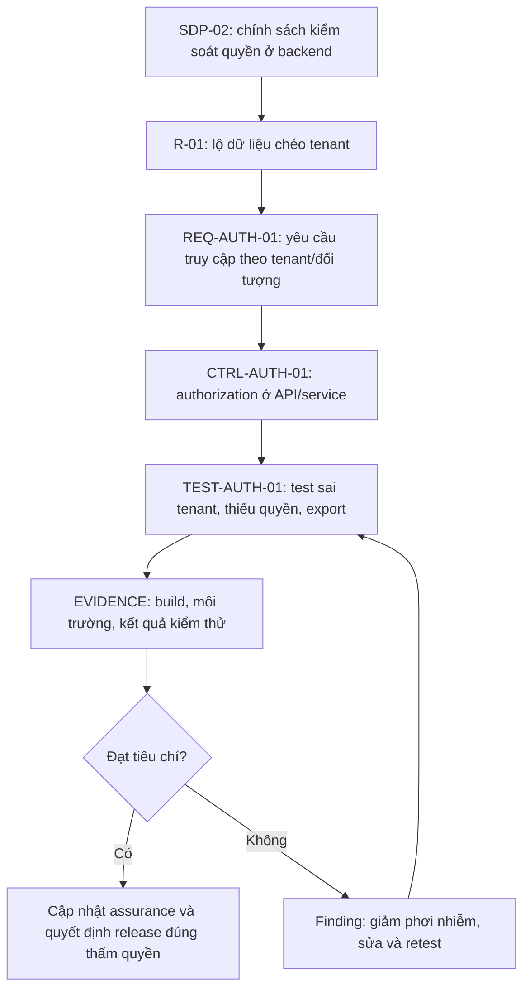

# Chính sách phát triển an toàn trong Security Assurance

## 1. Chính sách phát triển là gì?

**Chính sách phát triển an toàn (secure development policy)** là tập hợp nguyên tắc, yêu cầu và trách nhiệm được tổ chức phê duyệt, quy định cách bảo vệ hệ thống **trong toàn bộ vòng đời phát triển phần mềm**: từ hình thành yêu cầu, thiết kế, lập trình, kiểm thử, tích hợp, phát hành đến vận hành, bảo trì và ngừng sử dụng. Chính sách cần tạo ra các quy tắc có thể áp dụng, đo lường, kiểm chứng và xử lý khi không đạt.

Ví dụ, câu “nhóm phát triển cần lưu ý bảo mật” là lời khuyên chung, chưa phải quy định có thể kiểm tra. Một phát biểu hữu ích hơn là:

> **Mỗi chức năng truy cập dữ liệu theo tenant phải có yêu cầu phân quyền tại backend và ca kiểm thử âm cho truy cập sai tenant trước khi được phép đưa vào production. Kết quả kiểm thử phải gắn với phiên bản phát hành.**

Quy định thứ hai trả lời được **ai thực hiện, yêu cầu nào, phạm vi nào, khi nào phải hoàn thành và cần bằng chứng gì**. Nếu kiểm thử không đạt, nhóm biết phải mở finding, sửa, kiểm tra lại hoặc chuyển cấp xin quyết định theo cơ chế được phép.

Trong chương **Security policy** của module **SECURITY_SECURITY_ASSURANCE**, chính sách phát triển không chỉ nhằm giảm số lỗi bảo mật. Mục tiêu là tổ chức có thể **đánh giá bằng bằng chứng rằng hệ thống đáp ứng các mục tiêu bảo mật**, từ phân tích rủi ro và yêu cầu, thiết kế security controls, kiểm thử, audit, khắc phục phát hiện cho đến cải tiến chương trình security assurance liên tục trong phát triển và vận hành.

### Kết quả học tập

Sau bài này, người học có thể:

1. Phân biệt chính sách phát triển với tiêu chuẩn kỹ thuật, quy trình và hướng dẫn triển khai.
2. Xác lập phạm vi, vai trò, trách nhiệm, ngưỡng áp dụng và cơ chế ngoại lệ của một chính sách phát triển an toàn.
3. Viết yêu cầu có thể kiểm chứng cho các giai đoạn của Secure Software Development Lifecycle (Secure SDLC).
4. Ánh xạ yêu cầu chính sách với rủi ro, security controls, phép thử, hồ sơ bằng chứng và quyết định phát hành.
5. Tổ chức kiểm tra việc tuân thủ, xử lý sai lệch và cập nhật chính sách theo phản hồi từ kiểm thử, audit, sự cố và thay đổi công nghệ.

## 2. Phân biệt policy, standard, procedure và guideline

Một chính sách hiệu quả cần đủ ổn định để định hướng nhiều dự án nhưng không quá chung chung đến mức không thể kiểm chứng. Vì vậy tổ chức thường tách các cấp tài liệu:

| Cấp | Trả lời câu hỏi | Ví dụ cho việc kiểm soát truy cập |
| --- | --- | --- |
| **Policy – Chính sách** | Tổ chức **bắt buộc đạt điều gì**, ai chịu trách nhiệm và điều kiện phê duyệt là gì? | Mọi chức năng đọc/sửa dữ liệu nhạy cảm phải kiểm tra quyền ở phía server, được xác minh trước phát hành. |
| **Standard – Tiêu chuẩn nội bộ** | **Yêu cầu cụ thể và mức tối thiểu** để chứng minh tuân thủ là gì? | Định nghĩa cơ chế kiểm tra tenant, quy tắc quản lý session, định dạng log, yêu cầu test theo loại dữ liệu. |
| **Procedure – Quy trình** | **Các bước thực hiện, người duyệt và điểm kiểm soát** là gì? | Cách tạo threat model, yêu cầu review, chạy test, xử lý finding và lưu evidence. |
| **Guideline – Hướng dẫn** | Có những **cách làm khuyến nghị** nào để đáp ứng yêu cầu? | Mẫu kiểm tra quyền trong Spring Security, ví dụ test MockMvc, checklist pull request. |
| **Record/Evidence – Hồ sơ, bằng chứng** | Quy định **đã được thực hiện và có hiệu lực** trong phạm vi nào? | Report test phân quyền theo commit, log phê duyệt, biên bản quyết định release. |

Không phải tổ chức nào cũng dùng đúng các tên trên; điều quan trọng là **tài liệu có hiệu lực bắt buộc, quyền phê duyệt và cách kiểm chứng rõ ràng**. Policy có thể nói “phải xác minh quyền theo tài nguyên”; standard quy định cách thiết kế và tiêu chí tối thiểu; procedure chỉ cách thực hiện; evidence cho thấy kết quả trên phiên bản thực tế.

### 2.1. Phân biệt từ ngữ để tránh chính sách không thể audit

- **Phải / bắt buộc (MUST):** yêu cầu cần đạt trong phạm vi đã định, chỉ có ngoại lệ hợp lệ nếu chính sách cho phép.
- **Nên (SHOULD):** khuyến nghị mạnh; nếu không thực hiện cần nêu lý do theo quy trình áp dụng.
- **Có thể (MAY):** lựa chọn được phép.

Chỉ dùng từ “phải” khi tổ chức **có cơ chế triển khai, bằng chứng và thẩm quyền xử lý sai lệch**. Đừng gọi một sở thích kỹ thuật là quy định bắt buộc toàn doanh nghiệp nếu chưa được cấp có thẩm quyền phê duyệt.

### 2.2. Chính sách không tự động bằng chứng hệ thống an toàn

Một chính sách được ký duyệt chỉ chứng minh **tổ chức đã thiết lập yêu cầu**. Việc gắn check trong CI chứng minh **có kiểm tra ở phạm vi đó**. Để kết luận biện pháp đạt hiệu quả cần xem:

1. Yêu cầu có áp dụng cho đúng sản phẩm, tài sản và luồng dữ liệu không?
2. Cơ chế được triển khai ở môi trường và phiên bản nào?
3. Bằng chứng có cho thấy hành vi bảo mật mong muốn không?
4. Những chức năng chưa được kiểm tra hoặc ngoại lệ đang mở là gì?
5. Ai xác nhận rủi ro còn lại và quyết định phát hành trong đúng thẩm quyền?

## 3. Những thành phần cần có trong chính sách phát triển

Một văn bản chính sách nên quy định **tối thiểu**:

| Thành phần | Nội dung cần làm rõ |
| --- | --- |
| **Mục đích** | Những mục tiêu bảo mật, hậu quả và yêu cầu nghiệp vụ chính sách muốn bảo vệ. |
| **Phạm vi áp dụng** | Dự án mới, hệ thống đang vận hành, phần mềm nội bộ, API, mobile, cloud, mã nguồn bên thứ ba, tích hợp thuê ngoài và môi trường phát triển/kiểm thử/production. |
| **Đối tượng thực hiện** | Product owner, chủ sở hữu rủi ro, engineering, QA, security, operations, nhà cung cấp. |
| **Yêu cầu bắt buộc** | Các kiểm soát Secure SDLC, tiêu chí trước phát hành, bảo vệ dữ liệu và phụ thuộc. |
| **Tiêu chuẩn và quy trình tham chiếu** | Nơi tra cứu các yêu cầu chi tiết, mẫu threat model, checklist, test plan, quy trình sự cố và khắc phục. |
| **Bằng chứng cần lưu** | Loại hồ sơ, người tạo, nguồn, phạm vi, phiên bản, thời điểm, quyền truy cập và thời hạn lưu theo chính sách liên quan. |
| **Xử lý sai lệch và ngoại lệ** | Điều kiện được xem xét ngoại lệ, thẩm quyền, biện pháp giảm phơi nhiễm, thời hạn, giám sát và quyền từ chối. |
| **Theo dõi hiệu lực** | Chỉ số, kiểm tra tuân thủ, trách nhiệm phản hồi, tần suất rà soát, các sự kiện cần cập nhật. |
| **Quản lý phiên bản** | Chủ sở hữu văn bản, người phê duyệt, ngày hiệu lực, phạm vi thay đổi và lịch sử tài liệu. |

Chính sách nên áp dụng theo **mức độ rủi ro và phân loại hệ thống**, nhưng không được tạo khoảng trống tùy tiện. Ví dụ, một trang giới thiệu công khai và dịch vụ chuyển tiền có thể cần độ sâu kiểm thử khác nhau; cả hai vẫn phải đáp ứng các nghĩa vụ tối thiểu được xác định cho phạm vi của chúng.

### 3.1. Phạm vi bao gồm cả phần việc ngoài đội lập trình

Một hệ thống còn phụ thuộc vào pipeline, registry, artifact, tài khoản CI, công cụ code review, dependency package, hạ tầng, log và nhà cung cấp. Chính sách phát triển an toàn không thể chỉ yêu cầu “lập trình viên viết code đúng”. Cần phân công các điều kiện mà engineering, vận hành, security, pháp chế và chủ sở hữu nghiệp vụ cùng phải thực hiện.

**Đối với nhà cung cấp**, trách nhiệm phải được ghi trong hợp đồng/phụ lục hoặc quy trình đánh giá bên thứ ba. Việc thuê ngoài công đoạn phát triển không có nghĩa tổ chức sử dụng hệ thống hết trách nhiệm xem xét bằng chứng, rủi ro và điều kiện tích hợp.

## 4. Các nguyên tắc nền tảng của chính sách phát triển an toàn

### 4.1. Security by design và theo rủi ro

Bảo mật phải được đưa vào **yêu cầu và kiến trúc** trước khi viết code, không chỉ quét lỗ hổng ở cuối dự án. Bắt đầu bằng tài sản, mục tiêu **bí mật – toàn vẹn – sẵn sàng**, các yêu cầu truy vết/quyền riêng tư, data flow và threat scenarios. Mức độ đánh giá phải tương xứng với hậu quả; nếu thiếu bằng chứng về ảnh hưởng, phải xác minh thay vì tự đánh giá thấp.

### 4.2. Least privilege, defense in depth và secure defaults

- **Quyền tối thiểu:** danh tính người dùng, dịch vụ, CI và nhà cung cấp chỉ có quyền cần cho nhiệm vụ đã được duyệt.
- **Phòng thủ nhiều lớp:** kiểm soát ở backend, database, hạ tầng, monitoring và quy trình; không phụ thuộc một biện pháp không đủ phạm vi.
- **Mặc định an toàn:** chức năng, quyền và kênh chia sẻ nhạy cảm không được mở rộng tự động khi chưa có yêu cầu; từ chối truy cập không được phép.
- **Tách môi trường:** dữ liệu production và bí mật sản xuất không được tùy tiện chuyển vào dev/test; phân biệt quyền triển khai và quyền phê duyệt.
- **Kiểm soát thay đổi:** thay đổi code, cấu hình, schema và quyền đều có người review, truy vết và phương án xử lý sai lệch.

### 4.3. Evidence-based assurance

Một security control chỉ có giá trị assurance khi có thể xác minh **nó làm giảm đúng kịch bản rủi ro**. Chẳng hạn bật mã hóa ổ đĩa không giải quyết lỗi API trả dữ liệu ngoài quyền sau khi giải mã; “có backup” không chứng minh đạt khả năng khôi phục. Bằng chứng cần phù hợp với rủi ro và yêu cầu, có **phiên bản, môi trường, thời điểm, phạm vi và kết quả**.

### 4.4. Không tự chấp nhận rủi ro ngoài thẩm quyền

Engineering có thể chịu trách nhiệm triển khai control, QA chịu trách nhiệm kiểm chứng, security hỗ trợ đánh giá, nhưng **risk owner** hoặc cấp có thẩm quyền mới được đưa ra quyết định chấp nhận phần rủi ro còn lại theo quy định. Không được dùng ngoại lệ để hợp thức hóa việc vi phạm nghĩa vụ pháp lý, hợp đồng hoặc điều kiện bắt buộc đang áp dụng.

## 5. Các yêu cầu chính sách theo từng giai đoạn Secure SDLC

### 5.1. Giai đoạn khởi tạo và phân tích yêu cầu

**Yêu cầu chính sách đề xuất:**

1. **Mọi sản phẩm hoặc thay đổi trọng yếu phải xác định chủ sở hữu dịch vụ/rủi ro**, nhóm dữ liệu, tác động nghiệp vụ và các nghĩa vụ bắt buộc liên quan trước khi thiết kế.
2. **Yêu cầu bảo mật phải được mô tả theo hành vi có thể kiểm chứng**, không chỉ ghi “an toàn” hay “tuân thủ”.
3. Phải lập hoặc cập nhật đánh giá rủi ro/threat model khi thêm đường dữ liệu, quyền đặc biệt, nhà cung cấp, chức năng thanh toán, xử lý dữ liệu nhạy cảm hay điều kiện được tổ chức xác định là trọng yếu.
4. Mỗi yêu cầu phải có **ID, người sở hữu, tiêu chí chấp nhận và nơi lưu bằng chứng**.

**Ví dụ:**

| Yêu cầu yếu | Yêu cầu có thể kiểm chứng |
| --- | --- |
| “Bảo vệ dữ liệu nhân sự.” | “Người thuộc tenant A không thể đọc, tìm kiếm, xuất hoặc tải hồ sơ tenant B qua các API thuộc phạm vi.” |
| “Chức năng thanh toán phải an toàn.” | “Thay đổi tài khoản nhận tiền chỉ có hiệu lực sau khi được đúng vai trò và trạng thái phê duyệt xác nhận tại backend.” |
| “Hệ thống có dự phòng.” | “Khả năng khôi phục được kiểm thử theo RTO/RPO do chủ sở hữu nghiệp vụ phê duyệt.” |

**Evidence tối thiểu:** danh mục tài sản, phân loại dữ liệu, danh sách yêu cầu, risk ID và người phê duyệt, ghi nhận các điều kiện chưa xác minh.

### 5.2. Giai đoạn kiến trúc và thiết kế

Chính sách nên yêu cầu review bảo mật đối với các thay đổi có rủi ro, bao gồm:

- Sơ đồ data flow và **trust boundary** khi dữ liệu đi qua trình duyệt, API, dịch vụ, database, đối tác và kho tệp.
- Thiết kế **authentication, authorization, session**, quản lý danh tính dịch vụ và nguyên tắc phân vùng tenant.
- Cách xử lý dữ liệu trong truyền tải/lưu trữ, mã hóa và quản lý khóa, bí mật, backup, log, export và quyền truy cập.
- Điểm vào của dữ liệu không tin cậy, cơ chế kiểm tra đầu vào, chống injection, kiểm soát lỗi và giới hạn tài nguyên.
- Phụ thuộc vào bên thứ ba, các giả định về khả năng sẵn sàng, quy trình ứng phó và phương án khôi phục.

**Cổng đánh giá thiết kế** không nên chỉ hỏi “có sơ đồ chưa?”. Cần kiểm tra **các threat chính đã được gắn với control và kế hoạch kiểm thử chưa**. Nếu một rủi ro chưa có biện pháp đủ tin cậy, phải ghi người sở hữu và quyết định xử lý.

### 5.3. Giai đoạn lập trình và quản lý mã nguồn

Các quy định thực tiễn:

1. Mã nguồn và thay đổi cấu hình được quản lý trong kho có quyền truy cập phù hợp và lịch sử thay đổi.
2. Các nhánh bảo vệ hoặc cơ chế tương đương yêu cầu **review bởi người đủ thẩm quyền**; tác giả không được tự bỏ qua những bước phê duyệt bắt buộc.
3. Đưa **secure coding standard** phù hợp ngôn ngữ và nền tảng vào công việc: kiểm tra đầu vào, encode đầu ra theo ngữ cảnh, query tham số hóa, kiểm soát quyền ở server, quản lý lỗi, bảo vệ secrets.
4. Không hard-code token, mật khẩu, khóa sản xuất, credential hay dữ liệu cá nhân thật trong source, commit, test fixture và log.
5. Security review phải ưu tiên những thay đổi có ảnh hưởng tới danh tính, phân quyền, thanh toán, mã hóa, quản lý bí mật, dữ liệu nhạy cảm và ranh giới tenant.
6. Ngoại lệ đối với code review, kiểm tra secret hoặc yêu cầu quan trọng phải theo cơ chế phê duyệt có thời hạn; không cho phép bỏ qua không lưu dấu vết.

**Bằng chứng:** pull request, reviewer, commit, kết quả kiểm tra tự động, bản ghi quyết định và liên kết risk/requirement. Số lượng reviewer hoặc số cảnh báo lint bằng 0 **không đủ** chứng minh logic phân quyền đáp ứng yêu cầu.

### 5.4. Phụ thuộc phần mềm và software supply chain

Chính sách phát triển cần bao phủ cả **thư viện, container image, công cụ build, CI runner, package registry và artifact phát hành**:

- Chỉ sử dụng nguồn dependency và registry được cho phép theo quy chế tổ chức.
- Có cách kiểm kê thành phần và phiên bản, xác định người sở hữu việc cập nhật; có thể dùng **Software Bill of Materials (SBOM)** khi phù hợp với loại sản phẩm và yêu cầu.
- Quét và đánh giá lỗ hổng dependency/image theo rủi ro thực tế của đường khai thác, phiên bản và phạm vi sử dụng; không chỉ dựa duy nhất vào một điểm severity.
- Giới hạn quyền CI/CD và secrets, bảo vệ artifact và provenance theo mức quan trọng của hệ thống.
- Có quy trình tiếp nhận cảnh báo lỗ hổng, xác minh ảnh hưởng, ưu tiên sửa, xử lý phiên bản không còn được hỗ trợ và kiểm tra lại.

**Ví dụ:** một thư viện có lỗ hổng nghiêm trọng trên lý thuyết nhưng mã ứng dụng không dùng đường chức năng bị ảnh hưởng. Nhóm vẫn phải **đánh giá và lưu căn cứ**, không được đánh dấu “không áp dụng” chỉ vì chưa thấy exploit. Ngược lại, một lỗ hổng có điểm kỹ thuật trung bình nhưng nằm trên API Internet phục vụ dữ liệu rất nhạy cảm có thể cần ưu tiên cao.

### 5.5. Kiểm thử bảo mật và tiêu chí chấp nhận

Chính sách cần xác định **loại kiểm thử nào bắt buộc cho loại hệ thống hoặc thay đổi nào**, chứ không chỉ viết “chạy security scan”:

| Nhóm kiểm chứng | Mục tiêu | Bằng chứng cần lưu |
| --- | --- | --- |
| **Code/dependency/secret scanning** | Phát hiện sớm mẫu code nguy hiểm, dependency và bí mật lộ trong nguồn. | Kết quả scan gắn commit, phạm vi, cấu hình công cụ, trạng thái triage. |
| **Unit/integration security tests** | Kiểm tra logic xác thực, quyền, validation, xử lý lỗi và tính toàn vẹn. | Test case, dữ liệu thử, expected/actual, build và môi trường. |
| **Authorization negative tests** | Chứng minh chủ thể không đủ quyền bị từ chối ở backend, nhất là giữa tenant và trên từng đối tượng. | Báo cáo test thiếu quyền, sai tenant, sai trạng thái, role ngoài phạm vi. |
| **API/DAST hoặc kiểm tra động phù hợp** | Kiểm chứng hành vi từ các điểm vào và trường hợp bất thường. | Phạm vi endpoint, bản triển khai, kết quả, finding và giới hạn. |
| **Kiểm tra cấu hình/IaC và runtime** | Phát hiện quyền rộng, thành phần phơi nhiễm, cấu hình không theo standard. | Configuration snapshot, policy-check và xác minh môi trường. |
| **Restore/failover/incident drills** | Kiểm chứng sẵn sàng và năng lực ứng phó, không chỉ sự tồn tại của kế hoạch. | Thời gian thực đo, mất dữ liệu, kết quả so với tiêu chí đã duyệt. |
| **Review độc lập khi cần** | Kiểm tra giả định, thiết kế và phát hiện ngoài bộ test thường xuyên. | Báo cáo review/pentest/audit theo phạm vi và quyết định khắc phục. |

**Quy định mẫu:** nếu một security requirement trọng yếu chưa có bằng chứng kiểm chứng phù hợp, trạng thái của yêu cầu là **chưa được xác minh**, không mặc nhiên là “đạt”. Phát hiện lỗi phải có mức độ, người chịu trách nhiệm, action, hạn, biện pháp giảm phơi nhiễm và **retest** trước khi xác nhận đóng.

### 5.6. Cổng trước phát hành (release gate)

Chính sách phải trả lời rõ **điều kiện nào ngăn phát hành hoặc yêu cầu phê duyệt có thẩm quyền**, ví dụ:

1. Có bản release xác định được commit/artifact, người đề xuất và người phê duyệt.
2. Các yêu cầu bảo mật bắt buộc áp dụng cho phạm vi release được kiểm tra và có evidence đủ phù hợp.
3. Những finding/rủi ro vượt ngưỡng hoặc chưa xử lý phải được đưa ra quyết định theo chính sách; các vi phạm nghĩa vụ bắt buộc không thể bỏ qua bằng ngoại lệ tùy tiện.
4. Quy trình triển khai có phân tách quyền phù hợp, phương án rollback/giảm phơi nhiễm và người chịu trách nhiệm khi phát hiện vấn đề.
5. Mọi quyết định đặc biệt, giới hạn còn lại và action sau phát hành được ghi lại.

**“Pipeline xanh” là tín hiệu, không phải sự bảo đảm tuyệt đối.** Nếu pipeline không bao phủ API xuất mới hoặc chỉ chạy test trên môi trường cấu hình khác production, đó là một khoảng trống cần ghi rõ, không phải kết luận release đạt toàn bộ mục tiêu.

### 5.7. Sau phát hành: vận hành, bảo trì và ngừng sử dụng

- Giám sát những cơ chế trọng yếu (quyền đặc biệt, cấu hình drift, lỗ hổng dependency, tỷ lệ test thất bại, audit log, backup/restore, cảnh báo an ninh) theo nhu cầu và năng lực.
- Có kênh báo cáo lỗ hổng và quy trình phối hợp xử lý sự cố, bao gồm người trực/đường chuyển cấp.
- Mọi bản vá hoặc thay đổi nóng vẫn phải có ghi nhận, phê duyệt theo thẩm quyền và kiểm tra hồi quy/rà soát sau khi khẩn cấp kết thúc.
- Đánh giá lại threat model và risk register khi thay đổi kiến trúc, nhà cung cấp, dữ liệu, giao diện hoặc thời điểm nghiệp vụ quan trọng.
- Khi ngừng sử dụng thành phần, xác định kế hoạch quản lý dữ liệu, khóa, backup, quyền truy cập, log và phụ thuộc còn tồn tại theo chính sách lưu giữ áp dụng.

Đây là vòng phản hồi: **dữ liệu vận hành và audit** phải làm thay đổi yêu cầu, control, test và chính sách nếu chứng minh các giả định ban đầu không đúng.

## 6. Mẫu ma trận chính sách – rủi ro – bằng chứng

Giả sử hệ thống HR SaaS nhiều tenant có dữ liệu nhân viên, bảng lương và chức năng xuất hồ sơ. Ma trận sau cho thấy chính sách cần được **chuyển thành tiêu chí kiểm tra**:

| Policy ID | Nghĩa vụ phát triển | Rủi ro/mục tiêu | Kiểm soát thực thi | Bằng chứng assurance | Chủ thể giải trình |
| --- | --- | --- | --- | --- | --- |
| **SDP-01** | Cập nhật threat model cho luồng dữ liệu nhạy cảm mới. | Bỏ sót đường lộ dữ liệu; bí mật. | Review data flow và trust boundary. | Threat model có phiên bản, risk ID và quyết định review. | Chủ sở hữu sản phẩm/rủi ro. |
| **SDP-02** | Kiểm tra quyền server-side theo tenant và đối tượng. | BOLA/IDOR; bí mật và toàn vẹn. | Authorization tại API/service/data access. | Test âm trên detail/list/export/download gắn build. | Engineering lead cho triển khai; QA cho test. |
| **SDP-03** | Bảo vệ thay đổi tài khoản nhận tiền bằng quyền và phê duyệt. | Gian lận; toàn vẹn. | Kiểm tra role, trạng thái, tách nhiệm vụ, audit. | Test không đủ quyền, bỏ qua bước, đối chiếu sự kiện audit. | Product/risk owner của luồng thanh toán. |
| **SDP-04** | Không đưa secrets vào source, artifact hoặc log. | Lộ credential; bí mật và ảnh hưởng lan rộng. | Secret scanning, secret manager, redaction và quyền tối thiểu. | Scan theo commit và test log với dữ liệu giả định. | Control owner và security verifier. |
| **SDP-05** | Kiểm tra dependency mới và xử lý phát hiện theo rủi ro. | Vulnerable component, supply-chain compromise. | Dependency inventory, scan, review nguồn và cập nhật. | Manifest/SBOM phù hợp, finding triage và xác minh bản sửa. | Engineering/supply-chain owner. |
| **SDP-06** | Thử khôi phục sau thay đổi cơ chế backup trọng yếu. | Không thể khôi phục; sẵn sàng. | Backup, diễn tập restore và review quyền/khóa. | Restore drill đo RTO/RPO so với mục tiêu đã duyệt. | Operations và service owner. |
| **SDP-07** | Không cho phép release vượt điều kiện kiểm soát đã phê duyệt. | Rủi ro chưa xử lý hoặc thiếu evidence. | Release gate, phân cấp ngoại lệ, decision record. | Báo cáo gate, danh sách finding, phê duyệt và điều kiện. | Release authority/risk owner. |

**Đừng gộp quyền phê duyệt:** người triển khai control, người xác minh test và người chấp nhận rủi ro có thể là các vai trò khác nhau. Ma trận minh họa phải được điều chỉnh theo quy chế RACI và trách nhiệm đã phân cấp của tổ chức.

### 6.1. Chuỗi truy vết để phục vụ audit



Nếu không thể lần theo chuỗi từ **policy đến evidence và decision**, tổ chức khó chứng minh việc ban hành chính sách đã tạo ra kết quả bảo mật thực tế.

## 7. Biến chính sách thành cổng kiểm soát có thể tự động hóa

### 7.1. Những gì có thể kiểm tra tự động

Một số điều kiện thích hợp cho automation hoặc *policy-as-code*:

- Pull request vào nhánh được bảo vệ phải có review theo quy tắc.
- Build chạy unit/integration/security tests liên quan tới thay đổi.
- Secret/dependency/static scan chạy trong phạm vi được xác định và lưu kết quả.
- Artifact phải có định danh và nguồn build có thể truy xuất.
- Hệ thống chặn hoặc chuyển cấp release khi thiếu evidence bắt buộc hoặc có finding chưa được xử lý theo ngưỡng.
- Các quyền CI và artifact registry được kiểm tra theo chuẩn cấu hình.

Tự động hóa giảm sai sót lặp lại, nhưng **không thay việc phân tích logic nghiệp vụ, tác động dữ liệu, khả năng khai thác và thẩm quyền chấp nhận rủi ro**.

### 7.2. Pseudocode một release gate

Đoạn sau là **pseudocode để minh họa chính sách**, không phải cấu hình CI có thể chạy nguyên văn:

```text
function evaluateRelease(release):
    require release.artifactId and release.commitId
    require release.changeOwner and release.releaseApprover
    require allMandatoryControlsHaveEvidence(release.scope)
    require securityTestsPassedFor(release.artifactId, release.scope)

    findings = openFindingsInScope(release.scope)
    for finding in findings:
        if violatesNonWaivableObligation(finding):
            return BLOCK_AND_ESCALATE
        if exceedsApprovedRiskThreshold(finding):
            if not hasValidRiskDecision(finding, release, correctAuthority=true):
                return BLOCK_AND_ESCALATE

    require deploymentPlanAndRollbackAvailable(release)
    return ELIGIBLE_FOR_AUTHORIZED_RELEASE_DECISION
```

Ý nghĩa: pipeline xác minh điều kiện máy có thể kiểm tra và trả về **đủ điều kiện để người có thẩm quyền quyết định**, không nhất thiết là tự động phát hành. Những phát hiện nghiêm trọng có thể yêu cầu xử lý hoặc quyết định bổ sung; có sự khác nhau giữa **bằng chứng test đạt** và **quyết định release**.

### 7.3. Tránh làm đẹp chỉ số bằng cách cấu hình sai gate

Một pipeline có thể luôn xanh nếu test không được chạy, kết quả scan bị bỏ qua, hoặc báo cáo tìm lỗi được đánh dấu “warning” dù chính sách yêu cầu chặn. Cần kiểm tra:

1. Gate bao phủ **đúng repo, nhánh, artifact và môi trường** hay không?
2. Những test bắt buộc có **thực sự chạy** và thất bại có làm gate phản hồi chính xác không?
3. Có thể sửa rule, tắt check hoặc thay quyền phê duyệt mà không để lại dấu vết không?
4. Báo cáo security scan có phản ánh đầy đủ phạm vi hay chỉ quét các tệp dễ kiểm tra?
5. Kết quả có được giữ lại đủ để QA, risk owner và auditor tái dựng quyết định không?

## 8. Ví dụ thực hành: chính sách cho thay đổi tính năng xuất bảng lương

**Bối cảnh giả định:** một HR SaaS nhiều tenant chuẩn bị phát hành tính năng “Xuất bảng lương CSV”. Trước đây HR chỉ xem từng hồ sơ qua API detail. Đường export mới gom hàng nghìn bản ghi, tạo file trên object storage, rồi trả liên kết tải về.

### 8.1. Nhận diện yêu cầu chính sách áp dụng

| Giai đoạn | Yêu cầu bắt buộc cần áp dụng | Bằng chứng minh họa |
| --- | --- | --- |
| **Intake** | Phân loại dữ liệu lương; xác định người có quyền xuất và hạn chế chia sẻ. | Data classification, yêu cầu nghiệp vụ và chủ sở hữu. |
| **Thiết kế** | Phân tích trust boundary giữa API, job export, object storage và link tải. | Threat model cập nhật, risk register có kịch bản xuất chéo tenant. |
| **Triển khai** | Kiểm tra tenant/quyền ở backend, giới hạn dữ liệu theo trường, bảo vệ tệp xuất, quản lý thời hạn truy cập. | Thiết kế control, review PR, cấu hình storage theo môi trường. |
| **Kiểm thử** | Test người sai tenant, sai role, thay ID, liên kết hết hạn và lỗi log. | Report test âm/dương có build, môi trường, kết quả. |
| **Phát hành** | Giải quyết hoặc chuyển cấp finding, lưu quyết định với rủi ro còn lại. | Release gate report, decision record và action được giao. |
| **Vận hành** | Theo dõi truy cập export, quyền object storage, drift và các endpoint mới. | Log theo quyền, kiểm tra cấu hình và lịch đánh giá lại. |

### 8.2. Tình huống test thất bại

Giả sử QA dùng token của tenant A để yêu cầu tệp export thuộc tenant B và nhận được CSV. Đây là **finding quan sát được**, không chỉ là threat giả định. Nếu đã có dữ liệu khách hàng thực có thể bị truy cập trái phép, nhóm phải đánh giá dấu hiệu sự cố và kích hoạt quy trình ứng phó tương ứng.

Theo chính sách:

1. **QA** ghi bằng chứng tái hiện với dữ liệu thử, endpoint, build và response đã che thông tin.
2. **Security/assessor** liên kết finding với rủi ro lộ dữ liệu và yêu cầu phân quyền, xác định các đường export/list/download liên quan.
3. **Product/risk owner** cùng engineering đánh giá hậu quả và yêu cầu giảm phơi nhiễm; nếu vượt thẩm quyền thì chuyển cấp.
4. **Engineering** sửa kiểm tra quyền trên đối tượng và tenant, không chỉ ẩn nút “Export” ở giao diện.
5. **QA** thực hiện retest trong phạm vi đã chốt; bằng chứng phải chỉ rõ phiên bản và môi trường.
6. **Người có thẩm quyền release** xem kết quả test, những đường chưa kiểm chứng, rủi ro còn lại và điều kiện ngoại lệ; không để tác giả code tự duyệt vượt quy định.

**Điểm phân biệt:** việc merge bản sửa chỉ chứng minh **có thay đổi code**. Muốn kết luận control hiệu quả phải có bằng chứng test và đánh giá phù hợp. Không tự giảm mức rủi ro hiện tại chỉ vì công việc đã chuyển sang “Done”.

### 8.3. Một hồ sơ kiểm tra tuân thủ có thể truy vết

| Trường | Giá trị minh họa |
| --- | --- |
| Release | `HR-EXPORT-2026-11`, commit/build được lưu trong hệ thống CI. |
| Policy | `SDP-01` (threat model), `SDP-02` (authorization), `SDP-07` (release gate). |
| Risk | `R-HR-EXPORT-01`: tiết lộ dữ liệu lương giữa tenant. |
| Requirement | `REQ-AUTH-EXPORT-01`: user sai tenant hoặc không đủ quyền bị từ chối. |
| Control | Kiểm tra backend theo tenant và đối tượng; storage chỉ cung cấp tệp đúng phạm vi. |
| Test | `TEST-EXPORT-NEG-01`: token A không tải được tệp B; test trên nhiều vai trò/đường truy cập. |
| Evidence | ID report, build, timestamp, môi trường, expected/actual, reviewer. |
| Finding/action | `F-EXPORT-01` và `ACT-EXPORT-01`: sửa và retest. |
| Decision | Tạm chặn/giới hạn release đến khi đạt tiêu chí hoặc quyết định xử lý hợp lệ theo thẩm quyền. |
| Follow-up | Đánh giá lại khi thêm endpoint, thay storage policy hoặc có finding/sự cố. |

Không nên nhúng URL tải tệp production còn hiệu lực, token và dữ liệu bảng lương thật vào hồ sơ; dùng mã bằng chứng và kho tài liệu hạn chế quyền truy cập.

## 9. Mẫu chính sách phát triển an toàn có thể tùy chỉnh

Đoạn sau là **mẫu YAML mang tính giảng dạy**, mô tả các trường nên có của chính sách. Đây không phải định dạng bắt buộc hay tệp cấu hình thực thi tự động; tổ chức cần đánh giá và phê duyệt nội dung trước khi áp dụng.

```yaml
policy_id: "POL-SEC-DEV-001"
title: "Chính sách phát triển phần mềm an toàn"
version: "1.0"
owner_role: "Security governance lead"
approver_role: "Lãnh đạo có thẩm quyền"
effective_date: "Theo quyết định phê duyệt"
review_cycle: "Theo lịch quản trị và trigger thay đổi"
scope:
  services: ["Ứng dụng nội bộ", "API", "Hệ thống khách hàng"]
  stages: ["requirements", "design", "development", "test", "release", "operations"]
  third_party_development: "Áp dụng theo nghĩa vụ hợp đồng phù hợp"
principles:
  - "security-by-design"
  - "least-privilege"
  - "evidence-based-assurance"
mandatory_requirements:
  - id: "SDP-01"
    rule: "Đánh giá threat model khi có thay đổi trọng yếu"
    evidence: ["threat_model_ref", "risk_register_ref", "review_decision"]
  - id: "SDP-02"
    rule: "Xác minh authorization ở server trên tài nguyên nhạy cảm"
    evidence: ["requirement_ref", "negative_test_report", "build_id"]
  - id: "SDP-04"
    rule: "Không đưa bí mật sản xuất vào source, artifact hoặc log"
    evidence: ["secret_scan_result", "log_review_ref"]
  - id: "SDP-07"
    rule: "Ghi quyết định release dựa trên evidence và risk status"
    evidence: ["release_gate_result", "approval_record"]
exceptions:
  request_requirements:
    - "Lý do nghiệp vụ và phạm vi áp dụng"
    - "Rủi ro, biện pháp giảm phơi nhiễm và evidence"
    - "Người có thẩm quyền, hạn hiệu lực và trigger thu hồi"
  non_waivable: "Không được bỏ qua nghĩa vụ bắt buộc đang áp dụng"
governance:
  measures: ["coverage", "overdue_findings", "evidence_validity"]
  change_triggers: ["incident", "audit_finding", "major_architecture_change"]
```

**Điểm cần điều chỉnh trước khi dùng thật:** xác định tiêu chí “thay đổi trọng yếu”, ranh giới phạm vi từng sản phẩm, tiêu chuẩn kỹ thuật liên kết, thời hạn xử lý và phân cấp phê duyệt. Không dùng ngày/ID minh họa làm quy định áp dụng toàn công ty.

## 10. Vai trò, trách nhiệm và cơ chế phê duyệt

Ma trận dưới đây là ví dụ **RACI**: R là người thực hiện, A chịu trách nhiệm giải trình cuối cùng cho hoạt động, C được tham vấn, I được thông báo. `A/R` nghĩa là một vai trò vừa chịu trách nhiệm vừa trực tiếp làm. Mỗi hàng có một A để rõ người quyết định; tổ chức phải đối chiếu ma trận với phân cấp thực tế.

| Hoạt động | Lãnh đạo (LD) | Product/risk owner (PO) | Security/GRC (SEC) | Engineering (ENG) | QA | Operations (OPS) |
| --- | :---: | :---: | :---: | :---: | :---: | :---: |
| Phê duyệt chính sách và phạm vi áp dụng | **A** | C | **R** | C | C | C |
| Phân loại dữ liệu, xác định tác động và yêu cầu | I | **A** | **R** | R | C | C |
| Threat modeling và xác định security controls | I | **A** | **R** | R | C | C |
| Triển khai control, review code và cấu hình | I | I | C | **A/R** | C | R |
| Thiết kế/chạy test bảo mật và retest | I | I | C | R | **A/R** | C |
| Đối chiếu bằng chứng và tình trạng tuân thủ | I | C | **A** | R | **R** | R |
| Phê duyệt release trong quyền được giao | I | **A** | C | **R** | C | C |
| Ra quyết định ngoại lệ/rủi ro vượt quyền sản phẩm | **A** | **R** | **R** | C | C | C |
| Vận hành giám sát và ứng phó thông thường | I | I | C | R | I | **A/R** |
| Rà soát hiệu lực chính sách và đề xuất sửa đổi | **A** | C | **R** | C | C | C |

**Engineering là A của hoạt động triển khai, không tự động là A của quyết định chấp nhận rủi ro.** QA kiểm chứng hành vi theo phạm vi test nhưng không quyết định thay risk owner. SEC có thể có quyền phản biện hoặc yêu cầu chuyển cấp theo chính sách; điều này cần ghi rõ, không chỉ suy từ một ô C.

### 10.1. Xung đột quyền lợi và sự độc lập

Đặc biệt với thay đổi quan trọng, tránh việc một người vừa viết code, vừa tự bỏ qua kiểm thử, vừa ký chấp nhận rủi ro mà không có kiểm tra độc lập. Nếu nguồn lực nhỏ khiến vai trò kiêm nhiệm, cần **review bổ sung, approval riêng hoặc test có thể tái lập** và nêu rõ biện pháp bù đắp.

### 10.2. Trách nhiệm của nhà cung cấp

Đội phát triển thuê ngoài có thể là R cho việc triển khai và chạy test theo hợp đồng. Tổ chức vẫn cần người sở hữu yêu cầu, nhận hồ sơ evidence, xem xét rủi ro và phê duyệt tích hợp/phát hành trong hệ thống của mình. Không dùng RACI nội bộ để thay thế nghĩa vụ hợp đồng hoặc cơ chế đánh giá bảo đảm của bên thứ ba.

## 11. Quản lý ngoại lệ và sai lệch chính sách

Không phải mọi hệ thống kế thừa hoặc tình huống khẩn đều có thể hoàn thành mọi yêu cầu đúng lịch. Chính sách có thể cho phép **ngoại lệ có kiểm soát** trong phạm vi được cấp thẩm quyền:

1. **Ghi yêu cầu ngoại lệ:** policy ID, điều khoản, hệ thống, phiên bản, tài sản, hạn áp dụng và lý do thực tế.
2. **Đánh giá rủi ro:** kịch bản, tác động, khả năng, kiểm soát hiện có và độ tin cậy của bằng chứng.
3. **Đề xuất biện pháp bù đắp:** giới hạn tính năng, giảm quyền, tăng giám sát, chặn truy cập công khai, công việc sửa và test bổ sung.
4. **Phân cấp quyết định:** người sở hữu rủi ro hoặc cấp được ủy quyền xem xét; chuyển cấp nếu vượt ngưỡng, không tự phê duyệt.
5. **Ghi điều kiện và thời hạn:** người chịu trách nhiệm, thời hạn khắc phục, giới hạn hiệu lực, tiêu chí thu hồi và trigger đánh giá lại.
6. **Theo dõi và xác minh đóng:** có retest/evidence và quyết định kết thúc ngoại lệ, không gia hạn âm thầm.

**Không phải mọi yêu cầu đều có thể miễn trừ.** Nếu một điều kiện bắt buộc theo pháp luật, hợp đồng hoặc chính sách cấp trên không cho phép ngoại lệ, phương án hợp lệ có thể là **không phát hành, giới hạn tính năng hoặc thay đổi giải pháp** chứ không phải ký chấp nhận.

### 11.1. Phân biệt waiver với risk acceptance

- **Waiver/exception:** cho phép không thực hiện một yêu cầu chính sách cụ thể trong phạm vi và thời hạn được phép.
- **Risk acceptance:** quyết định có thẩm quyền chấp nhận mức rủi ro còn lại của một kịch bản.

Hai hồ sơ liên quan nhưng không đồng nhất. Một ngoại lệ cần đánh giá rủi ro, nhưng việc ký ngoại lệ không đương nhiên chấp nhận mọi rủi ro của hệ thống. Ngược lại, chấp nhận rủi ro không hợp thức hóa việc vi phạm nghĩa vụ không thể miễn trừ.

## 12. Đo tuân thủ và hiệu lực chính sách

Đo lường cần kết hợp **đã thực hiện quy trình chưa** và **kiểm soát có hiệu quả không**. Dùng chỉ số có tử số, mẫu số, phạm vi và nguồn để tránh số đẹp nhưng vô nghĩa.

| Chỉ số minh họa | Cách tính/quan sát | Cạm bẫy cần tránh |
| --- | --- | --- |
| **Bao phủ threat model cho thay đổi trọng yếu** | Số thay đổi thuộc phạm vi có review được chấp thuận / tổng thay đổi trọng yếu trong kỳ. | Nhỏ mẫu số vì không ghi nhận thay đổi API mới. |
| **Bao phủ test phân quyền của API nhạy cảm** | API nhạy cảm thuộc phạm vi có test âm đạt / toàn bộ API nhạy cảm đã kiểm kê. | Tỷ lệ cao nhưng các API export rủi ro lớn nằm ngoài kiểm kê. |
| **Kiểm soát có evidence còn hiệu lực** | Yêu cầu bắt buộc có bằng chứng đúng build/môi trường / số yêu cầu cần xác minh. | Có tài liệu thiết kế không đồng nghĩa control hoạt động. |
| **Finding nghiêm trọng quá hạn** | Finding còn mở quá hạn theo tiêu chí phê duyệt / số finding nghiêm trọng còn mở. | Đóng ticket khi chưa retest để làm đẹp tỷ lệ. |
| **Ngoại lệ sắp hết hạn/quá hạn** | Số ngoại lệ thiếu quyết định cập nhật trong khoảng giám sát. | Gia hạn không đánh giá lại rủi ro và nghĩa vụ. |
| **Tỷ lệ release có quyết định đủ bằng chứng** | Release thuộc phạm vi có gate report + approval/exception hợp lệ / tổng release thuộc phạm vi. | Pipeline xanh dù test bắt buộc không được thực thi. |
| **Lỗi tái diễn sau khắc phục** | Finding lặp lại cùng nguyên nhân trong các release tiếp theo. | Nhầm tăng khả năng phát hiện với tăng rủi ro thực tế. |

**Ví dụ:** “47/50 API nhạy cảm có test = 94%”. Nếu ba API thiếu test là tính năng xuất toàn bộ dữ liệu khách hàng, giá trị 94% không nói lên mức rủi ro còn lại. Rà soát phải nêu **đường chưa kiểm chứng, hậu quả và hành động ưu tiên**.

### 12.1. Rà soát chính sách dựa trên thông tin thực tế

Nguồn để sửa chính sách gồm:

- Kết quả kiểm thử, audit, pentest, code review và các findings lặp lại.
- Sự cố, near-miss và bài học từ ứng phó, khôi phục.
- Mức rủi ro hiện tại, thay đổi dữ liệu, kiến trúc, quyền và nhà cung cấp.
- Chất lượng evidence và những lần không thể đưa ra kết luận vì tiêu chí mơ hồ.
- Phản hồi từ đội phát triển, vận hành, QA và chủ sở hữu nghiệp vụ.
- Nghĩa vụ pháp lý/hợp đồng hoặc thay đổi ưu tiên quản trị được xác định áp dụng.

Kết quả rà soát là quyết định **giữ, điều chỉnh, bổ sung hoặc loại bỏ** quy định; phải ghi lý do, người phê duyệt, ngày hiệu lực, cách truyền thông, kế hoạch đào tạo và cập nhật các chuẩn/quy trình liên quan.

## 13. Những sai lầm thường gặp

| Sai lầm | Hệ quả | Cách sửa |
| --- | --- | --- |
| Chính sách chỉ viết “bảo mật là ưu tiên hàng đầu”. | Không thể biết hành vi nào đạt/chưa đạt. | Dùng điều khoản có đối tượng, phạm vi, điều kiện và evidence rõ. |
| Chỉ xem security ở cuối dự án. | Threat phát hiện muộn, khó sửa kiến trúc. | Đặt cổng tại yêu cầu, thiết kế, phát triển, test, release và vận hành. |
| Chọn một công cụ scan rồi coi đã tuân thủ mọi yêu cầu. | Bỏ sót logic nghiệp vụ, quyền, cấu hình, sẵn sàng. | Kết hợp test, review, diễn tập theo từng loại rủi ro. |
| Không phân biệt policy và hướng dẫn kỹ thuật. | Chính sách đổi liên tục theo công cụ, khó thực thi. | Tách yêu cầu bắt buộc ổn định khỏi procedure/standard có thể cập nhật. |
| Cho phép bypass CI không ghi nhận. | Mất khả năng kiểm toán, rủi ro tăng. | Bảo vệ gate, audit log, ngoại lệ có thời hạn và thẩm quyền. |
| “Có PR approval” đồng nghĩa code an toàn. | Không biết reviewer đã xét gì, test có đạt không. | Review theo phạm vi rủi ro, evidence theo yêu cầu, kiểm tra độc lập khi cần. |
| Đưa bí mật thật vào report hoặc fixture. | Bằng chứng trở thành kênh lộ dữ liệu. | Dùng dữ liệu giả, che payload, lưu evidence có phân quyền. |
| Merge bản sửa là đóng finding. | Lỗi có thể còn ở runtime hoặc đường khác. | Retest, xác minh bản triển khai, đánh giá lại rủi ro. |
| Ký ngoại lệ không hạn hoặc thiếu owner. | Ngoại lệ tồn tại mãi, mất trách nhiệm giải trình. | Giới hạn phạm vi, thời hạn, biện pháp bù đắp và trigger thu hồi. |
| Không xem cập nhật dependency/cloud là thay đổi bảo mật. | Control cũ không còn tương thích, xuất hiện đường rủi ro mới. | Đánh giá lại theo sự kiện và review cấu hình thực tế. |
| Báo cáo “100% compliant” không có mẫu số. | Che giấu thành phần không được kiểm kê. | Chốt phạm vi, nêu tài sản thiếu, nguồn chỉ số và giới hạn. |

## 14. Bài tập thực hành: xây dựng chính sách phát triển cho dịch vụ mới

**Bối cảnh:** một công ty xây dựng nền tảng thanh toán và quản lý giao dịch đa tenant. Sản phẩm có API tạo giao dịch, điều chỉnh tài khoản thụ hưởng, webhook từ đối tác, log tập trung, cơ sở dữ liệu và backup. Đội engineering muốn release mỗi ngày. Một nhà cung cấp bên ngoài xây dựng thành phần webhook.

Trong bản thử nghiệm, QA tìm thấy endpoint cho phép người thiếu quyền thay đổi tài khoản nhận tiền. Công cụ scanning cũng cảnh báo một dependency, nhưng chưa rõ có sử dụng đường mã bị ảnh hưởng không. Bài diễn tập restore chưa được thực hiện.

**Nhiệm vụ:**

1. **Soạn khung policy:** mục đích, phạm vi, đối tượng áp dụng, chủ sở hữu, người phê duyệt, ngày hiệu lực, lịch rà soát, định nghĩa các từ “phải/nên/có thể”.
2. **Chọn các yêu cầu Secure SDLC:** viết tối thiểu tám điều khoản cụ thể trải qua requirements, threat modeling, design, code review, dependency/secrets, tests, release và operations. Mỗi điều khoản phải có ID và cách kiểm chứng.
3. **Lập ma trận truy vết:** nối ba rủi ro (thay đổi tài khoản, dependency, restore) với requirement, control, test/audit, evidence và owner.
4. **Thiết kế release gate:** nêu điều kiện nào chặn release, điều kiện nào cần phê duyệt ngoại lệ và trường hợp không thể miễn trừ; xác định ai được quyết định khi QA không đạt.
5. **Kiểm tra nhà cung cấp:** chỉ rõ evidence cần nhận về việc review code, quản lý webhook secret, quyền triển khai và kiểm thử; quy định ai trong nội bộ chịu trách nhiệm nghiệm thu.
6. **Mô phỏng ngoại lệ:** product owner xin phát hành trong khi ca test quyền chưa đạt. Viết quyết định với đánh giá rủi ro, biện pháp giảm phơi nhiễm, thẩm quyền, hạn và điều kiện; giải thích khi nào phải dừng tính năng.
7. **Báo cáo hiệu lực chính sách:** xây dựng ít nhất năm chỉ số có tử số/mẫu số/nguồn và cách phát hiện tỷ lệ “đạt” giả do thiếu test hoặc thiếu phạm vi.
8. **Quy trình cải tiến:** giả sử một sự cố cho thấy API webhook chấp nhận request giả mạo; mô tả cách sửa policy/standard, thêm ca test, thay đổi gate và chứng minh biện pháp có hiệu lực.

**Tiêu chí đánh giá:** người ngoài nhóm phát triển có thể hiểu quy định nào áp dụng, ai có thẩm quyền, điều kiện pass/fail, bằng chứng thuộc phiên bản nào và xử lý ra sao nếu không đạt. Không đưa token, dữ liệu sản xuất thật hoặc hướng dẫn khai thác gây hại không cần thiết vào hồ sơ đào tạo.

## 15. Câu hỏi tự kiểm tra

**1. Chính sách phát triển có cần chỉ định một công cụ SAST cụ thể không?**  
Không nhất thiết. Policy nên quy định mục tiêu/điều kiện bắt buộc, phạm vi, owner và evidence; tiêu chuẩn hoặc quy trình có thể chỉ định công cụ và cấu hình triển khai, giúp thay công cụ mà vẫn giữ mục tiêu.

**2. Pipeline xanh có nghĩa đã đáp ứng mọi mục tiêu bảo mật không?**  
Không. Pipeline chỉ phản ánh những điều kiện đã được thiết lập và chạy trong phạm vi đó. Cần xem bao phủ rủi ro, test thực sự thực thi, độ tin cậy của evidence và phần chưa được đánh giá.

**3. Ai quyết định chấp nhận rủi ro trước phát hành?**  
Risk owner hoặc cấp có thẩm quyền theo chính sách và ngưỡng đã phê duyệt; người viết code hoặc người chạy test không mặc nhiên có quyền chấp nhận mọi rủi ro.

**4. Vì sao phải bao phủ cả thư viện, image và CI pipeline?**  
Vì phần mềm có thể bị ảnh hưởng qua phụ thuộc, artifact, secrets và quyền build/deploy dù code nghiệp vụ đã được review.

**5. Một ngoại lệ được phê duyệt có thể kéo dài vô thời hạn không?**  
Không nên. Ngoại lệ cần có phạm vi, điều kiện, người có thẩm quyền, thời hạn và trigger đánh giá lại; một số nghĩa vụ bắt buộc không cho phép ngoại lệ.

**6. Sau khi sửa lỗi phân quyền, có thể đóng finding ngay khi merge PR không?**  
Không mặc định. Cần retest trong phạm vi và bản triển khai liên quan, đối chiếu yêu cầu và cập nhật phần rủi ro còn lại.

**7. Làm sao chứng minh chính sách đang có hiệu quả thay vì chỉ “đã ban hành”?**  
Đo sự tuân thủ có đủ mẫu số/phạm vi, gắn policy ID đến requirement, control và evidence theo build, phân tích finding/sự cố, xác minh khắc phục và rà soát điều khoản không còn phù hợp.

## 16. Tổng kết

**Chính sách phát triển an toàn** xác lập nghĩa vụ bảo mật có thể kiểm chứng từ đầu đến cuối vòng đời phần mềm. Nó cần phân biệt rõ nguyên tắc bắt buộc với tiêu chuẩn và quy trình kỹ thuật; phân vai chịu trách nhiệm; bảo vệ mã nguồn, dependency, secrets, CI/CD, dữ liệu và cấu hình; xác định cổng kiểm thử/phát hành và cách xử lý ngoại lệ đúng thẩm quyền.

Trong **SECURITY_SECURITY_ASSURANCE**, giá trị của chính sách không nằm ở số trang hay số lần ký phê duyệt mà ở chuỗi **policy → rủi ro → yêu cầu → security control → kiểm thử/audit → bằng chứng → finding → khắc phục/retest → quyết định và rà soát lại**. Khi mỗi mắt xích có người chịu trách nhiệm, tiêu chí đánh giá và hồ sơ truy vết, tổ chức mới có cơ sở để khẳng định các mục tiêu bảo mật được thực thi, đánh giá và cải tiến liên tục trong phát triển lẫn vận hành.
