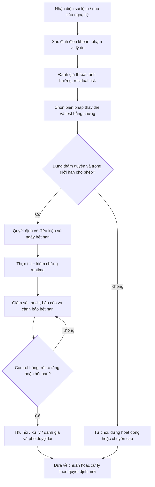

# Ngoại lệ chính sách

## Mục tiêu học tập

Sau bài học này, bạn có thể:

- Giải thích **ngoại lệ chính sách bảo mật (security policy exception)** và phân biệt ngoại lệ với **chấp nhận rủi ro**, **sai lệch kiểm soát**, **kết quả false positive** và **thay đổi chính sách chính thức**.
- Nhận biết trường hợp nào có thể xin ngoại lệ, trường hợp nào phải dừng hoặc chuyển cấp vì vượt thẩm quyền hoặc liên quan nghĩa vụ bắt buộc.
- Thiết kế quy trình **đề xuất → đánh giá rủi ro → phương án bù trừ → phê duyệt → thực thi có thời hạn → giám sát → hết hạn/thu hồi**.
- Xác định trách nhiệm của người yêu cầu, chủ dịch vụ, Security/Compliance, **risk owner**, người vận hành và người đánh giá assurance.
- Viết hồ sơ ngoại lệ có phạm vi, nguyên nhân, rủi ro còn lại, bằng chứng, điều kiện dừng và liên kết tới security requirements/controls.
- Kiểm chứng rằng ngoại lệ thực sự được kiểm soát bằng **Claim – Argument – Evidence**, thay vì coi một chữ ký phê duyệt là bằng chứng hệ thống đã an toàn.

## 1. Ngoại lệ chính sách là gì?

**Security policy** quy định những nguyên tắc hoặc yêu cầu bảo vệ bắt buộc trong phạm vi tổ chức: ví dụ quyền truy cập production phải được phê duyệt, dữ liệu cá nhân phải được bảo vệ, thay đổi bảo mật trọng yếu phải được kiểm tra trước phát hành. Từ chính sách, tổ chức thường cụ thể hóa thành **standards**, **baselines**, **procedures** và **security controls**.

**Ngoại lệ chính sách** là **quyết định được quản lý và phê duyệt trong thẩm quyền cho phép một phạm vi cụ thể tạm thời không đáp ứng đầy đủ một yêu cầu chính sách/chuẩn nội bộ**, kèm rủi ro được đánh giá, biện pháp thay thế khi cần, chủ chịu trách nhiệm, điều kiện giám sát và thời điểm phải khôi phục hoặc đánh giá lại.

Ví dụ: một dịch vụ học tập Java đang dùng thành phần có lỗ hổng được xác nhận, nhưng việc nâng cấp an toàn bị chặn bởi phụ thuộc chưa tương thích. Chính sách nội bộ yêu cầu xử lý phát hiện mức High trong một thời hạn nhất định. Nếu không thể xử lý đúng hạn, chủ dịch vụ có thể **đề nghị** ngoại lệ giới hạn cho đúng thành phần, phiên bản, môi trường và thời gian, cùng những biện pháp giảm rủi ro có thể kiểm chứng. **Đề nghị không có nghĩa ngoại lệ đã được chấp thuận.**

Trong module **SECURITY_SECURITY_ASSURANCE**, mục tiêu không chỉ có quyết định hành chính. Chương trình phải đưa ra bằng chứng rằng:

1. Ngoại lệ tồn tại vì một nguyên nhân có thật, với phạm vi và quyền phê duyệt rõ ràng.
2. Kịch bản rủi ro và hiệu lực controls thay thế đã được đánh giá.
3. Các điều kiện được phê duyệt **thực sự có hiệu lực** trên hệ thống đang vận hành.
4. Các bên nhận biết được rủi ro còn lại và giới hạn của kết luận assurance.
5. Ngoại lệ hết hạn, được thu hồi hoặc được gia hạn **bằng một quyết định mới có căn cứ**, không âm thầm trở thành chính sách mặc định.

### 1.1. Phân biệt những khái niệm gần nhau

| Khái niệm | Bản chất | Ví dụ | Điều không nên nhầm |
| --- | --- | --- | --- |
| **Policy exception / waiver** | Quyết định cho phép sai khác một yêu cầu nội bộ cụ thể trong phạm vi, điều kiện và thời gian đã phê duyệt. | Gia hạn thời gian khắc phục một điểm yếu đã xác nhận trong một dịch vụ. | Không làm control bị thiếu tự trở nên hiệu quả. |
| **Policy deviation / nonconformity** | Tình trạng thực tế đang không đáp ứng quy định. | Máy chủ không bật audit logging theo chuẩn. | Phát hiện sai lệch **không đồng nghĩa** đã có ngoại lệ hợp lệ. |
| **Risk acceptance** | Risk owner quyết định giữ lại một rủi ro còn lại cụ thể trong thẩm quyền. | Chấp nhận rủi ro thấp còn lại trong 10 ngày sau khi có biện pháp bù trừ. | Chấp nhận rủi ro không mặc nhiên thay thế phê duyệt ngoại lệ theo quy trình. |
| **Compensating control** | Biện pháp thay thế nhằm đạt mục tiêu bảo vệ hoặc giảm rủi ro khi control quy định không thể áp dụng đầy đủ. | Tạm vô hiệu chức năng dễ bị ảnh hưởng và giới hạn toàn bộ đường truy cập. | Phải chứng minh hiệu lực, không chỉ liệt kê ý tưởng. |
| **False positive / not applicable** | Phát hiện không đúng hoặc không áp dụng trong bối cảnh được xác minh. | Scanner gắn nhầm phiên bản thành phần đã không còn trong bản build. | Xử lý qua xác minh/kết luận phát hiện, **không nên xin ngoại lệ cho lỗi không tồn tại**. |
| **Policy change** | Sửa quy định có hiệu lực rộng hơn theo quy trình quản trị phiên bản chính sách. | Ban hành chuẩn kiểm soát mới thay cho chuẩn cũ sau review. | Không dùng ngoại lệ hàng loạt để lách quy trình sửa chính sách. |
| **Emergency change** | Thay đổi được thực thi nhanh theo quy trình khẩn, có giới hạn và hậu kiểm. | Cô lập một workload đang bị khai thác. | Không mặc nhiên miễn các nghĩa vụ báo cáo, kiểm chứng hay phê duyệt cần thiết. |

Tên gọi “waiver”, “variance” hoặc “deviation approval” có thể khác nhau giữa tổ chức. **Ý nghĩa kiểm soát quan trọng hơn tên biểu mẫu**: yêu cầu nào được miễn hoặc sửa cách áp dụng, ai quyết định, trong phạm vi nào, còn rủi ro gì và điều kiện gì kết thúc.

## 2. Ngoại lệ không phải quyền bỏ qua mọi yêu cầu

Trước khi lập hồ sơ, phải kiểm tra **nguồn của yêu cầu**:

- **Chính sách/chuẩn nội bộ có cơ chế ngoại lệ:** có thể xem xét theo quy định, thẩm quyền và ngưỡng rủi ro.
- **Cam kết hợp đồng:** cần xem điều khoản, người có quyền đại diện và quy trình thay đổi/thỏa thuận; phê duyệt nội bộ chưa chắc thay đổi nghĩa vụ với khách hàng.
- **Quy định pháp luật, yêu cầu quản lý, quyền của cá nhân:** không thể tự miễn trừ chỉ vì một cấp quản lý đồng ý. Phải xác định nghĩa vụ áp dụng với bộ phận pháp chế/tuân thủ.
- **Điều kiện an toàn được tuyên bố không có ngoại lệ:** phải tuân thủ hoặc dừng hoạt động liên quan cho đến khi có quyết định chính sách hợp lệ; không tạo đường lách bằng ticket.

Một ngoại lệ còn phải phù hợp với **risk appetite**, **risk limits** và các điều kiện quản trị rủi ro đã ban hành. Tổ chức có thể không cho phép cấp ngoại lệ cho một lớp sai lệch nhất định, ví dụ lỗi phân quyền đã xác nhận cho phép người dùng xem dữ liệu cá nhân của người khác ở production.

### 2.1. Khi nào nên xem xét ngoại lệ?

Các tình huống có thể mở yêu cầu, **không bảo đảm được duyệt**:

1. Cần thêm thời gian thay thế một thành phần do phụ thuộc kỹ thuật, nhưng có thể giảm phơi bày, theo dõi và ấn định thời hạn sửa.
2. Một control theo baseline không tương thích tạm thời với môi trường đặc thù; có biện pháp thay thế có thể đo và kiểm chứng.
3. Hoạt động chuyển đổi hệ thống cần tồn tại song song hai phương án bảo vệ trong khoảng thời gian được kiểm soát.
4. Một thay đổi khẩn để giảm thiệt hại cần quy trình quyết định nhanh và hậu kiểm có hồ sơ.

Không nên xin ngoại lệ chỉ vì *“đến ngày release”*, *“scanner có quá nhiều cảnh báo”*, *“chưa ai có thời gian viết test”* hoặc *“người thực hiện tin rằng ít rủi ro”*. Những lý do đó cần được chuyển thành **bối cảnh có thể kiểm chứng**, phương án thay thế và phân tích tác động thực tế; nhiều trường hợp quyết định đúng là trì hoãn phát hành.

### 2.2. Tính tạm thời phải là một thuộc tính thực tế

Đặt trường `expires_at` chưa đủ. Ngoại lệ cần có:

- Ngày hiệu lực **và ngày hết hạn**, múi giờ và cách xác định trạng thái.
- Một **phương án sửa/khôi phục yêu cầu gốc** với chủ xử lý, các mốc thực tế và phụ thuộc.
- Cảnh báo trước hạn, quyền thu hồi, cơ chế **fail closed** hoặc chuyển cấp khi quá hạn, nếu hệ thống hỗ trợ.
- Trigger xem xét lại ngay khi rủi ro tăng, control bù trừ thất bại, phát hiện sự cố hoặc phạm vi sử dụng thay đổi.
- Quy định **gia hạn là đánh giá và phê duyệt mới**, không đơn thuần sửa trường ngày hết hạn.

Ngoại lệ không có hạn, thiếu người chịu trách nhiệm hoặc quá rộng như “toàn bộ hệ thống Java không cần SCA” là dấu hiệu quản trị yếu.

## 3. Thành phần của một quyết định ngoại lệ có chất lượng

Một ngoại lệ tốt làm rõ **đúng yêu cầu nào** được tạm không đáp ứng, **đúng tài sản nào** được áp dụng và **đúng bằng chứng nào** chứng minh rủi ro được xử lý trong thời gian đó.

| Nhóm thông tin | Trường tối thiểu | Ý nghĩa assurance |
| --- | --- | --- |
| Định danh và nguồn quy định | Exception ID, policy ID và **phiên bản**, điều khoản/requirement ID. | Tránh tình trạng “miễn chung” hoặc dùng sai phiên bản chính sách. |
| Phạm vi | Service, tài sản, tài khoản, môi trường, vùng mạng, dữ liệu, phiên bản/build. | Biết chính xác điều gì được phép và điều gì vẫn bị cấm. |
| Lý do và phương án thay thế | Vì sao không thể đáp ứng ngay, những lựa chọn đã xét, kế hoạch đưa về chuẩn. | Kiểm tra tính cần thiết và khả năng tránh rủi ro bằng cách khác. |
| Kịch bản rủi ro | Threat/vulnerability, tài sản ảnh hưởng, tác động, khả năng xảy ra, giả định. | Tránh quyết định chỉ dựa vào điểm severity của scanner. |
| Control hiện tại và bù trừ | Mục tiêu kiểm soát, control đang có, biện pháp tạm, người triển khai. | Đánh giá biện pháp thay thế có cắt được đường tấn công không. |
| Residual risk | Rủi ro sau controls, độ không chắc chắn, đối chiếu giới hạn chấp nhận. | Cho risk owner thấy phần vẫn có thể xảy ra. |
| Phê duyệt | Người đề xuất, chủ dịch vụ, Security/Compliance, risk owner, người duyệt theo policy. | Kiểm tra thẩm quyền và phân tách nhiệm vụ. |
| Thời hạn và trigger | Effective/expiry, ngày kiểm tra, điều kiện thu hồi hoặc tăng mức. | Tránh ngoại lệ tồn tại vô thời hạn sau khi bối cảnh đổi. |
| Bằng chứng | Kết quả kiểm thử, dữ liệu cấu hình runtime, risk assessment, change/CI artifact. | Chứng minh điều kiện **đã hoạt động** chứ không chỉ được mô tả. |
| Kết thúc | Ngày đóng, bằng chứng đã đạt chuẩn, quyết định gia hạn mới hoặc thay đổi chính sách. | Khép vòng sửa và cập nhật sổ rủi ro/audit. |

Ví dụ: nếu ngoại lệ chỉ áp dụng cho một thư viện trong `learning-progress-api` trên production, nó **không** cho phép các dịch vụ khác bỏ quét vulnerability, cũng không cho phép tắt kiểm tra authorization hay logging không liên quan.

## 4. Quy trình quản lý ngoại lệ từ đầu đến cuối

Một vòng đời ngoại lệ nên minh bạch, có thể truy vết và gắn với thay đổi trong hệ thống thực:



### Bước 1 – Xác nhận có sai lệch thực sự

Đọc chính xác yêu cầu trong policy/standard đang áp dụng và xác định **control nào không đạt, từ khi nào, trong môi trường nào**. Phân biệt lỗi scanner với trạng thái runtime. Nếu finding là false positive, lưu kết quả xác minh và đóng theo quy trình finding, thay vì sinh ngoại lệ không cần thiết.

### Bước 2 – Kiểm tra những lựa chọn không cần ngoại lệ

Có thể thay thiết kế, tắt chức năng không cần thiết, chuyển hoạt động về môi trường an toàn hơn hoặc hoàn tất bản sửa trước hạn? Một ngoại lệ chỉ nên được xét khi hiểu được **vì sao giải pháp đáp ứng ngay chưa khả thi**, chi phí/tác động và những phương án đã cân nhắc.

### Bước 3 – Đánh giá rủi ro còn lại

Ghi kịch bản tấn công, khả năng tiếp cận, dữ liệu liên quan, hậu quả, phạm vi môi trường, các controls hiện hữu và **chất lượng bằng chứng**. Không suy ra residual risk thấp từ câu “chưa từng xảy ra incident”. Nếu một thành phần chưa được kiểm tra ở runtime, cần ghi rõ là **thiếu bằng chứng**.

### Bước 4 – Đề xuất biện pháp bù trừ

Chọn biện pháp ngăn hoặc thu hẹp đường khai thác: giới hạn đường truy cập, vô hiệu chức năng rủi ro, giảm quyền, phân vùng mạng, xác thực mạnh hơn, giám sát/cảnh báo, kiểm tra thủ công có kiểm soát. Đối với biện pháp không phòng ngừa trực tiếp như logging, không được tuyên bố nó bù hoàn toàn cho authorization đang thiếu.

### Bước 5 – Phê duyệt đúng thẩm quyền

Người duyệt cần nhìn thấy toàn bộ rủi ro còn lại, phương án thay thế, thời hạn, tác động người dùng và các giới hạn pháp lý/hợp đồng. Nếu vượt risk limit hoặc không có quyền miễn yêu cầu, phải **từ chối hoặc chuyển cấp theo quy định**; không thể dùng chữ ký của chủ dịch vụ để tự vượt quyền.

### Bước 6 – Triển khai và xác minh

Triển khai biện pháp theo change record, bảo đảm không tạo lỗ hổng mới, rồi kiểm tra **trên build và môi trường được ngoại lệ**. Kết quả kiểm tra, cấu hình thực, nhật ký thay đổi và người xác minh phải được liên kết với hồ sơ. Nếu không đạt điều kiện tiên quyết, ngoại lệ chưa đủ điều kiện có hiệu lực.

### Bước 7 – Giám sát khi còn hiệu lực

Theo dõi trạng thái của biện pháp bù trừ, phát hiện mới, phiên bản thành phần, lưu lượng và điều kiện thay đổi phạm vi. Cần có người trực nhận cảnh báo và tuyến chuyển cấp nếu điều kiện bị vi phạm. Báo cáo định kỳ phải phân biệt **ngoại lệ còn hiệu lực đúng điều kiện**, **ngoại lệ quá hạn** và **ngoại lệ có rủi ro tăng**.

### Bước 8 – Đóng, thu hồi hoặc đánh giá lại

Khi yêu cầu gốc đã được đáp ứng và re-test có bằng chứng, kết thúc ngoại lệ. Nếu cần gia hạn, phải mở **một lần đánh giá mới**, cập nhật rủi ro, lý do, thời hạn, người phê duyệt và các biện pháp. Nếu control tạm thời không hoạt động hoặc xuất hiện dấu hiệu khai thác, có thể phải thu hồi sớm, áp dụng kế hoạch rollback hoặc kích hoạt xử lý sự cố.

## 5. Phân quyền và tính độc lập trong quyết định ngoại lệ

Không nên để một cá nhân vừa đề xuất bỏ control, vừa phê duyệt việc bỏ, vừa tự xác nhận biện pháp thay thế có hiệu quả, đặc biệt với tài sản nhạy cảm. Các vai trò cần được phân định theo thẩm quyền thực tế.

| Vai trò | Trách nhiệm | Bằng chứng hoặc quyết định |
| --- | --- | --- |
| **Requester / change owner** | Nêu đúng yêu cầu cần ngoại lệ, lý do, phạm vi và phương án xử lý. | Request, lịch thay đổi, giải pháp đã xét. |
| **Service owner** | Chịu trách nhiệm tác động nghiệp vụ, ưu tiên sửa, tổ chức vận hành và điều kiện phát hành. | Kế hoạch remediation, phân công nguồn lực. |
| **Security/control owner** | Xác định mục tiêu của control, đánh giá biện pháp thay thế, hỗ trợ thiết kế phép kiểm. | Security assessment, test criteria, recommendation. |
| **Risk owner** | Chịu trách nhiệm quyết định về residual risk trong phạm vi được giao. | Quyết định chấp nhận/không chấp nhận, điều kiện và thời hạn. |
| **Policy owner/Compliance/Legal** | Xác nhận điều khoản được phép ngoại lệ, quy trình thẩm quyền và các nghĩa vụ phải xem xét. | Kết luận phù hợp chính sách và nghĩa vụ liên quan. |
| **Operator/DevOps** | Triển khai các biện pháp có phê duyệt, phát hiện drift, ghi evidence runtime. | Change log, cấu hình, telemetry, kết quả kiểm tra. |
| **Assurance reviewer/Internal audit** | Đánh giá tính đầy đủ/truy vết của lập luận, kiểm chứng độc lập theo mức rủi ro, phát hiện sai lệch quy trình. | Kết quả review/audit và phát hiện cần khắc phục. |

### 5.1. RACI minh họa

**R** là người thực hiện, **A** là người chịu trách nhiệm cuối cùng, **C** được tham vấn, **I** được thông báo. Ma trận sau chỉ là ví dụ để hướng dẫn thiết kế:

| Hoạt động | Requester | Service owner | Security/Policy | Risk owner | Reviewer |
| --- | --- | --- | --- | --- | --- |
| Đề xuất phạm vi và lý do | **R** | **A** | C | I | I |
| Đánh giá kịch bản threat và controls | C | C | **A/R** | C | C |
| Phê duyệt chấp nhận rủi ro thuộc thẩm quyền | I | C | C | **A/R** | I |
| Xác nhận yêu cầu nội bộ có được phép miễn hay không | I | C | **A/R** | C | C |
| Khắc phục để khôi phục control chuẩn | C | **A/R** | C | I | C |
| Kiểm chứng bằng chứng khắc phục trọng yếu | I | R (cung cấp evidence) | C | I | **A/R** |
| Báo cáo ngoại lệ quá hạn và phát hiện | I | C | **A/R** | C | C |

Tổ chức có thể quy định **hai phê duyệt độc lập**, ví dụ policy owner phê duyệt việc áp dụng sai khác và risk owner chấp nhận residual risk. Không được giả định một quyết định đơn lẻ thay thế tất cả. Nếu vai trò gộp do đội nhỏ, phải có biện pháp kiểm soát bù trừ và audit trail phù hợp.

## 6. Biện pháp bù trừ: tương đương mục tiêu hay chỉ giảm một phần?

**Compensating control** cần được đánh giá đối với **mục tiêu bảo vệ của yêu cầu gốc**. Không nên tuyên bố “tương đương” chỉ vì thêm một control bất kỳ.

| Yêu cầu gốc bị thiếu | Biện pháp được đề xuất | Điều biện pháp có thể hỗ trợ | Điều vẫn phải xem xét |
| --- | --- | --- | --- |
| Thư viện có lỗ hổng cần vá | Tạm vô hiệu chức năng bị ảnh hưởng, giới hạn mạng và giám sát. | Giảm khả năng truy cập hoặc cơ hội khai thác theo điều kiện đã xác minh. | Đường dùng thư viện khác, exploit không cần chức năng đang tắt, thay đổi config. |
| Tài khoản quản trị cần MFA | Giới hạn IP và tăng logging. | Giảm một số bề mặt phơi bày, hỗ trợ điều tra. | Không thay thế khả năng chống đánh cắp thông tin xác thực mà MFA cung cấp. |
| Dữ liệu xuất phải kiểm quyền theo đối tượng | Chỉ trả URL ngắn hạn. | Thu hẹp thời gian có thể tải. | Người không có quyền vẫn có thể nhận URL; chưa sửa lỗi authorization. |
| Audit log phải được giữ toàn vẹn | Sao lưu file log định kỳ. | Hỗ trợ phục hồi một số bản ghi. | Log vẫn có thể bị sửa/xóa giữa các lần backup; cần tính nguồn gốc và quyền. |
| Máy chủ phải được harden theo baseline | Chỉ đặt máy chủ sau firewall. | Giảm một số đường truy cập mạng. | Các đường nội bộ, thao tác đặc quyền và khai thác từ phần mềm khác. |

### 6.1. Cách đánh giá biện pháp bù trừ

Với mỗi control thay thế, hỏi:

1. Nó phòng ngừa, phát hiện, giới hạn tác động hay phục hồi? **Có tác động trực tiếp đến threat scenario không?**
2. Nếu người tấn công đã có tài khoản hợp lệ hoặc đi qua trust boundary khác, biện pháp còn hữu ích không?
3. Control có khả năng bị bỏ qua bởi feature flag, endpoint phụ, task nền hoặc một bản deploy cũ không?
4. Có **điểm lỗi chung** với control chính hay không?
5. Có thể test điều kiện thất bại và kiểm tra runtime không? Ai theo dõi tín hiệu?
6. Nếu mất hiệu lực, tổ chức biết sau bao lâu và có quyền thu hồi ngoại lệ ngay không?
7. Sau các biện pháp, residual risk có thực sự nằm trong ngưỡng quản trị đã phê duyệt không?

Một **biện pháp tạm thời không đủ** vẫn có thể cung cấp thông tin để quyết định dừng, giảm phạm vi hoặc cô lập dịch vụ. Đừng ép kết luận rằng nó “bù trừ thành công” chỉ để cho phép tiếp tục phát hành.

## 7. Ví dụ xuyên suốt: ngoại lệ vá dependency của ứng dụng Java

### 7.1. Bối cảnh và giới hạn giả định

Một nền tảng học tập chạy `learning-progress-api` dùng Java/Spring Boot. Quy chuẩn nội bộ **giả định** yêu cầu khắc phục lỗ hổng mức High đã được xác minh trong thành phần sản xuất trong vòng **14 ngày** kể từ mốc xác định theo quy trình. Một dependency dùng cho tính năng export cũ có phát hiện High; bản nâng cấp cần thay đổi giao diện lớn và chưa hoàn thành kiểm thử tương thích trước hạn.

Tổ chức đang cân nhắc đề nghị ngoại lệ **10 ngày** cho **một thư viện, một dịch vụ, một bản phát hành và môi trường production**, với mục tiêu vô hiệu đường export cũ trong thời gian chờ sửa. Các mốc 14 và 10 ngày chỉ là **số liệu minh họa cho chính sách nội bộ giả định**, không phải SLA phổ quát hay yêu cầu pháp luật.

Một đề nghị có chất lượng phải trả lời:

- Lỗ hổng thực sự có trong artifact đã triển khai hay chỉ xuất hiện trong danh sách phụ thuộc của một nhánh build?
- Chức năng bị ảnh hưởng có thể được gọi từ Internet, API nội bộ, job nền hoặc luồng khác không?
- Vô hiệu export cũ có thực sự loại bỏ **toàn bộ đường sử dụng dễ bị ảnh hưởng** không?
- Có thể loại bỏ dependency, chuyển sang chức năng khác hoặc trì hoãn release thay vì xin ngoại lệ không?
- Chức năng export bị tắt có làm gián đoạn nghĩa vụ nghiệp vụ không? Người dùng được thông báo qua kênh phù hợp chưa?
- Nếu trong thời gian ngoại lệ có exploit mới, thay đổi mã hoặc drift config, ai đánh giá lại và ai có quyền thu hồi ngoại lệ?

### 7.2. Threat, control và phần chưa chứng minh

| Thành phần | Nội dung ví dụ |
| --- | --- |
| Policy/requirement | `POL-VULN-01`: khắc phục phát hiện High đã được xác minh trong 14 ngày theo quy chuẩn giả định. |
| Sai lệch | Dependency X có lỗ hổng liên quan tới đường xử lý export cũ, dự kiến chưa nâng cấp đúng hạn. |
| Threat scenario | Tác nhân khai thác đường xử lý của thành phần lỗi khi có điều kiện tiếp cận và đầu vào thích hợp. |
| Phương án gốc | Nâng cấp/thay thế dependency, xác minh tương thích và triển khai bản sửa. |
| Biện pháp tạm | Vô hiệu toàn bộ chức năng liên quan; chặn đường vào ở API/gateway; tăng giám sát; giảm quyền liên quan theo khả năng. |
| Kiểm chứng bắt buộc | Xác định mọi đường gọi, kiểm thử không thể kích hoạt chức năng từ ngoài; kiểm tra runtime, kể cả job nền và instance cũ. |
| Residual risk | Chưa thể kết luận thấp nếu dependency còn được gọi qua đường chưa kiểm tra hoặc có sai lệch cấu hình. |
| Điều kiện ngoại lệ | Chỉ có hiệu lực sau khi controls tạm được xác minh; có thời hạn và người có quyền duyệt. |
| Trigger thu hồi | Có bằng chứng khai thác, control bù trừ hỏng, scope mở rộng, ngoại lệ hết hạn hoặc xuất hiện phương án sửa khả thi. |

### 7.3. Ví dụ đặt gate ở tầng Java/Spring Boot

Giả sử tính năng export cũ được quản lý bởi một **feature gate** do tổ chức kiểm soát. Ví dụ sau minh họa việc gắn yêu cầu kiểm tra gate với quyền của người dùng:

```java
@Configuration
@EnableMethodSecurity
class SecurityConfiguration {}

@Service
class LegacyExportService {
    private final LegacyExportJobRepository jobs;

    LegacyExportService(LegacyExportJobRepository jobs) {
        this.jobs = jobs;
    }

    @PreAuthorize(
        "@legacyExportGate.enabled() and " +
        "@courseAccess.canExport(authentication, #courseId)"
    )
    public ExportJobId requestExport(long courseId) {
        return jobs.enqueue(courseId);
    }
}
```

Ở đây `legacyExportGate`, `courseAccess` và `LegacyExportJobRepository` là các thành phần **giả định** của ứng dụng. Khi gate tắt, đường gọi qua Spring method-security proxy phải bị từ chối; khi bật, authorization theo lớp vẫn bắt buộc.

**Không nên coi đoạn mã là biện pháp hoàn chỉnh.** Cần xác minh method security hoạt động trong deployment, không có đường tự gọi nội bộ bỏ qua proxy, job nền trực tiếp kích hoạt dependency, controller/download endpoint khác hay instance cấu hình cũ. Nếu có đường khác, gate tại phương thức này **không** bù được rủi ro của thư viện.

### 7.4. Kiểm thử hành vi khi gate bị tắt

```java
@Test
@WithMockUser(username = "teacher-a", roles = "TEACHER")
void legacyExportMustBeDeniedWhileExceptionIsActive() throws Exception {
    mockMvc.perform(post("/api/courses/42/legacy-exports")
            .with(csrf()))
        .andExpect(status().isForbidden());
}

@Test
@WithMockUser(username = "teacher-b", roles = "TEACHER")
void unrelatedClassRemainsUnauthorized() throws Exception {
    mockMvc.perform(post("/api/courses/99/legacy-exports")
            .with(csrf()))
        .andExpect(status().isForbidden());
}
```

Các test trên giả định đã thiết lập fixture, Spring Security/MockMvc và cấu hình gate như môi trường cần kiểm; `csrf()` là hỗ trợ kiểm thử khi cơ chế CSRF áp dụng. Kết quả `403` tự nó **không chứng minh gate hoạt động vì đúng lý do**: cần quan sát rằng request đã được xác thực, đi qua đường xử lý dự kiến và không tạo job, không gọi thư viện lỗi. Nên kiểm tra riêng tình huống gate bật trên môi trường kiểm thử cách ly để chứng minh ca thử không chỉ `403` vì cấu hình thiếu hoặc đường API không tồn tại.

Các phép kiểm bổ sung gồm: cấu hình runtime và biến môi trường trên tất cả instance; endpoint phụ; queue/worker; quyền mạng; cảnh báo khi gate bị bật trái phép; post-deploy test; khả năng rollback không hồi sinh tính năng rủi ro. **Bằng chứng từ CI trước deploy không thay thế kiểm tra production**.

## 8. Mẫu hồ sơ ngoại lệ có thể audit

Dưới đây là YAML **minh họa cấu trúc**, không phải định dạng chuẩn được một công cụ mặc nhiên hỗ trợ, cũng không phải bằng chứng rằng ngoại lệ đã được phê duyệt:

```yaml
exception_id: "EXC-SEC-009"
state: "PENDING_APPROVAL"
policy:
  id: "POL-VULN-01"
  revision: "example-revision"
  clause: "High finding remediation time limit"
scope:
  service: "learning-progress-api"
  environment: "production"
  component: "example-library"
  affected_releases: ["release-example"]
  excluded_services: ["all-other-services"]
reason: "Compatible remediation requires additional testing"
requester_role: "learning-service-owner"
risk_assessment_ref: "risk/example-123"
threat_refs: ["threat/example-456"]
inherent_risk: "HIGH"
compensating_controls:
  - control: "Disable legacy export path"
    owner_role: "application-operator"
    verification: "Integration test and runtime route test"
    evidence_ref: "secure-artifacts/<actual-run-id>"
  - control: "Monitor unexpected legacy export invocation"
    owner_role: "security-on-call"
    verification: "End-to-end alert delivery drill"
    evidence_ref: "secure-artifacts/<actual-alert-test>"
residual_risk: "UNDER_REVIEW"
unverified_assumptions:
  - "No background path reaches affected component"
approvals:
  policy_owner: "PENDING"
  risk_owner: "PENDING"
time_window:
  starts_at: "<approved-start-instant>"
  expires_at: "<approved-expiry-instant>"
  review_by: "<review-instant>"
remediation:
  owner_role: "learning-service-owner"
  tracked_change: "change/example-789"
revoke_if:
  - "Compensating control fails"
  - "New credible exploitation evidence"
  - "Exception expires or scope changes"
closure_evidence_refs: []
```

Điều kiện triển khai thực tế có thể khắt khe hơn mẫu. Ví dụ `state: PENDING_APPROVAL` **chưa cho phép** bypass bất kỳ release gate nào. Bằng chứng phải có ID artifact thật, thời gian, commit/build, cấu hình, môi trường và người xác minh; tránh đưa giá trị token hoặc dữ liệu người học vào hồ sơ.

### 8.1. Trạng thái ngoại lệ cần tách biệt với trạng thái finding

Một mô hình trạng thái minh họa:

```text
Exception:
  Draft → Submitted → Under Review
                   → Approved with Conditions → Active
                   → Expired / Revoked / Closed
                   → Rejected

Finding:
  Open → In Remediation → Ready for Verification → Verified/Closed
```

Một finding **có thể vẫn Open** khi ngoại lệ đang Active. Ngoại lệ chỉ cho phép một hành vi xử lý rủi ro trong phạm vi được phê duyệt; nó không xóa lịch sử điểm yếu hoặc biến test thất bại thành `PASS`. Nếu tool bắt buộc dùng trạng thái `Suppressed`, cần lưu liên kết `exception_id`, expiry và điều kiện, đồng thời bảo đảm dashboard vẫn hiển thị rủi ro ngoại lệ.

## 9. Ngoại lệ với CI/CD, scanners và policy-as-code

Các tổ chức trưởng thành thường đưa security requirements vào **pipeline gates**. Một ngoại lệ được duyệt có thể cho phép một sai lệch **đã định danh và giới hạn**, nhưng cơ chế vận hành phải tránh “bypass toàn bộ kiểm tra”.

| Cách thực hiện | Đánh giá |
| --- | --- |
| Tắt toàn bộ SCA job để phát hành một phiên bản có dependency lỗi. | Nguy hiểm: che mọi phát hiện mới, không còn bằng chứng bao phủ. |
| Cho phép tất cả findings mức High trong pipeline. | Ngoài phạm vi ngoại lệ, dễ kéo dài thành quy định mặc định. |
| Gắn ngoại lệ với một finding ID, component, service, release, expiry và phê duyệt có thể xác minh. | Phù hợp hơn nếu hệ thống thực thi kiểm tra đúng toàn bộ điều kiện. |
| Scanner tiếp tục chạy, phát hiện mới vẫn được báo và gate chỉ xử lý riêng finding có ngoại lệ hợp lệ. | Giữ tính truy vết và khả năng phát hiện rủi ro mới. |
| Quá hạn hoặc control bù trừ thất bại thì gate chặn/chuyển cấp theo policy. | Hỗ trợ kết thúc ngoại lệ thật, không chỉ lưu ngày hết hạn trên giấy. |

### 9.1. Logic gate ở mức khái niệm

```text
for each confirmed finding:
    if finding satisfies ordinary policy:
        record PASS for that requirement
    else if exact_exception_exists(finding, asset, release):
        verify approval, effective window and mandatory conditions
        verify compensating-control evidence is current
        verify exception does not contradict non-waivable obligations
        if all checks pass:
            record "EXCEPTION_APPLIED", link its residual risk
        else:
            record "BLOCKED / INSUFFICIENT_EVIDENCE"
    else:
        record "BLOCKED"

continue all other security checks
publish gate decision with findings, exceptions, approvers and build
```

Đây là **pseudocode mô tả quyết định**, không phải chương trình sẵn có. Cần bảo vệ nơi lưu exception khỏi chỉnh sửa trái phép, tránh tự phê duyệt, kiểm tra ngày giờ và quyền ký, lưu audit trail và định nghĩa khi ngoại lệ bị thu hồi giữa quá trình release. Nếu hệ thống không đủ khả năng kiểm tra tự động, phải có bước review thủ công có truy vết, không bỏ mặc control trong trạng thái chưa xác minh.

### 9.2. Test cho quy trình ngoại lệ, không chỉ cho ứng dụng

Nên kiểm tra cả các trường hợp tiêu cực: một ID ngoại lệ cho **dịch vụ khác** không hợp lệ; hết hạn bị chặn; người tự cấp ngoại lệ không có quyền; tìm thấy lỗ hổng mới thì vẫn tạo finding; đổi release/config phải đánh giá lại; thiếu kết quả test bù trừ phải cho `INSUFFICIENT_EVIDENCE`, không `PASS`.

Đặc biệt, kết quả **`EXCEPTION_APPLIED`** không đồng nghĩa security control đạt; nó cho biết quyết định cho phép sai khác có kiểm soát trong phạm vi. Báo cáo assurance cần phân biệt nó với `PASS` để không làm đẹp số liệu bằng cách ẩn rủi ro.

## 10. Chứng minh ngoại lệ được kiểm soát bằng Claim – Argument – Evidence

Mô hình **Claim – Argument – Evidence (CAE)** giúp đánh giá hai câu hỏi riêng biệt: *quyết định ngoại lệ có hợp lệ không* và *những điều kiện bảo vệ đã thực sự được đáp ứng chưa*.

**Claim A – quản trị:** “Ngoại lệ `EXC-SEC-009` chỉ có hiệu lực cho thành phần, dịch vụ, môi trường và thời gian đã được phê duyệt bởi vai trò có thẩm quyền, không áp dụng cho phát hiện mới hoặc tài sản khác.”

**Argument A:**

1. Yêu cầu gốc và điều khoản cho phép ngoại lệ đã được xác định.
2. Risk owner, policy owner và các bên bắt buộc đã đánh giá rủi ro cùng phạm vi.
3. Hệ thống release gate áp dụng đúng ID/phiên bản/phạm vi/thời gian, ngăn tự mở rộng.
4. Quy trình có cơ chế hết hạn, thu hồi, thay đổi và audit trail.

**Evidence A:** policy revision, risk assessment, approval records, access controls của kho exception, test gate với ngoại lệ hết hạn/sai phạm vi, lịch sử cập nhật và dashboard ngoại lệ.

**Claim B – kỹ thuật:** “Trong khoảng thời gian ngoại lệ có hiệu lực trên bản R, không có đường truy cập được phép từ người dùng tới chức năng export cũ đã được vô hiệu hóa theo phương án bù trừ.”

**Argument B:**

1. Tất cả đường vào và task nền có thể kích hoạt thành phần đã được kiểm kê.
2. Feature gate và hạn chế mạng được áp dụng trên các instance phù hợp.
3. Test tại ứng dụng và kiểm tra sau triển khai xác nhận những đường vào đã liệt kê không kích hoạt thành phần.
4. Giám sát phát hiện bật gate trái phép, deployment drift hoặc lưu lượng bất thường.

**Evidence B:** data-flow review, call graph và code review, test hành vi tích cực/tiêu cực, deployment manifest/runtime snapshots, kết quả kiểm tra worker/queue, alert delivery drill và log giám sát.

**Giới hạn:** Không được viết claim B rộng hơn phạm vi chứng cứ. Nếu chưa xác minh job nền hoặc API phụ, kết luận tương ứng là **chưa đủ bằng chứng**, kể cả claim A đã có đầy đủ chữ ký.

## 11. Kiểm toán và các chỉ số cho chương trình ngoại lệ

Một danh mục ngoại lệ (exception register) hỗ trợ lãnh đạo đánh giá **rủi ro còn lại** thay vì chỉ xem số lượng findings đã đóng:

| Chỉ số | Câu hỏi quản trị | Nguy cơ khi diễn giải |
| --- | --- | --- |
| Số ngoại lệ Active theo mức rủi ro, tài sản và thời gian còn lại | Rủi ro tạm được cho phép đang tập trung ở đâu? | Ít ngoại lệ có thể do không ghi nhận sai lệch. |
| Ngoại lệ quá hạn hoặc thiếu owner | Có tình trạng tạm thời biến thành lâu dài? | Không coi tự động `Expired` trên giấy là control runtime đã khôi phục. |
| Tỷ lệ ngoại lệ có evidence bù trừ còn hiệu lực | Những điều kiện bảo vệ có đang hoạt động? | Artifact tồn tại không chứng minh nội dung đúng. |
| Tỷ lệ gia hạn và số lần gia hạn liên tiếp | Có vấn đề mang tính cấu trúc chưa được giải quyết? | Một số gia hạn có lý do chính đáng; cần xem bối cảnh và quyết định. |
| Thời gian từ phê duyệt đến áp dụng bù trừ | Quyết định có được thực thi đúng thời điểm? | Phê duyệt nhanh không chứng minh control đã triển khai. |
| Số ngoại lệ bị thu hồi sớm do control thất bại/incident | Cơ chế giám sát có phát hiện thay đổi rủi ro? | Số tăng đôi khi phản ánh giám sát tốt hơn. |
| Số finding mới trên tài sản đang có ngoại lệ | Môi trường ngoại lệ có tích tụ thêm điểm yếu? | Phải phân biệt lỗ hổng mới với lỗi đã được phạm vi ngoại lệ bao phủ. |

Audit cần đối chiếu mẫu hồ sơ với **môi trường thực tế**: xác nhận người phê duyệt có thẩm quyền tại thời điểm quyết định, evidence đúng version/config, ngoại lệ đã hết hạn có thật sự được gỡ và không có trường hợp bypass gate trái quy trình.

### 11.1. Bằng chứng có thể mất hiệu lực sớm hơn ngày hết hạn

Ngày hết hạn không bảo đảm claim vẫn đúng đến ngày đó. Những tình huống phải mở lại đánh giá:

- Xuất hiện kỹ thuật khai thác mới hoặc dấu hiệu đang khai thác điểm yếu.
- Bản vá an toàn đã sẵn có, hoặc việc trì hoãn không còn lý do ban đầu.
- Thêm API, task nền, người dùng, môi trường hoặc dữ liệu khiến phạm vi khác trước.
- Thay ingress, IAM, feature flag, proxy, secrets hoặc CI pipeline làm biện pháp bù trừ khác đi.
- Một reviewer phát hiện test trước đó chưa đi qua đúng control hoặc artifact không khớp build.
- Xảy ra incident, nghi ngờ che giấu finding, hoặc người có quyền phê duyệt không còn đúng vai trò.

Đánh giá assurance **liên tục** nghĩa là phát hiện rủi ro thay đổi và điều chỉnh quyết định, không chỉ nhắc owner vào ngày hết hạn.

## 12. Ngoại lệ khẩn cấp, hết hạn và xung đột quyết định

### 12.1. Ngoại lệ khẩn cấp

Trong sự cố đang diễn ra, có thể cần thay đổi control hoặc tạm áp dụng biện pháp khác nhanh hơn chu kỳ phê duyệt thường. Tổ chức cần chuẩn bị **emergency exception procedure**: ai có quyền ra quyết định tạm, giới hạn tài sản, phương án giảm thiệt hại, cách thông báo tới đầu mối trực, thời hạn ngắn và **hậu kiểm bắt buộc**.

Ví dụ, tạm ngắt một integration gặp rủi ro để bảo vệ dữ liệu có thể là **thao tác ứng phó được cho phép theo runbook**, không nhất thiết là miễn chính sách. Cần phân loại đúng trước khi mở exception. Nếu vì ứng cứu mà phải tạm không đáp ứng một chuẩn nội bộ, hồ sơ phải vẫn ghi nhận được lý do, người quyết định, thời gian và điều kiện khôi phục.

### 12.2. Khi ngoại lệ quá hạn

Quá hạn không có nghĩa điểm yếu tự được sửa. Trạng thái cần thể hiện rõ **không còn quyền sử dụng ngoại lệ cũ**; hệ thống và chủ rủi ro phải xử lý theo quy trình: khôi phục control chuẩn, hạn chế phạm vi, dừng hoạt động liên quan, hoặc đánh giá và xin quyết định mới khi chính sách cho phép.

Nếu có gate tự động, cần xác định trước hành vi khi ngoại lệ quá hạn hoặc dịch vụ xác minh ngoại lệ tạm không khả dụng. Đối với control trọng yếu, **không mặc định cho qua khi không xác minh được**. Cần dự trù cả các deploy rollback và feature flag có thể khôi phục trạng thái không phù hợp.

### 12.3. Khi các bên không đồng ý về rủi ro

Developer có thể cho rằng một lỗ hổng không khai thác được, Security team đánh giá khác, trong khi service owner cần phát hành. Không giải quyết bằng việc tự sửa điểm scanner hoặc bỏ yêu cầu kiểm chứng. Cần ghi rõ giả định, evidence và điều kiện tái hiện, sau đó đưa quyết định tới người có thẩm quyền theo tuyến rủi ro.

**Chấp nhận một rủi ro** chỉ hợp lệ trong phạm vi được ủy quyền; **phê duyệt ngoại lệ** còn phải đáp ứng điều kiện của policy owner và mọi nghĩa vụ áp dụng. Khi đánh giá còn thiếu bằng chứng, trạng thái phải minh bạch là `INSUFFICIENT_EVIDENCE`, không tự suy ra rủi ro thấp.

## 13. Những sai lầm thường gặp

| Sai lầm | Hậu quả | Cách cải thiện |
| --- | --- | --- |
| Dùng ngoại lệ cho mọi cảnh báo scanner. | Che lỗi không cần thiết, bỏ qua false positive và ngữ cảnh. | Triage, xác minh thành phần và đường khai thác trước. |
| Ngoại lệ không chỉ ra policy ID và điều khoản. | Không biết chính xác điều gì được miễn, khó audit. | Gắn đúng policy revision, clause và control ID. |
| Phạm vi “toàn công ty/toàn hệ thống” cho một khó khăn cục bộ. | Miễn cả tài sản và phát hiện ngoài mục đích. | Giới hạn service, component, environment, release và tài khoản liên quan. |
| Owner tự duyệt ngoại lệ mình đề xuất. | Xung đột lợi ích, thiếu quyết định rủi ro độc lập. | Áp dụng đúng thẩm quyền, review hoặc kiểm soát bù trừ. |
| Ghi “có logging” để bù lỗi phân quyền. | Logging không ngăn người không có quyền đọc dữ liệu. | Chọn biện pháp đánh vào threat path; đánh giá residual risk thực tế. |
| Đóng finding khi ngoại lệ được duyệt. | Báo cáo sai rằng lỗ hổng đã biến mất. | Duy trì finding và liên kết ngoại lệ cho đến khi re-test đạt. |
| Gia hạn tự động không đánh giá lại. | Rủi ro tạm kéo dài mà không ai chịu trách nhiệm. | Quyết định mới với evidence mới, hạn và chủ xử lý. |
| Tắt toàn bộ CI security job. | Không còn phát hiện sai lệch mới và mất chứng cứ. | Chỉ cho phép ngoại lệ đúng ID/scope và vẫn chạy các kiểm tra khác. |
| Kiểm thử trên staging nhưng kết luận production đã an toàn. | Control runtime có thể khác hoặc drift. | Gắn kết luận với build/môi trường và xác minh sau deploy. |
| Dùng phê duyệt nội bộ thay nghĩa vụ pháp lý. | Quyết định vượt quyền, có thể vi phạm nghĩa vụ bên ngoài. | Xác nhận với Legal/Compliance, không miễn yêu cầu không được phép. |
| Không lưu điều kiện thu hồi và cảnh báo hết hạn. | Ngoại lệ mất kiểm soát khi hoàn cảnh đổi. | Thiết kế trigger, owner, on-call và lịch hậu kiểm. |

## 14. Tình huống thực hành

**Bối cảnh:** `course-report-api` của nền tảng học tập dùng Spring Boot để xuất bảng điểm. Chính sách nội bộ giả định yêu cầu các dependency có lỗ hổng High đã được xác nhận phải sửa trong **14 ngày**. Một thư viện tạo báo cáo đang có phát hiện High nhưng chưa thể nâng cấp an toàn trong thời hạn. Nhóm đề xuất:

- Xin ngoại lệ **45 ngày** cho “tất cả dự án Spring Boot”.
- Tắt SCA job để CI có thể xanh.
- Chỉ thêm access log thay vì kiểm tra đường khai thác của thư viện.
- Để trưởng nhóm tự phê duyệt; không thông báo risk owner.
- Đánh dấu finding đã `Closed` ngay khi exception ticket được tạo.

**Yêu cầu:**

1. Chỉ ra tối thiểu **sáu lỗi quản trị hoặc assurance** của đề xuất và giải thích vì sao chúng nguy hiểm.
2. Thiết kế lại phạm vi ngoại lệ: policy clause, service/component, environment, build, thời hạn, chủ trách nhiệm và phương án đưa về chuẩn.
3. Mô tả threat scenario rõ tác nhân, điều kiện, đường vào, tài sản và hậu quả. Những bằng chứng nào cần để xác nhận library thực sự nằm trên đường khai thác?
4. Đề xuất ít nhất **hai biện pháp bù trừ** có thể kiểm chứng, đồng thời nêu những threat mà mỗi biện pháp **không giải quyết**.
5. Lập ma trận quyền: ai đề xuất, ai phân tích, ai phê duyệt ngoại lệ, ai chấp nhận residual risk, ai triển khai và ai xác minh.
6. Viết các tiêu chí để CI gate chỉ áp dụng cho **đúng finding đã được duyệt** mà không chặn hoạt động phát hiện rủi ro mới.
7. Xây dựng **Claim – Argument – Evidence** để chứng minh phạm vi ngoại lệ đúng và bù trừ đang hoạt động.
8. Nếu phát hiện điểm yếu bị khai thác ngay ngày thứ ba hoặc chức năng export được bật lại trong production, trạng thái ngoại lệ và tuyến phản ứng phải thay đổi ra sao?

**Gợi ý đối chiếu:** Một ngoại lệ cục bộ không được mở rộng sang mọi dự án; tắt SCA làm mất giám sát; access log thường chỉ hỗ trợ phát hiện; request chưa phải approval; người có quyền chấp nhận residual risk phải được xác định; finding vẫn mở cho đến khi khắc phục và kiểm chứng. Cần dữ liệu về dependency, đường gọi, quyền, mạng và kiểm thử thật. Nếu biện pháp bù trừ không đủ, quyết định đúng có thể là **dừng hoặc giảm phạm vi dịch vụ**, không phải cấp ngoại lệ bằng mọi giá. Khi threat thay đổi, phải thu hồi hoặc đánh giá lại và kích hoạt quy trình sự cố nếu có cơ sở nghi ngờ đã bị khai thác.

## Tổng kết

**Ngoại lệ chính sách** là cơ chế quản trị **sai khác có phạm vi, có điều kiện và có thời hạn**, không phải giấy phép bỏ bảo mật. Trong chương trình **security assurance**, một ngoại lệ đáng tin cần nối được **điều khoản chính sách → nguyên nhân sai lệch → threat/risk assessment → biện pháp bù trừ → phê duyệt đúng thẩm quyền → bằng chứng vận hành → giám sát/thu hồi → khắc phục và xác minh**. Phê duyệt hành chính chỉ xác nhận một quyết định trong thẩm quyền; nó **không chứng minh control hoạt động** và không thay thế nghĩa vụ bắt buộc. Ngoại lệ phải luôn được nhìn thấy trong báo cáo rủi ro và được xem xét lại khi điều kiện thực tế thay đổi.
