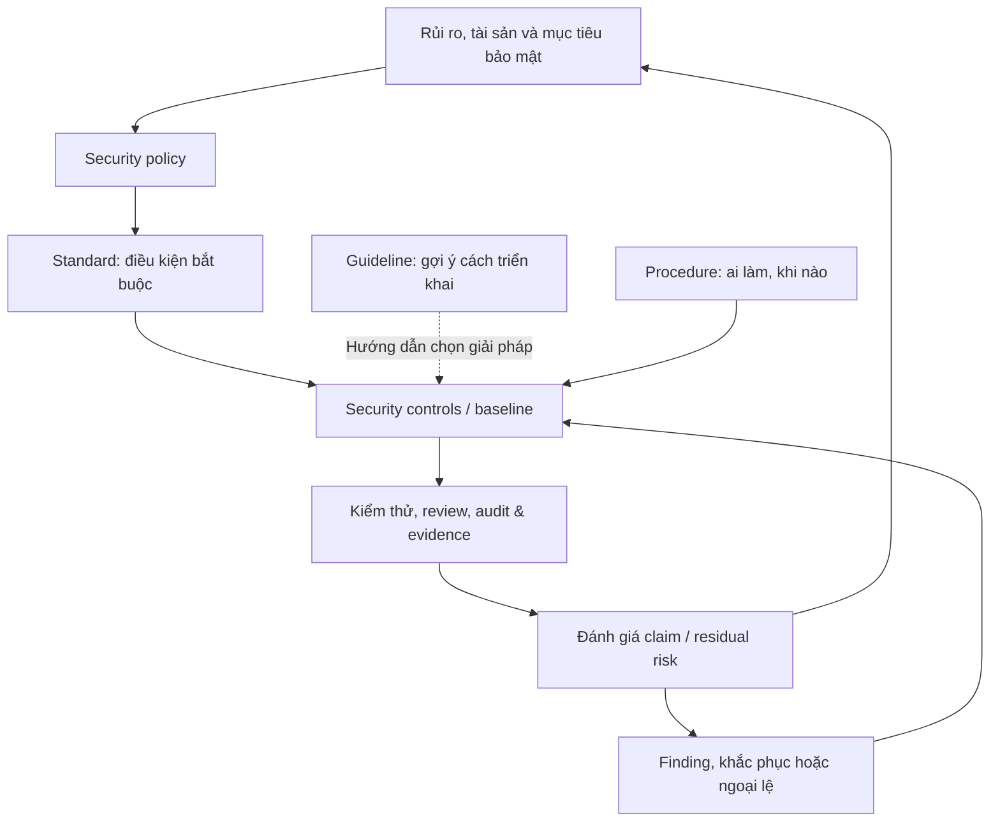
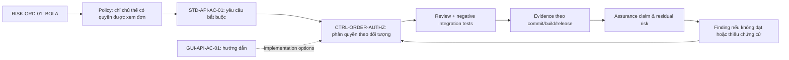
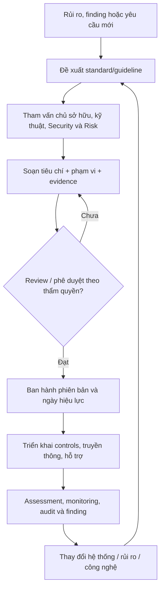

# Standard và guideline trong security assurance

Một nhóm phát triển nhận hai tài liệu về bảo mật API. Tài liệu thứ nhất yêu cầu: **“Mọi API trả dữ liệu khách hàng phải kiểm tra quyền trên đúng đối tượng và tenant trước khi trả dữ liệu.”** Tài liệu thứ hai gợi ý: **“Với ứng dụng Spring Boot, nên triển khai kiểm tra quyền tại service và bổ sung integration test cho trường hợp truy cập chéo tenant.”**

Sau một lần review, nhóm chọn thư viện phân quyền khác với ví dụ trong tài liệu thứ hai. Auditor hỏi: **“Như vậy có vi phạm quy định không?”** Câu trả lời phụ thuộc việc tổ chức đã phân biệt rõ **standard** (tiêu chuẩn bắt buộc trong phạm vi được ban hành) và **guideline** (hướng dẫn triển khai có tính khuyến nghị) hay chưa. Nhóm có thể dùng giải pháp khác hướng dẫn nhưng vẫn đáp ứng đầy đủ standard, miễn là có bằng chứng phù hợp.

Trong chương *Security standard* của module `SECURITY_SECURITY_ASSURANCE`, mục tiêu không chỉ là biết tên các bộ tiêu chuẩn. Người học cần biết cách chuyển **rủi ro và mục tiêu bảo mật** thành quy tắc có thể áp dụng, triển khai **security controls**, kiểm chứng bằng **test/audit**, xử lý sai lệch và duy trì **security assurance** xuyên suốt phát triển và vận hành.

> **Nguyên tắc trọng tâm:** Standard xác định **điều kiện phải đạt**; guideline giúp giải thích **những cách có thể đạt**. Mức độ bắt buộc thực tế vẫn phụ thuộc vào văn bản ban hành, phạm vi áp dụng, hợp đồng và nghĩa vụ liên quan. Assurance kiểm tra **hành vi và bằng chứng**, chứ không chỉ kiểm tra có một tài liệu tên “Standard” hay không.

## 1. Standard và guideline là gì?

### 1.1. Security standard — tiêu chuẩn bảo mật

Trong quản trị nội bộ, **security standard** là tập hợp các yêu cầu hoặc tiêu chí kỹ thuật/quy trình được tổ chức **quy định phải tuân thủ** đối với một tập đối tượng đã xác định. Standard thường chuyển nguyên tắc cấp cao của policy thành yêu cầu nhất quán và đo được.

Ví dụ, tổ chức có thể quy định:

- Các API xử lý dữ liệu khách hàng **phải** kiểm tra authorization ở cấp tài nguyên.
- Token dùng cho một API **phải** được xác minh đúng nguồn phát hành, đối tượng nhận và thời hạn theo mô hình xác thực đã chọn.
- Secret của production **không được** lưu trong repository hoặc log.
- Quyền đặc biệt **phải** có owner, lý do, phạm vi, thời hạn và phê duyệt theo ma trận thẩm quyền.
- Mọi finding vượt ngưỡng rủi ro **phải** được sửa hoặc xử lý theo quy trình ngoại lệ được phê duyệt trước mốc được quy định.

Các điều khoản này chỉ có giá trị quản trị thực tế khi định nghĩa rõ **phạm vi**, **mức áp dụng**, **trách nhiệm**, **tiêu chí kiểm tra** và **quy trình ngoại lệ**. Một câu “hệ thống phải bảo mật” không tạo thành tiêu chí đủ rõ để auditor đánh giá.

Từ *standard* còn được dùng cho **tiêu chuẩn do tổ chức bên ngoài công bố**. Không phải tất cả tài liệu có tên “standard” đều tự động là luật hoặc bắt buộc đối với mọi hệ thống. Tổ chức phải xác định cơ sở áp dụng: quy định, hợp đồng, yêu cầu khách hàng, chứng nhận, hoặc quyết định áp dụng nội bộ.

### 1.2. Security guideline — hướng dẫn bảo mật

**Security guideline** đưa ra **khuyến nghị, mẫu thiết kế, ví dụ triển khai, trade-off và cách thực hành** giúp nhóm đáp ứng policy/standard trong các bối cảnh kỹ thuật khác nhau.

Ví dụ:

- Khuyến nghị dùng policy ở service layer hoặc cơ chế authorization tập trung có thể kiểm chứng để tránh BOLA.
- Minh họa cấu hình Spring Security, kiểm tra principal và tenant từ nguồn đáng tin.
- Đề xuất negative tests cho truy cập chéo người dùng, chéo tenant, token hết hạn và đường qua queue.
- Gợi ý dùng secret manager và danh tính workload ngắn hạn thay cho credential dài hạn.
- Cung cấp checklist review DFD, trust boundary và các đường bypass thường bị bỏ sót.

Guideline giúp các nhóm **không phải tự phát minh lại một cách làm an toàn**, nhưng không phải mọi ví dụ đều bắt buộc áp dụng nguyên trạng. Nếu một hệ thống dùng cơ chế khác đạt cùng mục tiêu và có bằng chứng thích hợp, việc không làm theo **một khuyến nghị thuần túy** chưa đủ để kết luận vi phạm standard.

**Ngoại lệ quan trọng:** một guideline có thể chứa phần đã được policy hoặc hợp đồng **viện dẫn thành bắt buộc**, hoặc chính tài liệu được ban hành với một số điều khoản bắt buộc. Vì vậy, phải đọc **ngôn ngữ quy định, phạm vi và quyết định ban hành**, không suy ra tính bắt buộc chỉ từ tên file.

### 1.3. Bảng so sánh

| Tiêu chí | Standard | Guideline |
|---|---|---|
| **Mục đích** | Xác lập tiêu chí tối thiểu hoặc kết quả bắt buộc trong phạm vi | Hỗ trợ lựa chọn cách triển khai để đạt tiêu chí |
| **Cách diễn đạt** | “Phải”, “không được”, điều kiện chấp nhận, trường hợp ngoại lệ | “Nên”, “có thể”, lựa chọn tham khảo, lời giải thích |
| **Tính linh hoạt** | Khác biệt chỉ được cho phép theo cơ chế đã quy định | Cho phép chọn cách khác nếu vẫn đáp ứng nghĩa vụ cao hơn |
| **Đối tượng** | Vai trò, hệ thống, môi trường, dữ liệu, control thuộc phạm vi áp dụng | Nhóm kỹ thuật và người thực thi theo bối cảnh |
| **Cách kiểm chứng** | Đối chiếu tiêu chí với thiết kế, cấu hình và bằng chứng vận hành | Xem cách áp dụng, sự phù hợp và chất lượng giải pháp |
| **Khi không làm theo** | Có thể trở thành finding/exception nếu không đạt yêu cầu | Cần xem kết quả có còn đáp ứng standard không; không mặc định là finding |
| **Ví dụ** | “Quyền đọc đơn phải ràng buộc đúng tenant và owner.” | “Nên sử dụng truy vấn dữ liệu có điều kiện tenant + owner, kết hợp integration test.” |

## 2. Đặt standard và guideline vào hệ thống tài liệu quản trị

Standard và guideline không tồn tại độc lập. Chúng thường là một phần của hệ thống quản trị gồm policy, tiêu chuẩn, thủ tục, kiến trúc và các control đang hoạt động.

| Loại tài liệu / thành phần | Câu hỏi nó trả lời | Ví dụ |
|---|---|---|
| **Security policy** | Tổ chức cam kết bảo vệ điều gì, nguyên tắc và trách nhiệm là gì? | Chỉ chủ thể được phép mới truy cập dữ liệu nhạy cảm |
| **Security standard** | Tiêu chí tối thiểu bắt buộc và cách đánh giá đạt/không đạt là gì? | Mọi đường đọc đơn phải kiểm tra tenant/owner trước khi trả nội dung |
| **Security guideline** | Những thiết kế, thư viện, mô hình hoặc test nào được khuyến nghị? | Hướng dẫn dùng Spring Security cùng authorization ở tầng nghiệp vụ |
| **Procedure / runbook** | Ai thực hiện các bước nào, khi nào, và lưu bằng chứng ở đâu? | Quy trình yêu cầu quyền, phê duyệt, cấp, rà soát và thu hồi |
| **Control baseline** | Tập controls tối thiểu được lựa chọn cho một loại hệ thống | Bộ yêu cầu cho API Internet-facing xử lý dữ liệu khách hàng |
| **Technical control** | Hệ thống thực tế bảo vệ dữ liệu/hành động bằng cách nào? | Rule IAM, policy service, secret manager, ký thông điệp |
| **Evidence / assurance case** | Cơ sở nào chứng minh control đáp ứng yêu cầu trong phạm vi? | Code review, test, config, log, audit, finding và retest |



Sơ đồ là **quan hệ logic**; tổ chức có thể bố trí các tài liệu khác nhau. Điểm cần bảo đảm là có thể truy vết **vì sao yêu cầu tồn tại, ai sở hữu, control nào thực hiện và bằng chứng nào hỗ trợ kết luận**.

## 3. Ngôn ngữ quy định: MUST, SHOULD và MAY

Một cách giúp tài liệu bớt mơ hồ là định nghĩa rõ ý nghĩa của những từ thể hiện mức bắt buộc. Có thể dùng quy ước tương tự các thuật ngữ quy phạm thường thấy trong tài liệu kỹ thuật:

| Từ | Diễn giải khi **được văn bản quy định rõ** | Ví dụ |
|---|---|---|
| **MUST / SHALL / PHẢI** | Yêu cầu bắt buộc trong phạm vi được xác định | “Service phải từ chối request thiếu danh tính đã xác thực.” |
| **MUST NOT / KHÔNG ĐƯỢC** | Hành vi bị cấm trong phạm vi xác định | “Không được ghi secret nguyên bản vào log.” |
| **SHOULD / NÊN** | Khuyến nghị mạnh; nếu đi theo cách khác cần cân nhắc hệ quả | “Nên dùng mẫu policy thống nhất để tránh logic phân quyền phân tán.” |
| **SHOULD NOT / KHÔNG NÊN** | Cách làm thường không được khuyến nghị | “Không nên truyền token qua URL.” |
| **MAY / CÓ THỂ** | Lựa chọn được phép hoặc gợi ý tham khảo | “Có thể dùng row-level security như lớp bảo vệ bổ sung.” |

**Không có quy tắc chung rằng mọi chữ “nên” trong mọi công ty đều tự động yêu cầu phê duyệt ngoại lệ.** Tài liệu phải nêu nghĩa vụ với `SHOULD` nếu tổ chức muốn có cơ chế ghi nhận lý do khi không áp dụng. Tránh sao chép ngôn ngữ quy phạm từ một chuẩn mà không đưa ra định nghĩa trong chính tài liệu được ban hành.

Một yêu cầu bắt buộc chất lượng tốt nên có:

1. **Chủ thể phải tuân thủ:** nhóm, hệ thống, dịch vụ hoặc đối tượng dữ liệu nào.
2. **Hành vi/thuộc tính:** phải có, không được làm hoặc phải đạt tiêu chí gì.
3. **Điều kiện áp dụng:** loại dữ liệu, mức rủi ro, môi trường, loại giao dịch.
4. **Phương pháp xác minh:** test, kiểm tra cấu hình, audit hoặc bằng chứng vận hành nào.
5. **Thẩm quyền ngoại lệ:** ai phê duyệt, điều kiện và thời hạn nếu không thể đáp ứng ngay.

**Ví dụ chưa tốt:** “API phải an toàn”.

**Ví dụ có thể kiểm chứng:** “Với mọi API đọc dữ liệu đơn hàng của người dùng trong production, service phải kiểm tra quyền đối với đối tượng và tenant trước khi trả dữ liệu; yêu cầu chéo tenant phải bị từ chối và không được lộ nội dung đơn; kết quả được kiểm tra bằng negative integration tests gắn với bản phát hành.”

Tất cả yêu cầu còn phải phù hợp kiến trúc thực tế. Một công nghệ cụ thể không nên được quy định bắt buộc nếu nhiều cách triển khai an toàn khác có thể đáp ứng cùng tiêu chí và không có lý do nghiệp vụ/quản trị yêu cầu sự đồng nhất công nghệ.

## 4. Phân biệt tiêu chuẩn bên ngoài và tiêu chuẩn nội bộ

Khi xây chương trình security assurance, tổ chức thường tham khảo nhiều nguồn. **Tên và phiên bản tài liệu** phải được xác định theo quyết định áp dụng thực tế; không nên mặc định mọi hệ thống đều cần tuân thủ phiên bản mới nhất của tất cả nguồn bên ngoài.

| Nhóm nguồn | Mục đích thường gặp | Cách sử dụng thận trọng |
|---|---|---|
| **ISO/IEC 27001** | Yêu cầu cho hệ thống quản lý an toàn thông tin (ISMS) | Xác định phạm vi ISMS, yêu cầu áp dụng và bằng chứng quản trị; không tự suy ra chứng nhận cho từng ứng dụng |
| **ISO/IEC 27002** | Hướng dẫn liên quan đến các biện pháp kiểm soát an toàn thông tin | Dùng để tham khảo lựa chọn/triển khai controls trong bối cảnh của tổ chức |
| **NIST Cybersecurity Framework (CSF)** | Khung mô tả kết quả quản lý rủi ro an ninh mạng | Dùng tổ chức kết quả cần đạt và đánh giá khoảng trống; không nhầm framework với một chứng nhận tự động |
| **NIST SP 800-53** | Danh mục security/privacy controls | Lựa chọn, điều chỉnh control baseline phù hợp hệ thống và nghĩa vụ |
| **NIST SP 800-53A** | Hướng dẫn đánh giá controls | Tham khảo cách xây thủ tục kiểm tra, nguồn bằng chứng và kết luận |
| **OWASP ASVS** | Tập yêu cầu kiểm chứng bảo mật ứng dụng | Chọn yêu cầu có thể test cho loại ứng dụng và mức bảo đảm mong muốn |
| **OWASP Cheat Sheet Series** | Hướng dẫn kỹ thuật về các chủ đề phát triển ứng dụng | Tham khảo giải pháp triển khai và câu hỏi code review, không coi mọi ví dụ là yêu cầu chung |
| **CIS Benchmarks** | Khuyến nghị cấu hình an toàn cho nhiều nền tảng | Chọn profile/phiên bản phù hợp, kiểm thử tác động vận hành trước khi áp dụng |
| **Hợp đồng/quy định ngành, ví dụ PCI DSS nếu thuộc phạm vi** | Nghĩa vụ cụ thể theo bối cảnh pháp lý/hợp đồng và phạm vi hệ thống | Làm rõ nghĩa vụ thật sự, phạm vi, phiên bản và người có thẩm quyền diễn giải |

Một số tài liệu có **phần yêu cầu bắt buộc** lẫn **phần hướng dẫn**. Không thể chỉ dựa vào chữ *standard*, *framework* hay *guide* trong tiêu đề để kết luận tất cả điều khoản có cùng mức cưỡng chế.

### Ba câu hỏi khi lựa chọn nguồn

- **Đúng đối tượng chưa?** Một benchmark Linux server không tự thay thế hướng dẫn kiểm tra logic nghiệp vụ của API.
- **Đúng nghĩa vụ chưa?** Tài liệu được tham khảo tự nguyện, được hợp đồng viện dẫn hay nằm trong nghĩa vụ bắt buộc?
- **Đúng phiên bản/phạm vi chưa?** Đã xác định bản ban hành, mục áp dụng, điểm điều chỉnh (*tailoring*) và kiểm soát nội bộ tương ứng?

Chẳng hạn, tổ chức có thể dùng OWASP ASVS làm **nguồn lựa chọn yêu cầu xác minh ứng dụng**, sau đó ban hành standard nội bộ với mã, tiêu chí và phạm vi của riêng mình. Điều đó **không đồng nghĩa ứng dụng đã được một bên ngoài chứng nhận theo ASVS** chỉ vì đã lập bảng mapping.

## 5. Chọn nội dung nào phải là standard, nội dung nào nên là guideline?

Tổ chức không nên đưa mọi kinh nghiệm kỹ thuật vào một standard bắt buộc. Một standard quá chi tiết và cứng nhắc sẽ nhanh lỗi thời; một standard quá chung lại khó kiểm chứng.

| Tình huống | Đưa vào standard khi... | Đưa vào guideline khi... |
|---|---|---|
| **Authorization** | Phải kiểm tra quyền đúng tài nguyên, tenant, hành động | Chọn Spring Security, policy-as-code, query filter hoặc lớp phòng vệ bổ sung |
| **Authentication** | Phải kiểm tra nguồn danh tính, trạng thái token/phiên theo yêu cầu | Ví dụ cấu hình IdP/SDK cụ thể |
| **Secrets** | Cấm commit secret sống, quy định vòng đời và nguồn lưu trữ được chấp thuận | Hướng dẫn tích hợp workload identity/secret manager cho từng nền tảng |
| **Logging** | Phải ghi sự kiện nhạy cảm phù hợp, không ghi credential nguyên bản | Mẫu log có cấu trúc, cách dùng correlation ID và thư viện logging |
| **Dependencies** | Phải quản lý thành phần và xử lý lỗ hổng theo mức rủi ro | Hướng dẫn chạy SCA, tạo SBOM, nâng phiên bản an toàn |
| **CI/CD** | Phải bảo vệ quyền merge/deploy và khả năng truy vết artefact | Mẫu pipeline trên GitHub Actions, GitLab CI hoặc hệ thống khác |
| **Backup/restore** | Phải đáp ứng tiêu chí phục hồi đã được phê duyệt | Hướng dẫn chọn snapshot, diễn tập restore và tự động hóa |
| **Access review** | Phải có chủ sở hữu và kiểm tra định kỳ theo chính sách | Mẫu chiến dịch review, cách đối chiếu entitlement kế thừa |

**Quy tắc thiết kế hữu ích:** standard mô tả *security outcome* và các điều kiện tối thiểu không thể bỏ qua; guideline mô tả *implementation options* và hướng xử lý trade-off. Có những trường hợp tổ chức **cần bắt buộc một phương pháp cụ thể** (ví dụ tiêu chuẩn hóa trên một loại kho bí mật hoặc quy trình build). Khi ấy, phương pháp nên nằm trong standard/baseline với lý do và phạm vi rõ ràng, không được “giấu” nghĩa vụ bắt buộc trong một tài liệu khuyến nghị.

## 6. Ví dụ xuyên suốt: chuẩn bảo mật API nhiều tenant

Giả sử một nền tảng bán hàng Java/Spring Boot phục vụ nhiều tenant. Dữ liệu đơn hàng mang `tenantId` và `ownerId`. Một phát hiện BOLA cho thấy người dùng A biết ID đơn của B có thể đọc dữ liệu B.

### 6.1. Từ rủi ro đến yêu cầu

| Tầng | Mã hoặc tên | Nội dung |
|---|---|---|
| **Rủi ro** | `RISK-ORD-01` | Người dùng có quyền truy cập API nhưng đọc đơn không thuộc quyền |
| **Security objective** | Confidentiality, integrity và cách ly tenant | Chỉ chủ thể được quyền mới đọc/sửa dữ liệu theo phạm vi |
| **Policy** | `POL-AC-01` | Mọi truy cập dữ liệu khách hàng phải được cho phép theo nhu cầu, chủ thể và phạm vi |
| **Standard** | `STD-API-AC-01` | API nhạy cảm bắt buộc có object-level authorization và negative tests |
| **Guideline** | `GUI-API-AC-01` | Hướng dẫn triển khai authorization theo tenant/owner trong Spring Boot |
| **Control** | `CTRL-ORDER-AUTHZ` | Kiểm tra quyền trước khi trả/cập nhật đơn hàng trên mọi đường xử lý thuộc phạm vi |
| **Assessment** | `TEST-ORDER-AC-01..05` | Test owner, cross-owner, cross-tenant, thiếu danh tính, đường export |
| **Evidence** | CI, review, config, release | Bằng chứng gắn commit/môi trường, phạm vi và kết quả |
| **Residual risk** | `RISK-ORD-01-RES` | Các luồng cũ chưa kiểm chứng hoặc giả định chưa đủ bằng chứng |

Điểm khác biệt quan trọng: **standard không phải một dòng cấu hình**, guideline không phải “giấy miễn kiểm thử”. Cả hai giúp xây một chuỗi truy vết có thể kiểm tra.

### 6.2. Trích đoạn standard mẫu: `STD-API-AC-01`

Đây là **ví dụ văn bản nội bộ giả định**, không phải điều khoản được trích từ một tiêu chuẩn ngoài:

> **Đối tượng:** Các API và luồng bất đồng bộ đọc hoặc sửa dữ liệu đơn hàng của khách hàng trong môi trường production.
>
> **AC-01 (MUST):** Trước khi trả hoặc sửa dữ liệu, hệ thống phải xác định danh tính từ nguồn tin cậy và kiểm tra quyền theo **đối tượng tài nguyên, hành động và tenant**.
>
> **AC-02 (MUST NOT):** Không được dùng `tenantId`, `ownerId` hoặc vai trò do client tự khai báo làm căn cứ cấp quyền nếu chưa được đối chiếu với nguồn có thẩm quyền.
>
> **AC-03 (MUST):** Khi thiếu danh tính hoặc thuộc tính cần cho quyết định, hệ thống phải từ chối thao tác có quyền; không được tạo tác dụng phụ trước khi hoàn tất kiểm tra.
>
> **AC-04 (MUST):** Các API và consumer trong phạm vi phải có test trường hợp hợp lệ, sai chủ sở hữu, sai tenant và đường truy cập phụ tương ứng.
>
> **AC-05 (MUST):** Kết quả kiểm chứng phải liên kết được với mã yêu cầu, commit/build, môi trường, thời gian và bản triển khai cần đánh giá.

Để thành standard thực tế, tài liệu cần được **owner có thẩm quyền ban hành**, có ngày hiệu lực, phiên bản, phạm vi, định nghĩa thuật ngữ, ngưỡng/ngoại lệ áp dụng và phương pháp đánh giá chi tiết. Nếu dùng mô hình phức tạp với quản trị viên hỗ trợ nhiều tenant, các hành động đó cần **policy và tiêu chí kiểm tra riêng**, không tự mở quyền cho role chung.

### 6.3. Guideline mẫu: `GUI-API-AC-01`

Hướng dẫn này đề xuất một trong các cách hiện thực hóa `STD-API-AC-01`:

1. Tạo principal từ authentication context đã xác minh, không lấy danh tính và tenant từ request body hoặc header tự khai báo.
2. Đặt kiểm tra authorization ở tầng nghiệp vụ có thẩm quyền trên đối tượng và hành động; nếu cần, bổ sung kiểm tra tại gateway và database.
3. Ràng buộc truy vấn dữ liệu bằng cả `tenantId` và `ownerId`, hoặc dùng policy engine có kết quả tương đương đã kiểm chứng.
4. Chạy negative tests cho cross-tenant, cross-owner, tài khoản thiếu quyền, token sai nguồn và các luồng queue/export.
5. Bảo đảm việc từ chối không trả dữ liệu trái phép hoặc tạo tác dụng phụ, kể cả khi có cache hoặc retry.
6. Lưu test/review/release evidence, ghi giới hạn kiểm tra và các đường cần tái đánh giá.

Guideline không bắt buộc mọi service dùng một thư viện, một annotation hay một kiểu repository. Nhóm có thể dùng **ABAC, ReBAC, row-level security hoặc policy service** nếu chứng minh được tiêu chí bắt buộc vẫn được đáp ứng.

### 6.4. Ví dụ Java 17 thực hiện một phần guideline

Mã dưới đây minh họa một hướng triển khai với tầng service kiểm tra **chủ sở hữu và tenant** trong truy vấn. Đây là mẫu độc lập về mặt ý tưởng; có thể dùng repository Spring Data hoặc một adapter truy cập dữ liệu thực tế.

```java
import java.util.Optional;

record Caller(String userId, String tenantId) {}
record Order(String id, String ownerId, String tenantId) {}

interface OrderRepository {
    Optional<Order> findByIdAndOwnerIdAndTenantId(
            String id, String ownerId, String tenantId);
}

final class OrderReader {
    private final OrderRepository repository;

    OrderReader(OrderRepository repository) {
        this.repository = repository;
    }

    Order readOwnOrder(String orderId, Caller caller) {
        if (orderId == null || orderId.isBlank()
                || caller == null
                || caller.userId() == null || caller.userId().isBlank()
                || caller.tenantId() == null || caller.tenantId().isBlank()) {
            throw new SecurityException("Access denied");
        }

        return repository.findByIdAndOwnerIdAndTenantId(
                orderId, caller.userId(), caller.tenantId())
                .orElseThrow(() -> new SecurityException("Access denied"));
    }
}
```

**Điều kiện tin cậy:** `Caller` phải được tạo từ thông tin xác thực do thành phần đáng tin kiểm chứng (ví dụ xác minh đầy đủ chữ ký, issuer, audience và thời hạn JWT theo chính sách). Nếu caller được tạo từ `X-User-Id` hoặc `X-Tenant-Id` do client tự gửi, giải pháp **không đáp ứng standard** dù truy vấn có lọc tenant.

Bên cạnh đó, policy phải có mặt trên **mọi đường đọc và sửa dữ liệu** trong phạm vi, không chỉ hàm `readOwnOrder`. Tùy hợp đồng API, service có thể trả `403` hoặc `404` để tránh tiết lộ sự tồn tại của tài nguyên; điều quan trọng là **không lộ dữ liệu trái quyền** và không thực hiện tác dụng phụ bị cấm.

### 6.5. Đọc guideline như một gợi ý, không phải cơ sở kết luận

Giả sử đội A dùng truy vấn có `tenantId`/`ownerId` trong repository, đội B dùng policy engine và row-level security. Cả hai có thể **tuân thủ standard** nếu từng đội chứng minh:

- Principal và thuộc tính có nguồn đáng tin.
- Các thao tác đúng phạm vi quyền mới được cho phép.
- Không tồn tại đường xử lý hoặc cache/export có thể bỏ qua control trong phạm vi kết luận.
- Các trường hợp được phép, bị từ chối và lỗi được kiểm chứng ở môi trường phù hợp.
- Bằng chứng gắn được với bản release và chính sách đang có hiệu lực.

Ngược lại, một đội sao chép y nguyên đoạn code guideline nhưng **không gọi kiểm tra ở endpoint export** vẫn có thể vi phạm standard. **Sao chép ví dụ không bằng chứng minh kết quả.**

## 7. Cách viết standard có thể kiểm thử và audit

Một standard hữu ích cần tránh cả hai cực đoan: **không kiểm tra được** và **ràng buộc công nghệ không cần thiết**. Có thể dùng biểu mẫu sau:

| Trường | Tác dụng |
|---|---|
| **Standard ID / Title** | Định danh và chủ đề nhất quán |
| **Purpose / Risk** | Vì sao control cần thiết và mục tiêu bảo mật liên quan |
| **Applicability / Scope** | Hệ thống, dữ liệu, rủi ro, môi trường, phiên bản nào phải áp dụng |
| **Normative requirements** | Các mệnh đề `MUST`/`MUST NOT` được viết rõ |
| **Acceptance criteria** | Hành vi nào được coi đạt, trường hợp nào phải bị từ chối |
| **Implementation options** | Có thể viện dẫn guideline, nhưng không trộn khuyến nghị vào phần bắt buộc |
| **Control owner** | Vai trò chịu trách nhiệm thiết kế, triển khai và vận hành |
| **Evidence / assessment method** | Loại bằng chứng cần thiết và cách kiểm chứng |
| **Exception / risk handling** | Thẩm quyền, điều kiện và kỳ hạn xem lại |
| **Version / review triggers** | Người phê duyệt, ngày hiệu lực, phiên bản và sự kiện cần đánh giá lại |

Một mệnh đề tốt gồm **subject + điều kiện + hành vi bắt buộc + kết quả có thể kiểm tra**. Ví dụ:

**Chưa đủ rõ:** “Phải log các hoạt động quan trọng.”

**Rõ hơn:** “Trong môi trường production, thao tác cấp/thu hồi quyền quản trị phải tạo audit event có danh tính chủ thể, loại hành động, đối tượng, kết quả và thời gian; chỉ người được phân quyền mới được xem/sửa cấu hình lưu trữ log; không ghi credential nguyên bản.”

Mệnh đề thứ hai vẫn cần bổ sung tiêu chuẩn về **retention, tính toàn vẹn, nguồn thời gian, quyền truy cập, trường thông tin và đánh giá sự kiện thiếu** theo môi trường.

### Tránh chỉ tiêu gây hiểu nhầm

Một quy định “100% SAST pass” nghe có thể đo được, nhưng chưa bảo đảm logic authorization an toàn. SAST không phát hiện toàn bộ lỗ hổng. Nên diễn đạt **kết quả cần đạt theo rủi ro** (không có finding vượt ngưỡng chưa được xử lý theo chính sách, có negative tests cho yêu cầu trọng yếu) và dùng SAST như **một nguồn bằng chứng**, không phải phép thử duy nhất.

## 8. Guideline tốt cần gồm những gì?

Khác standard, guideline được phép đi sâu vào triển khai và trade-off, nhưng phải **không làm mờ nghĩa vụ bắt buộc**.

Một guideline hữu ích có thể gồm:

- **Khi nào dùng:** loại ứng dụng, dữ liệu, kiến trúc, điều kiện loại trừ.
- **Mục tiêu và standard liên quan:** liên kết tới điều khoản bắt buộc mà hướng dẫn hỗ trợ.
- **Các phương án:** ví dụ chính sách trong service, policy engine hoặc bảo vệ ở tầng dữ liệu.
- **Ưu/nhược điểm:** hiệu năng, độ phức tạp, khả năng mở rộng, độ trễ khi quyền thay đổi, auditability.
- **Mẫu code/cấu hình an toàn:** tránh secret thật, nêu phần minh họa và điều kiện đầu vào.
- **Anti-pattern:** sai lầm dễ gặp, đường bypass và các giả định sai.
- **Test matrix:** cả trường hợp hợp lệ lẫn bị từ chối, lỗi và tình huống dữ liệu bất thường.
- **Giới hạn và đánh giá lại:** thứ chưa được bảo vệ trong ví dụ, điều kiện khiến hướng dẫn lỗi thời.

Chẳng hạn guideline về **secret management** nên phân biệt secret dùng trên local development, trong CI và production, giải thích vì sao không để secret trong source code, hướng dẫn thao tác rotation khi lộ và kiểm tra secret cũ không còn hợp lệ. Nó không nên khuyên copy credential production vào máy cá nhân để “test nhanh”.

### Khi guideline lệch khỏi hệ thống thực tế

Một hướng dẫn có thể tham khảo framework/library phiên bản cũ hoặc hạ tầng không còn dùng. Người áp dụng nên:

1. Xác định yêu cầu standard vẫn phải đạt.
2. Kiểm tra giả định công nghệ của guideline có đúng không.
3. Đề xuất phương án phù hợp hơn với threat model.
4. Thu bằng chứng bằng test/review tương ứng.
5. Gửi phản hồi để cập nhật guideline, thay vì cố giữ một ví dụ lỗi thời.

Một guideline tốt nên dễ tiếp nhận các hướng triển khai tương đương, miễn là các **yêu cầu bảo mật bắt buộc không bị làm yếu**.

## 9. Baseline, tailoring và sự khác biệt theo mức rủi ro

Không phải hệ thống nào cũng cần cùng một tập controls chi tiết. Một API nội bộ không xử lý dữ liệu nhạy cảm, một dịch vụ thanh toán Internet-facing và một hệ thống quản lý bí mật production có **rủi ro và nghĩa vụ khác nhau**.

**Control baseline** là tập yêu cầu được lựa chọn làm mức khởi điểm cho một lớp hệ thống. Tổ chức có thể:

- Áp dụng baseline chung cho mọi dịch vụ.
- Bổ sung yêu cầu cho hệ thống có dữ liệu nhạy cảm, tài khoản đặc quyền hoặc giao dịch tài chính.
- Điều chỉnh (*tailor*) những yêu cầu không áp dụng, với lý do và thẩm quyền rõ.
- Áp dụng control thay thế khi phương án gốc không phù hợp, kèm bằng chứng đạt mục tiêu tương đương hoặc đáp ứng rủi ro theo quyết định đã phê duyệt.

| Loại hệ thống giả định | Yêu cầu cơ sở | Yêu cầu tăng cường có thể cần |
|---|---|---|
| Trang thông tin công khai | Quản lý cập nhật, bảo vệ quyền sửa nội dung, logging phù hợp | Giám sát chống sửa nội dung trái phép |
| API nội bộ có dữ liệu công việc | Authentication, authorization, secrets và dependency management | Workload identity, phân quyền theo dữ liệu |
| API khách hàng nhiều tenant | Các yêu cầu cơ sở | Object-level authorization, test cross-tenant, giám sát export |
| Dịch vụ xử lý dữ liệu rất nhạy cảm | Các yêu cầu cơ sở và quyền tối thiểu | Phê duyệt đặc biệt, bảo vệ dữ liệu, audit độc lập và kiểm tra chuyên sâu |
| Control plane / CI production | Các yêu cầu cơ sở | Segregation of duties, JIT/PAM, provenance và bảo vệ pipeline |

**Bảng là ví dụ thiết kế baseline**, không phải phân cấp bắt buộc của một bộ tiêu chuẩn bên ngoài. Bước đánh giá cần dựa vào phân loại tài sản, mô hình đe dọa, tác động và nghĩa vụ cụ thể.

Tailoring không đồng nghĩa bỏ control theo ý thích. Mỗi thay đổi phạm vi hoặc mức yêu cầu cần có **rationale, người phê duyệt, bằng chứng và thời hạn xem xét** phù hợp cơ chế quản trị.

## 10. Chuyển standard thành security controls và kiểm thử

Một điều khoản standard không nên kết thúc tại spreadsheet `COMPLIANT`. Nó cần được kết nối đến **control implementation** và **assessment procedures**.



### Ma trận kiểm chứng yêu cầu

| Điều khoản | Kỹ thuật đánh giá | Tiêu chí đạt | Bằng chứng |
|---|---|---|---|
| `AC-01` | Review luồng identity; thử truy cập tài nguyên theo chủ thể | Không đọc/sửa dữ liệu sai phạm vi quyền | DFD, policy code, API test |
| `AC-02` | Gửi header/body `tenantId` giả; thử cross-tenant | Thuộc tính do client gửi không cấp thêm quyền | Negative integration test |
| `AC-03` | Thiếu principal, dữ liệu policy không có; test failure mode | Không trả dữ liệu hoặc tạo tác dụng phụ trái phép | Error path test, DB/queue assertions |
| `AC-04` | Kiểm kê endpoint, consumer và test cases | Tất cả luồng thuộc phạm vi có kiểm tra phù hợp | Inventory, coverage matrix, test report |
| `AC-05` | Đối chiếu build/test với bản triển khai | Evidence có nguồn, thời gian và phiên bản đáng tin | CI run, release record, config review |

Một test unit có thể chứng minh hàm phân quyền trả `DENY` cho sai tenant, nhưng **không chứng minh tất cả controller/worker thực sự gọi hàm đó**. Cần kết hợp code review, integration test và kiểm tra cấu hình/runtime, đặc biệt khi dữ liệu đi qua API gateway, cache, queue, export hoặc storage.

### Lập luận bảo đảm: Claim – Argument – Evidence

Trong security assurance, mỗi điều khoản standard có thể hỗ trợ một **assurance case** với ba thành phần:

| Thành phần | Ví dụ gắn với `STD-API-AC-01` |
|---|---|
| **Claim (điều cần chứng minh)** | Tất cả đường đọc đơn hàng thuộc phạm vi release đã kiểm tra đều từ chối truy cập sai user/tenant |
| **Argument (lập luận)** | Bên nhận lấy identity từ nguồn đáng tin, thực thi object-level authorization trước khi trả dữ liệu, và các đường API/queue/export đều được rà soát |
| **Evidence (bằng chứng)** | Threat model, code/config review, negative integration tests, deployment record và kết quả retest gắn phiên bản |

Nếu chỉ có unit test của một hàm hoặc chưa đánh giá luồng export, **claim phải được thu hẹp hoặc kết luận chưa đủ bằng chứng**. Việc đạt một tiêu chí standard và việc có đủ chứng cứ cho tuyên bố rộng hơn là hai câu hỏi liên quan nhưng không đồng nhất.

**Tính đủ và tính phù hợp của bằng chứng** là phần của assurance: test có đúng requirement không, có bao phủ trường hợp âm tính không, có gắn đúng bản release không và có các luồng chưa kiểm tra không?

## 11. Mẫu manifest quản lý standard và evidence

Một số nhóm quản lý metadata của standard theo dạng cấu trúc để dễ truy vết. Ví dụ dưới đây là **mẫu dữ liệu minh họa**, không phải định dạng bắt buộc của một công cụ CI hay một bộ tiêu chuẩn cụ thể:

```yaml
standard_id: "STD-API-AC-01"
title: "Object-level and tenant-aware authorization"
version: "1.0"
status: "APPROVED"
owner: "<security-governance-owner>"
approved_by: "<authorized-approver>"
effective_at: "<ISO-8601-date>"
scope:
  application_classes: ["customer-data-api"]
  environments: ["production"]
  requirements:
    - "AC-01: Verify identity and object/tenant rights"
    - "AC-02: Do not trust caller-provided tenant or owner claims"
    - "AC-03: Deny safely when required attributes are missing"
    - "AC-04: Maintain positive and negative security tests"
evidence_expectations:
  - "Threat model / resource access design"
  - "Code or policy review"
  - "Integration test report linked to release"
  - "Production configuration where applicable"
guideline_refs: ["GUI-API-AC-01"]
control_owner: "<application-team>"
assessment:
  method: "control review + API tests"
  evaluated_revision: "<release-or-commit-id>"
  result: "<PASS-FAIL-INCONCLUSIVE>"
  evidence_refs: ["<review-url>", "<ci-run-url>"]
  known_limitations:
    - "Legacy export consumer not yet assessed"
exception:
  reference: "<approved-exception-or-none>"
  risk_owner: "<authorized-risk-owner>"
  expires_at: "<date-if-applicable>"
reassessment_triggers:
  - "New endpoint, tenant model, policy or identity-provider change"
```

**Không lưu bí mật** (token, private key, mật khẩu) trong manifest, ticket, PR hay CI report. Các đường dẫn evidence phải được phân quyền và lưu theo chính sách bảo vệ dữ liệu. Tài liệu mã hóa cấu trúc giúp quản lý, nhưng một số trường `PASS` được điền thủ công vẫn cần kiểm tra bằng chứng gốc.

### “Standards as code” và “policy as code” có gì khác?

- **Standards as code:** biểu diễn một phần yêu cầu/tiêu chí ở dạng cấu trúc để kiểm tra và truy vết tự động.
- **Policy as code:** biểu diễn các quy tắc kỹ thuật có thể được máy đánh giá và thực thi/kiểm tra, ví dụ policy IAM hoặc policy engine.
- **Compliance/assurance evidence automation:** tự động thu lại kết quả test, kiểm tra cấu hình, build metadata và trạng thái finding.

Ba khái niệm có thể liên kết, nhưng **không đồng nhất**. Một rule kiểm tra “bucket không public” không chứng minh dữ liệu trên bucket được phân loại đúng, IAM chỉ có người được phép, hoặc các access review đã diễn ra trong kỳ.

## 12. Quản lý ngoại lệ: chuẩn không phù hợp thì xử lý thế nào?

Nếu một hệ thống chưa thể đáp ứng yêu cầu bắt buộc, tổ chức cần **cơ chế ngoại lệ có kiểm soát**, không sửa dòng `MUST` thành `SHOULD` âm thầm trong PR.

Một ngoại lệ phù hợp thường ghi:

1. **Điều khoản bị ảnh hưởng**, hệ thống/tenant/môi trường, các tài sản và luồng nghiệp vụ liên quan.
2. **Lý do chưa thể đáp ứng**, điều kiện kỹ thuật và mốc dự kiến có thể khắc phục.
3. **Kịch bản rủi ro**, khả năng xảy ra, tác động, phạm vi phơi lộ và biện pháp bù đắp.
4. **Người có thẩm quyền chấp nhận rủi ro**, phân biệt với người triển khai.
5. **Thời hạn hiệu lực**, trigger rà soát và điều kiện thu hồi ngoại lệ.
6. **Kế hoạch hành động** với owner, mốc kiểm chứng và bằng chứng cần tạo.
7. **Trạng thái assurance** phản ánh đúng control chưa đạt hoặc chưa đủ bằng chứng.

Ví dụ: một consumer legacy chưa hỗ trợ authorization theo tenant và chưa thể thay đổi trước release. Nhóm đề xuất tạm hạn chế quyền publish/consume, chặn đường gọi từ Internet và tăng giám sát, đồng thời lập kế hoạch sửa. Các biện pháp này **có thể giảm rủi ro**, nhưng nếu standard yêu cầu bắt buộc kiểm tra tenant ở mọi luồng thì control **vẫn chưa đạt standard** cho đến khi có phương án được phê duyệt hoặc yêu cầu được đáp ứng. Không dùng `PASS` để che finding.

**Phân biệt ba tình huống:**

| Trường hợp | Cách diễn giải |
|---|---|
| Không làm theo **guideline không bắt buộc**, nhưng đạt đầy đủ standard bằng cách khác | Có thể hợp lệ; nên ghi rationale và bằng chứng nếu rủi ro đáng kể |
| Chưa đáp ứng **standard bắt buộc**, được risk owner phê duyệt ngoại lệ | Là **ngoại lệ/rủi ro được chấp nhận**, không phải bằng chứng tiêu chí đã đạt |
| Không rõ có đạt standard vì test/evidence thiếu | **Inconclusive/chưa được kiểm chứng**; không tự ghi `PASS` hoặc `FALSE POSITIVE` |

Nếu điều khoản bắt buộc xuất phát từ nghĩa vụ pháp luật/hợp đồng, quyết định ngoại lệ nội bộ **không mặc nhiên miễn** nghĩa vụ bên ngoài. Cần chuyển đến bên chịu trách nhiệm pháp lý, tuân thủ hoặc quan hệ hợp đồng khi thích hợp.

## 13. Audit standard khác với review guideline

Auditor và người đánh giá assurance cần bắt đầu từ **tiêu chí có hiệu lực**, sau đó đánh giá bằng chứng thực tế.

### 13.1. Kiểm tra design, implementation và operating effectiveness

| Cấp đánh giá | Câu hỏi | Ví dụ bằng chứng |
|---|---|---|
| **Design effectiveness** | Nếu thực hiện như thiết kế, control có đáp ứng tiêu chí không? | Kiến trúc, requirement, policy decision, review DFD |
| **Implementation** | Quy tắc có được triển khai đúng trên hệ thống đang xét không? | Source code, policy config, IAM mapping, CI/deployment review |
| **Operating effectiveness** | Trong kỳ đánh giá, control có hoạt động đúng/nhất quán không? | Log, access reviews, test và hồ sơ release trong kỳ, phê duyệt thực tế |
| **Remediation verification** | Sai lệch đã được xử lý ở bản/môi trường phù hợp chưa? | PR, test hồi quy, deployment record và retest sau sửa |

Một ảnh chụp quyền hôm nay **không chứng minh** quyền đã được kiểm soát trong cả quý. Một unit test trên staging **không chứng minh** cấu hình production đang dùng đúng chính sách. Một guideline được sao chép nguyên văn **không chứng minh** control đã được áp dụng.

### 13.2. Mẫu finding có tiêu chí rõ

Giả sử auditor kiểm tra `STD-API-AC-01/AC-04`, phát hiện `order-export-worker` nhận `tenantId` từ queue mà không kiểm tra quyền hoặc nguồn tin cậy:

| Thành phần | Nội dung minh họa |
|---|---|
| **Criteria** | `AC-01`, `AC-02`, `AC-04`: mọi luồng đọc dữ liệu trong phạm vi phải xác minh quyền và có kiểm thử |
| **Condition** | Consumer sử dụng `tenantId` từ job payload làm điều kiện đọc dữ liệu mà không đối chiếu thông tin đã tin cậy |
| **Evidence** | Review code, chính sách IAM queue, test cross-tenant theo phạm vi được phép |
| **Risk** | Lộ dữ liệu giữa các tenant thông qua luồng export |
| **Cause** | Giả định queue nội bộ đáng tin; nguyên nhân gốc cần xác nhận với owner |
| **Recommendation** | Ràng buộc job với người yêu cầu/tenant từ nguồn tin cậy, kiểm tra quyền tại consumer, thêm test |
| **Owner** | Đội phụ trách `export-worker`, phối hợp với Platform/IAM |
| **Verification** | Retest job giả, cross-tenant và kiểm tra bản deploy thực |
| **Residual risk** | Các đường export khác chưa được đánh giá, cần rà soát riêng |

Điều này là finding **không đạt standard**, không phải chỉ vì nhóm “không dùng thư viện được guideline khuyên”. Nếu triển khai khác guideline nhưng chứng minh được đúng hành vi bắt buộc, auditor nên ghi nhận bằng chứng thay vì ép một thư viện cụ thể khi standard không yêu cầu.

### 13.3. Báo cáo kết luận có giới hạn

Cách diễn đạt phù hợp:

> Đối với `GET /api/orders/{id}` của phiên bản đang đánh giá, việc xác minh danh tính và kiểm tra quyền theo tenant/owner đã được kiểm chứng bằng code review và integration test. Tuy nhiên, luồng `order-export-worker` chưa có bằng chứng đáp ứng `AC-01` và `AC-04`, nên chưa có cơ sở kết luận toàn bộ luồng đọc đơn tuân thủ `STD-API-AC-01`.

Kết luận nêu được **đã chứng minh điều gì, chưa chứng minh điều gì và yêu cầu nào bị ảnh hưởng**. “Hệ thống compliant 90%” có thể gây hiểu nhầm nếu 10% còn lại là đường có quyền truy cập dữ liệu nhạy cảm nhất.

## 14. Quản trị vòng đời standard và guideline

Một standard tốt có thể trở thành rủi ro nếu bị bỏ quên khi công nghệ, tổ chức hoặc nghĩa vụ thay đổi. Cần quản lý **version, ban hành, phổ biến, chuyển tiếp, rà soát và thu hồi**.



### Metadata tối thiểu

| Thuộc tính | Lý do cần |
|---|---|
| **ID và tên** | Không nhầm lẫn giữa nhiều standard/guideline |
| **Owner và approver** | Xác định ai có quyền ban hành và chịu trách nhiệm nội dung |
| **Version / effective date** | Biết tài liệu nào có hiệu lực khi một release được đánh giá |
| **Scope / applicability** | Tránh áp dụng ngoài phạm vi và bỏ sót tài sản |
| **Dependencies / references** | Biết chính sách và tiêu chuẩn khác nào được viện dẫn |
| **Normative vs informative** | Phân biệt điều bắt buộc và nội dung giải thích |
| **Exception policy** | Cách xử lý khi không đáp ứng đúng hạn |
| **Transition / review trigger** | Cách chuyển phiên bản, hỗ trợ legacy và thời điểm đánh giá lại |
| **Change history** | Vì sao tiêu chí đổi và tác động tới bằng chứng cũ |

**Versioning và chuyển tiếp** rất quan trọng. Nếu standard mới có hiệu lực vào ngày 01/12 và đòi test chéo tenant bổ sung, cần định nghĩa phạm vi áp dụng cho **dịch vụ mới, thay đổi lớn và hệ thống cũ**. Không mặc định một release trước ngày hiệu lực đã vi phạm standard chưa ban hành; đồng thời không miễn vô hạn cho legacy nếu rủi ro cao.

### Xử lý mâu thuẫn và các tiêu chí chồng lấp

Khi hai văn bản đưa ra yêu cầu khác nhau, nhóm cần:

1. Xác định **phạm vi và phiên bản** mỗi tài liệu.
2. Xác định **thẩm quyền ban hành, thứ bậc chính sách và nghĩa vụ ngoài tổ chức**.
3. Làm rõ tiêu chí nào chặt hơn hoặc khác bản chất; không tự động chọn quy định dễ nhất.
4. Ghi quyết định diễn giải với owner có thẩm quyền.
5. Cập nhật mapping, guideline và kiểm thử để tránh thực thi mỗi đội một cách.

Một guideline không nên ngầm **nới lỏng** standard mà nó được viết để hướng dẫn. Khi thấy ví dụ trái với tiêu chí bắt buộc, ưu tiên xử lý mâu thuẫn qua quy trình quản trị.

## 15. Vai trò và trách nhiệm trong chương trình standards

| Vai trò | Trách nhiệm |
|---|---|
| **Security governance / policy owner** | Quản lý cấu trúc tài liệu, chuẩn hóa ngôn ngữ, phạm vi, version và quy trình phê duyệt |
| **Risk owner / Business owner** | Cung cấp bối cảnh tác động, ưu tiên và quyết định rủi ro còn lại theo thẩm quyền |
| **AppSec / Security architect** | Đề xuất yêu cầu kỹ thuật có căn cứ, hướng dẫn cách triển khai, hỗ trợ threat modeling và kiểm thử |
| **Developer / Tech Lead** | Triển khai controls phù hợp standard, chọn hướng thực hiện, tạo tests và evidence, sửa findings |
| **Platform / Operations** | Áp dụng baseline IAM, network, container, secrets, CI/CD, giám sát và cung cấp bằng chứng vận hành |
| **Product / Data owner** | Xác định tài sản và phạm vi dữ liệu cần bảo vệ, phê duyệt nhu cầu và quyền trong phần việc được giao |
| **Auditor / Independent assessor** | Đánh giá mức tuân thủ, chất lượng bằng chứng, ghi giới hạn/finding và xác minh khắc phục |
| **Compliance / Legal khi liên quan** | Làm rõ nghĩa vụ pháp lý, hợp đồng và cơ sở áp dụng của tài liệu bên ngoài |

Ở tổ chức nhỏ, một người có thể kiêm nhiều vai trò, nhưng vẫn cần **phân biệt người triển khai với người có thẩm quyền chấp nhận rủi ro**, và áp dụng review độc lập khi mức rủi ro đòi hỏi.

## 16. Duy trì standard và guideline trong DevSecOps

Security assurance chỉ thực sự liên tục khi tiêu chí không dừng ở văn bản mà ảnh hưởng đến **thay đổi code, cấu hình, pipeline, phát hành và vận hành**.

| Giai đoạn | Standard yêu cầu | Guideline hỗ trợ | Bằng chứng |
|---|---|---|---|
| **Thiết kế** | Xác định yêu cầu bảo mật cho dữ liệu/chức năng có rủi ro | Mẫu DFD, threat model, trust boundary | Risk register, requirement/control mapping |
| **PR / Coding** | Code phải đáp ứng quy tắc bảo mật áp dụng | Mẫu secure coding, review checklist, thư viện khuyến nghị | PR, review, unit/negative tests |
| **CI / Build** | Security gates và nguồn artefact đáp ứng baseline | Mẫu pipeline SAST/SCA/secret scan/test | Scan report, build/commit, exception record |
| **Pre-release** | Mọi finding vượt ngưỡng phải được xử lý theo chính sách | Checklist readiness, phương án retest/rollback | Release approval, risk treatment, test reports |
| **Production** | IAM, log, secrets, patching và access review tuân thủ mức áp dụng | Runbook, cấu hình tham khảo, monitoring patterns | Runtime configs, audit trails, review records |
| **Sau incident/change** | Rủi ro mới và control bị ảnh hưởng phải được đánh giá lại | Hướng dẫn RCA, test hồi quy và cập nhật standard | Finding, corrective actions, evidence mới |

Một số **trigger** cần rà soát:

- Thay đổi lớn của Java/Spring Boot, IdP hoặc thư viện bảo mật.
- Thêm tenant, endpoint, API xuất dữ liệu, service account hoặc luồng queue.
- Bằng chứng phát hiện kiểu tấn công mới hoặc sai lệch lặp lại.
- Chuyển hạ tầng, mô hình CI/CD, cloud provider hoặc hệ thống log.
- Cập nhật nghĩa vụ bên ngoài, hợp đồng hoặc phân loại dữ liệu.
- Nhiều nhóm dùng guideline khác nhau và phát sinh bất nhất bảo mật.

### Chỉ số chương trình

| Chỉ số | Có ích để đo | Không tự chứng minh |
|---|---|---|
| Tỷ lệ standard có owner, phiên bản và phạm vi rõ | Chất lượng quản trị tài liệu | Mọi yêu cầu đang được thực thi |
| Tỷ lệ requirement rủi ro cao có control/evidence traceable | Độ bao phủ assurance | Control luôn hoạt động đúng |
| Số finding vi phạm standard quá hạn | Khả năng xử lý sai lệch theo policy | Độ lớn của rủi ro nếu không xem tác động |
| Tỷ lệ ngoại lệ có hạn và được tái đánh giá | Mức kiểm soát rủi ro tồn đọng | Ngoại lệ đồng nghĩa an toàn |
| Tỷ lệ thay đổi được kiểm tra theo standard phù hợp | Mức tích hợp vào SDLC | Test/scan có đủ chất lượng |
| Số lần guideline được cập nhật sau incident/finding | Khả năng học hỏi và cải tiến | Số bản cập nhật càng nhiều thì càng an toàn |

Cần định nghĩa **mẫu số, thời kỳ, trạng thái evidence hợp lệ và điều kiện loại trừ**. Không dùng `100% documents published` hay `100% tests green` làm đồng nghĩa “100% rủi ro được kiểm soát”.

## 17. Những sai lầm phổ biến

| Sai lầm | Hậu quả | Cách sửa |
|---|---|---|
| **Đặt tên “standard” cho một tài liệu toàn lời khuyên** | Không có tiêu chí audit rõ | Phân loại phần bắt buộc và phần hướng dẫn, ghi phạm vi |
| **Đặt lời bắt buộc trong guideline mà không nêu nghĩa vụ** | Nhóm không biết phải tuân thủ hay có thể chọn cách khác | Ban hành trong standard hoặc viện dẫn rõ điều khoản |
| **Chỉ chép tên ISO/NIST/OWASP vào tài liệu** | Không biết mục nào thực sự áp dụng | Chọn phiên bản, điều khoản, phạm vi và mapping cụ thể |
| **Standard chỉ nêu “bảo mật tốt”** | Không thể kiểm chứng | Viết hành vi, ngữ cảnh và acceptance criteria |
| **Bắt buộc một thư viện duy nhất không có lý do** | Khó đổi công nghệ, tạo ngoại lệ hình thức | Chuẩn hóa outcome; nêu phương pháp bắt buộc riêng khi thật cần |
| **Sao chép mẫu guideline rồi coi như compliant** | Lỗ hổng logic/đường bypass còn tồn tại | Test các đường đi thực và đánh giá bằng chứng theo release |
| **Bỏ qua quyền và trách nhiệm về ngoại lệ** | Risk owner không biết rủi ro tồn đọng | Có phê duyệt đúng cấp, thời hạn, biện pháp giảm thiểu và retest |
| **Giữ guideline lỗi thời sau thay công nghệ** | Nhóm áp dụng cấu hình cũ không an toàn | Review khi đổi framework, incident hoặc phát hiện mới |
| **Đồng nhất scan PASS với assurance** | Các rủi ro ngoài khả năng quét bị bỏ sót | Kết hợp threat modeling, test âm tính, review và audit |
| **Đánh dấu tất cả hệ thống tuân thủ cùng baseline** | Không phản ánh khác biệt tài sản, nghĩa vụ và tác động | Phân nhóm theo rủi ro, tailoring có kiểm soát và evidence |
| **Xem không dùng guideline là finding tự động** | Nhầm giải pháp thay thế hợp lệ với vi phạm | Đánh giá tiêu chí của standard và bằng chứng thực |
| **Đóng finding ngay khi PR merge** | Chưa xác minh control đã chạy trong môi trường mục tiêu | Retest và đối chiếu release/deployment |

## 18. Checklist áp dụng cho một standard và guideline

Khi xây hoặc đánh giá tài liệu trong chương trình security assurance, hãy tự kiểm tra:

- [ ] **Mục tiêu:** tài sản, kịch bản rủi ro và mục tiêu bảo mật được nêu rõ.
- [ ] **Phân loại:** biết đâu là policy, standard bắt buộc, guideline khuyến nghị, procedure và control.
- [ ] **Phạm vi:** hệ thống, dữ liệu, môi trường, nhóm áp dụng, ngoại lệ và ngày hiệu lực rõ.
- [ ] **Nguồn ngoài:** các phiên bản/điều khoản ISO, NIST, OWASP, CIS hoặc nghĩa vụ khác được xác định đúng khi viện dẫn.
- [ ] **Ngôn ngữ:** `MUST`/`SHOULD`/`MAY` có định nghĩa trong ngữ cảnh tài liệu.
- [ ] **Kiểm chứng:** mỗi yêu cầu bắt buộc có acceptance criteria và phương pháp đánh giá.
- [ ] **Phân tầng:** guideline cung cấp lựa chọn triển khai, trade-off, anti-pattern và test gợi ý mà không làm yếu standard.
- [ ] **Ownership:** có người phê duyệt, control owner, người đánh giá và risk owner phù hợp.
- [ ] **Traceability:** nối risk/requirement/control/test/evidence/finding theo mã và phiên bản.
- [ ] **Bằng chứng:** kết quả test/review/audit gắn commit, build, môi trường và thời gian.
- [ ] **Ngoại lệ:** được phê duyệt đúng thẩm quyền, có biện pháp giảm thiểu, thời hạn và trigger rà soát.
- [ ] **Khắc phục:** finding có tiêu chí, nguyên nhân, owner, hành động và bằng chứng retest.
- [ ] **Vòng đời:** standard/guideline có version, ngày hiệu lực, lịch review và quy trình thay đổi.
- [ ] **Liên tục:** thay đổi rủi ro, hệ thống và công nghệ làm phát sinh đánh giá lại control và bằng chứng.

**Ghi nhớ:** **Standard** giúp tổ chức xác định **kết quả và điều kiện bảo mật bắt buộc phải đạt**; **guideline** giúp đội ngũ chọn **cách triển khai phù hợp và an toàn**. Trong security assurance, cả hai chỉ thực sự có giá trị khi được gắn với **rủi ro, security controls, phương pháp kiểm chứng, bằng chứng còn hiệu lực, xử lý finding và tái đánh giá sau thay đổi**. Một hệ thống không trở nên đáng tin chỉ vì đã có tài liệu; điều cần chứng minh là **các tiêu chí bắt buộc đã được hiện thực hóa và hoạt động trong phạm vi được kết luận**.
