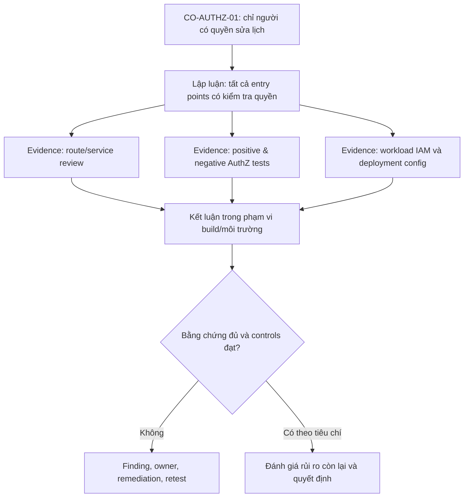
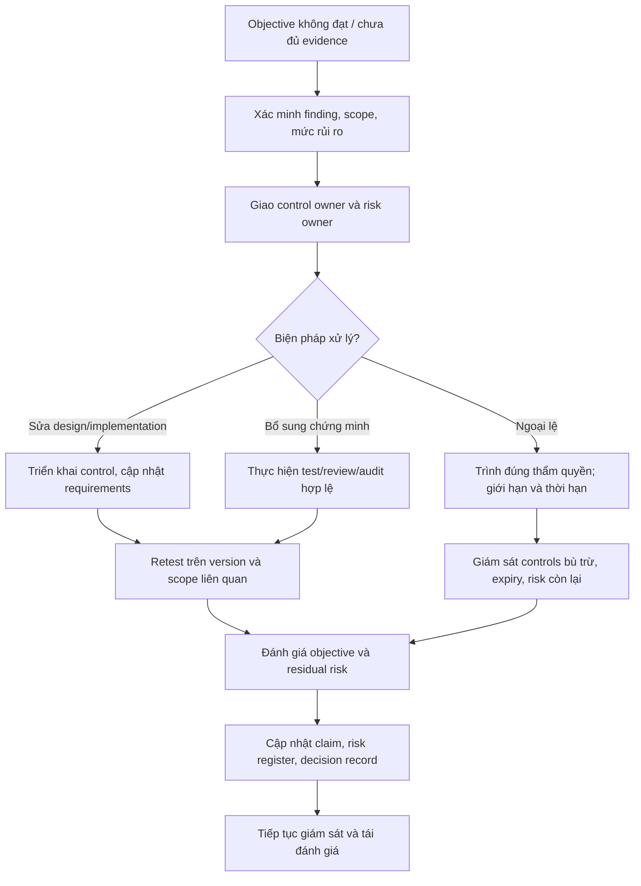

# Control objective: Mục tiêu kiểm soát trong các tiêu chuẩn bảo mật

## 1. Mục tiêu học tập

Sau bài học, người học có thể:

1. Định nghĩa **control objective** (mục tiêu kiểm soát) và phân biệt nó với *security objective*, *security requirement*, *security control*, thủ tục kiểm thử và bằng chứng.
2. Hiểu cách các tiêu chuẩn/khung bảo mật giúp xác định và kiểm tra mục tiêu kiểm soát, đồng thời tránh nhầm việc “có chứng chỉ/đã tick checklist” với hiệu quả bảo mật thực tế.
3. Viết mục tiêu kiểm soát có **phạm vi, đối tượng, kết quả mong đợi, điều kiện đánh giá và chủ sở hữu rõ ràng**, dựa trên rủi ro và mục tiêu nghiệp vụ.
4. Chuyển mục tiêu kiểm soát thành thiết kế controls, trách nhiệm thực thi và tiêu chí kiểm chứng có thể thu thập bằng chứng.
5. Đánh giá **tính phù hợp của thiết kế** (*design effectiveness*) và **hiệu quả hoạt động** (*operating effectiveness*) của controls; nhận biết bằng chứng thiếu, lỗi thời hoặc không đại diện.
6. Xây dựng bảng truy vết giữa tài sản, rủi ro, mục tiêu kiểm soát, các security controls, phương pháp kiểm thử, phát hiện và rủi ro còn lại.
7. Áp dụng cách làm vào hệ thống Java/Spring Boot, sau đó duy trì mục tiêu kiểm soát xuyên suốt phát triển, phát hành và vận hành.

Bài thuộc chương **Security standard** của module **SECURITY_SECURITY_ASSURANCE**. Module hướng tới việc **đánh giá có bằng chứng** rằng hệ thống đáp ứng mục tiêu bảo mật: từ phân tích rủi ro, yêu cầu và security controls tới kiểm thử, audit, khắc phục phát hiện và chương trình assurance liên tục. Trong chuỗi này, **control objective** là cầu nối giữa **điều tổ chức cần đạt** và **điều có thể chứng minh bằng việc kiểm tra controls cụ thể**.

## 2. Control objective là gì?

**Control objective** mô tả **kết quả kiểm soát mong muốn** mà tổ chức muốn đạt được để quản lý một hoặc nhiều rủi ro. Nó trả lời câu hỏi:

> Khi các biện pháp kiểm soát hoạt động đúng, trạng thái bảo vệ hoặc mức độ kiểm soát nào cần được bảo đảm trong phạm vi đã xác định?

Ví dụ:

- “Chỉ các chủ thể được ủy quyền mới có thể truy cập hoặc sửa dữ liệu tài khoản khách hàng theo quyền nghiệp vụ được phê duyệt.”
- “Các thay đổi code và cấu hình có ảnh hưởng bảo mật trước khi vào production phải được kiểm tra, phê duyệt đúng thẩm quyền và có khả năng truy vết.”
- “Các sự kiện bảo mật trọng yếu phải được ghi nhận và có thể được phát hiện, điều tra trong thời gian đáp ứng mục tiêu vận hành.”
- “Dịch vụ giao dịch có thể khôi phục dữ liệu và hoạt động theo các mục tiêu khôi phục được nghiệp vụ phê duyệt.”

Mỗi phát biểu nói về **kết quả cần đạt**, không khóa tổ chức vào một sản phẩm hoặc công nghệ duy nhất. Ví dụ, “dùng sản phẩm X để quản lý quyền” là một **lựa chọn triển khai**, còn “chỉ người được ủy quyền mới thao tác” là **mục tiêu kiểm soát**.

Control objective có thể xuất phát từ rủi ro, nghĩa vụ phải tuân thủ, mục tiêu nghiệp vụ, chính sách nội bộ hoặc yêu cầu của khách hàng. Việc định nghĩa mục tiêu không tự chứng minh mục tiêu đã đạt; cần chọn controls phù hợp và kiểm tra hiệu lực.

### 2.1. Phân biệt các khái niệm gần nhau

| Khái niệm | Câu hỏi chính | Ví dụ với API chuyển tiền |
| --- | --- | --- |
| **Business objective** | Nghiệp vụ muốn đạt điều gì? | Chuyển tiền đúng, nhanh và có khả năng phục hồi |
| **Security objective** | Thuộc tính bảo mật nào phải được bảo vệ? | Không có giao dịch trái quyền, bảo vệ thông tin khách hàng |
| **Risk scenario** | Điều gì có thể khiến mục tiêu thất bại? | Người dùng B sửa lịch chuyển của tài khoản A |
| **Control objective** | Kết quả kiểm soát nào phải đạt để quản lý rủi ro? | Chỉ chủ thể được ủy quyền mới có thể sửa lịch trong tất cả luồng có hiệu lực |
| **Security requirement** | Điều kiện hệ thống/quy trình phải thực hiện hoặc thỏa mãn là gì? | Backend kiểm tra quyền trên schedule và account trước khi cập nhật |
| **Security control** | Cơ chế cụ thể nào giảm rủi ro? | Object-level authorization ở service layer, deny by default |
| **Control activity/procedure** | Ai thực thi control, khi nào và bằng cách nào? | API gọi policy service với caller, tài nguyên và hành động |
| **Control evidence** | Dựa vào đâu chứng minh control có hoạt động? | Negative integration tests, IAM review, log và báo cáo theo build |
| **Assurance conclusion** | Bằng chứng hỗ trợ kết luận nào, còn giới hạn gì? | Đạt trong phạm vi các endpoint, role và release đã kiểm chứng |

Những khái niệm liên quan nhưng **không thay thế cho nhau**. Một test thành công có thể hỗ trợ một yêu cầu cụ thể; để kết luận control objective rộng hơn đã đạt, cần kiểm tra liệu tất cả đường đi và tình huống quan trọng trong phạm vi objective đã được bao phủ hay chưa.

## 3. Vị trí của control objective trong chuỗi quản lý rủi ro

Một chương trình assurance cần chuyển mục tiêu cấp cao thành những điều có thể triển khai và xác minh:

```mermaid
flowchart LR
    B["Mục tiêu nghiệp vụ và bảo mật"] --> A["Tài sản quan trọng"]
    A --> R["Kịch bản và mức rủi ro"]
    R --> O["Control objective: kết quả cần đạt"]
    O --> Q["Security requirements"]
    Q --> C["Control design và hoạt động"]
    C --> V["Verification / testing / audit"]
    V --> E["Evidence có nguồn gốc và phạm vi"]
    E --> J["Assurance conclusion / residual risk"]
    J --> D["Quyết định và khắc phục"]
    D --> R
```



Ví dụ xuyên suốt:

1. **Mục tiêu nghiệp vụ:** chuyển tiền đúng cho chủ thể được phép.
2. **Tài sản:** tính toàn vẹn lệnh chuyển và số dư tài khoản.
3. **Rủi ro:** người dùng có token hợp lệ nhưng thao tác tài khoản không thuộc quyền.
4. **Control objective:** mọi thao tác chuyển tiền phải được ủy quyền theo chủ thể, tài nguyên và ngữ cảnh nghiệp vụ.
5. **Requirement:** kiểm tra quyền tại backend trước khi tạo hoặc cập nhật giao dịch; từ chối khi không xác minh được quyền.
6. **Controls:** identity verification, policy evaluation, object-level authorization, kiểm soát quyền của service account.
7. **Verification:** test người dùng đúng/sai quyền, tenant khác, token thiếu quyền, đường background job.
8. **Evidence:** kết quả test trên release candidate, review entry points và policy cấu hình mục tiêu.
9. **Kết luận:** mức hỗ trợ objective trong phạm vi đã thử; các đường chưa thử phải được nêu rõ.
10. **Quyết định:** sửa finding, mở rộng test, chặn release hoặc trình risk owner theo chính sách.

Nếu thiếu bước 4, nhóm có thể “có JWT, có gateway” nhưng không thể giải thích liệu những controls ấy có thực sự đạt kết quả **không chuyển tiền trái quyền** hay không.

## 4. Vai trò của tiêu chuẩn bảo mật trong xác định control objective

**Security standard** có thể cung cấp các mục tiêu, nguyên tắc, yêu cầu, danh mục controls hoặc hướng dẫn đánh giá. Không phải tiêu chuẩn nào cũng dùng đúng thuật ngữ *control objective* hoặc có cấu trúc giống nhau.

| Khung/tiêu chuẩn | Cách sử dụng để xây mục tiêu kiểm soát | Điều cần chú ý |
| --- | --- | --- |
| **ISO/IEC 27001** | Xác lập yêu cầu hệ thống quản lý an toàn thông tin và lựa chọn controls dựa trên rủi ro, trong đó có việc xác định mục tiêu và đánh giá hiệu quả | Chỉ kiểm soát theo phiên bản/phạm vi áp dụng; chứng nhận ISMS không tự chứng minh mọi ứng dụng không có lỗi |
| **ISO/IEC 27002** | Tham khảo hướng dẫn triển khai và mục đích của các controls về tổ chức, con người, vật lý và công nghệ | Cần điều chỉnh theo rủi ro, cách triển khai và trách nhiệm của tổ chức |
| **NIST CSF** | Sử dụng các kết quả an ninh mạng mong muốn (*outcomes*) để xác định khoảng cách giữa trạng thái hiện tại và mục tiêu | CSF không mặc nhiên là danh sách kiểm thử kỹ thuật hay chứng nhận một ứng dụng |
| **NIST SP 800-53** | Tham khảo danh mục các controls và hướng dẫn liên quan nhằm xây kế hoạch bảo vệ và kiểm tra theo hệ thống | Phải chọn/baseline/tailor phù hợp; không mặc định tất cả controls đều áp dụng cho mọi hệ thống |
| **CIS Controls** | Tham khảo các biện pháp thực hành được ưu tiên để giảm các nhóm rủi ro phổ biến | Biện pháp triển khai cần gắn với kết quả bảo vệ và bằng chứng vận hành |
| **PCI DSS** | Khi phạm vi thanh toán thẻ thuộc điều chỉnh, sử dụng các yêu cầu liên quan và quy trình kiểm chứng theo phiên bản có hiệu lực | Nghĩa vụ áp dụng phụ thuộc hệ thống, dữ liệu và phạm vi; không đồng nhất với bảo mật toàn doanh nghiệp |
| **OWASP ASVS** | Tham khảo các yêu cầu kiểm chứng bảo mật ứng dụng để cụ thể hóa objectives như AuthN, AuthZ, session, data protection | Cần xác định mức/phiên bản yêu cầu và phạm vi ứng dụng khi đánh giá |

**Không có phép ánh xạ “một control ở chuẩn A = một control ở chuẩn B” luôn đúng.** Hai mục có thể cùng hướng đến bảo vệ quyền truy cập nhưng khác phạm vi, mức chi tiết, đối tượng, tiêu chí và bằng chứng. Khi lập bảng mapping, cần kiểm tra **ý nghĩa thực chất** thay vì chỉ tương đồng tên gọi.

Vì các phiên bản tiêu chuẩn và nghĩa vụ áp dụng có thể thay đổi, một hồ sơ kiểm soát thực phải ghi **tên chuẩn, phiên bản/ấn bản đang dùng, điều khoản/control tham chiếu và căn cứ áp dụng**. Bài này không áp đặt một bộ tiêu chuẩn hoặc các điều khoản chi tiết cho tất cả tổ chức.

### 4.1. “Theo chuẩn” không tự động là “đã kiểm chứng”

Một tổ chức có thể có chính sách quản lý quyền phù hợp với mục tiêu của một tiêu chuẩn, nhưng API mới lại bỏ qua kiểm tra quyền ở một endpoint. Khi đó:

- **Chính sách tồn tại:** là bằng chứng về sự thiết lập định hướng.
- **Control thiết kế:** mô tả cách phân quyền dự kiến.
- **Control triển khai:** thể hiện trong code, IAM và cấu hình.
- **Control vận hành hiệu quả:** đòi hỏi bằng chứng thực tế trong phạm vi được đánh giá.

Báo cáo assurance phải phân biệt bốn mức này. Việc chỉ trích dẫn tên chuẩn không thay thế test hoặc audit phù hợp.

## 5. Viết một control objective tốt

Một mục tiêu kiểm soát nên **rõ kết quả, phạm vi và khả năng đánh giá** nhưng không quy định cứng giải pháp nếu không cần thiết.

Có thể dùng cấu trúc:

> Trong **[phạm vi/tài sản/quy trình]**, **[đối tượng/hoạt động]** phải đáp ứng **[kết quả kiểm soát]** để giảm **[rủi ro/hậu quả]**, với **[điều kiện và cách đánh giá]** được xác định bởi tổ chức.

Ví dụ:

> Đối với mọi thao tác tạo, sửa, hủy lịch chuyển tiền trong dịch vụ thanh toán, hệ thống phải bảo đảm chỉ chủ thể được ủy quyền theo tài khoản và quyền nghiệp vụ mới thay đổi trạng thái; các trường hợp không có quyền hoặc không thể xác minh quyền phải bị từ chối trước khi thực hiện tác động, và hiệu lực được kiểm tra bằng các kịch bản quyền dương tính/âm tính trên bản phát hành mục tiêu.

Mục tiêu trên cho biết **ai**, **điều gì**, **ở đâu**, **để làm gì** và **cách xác minh ở mức khái quát**.

### 5.1. Sáu tiêu chí đánh giá chất lượng objective

| Tiêu chí | Câu hỏi kiểm tra | Sai lầm cần tránh |
| --- | --- | --- |
| **Liên quan rủi ro** | Objective giảm rủi ro hay bảo vệ tài sản nào? | Ghi mục tiêu vì công cụ có sẵn |
| **Kết quả rõ** | Trạng thái đạt được là gì? | “Tăng cường bảo mật” nhưng không nói kết quả |
| **Phạm vi cụ thể** | Gồm những hệ thống, data flows, actor, môi trường nào? | Chỉ nói “mọi truy cập” mà không có ranh giới |
| **Có thể kiểm chứng** | Bằng chứng nào có thể ủng hộ hoặc bác bỏ? | Chỉ dùng lời cam kết của nhóm |
| **Có owner và thẩm quyền** | Ai chịu trách nhiệm control, ai đánh giá và ai quyết định rủi ro? | Không ai sở hữu việc kiểm chứng |
| **Có vòng đời** | Khi thay đổi nào cần xem lại mục tiêu/controls? | Objective “đạt một lần” rồi bỏ quên |

Mục tiêu không cần chứa mọi chi tiết kỹ thuật. Các ngưỡng đo, test cases, thời hạn và ngoại lệ có thể nằm ở **security requirement, control specification và assurance plan** liên kết với objective.

### 5.2. Từ mục tiêu mơ hồ sang mục tiêu có thể đánh giá

| Phát biểu yếu | Control objective rõ hơn | Gợi ý bằng chứng |
| --- | --- | --- |
| “Ứng dụng phải bảo mật” | Các thao tác tài nguyên nhạy cảm chỉ được thực hiện bởi chủ thể được ủy quyền và có khả năng truy vết | AuthZ tests, review access paths, audit logs |
| “Phải mã hóa mọi thứ” | Dữ liệu thuộc lớp phân loại đã xác định được bảo vệ trước truy cập/tiết lộ trái phép khi truyền và lưu, theo chính sách dữ liệu | Data-flow map, TLS/config review, key/IAM review |
| “Phải ghi log đầy đủ” | Hành động đặc quyền và sự kiện có tác động bảo mật phải có dấu vết đủ để điều tra trong phạm vi retention được phê duyệt | Event tests, correlation, retention/access review |
| “Backup phải chạy” | Dịch vụ trọng yếu khôi phục được dữ liệu và hoạt động theo các mục tiêu phục hồi đã phê duyệt | Restore drills, recovery reports, integrity checks |
| “Không có lỗ hổng” | Các rủi ro kỹ thuật và nghiệp vụ trọng yếu được nhận diện, xử lý hoặc chấp nhận đúng thẩm quyền trước mốc quyết định | Risk register, test/pentest results, approval records |
| “Có kiểm tra nhà cung cấp” | Phụ thuộc bên ngoài trọng yếu được đánh giá rủi ro và các trách nhiệm/controls cần thiết có bằng chứng phù hợp | Vendor assessment, contracts, assurance artifacts |

Tránh đặt mục tiêu tuyệt đối không thể xác minh trong điều kiện thực tế, ví dụ “hệ thống không bao giờ bị tấn công”. Có thể đặt những **kết quả kiểm soát cụ thể** và đánh giá chất lượng bằng chứng cùng rủi ro còn lại.

## 6. Mục tiêu kiểm soát và mức chấp nhận rủi ro

Control objective cần tương thích với **risk appetite/tolerance**, giá trị tài sản và yêu cầu của tổ chức.

Ví dụ cùng là lưu log:

- Với dịch vụ ít nhạy cảm, cần sự kiện vận hành cơ bản để điều tra lỗi.
- Với dịch vụ chuyển tiền, những sự kiện như tạo lệnh, thay đổi quyền, từ chối giao dịch, phê duyệt đặc quyền và kết quả xử lý cần khả năng truy vết tốt hơn.
- Với môi trường đòi hỏi nghĩa vụ lưu hồ sơ cụ thể, retention, tính toàn vẹn và quyền truy xuất phải đáp ứng các điều kiện áp dụng của tổ chức.

Không nên tự đặt một ngưỡng như “mọi log phải giữ 365 ngày” hoặc “mỗi cảnh báo xử lý trong 5 phút” nếu chưa biết **nghĩa vụ, mức tác động, năng lực vận hành và chính sách được phê duyệt**.

Một objective có thể có ngưỡng đo phù hợp từng dịch vụ. Quan trọng là **ngưỡng và phương pháp kiểm chứng phải được xác định trước khi đánh giá**, để tránh nới lỏng tiêu chí chỉ vì kết quả test bất lợi.

## 7. Một objective có thể cần nhiều controls

Control objective diễn tả kết quả; để đạt kết quả đó thường cần các biện pháp ở nhiều lớp.

Ví dụ objective **“chỉ người có quyền mới thay đổi tài khoản khách hàng”**:

| Lớp | Control | Vai trò trong objective |
| --- | --- | --- |
| Identity | Xác thực người dùng/token theo nguồn tin cậy | Xác định caller |
| Authorization | Kiểm tra quyền theo tài khoản ở service layer | Ngăn thao tác trái quyền trên đối tượng |
| Application | Deny by default, kiểm soát mọi đường xử lý | Hạn chế bypass |
| Data | Ràng buộc tenant/account trong truy vấn và transaction | Ngăn truy cập/ghi sai phạm vi |
| Platform | Least privilege cho service account | Giới hạn thiệt hại khi workload bị chiếm |
| Monitoring | Log các thao tác nhạy cảm và truy cập bị từ chối | Phát hiện/điều tra lạm dụng |
| Governance | Review quyền, cấp/thu hồi truy cập, xử lý ngoại lệ | Duy trì hiệu lực theo thời gian |

Có thể một control phục vụ **nhiều objectives**. Chẳng hạn centralized security logging hỗ trợ truy vết, phát hiện, ứng phó và audit. Vì vậy mô hình mapping thường là **nhiều–nhiều** (*many-to-many*), không phải mỗi objective chỉ có một control.

### 7.1. Phân biệt loại control

| Loại | Mục đích | Ví dụ |
| --- | --- | --- |
| **Preventive — phòng ngừa** | Giảm khả năng xảy ra hành vi trái phép | Authorization, input validation, IAM, network policy |
| **Detective — phát hiện** | Phát hiện hành vi hoặc điều kiện bất thường | Security logs, alerts, monitoring, integrity checks |
| **Corrective — khắc phục** | Xử lý sau khi phát hiện điều kiện sai | Vá lỗ hổng, rotate credential, sửa dữ liệu qua quy trình |
| **Recovery — phục hồi** | Khôi phục hoạt động/dữ liệu sau sự cố | Restore, failover, recovery runbooks |
| **Compensating — bù trừ** | Giảm rủi ro khi control dự kiến chưa triển khai/không phù hợp | Giảm phạm vi chức năng, approval bổ sung, giám sát tăng cường |

Phân loại chỉ hỗ trợ tư duy; không thay thế đánh giá hiệu quả. Một control vừa có thể phòng ngừa vừa tạo dữ liệu phát hiện. Objective cần nêu kết quả tổng thể và **cách các lớp kiểm soát phối hợp**.

## 8. Từ objective sang security requirements có thể kiểm thử

Control objective và security requirement gần nhau nhưng nên giữ vai trò khác nhau:

- **Objective:** kết quả được mong muốn trên phạm vi nghiệp vụ/hệ thống.
- **Requirement:** hành vi hoặc điều kiện cụ thể mà thành phần/hoạt động phải đáp ứng.
- **Acceptance criterion:** tình huống, kết quả mong đợi và tiêu chí đánh giá rõ ràng.

Ví dụ objective `CO-AUTHZ-01`:

> Mọi thay đổi giao dịch phải đến từ chủ thể có quyền với tài khoản nguồn và bị từ chối nếu không xác minh được quyền.

Các requirements:

| ID | Requirement | Acceptance criterion |
| --- | --- | --- |
| REQ-AUTHZ-01 | API xác minh danh tính và quyền theo tài khoản nguồn trước khi tạo lệnh | Caller không có quyền bị từ chối, không ghi DB, không gửi event |
| REQ-AUTHZ-02 | Mọi API tạo, sửa, hủy lịch đều kiểm tra quyền trên tài nguyên | Negative tests bao phủ các endpoint và đối tượng liên quan |
| REQ-AUTHZ-03 | Worker chỉ xử lý lịch được tạo hợp lệ theo thiết kế được duyệt | Review đường phát event, kiểm thử event sai hoặc không hợp lệ |
| REQ-AUTHZ-04 | Service account chỉ có quyền cần thiết | Review IAM thực tế và test những quyền không được phép |
| REQ-AUTHZ-05 | Truy cập bị từ chối được ghi nhận theo chính sách | Có sự kiện phù hợp và không lộ secret hoặc thông tin nhạy cảm |

Một yêu cầu chỉ có mô tả “backend sẽ kiểm tra quyền” mà không nói **trước tác động nào, ở tất cả đường đi nào, từ chối như thế nào** vẫn dễ triển khai thiếu.

### 8.1. Gherkin giúp định nghĩa hành vi cần chứng minh

Ví dụ kịch bản nghiệp vụ:

```gherkin
Feature: Authorization when editing a transfer schedule

  Scenario: Account owner edits own schedule
    Given Alice is authenticated
    And schedule S belongs to Alice's authorized account
    When Alice updates schedule S with valid data
    Then the authorized update succeeds

  Scenario: Another user cannot edit the schedule
    Given Bob is authenticated
    And schedule S belongs to Alice's account
    And Bob has no permission over that account
    When Bob attempts to update schedule S
    Then the request is rejected
    And schedule S is unchanged
    And no transfer execution event is emitted

  Scenario: Authorization cannot be established
    Given the authorization decision is unavailable
    When a protected schedule update is requested
    Then the update is denied according to the approved policy
    And the system does not commit the protected state change
```

Đây là đặc tả **hành vi kỳ vọng**, không phải bằng chứng test đã chạy. Bằng chứng cần là kết quả thực thi test trên bản build và môi trường phù hợp.

## 9. Phạm vi áp dụng và lựa chọn objectives

Không phải mọi control objective đều cần áp dụng với mức độ giống nhau cho mọi tài sản. Việc lựa chọn nên dựa trên **risk assessment và obligations**.

Một quy trình lựa chọn:

1. Xác định dịch vụ, nghiệp vụ, tài sản, dữ liệu và mức quan trọng.
2. Đặt mục tiêu bảo mật và phân tích những kịch bản có thể làm thất bại mục tiêu.
3. Xác định các yêu cầu pháp lý/hợp đồng, chính sách và chuẩn được tổ chức lựa chọn.
4. Chọn objectives có khả năng giảm rủi ro hoặc đáp ứng nghĩa vụ.
5. Ánh xạ tới những controls hiện có và những controls cần bổ sung.
6. Ghi lý do áp dụng, phần không áp dụng, trách nhiệm và giới hạn.
7. Đặt test/audit/evidence và cơ chế giám sát phù hợp.
8. Đánh giá lại khi hệ thống, dữ liệu hoặc đe dọa thay đổi.

Trong ISMS áp dụng ISO/IEC 27001, **Statement of Applicability (SoA)** là một hiện vật quan trọng giải thích các controls cần thiết, quyết định bao gồm/loại trừ theo yêu cầu áp dụng và trạng thái triển khai. Không nên coi SoA là danh sách “tick đạt” hoặc làm giả lý do loại trừ. Control objective của hệ thống có thể được ánh xạ tới SoA hoặc các hồ sơ tương đương theo mô hình tổ chức, nhưng nội dung phải được xây trên **risk treatment thực tế**.

### 9.1. Khi một objective được tuyên bố “không áp dụng”

Một lý do đúng cần:

- Nêu phạm vi và tài sản nào không chịu kịch bản rủi ro/điều kiện áp dụng đó.
- Có dữ kiện hỗ trợ; ví dụ dịch vụ không lưu/truyền loại dữ liệu yêu cầu control cụ thể.
- Kiểm tra phụ thuộc, các bản sao dữ liệu và nghĩa vụ có liên quan.
- Được review/phê duyệt theo chính sách, có trigger khi điều kiện đổi.
- Không mâu thuẫn với nghĩa vụ bắt buộc phải đáp ứng.

**“Không có thời gian/budget” không tự động là “không áp dụng”.** Nếu objective vẫn cần thiết, đây là **control gap, kế hoạch xử lý hoặc risk exception**, không phải cơ sở hợp lý để xóa yêu cầu.

## 10. Mẫu bản ghi control objective

Một bản ghi hữu ích nên đủ dữ liệu để người xây control và người kiểm chứng hiểu cùng một mục tiêu.

| Trường | Mục đích |
| --- | --- |
| `objective_id` | Định danh ổn định để liên kết risk, control, evidence |
| Tiêu đề và kết quả | Mô tả outcome rõ ràng, không mơ hồ |
| Tài sản/phạm vi | Hệ thống, luồng, dữ liệu, actor, môi trường, thời điểm |
| Rủi ro được quản lý | Kịch bản và mức tác động có liên quan |
| Nguồn yêu cầu | Chính sách, tiêu chuẩn, nghĩa vụ, khách hàng hoặc risk assessment |
| Owner | Người chịu trách nhiệm objective và control operation |
| Control design | Một hoặc nhiều controls, nơi thực thi và failure behavior |
| Requirements | Tiêu chí kỹ thuật/quy trình có thể kiểm chứng |
| Testing/evidence | Phương pháp, frequency/trigger, artifact và người đánh giá |
| Kết quả | Planned/implemented/verified; kết quả và giới hạn |
| Findings/residual risk | Những vấn đề chưa đạt, kế hoạch xử lý và người sở hữu |
| Vòng đời | Phiên bản, ngày review, thời điểm và trigger đánh giá lại |

### 10.1. Ví dụ YAML cho một objective

Đây là **mẫu giảng dạy**, không phải định dạng bắt buộc của module hoặc bằng chứng rằng hệ thống đã đạt mục tiêu:

```yaml
control_objective:
  id: CO-AUTHZ-01
  title: "Chỉ chủ thể được ủy quyền thay đổi lịch chuyển tiền"
  outcome: >
    Mọi thao tác tạo, sửa hoặc hủy lịch trong phạm vi dịch vụ
    phải được kiểm tra quyền theo caller, tài khoản nguồn,
    tài nguyên và ngữ cảnh nghiệp vụ trước khi gây tác động.
  scope:
    service: scheduled-transfer-api
    release: "<target-build>"
    environment: "<target-environment>"
    operations: [create, update, cancel]
    entry_points: ["REST API", "approved background flows"]
  assets: ["transaction-integrity", "account-data"]
  risks: ["R-UNAUTHORIZED-SCHEDULE"]
  sources:
    - "<approved-policy-or-standard-reference-with-edition>"
  objective_owner: "<service-or-risk-owner>"
  control_owners: ["<engineering-team>", "<platform-team>"]
  requirements:
    - REQ-AUTHZ-01
    - REQ-AUTHZ-02
    - REQ-AUTHZ-03
  controls:
    - CTRL-IDENTITY-01
    - CTRL-OBJECT-AUTHZ-01
    - CTRL-WORKLOAD-IAM-01
  verification:
    - method: "Authorization integration tests"
      evidence: "<protected-build-linked-report>"
      status: pending
    - method: "Service path and IAM review"
      evidence: "<review-link>"
      status: pending
  current_result: "not_yet_verified"
  evidence_limitations:
    - "<untested-roles-or-environment-differences>"
  residual_risk:
    assessment: pending
    owner: "<authorized-risk-owner>"
  review:
    updated_at: "<UTC-date>"
    next_due_at: "<date-based-on-risk>"
    triggers:
      - "Thay đổi AuthN/AuthZ, role hoặc tenant model"
      - "Thêm đường thực thi lịch hoặc service identity"
      - "Có phát hiện mới hay control thất bại"
```

Không điền `current_result: verified` nếu chỉ mới viết requirement hoặc merge code. Cần kết quả kiểm tra đúng phạm vi để đánh giá trạng thái.

## 11. Mapping giữa standard, objective, control và bằng chứng

Trong môi trường có nhiều chuẩn hoặc nghĩa vụ, việc tạo **control library thống nhất** giúp giảm trùng lặp, nhưng phải giữ được nguồn và sự khác biệt trong yêu cầu.

Ví dụ:

| Control objective nội bộ | Nguồn tham chiếu có thể liên quan | Controls nội bộ | Evidence đề xuất |
| --- | --- | --- | --- |
| CO-ACCESS: truy cập có quyền | Chính sách IAM; chủ đề access control trong ISO/IEC 27002, NIST hoặc ASVS tùy phạm vi | AuthN, object-level AuthZ, IAM least privilege | User/role negative tests, IAM review |
| CO-CHANGE: thay đổi production được kiểm soát | Chủ đề change management và secure development | Protected branches, review, deploy permissions | Change records, PR approval, pipeline logs |
| CO-LOG: hoạt động nhạy cảm được truy vết | Chủ đề logging/monitoring trong các khung liên quan | Event schema, central logs, alerting, access policy | Event/alert tests, log integrity review |
| CO-DATA: dữ liệu được bảo vệ | Chính sách dữ liệu; các mục data protection phù hợp | Data classification, encryption, KMS, masking | Data-flow review, config/IAM tests |
| CO-RESILIENCE: dịch vụ phục hồi theo mục tiêu | Yêu cầu continuity và recovery phù hợp | Backup, restore runbook, failover, idempotency | Restore exercise, failure tests |
| CO-SUPPLIER: phụ thuộc được quản lý | Yêu cầu supplier/cloud risk của tổ chức | Risk review, shared-responsibility mapping, exit plan | Hợp đồng, vendor evidence, integration tests |

Cột “nguồn tham chiếu” trong bảng chỉ mô tả **các chủ đề có thể tương ứng**, không tuyên bố mapping chính thức hay tương đương điều khoản. Khi làm việc thực, cần điền mã điều khoản/control cụ thể của **phiên bản chuẩn đang áp dụng** và kiểm tra nội dung từng yêu cầu.

### 11.1. Một objective có thể nhận nhiều nguồn

Ví dụ “hạn chế quyền truy cập dữ liệu cá nhân” có thể được thúc đẩy bởi:

- Rủi ro nghiệp vụ lộ dữ liệu.
- Chính sách phân loại và quyền truy cập nội bộ.
- Yêu cầu từ tiêu chuẩn quản lý an toàn thông tin.
- Nghĩa vụ pháp lý hoặc hợp đồng tùy ngữ cảnh.

Các nguồn không làm objective “mạnh hơn” chỉ bởi số lượng. Cần kiểm tra **phạm vi, điều kiện, mức bảo vệ và tiêu chí kiểm chứng** của từng nguồn, tránh suy luận rằng một test ngắn đủ đáp ứng mọi nghĩa vụ.

## 12. Control objective và thiết kế assurance case

Một **assurance case** là lập luận có cấu trúc liên kết một khẳng định bảo mật với cơ sở lập luận và bằng chứng. Control objective cung cấp kết quả mà ta muốn chứng minh.

Ví dụ:

- **Claim:** Các thao tác thay đổi lịch chuyển tiền chỉ có thể được thực hiện bởi chủ thể có quyền trong phạm vi release X.
- **Argument:** Mọi entry point được xác định; caller được xác thực; authorization được kiểm tra theo tài nguyên; các đường worker chỉ thực thi các lịch đã được phép; các controls ngăn bypass.
- **Evidence:** Sơ đồ luồng, code/IAM review, tests dương tính và âm tính, cấu hình deployment, kết quả kiểm chứng đường background.
- **Assumptions:** Mô hình quyền với tài khoản đầy đủ và nhất quán; deployment dùng đúng policy và artifact đã kiểm tra.
- **Limits:** Những vai trò/luồng/môi trường chưa thử hoặc sự phụ thuộc mà bằng chứng chưa đủ.
- **Conclusion:** Objective được hỗ trợ đến mức nào, rủi ro còn lại và cần bổ sung việc gì.



Phần quan trọng nhất: **claim có phạm vi rộng hơn evidence thì không được đánh dấu đạt đầy đủ**. Có thể kết luận “đạt trên các luồng đã thử, cần kiểm tra worker” thay vì tuyên bố toàn bộ objective đã được chứng minh.

## 13. Design effectiveness và operating effectiveness

Đánh giá control objective không chỉ xem nó có được mô tả trong tài liệu hay không.

### 13.1. Design effectiveness — tính phù hợp của thiết kế

Câu hỏi: **Nếu triển khai và vận hành đúng như thiết kế, controls có đủ để đạt objective trong kịch bản rủi ro được xét không?**

Bằng chứng có thể gồm:

- Threat model, asset/data-flow diagrams, trust boundaries.
- Security requirements, ADR, control specifications và failure behavior.
- Review phân quyền, phân lớp bảo vệ, dependencies và điều kiện bypass.
- Phương pháp kiểm chứng được đề xuất đủ để phân biệt pass/fail.

Ví dụ, một thiết kế phân quyền chỉ ở API Gateway có thể **thiếu ngữ cảnh quyền trên từng tài khoản**. Khi đó design review có thể phát hiện objective chưa được đáp ứng **ngay cả trước khi test code**.

### 13.2. Operating effectiveness — hiệu quả hoạt động

Câu hỏi: **Trong hệ thống và kỳ đánh giá thực tế, controls có hoạt động như đã thiết kế không?**

Bằng chứng có thể gồm:

- Integration tests trên build mục tiêu, bao phủ tình huống dương tính/âm tính.
- Runtime configuration/IAM snapshots và review quyền.
- Audit logs, alert simulation, control health và kiểm tra vận hành.
- Retest sau khắc phục và bằng chứng trên deployment phù hợp.
- Mẫu hồ sơ thay đổi/cấp quyền trong kỳ đánh giá, nếu control vận hành theo quy trình.

### 13.3. So sánh hai cấp độ

| Objective | Bằng chứng thiết kế | Bằng chứng vận hành |
| --- | --- | --- |
| Chỉ người có quyền truy cập dữ liệu | Access control model và threat model | IAM configuration, authorization tests, access review |
| Chỉ artifact đã kiểm soát được deploy | Secure CI/CD design và policy | Pipeline runs, approvals, artifact provenance, deploy audit |
| Sự kiện quan trọng được phát hiện | Logging schema và detection rules thiết kế | Alert simulation, monitoring records, triage logs |
| Khôi phục dữ liệu đúng mục tiêu | Backup architecture, RTO/RPO plan | Restore exercise và kiểm tra integrity theo phạm vi |
| Nhà cung cấp được đánh giá | Supplier risk assessment process | Hồ sơ đánh giá, hợp đồng, kiểm tra định kỳ và follow-up |

Một control có thể **đúng thiết kế nhưng sai vận hành**, ví dụ policy quy định log không được xóa bởi app admin nhưng IAM thực tế vẫn cho phép họ xóa. Ngược lại, vài test hoạt động có thể pass dù thiết kế thiếu đường xử lý quan trọng. Cần đánh giá cả hai khi mức rủi ro yêu cầu.

## 14. Chọn test và bằng chứng phù hợp với objective

Bằng chứng cần bám **điều kiện đạt**, không bám vào công cụ quen thuộc.

| Control objective | Test hoặc review phù hợp | Giới hạn cần lưu |
| --- | --- | --- |
| Ngăn truy cập trái quyền | Role/tenant/object-level authorization tests, code/path review | Chưa thử mọi đường batch hoặc sản phẩm phụ |
| Tránh xử lý thanh toán hai lần | Duplicate event, concurrency, retry, failure tests, đối soát | Provider không cho phép thử mọi trạng thái lỗi |
| Ngăn lộ secret | Secret scan, runtime access tests, IAM review, rotation evidence | Scan repository không thấy secret không chứng minh runtime không lộ |
| Bảo vệ dữ liệu khi truyền/lưu | TLS/config review, encryption/key/IAM checks | Cấu hình staging có thể khác production |
| Phát hiện hành vi nhạy cảm | Tạo sự kiện thử, kiểm tra log/alert và thời gian phát hiện | Một lần simulation không đại diện mọi sự cố |
| Khôi phục dịch vụ | Restore/failover drill, data integrity checks | Chưa mô phỏng mọi hỏng hóc đồng thời |
| Thay đổi có phê duyệt | Review mẫu PR/change records, pipeline/IAM controls | Mẫu không đại diện nếu kỳ đánh giá hoặc quy trình khác |
| Thu hồi quyền kịp thời | Kiểm tra quy trình offboarding, role update, token/session behavior | Cần ghi thời gian, scope và đặc tính loại token |

Không dùng một kết quả quét CVE để chứng minh objective liên quan **logic nghiệp vụ**, và cũng không dùng một test HTTP 403 để kết luận mọi object-level authorization đều đúng.

### 14.1. Đọc một kết quả test đúng cách

Ví dụ test cho Bob sửa lịch của Alice trả `403 Forbidden`. Để đánh giá objective, phải hỏi:

1. Bob đã được **xác thực hợp lệ** chưa, hay request bị từ chối vì token sai/hết hạn?
2. Lịch thực sự thuộc Alice và Bob **không có quyền** theo nguồn dữ liệu đáng tin chưa?
3. Phản hồi 403 xảy ra **trước khi trạng thái bị thay đổi** và trước khi event phát đi chưa?
4. Có đường đi khác như bulk API, scheduled job, admin API hoặc event consumer có thể bypass không?
5. Test dùng bản build và chính sách của môi trường nào?
6. Đã có trường hợp người có quyền được phép thực hiện để phân biệt lỗi hệ thống với kiểm soát đúng chưa?

Một evidence tốt cho objective có thể là **bộ bằng chứng nhiều nguồn**, không chỉ một HTTP response.

## 15. Độ phủ, tần suất và phương pháp lấy mẫu

Không phải objective nào cũng cần kiểm thử 100% các giao dịch thực tế. Cần chọn **kiểm tra liên tục, kiểm thử theo sự kiện, lấy mẫu hay đánh giá định kỳ** dựa trên rủi ro.

Ví dụ:

- **Mỗi build:** chạy security regression và kiểm tra cấu hình/secret/dependency phù hợp.
- **Mỗi thay đổi quyền hoặc trust boundary:** review kiến trúc và kiểm chứng các role/entry points ảnh hưởng.
- **Mỗi release:** xác định controls trọng yếu, bằng chứng theo bản build, exception và release gate.
- **Định kỳ:** review quyền, kiểm tra hoạt động log, diễn tập phục hồi và đánh giá evidence freshness.
- **Sau sự cố hoặc phát hiện mới:** xem lại thiết kế, kịch bản đe dọa, control và các yêu cầu liên quan.

Với controls thủ công, lấy mẫu hồ sơ theo kỳ có thể phù hợp. Báo cáo phải ghi **cách chọn mẫu, kỳ được đánh giá, số mẫu, tiêu chí và giới hạn suy luận**; không thể kết luận “control hoạt động suốt năm” chỉ từ vài mẫu không đại diện mà không có lý do.

Một công thức độ phủ đơn giản chỉ để quản lý phạm vi:

\[
Coverage = \frac{\text{số objective trọng yếu có bằng chứng hợp lệ}}{\text{tổng objective trọng yếu trong phạm vi}}
\]

Chỉ số này có ý nghĩa nếu các mục tiêu đã được nhận diện đầy đủ, cách định nghĩa “bằng chứng hợp lệ” nhất quán và không coi coverage là thước đo trực tiếp “độ an toàn”. Objective có một test yếu không nên được xem như bảo đảm hoàn chỉnh.

## 16. Phân định trách nhiệm và ba tuyến kiểm tra

Control objective thường yêu cầu **nhiều nhóm phối hợp**.

| Vai trò | Trách nhiệm gợi ý |
| --- | --- |
| Business/Service Owner | Xác định mục tiêu nghiệp vụ, tác động và yêu cầu bảo vệ của dịch vụ |
| Risk Owner | Sở hữu rủi ro, lựa chọn treatment và chấp nhận residual risk trong quyền hạn |
| Security Architect | Định nghĩa objective và requirements theo rủi ro, đánh giá control design và trust boundaries |
| CISO/Security Leadership | Cung cấp chính sách, chuẩn nội bộ, chương trình assurance và giám sát rủi ro trọng yếu |
| Engineering | Thiết kế/triển khai code và security controls trong hệ thống |
| Platform/SRE/Operations | Triển khai và duy trì IAM, network, runtime config, logging, backup và control health |
| QA/AppSec/Assessor | Thiết kế verification, thu evidence, kết luận phạm vi và giới hạn; có thể cần đánh giá độc lập |
| Audit | Đánh giá độc lập hiệu lực quản trị/quy trình/controls theo phạm vi được giao |
| Compliance/Legal | Làm rõ nghĩa vụ áp dụng và bằng chứng cần giữ theo yêu cầu cụ thể |

**Một người có thể giữ nhiều vai trò trong tổ chức nhỏ**, nhưng khi rủi ro cao cần bù đắp xung đột lợi ích bằng review chéo hoặc độc lập phù hợp. Người xây control không mặc nhiên là người duy nhất kết luận objective đạt và chấp nhận mọi rủi ro còn lại.

### 16.1. Ma trận RACI minh họa

**R**: Responsible (thực hiện); **A**: Accountable (chịu trách nhiệm cuối); **C**: Consulted (tham vấn); **I**: Informed (được biết).

| Hoạt động | Service/Risk Owner | Security Architect | Engineering/Platform | Assessor/AppSec |
| --- | --- | --- | --- | --- |
| Xác lập objective và phạm vi theo rủi ro | **A** | **R** | C | C |
| Chuyển objective thành requirements/controls | **A** | **R** | C | C |
| Triển khai các controls | I | C | **A/R** | C |
| Kiểm tra hiệu quả trên bản mục tiêu | I | C | C | **A/R** |
| Xử lý phát hiện và bằng chứng retest | **A** | C | **R** | **R** (phần kiểm chứng) |
| Chấp nhận rủi ro còn lại | **A/R** nếu được phân quyền | C | C | C |
| Cập nhật objective khi thay đổi trọng yếu | **A** | **R** | C | C |

Trong thực tế, quyền chấp nhận rủi ro, phê duyệt release và yêu cầu đánh giá độc lập phải tuân theo **chính sách/thẩm quyền của tổ chức**; bảng chỉ hỗ trợ phân định công việc.

## 17. Mối quan hệ giữa objective, control gap và finding

Một control objective có thể chưa được đáp ứng vì:

1. **Thiếu thiết kế:** chưa có control phù hợp với rủi ro.
2. **Thiết kế yếu:** control tồn tại nhưng không bao phủ một entry point hoặc failure mode.
3. **Triển khai sai:** code/IAM/config lệch so với thiết kế được duyệt.
4. **Vận hành không hiệu quả:** logging không gửi cảnh báo, backup không restore, quyền không được thu hồi.
5. **Thiếu bằng chứng:** control có thể hoạt động nhưng không có cách kiểm chứng đủ tin cậy.
6. **Thay đổi điều kiện:** threat model, dữ liệu, nhà cung cấp hoặc architecture đổi làm kết luận cũ hết hiệu lực.

Cần phân biệt:

- **Objective gap:** kết quả mục tiêu chưa được đáp ứng hoặc chưa thể chứng minh theo tiêu chí.
- **Finding:** quan sát cụ thể trái với yêu cầu hoặc tiêu chí, có bằng chứng và phạm vi.
- **Risk scenario:** sự kiện/hậu quả mà gap hoặc finding có thể gây ra.
- **Remediation:** hành động có owner và hạn để cải thiện control hoặc bổ sung evidence.
- **Exception/risk acceptance:** quyết định có điều kiện và thẩm quyền, không đồng nghĩa objective đã đạt.

Ví dụ: “Không tìm thấy test khôi phục backup” là **evidence gap**; chưa thể kết luận backup không dùng được, nhưng cũng không thể khẳng định objective khôi phục đã đạt. Phải tổ chức diễn tập phù hợp hoặc báo cáo giới hạn và rủi ro chưa được chứng minh.

### 17.1. Quy trình xử lý gap



Chỉ đóng objective gap “đã đạt” khi evidence đủ hỗ trợ theo tiêu chí đã chốt. Với ngoại lệ hợp lệ, có thể báo **chấp nhận rủi ro còn lại** nhưng phải giữ nguyên sự thật rằng objective/control chưa được chứng minh hoàn toàn.

## 18. Bằng chứng đáng tin và vòng đời evidence

Một control objective có thể tồn tại nhiều năm; **bằng chứng về hiệu lực của nó chỉ có ý nghĩa trong phạm vi và thời điểm phù hợp**.

### 18.1. Những thông tin evidence tối thiểu

| Metadata | Ví dụ |
| --- | --- |
| Evidence ID | EV-AUTHZ-2026-EXAMPLE |
| Objective/control/requirement | CO-AUTHZ-01 / CTRL-OBJECT-AUTHZ-01 / REQ-AUTHZ-02 |
| Đối tượng | API, endpoint, worker, IAM hoặc quy trình được kiểm tra |
| Phiên bản | Commit, build, image digest, deployment ID hoặc policy revision |
| Môi trường | Staging/production, cloud account, tenant và cấu hình liên quan |
| Phương pháp | Integration test, IAM review, manual audit, alert simulation |
| Người/công cụ thực hiện | Người đánh giá và nguồn kiểm chứng |
| Thời gian | Khi nào thu thập và thời hạn/mốc cập nhật |
| Kết quả | Pass, fail, partial, not tested; chi tiết phát hiện |
| Giới hạn | Vai trò, luồng, tình huống lỗi và điều kiện chưa thử |
| Tính toàn vẹn | Nơi lưu artifact, phân quyền, lịch sử thay đổi, có thể kiểm tra lại |

Đánh giá **độ tin cậy** dựa trên mức liên quan, độ phủ, khả năng tái lập, tính nguyên vẹn và độ mới của bằng chứng. Một kết quả quét từ nhiều tháng trước có thể vẫn hữu ích về lịch sử nhưng không tự chứng minh bản release hiện tại.

### 18.2. Phân biệt “không có lỗi” và “không có bằng chứng”

| Trạng thái | Nên báo cáo |
| --- | --- |
| Kiểm thử đầy đủ theo phạm vi, không tìm thấy vấn đề | “Không phát hiện vi phạm trong các kịch bản đã thử” kèm giới hạn |
| Một kịch bản kiểm thử thất bại | “Control không đạt trong điều kiện đã kiểm tra”; mở finding |
| Chưa chạy kiểm thử | “Chưa kiểm chứng”; không ghi pass |
| Chạy kiểm thử ở bản/môi trường cũ | “Bằng chứng có giới hạn hiệu lực”; cần so sánh thay đổi hoặc retest |
| Công cụ không hỗ trợ kiểm tra logic nghiệp vụ | “Không bao phủ objective nghiệp vụ”; bổ sung phương pháp |
| Kết quả các nguồn mâu thuẫn | Ghi cả hai nguồn, giải thích khác biệt, yêu cầu xác minh bổ sung |

Chương trình assurance tốt khuyến khích **phát hiện và báo cáo thiếu sót sớm**, không thưởng cho việc ẩn findings để có tỷ lệ “pass” đẹp.

## 19. Control objective và CI/CD liên tục

Security assurance không nên chỉ xuất hiện khi có cuộc audit định kỳ. Các mục tiêu kiểm soát quan trọng có thể gắn với những cổng tự động và review theo thay đổi.

Ví dụ:

| Thời điểm | Objective được xem xét | Cơ chế/bằng chứng |
| --- | --- | --- |
| Phân tích yêu cầu | Định nghĩa quyền, dữ liệu, giao dịch, khả năng khôi phục cần bảo vệ | Risk assessment, requirements, threat model |
| Design review | Các controls được chọn có đủ bao phủ objective không? | ADR, design review, threat/control mapping |
| Pull request | Thay đổi có tạo đường bypass hoặc cấu hình yếu? | Code review, SAST/SCA/IaC/secret checks, security tests |
| CI integration tests | Những hành vi trọng yếu vẫn đúng? | AuthZ negative tests, retry, concurrency và failure tests |
| Pre-release gate | Có evidence gắn đúng build và config? | Coverage matrix, open findings, approvals |
| Production monitoring | Controls tiếp tục vận hành như kỳ vọng? | Telemetry, alerts, IAM drift, control health |
| Audit/reassessment | Objective còn phù hợp với rủi ro và nghĩa vụ? | Review records, sampled evidence, exception tracking |

Một pipeline có tất cả nút màu xanh **không tự chứng minh mọi objective đã đạt**. Security checks tự động chỉ bao phủ những điều được cấu hình và test. Những mục tiêu như *phân quyền nghiệp vụ*, *đối soát giao dịch*, *khả năng điều tra* và *khôi phục* thường cần nhiều phương pháp.

### 19.1. Tiêu chí release gate

Một release gate có thể xem:

1. Những objectives bắt buộc trong phạm vi đã được xác định và gắn owner?
2. Các controls trọng yếu đã được triển khai và kiểm chứng tương ứng với release candidate?
3. Có finding nào khiến objective không đạt hoặc rủi ro vượt ngưỡng?
4. Bằng chứng có giới hạn/thay đổi production parity nào ảnh hưởng kết luận?
5. Residual risk có được đánh giá theo phương pháp và người có thẩm quyền?
6. Nếu có ngoại lệ, biện pháp bù trừ, thời hạn và trigger đánh giá lại có đủ?

Quyết định cuối có thể là **cho phép**, **cho phép có điều kiện hợp lệ** hoặc **chặn**; người kiểm thử đưa ra kết luận chuyên môn nhưng không mặc nhiên có quyền chấp nhận mọi rủi ro kinh doanh.

## 20. Case study: Control objectives cho dịch vụ chuyển tiền Java/Spring Boot

### 20.1. Bối cảnh

Một nền tảng chuyển tiền sử dụng:

- API Gateway và backend Java/Spring Boot.
- Identity Provider phát hành token cho người dùng.
- Database giao dịch và lịch chuyển định kỳ.
- Message broker và worker thực thi lịch.
- Payment provider bên ngoài.
- Secret/KMS, CI/CD, logging và hệ thống giám sát.

Hệ thống phải **bảo vệ tiền, dữ liệu khách hàng và khả năng phục hồi**, không chỉ đáp ứng việc chạy thành công một endpoint.

### 20.2. Các mục tiêu kiểm soát chính

| Objective ID | Kết quả mong muốn | Rủi ro cần quản lý |
| --- | --- | --- |
| CO-01 — Authorization | Chỉ người có quyền được tạo/sửa/hủy và thực thi lệnh theo nghiệp vụ | BOLA/IDOR, truy cập xuyên tài khoản |
| CO-02 — Transaction integrity | Retry hoặc xử lý đồng thời không tạo tác động tài chính trùng | Duplicate event, race condition, sai số dư |
| CO-03 — Secrets | Credential/khóa được bảo vệ và cấp quyền tối thiểu | Lộ token, service account quá quyền |
| CO-04 — Auditability | Giao dịch và thay đổi nhạy cảm có thể điều tra xuyên thành phần | Thiếu log, mất correlation hoặc log bị sửa |
| CO-05 — Resilience | Có khả năng xử lý lỗi phụ thuộc và khôi phục theo mục tiêu | Provider timeout, broker backlog, mất database |
| CO-06 — Controlled changes | Chỉ thay đổi đã kiểm soát được triển khai production | CI/CD credential bị chiếm hoặc code không được review |

### 20.3. Tập trung CO-01: Chỉ chủ thể có quyền sửa lịch

**Kịch bản rủi ro:** Alice sở hữu tài khoản A và lịch S. Bob là người dùng hợp lệ nhưng không được ủy quyền với A. Nếu backend chỉ kiểm tra token hợp lệ, Bob có thể đoán scheduleId và sửa S.

**Kết quả mong muốn:** Người không được ủy quyền không thể làm thay đổi lịch hoặc phát lệnh liên quan, bất kể đường vào.

Mẫu pseudocode Java để minh họa điểm kiểm tra control:

```java
public ScheduleResult updateSchedule(
        AuthenticatedPrincipal principal,
        ScheduleUpdateCommand command) {

    Schedule schedule = scheduleRepository.getRequired(command.scheduleId());

    // Không tin userId hoặc role tự khai báo từ request body.
    if (!authorizationService.canModifySchedule(
            principal.subjectId(),
            schedule.accountId(),
            schedule.id())) {
        securityEvents.recordDeniedScheduleUpdate(
                principal.subjectId(), schedule.id());
        throw new AccessDeniedException("Schedule update not permitted");
    }

    return scheduleService.updateAuthorizedSchedule(schedule, command);
}
```

Đoạn mã là **minh họa**, không phải cấu hình Spring Security hoàn chỉnh hoặc bằng chứng đã đạt kiểm soát. Trong hệ thống thật còn phải xem authorization với người được ủy quyền, thay đổi quyền đồng thời, worker, transaction boundary và các đường thao tác khác.

**Bằng chứng cần có:**

- Test Alice sửa lịch của Alice thành công.
- Test Bob có token hợp lệ nhưng không có quyền sửa lịch của Alice bị từ chối.
- Xác minh database không thay đổi và event không được phát sau yêu cầu trái quyền.
- Kiểm tra tất cả entry points: REST, bulk, admin, worker hoặc batch theo thiết kế.
- Review IAM/service identities và data source xác định quyền.
- Liên kết test tới build/deployment cùng policy được sử dụng.

Nếu chỉ test HTTP `403` mà không kiểm tra tác động dữ liệu hoặc điều kiện token, có thể chưa đủ cho objective.

### 20.4. CO-02: Không có tác động tài chính trùng

Một event từ broker có thể được gửi lại khi worker bị lỗi hoặc khi không nhận được acknowledgement. Hai worker có thể xử lý đồng thời cùng một lệnh.

Mục tiêu **không phải** “broker chỉ phát một lần” vì không thể giả định mọi hạ tầng bảo đảm ngữ nghĩa chính xác tuyệt đối với side effect bên ngoài. Kết quả cần là **mỗi business operation không gây tác động tài chính trùng ngoài ý định** trong phạm vi được kiểm chứng.

Các biện pháp có thể gồm: định danh idempotency theo nghiệp vụ, xử lý state transition atomically, duplicate suppression, reconciliation, phân tích trạng thái không xác định khi provider timeout và kiểm soát retry.

Ví dụ ma trận assurance:

| Trường hợp | Hành vi mong đợi | Evidence |
| --- | --- | --- |
| Một event hợp lệ | Xử lý một lần theo quy trình | Integration test |
| Event gửi lại | Không thêm tác động tài chính | Duplicate delivery test |
| Hai worker xử lý đồng thời | Không tạo tác động trùng | Concurrency/race test |
| Provider timeout sau khi đã nhận lệnh | Không tự tạo lệnh thứ hai khi trạng thái chưa rõ | Failure test, integration contract và đối soát |
| Khôi phục sau sự cố | Không chạy lại lệnh đã hoàn tất một cách sai lệch | Restore/failover test và reconciliation |

Nếu hệ thống chỉ pass trường hợp một event hợp lệ, **control objective vẫn chưa được chứng minh** đối với các kịch bản rủi ro chính.

### 20.5. CO-04: Có khả năng điều tra

Để đạt mục tiêu truy vết, API, broker, worker và provider integration cần có liên kết giao dịch và security events phù hợp. Lưu `correlationId` đơn lẻ trong request HTTP chưa chắc đủ khi worker xử lý sau nhiều giờ.

Thiết kế có thể dùng event schema, correlation và operation IDs, kiểm soát quyền trên log, retention, kiểm soát dữ liệu nhạy cảm và alert theo kịch bản. Bằng chứng gồm **diễn tập một giao dịch**: từ người dùng tạo lịch tới worker chạy lệnh, kết quả và báo cáo điều tra; xác nhận các sự kiện cần thiết xuất hiện và không lộ dữ liệu không được phép.

### 20.6. Finding và cách cập nhật assurance

Giả sử kiểm thử đồng thời phát hiện hai worker cùng gọi provider với một lệnh. Báo cáo phải ghi:

- **Objective:** CO-02 không đạt trong kịch bản thử.
- **Finding:** ID, build, môi trường, bước tái hiện, bằng chứng và hậu quả.
- **Risk:** khả năng thanh toán lặp, tác động tới tính toàn vẹn và khách hàng.
- **Treatment:** Engineering thiết kế và triển khai biện pháp idempotency/đối soát phù hợp.
- **Verification:** QA/AppSec kiểm tra lại retry, race và lỗi provider trên bản sửa.
- **Decision:** Risk owner và người có thẩm quyền xem residual risk và release gate.
- **Limitations:** phần điều kiện phía provider chưa thử hoặc bằng chứng chưa đầy đủ.

Không đánh dấu objective “verified” khi mới merge thay đổi. Chỉ sau khi có **bằng chứng retest và phạm vi phù hợp**, mới đánh giá lại trạng thái và rủi ro còn lại.

## 21. Objectives với nhà cung cấp và shared responsibility

Một objective có thể trải qua **nhiều ranh giới sở hữu**. Ví dụ “bảo vệ dữ liệu khách hàng khi lưu” có thể cần:

- Nhà cung cấp cloud bảo vệ hạ tầng theo mô hình dịch vụ.
- Platform team cấu hình quyền, network, key management và backup.
- Application team kiểm tra authorization, masking và truy vấn.
- Data owner quy định phân loại, retention, quyền chia sẻ.
- Security/assessor xác minh evidence hoặc làm rõ giới hạn của tài liệu nhà cung cấp.

Không nên viết objective “đã đạt vì dùng managed database”. Cần phân tích chính xác controls phía nhà cung cấp và controls thuộc trách nhiệm của khách hàng.

### 21.1. Ma trận trách nhiệm minh họa

| Control objective | Đơn vị chịu trách nhiệm một phần | Evidence cần xem |
| --- | --- | --- |
| Chỉ workload được phép truy cập DB | Cloud/provider + Platform + Application | Shared-responsibility model, IAM config, application/AuthZ tests |
| Dữ liệu nhạy cảm được bảo vệ | Data owner + Platform + provider | Classification, encryption configuration, key/role review |
| Có thể khôi phục dịch vụ | Provider + SRE + Service Owner | SLA liên quan, backup design, restore exercise |
| Đối tác không gây giao dịch trùng ngoài ý định | Payment provider + integration team | Contract/integration spec, retry/reconciliation tests |
| Sự cố được thông báo và điều tra | Provider + Security Operations + Service Owner | Incident terms, alert tests, escalation runbook |

Báo cáo kiểm toán/chứng nhận của provider có thể hỗ trợ một phần evidence, nhưng cần xem **đúng kỳ, phạm vi hệ thống, ngoại lệ và các controls phía khách hàng còn phải thực hiện**.

## 22. Khi nào phải cập nhật hoặc ngừng sử dụng objective?

Control objectives không nên giữ nguyên khi điều kiện thực tế thay đổi. Các triggers:

- Tài sản hoặc mục tiêu nghiệp vụ thay đổi tính trọng yếu.
- Thêm dữ liệu nhạy cảm, tenant mới, actor mới hoặc luồng dữ liệu mới.
- Đổi AuthN/AuthZ, cơ chế mã hóa/khóa, cloud, API, broker, worker hay provider.
- Xuất hiện lỗ hổng/kỹ thuật tấn công làm control hiện tại không còn đủ.
- Test, audit, incident hoặc telemetry cho thấy thiết kế/triển khai thất bại.
- Nghĩa vụ áp dụng, hợp đồng hoặc phiên bản tiêu chuẩn được tổ chức lựa chọn thay đổi.
- Service chuyển quyền sở hữu, đưa lên production mới hoặc ngừng vận hành.
- Bằng chứng cũ không còn đại diện cho bản build hoặc cấu hình mục tiêu.

### 22.1. Ví dụ thay đổi objective CO-01

Ban đầu mọi thao tác chuyển tiền đi qua REST API và được kiểm tra quyền theo tài khoản.

Sau đó nhóm thêm worker chạy lịch qua broker. Việc cập nhật phải:

1. Xác nhận objective vẫn bao quát **mọi thao tác gây tác động**, không chỉ REST.
2. Cập nhật phạm vi: scheduler, producer/consumer identities, transaction state và quyền worker.
3. Thêm yêu cầu và controls cho các entry points mới.
4. Bổ sung tests/evidence về event validity, quyền workload và đường xử lý nền.
5. Đánh giá lại những claim/evidence cũ có còn phù hợp.
6. Xem xét findings và residual risk cho phiên bản mới.

Nếu một objective không còn áp dụng vì chức năng đã ngừng, cần **ghi rationale và bằng chứng ngừng hoạt động/thu hồi quyền**, giữ lịch sử thay vì xóa không dấu vết.

## 23. Báo cáo mức đáp ứng control objective

Một báo cáo dành cho người ra quyết định nên có **tình trạng và độ tin cậy**, không chỉ cột Yes/No.

| Objective | Thiết kế | Triển khai | Kiểm chứng | Khoảng trống và hành động |
| --- | --- | --- | --- | --- |
| CO-01: quyền trên lịch chuyển | Reviewed | Implemented | Một số đường đã verified | Chờ negative test trên worker/admin path |
| CO-02: không chuyển trùng | Revised | Fix in progress | Failed concurrency test trước sửa | Owner sửa, retest, release decision |
| CO-03: bí mật/quyền workload | Reviewed | Implemented | IAM review pending | Chưa đủ evidence runtime |
| CO-04: auditability | Reviewed | Partial | Log correlation test fail | Bổ sung event mapping, retest |
| CO-05: khôi phục | Designed | Implemented | Restore drill pending | Cần bằng chứng RTO/RPO theo nghiệp vụ |
| CO-06: thay đổi được kiểm soát | Reviewed | Implemented | Pipeline approvals reviewed | Kiểm tra drift và break-glass access |

Mọi dòng trên là **tình huống giả định của bài học**. Trạng thái “reviewed”, “implemented” hay “verified” phải có **định nghĩa, người xác nhận và bằng chứng** trong tổ chức thật.

### 23.1. Câu hỏi dành cho lãnh đạo

- Mục tiêu kiểm soát nào quan trọng nhất đối với tài sản và rủi ro của chúng ta?
- Mục tiêu nào chưa có owner, control đủ mạnh hoặc evidence có thể tin cậy?
- Những vấn đề chưa đạt có vượt ngưỡng chấp nhận rủi ro không?
- Có controls bị trùng lặp kém hiệu quả hay một control chung tạo single point of failure?
- Ngoại lệ nào đang quá hạn hoặc biện pháp bù trừ chưa được kiểm chứng?
- Bằng chứng và tiêu chí hôm nay có còn đúng với production và đe dọa ngày mai không?

Control objective hiệu quả phải hỗ trợ **hành động và giám sát**, chứ không chỉ giúp tổ chức hoàn thành bảng kiểm.

## 24. Sai lầm thường gặp

| Sai lầm | Hệ quả | Cách cải thiện |
| --- | --- | --- |
| Nhầm objective với công cụ (“phải mua X”) | Khóa phương án triển khai, không chứng minh được kết quả | Viết outcome theo rủi ro, chọn technology sau |
| Objective quá rộng: “luôn an toàn” | Không thể xác định pass/fail | Giới hạn tài sản, luồng, điều kiện và tiêu chí |
| Sao chép nguyên controls từ tiêu chuẩn không xét phạm vi | Thừa hoặc thiếu kiểm soát phù hợp | Risk-based selection và hồ sơ áp dụng |
| Coi các tiêu chuẩn khác nhau là tương đương tự động | Mapping sai và thiếu nghĩa vụ cụ thể | Đọc yêu cầu/phiên bản, so sánh phạm vi và evidence |
| Có policy là đánh dấu objective đạt | Thiết kế và runtime có thể khác nhau | Tách design/implementation/operating evidence |
| Chỉ có một test pass cho objective rộng | Bỏ sót nhiều actor, route hoặc failure case | Coverage matrix và negative tests theo scope |
| Dùng scanner để kết luận logic nghiệp vụ đạt | Bỏ qua BOLA, giao dịch trùng, sai trạng thái | Threat model, integration và failure tests |
| Không gắn owner và quyết định rủi ro | Findings không được xử lý hoặc bị chấp nhận sai quyền | RACI, risk owner, escalation |
| Hạ objective khi test thất bại | Kết luận assurance bị bóp méo | Giữ tiêu chí, xử lý gap hoặc ngoại lệ hợp lệ |
| Ghi “không áp dụng” vì thiếu ngân sách | Ẩn rủi ro chưa xử lý | Ghi gap/treatment và quyết định đúng thẩm quyền |
| Không nêu version/environment | Dùng bằng chứng cũ cho release mới | Versioned evidence và reassessment triggers |
| Không kiểm tra responsibilities của nhà cung cấp | Bỏ qua controls phía khách hàng | Shared-responsibility mapping |
| Chỉ đánh giá một lần khi audit | Controls mất hiệu lực trong vận hành | CI/CD, monitoring, periodic/event-driven reviews |
| Xóa lịch sử objective/exception | Không thể audit quyết định cũ | Giữ version, rationale, approvals và retest records |

## 25. Checklist thực hành

Trước khi xác nhận một control objective đã được định nghĩa và đưa vào chương trình assurance:

- [ ] Objective diễn tả **kết quả bảo vệ mong muốn**, không chỉ tên công cụ hoặc hoạt động?
- [ ] Có liên kết mục tiêu nghiệp vụ, tài sản, rủi ro và nghĩa vụ áp dụng?
- [ ] Có ghi phạm vi: hệ thống, dữ liệu, actor, trust boundaries, môi trường và phiên bản?
- [ ] Có tiêu chí có thể kiểm chứng, được chốt trước khi đánh giá?
- [ ] Có người sở hữu objective, controls và rủi ro còn lại?
- [ ] Đã chọn controls dựa trên rủi ro, xem xét preventive/detective/corrective/recovery khi cần?
- [ ] Các yêu cầu triển khai và hành vi khi lỗi đã được xác định?
- [ ] Đã đánh giá design effectiveness và thực tế operating effectiveness?
- [ ] Mỗi claim quan trọng có plan kiểm chứng, người đánh giá và bằng chứng tương ứng?
- [ ] Có negative tests, các đường phụ, background, admin và failure cases khi có liên quan?
- [ ] Evidence có scope, build/config, môi trường, thời điểm, nguồn gốc và giới hạn?
- [ ] Có phân biệt planned, implemented, verified, failed và insufficient evidence?
- [ ] Findings có owner, hướng khắc phục, hạn và acceptance criteria/điều kiện retest?
- [ ] Những risk exceptions được phê duyệt đúng quyền và có mốc tái đánh giá?
- [ ] Có mapping standards theo đúng **ấn bản và phạm vi** chứ không giả định tương đương?
- [ ] Có trigger cập nhật objective khi hệ thống, vendor hoặc môi trường đe dọa thay đổi?
- [ ] Báo cáo assurance nói rõ **điều đã được chứng minh và phần chưa được chứng minh**?

Checklist là công cụ hỗ trợ; nó không thay thế nội dung điều khoản chính thức của các tiêu chuẩn hoặc đánh giá chuyên môn khi áp dụng cho một hệ thống thật.

## 26. Bài tập vận dụng

**Bài 1 — Phân biệt objective/control/evidence.** Cho các phát biểu: “Chỉ người có quyền mới xem dữ liệu khách hàng”, “Sử dụng Spring Security ở service layer”, “Integration test truy cập chéo tenant pass”, “Tạo risk ticket để sửa lỗi”. Hãy phân loại từng phát biểu và chỉ ra cái nào chưa đủ làm assurance conclusion.

**Bài 2 — Viết objective.** Một dịch vụ lưu hồ sơ khách hàng có API, export CSV, object storage và background sync. Hãy viết một control objective bảo vệ tính bí mật có scope, kết quả kỳ vọng, rủi ro và phương pháp xác minh; sau đó chọn ba controls khác nhau để đáp ứng.

**Bài 3 — Mapping chuẩn.** Tổ chức lựa chọn một tiêu chuẩn bảo mật và một bộ yêu cầu ứng dụng. Hãy mô tả cách xây bảng mapping nguồn → objective → requirement → control → evidence, nêu vì sao các mục cùng chủ đề chưa chắc tương đương.

**Bài 4 — Thiết kế hay vận hành?** Có tài liệu quy định quyền tối thiểu nhưng một service account production vẫn có quyền đọc mọi secret. Hãy đánh giá trạng thái design effectiveness, operating effectiveness, finding, residual risk và phương án khắc phục.

**Bài 5 — Evidence chưa đủ.** Một API trả 403 khi Bob gọi endpoint của Alice, nhưng token của Bob hết hạn. Hãy nêu vì sao bằng chứng chưa hỗ trợ CO-AUTHZ-01 và thiết kế test bổ sung để xác minh đúng quyền nghiệp vụ.

**Bài 6 — Giao dịch trùng.** Một worker xử lý queue theo cơ chế retry. Hãy tạo control objective, requirements, controls, tests và evidence nhằm chứng minh một lệnh kinh doanh không bị thực thi trùng trong kịch bản đồng thời và provider timeout.

**Bài 7 — SoA và ngoại lệ.** Một team loại trừ yêu cầu kiểm chứng backup/restore vì “dự án không đủ thời gian”. Hãy giải thích khi nào có thể nói “không áp dụng” và khi nào phải ghi control gap, đánh giá rủi ro, kế hoạch/ngoại lệ theo thẩm quyền.

**Bài 8 — Báo cáo lãnh đạo.** Tạo bảng năm objectives của dịch vụ thanh toán với owner, risk, status thiết kế/triển khai/kiểm chứng, confidence, open findings và quyết định cần trình. Chỉ rõ trường hợp nào chưa thể kết luận.

**Bài 9 — Continuous assurance.** Sau release, cloud team đổi IAM policy và provider đổi retry behavior. Hãy chỉ ra objectives nào cần reassess, evidence nào có thể không còn hiệu lực, trigger nào phải hoạt động và ai cần phê duyệt residual risk.

## 27. Kết luận

**Control objective** là phát biểu về **kết quả kiểm soát cần đạt** để quản lý rủi ro và bảo vệ tài sản trong một phạm vi cụ thể. Tiêu chuẩn và khung bảo mật giúp định hướng các kết quả này, nhưng cần được lựa chọn, giải thích và áp dụng phù hợp với bối cảnh, phiên bản và nghĩa vụ của tổ chức.

Trong **SECURITY_SECURITY_ASSURANCE**, mục tiêu kiểm soát chỉ mang lại assurance khi có thể nối được **mục tiêu bảo mật → rủi ro → control objective → requirements → controls → kiểm thử/audit → bằng chứng → kết luận và rủi ro còn lại**. Chất lượng của chuỗi này không nằm ở số lượng checklist được đánh dấu, mà ở khả năng **chứng minh controls phù hợp và vận hành hiệu quả, công bố giới hạn trung thực và duy trì việc đánh giá khi hệ thống thay đổi**.
