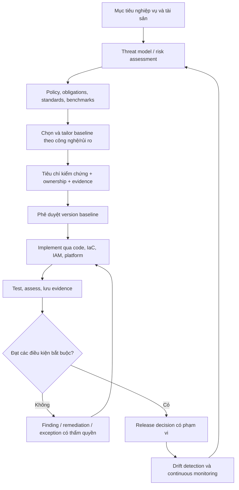
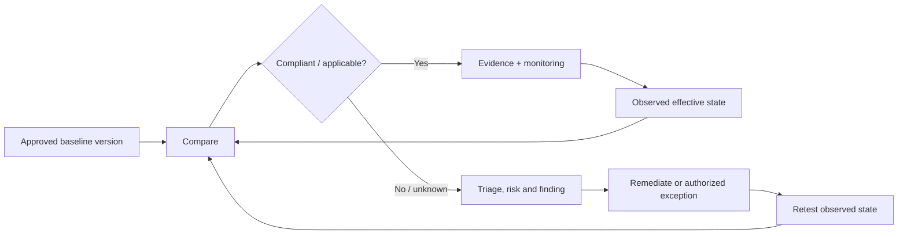

# Baseline bảo mật: xác lập, kiểm chứng và duy trì mức kiểm soát tối thiểu

## 1. Baseline bảo mật là gì?

**Security baseline (baseline bảo mật)** là tập yêu cầu và trạng thái kiểm soát **tối thiểu đã được phê duyệt** cho một loại hệ thống, tài sản, môi trường hoặc cấu hình xác định. Nó trả lời hai câu hỏi: **điều gì phải đúng ở mức tối thiểu** và **cần bằng chứng nào để xác nhận điều đó đang đúng**.

Trong chương **Security standard** của module **SECURITY_SECURITY_ASSURANCE**, baseline là cầu nối giữa **mục tiêu bảo mật**, **risk assessment**, **security controls** và **security assurance**. Một câu như “dịch vụ phải được cấu hình an toàn” không đủ để kiểm thử hay audit. Baseline chuyển nó thành những tiêu chí cụ thể: “endpoint quản trị không được công khai ngoài phạm vi đã duyệt”, “credential không nằm trong source code”, “quyền tài khoản chạy ứng dụng theo nguyên tắc tối thiểu”, “mọi ngoại lệ có chủ sở hữu và thời hạn”.

Ví dụ: nền tảng học tập viết bằng Java/Spring Boot có `user-service`, `submission-service` và `grade-service`. Đội vận hành cần baseline chung cho các dịch vụ backend, đồng thời yêu cầu chặt hơn đối với dịch vụ sửa điểm thi vì nó ảnh hưởng **tính toàn vẹn** của kết quả đào tạo. Baseline chung giúp các dịch vụ không bỏ sót điều kiện nền tảng; các **profile theo rủi ro** bổ sung control phù hợp cho dữ liệu, quyền và hoạt động trọng yếu.

**Một baseline không tự chứng minh hệ thống an toàn.** Nó xác định chuẩn cần đạt. Việc có đạt hay không phải được xác minh bằng **config review, code review, kiểm thử, audit và bằng chứng vận hành** trong phạm vi, phiên bản và thời điểm cụ thể.

### Kết quả học tập

Sau bài này, người học có thể:

1. Phân biệt security baseline với policy, standard, hardening guide, configuration baseline và chứng nhận.
2. Xây dựng baseline theo **tài sản, mục tiêu, rủi ro, nghĩa vụ và phạm vi** thay vì áp dụng checklist máy móc.
3. Viết tiêu chí bảo mật **có thể kiểm tra** với owner, phương pháp đánh giá, bằng chứng và cơ chế ngoại lệ.
4. Thiết kế baseline cho ứng dụng Java/Spring Boot và các phụ thuộc IAM, network, database, CI/CD, cloud, logging.
5. Đánh giá **compliance, effectiveness, coverage, evidence freshness** và xử lý finding/rủi ro tồn đọng.
6. Tổ chức quản lý phiên bản, configuration drift, kiểm tra tự động và continuous assurance trong SDLC.

> **Phát biểu có căn cứ:** “Trong phạm vi release R và môi trường production E, các control BSL-01…BSL-12 đã được đánh giá bằng phương pháp và bằng chứng liệt kê; 10 đạt, 1 chưa đạt, 1 không áp dụng có lý do. Vì BSL-07 là điều kiện chặn, chưa thể tuyên bố đạt baseline phát hành.” Không gộp mọi trạng thái thành nhãn “hệ thống an toàn 92%”.

## 2. Phân biệt policy, standard, baseline, hardening và control

Những khái niệm này liên quan nhưng giải quyết những lớp vấn đề khác nhau.

| Khái niệm | Chức năng | Ví dụ | Không đồng nghĩa với |
| --- | --- | --- | --- |
| **Security policy** | Xác lập nguyên tắc, mục tiêu, trách nhiệm và cam kết ở cấp tổ chức. | “Thông tin học viên phải được bảo vệ trước truy cập trái phép.” | Một giá trị cấu hình cụ thể. |
| **Security standard** | Đặt yêu cầu bắt buộc, có thể áp dụng cho một phạm vi. | “API xử lý dữ liệu nhạy cảm phải xác thực và phân quyền phía server.” | Hướng dẫn tùy chọn. |
| **Security baseline** | Tập **giá trị/điều kiện tối thiểu** được chốt cho loại hệ thống hoặc môi trường. | “Profile backend production phải có TLS, log audit phù hợp, secret không hard-code, actuator được giới hạn.” | Bằng chứng rằng cấu hình đã đúng. |
| **Hardening guide** | Hướng dẫn thực thi chi tiết để giảm bề mặt tấn công. | Các bước khóa dịch vụ không cần thiết, cấu hình OS/container, giới hạn quyền. | Tiêu chí phê duyệt áp dụng nguyên vẹn cho mọi hệ thống. |
| **Security control** | Biện pháp ngăn, phát hiện, sửa hoặc hạn chế hậu quả rủi ro. | Object-level authorization tại backend; network policy; secret manager. | Một chỉ tiêu audit không cần kiểm chứng. |
| **Configuration baseline** | Trạng thái cấu hình đã được xác lập và quản lý thay đổi của thành phần/hệ thống. | Bộ cấu hình OS, Kubernetes workload, Spring profile tại release X. | Toàn bộ chính sách an ninh của tổ chức. |
| **Evidence/assessment** | Kết quả kiểm tra một tiêu chí trong phạm vi và thời điểm rõ ràng. | Bản chụp IAM policy, test trái quyền, kết quả scan cấu hình. | Bản thân baseline. |

**Security baseline** thường bao gồm **configuration settings** nhưng không bị giới hạn ở settings. Nó có thể bao gồm yêu cầu kỹ thuật/phương pháp như review quyền định kỳ, test khôi phục dữ liệu, xử lý CVE theo rủi ro hoặc yêu cầu chứng minh rằng luồng khôi phục tài khoản không bị bypass. Trong khi đó, **configuration baseline** là khái niệm quản lý trạng thái cấu hình; một bản cấu hình ổn định nhưng chứa lỗi vẫn có thể là baseline cấu hình và **không đạt baseline bảo mật**.

### Một ví dụ phân tầng

| Tầng | Câu phát biểu mẫu |
| --- | --- |
| Policy | “Chỉ người được ủy quyền mới được thay đổi điểm thi.” |
| Standard | “Mọi đường cập nhật điểm phải kiểm tra quyền theo bản ghi, theo role và phân công hợp lệ.” |
| Baseline của `grade-service` | “Mỗi route ghi, batch import và admin override phải có authorization check và test âm tính tương ứng; không có đường bypass chưa được phê duyệt.” |
| Implementation | `gradeService.updateGrade(...)` gọi policy kiểm tra phân công trước khi lưu. |
| Assessment | Test giáo viên A sửa điểm lớp B bị từ chối; database không đổi; review đường batch/import. |
| Evidence | Test report theo build, route inventory, code review, config snapshot và finding/decision record. |

Điểm quan trọng: một baseline được định nghĩa tốt làm cho kết luận “đạt” trở thành **một kết luận có tiêu chí và bằng chứng**, chứ không phải cảm giác của người vận hành.

## 3. Baseline dùng để giải quyết những vấn đề nào?

Khi không có baseline chung, mỗi team có thể lựa chọn cấu hình theo thói quen. Hai service cùng xử lý dữ liệu học viên nhưng có thể khác nhau về TLS, log, quyền database, dependency update, response error, actuator, cloud IAM và thời hạn lưu dữ liệu. Sự khác biệt không được giải thích dễ tạo thành **configuration drift** và các khoảng trống assurance.

Baseline giúp:

- **Nhất quán:** đặt điều kiện tối thiểu trên các hệ thống cùng loại.
- **Đo được:** có tiêu chí pass/fail thay vì những yêu cầu mơ hồ như “cấu hình đủ an toàn”.
- **Phân công được:** mỗi requirement có control owner, assessor, risk owner và đường escalation.
- **Ưu tiên theo rủi ro:** chọn những kiểm soát có tác dụng với tài sản, luồng dữ liệu và threat scenarios thực tế.
- **Tự động hóa:** chuyển yêu cầu có thể kiểm tra thành kiểm tra cấu hình trong CI/CD hoặc runtime.
- **Audit và traceability:** liên kết policy, chuẩn, baseline, control, finding, ngoại lệ và bằng chứng.
- **Quản lý thay đổi:** phát hiện khi deployment hoặc provider khiến giả định ban đầu không còn đúng.

Tuy nhiên, baseline còn có **giới hạn**: không thể dự đoán mọi lỗ hổng logic nghiệp vụ; một hệ thống đạt toàn bộ kiểm tra cấu hình vẫn có thể có BOLA/IDOR ở API, giao dịch không nhất quán, mất dữ liệu do lỗi thiết kế hoặc quyền đặc quyền bị lạm dụng. Do đó baseline là **mức sàn**, không phải trần của security assurance.

## 4. Chọn đúng phạm vi và các profile baseline

Không nên áp dụng một tập thông số y hệt cho website tĩnh, API public, ứng dụng nội bộ, hệ thống kiểm soát đặc quyền và workload xử lý giao dịch nhạy cảm. Hãy xác định **asset, architecture, environment, dữ liệu, tác động và mô hình trách nhiệm** trước khi chọn profile.

| Chiều xác định | Câu hỏi cần giải quyết | Ví dụ |
| --- | --- | --- |
| **Loại thành phần** | OS, container image, Kubernetes workload, database, API, CI pipeline hay IAM? | `submission-service` chạy container trên Kubernetes. |
| **Môi trường** | Development, test, staging, production khác nhau ở quyền/dữ liệu ra sao? | Production lưu bài thi thật; staging chỉ dùng dữ liệu giả. |
| **Dữ liệu** | Bí mật, toàn vẹn, sẵn sàng và quyền riêng tư quan trọng đến đâu? | Bài nộp, điểm thi và thông tin nhận dạng. |
| **Phơi lộ** | Public Internet, internal VPC, service-to-service, mạng quản trị? | API được truy cập qua Internet qua gateway. |
| **Đặc quyền** | Service account có quyền gì trên DB, bucket, KMS và production? | Service chỉ đọc object bài nộp đã được ủy quyền. |
| **Tầm quan trọng nghiệp vụ** | Gián đoạn hay sai lệch gây hậu quả nào? | Không nộp được bài khi kỳ thi kết thúc. |
| **Third-party/shared responsibility** | Provider kiểm soát gì và tổ chức phải tự cấu hình gì? | Cloud quản lý hạ tầng; tổ chức quản lý IAM, policy bucket. |
| **Nghĩa vụ** | Hợp đồng, tiêu chuẩn nội bộ, luật và yêu cầu audit nào áp dụng? | Quy tắc dữ liệu cá nhân, lưu bằng chứng và notification. |
| **Phiên bản công nghệ** | Cấu hình hợp lệ trên Spring Boot, JDK, DB, OS, cloud version nào? | Setting đổi tên/không còn hỗ trợ sau nâng cấp. |

### Ví dụ ba lớp profile

1. **Common baseline:** áp dụng cho mọi workload được tổ chức quản lý: ownership, dependency inventory, secret handling, logging phù hợp, vulnerability triage, backup theo dữ liệu.
2. **Technology baseline:** dành cho Java/Spring Boot, Linux/container, Kubernetes, PostgreSQL, ingress, cloud IAM; các thông số phải **tương thích phiên bản**.
3. **Risk-based overlay:** thêm control cho hệ thống dữ liệu học viên, sửa điểm, tài khoản admin, thanh toán hoặc kỳ thi thời gian thực, ví dụ kiểm chứng quyền theo từng đối tượng và restore theo RTO/RPO.

Các lớp có thể bổ sung cho nhau. Không nên coi profile “nâng cao” là có thể bỏ các điều kiện nền tảng mà không có lý do và phê duyệt.

### Phân biệt việc áp dụng với ngoại lệ

- **Applicable:** control áp dụng vì thành phần thuộc scope và có đường rủi ro liên quan.
- **Not applicable (N/A):** control **không có đối tượng áp dụng**, ví dụ quy tắc session cookie cho một dịch vụ thuần machine-to-machine dùng bearer token và **không có session cookie**. Phải ghi lý do và bằng chứng xác định phạm vi.
- **Exception/waiver:** control **có áp dụng nhưng chưa đáp ứng**, được xin chấp thuận có điều kiện. Phải ghi risk owner, hạn, biện pháp bù trừ và kế hoạch.

Không được đổi nhãn một control đang FAIL thành N/A chỉ để tăng tỷ lệ đạt.

## 5. Xây dựng baseline từ mục tiêu và rủi ro

Một baseline tốt không bắt đầu bằng sao chép toàn bộ hàng nghìn mục từ benchmark. Cách hiệu quả là **lựa chọn và điều chỉnh** theo rủi ro, nghĩa vụ, công nghệ và mức assurance cần đạt.

### Quy trình tám bước

1. **Định nghĩa đối tượng:** chỉ rõ phạm vi sản phẩm, thành phần, môi trường, version, actor và dữ liệu.
2. **Xác định mục tiêu bảo mật:** ví dụ “không lộ tệp bài thi”, “không sửa điểm trái quyền”, “khôi phục được bài nộp đúng hạn”.
3. **Lập risk scenarios:** mối đe dọa, điểm yếu, đường tác động, hậu quả và control hiện có; dùng risk assessment và threat modeling.
4. **Tập hợp nguồn yêu cầu:** policy, nghĩa vụ bắt buộc, security requirements, benchmark/standard và thông tin sự cố phù hợp.
5. **Chọn/tailor controls:** quyết định điều kiện áp dụng, mức tối thiểu, những overlay cho rủi ro cao và phương án kiểm chứng.
6. **Viết tiêu chí có thể đánh giá:** mỗi control có ID, phạm vi, điều kiện PASS/FAIL, owner, cách tạo evidence và ngưỡng escalation.
7. **Phê duyệt baseline:** owner của chuẩn cùng risk/security và chủ sở hữu hệ thống xác nhận phiên bản và cách xử lý ngoại lệ.
8. **Đưa vào thực thi:** IaC, templates, CI/CD, config assessment, audit, runtime monitoring và reassessment.



### Tailoring không phải “bỏ điều kiện không thích”

Tailoring hợp lệ là **điều chỉnh yêu cầu cho đúng kiến trúc và rủi ro**. Ví dụ:

- Hệ thống không quản lý mật khẩu nội bộ mà dùng IdP: không bắt ứng dụng thiết lập password-hashing local, nhưng cần kiểm soát **SSO integration, token validation, MFA ở IdP và shared responsibility**.
- API chỉ xử lý bearer token không dùng cookie: yêu cầu về `SameSite` cho **session cookie** có thể N/A, nhưng token handling, CSRF theo cơ chế sử dụng credential, CORS và authorization vẫn cần xem xét.
- Một endpoint health public chỉ trả trạng thái tối thiểu phục vụ giám sát có thể được phép theo thiết kế; không đồng nghĩa mở toàn bộ management endpoints ra Internet.
- Một dịch vụ chạy managed database: nhà cung cấp vận hành một số control hạ tầng; tổ chức vẫn kiểm tra **database roles, encryption settings, network access, backups và restore** thuộc trách nhiệm của mình.

Mỗi điều chỉnh phải có **lý do, scope, evidence và người phê duyệt** để người đánh giá không hiểu sai một khoảng trống thành compliance.

## 6. Cách mô tả một điều kiện baseline có thể đánh giá

Một câu “hệ thống dùng mã hóa mạnh” quá chung: không nói mã hóa ở đâu, key management do ai, điều kiện đạt là gì và cách kiểm tra. Hãy viết baseline như **một bản ghi kiểm chứng được**:

| Trường | Ý nghĩa | Ví dụ |
| --- | --- | --- |
| **Control ID** | Định danh ổn định cho truy vết. | `BSL-API-04` |
| **Requirement/claim** | Trạng thái cần đúng. | “Chỉ route management được phê duyệt mới có thể truy cập từ mạng quy định.” |
| **Applicability** | Loại workload, môi trường, phiên bản, thành phần. | Spring Boot production có Actuator. |
| **Rationale/risk** | Vì sao control tồn tại; threat scenario. | Lộ thông tin quản trị, lạm dụng endpoint nhạy cảm. |
| **Expected configuration/behavior** | Điều kiện kiểm chứng cụ thể. | Exposure chỉ có allowlist endpoint được duyệt; endpoint còn lại không thể truy cập trái quyền. |
| **Implementation owner** | Ai cấu hình và giữ hiệu lực. | Backend + platform team. |
| **Assessment method** | Test, inspect, interview, runtime observation hoặc phối hợp. | Review config + request test qua ingress + IAM/network test. |
| **Evidence** | Artifact, người/công cụ, build, timestamp, environment. | `EVD-ACTUATOR-R42` |
| **Severity/gate** | Khi FAIL có chặn release hay yêu cầu xử lý theo SLA? | “Chặn release nếu management endpoint nhạy cảm lộ public.” |
| **Exception/review** | Ai có thể phê duyệt, bao lâu, thay đổi nào khiến bằng chứng hết hiệu lực? | Risk owner, hết hạn có mốc, kiểm tra sau đổi ingress. |

### Mẫu câu đạt/không đạt

**Chưa kiểm chứng được:** “Service phải harden Actuator.”

**Có thể kiểm chứng:** “Với mọi workload Spring Boot production có Actuator, chỉ các endpoints được phê duyệt trong inventory mới có thể truy cập theo network và authorization policy. Kiểm thử qua ingress và đường nội bộ với principal có/không có quyền phải xác nhận endpoints nhạy cảm không truy cập được ngoài scope; kết quả gắn với build, cấu hình và môi trường.”

Điều kiện này **không chỉ** đo giá trị `management.endpoints.web.exposure.include`: firewall/ingress, đường proxy, security filter và cấu hình runtime có thể khiến kết quả thực tế khác file cấu hình dự kiến.

## 7. Những nhóm kiểm soát thường có trong baseline ứng dụng

Đối với Java/Spring Boot và API backend, một baseline thực dụng thường gồm:

| Nhóm | Yêu cầu trọng tâm | Ví dụ bằng chứng |
| --- | --- | --- |
| **Identity & authentication** | Xác thực token/session đúng giao thức, admin có MFA theo rủi ro, danh tính service tin cậy. | Security config, negative auth tests, IAM review. |
| **Authorization** | Kiểm tra quyền **theo tài nguyên/tenant/role** tại server cho mọi đường đọc/ghi. | Test trái quyền, route inventory, code review. |
| **Session/cookie/token** | Cookie flags khi có cookie, token lifecycle, logout/revocation phù hợp. | Response headers, session tests, config. |
| **Input/output handling** | Validation theo nghiệp vụ, bảo vệ injection, output encoding, file upload restrictions. | API tests, SAST/DAST triage, code review. |
| **Errors & diagnostics** | Không trả stack trace, bí mật, config nội bộ ra client. | Error-response tests, sample logs đã ẩn dữ liệu. |
| **Actuator/management** | Endpoint quản trị được giới hạn exposure và quyền. | Test qua ingress, route config, auth tests. |
| **Transport security** | TLS và trust chain phù hợp cho kết nối có dữ liệu/credential nhạy cảm. | Gateway/TLS configuration, end-to-end test. |
| **Secret management** | Không hard-code secrets; cấp quyền và rotation phù hợp. | Secret scanning, secrets-store access review. |
| **Dependencies** | Có SBOM/inventory, cập nhật và triage lỗ hổng theo rủi ro. | Dependency report, vulnerability finding decisions. |
| **Audit/observability** | Ghi sự kiện bảo mật cần thiết, không ghi token/password/dữ liệu nhạy cảm trái phép. | Test sự kiện, log redaction, retention policy. |
| **Resilience** | Timeout/retry/circuit-breaking đúng ngữ cảnh; khôi phục theo RTO/RPO. | Failure tests, restore exercise, operational dashboard. |

**Phân quyền theo đối tượng** đặc biệt quan trọng với nền tảng học tập: một giáo viên có role `TEACHER` không mặc nhiên được sửa điểm tất cả lớp; một học viên có role `STUDENT` không được tải bài của học viên khác. Cấu hình HTTP security tốt **không thay** kiểm tra chính sách trên từng object.

### Baseline không phải một thư viện cấu hình duy nhất

Không thể chỉ đưa vào dependency Spring Security rồi kết luận rằng các kiểm soát IAM, authorization, TLS, secret handling và session đã đạt. Cần đánh giá **những gì ứng dụng thực sự làm**, bao gồm batch jobs, message consumers, admin tools, API legacy, data migrations và các đường gọi từ bên thứ ba.

## 8. Baseline hạ tầng, container và cloud

Ứng dụng có mã tốt vẫn có thể bị lộ dữ liệu nếu môi trường chạy cấu hình sai. Vì vậy baseline nên có profile cho hệ điều hành, image, container orchestration, network, database, cloud IAM và provider.

### 8.1. OS và container runtime

- Dùng image và package có nguồn gốc đáng tin, phiên bản được quản lý; tránh thành phần không cần thiết làm tăng attack surface.
- Chạy process với **quyền tối thiểu**, ưu tiên non-root khi kiến trúc cho phép; hạn chế container privileged, host namespaces và việc mount socket/volume nhạy cảm.
- Cấu hình filesystem, capabilities, resource limits và runtime protections theo đặc điểm ứng dụng.
- Không gắn credential dài hạn vào Docker image, manifest công khai hoặc biến môi trường được dump ra nơi không được phép.
- Kiểm soát cập nhật/pinning dependency, SBOM và artifact integrity theo quy trình release.

Một yêu cầu như “tất cả containers phải read-only filesystem” có thể cần điều chỉnh nếu workload có thư mục tạm. Thay vì bỏ hẳn control, nên giữ filesystem chính read-only và mount **thư mục ghi tạm được xác định, giới hạn, có owner** nếu phù hợp. Tài liệu hóa quyết định và kiểm chứng các đường ghi.

### 8.2. Network và service-to-service

- Chỉ mở cổng và đường kết nối cần cho nghiệp vụ; quản lý ingress/egress theo service và environment.
- Hạn chế đường management, metrics và database không phải public.
- Dùng TLS/mTLS hoặc cơ chế bảo vệ truyền thông theo trust boundaries, identity và threat model.
- Đánh giá rủi ro khi có service mesh, gateway, proxy hoặc load balancer làm TLS termination; service phía sau không tự được xem là tin cậy tuyệt đối.
- Kiểm tra cả **effective network access**, không chỉ quy tắc được viết trong file IaC.

### 8.3. Cloud IAM, managed services và third party

| Thành phần | Ví dụ điều kiện baseline | Điều cần kiểm chứng |
| --- | --- | --- |
| **Cloud IAM** | Least privilege, identity tách theo workload, review quyền đặc biệt. | Effective permissions, trust relationships, service-account bindings. |
| **Object storage** | Không public ngoài use case được phê duyệt; encryption, retention và URL scope phù hợp. | Bucket policy, ACL, signed URL tests, provider settings. |
| **Database** | Chỉ kết nối từ nguồn cần thiết, role không dùng quyền superuser cho app, backup/recovery theo mục tiêu. | DB grants, network controls, restore exercise. |
| **Secrets/KMS** | Quyền đọc/ghi key, rotation, audit và quản lý vòng đời theo rủi ro. | IAM policies, key inventory, key-access logs. |
| **Cloud logging** | Thu thập và bảo vệ sự kiện quan trọng; không lộ dữ liệu/credential ngoài mục đích. | Logging coverage, retention và access review. |
| **Managed IdP** | MFA, account lifecycle, log và token policy theo phạm vi khách hàng. | Tenant configuration, provider assurance và test tích hợp. |

**Shared responsibility:** Nhà cung cấp có thể đảm bảo hạ tầng trong phạm vi dịch vụ, nhưng tổ chức sử dụng vẫn chịu trách nhiệm cấu hình tenant, quyền truy cập, secret và tích hợp thuộc phần của mình. Báo cáo ISO/SOC 2 của provider **không chứng minh** mọi control ở phía khách hàng được bật đúng.

## 9. Baseline dữ liệu, backup, logging và khả năng phục hồi

Nền tảng học tập xử lý bài nộp, điểm và dữ liệu cá nhân. Những mục tiêu này không thể được bao phủ chỉ bằng cài đặt Spring Boot.

| Mục tiêu | Baseline cần xét | Bằng chứng |
| --- | --- | --- |
| **Bí mật** | Phân loại dữ liệu, kiểm quyền, mã hóa phù hợp khi lưu/truyền, loại bỏ bản sao thừa. | Data flow, access tests, encryption config, review export paths. |
| **Toàn vẹn** | Kiểm soát thao tác sửa, versioning hoặc audit phù hợp cho điểm thi/bài nộp. | Negative tests, data assertions, change/audit logs. |
| **Sẵn sàng** | Backup, restore, RTO/RPO dựa trên nghiệp vụ, khả năng phục hồi khỏi hỏng dữ liệu. | Restore exercise trên dữ liệu giả/được phép, báo cáo RTO/RPO đạt/chưa đạt. |
| **Quyền riêng tư** | Data minimization, retention, truy cập theo mục đích, xử lý khi hết hạn. | Retention rules, access review, purge tests và evidence. |
| **Truy vết** | Log ai thực hiện thao tác nhạy cảm, trên đối tượng nào, vào lúc nào, kết quả gì. | Audit event tests, log integrity/access review. |
| **Khả năng điều tra** | Correlation ID, đồng bộ thời gian, giữ evidence có giới hạn. | Incident tabletop, log coverage và thời hạn bảo quản. |

**Không nhầm availability với uptime:** Một cloud storage có uptime cam kết cao không tự chứng minh rằng nền tảng có thể **khôi phục bài thi đã ghi** khi metadata, version hoặc quyền truy cập gặp lỗi. Phải kiểm tra quy trình khôi phục **đầu cuối** theo RTO/RPO đã phê duyệt.

**Không log secrets:** Mật khẩu, reset token, API key, bearer token hoặc signed URL mang quyền không nên xuất hiện trong log, ticket hoặc telemetry trái với nguyên tắc bảo vệ dữ liệu. Audit cần có đủ định danh để điều tra nhưng phải giới hạn quyền xem và xử lý thông tin cá nhân.

## 10. Baseline chuỗi cung ứng và CI/CD

Trong continuous delivery, **pipeline có quyền đưa code hoặc configuration vào production** là một phần của bề mặt tấn công. Một baseline ứng dụng chỉ đo runtime mà bỏ qua build/release có thể để lọt thay đổi trái phép.

| Mục | Yêu cầu tối thiểu có thể cân nhắc | Evidence ví dụ |
| --- | --- | --- |
| **Source control** | Quyền repo tối thiểu, review cho nhánh nhạy cảm, lịch sử thay đổi có truy vết. | Branch protection settings, access review. |
| **Build dependencies** | Khóa/cố định version phù hợp, quản lý nguồn package, triage CVE áp dụng được. | Lockfile/manifest, SBOM, SCA report và quyết định. |
| **Build environment** | Runner/agent không mặc nhiên có quyền production; secrets được giới hạn thời điểm/scope. | Pipeline IAM, runner isolation review. |
| **Artifact integrity** | Artifact được định danh, lưu và kiểm chứng nguồn gốc/tính toàn vẹn theo chính sách. | Digest, provenance/attestation nếu áp dụng, deploy record. |
| **Secret scanning** | Không cho phép credential thực lọt vào repo hoặc artifact công khai. | Scan results, remediation và rotation record. |
| **Deployment approvals** | Quy trình phát hành và khẩn cấp có thẩm quyền; thay đổi config được kiểm soát. | Release approval, change tickets, deployment logs. |
| **Baseline gates** | Điều kiện bắt buộc FAIL thì chặn hoặc đưa vào quy trình ngoại lệ có thẩm quyền. | Policy-as-code report, exception reference và quyết định release. |
| **Post-deploy verification** | Xác minh trạng thái runtime/ingress/IAM thực tế khớp kỳ vọng. | Runtime config scan, smoke/security tests. |

Tránh dùng **số lượng CVE** làm thước đo duy nhất. Một CVE có severity cao nhưng không thể bị khai thác trong ngữ cảnh cụ thể cần đánh giá khác với một lỗi quyền nghiệp vụ có thể tái hiện. Mặt khác, không được viện “không thấy exploit” để bỏ qua lỗ hổng khi thiếu thông tin hoặc nghĩa vụ bắt buộc.

## 11. Ma trận baseline mẫu cho API Spring Boot

Bảng là **ví dụ nội bộ do bài học xây dựng**, không phải bản sao nguyên văn CIS, NIST, ISO hoặc OWASP. Việc áp dụng phải theo loại service, threat model, tiêu chí rủi ro và hướng dẫn của phiên bản công nghệ thực tế.

| ID | Điều kiện baseline | Scope/điều kiện áp dụng | Phương pháp kiểm chứng | Evidence và owner |
| --- | --- | --- | --- | --- |
| **BSL-01** | Có owner, phân loại dữ liệu, architecture và dependency inventory. | Mọi service production. | Inspect inventory và đối chiếu triển khai. | CMDB/data-flow/asset records; service owner. |
| **BSL-02** | Mọi endpoint nhạy cảm được xác thực; service xác minh token/session theo giao thức. | API nhận yêu cầu từ user/service khác. | Negative auth tests; review token config. | Test report/IAM review; app + IAM owner. |
| **BSL-03** | Authorization được kiểm tra theo đối tượng/tenant/role ở đường dữ liệu liên quan. | Dịch vụ có dữ liệu phân quyền. | API test trái quyền + DB invariant + route review. | Security test matrix; app owner. |
| **BSL-04** | Management endpoints được giới hạn exposure/authorization/network. | Spring Boot có Actuator. | Inspect config và gọi thử các đường qua ingress. | Endpoint access report; platform owner. |
| **BSL-05** | Secret/credential không hard-code hoặc lộ log; quyền secrets-store tối thiểu. | Mọi workload có secrets. | Secret scan, IAM/config review, log tests. | Scan + access review; platform/SRE. |
| **BSL-06** | Network/TLS theo trust boundaries và protocol baseline đã duyệt. | Kênh có credentials/dữ liệu nhạy cảm. | TLS endpoint test, path/ingress review. | Configuration/protocol evidence; network owner. |
| **BSL-07** | Runtime workload không có quyền vượt mức; image/host/container security áp dụng. | Workload container/VM. | Scan config, effective permission checks. | IaC and runtime scan; platform owner. |
| **BSL-08** | Database và storage giới hạn truy cập, có backup/restore theo mục tiêu. | Workload lưu dữ liệu quan trọng. | Permission review + restore exercise. | DB grants, restore report; data/platform owner. |
| **BSL-09** | Không trả stack trace/secret và có kiểm soát log dữ liệu nhạy cảm. | API public/internal chứa thông tin quan trọng. | Error-path tests + log review. | HTTP/test report, log evidence; app/SRE. |
| **BSL-10** | Dependency/vulnerability inventory được rà soát, finding có risk treatment. | Workload có package/dependency. | SBOM/SCA review và tình trạng remediation. | SCA output + risk decisions; app/sec owner. |
| **BSL-11** | Build/release bảo vệ source, artifact và credential triển khai. | Mọi production deployment. | CI policy review, artifact/release trace. | Pipeline evidence; DevSecOps owner. |
| **BSL-12** | Audit các thao tác nhạy cảm có owner, retention và response process. | Luồng có yêu cầu truy trách nhiệm. | Audit event test, log-access review. | Test + runtime samples; app/SOC owner. |
| **BSL-13** | Có chiến lược đánh giá lại khi config, API, phụ thuộc hoặc rủi ro thay đổi. | Mọi service production. | Review change workflow/drift alerts. | Change assessment records; service owner. |

### Gắn mức nghiêm trọng thay vì chấm tất cả như nhau

Đối với `grade-service`, `BSL-03` phải là **blocking control** nếu có bằng chứng giáo viên lớp A sửa điểm lớp B. Một lỗi tag tài liệu ở `BSL-01` có thể cần hoàn thiện nhưng không nhất thiết có cùng hậu quả. Cấp độ xử lý và release gate phải dựa trên **rủi ro, tính bắt buộc và ngưỡng đã duyệt**, không lấy trọng số do scanner tự gán thay quyết định quản trị.

### Requirement vs implementation detail

Một control như `BSL-06` yêu cầu **kênh truyền được bảo vệ đúng trust boundary**. Nếu TLS kết thúc tại ingress thay vì bên trong Spring Boot, không thể kết luận FAIL chỉ vì không có `server.ssl.*` trong `application.yml`. Phải đánh giá **luồng HTTPS đến ingress, đường từ ingress tới service, trust network và encryption policy** trong phạm vi kiến trúc.

Tương tự, cấu hình `server.servlet.session.cookie.secure` có ý nghĩa khi ứng dụng **sử dụng session cookie**. Một API thuần bearer token có thể N/A với setting này nhưng vẫn có yêu cầu bảo vệ token ở client và trên đường truyền.

## 12. Ví dụ baseline cấu hình trong Spring Boot

Giả sử `submission-service` chạy sau ingress có TLS đã được phê duyệt, sử dụng Spring Boot Actuator phục vụ monitoring và **có dùng session cookie** cho một số luồng giao diện. Một phần cấu hình baseline có thể viết:

```yaml
# application-prod.yml (minh họa; phải đối chiếu Spring Boot version thực tế)
server:
  error:
    include-message: never
    include-stacktrace: never
    include-exception: false
  servlet:
    session:
      cookie:
        secure: true
        http-only: true
        same-site: lax  # Chính sách này cần xem threat model/luồng đăng nhập

management:
  endpoints:
    web:
      exposure:
        include: health,info
  endpoint:
    health:
      show-details: never

spring:
  jpa:
    open-in-view: false
```

### Điều đoạn YAML này làm được và không làm được

- `server.error.*` hướng tới giảm thông tin lỗi chi tiết trả cho client; vẫn cần **test exception handlers tự viết**, API error format, logging và error pages để xác minh không lộ bí mật.
- Các thuộc tính session cookie chỉ có tác dụng với **cookie do ứng dụng/server quản lý** theo cấu hình và framework tương ứng. Nếu hệ thống dùng bearer token hoặc cookie được thiết lập ở proxy, cần kiểm tra đúng nơi.
- `same-site: lax` là **ví dụ cấu hình**, không phải đáp án chung cho mọi luồng OAuth, cross-site integration hoặc CSRF threat model. Một số hệ thống phải chọn chính sách khác hoặc có biện pháp bổ sung; `SameSite` không thay thế hoàn toàn CSRF protection.
- `management.endpoints.web.exposure.include` thu hẹp các Actuator endpoints exposed qua web theo cấu hình, nhưng **không tự giới hạn mạng hay xác thực**. Cần bảo vệ ingress, Spring Security và đường nội bộ theo phạm vi; ngay cả `info`/`health` cũng không nên công bố dữ liệu nhạy cảm.
- `show-details: never` giảm thông tin health chi tiết, nhưng cần kiểm tra response thực tế và các health contributors/custom endpoints khác.
- `spring.jpa.open-in-view: false` là lựa chọn kiến trúc/giảm phụ thuộc persistence context trong web request, **không phải security control thay thế authorization**; chỉ đưa vào baseline nếu đã đánh giá tác động với kiến trúc ứng dụng.
- Cấu hình trên **không** thể chứng minh TLS, secret storage, object-level authorization, least privilege IAM, backup hay scanning đã đạt. Những control đó nằm ở service code, proxy, platform hoặc provider.

### Ví dụ đánh giá qua hành vi, không chỉ đọc file

Giả sử một ứng dụng dùng cookie session. Để chứng minh `BSL-09` và phần session-related:

1. Gửi request tạo lỗi có kiểm soát qua **đường ingress thực tế**, xác minh response không trả exception class, stack trace hoặc secret.
2. Đăng nhập qua flow có dùng session, đọc header `Set-Cookie` rồi kiểm tra `Secure`, `HttpOnly` và chính sách `SameSite` đã duyệt; đánh giá cả CORS/CSRF khi liên quan.
3. Gọi `/actuator/health` và các management endpoints **trong/ngoài vùng cho phép**; xác minh không lộ thông tin/không truy cập được endpoint nhạy cảm khi thiếu quyền.
4. Đọc runtime deployment settings để phát hiện profile, biến môi trường, command-line args hoặc config server **ghi đè** các giá trị trong file.
5. Ghi build/version, environment, URL path, công cụ, timestamp và kết quả có thể tái lập; không lưu session cookie thật vào evidence công khai.

**Cảnh báo:** Một integration test chỉ dùng `MockMvc` có thể xác nhận hành vi ở application layer nhưng **không thay** kiểm tra TLS/ingress/network policy trong môi trường triển khai.

## 13. Baseline as Code: biến quy tắc thành kiểm tra tự động

**Baseline as Code / Policy as Code** là cách biểu diễn các yêu cầu có thể kiểm tra bằng cấu hình hoặc quy tắc máy đọc được. Mục đích là phát hiện vi phạm sớm, tái lập đánh giá và tạo bằng chứng ổn định.

### 13.1. Mô tả baseline bằng metadata có ID

Ví dụ một bản ghi nội bộ không ràng buộc vào công cụ kiểm tra:

```yaml
baseline:
  id: BASE-SPRING-PROD
  version: "2026.1-example"
  ownerRole: application-security-standard-owner
  scope:
    runtime: spring-boot
    environment: production
    technologyVersion: "<approved-version-range>"
  controls:
    - id: BSL-04
      title: "Restrict management endpoints"
      applicability: "Spring Boot with Actuator enabled"
      requirement: >-
        Only approved management endpoints may be accessed
        through approved network paths and identities.
      assessmentMethods:
        - inspect-effective-configuration
        - probe-allowed-and-denied-network-paths
      mandatoryGate: true
      controlOwnerRole: platform-owner
      evidenceRequired:
        - "actuator-route-inventory"
        - "management-access-test-report"
    - id: BSL-09
      title: "Do not expose sensitive diagnostics"
      applicability: "HTTP API"
      requirement: "Error responses must not contain stack traces or secrets."
      assessmentMethods:
        - api-error-negative-tests
        - application-log-redaction-review
      mandatoryGate: true
      controlOwnerRole: backend-owner
      evidenceRequired:
        - "error-response-test-report"
        - "log-redaction-assessment"
```

Đây là **schema minh họa** cho logic quản lý baseline, không phải file cấu hình được Spring Boot, CIS, NIST hoặc một công cụ policy engine nhận trực tiếp. Khi hiện thực hóa, đội kỹ thuật cần lập **rule mapping** từ điều kiện này sang công cụ phù hợp (tests, IaC scanners, posture management, OPA/Gatekeeper/Kyverno, hoặc script đánh giá có quản lý).

### 13.2. Kiểm tra cấu hình Spring Boot trong test

Một test ở mức application context có thể phát hiện **một số giá trị cấu hình**:

```java
import static org.assertj.core.api.Assertions.assertThat;

import org.junit.jupiter.api.Test;
import org.springframework.beans.factory.annotation.Autowired;
import org.springframework.boot.test.context.SpringBootTest;
import org.springframework.core.env.Environment;

@SpringBootTest(properties = "spring.profiles.active=prod")
class SecurityBaselinePropertiesTest {

    @Autowired
    Environment environment;

    @Test
    void diagnosticsAreNotConfiguredForVerboseResponses() {
        assertThat(environment.getProperty("server.error.include-stacktrace"))
            .isEqualTo("never");
        assertThat(environment.getProperty("server.error.include-message"))
            .isEqualTo("never");
    }

    @Test
    void healthDetailsAreNotConfiguredForPublicDisclosure() {
        assertThat(environment.getProperty("management.endpoint.health.show-details"))
            .isEqualTo("never");
    }
}
```

**Giới hạn quan trọng:** Test này chỉ kiểm tra **property values ở application context của test**. Nó không bảo đảm toàn bộ response lỗi không lộ stack trace, mọi management endpoints đều được bảo vệ, hoặc production có cùng configuration. Cần thêm **behavior tests**, kiểm thử hiệu lực security filter và kiểm tra **effective deployment configuration**. Cũng không nên mặc định chạy `prod` profile trong test với dữ liệu/secrets thật; dùng cấu hình và dữ liệu thử nghiệm an toàn, cho phép kiểm tra tham số tương đương.

### 13.3. Kiểm tra policy tại nhiều điểm

| Lớp | Điểm kiểm tra tự động | Lưu ý |
| --- | --- | --- |
| **Repository/PR** | Secret scanning, IaC static analysis, file cấu hình baseline, code tests. | Chỉ thấy trạng thái khai báo, không chắc runtime giống vậy. |
| **Build** | SCA/SBOM, artifact validation, unit/integration tests. | Không bao phủ lỗi network và IAM thực tế nếu thiếu test thích hợp. |
| **Deploy/admission** | Policy engine kiểm tra manifest/container/namespace trước khi nhận workload. | Cần phân biệt policy version, ngoại lệ và khả năng bị bypass. |
| **Post-deploy** | Config posture scan, endpoint probing, effective IAM/network tests. | Phải có quyền/giới hạn kiểm tra an toàn, tránh gây ảnh hưởng production. |
| **Operations** | Drift detector, vulnerability advisories, access review, backup restore exercises. | Event/log chỉ có giá trị khi coverage và response process đủ. |

Nguyên tắc là **shift-left nhưng không bỏ shift-right**: bắt sai sớm trong PR/CI và xác minh trạng thái thật sau triển khai.

## 14. Phương pháp đánh giá baseline và chất lượng bằng chứng

Một baseline có thể được đánh giá bằng ba nhóm phương pháp phổ biến:

| Phương pháp | Mục đích | Ví dụ |
| --- | --- | --- |
| **Examine/Inspect** | Xem hồ sơ, config, code, policy, quyền và tài liệu. | Xem IAM policy, Actuator config, dependency inventory. |
| **Test** | Tác động có kiểm soát để xem control có hoạt động theo tiêu chí. | Gọi endpoint trái quyền; kiểm tra DB không đổi; thử truy cập management port. |
| **Interview/Observe** | Hiểu quy trình, trách nhiệm và hiệu lực vận hành; đối chiếu thực tế. | Trao đổi với SRE về restore, quan sát quy trình rotate secret. |

Không phương pháp nào luôn đủ một mình. **Examine** cho thấy một cấu hình dự kiến; **test** có thể phát hiện bypass; **observe** giúp đánh giá control duy trì được hay không.

### Chứng cứ tốt cần có gì?

| Thuộc tính evidence | Câu hỏi kiểm tra |
| --- | --- |
| **Relevance** | Artifact có liên quan đúng requirement, control, workload và nguy cơ cần chứng minh không? |
| **Scope** | Kết quả thuộc production hay staging, service nào, region/tenant nào, build/config nào? |
| **Authenticity** | Nguồn evidence, người/công cụ tạo, độ tin cậy và tính toàn vẹn được bảo đảm thế nào? |
| **Completeness/coverage** | Kiểm thử có bao gồm các đường API, identity và tình huống rủi ro trọng yếu? |
| **Repeatability** | Người khác có thể chạy lại theo phương pháp và dữ liệu test được quản lý không? |
| **Freshness** | Evidence có còn đúng với release, cấu hình và threat model hiện tại? |
| **Independence** | Với control quan trọng, có yêu cầu review hoặc assessment độc lập không? |
| **Limitations** | Có ghi N/A, assumptions, bypass chưa kiểm, scope exclusions và uncertainty không? |

Một report chỉ ghi “95% hardening passed” nhưng thiếu danh sách điều kiện, phạm vi, bằng chứng và các finding chặn **không đủ** để kết luận hệ thống đạt security baseline ở mức cần chứng minh.

### Độ sâu và độ bao phủ

Baseline assessment có thể cần kiểm:

- **Độ bao phủ:** đủ thành phần, tài khoản, endpoint, môi trường, đường inbound/outbound?
- **Độ sâu:** chỉ đọc config hay còn test hành vi, kiểm tra log, query quyền, xác minh runtime?
- **Độ tin cậy:** tool có hỗ trợ đúng phiên bản, rule có false positive/false negative, có triage bởi người hiểu hệ thống?
- **Tính độc lập:** các control rủi ro cao có cần người khác nhóm implementation review?

Đặc biệt với authorization và recovery, scan cấu hình không thay được **thử nghiệm tình huống nghiệp vụ âm tính**.

## 15. Quy trình PASS, FAIL, N/A, EXCEPTION và NOT VERIFIED

Một bảng baseline không nên chỉ có checkbox bật/tắt. Ít nhất cần phân biệt:

| Trạng thái | Ý nghĩa | Hành động |
| --- | --- | --- |
| **PASS** | Bằng chứng hiện tại phù hợp **tiêu chí** trong scope đã công bố. | Ghi evidence, thời điểm, giới hạn và trigger đánh giá lại. |
| **FAIL** | Có bằng chứng điều kiện bắt buộc chưa đạt. | Mở finding, đánh giá rủi ro và phương án khắc phục. |
| **NOT VERIFIED** | Không đủ bằng chứng hoặc bằng chứng không phù hợp. | Bổ sung assessment; không tự đánh dấu PASS. |
| **N/A** | Điều kiện không áp dụng theo tiêu chí scope và có lý do kiểm chứng được. | Ghi justification và reviewer; xem lại khi công nghệ/scope đổi. |
| **EXCEPTION / ACCEPTED GAP** | Điều kiện áp dụng nhưng chưa đạt, có quyết định ngoại lệ phù hợp. | Giữ trạng thái gap, ghi owner, risk, hạn, bù trừ và monitoring. |

**Một ngoại lệ hợp lệ không biến FAIL thành PASS.** Một control có tính bắt buộc theo luật, hợp đồng hoặc policy không cho phép ngoại lệ thì cần tuân thủ quy trình xử lý/escalation tương ứng; risk owner không thể tự bỏ qua nghĩa vụ đó chỉ bằng chữ ký.

### Vì sao không dùng điểm trung bình làm kết luận?

Giả sử 12 control được đánh giá, 11 PASS, 1 FAIL. Nếu control FAIL là `BSL-03` và học viên có thể đọc bài người khác, tuyên bố “baseline đạt 91,7% nên được release” có thể vi phạm ngưỡng bảo mật. Tỷ lệ đạt chỉ mô tả một phần **coverage/compliance**, không tự biểu diễn mức rủi ro còn lại.

Nếu muốn báo chỉ số, phải ghi rõ:

\[
\text{Pass rate} = \frac{\text{số control PASS}}{\text{số control được đánh giá và áp dụng}}
\]

Mẫu số **không** gồm N/A đã xác minh; NOT VERIFIED và EXCEPTION có thể được thống kê riêng theo policy để tránh làm đẹp số. Không lấy tỷ lệ này làm bằng chứng “an toàn X%”. Kết luận release cần dựa trên **mandatory gates, rủi ro thực tế và thẩm quyền phê duyệt**.

## 16. Ví dụ end-to-end: baseline của `grade-service`

### 16.1. Bối cảnh và claim

Giả sử nền tảng học tập triển khai `grade-service` bằng Spring Boot. Giáo viên được phân công có thể sửa điểm; học viên chỉ xem điểm của mình; hoạt động thay điểm phải truy vết được.

**Objective – OBJ-GRADE-01:** Điểm thi không bị sửa trái quyền và mọi thay đổi hợp lệ phải truy vết được.

**Claim – CLAIM-GRADE-BASELINE:** Bản release X của `grade-service` trong production đáp ứng baseline backend và các overlay về quyền, audit, vận hành cần thiết để hỗ trợ mục tiêu trên.

Đây là một **claim cần chứng minh**, không phải kết luận đã đạt.

### 16.2. Phân tích rủi ro và lựa chọn baseline

| Risk ID | Tình huống | Baseline/control ưu tiên |
| --- | --- | --- |
| `RISK-GRADE-01` | Giáo viên A thay điểm học viên lớp B do chỉ kiểm role, không kiểm phân công. | `BSL-03` + negative authorization tests theo object. |
| `RISK-GRADE-02` | Actuator endpoint nhạy cảm bị lộ qua ingress. | `BSL-04` + route/network testing. |
| `RISK-GRADE-03` | DB credential hoặc deploy key nằm trong repository/log. | `BSL-05/11` + secret scan/access review/rotation. |
| `RISK-GRADE-04` | Người dùng truy cập API production qua kênh không được bảo vệ đúng. | `BSL-06` + TLS and ingress assessment. |
| `RISK-GRADE-05` | Điểm bị sửa nhưng không có audit đủ tin cậy. | `BSL-12` + audit event test, quyền log và retention. |
| `RISK-GRADE-06` | Backup không restore được bảng điểm hoặc cấu hình quan trọng. | `BSL-08` + restore exercise và RTO/RPO. |

Kịch bản cho `RISK-GRADE-01` có thể được mô tả: *“Khi giáo viên A gửi ID điểm của lớp B qua API cập nhật, backend kiểm `ROLE_TEACHER` nhưng bỏ qua quan hệ phân công nên sửa dữ liệu không thuộc quyền.”* Nếu có test tái hiện, đây là **finding về control**; nếu chỉ là giả thuyết thì vẫn cần assessment trước khi kết luận.

### 16.3. Kiểm thử xác minh control trọng yếu

Một logic service minh họa:

```java
@Transactional
public void updateGrade(
        UUID submissionId,
        BigDecimal newScore,
        UUID authenticatedTeacherId) {
    Submission submission = submissionRepository.findById(submissionId)
        .orElseThrow(() -> new NotFoundException("Submission not found"));

    if (!teacherAssignmentPolicy.canEdit(
            authenticatedTeacherId, submission.getClassId())) {
        throw new AccessDeniedException("Not allowed to update grade");
    }

    gradePolicy.validateNewScore(submission, newScore);
    BigDecimal before = submission.getScore();
    submission.setScore(newScore);
    submissionRepository.save(submission);
    auditService.recordGradeChange(
        authenticatedTeacherId, submissionId, before, newScore);
}
```

**Giả định:** Principal phải do cơ chế xác thực phía server cung cấp; `teacherAssignmentPolicy` được thiết kế đúng role/tenant/ủy quyền và các trạng thái nghiệp vụ; audit có bảo đảm tin cậy phù hợp giao dịch; concurrent update và batch/import cần được đánh giá riêng. Mã trên **không phải** một triển khai đầy đủ hoặc bằng chứng control đạt baseline.

### 16.4. Ma trận assessment cho release X

| Control | Phép kiểm chứng | Tiêu chí PASS | Artifact cần lưu |
| --- | --- | --- | --- |
| `BSL-03` | Giáo viên A sửa điểm lớp B; student thử API ghi; review batch/import. | Bị từ chối; **dữ liệu DB không đổi**; mọi đường ghi kiểm quyền. | Test matrix, route inventory, code review, build X. |
| `BSL-04` | Gọi Actuator nhạy cảm qua Internet và đường nội bộ trái quyền. | Không truy cập được khi không có quyền; exposure đúng allowlist. | Endpoint test + ingress config. |
| `BSL-05` | Scan repo và kiểm effective service account permissions. | Không có credential thật trong source/log, scope đúng. | Scan results + IAM review. |
| `BSL-06` | Kiểm thử TLS trên ingress và các trust boundaries cần bảo vệ. | Đúng policy protocol/identity; không cho phép đường yếu trái chuẩn. | TLS test + network diagram/config. |
| `BSL-08` | Khôi phục dữ liệu bài/điểm bằng quy trình đã duyệt. | Restore đúng dữ liệu và thời gian theo mục tiêu. | Restore exercise record. |
| `BSL-12` | Thử thay điểm hợp lệ và trái quyền. | Audit ghi actor, object, action, outcome, timestamp; không lộ bí mật. | Audit test/report và retention evidence. |

**Ví dụ kết quả:** giả sử 5 control PASS, `BSL-03` FAIL vì phát hiện batch update có thể sửa điểm ngoài lớp. Khi đó baseline **chưa đạt điều kiện bắt buộc** dù các setting hạ tầng khác đạt. Đội cần sửa cùng một chính sách ủy quyền cho batch, retest bằng build đã sửa, đánh giá ảnh hưởng production nếu có, cập nhật residual risk và release decision. Không dùng phần trăm pass để lấn át finding về toàn vẹn điểm.

### 16.5. Traceability từ risk đến quyết định

```text
OBJ-GRADE-01  Mục tiêu toàn vẹn điểm thi
  -> RISK-GRADE-01  Giáo viên sửa điểm ngoài lớp
  -> REQ-GRADE-AUTHZ  Backend kiểm quyền theo bản ghi/lớp
  -> BSL-03  Baseline authorization
  -> TC-GRADE-NEG-02 + TC-GRADE-BATCH-07  Assessment
  -> EVD-GRADE-BUILD-X  Evidence
  -> FIND-GRADE-04  Finding nếu kiểm tra thất bại
  -> REM-GRADE-04 + EVD-RETEST-X2  Remediation và retest
  -> DEC-GRADE-RELEASE  Quyết định của người có thẩm quyền
```

Khi thêm endpoint mới `POST /grades/bulk-update`, traceability cho thấy phải đánh giá lại `RISK-GRADE-01`, phạm vi `BSL-03` và các test/evidence liên quan.

## 17. Configuration drift và continuous compliance

**Configuration drift** là sự khác biệt phát sinh theo thời gian giữa **trạng thái thực tế** và **trạng thái baseline đã duyệt**. Có thể do thay đổi thủ công, cập nhật provider, deployment khác manifest, bổ sung route, policy IAM bị mở rộng hoặc thư viện/OS thay phiên bản.

| Drift | Ví dụ | Hậu quả bảo mật có thể có |
| --- | --- | --- |
| **Application config** | Production bật verbose errors sau hotfix. | Lộ thông tin nội bộ/stack trace. |
| **Management exposure** | Actuator mapping được mở rộng tại ingress. | Truy cập endpoint vận hành ngoài phạm vi. |
| **IAM** | Workload được cấp quyền đọc toàn bộ bucket thay vì một prefix. | Mở rộng tác động khi credential bị lộ. |
| **Network** | Rule tạm thời mở DB port cho mọi nguồn rồi bị quên. | Tăng bề mặt tấn công. |
| **Container** | Workload mới chạy privileged hoặc mount socket host. | Tăng khả năng vượt ranh giới container. |
| **CI/CD** | Runner dùng token deploy có scope quá rộng. | Thay đổi production trái phép/lan truyền sự cố. |
| **Dependency** | Package mới được kéo vào build không qua review. | Phát sinh CVE và rủi ro supply chain chưa đánh giá. |

### Quy trình xử lý drift

1. **Discover:** quét/quan sát runtime và thu effective configuration, không chỉ Git.
2. **Compare:** đối chiếu với baseline **đúng phiên bản và scope**.
3. **Classify:** kết quả là thay đổi đã duyệt, N/A, sai lệch, false positive hay finding chưa biết?
4. **Assess risk:** tài sản, likelihood, impact, control còn lại và mức khẩn cấp.
5. **Remediate hoặc authorize exception:** rollback, sửa IaC/code, đổi quyền, bổ sung control, phê duyệt trong thẩm quyền.
6. **Retest:** xác minh cấu hình thực tế và hành vi đã đáp ứng, không chỉ ticket đã được đóng.
7. **Record:** gắn evidence, owner, ngày, build/config, residual risk và trigger review.



**Tự động sửa drift** có thể hữu ích nhưng cũng có rủi ro vận hành. Ví dụ, một controller tự động đóng network access của dịch vụ đang thi trực tuyến có thể gây gián đoạn. Policy cần quyết định control nào được tự động sửa, control nào phải approval và rollback plan, cùng cách theo dõi hậu quả.

## 18. Quản lý phiên bản và thay đổi baseline

Baseline phải là **một artifact được quản lý như code hoặc tài liệu kiểm soát**: có định danh, version, owner, người phê duyệt, thời điểm hiệu lực, change log và cách migration giữa các phiên bản.

### Tình huống cần thay baseline

- Cập nhật phiên bản Spring Boot/JDK, container runtime, Kubernetes, database hoặc cloud service làm đổi cấu hình và rủi ro.
- Có security incident, finding từ pentest/audit, kết quả threat modeling cho thấy lỗ hổng baseline chưa bao phủ.
- Chuẩn/benchmark hoặc nghĩa vụ tổ chức áp dụng được cập nhật.
- Mở rộng loại dữ liệu, role đặc quyền, tenant, region hoặc provider.
- Phát hiện kiểm tra baseline đang **false positive** hoặc không còn phù hợp kiến trúc.
- Áp dụng control mới có tác động hoạt động, chi phí hoặc trải nghiệm người dùng.

### Mẫu lifecycle baseline

| Giai đoạn | Cần làm | Bằng chứng |
| --- | --- | --- |
| **Draft** | Nêu mục tiêu, scope, risk rationale, nguồn tiêu chí, phương án assessment. | Baseline proposal, stakeholder review. |
| **Review/tailor** | Đánh giá ảnh hưởng công nghệ, nghĩa vụ và tính khả thi. | Gap analysis, threat/risk review. |
| **Approve** | Chốt version/owner/effective date/exception authority. | Approval record. |
| **Rollout** | Triển khai templates, IaC, tests, IAM và migration. | PRs, pipelines, deployment plans. |
| **Assess** | Đo điều kiện đạt trên hệ thống có scope và lưu evidence. | Compliance/assurance reports. |
| **Monitor** | Giám sát drift, exceptions, vulnerability và control failures. | Runtime reports, findings, KRI. |
| **Revise/retire** | Đổi baseline với quy trình chuyển tiếp và xem lại evidence cũ. | Version diff, migration decision, review schedule. |

**Backward compatibility của bằng chứng:** Báo cáo đạt baseline v1 không tự chứng minh đạt v2 nếu v2 thêm control hoặc thay tiêu chí. Ngược lại, một thay đổi chỉ sửa cách diễn đạt không ảnh hưởng kỹ thuật có thể không cần test lại toàn bộ; quyết định dựa vào **impact assessment**.

## 19. Ngoại lệ, risk acceptance và quyền phê duyệt

Không phải mọi workload có thể đồng thời đạt mọi control sau khi baseline thay đổi. Tuy nhiên, **ngoại lệ là quyết định quản trị rủi ro có hạn và có trách nhiệm**, không phải cách thay tên FAIL thành PASS.

### Hồ sơ ngoại lệ cần có

| Trường | Nội dung |
| --- | --- |
| **Exception ID / baseline version** | Điều kiện nào không đạt, của baseline v nào. |
| **Scope** | System, workload, environment, tenant, data, owner và khoảng thời gian. |
| **Gap/evidence** | Chính xác yêu cầu chưa đạt; bằng chứng cấu hình/test; giới hạn. |
| **Risk scenario** | Tác nhân/tình huống, likelihood, impact và rủi ro còn lại. |
| **Compensating controls** | Biện pháp tạm, bằng chứng hiệu lực và giới hạn. |
| **Remediation** | Hành động, người thực hiện, thời hạn, tiêu chí retest. |
| **Approver/authority** | Risk owner hoặc cấp có thẩm quyền theo policy. |
| **Effective/expiry** | Ngày quyết định, ngày hết hạn, điều kiện hủy. |
| **Monitoring/triggers** | KRI và thay đổi buộc đánh giá lại. |

Ví dụ, một dịch vụ legacy chưa thể chạy filesystem read-only có thể được phê duyệt tạm với filesystem chỉ ghi ở mount xác định, sandboxing và kế hoạch refactor theo thời hạn. Nhưng **có bằng chứng khai thác sửa điểm trái phép** không thể được hợp thức hóa bằng ngoại lệ thiếu thông tin, không có người chịu trách nhiệm hoặc vi phạm yêu cầu bắt buộc không cho phép miễn trừ.

### Trách nhiệm không bị chuyển bằng nhãn “accepted”

Third-party owner có thể điều phối bằng chứng từ vendor. Engineering thực hiện sửa. Security assessor xác minh. **Risk owner** quyết định chấp nhận rủi ro trong thẩm quyền. Product/release owner áp dụng release gate đã phê duyệt. Audit độc lập có thể đánh giá lại quy trình và kết quả. Gộp mọi quyền cho một người mà không có review chéo có thể làm suy yếu assurance.

## 20. Vai trò và RACI trong quản trị baseline

RACI là cách biểu diễn ai **Responsible (R)** – thực hiện, **Accountable (A)** – chịu trách nhiệm cuối cùng theo quyền hạn, **Consulted (C)** – tham vấn và **Informed (I)** – được thông báo. Đây là ma trận **minh họa cho tổ chức phần mềm**, không phải phân quyền pháp lý bắt buộc.

| Hoạt động | Security standard owner | Risk owner | Service owner | Platform/Engineering | Security assessor |
| --- | :---: | :---: | :---: | :---: | :---: |
| Soạn/duy trì profile baseline chung | **A/R** | C | C | R | C |
| Xác định scope, áp dụng/tailor cho service | C | **A** | **R** | R | C |
| Triển khai config và control | C | I | **A** | **R** | C |
| Thiết kế phương pháp kiểm chứng | C | I | C | C | **A/R** |
| Thực hiện assessment và ghi finding | I | I | C | C | **A/R** |
| Quyết định chấp nhận rủi ro trong thẩm quyền | C | **A/R** | C | C | C |
| Thực hiện remediation, cung cấp retest evidence | C | I | **A** | **R** | C |
| Theo dõi drift và triển khai kiểm soát liên tục | C | C | **A** | **R** | R |
| Phê duyệt baseline version chung | **A/R** | C | C | C | C |

Trong hàng **áp dụng/tailor**, risk owner chịu trách nhiệm cuối cùng đối với lựa chọn rủi ro, còn service owner/engineering thực hiện phân tích áp dụng; nếu tổ chức muốn security standard owner chốt mọi tailoring, cần **điều chỉnh ma trận theo thẩm quyền đã giao**. Với release decision, có thể cần thêm product/release owner và bộ phận compliance; không nên giả định bảng trên là toàn bộ quy trình.

## 21. Chỉ số theo dõi và hạn chế diễn giải

KPI/KRI giúp theo dõi chương trình baseline nhưng không thay đánh giá thực trạng bảo mật.

| Chỉ số | Mục đích | Điều cần thận trọng |
| --- | --- | --- |
| **Tỷ lệ workload được gán đúng baseline/profile** | Phát hiện hệ thống “ngoài quản trị”. | Có profile không có nghĩa đã đánh giá. |
| **Control coverage** theo nhóm rủi ro | Biết control nào có assessment phù hợp. | “Có test” không đồng nghĩa test đúng các đường rủi ro. |
| **Tỷ lệ PASS trên các control áp dụng** | Nhìn trạng thái tuân thủ. | Không gộp NOT VERIFIED, EXCEPTION thành PASS; không dùng làm % an toàn. |
| **Critical/mandatory baseline failures** chưa xử lý | Theo dõi điều kiện chặn và phơi lộ lớn. | Cần xét impact, exposure và nghĩa vụ; số lượng ít không tự an toàn. |
| **Mean time to remediate/retest** | Đo hiệu quả xử lý finding. | Ticket “đã sửa” khác “đã retest thành công”. |
| **Exception count/age/expiry** | Tránh miễn trừ quá hạn, thiếu owner. | Có exception không có nghĩa rủi ro đã giảm. |
| **Configuration drift detection/closure** | Phát hiện trạng thái thực khác baseline. | Monitor thiếu coverage có thể báo “0 drift” giả. |
| **Evidence freshness** | Xem liệu quyết định còn dựa trên build/config hiện hành. | Độ mới không có nghĩa evidence đúng scope/chất lượng. |
| **Post-deploy validation coverage** | Chứng minh pipeline không chỉ kiểm tra file khai báo. | Phải kiểm quyền, ingress, dependency và runtime phù hợp. |

Một dashboard đẹp có thể che khuất việc **route batch thiếu authorization**. Khi báo cáo, cần kết hợp chỉ số với **những kịch bản rủi ro trọng yếu, finding chưa đóng và bất định của bằng chứng**.

## 22. Những sai lầm thường gặp

| Sai lầm | Hậu quả | Cách làm đúng |
| --- | --- | --- |
| “Áp dụng CIS benchmark 100% là mọi hệ thống đều an toàn.” | Một số control không phù hợp scope; vẫn có lỗ hổng logic nghiệp vụ. | Tailor theo rủi ro và ứng dụng; xác minh các đường tấn công ngoài benchmark. |
| “Có file `application-prod.yml` chuẩn nghĩa là production đạt.” | Biến môi trường, helm values, config server hoặc runtime override khác. | Kiểm tra **effective config và hành vi** sau deploy. |
| “Tất cả service phải có đúng một baseline.” | Không đáp ứng rủi ro riêng; áp nhầm yêu cầu cho workload khác. | Common + technology + risk overlays. |
| “Hệ thống không dùng cookie nhưng thiếu `SameSite` nên FAIL.” | Nhầm applicability. | N/A có căn cứ, đánh giá token/session theo mô hình thật. |
| “Đã cài Spring Security nên không còn IDOR.” | Authentication không thay authorization theo object. | Kiểm thử role/tenant/object ở mọi đường nghiệp vụ. |
| “Actuator expose health/info nên không cần xem xét gì thêm.” | Có thể lộ metadata hoặc management routes qua proxy khác. | Review từng endpoint, network, auth và response. |
| “Container non-root là đủ hardening.” | Vẫn có excess capabilities, secrets, volume mounts và network reachability. | Kiểm tra profile container và runtime permissions đầy đủ. |
| “Dependency scan không thấy CVE thì baseline hoàn toàn đạt.” | Thiếu IaC, authorization, incident/backup, app logic. | Kết hợp nhiều assessment methods theo control. |
| “N/A, ngoại lệ và PASS là cùng một trạng thái.” | Báo cáo tuân thủ sai, che khoảng trống. | Tách trạng thái và ghi rationale/approval. |
| “11/12 control PASS thì được release.” | Control duy nhất FAIL có thể là bắt buộc/trọng yếu. | Sử dụng gates và risk criteria, không trung bình máy móc. |
| “Chứng chỉ provider bao phủ mọi cấu hình tenant.” | Bỏ sót trách nhiệm IAM, dữ liệu, network ở khách hàng. | Shared responsibility và effective customer configuration. |
| “Không có drift alert nghĩa là không có drift.” | Coverage hoặc logic phát hiện có thể thiếu. | Kiểm tra inventory, drift detectors và mẫu kiểm chứng độc lập. |

## 23. Bài tập tình huống và đáp án định hướng

### Tình huống 1 – Baseline đòi TLS trong ứng dụng nhưng TLS ở ingress

Một Spring Boot service chỉ nhận HTTP nội bộ sau load balancer có TLS termination. Công cụ quét tĩnh đánh FAIL vì không tìm thấy `server.ssl.enabled=true`.

**Câu hỏi:** Có phải control TLS chắc chắn thất bại?

**Định hướng:** Chưa thể kết luận. Cần đọc requirement **bảo vệ luồng dữ liệu** và trust boundary: client → ingress, ingress → backend, identity giữa các service và threat model nội bộ. Nếu chuẩn yêu cầu mã hóa end-to-end, cần giải quyết đường nội bộ; nếu TLS termination được phê duyệt, đánh giá effective architecture rồi chỉnh rule để tránh false positive. Không đánh PASS chỉ vì “nội bộ an toàn”.

### Tình huống 2 – Một mục quan trọng FAIL, nhiều mục khác PASS

`grade-service` đạt các kiểm tra image, secrets, network và log. Negative test cho thấy giáo viên có thể đổi điểm lớp khác bằng endpoint batch.

**Câu hỏi:** Có được kết luận “baseline đạt” vì trên 90% test xanh không?

**Định hướng:** Không. Đây là control authorization trọng yếu và có bằng chứng vi phạm. Cần finding, đánh giá rủi ro, sửa/giới hạn chức năng và retest đúng build. Release theo gate và authority, không dựa trên tỷ lệ trung bình.

### Tình huống 3 – Bằng chứng quá cũ

Assessment tháng trước PASS. Tuần này team đổi ingress rules và thêm API export học viên nhưng vẫn gắn báo cáo cũ vào release.

**Câu hỏi:** Bằng chứng nào cần cập nhật?

**Định hướng:** Đánh giá impact: ingress/management/TLS, route inventory, authentication/authorization theo đối tượng, data flow, logging và export controls. Bằng chứng trước đó chỉ hợp lệ trong scope cũ. Có thể tái sử dụng test không bị ảnh hưởng nếu giải trình, nhưng phải kiểm chứng phần thay đổi.

### Tình huống 4 – Profile container non-root gây lỗi ứng dụng

Ứng dụng cũ cần ghi file tạm; bật read-only root filesystem làm chức năng upload không hoạt động.

**Câu hỏi:** Nên xóa yêu cầu hardening khỏi baseline?

**Định hướng:** Không vội xóa. Kiểm tra khả năng mount một volume tạm tối thiểu, quyền và giới hạn của volume, refactor đường ghi và test nghiệp vụ. Nếu chưa thể đạt, mở exception có owner, biện pháp bù trừ, hạn và phê duyệt đúng thẩm quyền.

### Tình huống 5 – Provider chứng nhận ISO nhưng IAM tenant quá rộng

Nhà cung cấp SaaS có chứng nhận trong phạm vi được nêu, nhưng tài khoản hỗ trợ nội bộ được cấp quyền admin toàn bộ tenant.

**Câu hỏi:** Baseline cloud/IAM của khách hàng có đạt không?

**Định hướng:** Chưa đủ căn cứ; có dấu hiệu quyền vượt mức. Cần kiểm tra role/scope thực, nguồn quyền, review người dùng, MFA, thay đổi đặc quyền, audit và trách nhiệm phía khách hàng. Chứng nhận provider không thay bằng chứng control ở tenant.

### Tình huống 6 – Ngoại lệ hết hạn và xuất hiện vulnerability mới

Một workload có exception tạm thời về image cũ. Ngày hết hạn đã qua; xuất hiện advisory áp dụng được cho package trọng yếu.

**Câu hỏi:** Có tiếp tục dùng phê duyệt ban đầu?

**Định hướng:** Không. Đánh giá lại kịch bản/likelihood/impact và control hiện tại, triage advisory, quyết định hạn chế/phát hành/khắc phục và escalation theo ngưỡng. Ngoại lệ hết hạn phải được xử lý, không tự gia hạn.

### Tình huống 7 – Chính sách đã nằm trong Git nhưng production vẫn sai

IaC định nghĩa service account chỉ đọc bucket A. Runtime workload lại dùng role chung có quyền ghi nhiều bucket do binding cũ.

**Câu hỏi:** Nên tin Git hay runtime?

**Định hướng:** Baseline là trạng thái cần đạt; evidence về **effective permissions** phải được đánh giá. Ghi drift/finding, kiểm nguồn binding, sửa hoặc thu hồi quyền theo phương án an toàn, retest quyền và cập nhật rollout/monitoring. Version trong Git chưa đủ chứng minh production.

## 24. Checklist thiết lập và kiểm chứng security baseline

1. **Scope:** Đã xác định service, technology version, environment, asset/data classification, actor và trust boundary?
2. **Policy link:** Có liên kết baseline với security objectives, standards, nghĩa vụ và risk scenarios liên quan?
3. **Profile:** Đã chọn common, technology và risk overlays phù hợp, tránh “one size fits all”?
4. **Control IDs:** Mỗi điều kiện có ID, phạm vi, tiêu chí PASS/FAIL, owner, mức ưu tiên và gate?
5. **Applicability:** N/A có lý do và bằng chứng; exception được quản lý riêng thay vì che FAIL?
6. **Implementation:** Yêu cầu được triển khai vào code, IdP/IAM, IaC, ingress, container, data controls và pipeline ở đúng lớp?
7. **Testability:** Có phương pháp examine/test/observe phù hợp và kiểm hành vi, không chỉ file cấu hình?
8. **Evidence:** Có build/config/env/time, scope, source, kết quả, giới hạn và khả năng tái lập?
9. **Risk treatment:** Finding có owner, severity theo nghiệp vụ, remediation, retest, residual risk và người quyết định?
10. **Supply chain:** Repo, dependencies, image, artifact, pipeline credentials và deployment approvals đã nằm trong phạm vi cần thiết?
11. **Recovery:** Control backup/restore có được kiểm chứng theo RTO/RPO thay vì chỉ có SLA uptime?
12. **Drift:** Có kiểm tra effective runtime, phát hiện drift và xử lý có kiểm soát trong production?
13. **Versioning:** Baseline có owner, version, approval, effective date, change log và migration plan?
14. **Continuous assurance:** Có kiểm tra khi code, config, IAM, provider, công nghệ, dữ liệu hoặc rủi ro thay đổi?
15. **Reporting:** Báo cáo PASS/FAIL/N/A/NOT VERIFIED/EXCEPTION minh bạch, không dùng điểm trung bình để che control trọng yếu?

**Ghi nhớ:** Baseline bảo mật là **mức sàn đã được lựa chọn, điều chỉnh và phê duyệt theo bối cảnh**, chứ không phải danh sách thiết lập bất biến cho mọi hệ thống. Một baseline có giá trị khi mỗi control truy vết được **mục tiêu → rủi ro → yêu cầu → implementation → assessment → evidence → quyết định và giám sát**. Việc đạt baseline cần được chứng minh trên **trạng thái triển khai thực tế**, tiếp tục duy trì qua CI/CD, audit, xử lý findings và kiểm soát thay đổi.

### Tài liệu tham khảo định hướng

- **NIST SP 800-53:** bộ security/privacy controls; có các nhóm liên quan cấu hình và thay đổi như **CM-2 (Baseline Configuration)**, **CM-6 (Configuration Settings)**, **CM-7 (Least Functionality)** theo phiên bản áp dụng.
- **NIST SP 800-53A:** phương pháp đánh giá các control, giúp định nghĩa cách examine/test/interview và thu bằng chứng.
- **NIST SP 800-128:** hướng dẫn về security-focused configuration management của hệ thống thông tin.
- **NIST Cybersecurity Framework (CSF):** khung kết quả quản trị rủi ro; **profile** của CSF không đồng nghĩa một file hardening settings.
- **CIS Benchmarks và CIS Controls:** tham khảo cấu hình/hành động giảm rủi ro theo công nghệ, phiên bản và phạm vi; phải đánh giá điều kiện áp dụng.
- **OWASP Application Security Verification Standard (ASVS):** tập yêu cầu xác minh ứng dụng, đặc biệt hữu ích cho API, authentication, authorization và dữ liệu.
- **OWASP Secure Configuration / Java / Spring Security guidance:** gợi ý kiểm soát cấu hình ứng dụng và kiểm chứng an ninh theo framework.
- **ISO/IEC 27001 và ISO/IEC 27002:** quản lý an toàn thông tin và biện pháp kiểm soát, hỗ trợ governance, risk treatment và audit.
- **NIST Secure Software Development Framework (SSDF):** tham chiếu cho các thực hành phát triển phần mềm an toàn và chuỗi cung ứng.

Khi áp dụng các khung trên vào tổ chức, cần kiểm tra **phiên bản được chấp nhận, phạm vi, điều khoản, quyền sở hữu và cách ánh xạ từng yêu cầu**. Các ID, profile, tỷ lệ, đoạn mã và giá trị cấu hình trong bài là **ví dụ minh họa**, không chứng minh một dịch vụ production cụ thể đạt chuẩn hay có chứng nhận.
