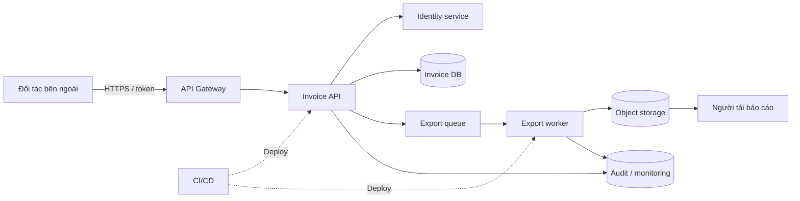
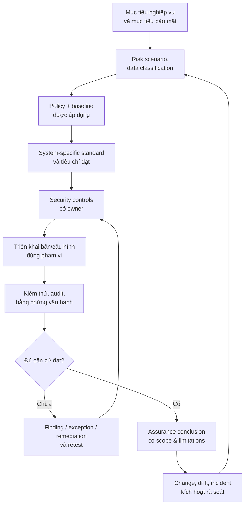

# Chuẩn bảo mật theo hệ thống: từ yêu cầu chung đến kiểm soát có bằng chứng

## Mục tiêu học tập

Sau bài học, người học có thể:

1. Giải thích **chuẩn bảo mật theo hệ thống (system-specific security standard)** và phân biệt nó với chính sách, khung tham chiếu, baseline dùng chung, quy trình vận hành và hướng dẫn kỹ thuật.
2. Xác định phạm vi một hệ thống, các môi trường, loại dữ liệu, ranh giới tin cậy và **phần trách nhiệm của hệ thống so với nền tảng hoặc nhà cung cấp**.
3. Chuyển yêu cầu cấp tổ chức và kết quả đánh giá rủi ro thành **điều khoản bắt buộc, có tiêu chí đạt/trượt và có người chịu trách nhiệm** đối với hệ thống cụ thể.
4. Liên kết mỗi điều khoản với **security control, cách triển khai, kiểm thử, bằng chứng audit, phát hiện và kế hoạch khắc phục**.
5. Lập một mẫu chuẩn riêng cho ứng dụng/API, bao gồm phân quyền, mã hóa, quản lý bí mật, logging, phát hành và khôi phục.
6. Quản lý ngoại lệ, sự khác biệt giữa các môi trường, thay đổi kiến trúc, kiểm soát dùng chung và **rủi ro còn lại** theo đúng thẩm quyền.
7. Thiết kế cơ chế kiểm tra tuân thủ **trước phát hành và liên tục trong vận hành**, đồng thời diễn đạt kết luận assurance không vượt quá bằng chứng.

Trong module **SECURITY_SECURITY_ASSURANCE**, mục tiêu không dừng ở việc đưa ra yêu cầu bảo mật. Hệ thống phải **chứng minh có cơ sở** rằng các yêu cầu đó được thực hiện thông qua phân tích rủi ro, security controls, kiểm thử, audit và khắc phục các phát hiện. Chuẩn theo hệ thống là lớp nối quan trọng giữa chính sách cấp tổ chức và những kiểm soát **thực sự có thể đánh giá trên một hệ thống, phiên bản và môi trường cụ thể**.

## 1. “Chuẩn theo hệ thống” có nghĩa là gì?

**Chuẩn bảo mật theo hệ thống** là một tập yêu cầu kỹ thuật và vận hành **được xác định cho một hệ thống hoặc một lớp hệ thống có đặc tính rõ ràng**, dựa trên chính sách tổ chức, yêu cầu nghiệp vụ, pháp lý/hợp đồng, dữ liệu, kiến trúc và kết quả đánh giá rủi ro.

Chuẩn trả lời: **“Trong phạm vi hệ thống này, tối thiểu phải đáp ứng những điều gì, ai chịu trách nhiệm, và kiểm tra bằng cách nào?”**

Ví dụ, chính sách tổ chức nêu:

> Dịch vụ xử lý dữ liệu khách hàng nhạy cảm phải có cơ chế kiểm soát truy cập phù hợp và kiểm chứng được.

Chuẩn riêng cho hệ thống **Partner Invoice API** có thể diễn giải thành:

> Mọi thao tác đọc, xuất và sửa hóa đơn phải kiểm tra quyền đối với **đúng tài nguyên và tenant ở phía server**; kiểm thử âm phải chứng minh tài khoản của tenant A không thể truy cập dữ liệu tenant B trên tất cả tuyến API đang được sử dụng.

Một câu là **nguyên tắc bảo vệ rộng**; câu kia là **yêu cầu có phạm vi, hành vi kiểm chứng và tiêu chí đạt**. Việc ban hành yêu cầu thứ hai không tự chứng minh đã tuân thủ: phải có kiểm soát đang chạy, bài kiểm thử và bằng chứng tương ứng.

### 1.1. Các lớp tài liệu không nên nhập làm một

| Lớp | Câu hỏi trả lời | Ví dụ |
|---|---|---|
| **Chính sách bảo mật (policy)** | Tổ chức bắt buộc hoặc cam kết điều gì? | Dữ liệu khách hàng phải được bảo vệ khỏi truy cập ngoài quyền |
| **Khung tham chiếu (framework/catalog)** | Có những nhóm mục tiêu và kiểm soát nào để lựa chọn, đánh giá? | Nhóm yêu cầu kiểm soát truy cập, nhật ký, khôi phục |
| **Tiêu chuẩn/baseline dùng chung** | Mức kỹ thuật tối thiểu áp dụng cho một loại tài sản/công nghệ là gì? | Cấu hình TLS được phê duyệt; quy tắc quản lý secrets |
| **Chuẩn theo hệ thống** | Hệ thống cụ thể phải thực hiện yêu cầu nào, ở thành phần/luồng nào? | Object-level authorization cho tất cả đường đọc hóa đơn |
| **Quy trình/runbook** | Ai thực hiện từng thao tác và xử lý lỗi thế nào? | Cách cấp quyền service account, luân chuyển khóa, xử lý phát hiện |
| **Implementation/configuration** | Hệ thống thực sự vận hành ra sao? | IAM policy, middleware kiểm tra quyền, cấu hình gateway |
| **Assurance evidence** | Có gì chứng minh kiểm soát đang hoạt động đúng phạm vi? | Test IDOR, cấu hình production, bản ghi triển khai, access review |

Một tổ chức có thể tham khảo các họ tài liệu như **ISO/IEC 27001/27002, NIST SP 800-53 hoặc OWASP ASVS** để xây dựng phương pháp hoặc danh mục yêu cầu. Tuy nhiên, **tham khảo khung không đồng nghĩa đã đạt chứng nhận, đáp ứng toàn bộ tiêu chuẩn hoặc đã kiểm soát an toàn**. Khi viện dẫn một phiên bản cụ thể, cần kiểm tra phiên bản và phạm vi áp dụng thực tế trong quy chế nội bộ.

### 1.2. “Theo hệ thống” không chỉ là “theo hệ điều hành”

Tên gọi này có thể bị hiểu thành chuẩn cấu hình Linux hoặc Windows. Trong bài này, nó có nghĩa rộng hơn: chuẩn cho **một service, ứng dụng, nền tảng, hệ thống dữ liệu hoặc hệ thống tích hợp được định danh rõ**.

Chuẩn theo hệ thống thường **kế thừa**:

- Yêu cầu của tổ chức áp dụng cho tất cả hệ thống.
- Baseline theo loại công nghệ: ứng dụng web, API, database, container, endpoint, hạ tầng cloud.
- Yêu cầu tăng cường do **mức quan trọng của hệ thống, phân loại dữ liệu và kịch bản rủi ro đặc thù**.

Ví dụ, một hệ thống tra cứu thông tin công khai và hệ thống thực thi chuyển tiền đều có thể áp dụng baseline API, nhưng hệ thống chuyển tiền cần thêm **bất biến nghiệp vụ, phân quyền duyệt và thực thi, chống xử lý lặp, đối soát và khả năng truy vết quyết định**. Không thể chỉ sao chép checklist hardening của máy chủ để khẳng định đã bảo vệ nghiệp vụ chuyển tiền.

## 2. Bắt đầu bằng phạm vi hệ thống và mục tiêu bảo mật

Một chuẩn không có phạm vi rõ sẽ dẫn đến hai nguy cơ: **kiểm thử sai đối tượng** hoặc **đưa ra kết luận quá rộng**. Trước khi viết điều khoản, cần xác định hệ thống là gì và hệ thống phụ thuộc những gì.

### 2.1. Hồ sơ nhận diện hệ thống

| Thông tin | Câu hỏi kiểm tra | Ví dụ minh họa |
|---|---|---|
| **System ID và mục đích** | Hệ thống nào, đáp ứng mục tiêu gì? | `SYS-INVOICE-01` – Partner Invoice API |
| **Chủ sở hữu hệ thống** | Ai chịu trách nhiệm tổng thể về phạm vi và bằng chứng? | Head of Billing Platform |
| **Chủ sở hữu dữ liệu/nghiệp vụ** | Ai xác định giá trị, phân loại và hậu quả? | Billing Business Owner |
| **Dữ liệu và mức quan trọng** | Có dữ liệu khách hàng, hóa đơn, khóa, chứng cứ nào? | Hóa đơn nhạy cảm, quyền xuất dữ liệu theo tenant |
| **Thành phần** | API, DB, cache, queue, worker, batch, pipeline nào? | API v2, export worker, DB, object storage |
| **Môi trường** | Production, staging, sandbox và dữ liệu thật ở đâu? | Production và staging có dữ liệu giả lập |
| **Ranh giới tin cậy** | Ai có thể tác động đầu vào, truyền dữ liệu, cấp quyền? | Đối tác → API → DB; API → export storage |
| **Phụ thuộc** | IdP, KMS, cloud, vendor và nền tảng dùng chung nào? | Identity service, managed DB, object storage |
| **Chuẩn kế thừa** | Baseline/chính sách chung nào áp dụng? | Baseline API, IAM, storage, logging |
| **Thời điểm** | Chuẩn áp dụng từ bản nào, xem lại khi nào? | Release 2026-11 trở đi; review khi có thay đổi |

### 2.2. Sơ đồ ranh giới minh họa



Sơ đồ cho thấy chuẩn phải bao phủ nhiều **đường truy cập**. TLS từ đối tác tới gateway không tự bảo đảm quyền đọc dữ liệu tại API. Quy tắc phân quyền trên API cũng không tự bảo vệ **file báo cáo đã xuất** khi đi qua object storage và đường tải riêng.

### 2.3. Phạm vi phải gồm tài sản và luồng phụ

Khi xác định yêu cầu, cần xem:

1. **Đường chính:** Request/response, tạo/sửa/xem tài nguyên, thực thi thao tác nghiệp vụ.
2. **Đường nền:** Batch job, message queue, scheduled task, đồng bộ dữ liệu và xử lý retry.
3. **Bản sao:** Cache, log, export, snapshot, backup, dữ liệu kiểm thử, hệ thống phân tích.
4. **Quyền và khả năng thao tác:** Tài khoản người dùng, service account, token, khóa, vai trò quản trị và quyền deploy.
5. **Nhà cung cấp/phần kế thừa:** Cloud, identity provider, HSM/KMS, CDN, email hoặc báo cáo.
6. **Vòng đời:** Tạo, truyền, lưu, xử lý, chia sẻ, khôi phục, lưu giữ và xóa dữ liệu.

Chuẩn theo hệ thống có thể ghi rõ phần **không áp dụng** nhưng phải kèm lý do, phạm vi và người phê duyệt theo quy trình. **Không tìm thấy một thành phần trong sơ đồ không phải bằng chứng nó không tồn tại.**

## 3. Chọn yêu cầu dựa trên chính sách và rủi ro

Không nên bắt đầu bằng việc sao chép hàng trăm điều khoản mẫu. Hãy chọn yêu cầu bằng cách kết hợp:

- **Chính sách cấp tổ chức** và tiêu chuẩn kỹ thuật đã được phê duyệt.
- **Mục tiêu nghiệp vụ:** Giao dịch đúng người, số tiền đúng, dữ liệu không lộ, dịch vụ đáp ứng mục tiêu hoạt động.
- **Phân loại dữ liệu:** Mức nhạy cảm, quyền riêng tư, thời hạn lưu giữ và vị trí xử lý.
- **Threat model và risk scenarios:** Lỗi phân quyền cấp đối tượng, replay, mất log, sai cấu hình, mất khóa và không thể restore.
- **Kiến trúc và công nghệ:** API, JVM/Java backend, queue, database, hạ tầng cloud, storage và CI/CD.
- **Cam kết hợp đồng hoặc yêu cầu bắt buộc:** Chỉ xác định các nghĩa vụ **thực sự áp dụng** sau khi được bộ phận có thẩm quyền đánh giá.
- **Điều kiện vận hành và nguồn lực:** Phụ thuộc nền tảng, quyền của vendor, mức tự động hóa, khả năng kiểm thử và khôi phục.

### 3.1. Ba nhóm yêu cầu

| Nhóm | Đặc trưng | Ví dụ |
|---|---|---|
| **Bắt buộc kế thừa** | Áp dụng từ chính sách hoặc baseline chung | Quản lý secrets qua hệ thống được phê duyệt, không hardcode |
| **Tăng cường theo rủi ro** | Bổ sung vì hệ thống có giá trị/hành vi đặc thù | Hai vai trò độc lập cho duyệt và thực thi hoàn tiền |
| **Điều chỉnh hoặc không áp dụng có căn cứ** | Yêu cầu chung không phù hợp hoặc cần biện pháp tương đương được phê duyệt | Không có tài khoản người dùng trực tiếp nên kiểm soát phiên người dùng được thay bằng kiểm soát danh tính service phù hợp |

Không được tùy tiện gán *not applicable* cho điều khoản khó thực hiện. Phải có **lý do kỹ thuật/nghiệp vụ, người thẩm định, quyết định, ngày xem lại và bằng chứng hỗ trợ**. Nếu tổ chức không có quyền miễn trừ một yêu cầu bắt buộc theo pháp luật/hợp đồng, ghi “ngoại lệ” nội bộ không làm yêu cầu đó biến mất.

### 3.2. Ví dụ đi từ kịch bản tới yêu cầu

| Kịch bản rủi ro | Mục tiêu bảo mật | Yêu cầu cần có trong chuẩn |
|---|---|---|
| Đối tác thay ID để tải hóa đơn của tenant khác | Bí mật và đúng thẩm quyền | Mọi đường xem/xuất dữ liệu phải kiểm tra object-level authorization |
| Hai worker xử lý lại cùng sự kiện thanh toán | Toàn vẹn giao dịch | Một business request chỉ tạo tối đa một hiệu ứng thanh toán hợp lệ; retry/replay phải được kiểm thử |
| Tài khoản ứng dụng giải mã dữ liệu toàn bộ tenant | Hạn chế phạm vi dữ liệu và khóa | IAM/KMS phải giới hạn khả năng decrypt theo đúng mục đích và phạm vi |
| Pipeline triển khai image ngoài quy trình phê duyệt | Toàn vẹn phần mềm | Artifact và cấu hình production phải truy vết được tới nguồn/build/change đã phê duyệt |
| DB mất dữ liệu và backup không mở được | Khả năng phục hồi | Phải kiểm thử restore kèm quyền khóa, đạt mục tiêu RPO/RTO được chấp thuận |
| Không thể xác định ai sửa thông tin người nhận | Trách nhiệm giải trình | Sự kiện nhạy cảm phải có audit trail được bảo vệ, liên kết định danh và giao dịch |

Chuẩn nên nêu rõ **trường hợp kiểm chứng**, không chỉ yêu cầu cấu hình. Chẳng hạn, “có MFA” không chứng minh API kiểm tra quyền trên từng hóa đơn; “có backup” không chứng minh khả năng phục hồi đúng thời hạn.

## 4. Viết điều khoản chuẩn có thể kiểm chứng

Một điều khoản tốt là **cụ thể, áp dụng được, có người chịu trách nhiệm, có tiêu chí đạt/trượt và có bằng chứng**.

### 4.1. Cấu trúc đề xuất

| Thuộc tính | Ý nghĩa |
|---|---|
| **Requirement ID** | Mã ổn định, ví dụ `SYS-INV-AUTHZ-01` |
| **Mục tiêu và lý do** | Tài sản/rủi ro nào làm phát sinh yêu cầu |
| **Phát biểu bắt buộc** | Hành vi hoặc trạng thái phải có, tránh “an toàn”, “mạnh”, “đầy đủ” không định nghĩa |
| **Phạm vi áp dụng** | Thành phần, dữ liệu, vai trò, môi trường, phiên bản và đường xử lý |
| **Tiêu chí đạt** | Điều kiện và kết quả phải thấy; nếu có ngưỡng phải định nghĩa đơn vị/nguồn |
| **Cách xác minh** | Kiểm tra cấu hình, test âm/dương, review, scan, restore drill hoặc log quan sát |
| **Control owner** | Người vận hành/thiết kế security control |
| **System/risk owner** | Người chịu trách nhiệm phạm vi và rủi ro liên quan |
| **Bằng chứng** | Định danh kết quả, build/config, ngày chạy, kết quả và giới hạn |
| **Ngoại lệ hoặc điều kiện phụ thuộc** | Căn cứ not applicable, inherited control, chấp nhận rủi ro hoặc thời hạn |
| **Chu kỳ/trigger đánh giá lại** | Khi thay đổi nào hoặc đến kỳ nào phải xác minh lại |

### 4.2. Chuyển câu mơ hồ thành câu kiểm tra được

| Câu chưa đủ | Câu được chuẩn hóa |
|---|---|
| “API phải an toàn” | “Mọi endpoint trả dữ liệu theo tenant phải kiểm tra quyền đối với resource ở server; test yêu cầu tenant A truy cập resource tenant B phải bị từ chối và không lộ dữ liệu” |
| “Mã hóa tốt” | “Các luồng chứa dữ liệu nhạy cảm được bảo vệ bằng cấu hình truyền dữ liệu thuộc baseline mật mã đã phê duyệt, có xác minh đúng endpoint và test từ chối cấu hình bị cấm” |
| “Có log đầy đủ” | “Các thao tác phê duyệt, sửa, xuất dữ liệu và thay quyền phải ghi được actor, action, target, thời điểm, kết quả, correlation ID và log phải có quyền xóa/sửa giới hạn” |
| “Backup thường xuyên” | “Hệ thống phải hoàn thành bài restore định kỳ và chứng minh dữ liệu/khả năng truy cập khóa đáp ứng RPO/RTO đã được business owner phê duyệt” |
| “Không có lỗ hổng” | “Các findings thuộc mức nghiêm trọng đã định được triage, xử lý/đưa ra quyết định theo thẩm quyền và retest trước mốc phát hành tương ứng” |
| “Dependency đã kiểm tra” | “SBOM/dependency inventory phải tương ứng build đang chạy; các kết quả kiểm tra được triage và những rủi ro còn lại được xử lý theo tiêu chí release” |

**Lưu ý:** Một ngưỡng cụ thể như “RPO 15 phút”, “log giữ 180 ngày” hoặc “khóa luân chuyển sau 90 ngày” chỉ trở thành yêu cầu thực tế khi **đã được đánh giá và phê duyệt cho hệ thống/đối tượng đó**. Không có một bộ số cố định đúng cho tất cả hệ thống.

### 4.3. Chuẩn phải tách thiết kế, triển khai và hiệu quả

Ba câu khẳng định khác nhau:

1. **Control defined:** Đã ban hành yêu cầu kiểm tra quyền theo tenant.
2. **Control implemented:** Có middleware và policy trên đường API cụ thể của bản đang chạy.
3. **Control effective:** Kiểm thử trái quyền, đường export và hoạt động thực tế cho thấy người dùng không đọc được dữ liệu ngoài phạm vi trong các trường hợp đã định nghĩa.

Chỉ đánh dấu **đạt chuẩn** khi có căn cứ tương ứng với loại kiểm soát và mức bảo đảm mong muốn. Một tài liệu thiết kế hay ticket `Done` không chứng minh đầy đủ hiệu quả của việc triển khai.

## 5. Danh mục điều khoản theo hệ thống

Tùy phạm vi, chuẩn có thể chia thành nhóm; đây là gợi ý cho một hệ thống API xử lý dữ liệu nhạy cảm, **không phải checklist áp dụng máy móc**.

### 5.1. Định danh, xác thực và phân quyền

Các câu hỏi:

- Người dùng và dịch vụ được định danh thế nào? Ai có quyền cấp, sửa, thu hồi?
- Có kiểm soát **đúng đối tượng dữ liệu**, chứ không chỉ vai trò chung?
- Các thao tác quản trị, duyệt và thực thi có được phân tách thích hợp?
- Service account chỉ có quyền tối thiểu theo nhiệm vụ? Có tài khoản không còn chủ sở hữu?
- Thu hồi quyền có hiệu lực với token hoặc phiên còn tồn tại theo yêu cầu hệ thống?

Điều khoản ví dụ:

> `SYS-INV-AUTHZ-01`: Mọi đường API, export và batch truy xuất hóa đơn phải xác minh quyền của chủ thể đối với **từng hóa đơn và tenant** ở phía server trước khi tiết lộ nội dung; test ngoài quyền phải trả kết quả từ chối mà không trả dữ liệu nhạy cảm.

Bằng chứng: access-control matrix, test âm giữa tenant, review code/policy, deployment record, access review và kết quả thử thu hồi quyền.

### 5.2. Mã hóa, dữ liệu và secrets

Điều khoản nên xác định:

- Nơi dữ liệu nhạy cảm xuất hiện: DB, queue, backup, cache, log, export, thiết bị, vendor.
- Luồng nào cần bảo vệ khi truyền, nơi kết thúc TLS, chính sách xác minh endpoint.
- Nơi nào cần bảo vệ khi lưu, ai có quyền decrypt, key lifecycle và thử khôi phục.
- Secrets có bị đưa vào repository, log, CI artifact hay thông báo lỗi?
- Các đường xuất và xóa dữ liệu đáp ứng yêu cầu phân loại/retention không?

Ví dụ:

> `SYS-INV-DATA-02`: File hóa đơn xuất ra object storage phải được bảo vệ tại nơi lưu, có kiểm tra quyền tải theo tenant và có thời hạn truy cập/lưu giữ được quy định; test tải trái quyền và kiểm tra quyền service account là bằng chứng bắt buộc.

Mã hóa tại storage **không tự thay thế** phân quyền tải file. Một client đã được quyền giải mã nhưng sai tenant vẫn có thể gây rò rỉ nếu API không kiểm tra đối tượng.

### 5.3. Toàn vẹn nghiệp vụ và API

Chuẩn phải bao gồm **bất biến nghiệp vụ**, không chỉ security headers hoặc scanner.

Ví dụ:

> `SYS-INV-STATE-03`: Một hóa đơn ở trạng thái đã phát hành không được thay đổi số tiền/người nhận bởi đường cập nhật thông thường; mọi điều chỉnh phải theo luồng có phê duyệt và audit trail.

Đối với hệ thống thanh toán có retry:

> `SYS-PAY-IDEMP-01`: Giao lại một business request không được tạo thêm hiệu ứng thanh toán hợp lệ; phải có test replay và đồng thời ở đường chính cũng như đường khôi phục.

Bằng chứng: state-machine tests, integration tests, concurrency/replay tests, DB constraints, kết quả đối soát và xác minh trên phiên bản đã triển khai.

### 5.4. Hạ tầng, cấu hình và chuỗi cung ứng

Các nhóm yêu cầu có thể gồm:

- Cấu hình mặc định an toàn, hạn chế cổng mạng và quyền quản trị.
- Secrets và môi trường được phân tách theo chính sách.
- Dependency inventory, kết quả đánh giá lỗ hổng và quy trình khắc phục.
- Kiểm soát quyền CI/CD, xây dựng artifact, lưu provenance hoặc digest.
- Kiểm tra IaC/configuration drift, quyền sửa feature flag, thay đổi qua quy trình.
- Baseline hardening đối với OS/container/DB/cloud service thuộc trách nhiệm của hệ thống.

Ví dụ:

> `SYS-INV-DEPLOY-04`: Production chỉ nhận artifact được tạo từ pipeline đã phê duyệt; deployment record phải liên kết tới version, artifact digest, commit và người/quy trình cho phép phát hành.

Một container image đã được scan không có nghĩa **chính image đó** đang chạy trên production; cần nối kết quả scan với định danh artifact và bản triển khai thực tế.

### 5.5. Logging, phát hiện và ứng phó

Chuẩn cần nêu **sự kiện nào phải ghi**, **trường tối thiểu nào cần có**, **ai truy cập được**, **cách bảo vệ log**, **cách phát hiện mất log** và **các trường hợp cảnh báo phải thử**.

Ví dụ:

> `SYS-INV-AUDIT-05`: Hệ thống phải tạo audit event cho thao tác export hóa đơn và thay quyền, bao gồm actor, action, target, thời điểm, kết quả và correlation ID; tài khoản ứng dụng thông thường không được tự ý xóa log đã chuyển vào kho lưu trữ.

Log chứa dữ liệu nhạy cảm cũng cần được phân loại, hạn chế quyền, che các trường không cần thiết và quản lý lưu giữ. Không được chép secret hoặc toàn bộ dữ liệu khách hàng vào log chỉ để “đủ chứng cứ”.

### 5.6. Sẵn sàng, sao lưu và phục hồi

- Mục tiêu **RPO/RTO** phải được xác lập theo tác động nghiệp vụ; không tự đặt bằng con số chung.
- Sao lưu cần bảo vệ quyền và khóa, đồng thời có kiểm thử restore thực tế.
- Với queue/job nền cần xác minh retry, xử lý thông điệp trùng, tình huống phục hồi sau gián đoạn.
- Kế hoạch incident/rollback phải nêu quyền quyết định và cách xác minh trạng thái sau khôi phục.

> `SYS-INV-RECOVERY-06`: Trong bài phục hồi định kỳ, nhóm vận hành phải chứng minh có thể khôi phục dữ liệu hóa đơn với các khóa và cấu hình cần thiết, đối chiếu tính nhất quán và đáp ứng RPO/RTO đã được phê duyệt.

“Có file backup” chưa phải bằng chứng phục hồi thành công.

## 6. Mẫu chuẩn theo hệ thống: Partner Invoice API

Ví dụ sau mô tả **một chuẩn nội bộ giả lập** cho bài học, không phải cấu hình máy chủ có thể áp dụng trực tiếp hoặc chứng nhận theo một bộ tiêu chuẩn bên ngoài. Các giá trị như thời hạn và lịch kiểm tra chỉ là ví dụ; tổ chức phải xác định bằng phương pháp quản trị riêng.

```yaml
standard:
  id: STD-SYS-INVOICE-01
  title: Partner Invoice API Security Standard
  version: "1.0"
  systemId: SYS-INVOICE-01
  classification: internal
  status: approved-example
  ownerRole: Billing System Owner
  approvedByRole: Security Governance Delegate
  scope:
    environments:
      - production
      - staging-with-sensitive-data
    components:
      - invoice-api
      - invoice-export-worker
      - invoice-database
      - invoice-object-storage
    data:
      - customer-invoices
      - partner-access-tokens
  inheritedBaselines:
    - ORG-API-BASELINE
    - ORG-IAM-BASELINE
    - ORG-DATA-PROTECTION
  reviewTriggers:
    - API or authorization model changes
    - New vendor or sensitive-data flow
    - Critical security finding
    - Release affecting production controls

requirements:
  - id: SYS-INV-AUTHZ-01
    objective: Prevent cross-tenant invoice access
    appliesTo:
      - invoice-api
      - invoice-export-worker
      - invoice-object-storage
    mandatory: true
    ownerRole: Invoice Application Lead
    acceptanceCriteria:
      - Every read/export checks tenant and object authorization
      - Cross-tenant negative tests do not disclose invoice data
    verification:
      methods:
        - integration-security-test
        - authorization-policy-review
      evidenceIds:
        - TEST-AUTHZ-INVOICE-42
        - REVIEW-AUTHZ-07

  - id: SYS-INV-DEPLOY-04
    objective: Deploy only approved and traceable artifacts
    mandatory: true
    ownerRole: Platform Delivery Lead
    acceptanceCriteria:
      - Production artifact matches approved build digest
    verification:
      methods:
        - deployment-record-review
        - artifact-digest-check
      evidenceIds:
        - DEPLOY-INVOICE-RC2

  - id: SYS-INV-RECOVERY-06
    objective: Restore invoice records within approved objectives
    mandatory: true
    ownerRole: Database Reliability Lead
    acceptanceCriteria:
      - Restore exercise meets business-approved RPO and RTO
      - Restored invoice balances pass reconciliation
    verification:
      methods:
        - restore-exercise
        - reconciliation-review
      evidenceIds:
        - RESTORE-INVOICE-2026-11

knownLimitations:
  - Legacy batch importer requires separate assessment
  - Evidence references require scope and result verification

exceptionRegister: SYS-INVOICE-EXCEPTIONS
nextReview: 2026-12-20
```

Điểm quan trọng trong mẫu:

1. **Chuẩn có phiên bản, chủ sở hữu, phạm vi và trạng thái quản trị.**
2. Một điều khoản có **ID ổn định, mục tiêu, thành phần áp dụng, control owner, tiêu chí đạt và cách xác minh**.
3. Những kiểm soát dùng chung được **tham chiếu**, nhưng không biến thành một kết luận tự động.
4. Có **giới hạn đã biết** và tài liệu ngoại lệ được quản lý riêng.
5. Danh sách `evidenceIds` chỉ là tham chiếu; phải đọc **bằng chứng thực tế** để quyết định đạt/trượt.

### 6.1. Ví dụ tiêu chí chấp nhận dưới dạng Gherkin

Một hệ thống Java/Spring hoặc bất kỳ backend khác có thể dùng tiêu chí hành vi tương đương để xây integration/security tests:

```gherkin
Feature: System standard - tenant authorization for invoices

  Scenario: An authenticated partner cannot read another tenant's invoice
    Given invoice I100 belongs to tenant B
    And user U1 is authenticated for tenant A only
    When U1 requests GET /invoices/I100
    Then the response must not disclose invoice I100
    And the access decision must be recorded according to audit policy

  Scenario: Export links must not bypass tenant authorization
    Given export E100 contains invoices belonging to tenant B
    And user U1 is authenticated for tenant A only
    When U1 requests to download export E100
    Then the download must be denied
    And no cross-tenant invoice content may be returned

  Scenario: Revoked permission cannot authorize an export
    Given U1 previously had export permission
    And export permission for U1 has been revoked
    When U1 uses an existing session to request a new export
    Then authorization must follow the revocation requirement
```

**Điểm cần lưu ý khi thử:** Trường hợp cuối cần chỉ rõ **thời hạn có hiệu lực của việc thu hồi** do chuẩn quy định; không nên ngầm giả định mọi hệ thống có cơ chế vô hiệu hóa token tức thì. Các trường hợp test nên kiểm tra kết quả nghiệp vụ và dữ liệu trả về, không chỉ một mã HTTP cố định.

### 6.2. Những trường dữ liệu không nên nhét vào chuẩn

Chuẩn không nên lưu **mật khẩu, private key, access token thực, dữ liệu cá nhân không cần thiết** hoặc chi tiết tấn công nhạy cảm không phục vụ việc triển khai. Nên lưu **tham chiếu tới kho bằng chứng có phân quyền** thay vì sao chép toàn bộ chứng cứ vào một tệp chuẩn.

Giá trị như API URL hoặc cổng mạng cụ thể có thể đặt trong phụ lục/hồ sơ cấu hình được kiểm soát phiên bản. Tránh khiến chuẩn trở thành bản sao của cấu hình dễ lỗi thời; chuẩn phải ổn định ở **mức yêu cầu**, còn hiện trạng triển khai được ghi ở inventory, configuration và evidence.

## 7. Liên kết chuẩn với security assurance

### 7.1. Chuỗi truy vết từ mục tiêu tới kết luận



Chuẩn có thể **phù hợp chính sách trên giấy** nhưng không phù hợp thực tế vận hành; cũng có thể có kiểm soát kỹ thuật hoạt động tốt nhưng **không đáp ứng một nghĩa vụ bắt buộc khác**. Vì vậy cần đánh giá **cả thiết kế chuẩn lẫn việc thực hiện và hiệu quả**.

### 7.2. Ma trận kiểm soát và bằng chứng

| Requirement | Control cần tồn tại | Xác minh cần thực hiện | Bằng chứng phù hợp |
|---|---|---|---|
| `SYS-INV-AUTHZ-01` | Server-side object/tenant authorization ở API và export | Thử truy cập chéo tenant, đường cũ và quyền đã thu hồi | Kết quả test âm, policy/code review, bản triển khai |
| `SYS-INV-DATA-02` | Bảo vệ storage và quyền tải file xuất | Test tải trái quyền, kiểm tra phạm vi storage/KMS và retention | Config snapshot, IAM review, test report |
| `SYS-INV-STATE-03` | State machine và kiểm tra biến đổi dữ liệu | Test cập nhật bất hợp lệ, đồng thời và đường batch | Integration test, DB constraint, change record |
| `SYS-INV-DEPLOY-04` | Pipeline chỉ deploy artifact được duyệt | Đối chiếu digest với build và production | Build provenance, artifact ID, deployment record |
| `SYS-INV-AUDIT-05` | Audit events và kho log tách quyền | Test event, thử quyền sửa/xóa, cảnh báo mất log | Log mẫu đã che dữ liệu, access review, alert test |
| `SYS-INV-RECOVERY-06` | Backup, khóa và runbook khôi phục | Restore drill và đối soát kết quả | Exercise record, RPO/RTO đo thực tế, reconciliation |

Một cách đặt câu hỏi cho từng hàng: **“Nếu kiểm soát thất bại, bằng chứng nào sẽ cho phép chúng ta nhận biết đúng thất bại đó?”** Nếu câu trả lời chỉ là “tool chạy xanh”, cần bổ sung tiêu chí hành vi và phạm vi.

### 7.3. Phân biệt các mức đánh giá

| Trạng thái | Cần khẳng định điều gì? | Chưa được tự suy ra |
|---|---|---|
| **Specified** | Yêu cầu đã được phê duyệt và gán owner | Hệ thống đã triển khai |
| **Implemented** | Control có mặt trên môi trường/phiên bản được nêu | Control hiệu quả trong mọi trường hợp |
| **Tested** | Bộ test được chỉ định đã chạy và có kết quả | Mọi trường hợp hoặc đường xử lý đều đạt |
| **Verified / effective trong phạm vi** | Có bằng chứng phù hợp cho yêu cầu và scope đã xác định | Toàn bộ hệ thống an toàn tuyệt đối |
| **Exception accepted** | Người đủ thẩm quyền chấp nhận rủi ro còn lại trong điều kiện xác định | Yêu cầu kỹ thuật đã được đáp ứng |
| **Not applicable có căn cứ** | Không áp dụng theo quyết định/đánh giá phù hợp | Không cần xem lại khi scope thay đổi |

**Tuân thủ chuẩn** và **mức rủi ro bảo mật** liên quan nhưng không đồng nhất. Một chuẩn có thể chưa bao phủ đe dọa mới; một ngoại lệ được phê duyệt có thể hợp lệ về quản trị nhưng **không biến kiểm soát chưa đạt thành kiểm soát đạt**.

### 7.4. Cấu trúc hồ sơ bằng chứng

Đối với mỗi kết quả kiểm thử/audit nên lưu:

- **Requirement/Control ID** cùng bản tiêu chuẩn áp dụng.
- **System, component, endpoint, tenant/role, environment và release/build/config**.
- **Ngày giờ, người thực hiện, nguồn công cụ và cách tiến hành**.
- **Expected vs actual result**, kết luận đạt/trượt và giới hạn độ bao phủ.
- **Liên kết tới finding, risk ID, change request và retest** nếu có.
- **Tính toàn vẹn/khả năng truy xuất** của bằng chứng: phân quyền, lưu giữ, lịch sử sửa đổi thích hợp.

Không chép secret hoặc dữ liệu khách hàng thô vào báo cáo để làm “bằng chứng”. Cần che thông tin nhạy cảm mà vẫn giữ được khả năng xác minh.

## 8. Kiểm soát kế thừa và trách nhiệm chia sẻ

Một hệ thống hiếm khi sở hữu toàn bộ kiểm soát. Identity, logging, database platform, CI/CD, cloud và KMS thường là **shared services**. Chuẩn theo hệ thống phải biết **được kế thừa điều gì và phần nào vẫn cần kiểm tra ở lớp ứng dụng**.

### 8.1. Ma trận shared control

| Kiểm soát | Owner của kiểm soát dùng chung | System owner cần kiểm chứng thêm |
|---|---|---|
| MFA cho tài khoản quản trị IdP | Identity team | Tài khoản của hệ thống có thực sự thuộc policy, không có đường bypass |
| TLS ở API gateway | Platform networking | Kết nối giữa gateway và backend, certificate verification của client |
| Encryption at rest của DB | Data platform/cloud control owner | Các bản sao export/log/backup, quyền decrypt và IAM của ứng dụng |
| Backup do đội DB vận hành | Database reliability | Restore **dữ liệu ứng dụng** và kiểm tra bất biến/RPO/RTO nghiệp vụ |
| Logging tập trung | Observability | Ứng dụng gửi đủ sự kiện cần audit và có kiểm soát mất log |
| Container scanning trong CI | DevSecOps platform | Artifact thực tế được triển khai có trùng build đã scan, finding được triage |

Ví dụ: Vendor cloud cung cấp managed database và báo cáo đánh giá kiểm soát hạ tầng. Điều đó **không** chứng minh quyền của service account ứng dụng được cấu hình tối thiểu hay bản xuất CSV được kiểm soát đúng tenant.

### 8.2. Điều khoản cho kiểm soát kế thừa

Thay vì ghi “IAM: covered by platform”, nên ghi:

> `SYS-INV-IAM-07`: Hệ thống sử dụng cơ chế danh tính từ Identity Service theo baseline IAM; System owner phải xác minh mọi tài khoản quản trị thuộc scope của policy liên quan, các service identities có quyền theo nhiệm vụ và những trường hợp ngoại lệ được theo dõi.

Bằng chứng có thể chia:

- **Nền tảng cung cấp:** Policy, cấu hình, báo cáo vận hành, kết quả kiểm thử của Identity Service.
- **Hệ thống cung cấp:** Danh sách identity thực tế đang dùng, mapping quyền, test tích hợp và bằng chứng không có đường bypass.

**Giới hạn hiệu lực:** Bằng chứng chung chỉ có giá trị khi **đúng dịch vụ, phiên bản, thời hạn và phạm vi sử dụng**. Nếu nền tảng đổi chính sách hoặc thành phần phụ thuộc thay đổi, hệ thống cần đánh giá lại.

## 9. Quản trị chuẩn: trách nhiệm, phê duyệt và ngoại lệ

### 9.1. Ai làm gì?

| Vai trò | Trách nhiệm chính |
|---|---|
| **Policy/standard owner cấp tổ chức** | Duy trì quy định chung, baseline, cơ chế phê duyệt và rà soát |
| **Business/data owner** | Xác định mục tiêu, phân loại, mức ảnh hưởng và nghĩa vụ đối với dữ liệu |
| **System owner** | Xác định scope, điều phối các điều khoản và chịu trách nhiệm về trạng thái quản trị/bằng chứng của hệ thống |
| **Security architect / GRC** | Hỗ trợ chọn yêu cầu theo rủi ro, chất vấn sự phù hợp và đánh giá ngoại lệ |
| **Control owner** | Thiết kế, triển khai, vận hành và cung cấp bằng chứng cho một control |
| **Risk owner** | Quản lý một rủi ro cụ thể, quyết định xử lý hoặc chuyển cấp khi vượt thẩm quyền |
| **Action owner** | Sửa một phát hiện theo tiêu chí và hạn được giao |
| **Security assurance / QA** | Xác minh/đánh giá theo phạm vi, lập findings và kiểm tra lại |
| **Internal audit** | Đánh giá độc lập theo phạm vi được giao, không tự chịu trách nhiệm triển khai |
| **Người chấp nhận rủi ro có thẩm quyền** | Phê duyệt giữ rủi ro còn lại trong giới hạn ủy quyền và điều kiện xác định |

Một người có thể kiêm vai trò trong tổ chức nhỏ, nhưng **thẩm quyền chấp nhận ngoại lệ** và **tính độc lập của đánh giá** không được tự suy ra từ tên chức danh.

### 9.2. RACI minh họa

RACI: **R** = Responsible (thực hiện), **A** = Accountable (chịu trách nhiệm cuối cùng cho hoạt động), **C** = Consulted (tham vấn), **I** = Informed (được thông báo).

| Hoạt động | System owner | Control/engineering owner | Security/GRC | Risk owner | Cấp duyệt |
|---|---|---|---|---|---|
| Định nghĩa phạm vi hệ thống và bản tiêu chuẩn áp dụng | **A/R** | R | C | C | I |
| Chọn kiểm soát theo threat model và policy | **A** | R | R/C | C | I |
| Triển khai/cấu hình kiểm soát | A | **R** | C | I | I |
| Tổ chức thu thập bằng chứng | **A/R** | R | C | I | I |
| Đánh giá rủi ro của finding | C | C | R/C | **A/R** | I |
| Quyết định chấp nhận ngoại lệ vượt ủy quyền | R | C | C | R | **A** |
| Xác nhận một đợt đánh giá độc lập đạt phạm vi | C | C | **A/R** | I | I |

Ma trận là ví dụ tổ chức công việc, không phải phân quyền cố định. Đối với từng hoạt động cần có **một đầu mối A thực sự có quyền**, không ép System owner phê duyệt rủi ro mà họ không được ủy quyền.

### 9.3. Ngoại lệ phải có vòng đời

Khi một hệ thống legacy không thể thực hiện đầy đủ chuẩn, hồ sơ ngoại lệ cần:

1. **Requirement ID, hệ thống, component, môi trường và data flow** không đạt.
2. **Nguyên nhân và bằng chứng** cho thấy không đáp ứng; không dùng mô tả chung “không khả thi”.
3. **Rủi ro còn lại:** sự kiện, khả năng, tác động, độ bất định và đối tượng chịu ảnh hưởng.
4. **Lựa chọn thay thế:** nâng cấp, tắt đường cũ, giới hạn scope, kiểm soát bù trừ, chuyển vendor.
5. **Kế hoạch xử lý:** action owner, mốc khắc phục, nguồn lực và tiêu chí retest.
6. **Quyết định đúng thẩm quyền:** ai phê duyệt, trong điều kiện nào, thời hạn hiệu lực.
7. **Trigger đánh giá lại:** sự cố, khai thác mới, thay đổi dữ liệu, expiry hoặc thay đổi thiết kế.
8. **Bằng chứng kiểm soát bù trừ:** logging, phân đoạn, hạn chế quyền, đối soát hoặc cơ chế phòng ngừa khác.

**Không được đánh dấu “compliant” vì ngoại lệ đã được ký.** Có thể dùng các trạng thái khác nhau như *Noncompliant—Accepted exception* và *Noncompliant—Remediation in progress* để giữ nguyên sự thật kỹ thuật.

## 10. Kiểm tra trước release và theo dõi trong vận hành

Chuẩn có hiệu lực khi được đưa vào **chuỗi thay đổi và giám sát thường xuyên**, không chỉ khi đến kỳ audit.

### 10.1. Kiểm tra ở những thời điểm khác nhau

| Thời điểm | Việc cần thực hiện | Đầu ra |
|---|---|---|
| **Khởi tạo/mua hệ thống** | Xác định scope, dữ liệu, baseline và chủ sở hữu | System-specific standard ban đầu |
| **Thiết kế kiến trúc** | Threat modeling, chọn controls, phân chia trách nhiệm | DFD, risk mapping, control matrix |
| **Phát triển** | Kiểm tra code, cấu hình, dependency, unit/integration security tests | PR review, test result, scan findings |
| **Trước release** | Đối chiếu bắt buộc áp dụng, kết quả test và ngoại lệ | Release security evidence package |
| **Triển khai** | Xác minh đúng artifact/config/environment | Build digest, deployment/change record |
| **Vận hành** | Giám sát drift, phân quyền, lỗ hổng, backup, audit logs | Dashboards, access reviews, alerts |
| **Sau sự cố/finding** | Đánh giá lại kịch bản, kiểm soát và giả định | Risk update, remediation, retest |
| **Thay đổi lớn/ngừng hệ thống** | Rà soát scope, phụ thuộc, retention, quyền và bằng chứng | Standard revision, decommission evidence |

### 10.2. Chuyển các yêu cầu thành kiểm tra tự động khi phù hợp

Có thể dùng pipeline/IaC policy checks để:

- Từ chối một cấu hình object storage công khai khi bucket chứa dữ liệu nhạy cảm, theo chính sách đã định.
- Phát hiện service account được cấp quyền quá rộng.
- Kiểm tra các điều kiện bắt buộc đối với artifact, phiên bản image hoặc thay đổi production.
- Đối chiếu secrets không được đưa vào mã nguồn, container image hoặc log.
- Liên kết test kết quả phân quyền/API vào release gate.
- Phát hiện thay đổi cấu hình thực tế so với baseline đã được phê duyệt.

Tuy nhiên, **không phải điều khoản nào cũng phù hợp cho một linter**. Tính đúng đắn của nghiệp vụ (chẳng hạn mỗi lần duyệt chỉ chi đúng người) cần **test hành vi, integration test, đối soát và đánh giá hệ thống thực tế**. Scanner không thay thế phân tích rủi ro hoặc assurance chuyên môn.

### 10.3. Mô hình trạng thái đánh giá

Nên theo dõi từng requirement ID theo những trạng thái có nghĩa rõ:

| Trạng thái minh họa | Điều kiện |
|---|---|
| **NOT_ASSESSED** | Chưa có kết quả phù hợp với kỳ/bản triển khai đang đánh giá |
| **PASS** | Có bằng chứng mới, đúng scope và đáp ứng tiêu chí |
| **FAIL** | Có bằng chứng cho thấy không đạt |
| **IN_PROGRESS** | Đang sửa hoặc chờ retest; chưa đủ điều kiện PASS |
| **EXCEPTION_ACTIVE** | Chưa đáp ứng nhưng được phê duyệt ngoại lệ có điều kiện/thời hạn |
| **NOT_APPLICABLE** | Có căn cứ/duyệt rằng yêu cầu không áp dụng cho scope hiện tại |
| **EXPIRED_EVIDENCE** | Kết quả cũ không còn đủ tin cậy sau thay đổi/kỳ đánh giá |

Một sản phẩm có thể hiển thị tên trạng thái khác; điều cốt yếu là **không biến “chưa đánh giá” thành “đã đạt” và không che giấu các ngoại lệ**.

### 10.4. Tính tỷ lệ tuân thủ không gây hiểu nhầm

Ví dụ giả định: Một chuẩn có **20 điều khoản áp dụng** cho production; 14 điều khoản có bằng chứng PASS, 3 FAIL, 2 có ngoại lệ còn hiệu lực và 1 chưa được đánh giá. Khi chỉ đo *tỷ lệ PASS có chứng cứ* trên tất cả điều khoản áp dụng:

```text
Evidence-backed PASS rate = 14 / 20 = 70%
```

Không được ghi “80% đạt” bằng cách cộng hai ngoại lệ như thể đã đạt kỹ thuật. Có thể báo cáo **riêng** ngoại lệ được quản trị và độ bao phủ đánh giá. Nếu số điều khoản *NOT_APPLICABLE* bị loại khỏi mẫu số, phải công bố **tiêu chí loại trừ và bằng chứng**.

Tỷ lệ PASS cũng không thể thay thế đánh giá **mức nghiêm trọng của điều khoản thất bại**: một lỗi truy cập trái tenant có thể đáng xử lý hơn nhiều PASS ở những kiểm soát ít quan trọng.

## 11. Tình huống: chuẩn API chung không bao phủ đường xuất dữ liệu cũ

Một công ty triển khai **Partner Invoice API** với các thành phần: API v2, worker xuất CSV, object storage và một đường batch legacy. Chuẩn chung dành cho API yêu cầu TLS, authentication và logging. Sau một đợt kiểm thử, team phát hành báo cáo “hệ thống đạt chuẩn API”.

Đợt đánh giá bảo đảm tiếp theo phát hiện:

- API v2 kiểm tra quyền theo tenant, nhưng **endpoint v1 cũ** chỉ kiểm tra người dùng đã đăng nhập.
- Worker tạo **CSV nhiều hóa đơn**, rồi lưu trong object storage có URL tải tồn tại lâu và không kiểm tra lại tenant khi tải.
- Dữ liệu nhạy cảm được mã hóa trong DB chính, nhưng **đường xuất báo cáo** chưa có bằng chứng phân quyền phù hợp.
- Pipeline có kết quả scan source, nhưng **chưa liên kết kết quả với artifact đang chạy** và feature flag hiện tại.

### 11.1. Vì sao báo cáo ban đầu chưa đủ?

Baseline API chung chủ yếu có **kiểm soát ở lớp giao tiếp/ứng dụng**; nó chưa quy định đầy đủ **điều kiện phân quyền cho dữ liệu hóa đơn của hệ thống cụ thể**. Kể cả khi tất cả mục baseline chung đạt, một đường nghiệp vụ vẫn có thể gây lộ dữ liệu.

Điều này thể hiện ba khoảng trống:

1. **Khoảng trống lựa chọn yêu cầu:** Chưa bổ sung điều khoản kiểm tra quyền theo tenant và toàn bộ đường xuất.
2. **Khoảng trống phạm vi:** Đã bỏ sót API v1, object storage và download flow.
3. **Khoảng trống bằng chứng:** Test/scan không được liên kết đầy đủ với bản triển khai production và feature flag.

### 11.2. Điều khoản chuẩn được bổ sung

| ID | Điều khoản theo hệ thống | Cách xác minh |
|---|---|---|
| `SYS-INV-AUTHZ-01` | Mọi đường đọc/xuất hóa đơn phải kiểm tra quyền theo tenant và đối tượng | Test chéo tenant trên v1/v2, batch, export và download |
| `SYS-INV-EXPORT-08` | File xuất phải có quyền truy cập và retention theo phân loại dữ liệu | Test link hết hạn, tải trái quyền, IAM/storage review |
| `SYS-INV-DEPLOY-04` | Kết quả scan và phê duyệt phải gắn với artifact/config đang chạy | Build/deploy identity, digest, feature-flag snapshot |
| `SYS-INV-AUDIT-05` | Export và truy cập bị từ chối phải được ghi sự kiện theo yêu cầu | Log mẫu, test gửi log, thử cảnh báo khi pipeline mất log |

### 11.3. Phân công và xử lý

**System owner** rà soát scope và theo dõi mức đáp ứng; **business/data owner** nêu hậu quả nếu lộ hóa đơn; **control owner** của API/worker/storage sửa điểm yếu và cung cấp bằng chứng; **risk owner** đánh giá và quyết định xử lý hoặc chuyển cấp. Bộ phận security assurance kiểm thử lại theo phạm vi xác định và ghi rõ điều còn chưa bao phủ.

Nếu không thể sửa v1 ngay, nhóm phải cân nhắc **đóng endpoint, hạn chế truy cập, giảm phạm vi dữ liệu hoặc ngoại lệ có thời hạn được phê duyệt đúng quyền**. Việc ghi “v1 legacy” không tự tạo quyền bỏ qua kiểm soát phân quyền bắt buộc.

### 11.4. Một kết luận assurance có trách nhiệm

> **Claim:** API v2 đáp ứng điều khoản phân quyền theo tenant đối với các tuyến và vai trò đã được kiểm thử trên bản triển khai được xác định.
>
> **Evidence:** Test âm cross-tenant, review policy, định danh build và xác nhận cấu hình.
>
> **Limitation:** Chưa thể kết luận toàn bộ Partner Invoice System đạt chuẩn cho truy cập dữ liệu vì đường v1 và export/download vẫn có findings đang xử lý.
>
> **Follow-up:** Risk owner quản lý quyết định còn lại; các control owners khắc phục; assurance thực hiện retest và cập nhật phạm vi kết luận.

Một kết luận có giới hạn rõ **giá trị hơn** dấu “PASS” chung chung không được bằng chứng hỗ trợ.

## 12. Những sai lầm thường gặp

| Sai lầm | Vì sao gây rủi ro | Cách cải thiện |
|---|---|---|
| Sao chép nguyên checklist chung cho mọi hệ thống | Bỏ sót bất biến nghiệp vụ và đường dữ liệu đặc thù | Bổ sung yêu cầu từ threat model và business objectives |
| Viết câu “bảo mật tốt”, “mã hóa mạnh” | Không có tiêu chí đạt/trượt | Nêu scope, hành vi, phương pháp xác minh và baseline được duyệt |
| Đồng nhất policy, standard và implementation | Không biết đang đánh giá tài liệu hay kiểm soát chạy thực tế | Tách lớp tài liệu và liên kết evidence |
| Không ghi phiên bản/tenant/environment | Dùng test staging kết luận cho production | Gắn kết quả với build/config, môi trường và đường xử lý |
| Mặc định control do cloud cung cấp bao phủ mọi thứ | Phần ứng dụng/khách hàng có thể chưa được kiểm tra | Quản lý inherited controls và consumer-side verification |
| Đánh dấu PASS vì đã merge code | Chưa có kiểm chứng trong bản chạy | Test, deploy verification, monitoring và retest |
| Dùng scan như bằng chứng toàn bộ tính đúng đắn | Scanner không kiểm tra mọi bất biến nghiệp vụ | Kết hợp unit/integration/security test và đánh giá chuyên môn |
| Đánh dấu ngoại lệ thành tuân thủ | Che giấu tình trạng chưa đạt và rủi ro còn lại | Báo cáo trạng thái ngoại lệ riêng, hạn và thẩm quyền |
| Bỏ qua phần NOT_APPLICABLE | Dễ loại nhầm kiểm soát cần áp dụng | Ghi lý do và duyệt, xem lại khi phạm vi thay đổi |
| Chỉ báo tỷ lệ PASS không tính mức quan trọng | Nhiều PASS không bù được một lỗi nghiêm trọng | Phân theo mức độ rủi ro, kiểm soát trọng yếu và độ phủ |
| Không cập nhật chuẩn khi phát hành hoặc thêm vendor | Yêu cầu không còn khớp hiện trạng | Thiết lập review trigger trong change/incident workflow |
| Không có control owner và đầu mối khắc phục | Không ai cung cấp bằng chứng hoặc xử lý finding | Gán system/risk/control/action owner và cơ chế chuyển cấp |

## 13. Bài tập thực hành

### Bài tập 1 — Chuyển từ policy chung sang chuẩn riêng

Một hệ thống **HR Payroll Service** lưu bảng lương, nhận dữ liệu chấm công, gửi file thanh toán cho ngân hàng và có báo cáo cho phòng nhân sự. Chính sách tổ chức nêu “Dữ liệu nhạy cảm phải được kiểm soát quyền và được bảo vệ trong lưu trữ, truyền tải”.

**Yêu cầu:** Viết ít nhất **sáu điều khoản system-specific** có ID, scope, tiêu chí đạt, control owner và bằng chứng. Cần bao phủ phân quyền bảng lương, kênh gửi dữ liệu, file xuất, quyền ngân hàng, logging, khôi phục hoặc thay đổi quy trình duyệt.

**Gợi ý:** Phải phân biệt quyền của HR xem lương, quyền của kế toán xuất báo cáo, tài khoản dịch vụ gửi ngân hàng và quyền thay đổi kết quả chi trả. Không thể dùng một tiêu chí “đã đăng nhập” cho toàn bộ.

### Bài tập 2 — Phân tích inherited control

Order API sử dụng nền tảng Identity chung có MFA, hệ thống logging dùng chung và database managed có encryption at rest.

**Yêu cầu:** Lập bảng gồm **Control kế thừa – Owner phía nền tảng – Điều hệ thống còn phải kiểm chứng – Bằng chứng cần thu – Giới hạn kết luận**. Đề xuất một phép thử âm để chứng minh ứng dụng không dùng sai hoặc bypass kiểm soát Identity.

**Gợi ý:** Bằng chứng MFA của Identity không chứng minh object-level authorization của Order API.

### Bài tập 3 — Đánh giá ngoại lệ

API v1 cần hoạt động thêm hai tháng nhưng không thực hiện được kiểm tra quyền theo tenant. System owner đề nghị “đánh dấu compliant vì có ticket sửa trong sprint sau”. Hệ thống xử lý dữ liệu khách hàng nhạy cảm.

**Yêu cầu:** Xác định trạng thái chính xác, người cần ra quyết định, rủi ro còn lại, những lựa chọn xử lý ngay và những điều kiện bắt buộc để một ngoại lệ có thời hạn có thể được xem xét.

**Gợi ý:** Ticket theo kế hoạch **không phải bằng chứng kiểm soát đã hiệu quả**; rủi ro phải được đánh giá và chuyển cấp đúng phạm vi thẩm quyền.

### Bài tập 4 — Kiểm chứng kết luận assurance

Một bản báo cáo ghi “100% hệ thống đạt chuẩn” dựa trên scan TLS và dependency của API v2. Production còn một batch worker, object storage và một luồng khôi phục DB không có trong scan.

**Yêu cầu:** Viết lại **claim đúng phạm vi**, chỉ ra ba nguồn bằng chứng còn thiếu, đề xuất test/kiểm tra bổ sung và cách điều chỉnh mẫu số của báo cáo tuân thủ.

**Gợi ý:** Phải biết **tổng số điều khoản áp dụng cho toàn hệ thống**, phần đã có bằng chứng PASS, ngoại lệ và phần chưa được đánh giá. Không được tự coi thành phần chưa scan là đã đạt.

## 14. Checklist trước khi ban hành hoặc xác nhận đạt chuẩn

- **Phạm vi:** System ID, chủ sở hữu, data flows, môi trường, bản triển khai, API cũ và phụ thuộc đã rõ chưa?
- **Nguồn yêu cầu:** Có truy vết policy, baseline dùng chung, phân loại dữ liệu, nghĩa vụ và threat model không?
- **Tùy biến:** Các rủi ro/bất biến đặc thù hệ thống đã được chuyển thành điều khoản riêng chưa?
- **Đo lường:** Mỗi điều khoản có ID, tiêu chí đạt/trượt, owner và cách kiểm tra phù hợp không?
- **Kế thừa:** Với shared controls, có biết bên cung cấp chứng minh gì và phía hệ thống còn phải xác minh gì?
- **Triển khai:** Điều khoản có map tới security controls và đúng thành phần/phiên bản đang chạy không?
- **Kiểm chứng:** Đã có test âm, test nghiệp vụ, kiểm tra cấu hình và bằng chứng vận hành theo loại kiểm soát chưa?
- **Giới hạn:** Có biết những đường, tenant, vùng, bản sao, vendor hoặc dữ liệu còn ngoài scope không?
- **Ngoại lệ:** Có phân biệt FAIL, IN_PROGRESS, EXCEPTION_ACTIVE và NOT_APPLICABLE có căn cứ không?
- **Rủi ro:** Risk owner có thấy findings, đánh giá phần rủi ro còn lại và chuyển cấp đúng thẩm quyền không?
- **Audit:** Có thể đi từ mục tiêu → requirement ID → control owner → test/audit → evidence → finding/remediation/retest không?
- **Liên tục:** Release, incident, IAM/config drift, thay vendor hoặc thay dữ liệu có kích hoạt đánh giá lại không?

**Ghi nhớ:** **Chuẩn bảo mật theo hệ thống** không phải bản sao của checklist hay bằng chứng rằng hệ thống an toàn tuyệt đối. Nó là **bộ yêu cầu có trách nhiệm, phạm vi và tiêu chí kiểm chứng cụ thể**, được rút ra từ mục tiêu, chính sách và rủi ro của chính hệ thống. Trong security assurance, giá trị của chuẩn chỉ được chứng minh khi **security controls đang hoạt động, bằng chứng đúng phạm vi và các khoảng trống được quản lý đến khi khắc phục hoặc quyết định hợp lệ**.
