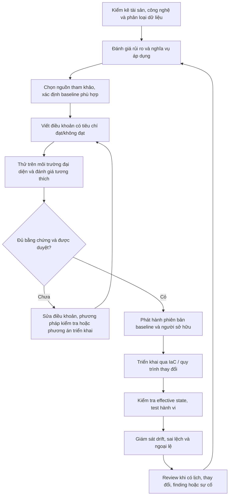
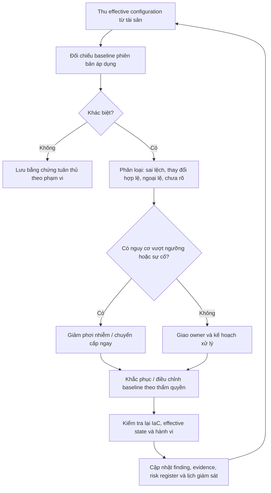

# Chuẩn cấu hình bảo mật: baseline, hardening và kiểm chứng liên tục

## 1. Chuẩn cấu hình là gì và vì sao cần trong Security Assurance?

**Chuẩn cấu hình bảo mật (security configuration standard)** là tập hợp các **yêu cầu kỹ thuật có thể kiểm chứng** xác định trạng thái cấu hình được chấp thuận đối với một loại tài sản hoặc hệ thống: hệ điều hành, máy chủ, mạng, cơ sở dữ liệu, dịch vụ đám mây, container, Kubernetes, ứng dụng, tài khoản dịch vụ, pipeline phát hành và công cụ quan sát. Chuẩn phải làm rõ **điều gì được phép hoặc bị cấm, phạm vi áp dụng, trách nhiệm, cách kiểm tra và bằng chứng cần giữ**.

Ví dụ, câu “cấu hình cloud phải an toàn” không đủ để đội triển khai thực hiện hoặc auditor kết luận. Một yêu cầu có thể kiểm chứng hơn là:

> Kho đối tượng chứa hồ sơ nhân sự không được truy cập công khai; quyền truy cập phải được giới hạn theo danh tính và nhu cầu nghiệp vụ, còn mọi ngoại lệ phải có phê duyệt trong thẩm quyền. Kết quả kiểm tra cần xác nhận cả cấu hình khai báo lẫn trạng thái đang có hiệu lực ở môi trường triển khai.

Chuẩn cấu hình trả lời câu hỏi **“trạng thái kỹ thuật được chấp thuận là gì?”**, còn **Security Assurance** trả lời câu hỏi sâu hơn: **“có bằng chứng đáng tin cậy cho thấy cấu hình đó đang tồn tại và giảm đúng rủi ro không?”**

Trong chương **Security standard** của module **SECURITY_SECURITY_ASSURANCE**, bài học này liên kết chuẩn cấu hình với mục tiêu xây dựng đánh giá bảo mật có bằng chứng: từ phân tích rủi ro, yêu cầu và security controls đến kiểm thử, audit, phát hiện sai lệch, khắc phục và duy trì assurance liên tục trong phát triển và vận hành.

**Sau bài học, người học có thể:**

1. Phân biệt chuẩn cấu hình, chính sách, baseline, hướng dẫn hardening, bản khai báo IaC và trạng thái thực tế.
2. Thiết kế một chuẩn cấu hình theo công nghệ, môi trường, phân loại dữ liệu và mức rủi ro, có tiêu chí đạt/không đạt.
3. Ánh xạ chuẩn cấu hình với các kịch bản rủi ro, controls, bằng chứng kiểm tra và chủ sở hữu.
4. Tổ chức kiểm tra trước phát hành và giám sát configuration drift trong vận hành.
5. Quản lý sai lệch, ngoại lệ, khắc phục và đánh giá lại hiệu lực kiểm soát theo trách nhiệm có thể audit.

## 2. Phân biệt các khái niệm cốt lõi

| Khái niệm | Trả lời câu hỏi nào? | Ví dụ |
| --- | --- | --- |
| **Security policy – Chính sách** | Tổ chức bắt buộc bảo vệ điều gì và ai chịu trách nhiệm? | Dữ liệu nhạy cảm phải được bảo vệ khỏi truy cập trái phép. |
| **Configuration standard – Chuẩn cấu hình** | Trạng thái kỹ thuật tối thiểu hoặc điều kiện cấu hình nào phải đạt? | Storage chứa dữ liệu nhạy cảm phải giới hạn public access, có kiểm soát danh tính và nhật ký phù hợp. |
| **Security baseline – Cấu hình nền được duyệt** | Tập giá trị/quy tắc áp dụng cho một họ tài sản và phiên bản nào? | Baseline cho object storage production; baseline cho Linux server nhóm ứng dụng. |
| **Hardening guide – Hướng dẫn gia cố** | Thực hiện các bước nào để đạt baseline? | Hướng dẫn tắt dịch vụ không dùng, giới hạn quyền và cấu hình log. |
| **IaC/configuration template** | Trạng thái mong muốn được khai báo hoặc tự động triển khai thế nào? | Module Terraform hoặc manifest Kubernetes có các thuộc tính bắt buộc. |
| **Effective/runtime configuration** | Hệ thống **thực sự đang chạy** với trạng thái nào? | Bucket hiện bị chặn truy cập công khai hay đã bị thay policy ngoài pipeline? |
| **Evidence – Bằng chứng** | Có thể tái kiểm tra kết quả so với tiêu chí nào? | Kết quả policy check, cấu hình thực tế, thời điểm chụp, tài sản và người xác minh. |
| **Exception/deviation – Ngoại lệ/sai lệch** | Không đạt chuẩn ở đâu, có được phép hay phải sửa? | Một dịch vụ tạm cần quyền bổ sung, có rủi ro, thời hạn và người phê duyệt. |

**Không đồng nhất baseline với hệ thống thực tế.** Một tệp IaC khai báo `public_access = false` chỉ thể hiện ý định trong mã cấu hình. Khi một tài khoản quản trị thay đổi quyền trực tiếp ngoài quy trình, trạng thái đang chạy có thể khác. Do đó cần kiểm tra **desired state, deployed state và effective state**.

### 2.1. “Đã cấu hình” chưa chắc “đã an toàn”

Một máy chủ đã bật ghi log nhưng không gửi log tới hệ thống có người giám sát vẫn có thể không đạt mục tiêu phát hiện. Một database bật mã hóa lưu trữ không tự bảo vệ khỏi API trả dữ liệu cho người dùng sai tenant. Một backup hoàn tất mỗi ngày không chứng minh có thể khôi phục đúng thời hạn.

Chuẩn cấu hình tốt cần nối **giá trị hoặc điều kiện kỹ thuật** với **mục tiêu bảo mật và tình huống gây hại cụ thể**. Vì vậy, một số mục tiêu kiểm chứng cần thêm **functional test, negative test, restore drill hoặc audit** bên cạnh việc đọc giá trị cấu hình.

### 2.2. Baseline dùng chung và tiêu chuẩn chuyên biệt

Một baseline chung có thể yêu cầu hệ thống phải xác thực danh tính quản trị và có cơ chế ghi log. Tuy nhiên, chuẩn cho database xử lý dữ liệu lương khác chuẩn cho một máy build tạm:

- Database cần chú trọng phân quyền đọc/ghi, backup, mã hóa, audit, truy cập mạng và khả năng phục hồi.
- Máy build cần chú trọng tính toàn vẹn pipeline, quyền lấy secrets, nguồn dependency, artifact và cô lập công việc.
- API production cần chú trọng TLS, xác thực và phân quyền, cấu hình lỗi, kết nối backend, logging và giới hạn tài nguyên.

Không sao chép một bộ giá trị “cứng” cho mọi công nghệ. Chuẩn nên xác định **cấp nền tảng**, sau đó bổ sung **profile theo dịch vụ và môi trường**.

## 3. Từ rủi ro đến các điều khoản chuẩn cấu hình

### 3.1. Mối liên hệ giữa risk, requirement và baseline

Thứ tự hợp lý:

1. **Nhận diện tài sản và luồng dữ liệu:** hồ sơ khách hàng, thông tin lương, tài khoản dịch vụ, backup, pipeline triển khai.
2. **Mô tả kịch bản rủi ro:** truy cập công khai nhầm kho tệp, quyền quản trị bị chiếm dụng, thiếu log phát hiện, restore không đạt.
3. **Xác định mục tiêu:** bí mật, toàn vẹn, sẵn sàng, truy vết; thêm nghĩa vụ về dữ liệu và dịch vụ khi áp dụng.
4. **Đặt yêu cầu kiểm soát:** chỉ danh tính được phép mới xem dữ liệu; thay đổi cấu hình phải truy vết; chỉ các cổng cần thiết được mở; có khả năng khôi phục.
5. **Định nghĩa cấu hình chấp thuận:** cấu hình IAM, network, storage, log, backup, runtime và phương pháp kiểm tra.
6. **Thu thập evidence:** cấu hình thực tế, kiểm tra tự động, test quyền và khôi phục; xem mức phơi nhiễm còn lại.

Ví dụ liên kết:

| Risk ID | Kịch bản và hậu quả | Điều khoản chuẩn | Kiểm tra cần thực hiện |
| --- | --- | --- | --- |
| **R-ST-01** | Bucket chứa file xuất có thể bị đọc công khai → lộ dữ liệu. | `CFG-OBJ-01`: kho nhạy cảm phải cấm truy cập công khai, phân quyền theo danh tính. | Kiểm tra policy hiệu lực, thử truy cập không có quyền với tệp giả định. |
| **R-IAM-02** | Tài khoản dịch vụ có quyền rộng → đọc/sửa tài sản ngoài phạm vi. | `CFG-IAM-02`: quyền tối thiểu, quyền đặc biệt phải được xét duyệt và rà soát. | Đối chiếu role thực cấp, thử thao tác ngoài quyền và xem lịch sử cấp quyền. |
| **R-NET-03** | Database lộ trực tiếp qua Internet → tăng bề mặt tấn công. | `CFG-NET-03`: chỉ chấp nhận luồng truy cập đã được xác định, không phơi nhiễm DB trực tiếp trái phép. | Kiểm tra route/security group/firewall hiệu lực và test reachability. |
| **R-LOG-04** | Không đủ nhật ký để điều tra thao tác thay đổi quan trọng. | `CFG-LOG-04`: audit event và quyền sửa/xóa log theo yêu cầu. | Sinh sự kiện kiểm thử, kiểm tra nội dung log, quyền truy cập và giữ log. |
| **R-AV-05** | Backup tồn tại nhưng không khôi phục được trong thời hạn. | `CFG-BCP-05`: backup và restore phải thỏa mục tiêu RTO/RPO được duyệt. | Kiểm tra lịch backup, quyền/khóa, chạy diễn tập khôi phục và đo kết quả. |

**Lưu ý:** mã `CFG-*` là ví dụ của một bộ chuẩn nội bộ, không phải mã chính thức của CIS, NIST hay ISO. Các tổ chức có thể tham khảo khuyến nghị nhà cung cấp, tài liệu hardening và những bộ chuẩn như CIS Benchmarks, nhưng phải xác nhận **bản công nghệ, phiên bản, phạm vi áp dụng, điều kiện nghiệp vụ và yêu cầu hiện hành**. Không mặc định mọi mục kiểm tra của một benchmark đều bắt buộc hoặc phù hợp trong mọi trường hợp.

### 3.2. Điều khoản chuẩn cần đo được

Mỗi điều khoản nên có:

- **ID ổn định và phiên bản** để so sánh các kỳ.
- **Đối tượng và điều kiện áp dụng**: loại tài sản, phiên bản, mức dữ liệu, môi trường và ngoại lệ loại trừ được phê duyệt.
- **Desired state/tiêu chí đạt**: giá trị kỹ thuật hoặc hành vi bảo mật mong muốn.
- **Lý do/rủi ro**: vì sao giá trị quan trọng, kiểm soát đường gây hại nào.
- **Phương pháp xác minh**: đọc cấu hình tĩnh, kiểm tra effective state, negative test, diễn tập hay review độc lập.
- **Evidence và tần suất**: nguồn, thời gian, scope và mức mới của bằng chứng.
- **Owner và cách xử lý fail**: ai chịu trách nhiệm, giới hạn thẩm quyền, điều kiện khắc phục hoặc xin ngoại lệ.

Đừng dùng điều khoản kiểu “máy chủ nên cứng hóa bảo mật” mà không có tiêu chí. Nếu chưa thể quy định một giá trị cố định vì phụ thuộc nền tảng, ghi **phương pháp xác định giá trị được phê duyệt** và bằng chứng của từng hệ thống, ví dụ danh sách cổng được phép theo sơ đồ luồng mạng có phê duyệt.

## 4. Cấu trúc một bộ security configuration baseline

### 4.1. Nhiều lớp baseline

| Lớp | Nội dung | Ví dụ |
| --- | --- | --- |
| **Lớp quản trị** | Ai phê duyệt, độ nhạy, rủi ro và quy định về sai lệch. | Policy yêu cầu bảo vệ dữ liệu khách hàng và ghi lại các thay đổi cấu hình quan trọng. |
| **Lớp nền tảng** | Điều kiện chung cho loại công nghệ. | Baseline Linux, Kubernetes, PostgreSQL, object storage, CI runner. |
| **Lớp môi trường** | Ranh giới và mức yêu cầu khác nhau theo môi trường. | Production hạn chế public ingress và quyền debug; môi trường test dùng dữ liệu giả. |
| **Lớp ứng dụng/dịch vụ** | Rủi ro và luồng dữ liệu cụ thể. | API multi-tenant cần kiểm tra quyền; database chi trả lương cần kiểm soát thao tác ghi. |
| **Lớp ngoại lệ được duyệt** | Các khác biệt có lý do, phạm vi, thời hạn và giám sát. | Cổng quản trị tạm chỉ mở qua đường quản trị hạn chế trong thời hạn xác định. |

Một tài sản có thể chịu **nhiều baseline**. Khi điều khoản mâu thuẫn, phải xác định thứ tự ưu tiên: nghĩa vụ bắt buộc và chính sách cấp trên, yêu cầu riêng được phê duyệt cho tài sản, rồi đến baseline nền tảng; không để đội kỹ thuật tùy tiện chọn điều kiện yếu hơn mà không ghi quyết định.

### 4.2. Hồ sơ quản lý baseline

| Trường | Câu hỏi kiểm tra |
| --- | --- |
| `baseline_id`, `version` | Có định danh và phiên bản ổn định để đối chiếu hay không? |
| `platform`, `technology_version` | Áp dụng cho sản phẩm/công nghệ và các phiên bản nào? |
| `environment`, `data_classification` | Áp dụng cho production/dev/test, dữ liệu công khai hay nhạy cảm? |
| `policy_refs`, `risk_refs` | Điều khoản nào được yêu cầu và vì sao? |
| `approved_values` | Những trạng thái hoặc giá trị kỹ thuật nào là điều kiện đạt? |
| `verification_method` | Kiểm tra bằng công cụ hoặc phép thử gì? Có cần kiểm tra hành vi hay không? |
| `control_owner`, `approver` | Ai triển khai và ai có quyền phê duyệt chuẩn/ngoại lệ? |
| `effective_date`, `next_review` | Khi nào có hiệu lực và khi nào phải cập nhật? |
| `evidence_refs`, `exception_refs` | Bằng chứng và sai lệch hợp lệ được truy xuất từ đâu? |

Baseline là **một tài liệu có phiên bản**; khi thay đổi, phải xem tác động tương thích, kế hoạch triển khai và kiểm chứng thay vì chỉnh một giá trị trong wiki rồi giả định mọi hệ thống đã tuân thủ.

## 5. Những nhóm cấu hình cần chuẩn hóa

### 5.1. Danh tính, xác thực và quyền

Chuẩn nên mô tả:

- Danh tính quản trị phải được kiểm soát, áp dụng xác thực đủ mạnh theo rủi ro và quy định, bao gồm MFA khi phù hợp và được yêu cầu.
- Không dùng tài khoản dùng chung không kiểm soát; quyền đặc biệt được phân cấp và kiểm tra định kỳ.
- Tài khoản dịch vụ, CI runner và workload identity có **quyền tối thiểu**; hạn chế credential dài hạn khi có phương án quản lý danh tính phù hợp.
- Quyền truy cập dữ liệu giữa tenant, role và đối tượng được xác minh **ở phía backend**, không chỉ trong giao diện.
- Thu hồi quyền khi thay vai trò, chấm dứt hợp tác hoặc khi phát hiện credential bị lộ; lịch sử thay đổi quyền có thể truy vết.

**Kiểm chứng:** chính sách quyền hiệu lực, số tài khoản có quyền cao, thử hành động ngoài quyền với tài khoản thử, bằng chứng cấp/thu hồi và log truy cập. Một bảng role khai báo trong tài liệu chưa chứng minh quyền thật trong hệ thống.

### 5.2. Mạng và bề mặt phơi nhiễm

- Chỉ mở luồng inbound/outbound theo nhu cầu đã được đánh giá và duyệt.
- Database, management interface và dịch vụ nội bộ không được mở công khai nếu không có căn cứ và biện pháp kiểm soát đủ phù hợp.
- Áp dụng phân vùng mạng hoặc kiểm soát truy cập tương đương ở những ranh giới quan trọng.
- Quản lý chính sách DNS, proxy, API gateway và TLS theo các tiêu chuẩn được phê duyệt, có kế hoạch loại bỏ giao thức/cipher không được cho phép.
- Xem lại quyền kết nối khi có endpoint, đối tác hoặc môi trường mới.

**Kiểm chứng:** đối chiếu sơ đồ luồng được duyệt với firewall/security group/network policy **đang có hiệu lực**, thử kết nối từ vị trí không được phép, kiểm tra cấu hình TLS và phạm vi phơi nhiễm. Không coi “security group đã khai báo” là đủ nếu route, load balancer hoặc cấu hình hiện tại tạo đường ngoài ý muốn.

### 5.3. Hệ điều hành và máy chủ

- Chỉ sử dụng hệ điều hành/phiên bản được hỗ trợ theo chính sách; có quy trình cập nhật và xử lý lỗ hổng.
- Vô hiệu hóa dịch vụ, tài khoản, giao thức và tính năng không cần thiết theo chức năng tài sản.
- Giới hạn quyền quản trị, tách quyền vận hành và cấu hình audit.
- Bảo vệ truy cập từ xa, khả năng nâng quyền và tệp cấu hình/bí mật.
- Duy trì đồng bộ thời gian và độ tin cậy của logging phù hợp nhu cầu điều tra.
- Xem xét các ngoại lệ tương thích ứng dụng trước khi áp dụng hardening có thể gây gián đoạn.

**Kiểm chứng:** danh sách package/service, cấu hình truy cập và logging hiệu lực, kết quả kiểm tra compliance có phiên bản, phép thử hoạt động nghiệp vụ sau thay đổi. Việc tắt một dịch vụ “không dùng” cần xác minh không làm hỏng backup/monitoring hoặc chức năng khác.

### 5.4. Container, Kubernetes và môi trường orchestration

- Giới hạn quyền chạy của container, đặc quyền host và các capability chỉ ở mức cần thiết.
- Sử dụng image từ nguồn được phê duyệt; quản lý tag/digest, cập nhật và quét thành phần.
- Phân quyền API của nền tảng orchestration theo vai trò và namespace; không mặc định workload có quyền cluster rộng.
- Quản lý ingress/egress, secrets, tài nguyên CPU/memory và cấu hình bảo mật runtime theo rủi ro.
- Tách cấu hình cho dev/test/production; bảo vệ đường triển khai và kiểm soát admission/policy phù hợp.

**Kiểm chứng:** image digest và nguồn artifact, manifest đã duyệt, policy check khi deploy, RBAC/network policy hiện có, kiểm tra hành vi và nhật ký sửa cấu hình. Một manifest đạt policy check trước deploy vẫn chưa đủ nếu workload chạy với cấu hình khác.

### 5.5. Cơ sở dữ liệu và lưu trữ

- Dữ liệu và backup cần được phân loại; cấu hình quyền đọc/ghi/quản trị theo nhu cầu.
- Chỉ những dịch vụ và danh tính được phép mới kết nối; bảo vệ truy cập mạng và kênh truyền theo yêu cầu.
- Có cơ chế mã hóa và quản lý khóa phù hợp, xem xét vòng đời khóa và quyền giải mã.
- Bảo vệ backup, snapshot, dump và export như dữ liệu gốc; không mặc định “bản sao không nhạy cảm”.
- Cấu hình audit cho thao tác quan trọng; xác định quyền đọc/sửa/xóa log và thời hạn lưu theo chính sách.
- Dữ liệu test phải dùng dữ liệu giả hoặc được xử lý/phê duyệt phù hợp thay vì sao chép tùy tiện dữ liệu thật.

**Kiểm chứng:** IAM và database grants hiệu lực, network connectivity, cấu hình lưu trữ, test quyền âm, kết quả restore drill và kiểm tra đường xuất dữ liệu.

### 5.6. Secrets, khóa và mã hóa

- Không lưu credential thật trong source, image, report, ticket hoặc log.
- Phân quyền sử dụng và quản trị secrets; sử dụng secret manager hoặc giải pháp tương đương phù hợp.
- Định nghĩa phương pháp phân phối, thu hồi, luân chuyển secrets/khóa và xử lý khi bị lộ.
- Cấu hình giao thức, thuật toán, chiều dài khóa và chu kỳ phù hợp với chuẩn được duyệt và năng lực tương thích hiện tại; không đóng băng một lựa chọn đã lỗi thời.
- Phân biệt **mã hóa lưu trữ**, **mã hóa khi truyền** và **ủy quyền truy cập**: không loại nào tự thay thế hoàn toàn loại khác.

**Kiểm chứng:** kết quả secret scanning, quyền IAM và cấu hình quản lý khóa, kiểm tra kết nối bảo mật theo phiên bản thực tế, test luồng thu hồi/luân chuyển bằng credential thử khi phù hợp.

### 5.7. Logging, giám sát và phát hiện

- Xác định các sự kiện cần log: thay đổi quyền, thao tác quản trị, truy cập dữ liệu nhạy cảm, phê duyệt giao dịch, thay đổi cấu hình quan trọng.
- Audit log có nội dung đủ điều tra theo nhu cầu: actor, action, resource, outcome, thời điểm và correlation ID khi phù hợp.
- Giới hạn nội dung: không ghi token, bí mật và dữ liệu cá nhân không cần thiết.
- Giới hạn quyền sửa/xóa log, vận chuyển và lưu giữ log phù hợp; cơ chế phát hiện phải có người vận hành/ứng phó.
- Kiểm tra hành vi khi hệ thống bị lỗi, quá tải hoặc mất kết nối với nơi lưu log, theo yêu cầu vận hành.

**Kiểm chứng:** tạo sự kiện giả định đã biết trước, đối chiếu log nhận được, kiểm thử quyền truy cập vào log, kiểm tra retention và phản hồi cảnh báo. Việc bật một checkbox “audit enabled” không chứng minh hệ thống ghi đúng sự kiện.

### 5.8. Backup, phục hồi và tính sẵn sàng

- Định nghĩa mục tiêu RTO/RPO dựa trên nhu cầu nghiệp vụ và nghĩa vụ đã phê duyệt.
- Cấu hình lịch, phạm vi, vị trí lưu, quyền và bảo vệ bản sao; xem xét nguy cơ mất cả hệ thống chính và backup do cùng một sự cố.
- Kiểm tra khả năng sử dụng khóa, quyền và runbook khi cần restore.
- Có diễn tập khôi phục theo kế hoạch và sau thay đổi trọng yếu, đo **thời gian và mức mất dữ liệu thực tế**.
- Phân biệt kết quả “backup job succeeded” với “restore drill met criteria”.

**Kiểm chứng:** báo cáo backup, cấu hình quyền/khóa, biên bản diễn tập và số liệu thực đo, finding/action khi kết quả không đạt.

### 5.9. CI/CD và cấu hình công cụ phát triển

- Bảo vệ nhánh, quyền phê duyệt, secrets của pipeline, quyền runner và registry theo mức nhạy cảm.
- Artifact phải có nguồn gốc và định danh phiên bản; kiểm soát việc lấy dependency/image.
- Kiểm tra IaC/config và security policy trước khi triển khai; lưu kết quả gate.
- Phân tách quyền viết code, phê duyệt và triển khai khi có yêu cầu; kiểm soát bypass.
- Sửa config gấp vẫn phải lưu lịch sử và rà soát sau ứng cứu.

**Kiểm chứng:** repo policy, log pipeline, scan theo commit/artifact, quyền runner/registry và evidence của quyết định release. Một pipeline “xanh” chưa đủ nếu phần config quan trọng nằm ngoài phạm vi gate.

## 6. Quy trình tạo và ban hành chuẩn cấu hình



### Bước 1 — Xác định lớp tài sản và mức rủi ro

Chốt danh sách tài sản, owner, loại nền tảng, phiên bản, dữ liệu, môi trường và các luồng truy cập. Tránh áp chuẩn máy ảo cho container hoặc quy tắc dịch vụ cloud cũ lên phiên bản đã đổi API mà không rà soát.

### Bước 2 — Chọn căn cứ chuẩn hóa

Có thể tham khảo khuyến nghị hardening của nhà sản xuất, CIS Benchmarks, các khung quản lý rủi ro/controls và kinh nghiệm vận hành. **Nguồn tham khảo không tự biến thành nghĩa vụ**; cần chọn và ghi lý do điều khoản nào được chấp thuận, điều khoản nào không áp dụng, và nghĩa vụ nào bắt buộc theo bối cảnh.

Khi sử dụng một benchmark, cần ghi **tên, phiên bản, cấu hình profile và ngày phê duyệt**, đồng thời xem ảnh hưởng tương thích. Không suy rằng việc đạt một tỷ lệ benchmark tự động bảo đảm hệ thống không còn lỗ hổng.

### Bước 3 — Viết điều khoản và phép kiểm chứng

Mỗi rule nên có:

1. Định danh: `CFG-OBJ-01`.
2. Điều kiện áp dụng: object storage chứa dữ liệu khách hàng trong production.
3. Trạng thái đạt: không cho truy cập công khai, chỉ identity được duyệt có quyền.
4. Phương pháp đánh giá: kiểm tra effective IAM/bucket policy và thử truy cập không có quyền.
5. Evidence: snapshot cấu hình, log kết quả truy cập với dữ liệu giả, thời điểm và resource ID.
6. Phương án fail: chặn phát hành/sửa ngay/chuyển cấp theo ngưỡng đã được phê duyệt.

**Nếu phép kiểm tra chỉ thấy một trường khai báo nhưng không thấy các quyền kế thừa, resource policy khác hoặc tình trạng áp dụng thực tế, điều khoản chưa đủ kiểm chứng.**

### Bước 4 — Thử và đánh giá tác động

Kiểm tra trên môi trường đại diện để phát hiện hardening làm gián đoạn dịch vụ. Ví dụ chặn quyền ghi của filesystem có thể ảnh hưởng thư mục tạm của ứng dụng; tắt một dịch vụ hệ thống có thể khiến giám sát hoặc phục hồi không hoạt động. Cần có test chức năng và rollback hoặc phương án điều chỉnh được phê duyệt.

### Bước 5 — Phê duyệt, phổ biến và chuyển thành triển khai

Baseline phải có owner và cấp phê duyệt, ngày hiệu lực, hướng dẫn triển khai, thời hạn chuyển đổi cho hệ thống hiện hữu và cơ chế hỗ trợ. Ưu tiên module IaC, golden image và kiểm tra tự động để giảm thao tác thủ công, nhưng phải giữ **quyền phê duyệt và truy vết**.

### Bước 6 — Kiểm tra trạng thái thật và duy trì

Sau triển khai, kiểm tra cấu hình runtime/effective state, test đường truy cập và ghi nhận các khác biệt. Lập lịch tái kiểm tra theo mức rủi ro; khi phát hiện drift, tạo finding và áp dụng quyết định xử lý trong thẩm quyền. **Kiểm tra một lần tại ngày phát hành không thay kiểm chứng trong vận hành.**

## 7. Mẫu chuẩn cấu hình có thể tái sử dụng

Mẫu YAML dưới đây dùng để minh họa **cấu trúc quản trị một baseline**, không phải tệp cấu hình có thể áp dụng trực tiếp cho bất kỳ cloud provider nào. Các khóa là trường mô tả của tổ chức; mã, ngày và công nghệ chỉ nhằm học tập.

```yaml
baseline_id: "BASELINE-OBJ-PROD-01"
title: "Cấu hình kho đối tượng chứa dữ liệu nhạy cảm"
version: "1.0"
status: "approved_example"
policy_refs: ["POL-DATA-PROTECTION", "POL-CHANGE-MANAGEMENT"]
scope:
  platform: "Object storage"
  environments: ["production"]
  data_classification: ["confidential", "restricted"]
  exclusions: []
owner_roles:
  baseline_owner: "Security architecture"
  control_owner: "Cloud platform team"
  risk_owner: "Chủ sở hữu dịch vụ/dữ liệu"
  approver: "Cấp có thẩm quyền theo chính sách"
rules:
  - id: "CFG-OBJ-01"
    risk_refs: ["R-ST-01"]
    description: "Không cho truy cập công khai vào kho dữ liệu nhạy cảm"
    expected_state:
      public_access_allowed: false
      access_by_approved_identity_only: true
    verification:
      static_check: "Kiểm tra IaC và policy cấu hình"
      runtime_check: "Đọc effective resource/identity policy"
      behavioral_test: "Truy cập không có quyền phải bị từ chối"
    evidence_required:
      - "Asset ID, environment, thời điểm và configuration snapshot"
      - "Kết quả negative test với dữ liệu giả"
    failure_response: "Khắc phục/chuyển cấp theo ngưỡng rủi ro"
  - id: "CFG-OBJ-02"
    risk_refs: ["R-ST-02"]
    description: "Bảo vệ dữ liệu lưu trữ và quyền quản lý khóa"
    expected_state:
      encryption_at_rest_required: true
      key_access_reviewed: true
    verification:
      static_check: "Kiểm tra IaC và policy khóa"
      runtime_check: "Đối chiếu trạng thái mã hóa và IAM thực tế"
    evidence_required:
      - "Encryption configuration và quyền khóa đã che dữ liệu nhạy cảm"
review:
  schedule: "Theo chu kỳ phù hợp với rủi ro"
  triggers: ["Thay đổi dịch vụ", "Drift", "Audit finding", "Incident"]
  approval_record_ref: "DECISION-BASELINE-01"
```

Trong thực tế cần phân biệt **“baseline được phê duyệt”** với **“tài sản đã tuân thủ baseline”**: YAML trên không chứng minh bất kỳ bucket nào đã đạt. Kết quả kiểm chứng phải được ghi riêng theo **asset ID, môi trường, rule version, công cụ, thời điểm, evidence và trạng thái**.

### 7.1. Mẫu bản ghi kết quả kiểm tra

```yaml
assessment_id: "CFG-CHECK-2026-001"
asset_id: "ASSET-PROD-EXPORT-01"
baseline_id: "BASELINE-OBJ-PROD-01"
baseline_version: "1.0"
environment: "production"
checked_at: "2026-11-28"
rule_results:
  - rule_id: "CFG-OBJ-01"
    declared_state: "pass"
    effective_state: "fail"
    behavioral_test: "fail"
    overall_result: "fail"
    evidence_refs: ["EVIDENCE-POLICY-17", "EVIDENCE-NEGTEST-09"]
    finding_ref: "FINDING-CFG-07"
  - rule_id: "CFG-OBJ-02"
    declared_state: "pass"
    effective_state: "pass"
    behavioral_test: "not_applicable"
    overall_result: "pass_with_scope_note"
    evidence_refs: ["EVIDENCE-ENCRYPTION-03"]
assessor_role: "Security assurance reviewer"
next_action: "Giới hạn public access, tìm nguyên nhân drift, retest"
```

Ví dụ này có **IaC khai báo pass nhưng effective state và negative test fail** cho cùng một tài sản. Nó cho thấy lý do phải tách **declared** và **runtime**. Trường `pass_with_scope_note` chỉ có nghĩa trong phạm vi được xác định; không nên dùng để ngầm khẳng định mọi điều kiện mã hóa và quản lý khóa đều đã đạt nếu phép thử còn thiếu.

## 8. IaC và policy-as-code: kiểm soát trước khi cấu hình đến production

### 8.1. Kiểm tra sớm nhưng không bỏ qua runtime

**Infrastructure as Code (IaC)** mô tả hạ tầng/cấu hình theo mã có phiên bản. **Policy-as-code** diễn đạt các điều kiện có thể kiểm tra tự động. Một quy trình tốt áp dụng kiểm tra tại nhiều điểm:

1. **Khi tạo thay đổi:** kiểm tra cú pháp, schema, secret và điều khoản baseline áp dụng cho IaC/config.
2. **Trong pull request:** kiểm tra khác biệt so với baseline, review tác động rủi ro và phê duyệt phù hợp.
3. **Trước deploy:** kiểm tra artifact/plan cuối cùng, các điều kiện bị cấm và ngoại lệ đã được phê duyệt.
4. **Sau deploy:** so sánh cấu hình thực tế với desired state; chạy negative/functional tests cần thiết.
5. **Trong vận hành:** phát hiện drift, thay đổi ngoài pipeline và bằng chứng hết hiệu lực.

### 8.2. Pseudocode kiểm tra chính sách

Đây là **pseudocode**, không phải cú pháp thực thi của Terraform, OPA/Rego hay một dịch vụ cloud cụ thể:

```text
function evaluateObjectStorage(asset, baseline):
    if not baseline.appliesTo(asset.type, asset.environment, asset.dataClass):
        return NOT_APPLICABLE_WITH_REASON

    declared = inspectIaC(asset)
    effective = inspectRuntimePermissions(asset)
    evidence = collectSafeEvidence(asset, declared, effective)

    if effective.publicAccessAllowed:
        return FAIL(
            rule = "CFG-OBJ-01",
            reason = "Tồn tại đường truy cập công khai",
            evidenceRefs = evidence.refs
        )

    if not effective.accessLimitedToApprovedIdentities:
        return FAIL(
            rule = "CFG-OBJ-01",
            reason = "Quyền thực tế vượt danh sách được duyệt",
            evidenceRefs = evidence.refs
        )

    if declared != effective:
        return REVIEW_DRIFT_WITH_EVIDENCE

    return PASS_FOR_ASSESSED_SCOPE
```

Nguyên tắc quan trọng: nếu **không thể đọc runtime state**, kết quả phù hợp là `UNKNOWN/UNVERIFIED` hoặc chặn theo chính sách, **không phải PASS**. Bài kiểm tra cũng cần tránh ghi raw credential và dữ liệu nhạy cảm vào pipeline log.

### 8.3. Gate phải có điều kiện và quyền phê duyệt rõ ràng

Một release gate có thể dùng quy tắc:

| Kết quả | Phản ứng ví dụ |
| --- | --- |
| **Pass** | Cho tiếp tục bước kế tiếp, nhưng vẫn cần những điều kiện khác của release. |
| **Fail – bắt buộc/không được miễn trừ** | Chặn hoặc cô lập thay đổi theo quy trình; chuyển cấp xử lý. |
| **Fail – có thể xin ngoại lệ** | Yêu cầu risk owner/cấp có quyền phê duyệt, thời hạn và biện pháp bù đắp. |
| **Unverified/Unknown** | Thu thập bằng chứng hoặc xử lý theo quy tắc thiếu bằng chứng; không tự coi là đạt. |
| **Not applicable** | Ghi căn cứ ngoài phạm vi, tránh dùng N/A để che một tài sản chưa kiểm kê. |

**Không nên để người đang thay đổi cấu hình tự tắt gate mà không có lịch sử hoặc phê duyệt.** Người thực hiện sửa, người xác minh và người chấp nhận phần rủi ro còn lại có thể là các vai trò khác nhau.

## 9. Configuration drift và kiểm chứng liên tục

**Configuration drift** là hiện tượng cấu hình thực tế thay đổi khỏi baseline hoặc desired state do chỉnh tay, bản cập nhật nền tảng, thao tác khẩn, tự động hóa không nhất quán, thay đổi quyền hoặc điều kiện vận hành.

### 9.1. Những đường tạo drift phổ biến

- Một quản trị viên mở quyền hoặc cổng phục vụ kiểm tra rồi không thu hồi.
- Một đội chỉnh trực tiếp database/cloud console thay vì qua IaC.
- Module IaC thay đổi phiên bản default nhưng không được đánh giá tác động.
- Nhà cung cấp đổi cách kế thừa quyền, log hoặc network policy.
- Công cụ triển khai chỉ sửa một số tài sản; các replica khác giữ cấu hình cũ.
- Workload tự tạo tài nguyên phụ không nằm trong phạm vi kiểm tra ban đầu.

### 9.2. Luồng xử lý drift



Một drift có thể **hợp lệ** nếu baseline đã thay đổi nhưng bộ quét dùng phiên bản cũ; khi đó phải đối chiếu phiên bản trước khi ghi finding. Ngược lại, drift do thay đổi khẩn được phê duyệt vẫn cần **đánh giá hậu kiểm**, xác minh và hoàn tất thay đổi theo quy trình.

### 9.3. Chọn tần suất kiểm tra

Không có một nhịp cố định cho mọi cấu hình. Các thay đổi IAM và public exposure có thể cần phát hiện nhanh theo mức độ rủi ro; những điều khoản ít biến động có thể kiểm tra theo kỳ. Cần xác định:

- Loại tài sản/độ nhạy, thời gian phơi nhiễm chấp nhận được và nghĩa vụ.
- Tần suất thay đổi và khả năng giám sát có sẵn.
- Mức độ hậu quả khi control sai, độ khó khôi phục và khả năng phát hiện.
- Điểm cần kiểm tra sự kiện, ví dụ sau phát hành, thay role, thay nhà cung cấp hoặc sự cố.

Đừng chỉ ghi `last_checked_at`; cần cả **khoảng thời gian bằng chứng còn có ý nghĩa** và điều kiện khiến chứng cứ cũ không còn đại diện.

## 10. Tình huống xuyên suốt: SaaS nhân sự đa tenant trên cloud

**Bối cảnh giả định:** nền tảng lưu hồ sơ và bảng lương nhiều khách hàng, sử dụng API, database, kho CSV xuất dữ liệu, nền tảng container, log tập trung và backup. Đội engineering dùng IaC để triển khai, operations vận hành và security/QA đánh giá.

Mục tiêu bảo mật gồm: không lộ hồ sơ giữa tenant (**bí mật**); không sửa tài khoản nhận lương sai quyền (**toàn vẹn**); có thể phục hồi đúng nhu cầu (**sẵn sàng**); và tái dựng được các thao tác quan trọng (**truy vết**).

### 10.1. Một kỳ kiểm tra baseline

| Asset/control | Kỳ vọng | Quan sát có bằng chứng (giả định) | Kết luận assurance |
| --- | --- | --- | --- |
| **CFG-OBJ-01 / kho CSV** | Cấm public access; chỉ danh tính được phép đọc. | IaC không mở công khai, nhưng effective policy cho phép truy cập rộng; negative test với tệp giả thành công ngoài quyền. | **Fail**, cần giảm phơi nhiễm tức thời và điều tra drift. |
| **CFG-IAM-02 / service identity** | Chỉ đọc dữ liệu tenant/luồng đã duyệt. | IAM role đã thu hẹp, nhưng chưa test đường export ở runtime. | **Unverified/partial**; không coi quyền đã đủ an toàn. |
| **CFG-NET-03 / database** | Không truy cập trực tiếp từ mạng không được phép. | Kiểm tra effective network policy và kết nối thử từ nguồn trái phép bị chặn. | **Pass trong phạm vi test**, lưu môi trường và thời điểm. |
| **CFG-LOG-04 / audit** | Có actor/action/resource/outcome cho thay đổi nhạy cảm, hạn chế quyền log. | Audit bật nhưng event đổi tài khoản không có actor; quyền log cho nhiều vai trò chưa rà soát. | **Fail/partial**; cần sửa schema và kiểm tra quyền. |
| **CFG-BCP-05 / backup** | Khôi phục theo RTO/RPO đã duyệt. | Job backup thành công, chưa chạy restore drill sau khi chuyển kho. | **Unverified** đối với mục tiêu khôi phục. |
| **CFG-CI-06 / pipeline** | Cấu hình thay đổi được review và gate kiểm tra baseline. | Gate chạy trên IaC nhưng chưa so sánh runtime sau deploy. | **Partial**, cần bổ sung kiểm tra drift. |

### 10.2. Vì sao không được cộng các kết quả “pass” để kết luận hệ thống đạt?

Giả sử 4/6 điều khoản đạt ở một môi trường, nhưng điều khoản lỗi là public exposure của kho bảng lương. **Tỷ lệ đạt tổng thể không phản ánh tác động của một sai lệch trọng yếu**. Trước khi ra quyết định, cần xem:

1. Tài sản/rủi ro nào liên quan, dữ liệu nào có thể bị truy cập.
2. Tình trạng effective policy, khả năng truy cập thực tế và có dấu hiệu sự cố hay không.
3. Kiểm soát bù đắp thực sự hoạt động hay chỉ là kế hoạch.
4. Những tài sản tương tự có cùng lỗi hay không.
5. Nghĩa vụ và thẩm quyền nào yêu cầu dừng/giới hạn chức năng, thông báo hoặc ứng phó.

**Trường hợp kho CSV đã có dấu hiệu bị truy cập trái phép**, cần kích hoạt quy trình ứng phó sự cố và bảo toàn bằng chứng ngay; không đợi đến kỳ kiểm tra chuẩn kế tiếp.

### 10.3. Từ finding đến sửa, retest và quyết định

Với **CFG-OBJ-01**:

1. **Assessor/QA** thu bằng chứng đọc quyền hiệu lực và thử truy cập không có quyền trên tệp giả, ghi asset ID, thời điểm, phạm vi và build/config.
2. **SEC** liên kết sai lệch với risk ID lộ dữ liệu, xác định mức tác động, phạm vi tài sản và câu hỏi điều tra.
3. **Operations/Cloud team** giảm phơi nhiễm theo quyền và quy trình được duyệt; đối chiếu nguyên nhân khác biệt giữa IaC và runtime.
4. **Engineering** sửa module IaC và quy tắc gate để không lặp lại sai lệch; bổ sung bài kiểm tra các tài sản tương tự.
5. **QA/Security assurance** kiểm tra lại effective policy, negative test, thay đổi IaC và giám sát drift; không đóng finding chỉ vì PR đã merge.
6. **Risk owner/cấp có thẩm quyền** xem phần rủi ro còn lại, nghĩa vụ và bằng chứng trước quyết định tiếp tục/giới hạn hoạt động.
7. **Security governance** ghi nguyên nhân gốc và điều chỉnh baseline, công cụ, quy trình hoặc tần suất kiểm tra nếu cần.

Kết quả “test bị từ chối” hỗ trợ đánh giá đã giảm rủi ro **trong phạm vi được kiểm chứng**, không chứng minh mọi bucket và mọi tài khoản trên toàn bộ hạ tầng đều an toàn.

## 11. Ngoại lệ cấu hình và xử lý sai lệch

### 11.1. Sai lệch khác ngoại lệ được duyệt

- **Non-compliance/deviation:** trạng thái không đạt baseline, có thể do lỗi, thiếu bằng chứng hoặc thay đổi chưa được duyệt.
- **Approved exception:** quyết định có thẩm quyền cho phép khác chuẩn trong **phạm vi, điều kiện và thời hạn cụ thể**, nếu yêu cầu đó được phép miễn trừ.
- **Not applicable:** điều khoản không áp dụng do đặc điểm tài sản, có lý do có thể xác minh.
- **Compensating control:** biện pháp thay thế nhằm giảm đúng kịch bản rủi ro, phải có bằng chứng hiệu lực chứ không chỉ được mô tả.

Không gán `N/A` cho một tài sản có rủi ro cao chỉ vì chưa biết cách cấu hình. Khi thiếu quyền đọc hoặc không thu thập được evidence, ghi **Unknown/Unverified** và giao action.

### 11.2. Hồ sơ ngoại lệ tối thiểu

| Trường | Cần ghi |
| --- | --- |
| Baseline/rule và phiên bản | Điều khoản chính xác bị khác biệt. |
| Tài sản/môi trường/phạm vi | Hệ thống và dữ liệu chịu ảnh hưởng; phạm vi tối đa. |
| Lý do và rủi ro | Tại sao không đạt, kịch bản gây hại, tác động và độ tin cậy. |
| Biện pháp bù đắp | Giới hạn quyền, network, monitoring hoặc giải pháp khác có kiểm chứng. |
| Risk owner và thẩm quyền | Người chịu trách nhiệm, người phê duyệt đúng cấp. |
| Hạn và trigger | Ngày hết hiệu lực, sự kiện phải thu hồi/đánh giá lại. |
| Action và điều kiện đóng | Người làm, người xác minh, test và evidence cụ thể. |
| Lịch sử/decision ref | Phê duyệt, cập nhật, gia hạn hay thu hồi có truy vết. |

**Không thể dùng ngoại lệ để bỏ qua nghĩa vụ pháp lý, hợp đồng hoặc kiểm soát bắt buộc không có quyền miễn trừ.** Trong trường hợp đó, giải pháp có thể là thay đổi kiến trúc, tạm ngừng chức năng hoặc chuyển cấp để xác định cách xử lý hợp lệ.

### 11.3. Khắc phục và kiểm chứng đóng

Một finding được xem là khắc phục có bằng chứng khi:

1. Thay đổi đã triển khai vào **đúng tài sản và môi trường**.
2. Cấu hình **effective state** đạt điều khoản, không chỉ IaC hoặc ticket.
3. Phép thử hành vi cần thiết đạt, các đường liên quan được xem xét.
4. Có evidence theo thời điểm, baseline version, asset ID, người kiểm chứng và các giới hạn.
5. Rủi ro còn lại và các ngoại lệ liên quan được cập nhật đúng thẩm quyền.

Đóng ticket hay chụp ảnh cấu hình “sạch” ở một thời điểm duy nhất chưa đủ để chứng minh **không còn drift**; cần thiết kế giám sát và tái kiểm tra theo rủi ro.

## 12. RACI cho chuẩn cấu hình và kiểm chứng

Đây là ma trận **minh họa**, tổ chức phải điều chỉnh theo quyền quyết định thực tế. **R** thực hiện, **A** chịu trách nhiệm giải trình cuối cùng của đúng hoạt động, **C** tham vấn và **I** được thông báo.

| Hoạt động | Lãnh đạo (LD) | Risk owner (RO) | Security/GRC (SEC) | Engineering (ENG) | Operations (OPS) | QA/Assessor |
| --- | :---: | :---: | :---: | :---: | :---: | :---: |
| Phê duyệt chính sách/nguồn lực quản lý cấu hình | **A** | C | **R** | C | C | I |
| Phân loại tài sản, xác định tác động nghiệp vụ | I | **A** | **R** | R | R | C |
| Soạn baseline và điều khoản kiểm tra | I | C | **A/R** | R | R | C |
| Review tương thích và cách triển khai | I | C | C | **A/R** | R | C |
| Triển khai IaC và hardening cho hạ tầng | I | I | C | R | **A/R** | C |
| Kiểm tra effective state, negative test, evidence | I | I | C | R | R | **A/R** |
| Xác minh finding và yêu cầu khắc phục | I | C | **A** | R | R | R |
| Chấp nhận phần rủi ro còn lại trong thẩm quyền | I | **A** | **R** | C | C | C |
| Xử lý quyết định vượt quyền risk owner | **A** | **R** | **R** | C | C | C |
| Rà soát chất lượng baseline và hiệu lực chương trình | **A** | C | **R** | C | R | C |

**Một A cho mỗi hàng** giúp xác định người phải giải trình. Ở tổ chức thực, vai trò có thể khác, chẳng hạn engineering là A của triển khai ứng dụng còn OPS là A của hạ tầng; cần **tách hoạt động** để không có hai A mơ hồ. Vai trò triển khai không tự có quyền chấp nhận rủi ro kinh doanh vượt thẩm quyền.

Với rủi ro quan trọng, bảo đảm sự độc lập thích hợp giữa người sửa và người kiểm chứng. Nếu nhân sự kiêm nhiệm, có thể dùng review chéo hoặc bằng chứng test tái lập được và phê duyệt bổ sung.

## 13. Đo hiệu quả của chương trình chuẩn cấu hình

Tỷ lệ tuân thủ đơn thuần không đủ để chứng minh an toàn. Cần chỉ số có **mẫu số, phạm vi, nguồn và phiên bản baseline**, kết hợp đánh giá hậu quả của sai lệch.

| Chỉ số gợi ý | Cách xác định | Điều cần cảnh giác |
| --- | --- | --- |
| **Độ bao phủ tài sản** | Tài sản thuộc phạm vi đã gán baseline hợp lệ / toàn bộ tài sản phải áp baseline. | Tài sản cloud mới có thể không được kiểm kê, làm tỷ lệ cao giả. |
| **Mức đạt rule** | Cặp asset–rule đã xác minh Pass / tổng cặp asset–rule áp dụng. | Nhiều rule nhỏ đạt có thể che một lỗ hổng public exposure nghiêm trọng. |
| **Bằng chứng còn hiệu lực** | Rule quan trọng có evidence đúng phiên bản/môi trường/thời điểm / tổng rule quan trọng cần xác minh. | Có bản chụp IaC nhưng không kiểm tra effective state. |
| **Sai lệch quá hạn** | Finding cấu hình quá hạn chưa có retest / tổng finding cấu hình đến hạn. | Đóng ticket sau merge không đồng nghĩa đạt ở runtime. |
| **Thời gian phát hiện drift** | Thời gian từ thay đổi thực tế đến khi được phát hiện, phân theo mức rủi ro. | Không thể đo nếu không có nguồn ghi nhận thời điểm thay đổi. |
| **Thời gian khắc phục và kiểm chứng** | Từ phát hiện đến lúc có evidence đóng đạt, phân theo mức độ. | Tối ưu số ngày bằng cách giảm độ sâu kiểm thử. |
| **Ngoại lệ quá hạn** | Ngoại lệ hết hạn không có quyết định hoặc chưa kiểm chứng lại. | Gia hạn hàng loạt có thể che rủi ro kéo dài. |
| **Tỷ lệ tái diễn cùng nguyên nhân** | Finding lặp lại trên cùng control/asset group sau lần khắc phục. | Cần xem có mở rộng phát hiện tới tài sản trước đây chưa kiểm tra không. |

Ví dụ: hệ thống có 100 tài sản, nhưng danh mục chỉ ghi 60. Nếu tất cả 60 đều đạt baseline, dashboard hiện “100% compliance” theo các tài sản đã quét, trong khi **40 tài sản chưa được đưa vào phạm vi kiểm chứng**. Vì vậy phải công bố cả **coverage** và **pass rate trên phạm vi đã kiểm tra**.

### 13.1. Review hiệu lực, không chỉ review số liệu

Trong mỗi kỳ rà soát:

- Điều khoản nào liên tục fail, vì sao (thiết kế khó áp dụng, cấu hình sai, thiếu tự động hóa, nguồn lực)?
- Bằng chứng nào hết hạn khi thay phiên bản công nghệ, kiến trúc hoặc nhà cung cấp?
- Có rule nào “Pass” nhưng sự cố thực chứng minh mục tiêu vẫn không đạt?
- Có ngoại lệ nào tồn tại qua nhiều kỳ, cần thay kiến trúc hoặc tiêu chuẩn?
- Những thay đổi baseline nào đòi hỏi kế hoạch nâng cấp, diễn tập và thông báo?
- Có đủ người chịu trách nhiệm xử lý findings và kiểm chứng phần rủi ro còn lại không?

Một chuẩn cấu hình tốt phải được **rà soát và điều chỉnh theo bằng chứng**, không phải giữ nguyên mọi giá trị qua nhiều năm chỉ vì đã ký duyệt.

## 14. Các sai lầm thường gặp

| Sai lầm | Hậu quả | Cách làm đúng hơn |
| --- | --- | --- |
| Sao chép nguyên benchmark mà không xét nền tảng/phiên bản. | Rule không áp dụng hoặc làm hỏng chức năng nghiệp vụ. | Chọn phiên bản, profile, phạm vi và thử nghiệm; ghi lý do ngoại lệ. |
| Chỉ kiểm tra IaC, không kiểm tra trạng thái thực tế. | Drift ngoài pipeline không bị phát hiện. | Kiểm tra declared, deployed và effective state. |
| Chỉ ghi một dòng “hệ thống phải harden”. | Không thể kiểm chứng đạt/không đạt. | Viết rule ID, đối tượng, expected state, test và evidence. |
| Bật mã hóa rồi kết luận API không thể lộ dữ liệu. | Lỗi phân quyền vẫn tồn tại sau khi giải mã. | Ánh xạ mỗi control với đúng kịch bản gây hại. |
| Backup job thành công được xem là sẵn sàng. | Không phát hiện không thể restore. | Diễn tập khôi phục theo RTO/RPO đã duyệt. |
| Dùng N/A cho các tài sản chưa quét. | Che khoảng trống kiểm kê và đánh giá. | Nêu lý do N/A; thiếu evidence phải là Unknown/Unverified. |
| Chỉ dùng pass rate mà không xét mức rủi ro. | Một rule trọng yếu fail bị chìm giữa các rule nhỏ. | Báo cáo cả compliance, coverage, risk và sai lệch nghiêm trọng. |
| Không gắn chủ sở hữu và hạn cho sai lệch. | Finding tồn tại nhiều kỳ không ai giải quyết. | Có control owner, risk owner, thời hạn và điều kiện đóng. |
| Người sửa tự xác nhận rủi ro đã được chấp nhận. | Quyết định vượt thẩm quyền, thiếu tính độc lập. | Phân vai thực hiện, xác minh và phê duyệt. |
| Mở ngoại lệ không thời hạn hoặc không có bằng chứng bù đắp. | Cấu hình yếu trở thành trạng thái mặc định. | Có thẩm quyền, giới hạn, hạn, giám sát và retest. |
| Báo cáo chứa token, policy bí mật và dữ liệu khách hàng thật. | Bằng chứng thành kênh lộ dữ liệu. | Dùng dữ liệu giả/đã che, giới hạn truy cập, evidence ref. |
| Không thay baseline sau phát hiện từ sự cố. | Cùng lỗi lặp lại ở dịch vụ khác. | Root cause analysis, cập nhật rule và kiểm tra toàn bộ tài sản tương tự. |

## 15. Bài tập thực hành: xây baseline và chứng minh tuân thủ

**Tình huống:** một nền tảng thương mại điện tử có API multi-tenant, database đơn hàng, object storage chứa CSV, dịch vụ thanh toán, Kubernetes, log tập trung và pipeline triển khai. Công ty đang chuyển một phần tài sản sang cloud mới; một số đội có quyền quản trị trực tiếp để xử lý nhanh sự cố.

Trong lần kiểm tra đầu tiên, bạn nhận được các thông tin:

- Kho CSV có **IaC khai báo không public**, nhưng kiểm tra runtime cho thấy resource policy cho phép truy cập rộng hơn dự kiến.
- Database được mã hóa khi lưu trữ, nhưng security group cho phép kết nối từ một dải mạng không nằm trong sơ đồ đã được phê duyệt.
- Workload xử lý thanh toán đang dùng service identity có quyền đọc rộng hơn nhu cầu nghiệp vụ.
- Pipeline có secret scanning, nhưng không chạy khi cấu hình ở một kho phụ thay đổi.
- Backup chạy thành công; chưa diễn tập restore sau thay đổi nhà cung cấp.
- Audit log có sự kiện thay đổi quyền, nhưng chưa xác minh người dùng không có quyền có thể xóa log hay không.

**Nhiệm vụ:**

1. **Lập phạm vi:** phân loại tài sản, dữ liệu và môi trường; xác định risk owner và control owner.
2. **Soạn baseline:** tối thiểu tám rule ID cho IAM, network, storage, Kubernetes, CI/CD, secrets, audit và backup. Mỗi rule có expected state, điều kiện áp dụng, test, evidence và cách xử lý fail.
3. **Lập ma trận truy vết:** với ít nhất bốn rule, nối risk → policy → requirement → control/config → kiểm thử → evidence → decision.
4. **Phân biệt trạng thái:** lập cột declared, effective và behavioral test cho sáu vấn đề; xác định Pass, Fail, Partial hay Unverified có căn cứ.
5. **Thiết kế gate:** chọn điều kiện nào chặn release, điều kiện nào chuyển cấp, người được quyền quyết định và bằng chứng bắt buộc.
6. **Giải quyết drift:** đưa ra cách phát hiện thay đổi ngoài IaC, người xử lý, biện pháp giảm phơi nhiễm tức thời, thời hạn và retest.
7. **Mô phỏng ngoại lệ:** một công cụ vận hành cần thêm quyền tạm thời; soạn hồ sơ ngoại lệ có giới hạn phạm vi, giám sát, thời hạn và người phê duyệt. Giải thích điều kiện không được chấp nhận.
8. **Đánh giá chương trình:** thiết kế tối thiểu năm KPI có mẫu số, nguồn dữ liệu và giới hạn diễn giải; cho thấy “100% pass trên 60/100 tài sản” không phải 100% bao phủ.

**Tiêu chí tự đánh giá:** người không tham gia dự án có thể xác định một rule áp dụng cho tài sản nào, vì sao quan trọng, trạng thái thực tế ra sao, bằng chứng có đáng tin cậy không, ai phải sửa, ai xác minh và ai quyết định phần rủi ro còn lại.

## 16. Câu hỏi tự kiểm tra

**1. Đã khai báo cấu hình đúng trong IaC có nghĩa production đang đạt baseline không?**  
Không. Cần xem trạng thái đã triển khai và effective runtime; thay đổi thủ công, policy kế thừa hoặc drift có thể làm khác IaC.

**2. Một rule không đọc được cấu hình do thiếu quyền kiểm tra nên được gắn “Pass” hay “N/A”?**  
Không. Nếu rule áp dụng mà không đủ bằng chứng, dùng **Unknown/Unverified**, ghi nguyên nhân và action xác minh. N/A chỉ dùng khi có căn cứ rõ ràng rằng rule không áp dụng.

**3. Kết quả đạt một bộ benchmark có chứng minh hệ thống an toàn tuyệt đối không?**  
Không. Benchmark là nguồn tham khảo để chọn cấu hình; còn cần threat modeling, kiểm thử hành vi, đánh giá nghiệp vụ, kiểm soát và giám sát thực tế.

**4. Tại sao phải kiểm tra đường truy cập thực thay vì chỉ xem trường “public = false”?**  
Quyền có thể phát sinh từ identity policy, resource policy, mạng, token, liên kết chia sẻ hoặc các cơ chế khác. Phải xác minh đường gây hại theo phạm vi.

**5. “Có backup” đã đủ đạt chuẩn sẵn sàng chưa?**  
Không. Cần kết quả diễn tập restore, đo thời gian/mất dữ liệu và so với mục tiêu RTO/RPO đã được phê duyệt.

**6. Ai có quyền chấp nhận sai lệch cấu hình trọng yếu?**  
Risk owner hoặc cấp có thẩm quyền theo chính sách, dựa trên phạm vi, hậu quả, bằng chứng, thời hạn và nghĩa vụ. Người triển khai hoặc người chạy scan không tự có quyền miễn trừ mọi yêu cầu.

**7. Khi một control được sửa xong trong code/IaC, lúc nào finding có thể đóng?**  
Sau khi thay đổi đến đúng tài sản/môi trường, effective state và test liên quan đạt, có bằng chứng phù hợp và người có nhiệm vụ xác minh chấp nhận kết quả; rủi ro còn lại được cập nhật.

**8. Khi nào cần xem lại baseline?**  
Theo kỳ được phê duyệt và khi thay phiên bản công nghệ, kiến trúc, dữ liệu, nhà cung cấp, quyền, khi có drift, finding/sự cố hoặc bằng chứng cho thấy rule cũ không còn đủ hiệu lực.

## 17. Ghi nhớ

**Chuẩn cấu hình bảo mật là bộ yêu cầu kỹ thuật có thể xác minh, không chỉ là danh sách giá trị đẹp trên tài liệu.** Nó phải chỉ rõ **đối tượng, phạm vi, phiên bản, trạng thái được duyệt, đường gây hại cần kiểm soát, phương pháp kiểm tra, bằng chứng và trách nhiệm**. Triển khai thông qua baseline, hardening, IaC và policy-as-code giúp tăng tính nhất quán, nhưng vẫn cần kiểm tra **effective state, hành vi, drift và khả năng phục hồi**.

Trong **SECURITY_SECURITY_ASSURANCE**, giá trị của chuẩn cấu hình thể hiện ở chuỗi **rủi ro → yêu cầu → rule baseline → triển khai control → kiểm thử/audit → evidence → finding → khắc phục/retest → quyết định rủi ro còn lại → giám sát**. Chuỗi này cho phép tổ chức không chỉ tuyên bố đã thiết lập cấu hình an toàn, mà còn có thể **chứng minh và duy trì** hiệu lực bảo mật trong phát triển và vận hành.
