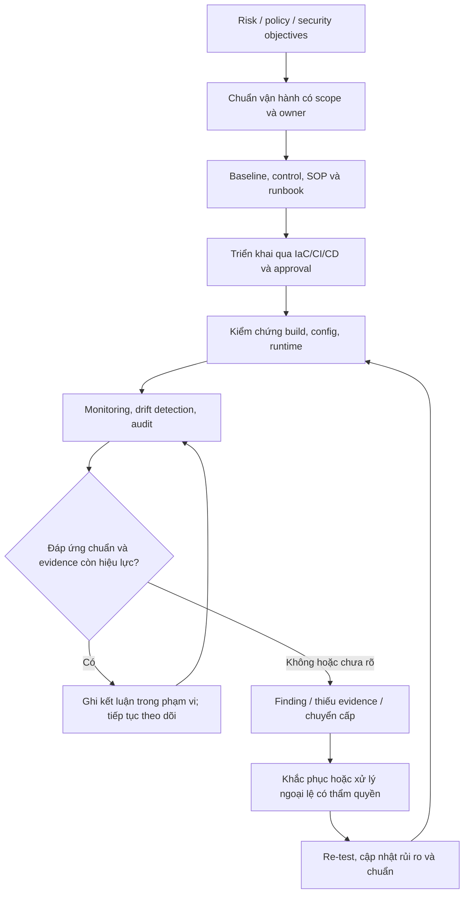

# Chuẩn vận hành

## Mục tiêu học tập

Sau bài học này, bạn có thể:

- Giải thích **chuẩn vận hành bảo mật (operational security standard)**, phân biệt với policy, baseline, quy trình, runbook và từng security control.
- Viết một yêu cầu vận hành có **phạm vi, điều kiện bắt buộc, chủ sở hữu, tiêu chí kiểm chứng và bằng chứng** thay vì chỉ nêu khẩu hiệu “vận hành an toàn”.
- Ánh xạ chuẩn vận hành với mục tiêu **confidentiality, integrity, availability, accountability** và các rủi ro cụ thể của hệ thống.
- Tổ chức thực hiện chuẩn qua **triển khai, thay đổi, giám sát, kiểm tra drift, xử lý phát hiện, audit và tái đánh giá**.
- Xây dựng lập luận **Claim – Argument – Evidence** để đánh giá một yêu cầu chuẩn đang được đáp ứng trên phiên bản và môi trường xác định.
- Phân tích ví dụ vận hành Java/Spring Boot, lựa chọn bằng chứng thực tế và xử lý trường hợp thiếu bằng chứng, control thất bại hoặc cần ngoại lệ đúng thẩm quyền.

## 1. Chuẩn vận hành là gì?

**Chuẩn vận hành bảo mật** là tập hợp các **yêu cầu cụ thể, có tính bắt buộc trong phạm vi áp dụng**, quy định cách tổ chức duy trì các tính chất bảo mật khi hệ thống thực sự hoạt động: cấu hình runtime, quản lý quyền và secrets, triển khai thay đổi, lưu nhật ký, giám sát, sao lưu, xử lý lỗ hổng, phản ứng sự cố và khả năng kiểm chứng.

Chuẩn vận hành trả lời một câu hỏi thực tế: **đội vận hành phải duy trì trạng thái tối thiểu nào và làm cách nào chứng minh trạng thái đó còn đúng?**

Ví dụ, câu “phải bảo vệ dữ liệu học viên” là định hướng quan trọng nhưng chưa đủ để audit. Một yêu cầu chuẩn có thể cụ thể hơn:

> Tất cả workload production xử lý dữ liệu học viên phải sử dụng tài khoản dịch vụ có quyền tối thiểu được phê duyệt; việc thay quyền đặc quyền phải có hồ sơ thay đổi và được kiểm tra lại trên môi trường triển khai.

Yêu cầu này còn cần định nghĩa thế nào là quyền cần thiết, tài sản nào thuộc phạm vi, ai duyệt, khi nào kiểm tra và bằng chứng nào được chấp nhận. Một chuẩn có hiệu lực **không phải tự động là một control đang hoạt động**: nó đặt ra điều phải đạt; triển khai, kiểm thử và giám sát mới tạo căn cứ đánh giá.

### 1.1. Phân biệt các tầng tài liệu và hiện thực

| Thành phần | Mục đích | Ví dụ trong nền tảng học tập | Vai trò với security assurance |
| --- | --- | --- | --- |
| **Security policy** | Đặt mục tiêu, nguyên tắc và trách nhiệm ở cấp quản trị. | “Mọi truy cập đặc quyền phải được kiểm soát và truy vết.” | Căn cứ phê duyệt, giới hạn và trách nhiệm. |
| **Security standard** | Quy định **yêu cầu tối thiểu có thể kiểm tra** cho phạm vi xác định. | “Quyền production chỉ được cấp qua cơ chế được duyệt; quyền tạm phải có hạn và kiểm tra thu hồi.” | Tạo tiêu chí đạt/không đạt rõ ràng. |
| **Baseline** | Mô tả cấu hình/trạng thái chuẩn được phê duyệt cho loại tài sản hoặc môi trường. | Bộ chính sách IAM, ingress, logging và phiên bản container cho production. | Điểm so sánh với cấu hình thực và drift. |
| **Procedure/SOP** | Trình tự thực hiện công việc thường lệ. | Cách yêu cầu cấp quyền, review và thu hồi tài khoản. | Cho thấy tổ chức thực hiện yêu cầu bằng quy trình nào. |
| **Runbook/Playbook** | Hướng dẫn thao tác theo tình huống, nhất là lỗi hoặc sự cố. | Khi log audit ngừng gửi, ai nhận cảnh báo, cách xác minh và chuyển cấp. | Giúp kiểm tra khả năng phản ứng, không chỉ cấu hình tĩnh. |
| **Security control** | Cơ chế kỹ thuật, tổ chức hoặc quy trình để giảm rủi ro. | Phân quyền phía server, IAM, hạn quyền mạng, audit logging. | Đối tượng cần đánh giá hiệu quả thiết kế và vận hành. |
| **Evidence/record** | Kết quả quan sát, kiểm thử, phê duyệt, thay đổi, giám sát. | Kết quả test, snapshot runtime, log triển khai, hồ sơ review quyền. | Hỗ trợ hoặc bác bỏ claim về mức đáp ứng. |

Một tài liệu có thể mang tên khác trong từng tổ chức; điều quan trọng là **quan hệ giữa yêu cầu, triển khai, bằng chứng và quyền quyết định** được định nghĩa rõ. Một checklist cũng không tự trở thành security standard nếu thiếu phạm vi, quyền phê duyệt, phiên bản và tiêu chí.

### 1.2. Chuẩn vận hành không đồng nghĩa với compliance tuyệt đối

Một cuộc kiểm toán có thể kết luận các yêu cầu chuẩn đã được đáp ứng **trong phạm vi và thời điểm đánh giá**. Kết luận đó không chứng minh hệ thống không còn lỗ hổng chưa biết hoặc không bao giờ có sự cố.

Ngược lại, việc một yêu cầu chuẩn không có bằng chứng **chưa tự chứng minh hệ thống đã bị khai thác**: nó cho thấy khoảng trống assurance cần xử lý. Vì thế báo cáo phải phân biệt **control thất bại**, **thiếu bằng chứng** và **rủi ro còn lại được quyết định hợp lệ**.

## 2. Chuẩn vận hành liên kết với rủi ro và mục tiêu bảo mật thế nào?

Chuẩn không nên hình thành bằng cách sao chép danh sách công nghệ hoặc mẫu cấu hình rồi áp dụng cho mọi hệ thống. Trước tiên cần xác định **tài sản, security objectives, risk scenarios, risk appetite và môi trường vận hành**.

Ví dụ:

| Mục tiêu | Kịch bản rủi ro | Yêu cầu chuẩn vận hành hỗ trợ | Phương pháp chứng minh |
| --- | --- | --- | --- |
| **Confidentiality** | Tài khoản ứng dụng được phép đọc ngoài phạm vi dữ liệu học viên. | Tài khoản runtime theo least privilege; quyền đặc quyền được review và thu hồi. | Đối chiếu IAM thực tế, thử truy cập từ vai trò không được phép, hồ sơ review. |
| **Integrity** | Điểm số bị thay đổi không có dấu vết hoặc thay đổi ngoài quy trình. | Thay đổi production theo approval, audit trail và kiểm chứng sau deploy. | Change ticket, log thay đổi, kết quả test nghiệp vụ và review sự kiện. |
| **Availability** | Backup đã chạy nhưng không thể phục hồi khi cơ sở dữ liệu lỗi. | Có lịch backup và **diễn tập restore** theo RPO/RTO được phê duyệt. | Biên bản restore, dữ liệu kiểm thử, thời gian phục hồi đo được. |
| **Accountability** | Không biết ai sửa quyền giáo viên hoặc tải dữ liệu hàng loạt. | Ghi nhận sự kiện bảo mật cần thiết, định danh và dấu thời gian; bảo vệ log. | Test tạo sự kiện và truy vấn end-to-end, quyền truy cập log, thời hạn lưu. |
| **Privacy** | Dữ liệu cá nhân bị lưu quá lâu trong log hoặc bản export. | Giảm thiểu dữ liệu log, phân loại và lưu giữ/xóa theo chính sách áp dụng. | Kiểm tra payload/log, lịch xử lý dữ liệu và bằng chứng thực thi. |

Chuẩn vận hành là **một phương tiện thực thi risk treatment**, không phải đích tự thân. Nếu một yêu cầu không còn phục vụ mục tiêu bảo vệ hoặc gây tác động phụ lớn, cần đánh giá và thay đổi chuẩn **theo quy trình có thẩm quyền**, thay vì từng Operator âm thầm bỏ qua.

### 2.1. Các yếu tố quyết định phạm vi

Khi xây chuẩn cần nói rõ:

1. **Tài sản:** ứng dụng, cluster, cơ sở dữ liệu, thiết bị người dùng, account đặc quyền hay đối tác.
2. **Môi trường:** development, test, staging, production; mức độ nhạy cảm và trust boundary.
3. **Dữ liệu:** dữ liệu công khai, nội bộ, dữ liệu cá nhân, dữ liệu nhạy cảm hoặc dữ liệu có giá trị nghiệp vụ cao.
4. **Mô hình trách nhiệm:** on-premises, cloud managed service, SaaS hoặc vận hành bởi nhà cung cấp.
5. **Hệ thống quản lý:** service owner, control owner, Operator, security/risk và người kiểm chứng.
6. **Nguồn yêu cầu:** policy nội bộ, risk limit, cam kết hợp đồng, tiêu chuẩn ngành hay nghĩa vụ pháp lý áp dụng.

Không nên nói “mọi server phải có cùng chính sách” nếu một số workload đã được nhà cung cấp quản lý ở tầng hệ điều hành và trách nhiệm của tổ chức nằm tại IAM, cấu hình dịch vụ và giám sát. Cần xác định **shared responsibility**, ai nắm bằng chứng và phần nào nằm ngoài quyền vận hành trực tiếp.

## 3. Đặc tính của một chuẩn có thể thực thi và audit

Một quy định như “log phải đủ”, “phân quyền phải an toàn” hoặc “cập nhật thường xuyên” khó dùng để kiểm chứng. Câu văn chuẩn nên có các thành phần:

```text
[Đối tượng và phạm vi]
PHẢI [hành vi/trạng thái bắt buộc có điều kiện cụ thể]
trong [thời điểm hoặc điều kiện kích hoạt],
được kiểm chứng bằng [phương pháp, tiêu chí chấp nhận],
do [vai trò] chịu trách nhiệm,
và lưu [bằng chứng, thời hạn/nguồn tham chiếu].
```

**Ví dụ tốt hơn:**

> Trên các ứng dụng production xử lý dữ liệu người học, mỗi thay đổi quyền của tài khoản dịch vụ phải được đối chiếu với yêu cầu quyền đã phê duyệt; sau triển khai, kết quả kiểm tra quyền thực tế phải được liên kết với change ID và phiên bản cấu hình. Sai lệch phải tạo finding có owner và hạn xử lý theo mức rủi ro.

Yêu cầu này cho phép trả lời: **cái gì, ở đâu, khi nào, ai và kiểm tra bằng gì**. Không nên nhồi tất cả quy trình triển khai vào câu chuẩn; các bước cụ thể có thể nằm trong SOP/runbook mà chuẩn tham chiếu.

### 3.1. Từ ngữ bắt buộc và ngoại lệ

Các quy định có thể dùng hệ thống từ ngữ như:

- **PHẢI (MUST):** yêu cầu bắt buộc trong phạm vi đã công bố.
- **KHÔNG ĐƯỢC (MUST NOT):** hành vi bị cấm trong phạm vi áp dụng.
- **NÊN (SHOULD):** khuyến nghị ưu tiên nhưng có thể cần đánh giá các trường hợp không áp dụng.
- **CÓ THỂ (MAY):** lựa chọn tùy điều kiện/thiết kế.

Đây là **quy ước soạn chuẩn nội bộ minh họa**; mỗi tổ chức nên định nghĩa cách hiểu và cơ chế ngoại lệ chính thức. Nếu một yêu cầu là bắt buộc, không được dùng từ mơ hồ như “cố gắng đảm bảo” rồi xem việc không đạt là hợp lệ mặc định.

### 3.2. Kiểm tra chất lượng trước khi ban hành

| Câu hỏi | Dấu hiệu quy định tốt | Dấu hiệu cần sửa |
| --- | --- | --- |
| Ai phải làm? | Role và người phụ trách có thể gán được cho tài sản. | “Bộ phận liên quan chịu trách nhiệm”. |
| Áp dụng ở đâu? | Có môi trường, loại hệ thống, nhóm dữ liệu. | “Áp dụng toàn bộ” nhưng không rõ tài sản và ngoại lệ. |
| Đạt nghĩa là gì? | Có điều kiện và kết quả kiểm chứng quan sát được. | “An toàn”, “đủ mạnh”, “tối ưu”. |
| Khi nào kiểm tra? | Trước/sau deploy, định kỳ, sau sự cố/thay đổi quan trọng. | Không có lịch hay trigger. |
| Bằng chứng ở đâu? | Artifact gắn build/môi trường/timestamp và phân quyền lưu trữ. | Chỉ lời cam kết của người vận hành. |
| Sai lệch xử lý ra sao? | Finding, ưu tiên, owner, re-test, chuyển cấp và ngoại lệ. | Ticket đóng chỉ vì công việc đã được giao. |
| Khi nào xem lại chuẩn? | Version, ngày có hiệu lực, chủ phê duyệt, trigger rà soát. | Không có lịch sử sửa đổi hoặc ai cũng được đổi. |

## 4. Các nhóm chuẩn vận hành bảo mật quan trọng

Các yêu cầu dưới đây là **ví dụ thực hành**, không phải danh sách bắt buộc chung cho mọi tổ chức. Cần căn chỉnh với hệ thống cụ thể, mức rủi ro, nghĩa vụ và ngưỡng đã được phê duyệt.

| Nhóm chuẩn | Ví dụ yêu cầu có thể kiểm chứng | Chủ vận hành điển hình | Bằng chứng liên quan |
| --- | --- | --- | --- |
| **Định danh và quyền truy cập** | Tài khoản production được cấp theo phê duyệt; quyền đặc quyền được rà soát, thu hồi khi không còn cần. | IAM/Platform Operator. | Review IAM, lịch sử cấp/thu hồi, test quyền. |
| **Secrets và khóa** | Không lưu bí mật vào mã nguồn, image công khai, ticket hoặc log; xoay/thu hồi khi nghi lộ theo quy trình. | App/Platform Operator, secret owner. | Metadata phiên bản secret, event rotation, kiểm tra phân quyền kho khóa. |
| **Cấu hình an toàn** | Workload/ingress/storage khớp baseline đã phê duyệt; sai lệch trọng yếu phải được phát hiện. | Platform/Cloud Operator. | IaC diff, runtime snapshot, drift check, change record. |
| **Vulnerability/patch** | Finding đã xác nhận được đánh giá theo độ phơi bày và tác động; patch/mitigation có owner và re-test. | Service owner, Developer, Operator. | SCA/SAST/scan output, dependency inventory, build deploy, re-test. |
| **Release và thay đổi** | Thay đổi security quan trọng có review, phương án rollback và kiểm tra sau deploy. | Engineering, Release/Platform team. | Pull request, approval, pipeline gate, deployment record. |
| **Logging/audit** | Sự kiện trọng yếu có định danh, thời gian, trạng thái; log được bảo vệ và lưu trong thời hạn quy định. | App/SOC/Logging Operator. | Test end-to-end, log pipeline health, access/retention config. |
| **Monitoring và cảnh báo** | Cảnh báo trọng yếu có người trực, tuyến dự phòng, runbook và diễn tập xác nhận đã nhận. | SOC/SRE/on-call. | Alert rules, kết quả thử paging, incident ticket. |
| **Backup/restore** | Bản sao bảo vệ theo chính sách; khôi phục được kiểm thử theo RPO/RTO của hệ thống. | Database/SRE Operator. | Restore report, thời gian và dữ liệu phục hồi, kết quả review. |
| **Network/service exposure** | Đường truy cập quản trị chỉ mở theo phạm vi cho phép và có kiểm chứng sau deploy. | Network/Cloud Operator. | Firewall/ingress policy, thử kết nối từ vùng đúng/sai, topology. |
| **Dữ liệu và privacy** | Dữ liệu log/export/backup giới hạn quyền, mục đích và thời hạn được duyệt. | Data/Service owner, Operator. | Data flow, retention job results, audit bên nhận. |
| **Incident response** | Sự cố được ghi nhận, phân loại, chuyển cấp, khắc phục và hậu kiểm theo playbook. | Incident commander, SOC, các đội xử lý. | Timeline, ticket, evidence bảo toàn, post-incident review. |
| **Nhà cung cấp/bên thứ ba** | Thành phần do đối tác vận hành có chủ trách nhiệm và nguồn chứng cứ phù hợp phần kiểm soát được giao. | Vendor/Service owner, Security/Risk. | Hồ sơ thẩm định, cam kết, báo cáo kiểm tra, exception. |

Không thể kết luận “đã tuân thủ chuẩn vận hành” chỉ từ một nhóm controls. Ví dụ, bật audit logging ở ứng dụng có ích nhưng chưa chứng minh log đến hệ thống tập trung, có người theo dõi, không ghi secrets hoặc có thể truy vấn lại khi điều tra.

## 5. Ví dụ bộ chuẩn vận hành cho ứng dụng học tập

Giả sử một nền tảng Java/Spring Boot xử lý điểm và tiến độ người học, chạy sau ingress trên môi trường production. Bộ mẫu bên dưới tập trung vào yêu cầu **nhỏ nhưng kiểm tra được**, dễ liên kết tới risk và audit.

### 5.1. Danh mục yêu cầu mẫu

| Requirement ID | Yêu cầu vận hành | Tiêu chí chấp nhận minh họa | Kích hoạt kiểm chứng |
| --- | --- | --- | --- |
| `OPS-ACC-01` | Tài khoản dịch vụ không có quyền ngoài tài nguyên cần thiết cho ứng dụng. | Quyền runtime khớp danh sách đã phê duyệt; test truy cập trái phạm vi bị từ chối. | Cấp/đổi quyền, định kỳ và sau sự cố. |
| `OPS-CONF-02` | Ingress và management endpoints chỉ phơi bày theo danh mục được duyệt. | Đường cho phép truy cập được; đường không cho phép không truy cập được từ nguồn đã kiểm. | Mỗi deploy tác động ingress/Spring config và khi drift. |
| `OPS-LOG-03` | Các thao tác đổi quyền và truy cập quản trị tạo audit event có thể truy vấn. | Test event từ nguồn đến nơi nhận đạt; payload không chứa bí mật ngoài yêu cầu. | Thay ứng dụng/pipeline log; kiểm tra theo kỳ. |
| `OPS-CHG-04` | Thay đổi cấu hình production liên quan security có hồ sơ phê duyệt và kiểm chứng sau triển khai. | Change ID khớp build/config và post-deploy checks. | Mỗi thay đổi thuộc phạm vi. |
| `OPS-RES-05` | Có bằng chứng phục hồi từ backup theo mục tiêu được chủ dịch vụ phê duyệt. | Restore drill hoàn tất và đo được RPO/RTO trong phạm vi test. | Theo lịch/đổi kiến trúc backup. |
| `OPS-SEC-06` | Secret nghi bị lộ được thu hồi hoặc xoay theo playbook có dấu vết. | Metadata phiên bản và bằng chứng ứng dụng dùng secret mới; quyền cũ bị vô hiệu. | Phát hiện lộ, thay owner hoặc policy rotation. |
| `OPS-OBS-07` | Cảnh báo control trọng yếu không hoạt động được chuyển tới người trực. | Alert phát sinh, được nhận và tạo ticket/escalation đúng flow kiểm tra. | Sau thay alert rule, lịch trực và diễn tập định kỳ. |
| `OPS-FIND-08` | Mọi sai lệch mức ưu tiên cao có owner, hạn xử lý và bằng chứng re-test trước khi đóng. | Risk/finding tracker có chuỗi phát hiện → sửa → kiểm tra → kết luận. | Khi test, audit hoặc monitoring phát hiện vấn đề. |

**Các mã ID, tiêu chí và tần suất ở đây là ví dụ.** Khi tổ chức chọn ngưỡng cụ thể (ví dụ kiểm tra drift mỗi 24 giờ hoặc diễn tập restore mỗi quý), ngưỡng đó phải được phê duyệt và phù hợp rủi ro; không nên coi số liệu minh họa là quy định chung cho mọi môi trường.

### 5.2. Từ câu chuẩn đến control và phép kiểm

Xét `OPS-CONF-02`: “management endpoints chỉ phơi bày theo danh mục được duyệt”.

| Thành phần | Câu hỏi/đầu ra |
| --- | --- |
| Rủi ro | Endpoint quản trị phơi bày thông tin hoặc chức năng nhạy cảm cho nguồn không có quyền. |
| Mục tiêu | Giới hạn truy cập dữ liệu và khả năng điều khiển ứng dụng. |
| Control thiết kế | Phân tách vùng quản trị; cấu hình Spring Boot Actuator và Spring Security; giới hạn ingress/network. |
| Chủ thực thi | Developer thiết kế cấu hình/ủy quyền; Operator triển khai ingress và kiểm tra runtime. |
| Tiêu chí | Endpoint được duyệt hoạt động theo vai trò/vùng cho phép; endpoint khác không được expose hoặc bị từ chối phù hợp thiết kế. |
| Bằng chứng | Cấu hình được duyệt, bản build, kiểm thử từ vùng mạng hợp lệ/không hợp lệ, trạng thái deployment và review. |
| Trigger xem lại | Đổi version Spring Boot/Security, ingress, reverse proxy, network policy, profile hoặc Actuator config. |

Một **control ở ứng dụng** không thay thế **control ở mạng** và ngược lại. Nếu frontend proxy mới bỏ qua policy ingress, kết luận trước đó có thể mất hiệu lực dù không có dòng Java nào thay đổi.

## 6. Chuẩn vận hành phải sống trong vòng đời phát triển và vận hành

Quy trình chỉ kiểm tra trước go-live sẽ bỏ qua **configuration drift**, thay đổi thủ công, nâng cấp dependency, người dùng mới và sự cố sau phát hành. Chuẩn vận hành cần có vòng đời đánh giá liên tục.



### 6.1. Trước khi triển khai

Xác định những tiêu chí chuẩn áp dụng, thay đổi nào ảnh hưởng security, hệ thống nào phải được test và ai duyệt. Đối chiếu:

- Phiên bản cấu hình chuẩn và version ứng dụng.
- Danh mục endpoint, quyền, dữ liệu, bí mật và tài khoản dịch vụ mới.
- Kết quả CI/security tests có phạm vi đúng.
- Rủi ro đang mở, finding có ngoại lệ hợp lệ và điều kiện phát hành.
- Phương án rollback và rủi ro của rollback (ví dụ bản cũ có lỗ hổng).

### 6.2. Trong và sau triển khai

Ghi lại build/image, config revision, người thực thi, change approval và thời gian. Xác minh **trạng thái thực**, không chỉ “pipeline completed”:

- Các instance có thực sự chạy đúng phiên bản?
- Đường quản trị có bị mở rộng ngoài danh mục cho phép?
- Quyền IAM/secret/network có khớp baseline?
- Log/audit/alert có hoạt động từ nguồn đến người trực?
- Hệ thống có trở về trạng thái bình thường nếu test bảo mật phát hiện lỗi?

### 6.3. Trong vận hành

Thiết lập người chịu trách nhiệm, kiểm tra theo chu kỳ hoặc sự kiện và độ mới của bằng chứng. Khi monitor thấy log ngừng gửi, chứng chỉ sắp hết hạn, ingress mở rộng hoặc backup fail, hệ thống phải tạo tín hiệu đến đúng người và **không âm thầm coi control đạt**.

### 6.4. Khi chuẩn hoặc hệ thống thay đổi

Thay đổi yêu cầu chuẩn cũng là thay đổi phải quản lý: ai phê duyệt, version nào có hiệu lực, tài sản nào cần migration, deadline nào, test nào phải cập nhật, ngoại lệ cũ có còn hợp lệ không. Nếu policy mới bắt buộc kiểm soát mạnh hơn, các bản đánh giá cũ cần xem lại theo phạm vi.

## 7. Ví dụ Java/Spring Boot: chuẩn giới hạn Actuator và đường quản trị

Giả sử `learning-progress-api` chạy Spring Boot, có chức năng xem tiến độ học viên. Một yêu cầu chuẩn vận hành là **không công khai các management endpoints ngoài danh mục phê duyệt**. Bài tập dùng `health` làm endpoint được phép, những endpoint còn lại phải bị hạn chế theo kiến trúc thực.

### 7.1. Cấu hình ứng dụng minh họa

```yaml
# application-prod.yml - cấu hình minh họa, không phải toàn bộ cấu hình production
management:
  endpoints:
    web:
      exposure:
        include: "health"
  endpoint:
    health:
      show-details: "never"
```

Cấu hình này chỉ giới hạn danh mục Actuator HTTP endpoints được expose trong application context theo điều kiện cấu hình phù hợp. Nó **không** thay thế việc kiểm soát ingress, quyền mạng, authentication, các API tự tạo hoặc management server chạy trên cổng riêng. Trong Spring Boot, những cấu hình khác, biến môi trường hoặc profile có thể ghi đè giá trị trên; Operator phải kiểm tra **effective runtime configuration**.

Một lớp cấu hình Spring Security có thể thêm giới hạn truy cập cho web routes trong cùng ngữ cảnh:

```java
@Configuration
@EnableWebSecurity
class WebSecurityConfiguration {
    @Bean
    SecurityFilterChain securityFilterChain(HttpSecurity http) throws Exception {
        return http
            .authorizeHttpRequests(auth -> auth
                .requestMatchers("/actuator/health").permitAll()
                .requestMatchers("/actuator/**").denyAll()
                .anyRequest().authenticated()
            )
            .build();
    }
}
```

Đây là **minh họa định tuyến quyền**, chưa gồm cơ chế xác thực thực tế, chính sách CSRF phù hợp, quyền của từng API, authorization ở tầng service và cấu hình management context tách biệt nếu có. Khi áp dụng phải review theo phiên bản Spring Boot/Security đang dùng, cấu trúc route và hệ thống proxy. Nếu hệ thống dùng management context/port riêng, lớp filter này chưa chắc bao phủ đường đó.

### 7.2. Phép kiểm bổ trợ

Ở môi trường integration test có cấu hình tương ứng, có thể xây test về hành vi endpoint:

```java
@SpringBootTest
@AutoConfigureMockMvc
class ManagementExposureIT {
    @Autowired
    MockMvc mockMvc;

    @Test
    void approvedHealthEndpointIsAvailable() throws Exception {
        mockMvc.perform(get("/actuator/health"))
               .andExpect(status().isOk());
    }

    @Test
    void sensitiveManagementEndpointIsNotPublic() throws Exception {
        mockMvc.perform(get("/actuator/env"))
               .andExpect(status().is4xxClientError());
    }
}
```

Test trên giả định `health` được expose/cho phép và `env` không được công khai theo cấu hình của trường hợp học. **Một mã 4xx đơn lẻ chưa chứng minh nguyên nhân bảo vệ**, vì endpoint có thể không tồn tại hoặc đường kiểm thử sai; cần đối chiếu route thực, authentication, response và cấu hình chạy thật. Ngoài ra, MockMvc không đi qua ingress, load balancer hay network policy nên phải có phép kiểm bổ sung trên đường mạng của môi trường triển khai.

Điều quan trọng là **không tắt security filters trong test** để đạt kết quả mong muốn. Một bài test luôn trả 403 do cấu hình bị lỗi khác cũng không đủ làm bằng chứng hiệu lực control; phải có đối chứng cho đường được phép và đường bị từ chối trong điều kiện xác định.

### 7.3. Kiểm chứng sau deploy cần nhìn ngoài mã Java

| Phép kiểm | Vì sao cần | Bằng chứng |
| --- | --- | --- |
| So sánh profile, biến cấu hình và phiên bản đang chạy | Cấu hình runtime có thể khác file trong repo. | Config revision, deployment record, danh mục profile và review. |
| Thử endpoint từ vùng public và vùng quản trị được phép | Kiểm tra ingress/network và cách expose thực tế. | Kết quả request có nguồn, thời gian, endpoint, trạng thái và trace. |
| Kiểm tra quyền của workload đối với secrets và storage | API không công khai chưa đủ nếu service account có quyền quá rộng. | IAM policy, kiểm tra quyền, review yêu cầu. |
| Test log và cảnh báo khi truy cập endpoint không được phép | Phát hiện và điều tra đường truy cập đáng ngờ. | Audit event, log sink, alert delivery test. |
| Kiểm tra drift sau thay đổi ingress hoặc Spring Boot | Nguy cơ kết luận cũ mất hiệu lực. | Drift report, change ID, test chạy lại. |

Không ghi giá trị bí mật vào bằng chứng. Snapshot cấu hình nên được lọc/chia quyền phù hợp để artifact kiểm toán không biến thành nguồn rò rỉ mới.

## 8. Claim – Argument – Evidence cho một chuẩn vận hành

Một báo cáo có giá trị phải trả lời **“vì sao có thể tin rằng chuẩn đang được thực thi?”** thay vì “tài liệu chuẩn đã được ký”.

### 8.1. Ví dụ một claim có phạm vi

**Claim:** “Trên phiên bản `release-R` của `learning-progress-api` tại môi trường production, các đường quản trị HTTP chỉ được expose/truy cập theo danh mục và chính sách đã phê duyệt của `OPS-CONF-02`.”

**Argument:**

1. Chuẩn và baseline mô tả các management endpoints được phép và các vùng mạng có quyền truy cập.
2. Cấu hình ứng dụng, ingress và quyền mạng triển khai các giới hạn tương ứng.
3. Test ứng dụng và kiểm tra từ các vị trí mạng thực tế chứng minh trường hợp cho phép/từ chối đã định.
4. Deployment, post-deploy verification và drift monitoring tạo bằng chứng về trạng thái đúng ở phiên bản/môi trường được đánh giá.
5. Những phát hiện còn mở, sai lệch và ngoại lệ được ghi nhận riêng, không bị che bởi một tuyên bố PASS chung.

**Evidence:** policy/baseline revision, approved change, config diff, artifact CI, kiểm tra đường mạng, bản build đang chạy, danh sách runtime routes, kết quả drift scan, log/cảnh báo và đánh giá reviewer.

**Giới hạn:** claim không chứng minh toàn bộ hệ thống an toàn, không bao phủ tất cả API nghiệp vụ và có thể mất hiệu lực khi routing, Spring Boot, profile, IAM hoặc hạ tầng thay đổi.

### 8.2. Mẫu bản ghi đối chiếu chuẩn

```yaml
requirement_id: "OPS-CONF-02"
standard:
  id: "SEC-OPS-STANDARD"
  revision: "<approved-standard-revision>"
asset: "learning-progress-api"
environment: "production"
release: "<deployed-release-id>"
control_owners:
  application: "learning-service-owner"
  infrastructure: "platform-operator"
reviewer_role: "security-assurance-reviewer"
claim: "Management routes match approved exposure baseline"
baseline_ref: "<approved-baseline-reference>"
verification:
  - check: "Allowed health route is accessible from approved origin"
    expected: "Within approved behavior"
    observed: "<actual-observation>"
    evidence_ref: "<protected-artifact-id>"
  - check: "Restricted route is denied from external origin"
    expected: "Not accessible outside approved scope"
    observed: "<actual-observation>"
    evidence_ref: "<protected-artifact-id>"
  - check: "Running ingress and application config matches baseline"
    expected: "No unauthorized security-relevant drift"
    observed: "<actual-observation>"
    evidence_ref: "<protected-artifact-id>"
assurance_result: "INSUFFICIENT_EVIDENCE"
open_findings: []
reassess_on:
  - "Ingress, identity, Spring Boot or management configuration changes"
```

Mẫu này **không phải kết quả thực tế**. Đừng đặt `PASS` chỉ vì trường `evidence_ref` có chuỗi ký tự hoặc đã chạy một lệnh cấu hình. Artifact phải tồn tại, có dấu thời gian, nguồn gốc, môi trường, phương pháp và kết quả quan sát để người khác đánh giá được.

### 8.3. Ba trạng thái kết luận nên phân biệt

| Kết luận | Khi nào dùng | Hành động tiếp theo |
| --- | --- | --- |
| **PASS trong phạm vi** | Các tiêu chí đã được kiểm chứng với bằng chứng phù hợp và còn hiệu lực. | Ghi phiên bản/phạm vi và duy trì giám sát. |
| **FAIL** | Một yêu cầu đã được thử và không đạt; ví dụ endpoint bị cấm truy cập được từ vùng public. | Tạo finding, đánh giá rủi ro, khắc phục, chuyển cấp và re-test. |
| **INSUFFICIENT_EVIDENCE** | Không chạy được phép kiểm, thiếu quan sát runtime hoặc không rõ cấu hình. | Bổ sung bằng chứng; không tuyên bố đạt/không có rủi ro. |

Ngoại lệ được duyệt hợp lệ phải được hiển thị bằng trạng thái hoặc liên kết riêng, chẳng hạn `EXCEPTION_APPLIED`, kèm rủi ro còn lại, người phê duyệt, hạn và biện pháp bù trừ. **Ngoại lệ không biến control FAIL thành PASS.**

## 9. Quản trị vòng đời chuẩn và quản lý sai lệch

Một security standard cần được vận hành như tài sản quản trị có phiên bản:

1. **Soạn thảo:** xác định mục tiêu, nguồn yêu cầu, scope, thuật ngữ, phép kiểm và người chịu trách nhiệm.
2. **Review:** đối chiếu với risk appetite, kiến trúc, khả năng triển khai, dữ liệu và nghĩa vụ áp dụng.
3. **Phê duyệt/ban hành:** định danh version, ngày hiệu lực, quyền quyết định và quy trình truyền đạt tới các nhóm.
4. **Chuyển đổi thành baseline/SOP/tests:** không để chuẩn chỉ tồn tại trong PDF hoặc wiki.
5. **Triển khai và theo dõi:** chủ dịch vụ/Operator bảo đảm cấu hình chạy, evidence có nguồn gốc.
6. **Xử lý sai lệch:** ghi finding, mức độ, root cause, owner, remediation plan, thời hạn và cách kiểm chứng.
7. **Audit và sửa chuẩn:** rút kinh nghiệm, đánh giá ngoại lệ lặp lại, làm rõ requirement mơ hồ hoặc không khả thi.

### 9.1. Phân biệt sai lệch, finding và exception

| Thuật ngữ | Ví dụ | Cần làm |
| --- | --- | --- |
| **Deviation/nonconformity** | Runtime ingress mở endpoint ngoài baseline. | Xác nhận và đánh giá mức độ ảnh hưởng. |
| **Finding** | Test/review/audit có bằng chứng sai lệch `OPS-CONF-02`. | Gắn ID, owner, risk, remediation và re-test. |
| **Exception** | Cấp có thẩm quyền cho phép tạm áp dụng sai khác **đúng phạm vi và thời gian**, có điều kiện. | Lưu decision, residual risk, bù trừ, expiry và trigger thu hồi. |
| **False positive/not applicable** | Scan kết luận sai do asset không tồn tại hoặc không thuộc phạm vi. | Ghi bằng chứng xác minh, không tạo ngoại lệ vô cớ. |
| **Policy/standard revision** | Tổ chức chính thức thay chuẩn sau đánh giá/duyệt. | Quản lý version, ngày hiệu lực, migration và re-assessment. |

Đặc biệt, một finding chưa được khắc phục **không được tự đóng** chỉ vì có ngoại lệ; phải có trạng thái hiển thị rõ nó đang được xử lý bằng ngoại lệ trong thời hạn. Khi ngoại lệ hết hạn, không được âm thầm gia hạn hoặc giữ kết quả audit cũ mà thiếu kiểm tra lại.

### 9.2. Điều kiện chuyển cấp

Chuyển cấp theo chính sách khi control trọng yếu thất bại, dấu hiệu khai thác xuất hiện, không có owner, finding quá hạn, evidence thiếu khi sắp phát hành, biện pháp bù trừ không còn hiệu lực hoặc một bên tìm cách tự bỏ qua chuẩn. **Risk owner** quyết định residual risk trong thẩm quyền; việc phê duyệt policy exception còn phụ thuộc policy owner và nghĩa vụ liên quan.

Một chuẩn vận hành tốt cần có **đường dây báo cáo** từ Operator và CI tới security/risk và lãnh đạo khi vượt giới hạn. Chỉ một dashboard màu xanh không thay thế việc có người nhận trách nhiệm.

## 10. Audit chuẩn vận hành: xem tài liệu và kiểm tra thực tế

Một cuộc audit hiệu quả cần đối chiếu **thiết kế, triển khai, vận hành, kết quả và quyết định**. Ví dụ kiểm toán `OPS-LOG-03` (audit event):

| Bước audit | Câu hỏi | Bằng chứng mẫu |
| --- | --- | --- |
| Xác định tiêu chí | Yêu cầu ghi sự kiện nào, định danh nào, lưu trong bao lâu, áp dụng ở đâu? | Standard revision, audit-event catalog, owner. |
| Đánh giá thiết kế | Ứng dụng phát event ở đúng đường nhạy cảm chưa? Có che token và dữ liệu cá nhân không cần thiết? | Design review, code mapping, event schema. |
| Kiểm tra hoạt động | Thao tác đổi quyền thử nghiệm có tạo log, chuyển đến hệ thống tập trung và truy vấn được không? | Test run, correlation ID, timestamp, log sink evidence. |
| Kiểm tra quyền và toàn vẹn | Ai có thể đọc/sửa/xóa log? Có phát hiện đường ghi log gián đoạn không? | IAM/retention config, access test, alert check. |
| Kiểm tra biến động | Sau deploy mới hoặc sự cố log pipeline, sự kiện còn được ghi đầy đủ không? | Drift report, incident/change ticket, re-test. |
| Kết luận và follow-up | Claim nào đạt, thiếu evidence nào, finding nào chưa đóng? | Audit report, risk register, remediation & reviewer sign-off. |

**Lấy mẫu không chứng minh mọi sự kiện ở mọi thời điểm đều đúng.** Báo cáo phải nêu phạm vi mẫu, cách chọn mẫu, phiên bản và giới hạn quan sát. Tổ chức không nên công bố “tuân thủ 100%” khi còn requirements chưa được kiểm tra hoặc ngoại lệ đang tồn tại.

## 11. Đo lường mức hiệu quả của chuẩn vận hành

Chỉ số phải phản ánh **chuẩn có thực thi và rủi ro có được kiểm soát hay không**, không chỉ số lượng bản checklist.

| KRI/KPI gợi ý | Câu hỏi trả lời được | Rủi ro diễn giải |
| --- | --- | --- |
| Tỷ lệ controls trọng yếu có evidence runtime còn hiệu lực | Tổ chức kiểm chứng được những yêu cầu nào? | Có artifact không đồng nghĩa artifact đúng nội dung. |
| Số sai lệch cấu hình trọng yếu đang mở | Baseline có giữ được khi hệ thống thay đổi không? | Số giảm có thể do công cụ không còn quét. |
| Thời gian từ phát hiện đến xác nhận/khắc phục được xác minh | Chủ trách nhiệm có phản ứng đúng mức rủi ro? | Ticket “Closed” chưa chắc đã re-test đạt. |
| Tỷ lệ thay đổi production có kiểm chứng sau deploy | Có khoảng trống giữa CI và runtime không? | Checklist có thể thiếu tiêu chí attack path. |
| Tỷ lệ backup restore drill đạt mục tiêu | Có khả năng phục hồi đo được không? | Cần nêu phạm vi dữ liệu, thời điểm và điều kiện thử. |
| Số lần mất log/alert delivery và thời gian phục hồi | Monitoring có phát hiện được chính sự mất hiệu lực của nó? | Không có alert có thể do log và alert đồng thời hỏng. |
| Ngoại lệ còn hiệu lực/quá hạn theo mức rủi ro | Những sai lệch tạm đang tích tụ ở đâu? | Ít ngoại lệ có thể do không được ghi nhận đầy đủ. |
| Tỷ lệ release cần chạy lại security check do thay đổi | Evidence có được làm mới khi claim bị ảnh hưởng? | Chạy lại nhiều không bằng bao phủ đúng những thay đổi quan trọng. |

Chọn **số ít chỉ số gắn quyết định cụ thể**, có nguồn dữ liệu, chủ tính toán, kỳ cập nhật và ngưỡng cảnh báo. Khi kết quả không đo được do pipeline lỗi, hiển thị **`UNKNOWN/INSUFFICIENT_EVIDENCE`** thay vì giữ giá trị xanh của kỳ trước.

## 12. Tình huống thực hành: chuẩn vận hành mất hiệu lực sau deploy

**Bối cảnh:** một nền tảng Java/Spring Boot dùng `learning-progress-api` để phục vụ học viên và giáo viên. Chuẩn nội bộ giả định có ba yêu cầu:

- `OPS-CONF-02`: không công khai Actuator ngoài `health` từ vùng public.
- `OPS-LOG-03`: mọi lần thay quyền giáo viên phải được ghi vào audit log tập trung.
- `OPS-CHG-04`: thay đổi cấu hình production phải được review và kiểm chứng sau triển khai.

Đội phát hành bật một profile mới cho production. Pipeline CI xanh. Một Operator phát hiện `/actuator/env` có thể truy cập từ mạng ngoài qua ingress. Đồng thời log pipeline ngừng nhận audit event sau khi đổi endpoint gửi log; dashboard vẫn hiển thị trạng thái `PASS` từ đợt kiểm thử trước. Người phụ trách release muốn đóng ticket vì “đã sửa cấu hình trong Git”.

### 12.1. Phân tích theo security assurance

1. **Yêu cầu bị ảnh hưởng:** `OPS-CONF-02` có dấu hiệu `FAIL` nếu kết quả kiểm thử truy cập được xác nhận đúng đường và phạm vi; `OPS-LOG-03` cần test end-to-end và có thể `FAIL`; `OPS-CHG-04` không đạt nếu thiếu review/kiểm chứng sau deploy.
2. **Bằng chứng cũ:** kết quả CI trước khi bật profile không tự chứng minh runtime sau thay đổi; dấu `PASS` cũ cần được đánh dấu **không còn hiệu lực** với các claim bị ảnh hưởng.
3. **Hành động trước mắt:** đánh giá mức độ phơi bày và dữ liệu có thể truy cập, kích hoạt tuyến sự cố nếu có dấu hiệu truy cập trái phép; áp dụng rollback/giới hạn đường truy cập theo runbook và thẩm quyền.
4. **Khắc phục:** sửa nguồn cấu hình và pipeline, xác nhận không còn instance cũ, đưa log về đúng sink và kiểm tra sự kiện quản trị được ghi nhận.
5. **Kiểm chứng:** test từ nguồn public/allowed; kiểm tra build và runtime config; tạo sự kiện audit thử và truy vấn ở log sink, có dấu thời gian và correlation ID.
6. **Đóng finding:** reviewer xác minh bằng chứng đúng bản deploy, đánh giá các khoảng thời gian bị mất log và rủi ro còn lại; chỉ kết luận đạt với phạm vi đã được kiểm tra.

Nếu chưa có evidence về thời gian log bị gián đoạn, không thể đơn giản kết luận toàn bộ hoạt động trong khoảng đó đã được ghi nhận. Cần xác định phần dữ liệu có thể phục hồi từ nguồn khác, giới hạn quan sát và liệu có phải điều tra sự cố hay không.

### 12.2. Bài tập tự luyện

Hãy hoàn thành:

1. Viết lại **ba yêu cầu vận hành** theo mẫu có phạm vi, chủ sở hữu, điều kiện kiểm chứng và artifact, tránh câu diễn đạt chung chung.
2. Phân biệt `FAIL`, `INSUFFICIENT_EVIDENCE` và `PASS` cho mỗi yêu cầu trong tình huống; chỉ rõ điều kiện nào làm thay đổi trạng thái.
3. Xây chuỗi **risk → standard ID → control → test → evidence → finding → remediation → re-test** cho việc lộ `/actuator/env`.
4. Chỉ ra vì sao test MockMvc trong CI **không đủ** làm bằng chứng về network policy và ingress runtime.
5. Đề xuất đường chuyển cấp, cách giữ bằng chứng nhạy cảm và người có thẩm quyền quyết định nếu muốn tạm không đáp ứng chuẩn.
6. Xác định ba trigger khiến bằng chứng cần được chạy lại: thay đổi Spring Boot, profile, IAM, ingress hoặc log sink.
7. Đề xuất hai chỉ số để đo chuẩn vận hành đang được duy trì, kèm giới hạn khi dữ liệu giám sát bị mất.

**Gợi ý tự đối chiếu:** Yêu cầu `OPS-CONF-02` cần phép thử từ vùng ngoài và vùng được phép, kết hợp config runtime và route thực tế. `OPS-LOG-03` cần theo dõi sự kiện từ nguồn đến sink, không chỉ bật logging trong cấu hình. `OPS-CHG-04` cần liên kết approval, build và post-deploy verification. Cấu hình đã sửa trong Git chưa đủ để đóng finding; phải xác minh trạng thái trên môi trường đích và nguy cơ instance còn bản cũ. Ngoại lệ không tự sửa control và phải theo thẩm quyền, phạm vi, thời hạn.

## 13. Những ngộ nhận thường gặp

| Ngộ nhận | Cách hiểu đúng |
| --- | --- |
| “Có tài liệu standard là đã đạt bảo mật.” | Standard là yêu cầu; hiệu lực cần được chứng minh bằng thiết kế, triển khai và kiểm thử vận hành. |
| “Policy, standard và runbook là một.” | Chúng có chức năng khác nhau: định hướng, yêu cầu tối thiểu và hướng dẫn thực thi. |
| “Áp một cấu hình cho mọi hệ thống sẽ an toàn hơn.” | Cần xét loại tài sản, cloud shared responsibility, dữ liệu và rủi ro; quy tắc chung phải có scope rõ. |
| “Pipeline xanh nghĩa là production đạt chuẩn.” | Runtime, ingress, IAM, feature flag và profile có thể khác CI; phải kiểm chứng sau deploy. |
| “Backup chạy thành công là phục hồi đạt.” | Cần restore drill, đo mục tiêu và phạm vi dữ liệu thực tế. |
| “Bật audit log trong Spring Boot là đủ.” | Sự kiện cần được tạo, chuyển, bảo vệ, truy vấn và giám sát mất log. |
| “Không thấy alert tức không có drift.” | Detection có thể thiếu độ bao phủ hoặc đã ngừng hoạt động. |
| “Có ngoại lệ thì finding thành PASS.” | Ngoại lệ là quyết định xử lý sai lệch có điều kiện, không biến control thất bại thành đạt. |
| “Mọi chuẩn phải giữ nguyên mãi mãi.” | Rủi ro, kiến trúc, nghĩa vụ và cách vận hành thay đổi thì chuẩn và bằng chứng phải được xem lại. |
| “Audit chỉ cần ảnh chụp màn hình cấu hình.” | Cần xem bản chạy, nguồn gốc, thời điểm, phép kiểm, giới hạn và lịch sử thay đổi. |

## Tổng kết

**Chuẩn vận hành** chuyển mục tiêu bảo mật và khẩu vị rủi ro thành **yêu cầu tối thiểu có thể triển khai, kiểm tra và truy vết** trong hoạt động hằng ngày. Trong chương trình **security assurance**, chuẩn phải đi cùng **scope và owner → baseline/controls → thực thi → kiểm thử và bằng chứng runtime → monitoring/audit → phát hiện → khắc phục/ngoại lệ đúng thẩm quyền → re-test và tái đánh giá**. Chỉ khi phân biệt rõ quy định trên giấy với trạng thái hệ thống thực tế, tổ chức mới có cơ sở đáng tin để đánh giá mức đáp ứng security objectives qua các lần phát hành và thay đổi vận hành.
