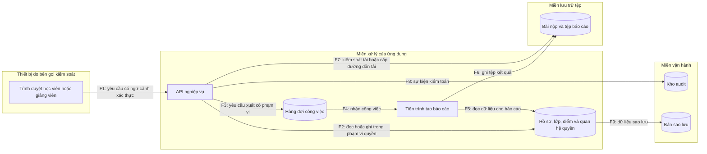

# Người dùng, tài sản và trust boundary

## 1. Ba câu hỏi trước khi viết yêu cầu bảo mật

Trước khi quyết định một chức năng cần xác thực, mã hóa hay ghi log như thế nào, nhóm phát triển cần trả lời ba câu hỏi:

1. **Ai đang tương tác với hệ thống?** Họ muốn làm gì, có quyền gì và hành động dưới danh tính nào?
2. **Điều gì cần được bảo vệ?** Dữ liệu, chức năng, bí mật kỹ thuật hay khả năng cung cấp dịch vụ nào có giá trị?
3. **Ở đâu giả định tin cậy thay đổi?** Khi dữ liệu hoặc quyền điều khiển đi qua một ranh giới, thành phần nhận được phép tin điều gì và phải tự kiểm tra điều gì?

Ba câu hỏi tương ứng với **người dùng và chủ thể**, **tài sản**, **trust boundary — ranh giới tin cậy**. Chúng tạo nền tảng để chuyển mục tiêu an toàn thông tin và kịch bản đe dọa thành yêu cầu cụ thể, đo được, có thể kiểm chứng.

Ví dụ, “bảo vệ chức năng xem điểm” còn quá rộng. Khi làm rõ rằng học viên gọi API từ trình duyệt để đọc bảng điểm trong một trường, nhóm có thể đặc tả: danh tính phải được xác minh ở đâu, quyền đọc được kiểm tra với học viên nào, dữ liệu thuộc trường nào và phản hồi phải xử lý thế nào khi yêu cầu bị từ chối.

Trong bài này, ta dùng một nền tảng học tập phục vụ nhiều trường làm ví dụ. Mỗi trường là một **tenant**, tức một phạm vi dữ liệu và quản trị cần được phân tách theo quy tắc nghiệp vụ. Một người có thể tham gia nhiều trường, nhưng quyền ở trường này không tự động có hiệu lực ở trường khác. Đây là giả định của ví dụ, cần được ghi rõ khi áp dụng cho một hệ thống thực tế.

## 2. Người dùng không chỉ là người đang mở giao diện

### 2.1. Phân biệt người dùng, tác nhân, chủ thể và vai trò

Trong thảo luận nghiệp vụ, “người dùng” thường chỉ một con người. Khi phân tích bảo mật, cần nhìn rộng hơn vì nhiều hành động do phần mềm thực hiện.

| Khái niệm | Ý nghĩa | Ví dụ |
| --- | --- | --- |
| Người dùng | Con người sử dụng hoặc quản trị chức năng | Học viên tải bài nộp, giảng viên chấm điểm. |
| Tác nhân — actor | Người, hệ thống hoặc thành phần tương tác trong một luồng | Dịch vụ thông báo nhận sự kiện điểm mới. |
| Chủ thể bảo mật — security principal | Thực thể được nhận diện để gán và kiểm tra quyền | Tài khoản học viên, tài khoản dịch vụ của tiến trình xuất báo cáo. |
| Vai trò — role | Nhóm quyền hoặc trách nhiệm được định nghĩa trong một phạm vi | Giảng viên của lớp A, quản trị viên của trường B. |
| Chủ thể dữ liệu | Người mà dữ liệu nói đến | Học viên có thông tin cá nhân xuất hiện trong hồ sơ. |

Một người có thể sử dụng nhiều tài khoản; một tài khoản có thể có nhiều vai trò theo từng trường hoặc lớp. Vì vậy, không nên đồng nhất “đã đăng nhập” với “được phép thực hiện mọi hành động của người dùng”.

Ngược lại, một tác vụ nền không mở trình duyệt vẫn có quyền truy cập dữ liệu. Nếu nó chạy dưới tài khoản có quyền rộng, đó là một chủ thể cần được mô tả trong mô hình bảo mật. Việc bỏ qua tài khoản dịch vụ có thể khiến ma trận quyền chỉ đúng cho giao diện nhưng sai ở các luồng xử lý phía sau.

### 2.2. Liệt kê chủ thể theo hành động và phạm vi quyền

Một bảng người dùng có ích cần chỉ ra hành động và phạm vi, thay vì chỉ có tên vai trò.

| Chủ thể | Nhu cầu nghiệp vụ | Phạm vi quyền dự kiến | Điểm cần làm rõ |
| --- | --- | --- | --- |
| Học viên | Xem điểm, nộp và tải bài của mình | Dữ liệu cá nhân và các tài nguyên được chia sẻ trong lớp đã tham gia | Có được xem bài của bạn học không? Khi rời lớp còn được truy cập gì? |
| Giảng viên | Xem bài nộp, chấm và sửa điểm | Lớp được phân công trong từng trường | Chuyển lớp hoặc thu hồi phân công ảnh hưởng đến quyền từ thời điểm nào? |
| Quản trị viên trường | Quản lý người dùng, lớp và phân công | Trường được giao quản trị | Có được đọc mọi nội dung bài nộp không, hay chỉ quản lý cấu hình? |
| Nhân viên hỗ trợ nền tảng | Chẩn đoán lỗi và hỗ trợ tài khoản | Các chức năng hỗ trợ được phê duyệt | Có cần truy cập dữ liệu học tập không? Nếu có, điều kiện và dấu vết là gì? |
| Tiến trình xuất báo cáo | Tạo tệp theo yêu cầu đã được chấp nhận | Tập dữ liệu và tenant của công việc cụ thể | Quyền được kiểm tra khi nhận yêu cầu, khi thực thi hay ở cả hai thời điểm? |
| Dịch vụ sao lưu | Đọc và lưu bản sao để phục hồi | Nguồn dữ liệu và nơi lưu bản sao đã xác định | Ai được phục hồi, giải mã hoặc xóa bản sao? |
| Bên chưa xác thực | Truy cập nội dung công khai, gửi yêu cầu đăng nhập | Chỉ phần được công bố công khai | Đường nào phải từ chối trước khi trả dữ liệu riêng? |

“Quản trị viên” không mặc nhiên có nghĩa là toàn quyền. Cần phân biệt quyền quản trị nền tảng, quyền quản trị một trường, quyền xem dữ liệu và quyền thay đổi dữ liệu. Nếu nghiệp vụ cần quyền khẩn cấp, quyền đó cũng phải có điều kiện cấp, thời hạn và khả năng truy vết riêng.

### 2.3. Phân tích cả hành vi hợp lệ lẫn khả năng lạm dụng

Một học viên là người dùng hợp lệ nhưng có thể thay mã bài nộp để thử tải dữ liệu của người khác. Một tài khoản giảng viên có thể bị chiếm quyền. Một dịch vụ tích hợp có thể gửi dữ liệu sai do lỗi cấu hình, không nhất thiết do tấn công.

Vì vậy, bảng người dùng không phải danh sách “người đáng tin”. Nó mô tả ai được phép làm gì và điều kiện nào phải được kiểm tra, kể cả khi hành động đi từ một tài khoản hợp lệ. Cần xét cả khả năng lỗi, lạm dụng và bị chiếm quyền của các chủ thể có quyền truy cập.

## 3. Tài sản là mọi thứ có giá trị cần bảo vệ

### 3.1. Nhận diện tài sản nghiệp vụ và tài sản hỗ trợ

**Tài sản** là dữ liệu, năng lực hoặc nguồn lực mà việc bị lộ, bị sửa trái phép, bị mất hay bị gián đoạn sẽ gây hậu quả đáng kể trong bối cảnh đang xét.

Trong nền tảng học tập, bảng điểm là tài sản dễ nhận thấy. Tuy nhiên, khóa ký token, thông tin kết nối cơ sở dữ liệu, bản sao lưu và dịch vụ chấm điểm cũng có thể là tài sản quan trọng. Chúng hỗ trợ việc bảo vệ hoặc vận hành tài sản nghiệp vụ.

| Nhóm tài sản | Ví dụ | Hậu quả cần xem xét |
| --- | --- | --- |
| Dữ liệu nghiệp vụ | Điểm, bài nộp, danh sách lớp | Lộ thông tin học viên, sửa sai kết quả, mất bài đã nộp. |
| Dữ liệu nhận diện và liên hệ | Hồ sơ tài khoản, email, thông tin trường | Lộ dữ liệu cá nhân, gửi thông báo nhầm đối tượng. |
| Thông tin xác thực và bí mật | Mật khẩu, token, khóa ký, khóa giải mã | Giả mạo chủ thể, truy cập dữ liệu hoặc làm suy yếu kiểm soát khác. |
| Chức năng có đặc quyền | Sửa điểm, cấp quyền, xuất dữ liệu hàng loạt | Thao tác vượt thẩm quyền, thay đổi quyền truy cập, tiết lộ nhiều dữ liệu. |
| Bằng chứng và dấu vết | Audit về sửa điểm và cấp quyền | Không xác định được hành động, người thực hiện hoặc thời điểm liên quan. |
| Khả năng cung cấp dịch vụ | Đăng nhập, nộp bài, khôi phục dữ liệu | Học viên không nộp được bài đúng hạn, hệ thống không phục hồi được sau sự cố. |

Tệp log và bản sao lưu không tự động ít nhạy cảm hơn dữ liệu chính. Một bản xuất chứa toàn bộ điểm của trường có thể tạo rủi ro lớn hơn một API chỉ trả từng hồ sơ, vì lượng dữ liệu và cách lưu giữ khác nhau.

### 3.2. Mô tả tài sản bằng thuộc tính cần bảo vệ

Ba thuộc tính nền tảng là:

- **Bí mật:** chỉ chủ thể được phép mới được biết thông tin.
- **Toàn vẹn:** dữ liệu và hành vi chỉ được thay đổi theo quyền và quy tắc hợp lệ.
- **Sẵn sàng:** dữ liệu và dịch vụ sử dụng được theo nhu cầu đã xác định.

Mức ưu tiên không giống nhau giữa mọi tài sản. Với một trang giới thiệu khóa học đã công khai, bí mật nội dung có thể không phải mục tiêu chính, nhưng toàn vẹn vẫn quan trọng vì kẻ sửa nội dung có thể dẫn người học đến địa chỉ giả mạo. Với bảng điểm, cả bí mật, toàn vẹn và khả năng truy cập đúng lúc đều có thể quan trọng.

Có thể bổ sung tính xác thực, khả năng quy trách nhiệm và yêu cầu về quyền riêng tư khi phù hợp. Điều cần tránh là gắn một nhãn “nhạy cảm” rồi dừng lại: nhãn phải giúp xác định hành vi bảo vệ cụ thể.

### 3.3. Theo dõi tài sản trong suốt vòng đời

Một bảng kiểm kê tài sản nên có ít nhất những thông tin sau:

| Trường thông tin | Câu hỏi cần trả lời |
| --- | --- |
| Tên và phạm vi | Đang nói đến dữ liệu hoặc chức năng nào, thuộc trường hay lớp nào? |
| Bên chịu trách nhiệm nghiệp vụ | Ai quyết định mục đích sử dụng và mức bảo vệ cần thiết? |
| Nguồn và người sử dụng | Ai tạo ra, ai được đọc, ai được sửa? |
| Nơi xử lý và bản sao | Dữ liệu xuất hiện ở API, cơ sở dữ liệu, bộ nhớ đệm, tệp xuất, log hay bản sao lưu nào? |
| Vòng đời | Khi nào tạo, truyền, lưu, chia sẻ, hết hạn và xóa? |
| Tác động | Điều gì xảy ra nếu bị lộ, bị sửa sai, mất hoặc không truy cập được? |
| Phụ thuộc | Cần khóa, dịch vụ, quyền hay cấu hình nào để sử dụng và phục hồi? |

Bên chịu trách nhiệm nghiệp vụ không nhất thiết là quản trị viên cơ sở dữ liệu hay người mà dữ liệu đề cập. Chẳng hạn, người phụ trách đào tạo có thể quyết định quy tắc sử dụng bảng điểm; đội vận hành giữ hạ tầng; học viên là người có dữ liệu trong bảng điểm. Ba trách nhiệm này cần được phân biệt.

## 4. Trust boundary là gì?

### 4.1. Ranh giới đánh dấu sự thay đổi giả định tin cậy

**Trust boundary — ranh giới tin cậy — là nơi dữ liệu hoặc quyền điều khiển đi giữa những ngữ cảnh có giả định tin cậy, quyền hạn hoặc cơ chế bảo vệ khác nhau.** Khi đi qua ranh giới, dữ liệu không được tự động thừa hưởng mức tin cậy của thành phần tiếp nhận.

Ví dụ quen thuộc là trình duyệt gửi yêu cầu đến API. Phía máy chủ phải coi mã người dùng, mã trường, trường dữ liệu và tiêu đề HTTP do bên gọi cung cấp là những giá trị cần kiểm tra. Việc giao diện chỉ cho chọn các giá trị hợp lệ không bảo đảm yêu cầu HTTP thực tế cũng hợp lệ.

Ranh giới còn có thể nằm giữa API và tiến trình nền, giữa hai tenant dùng chung cơ sở dữ liệu, giữa tài khoản ứng dụng và tài khoản vận hành, hoặc giữa nền tảng và nhà cung cấp bên ngoài.

Trust boundary không nhất thiết trùng với tường lửa, máy chủ hay mạng vật lý. Ngược lại, không phải mỗi mũi tên gọi hàm đều cần được coi là một ranh giới riêng. Mức mô tả cần đủ chi tiết để bộc lộ sự thay đổi quyền và giả định có ảnh hưởng đến tài sản đang phân tích.

### 4.2. Tin cậy luôn có phạm vi

Nên hỏi “tin thành phần này về điều gì?” thay vì chỉ ghi “thành phần này đáng tin”.

- Một dịch vụ danh tính có thể được tin để phát hành bằng chứng danh tính theo một cấu hình đã thống nhất; điều đó không có nghĩa mọi thuộc tính tùy ý gửi từ trình duyệt đều đúng.
- Một cơ sở dữ liệu có thể thực thi quyền truy cập kỹ thuật, nhưng giá trị văn bản lưu trong đó vẫn có thể xuất phát từ đầu vào của người dùng.
- Một hàng đợi có thể hạn chế ai được gửi thông điệp, nhưng một thông điệp hợp lệ về định dạng vẫn có thể chứa mã đối tượng ngoài phạm vi được phép.
- Một kết nối được mã hóa bảo vệ những thuộc tính của kênh truyền; nó không tự quyết định người gọi có quyền đọc một hồ sơ cụ thể hay không.

**Tin cậy về danh tính, tính hợp lệ của dữ liệu và quyền nghiệp vụ là các câu hỏi khác nhau.** Nếu gom chúng thành một nhãn “đã xác thực”, nhiều nghĩa vụ kiểm tra sẽ bị bỏ sót.

### 4.3. Những thay đổi thường tạo ra ranh giới

| Thay đổi ngữ cảnh | Ranh giới cần xem xét | Kiểm tra gợi ý |
| --- | --- | --- |
| Dữ liệu do người dùng kiểm soát đi vào máy chủ | Trình duyệt hoặc ứng dụng khách → API | Xác thực, quyền theo đối tượng, kiểm tra dữ liệu và giới hạn tài nguyên. |
| Quyền chuyển từ người dùng sang dịch vụ | API → tiến trình nền | Danh tính công việc, phạm vi dữ liệu và quyền thực thi. |
| Dữ liệu đi giữa các tenant | Tenant A → tài nguyên của tenant B | Phân tách dữ liệu và quyền theo tenant. |
| Đầu vào đến từ một tổ chức khác | Dịch vụ bên ngoài → điểm nhận tích hợp | Xác minh nguồn theo giao thức, nội dung và quyền gây thay đổi trạng thái. |
| Chức năng chuyển sang đặc quyền quản trị | Giao diện thông thường → chức năng quản trị | Quyền quản trị đúng phạm vi và dấu vết thao tác. |
| Dữ liệu rời luồng nghiệp vụ chính | API → log, tệp xuất hoặc sao lưu | Giảm dữ liệu, quyền truy cập, lưu giữ và phục hồi. |

Bảng này là cách tìm ranh giới, không phải một bộ kiểm soát đầy đủ. Mỗi hệ thống cần xác định yêu cầu dựa trên tài sản, luồng và rủi ro thực tế.

## 5. Dựng bản đồ cho một luồng nghiệp vụ

### 5.1. Chọn phạm vi đủ cụ thể

Xét ba hành động của nền tảng học tập:

- Học viên nộp và tải bài của mình.
- Giảng viên đọc bài, nhập và sửa điểm trong lớp được phân công.
- Người có quyền yêu cầu xuất bảng điểm; tiến trình nền tạo tệp để người yêu cầu tải về.

Trong phạm vi này, cần theo dõi danh tính, trường, lớp, bài nộp, điểm và tệp xuất. Các chức năng thanh toán hoặc diễn đàn không được giả định là đã được bao phủ chỉ vì cùng nằm trong nền tảng.

Một sơ đồ luồng dữ liệu đơn giản:



Các nhóm trong sơ đồ giúp nhìn thấy những miền quản lý khác nhau. Chúng chưa tự xác định mọi ranh giới: bên trong miền ứng dụng vẫn có thể tồn tại ranh giới quyền giữa API, tiến trình nền và dữ liệu của từng tenant. Sơ đồ cũng chưa mô tả mọi phản hồi, giao thức và luồng lỗi; khi thiết kế chi tiết phải bổ sung các thông tin cần thiết.

### 5.2. Ghi rõ dữ liệu đi qua mỗi ranh giới

| Luồng | Dữ liệu hoặc ngữ cảnh đi qua | Điều bên nhận phải xác định |
| --- | --- | --- |
| F1: Trình duyệt → API | Bằng chứng xác thực, mã trường, mã lớp, mã bài nộp, nội dung nhập | Chủ thể là ai; thông tin xác thực còn hiệu lực không; chủ thể có quyền với hành động và đối tượng này không. |
| F2: API → cơ sở dữ liệu | Truy vấn, dữ liệu cập nhật, phạm vi tenant | Truy vấn và cập nhật có giới hạn đúng tập dữ liệu được phép không; dữ liệu có đáp ứng quy tắc nghiệp vụ không. |
| F3–F5: API → hàng đợi → tiến trình nền → dữ liệu | Mã công việc, người yêu cầu, tenant, bộ lọc dữ liệu | Công việc có nguồn hợp lệ không; có bị sửa hoặc gửi lại trái phép không; quyền nào được dùng khi thực thi. |
| F6–F7: Tạo và tải tệp | Tệp xuất, định danh tệp, quyền hoặc khả năng tải | Tệp gắn với ai và tenant nào; ai được tải; quyền tải có hạn sử dụng hoặc bị thu hồi như thế nào. |
| F8: API → kho audit | Người thực hiện, hành động, đối tượng, thời điểm, kết quả | Dữ liệu có đủ để truy vết nhưng không chứa bí mật không cần thiết không; ai được đọc hoặc sửa bản ghi. |
| F9: Cơ sở dữ liệu → sao lưu | Bản sao dữ liệu cùng phụ thuộc phục hồi | Ai đọc được bản sao; bản sao giữ bao lâu; có khôi phục được khi mất môi trường chính không. |

Không nên dùng chung một dòng “kết nối nội bộ an toàn” cho tất cả các luồng này. Mỗi luồng mang một tài sản và trao cho bên nhận một khả năng khác nhau, nên cần nghĩa vụ kiểm tra riêng.

## 6. Từ bản đồ đến yêu cầu bảo mật có thể kiểm chứng

Mỗi ranh giới có thể được phân tích theo chuỗi:

```text
Chủ thể → hành động → tài sản → ranh giới
        → giả định có thể sai → hậu quả
        → yêu cầu cần có → bằng chứng xác minh
```

Ví dụ, học viên gửi mã bài nộp qua API. Giả định sai là “mã có trong màn hình của người dùng nên chắc thuộc người đó”. Hậu quả là tải được bài của bạn học. Yêu cầu phải ràng buộc quyền tải theo đúng người gọi và bài nộp, thay vì chỉ yêu cầu một phiên đăng nhập hợp lệ.

Các yêu cầu minh họa dưới đây chỉ áp dụng cho phạm vi ví dụ đã nêu.

| Mã | Nguồn rủi ro | Yêu cầu minh họa | Bằng chứng xác minh |
| --- | --- | --- | --- |
| SR-ID-01 | Giả mạo danh tính bằng tham số đầu vào | API phải lấy chủ thể đang thực hiện hành động từ ngữ cảnh xác thực đã được máy chủ xác minh; không được dùng tham số do bên gọi tự khai làm bằng chứng danh tính. | Đăng nhập bằng A nhưng gửi tham số nhận mình là B; quyền và dấu vết vẫn được xác định theo A hoặc yêu cầu bị từ chối theo đặc tả. |
| SR-TENANT-01 | Truy cập chéo trường qua mã đối tượng | Với mỗi yêu cầu đọc hoặc sửa điểm, hệ thống phải xác minh quyền của chủ thể trong tenant của tài nguyên đích; khi không có quyền phải từ chối và không tiết lộ nội dung điểm. | Tạo hai trường có dữ liệu riêng; thay mã trường và mã đối tượng trên từng đường truy cập trong phạm vi. |
| SR-SUBMIT-01 | Học viên tải bài của người khác | API tải bài nộp dành cho học viên phải chỉ cung cấp nội dung hoặc đường dẫn tải dùng được khi chủ thể có quyền tải đúng bài nộp đó. | Kiểm tra tải bài của mình và bài của học viên khác, bao gồm luồng cấp đường dẫn tải. |
| SR-GRADE-01 | Giảng viên sửa điểm ngoài lớp được phân công | Mỗi yêu cầu sửa điểm phải kiểm tra phân công và quyền sửa còn hiệu lực của giảng viên đối với lớp chứa điểm đó. | Dùng giảng viên có quyền trong lớp A nhưng không có quyền trong lớp B; gửi yêu cầu sửa ở cả hai lớp. |
| SR-EXPORT-01 | Tiến trình nền đọc vượt phạm vi được giao | Trước khi đọc dữ liệu tạo báo cáo, tiến trình nền phải kiểm tra quyền xuất hiện tại của người yêu cầu và giới hạn dữ liệu theo tenant, bộ lọc đã được cho phép của công việc. | Thu hồi quyền trước lúc thực thi; thử công việc tham chiếu tenant khác; xác nhận không tạo báo cáo chứa dữ liệu ngoài quyền. |
| SR-AUDIT-01 | Không truy vết được hành động sửa điểm | Mỗi lần sửa điểm thành công phải tạo bản ghi audit gắn với chủ thể thực hiện, tenant, đối tượng, hành động, thời điểm và mã liên kết giao dịch. | Thực hiện sửa điểm rồi đối chiếu sự kiện audit với giao dịch tương ứng. |
| SR-LOG-01 | Bí mật đi từ yêu cầu HTTP sang log | Các luồng trong phạm vi phải loại bỏ mật khẩu và token truy cập nguyên giá trị trước khi ghi log ứng dụng. | Gửi dữ liệu thử có dấu nhận diện qua nhánh thành công và nhánh lỗi; kiểm tra đầu ra log liên quan. |
| SR-RECOVERY-01 | Mất dữ liệu và bản sao không dùng được | Hệ thống phải khôi phục dữ liệu điểm từ bản sao trong RPO và RTO đã được nghiệp vụ chấp thuận cho kịch bản sự cố đã xác định. | Diễn tập phục hồi, đối soát dữ liệu và đo các mốc thời gian theo đặc tả. |

Ở đây, **RPO** là mục tiêu giới hạn mức mất dữ liệu xét theo thời gian; **RTO** là mục tiêu thời gian khôi phục dịch vụ theo mốc đo đã thống nhất. Những yêu cầu phục hồi cần giá trị cụ thể trước khi nghiệm thu, nhưng không nên tự chọn giá trị khi chưa có căn cứ nghiệp vụ và vận hành.

Yêu cầu `SR-EXPORT-01` chọn kiểm tra lại quyền hiện tại khi công việc thực thi. Đây là quyết định của ví dụ. Một hệ thống khác có thể cần cơ chế ủy quyền có phạm vi và thời hạn riêng cho công việc đã được phê duyệt. Khi đó, yêu cầu phải đặc tả rõ hiệu lực ủy quyền và cách thu hồi, thay vì để tiến trình nền tự suy đoán.

Các phát biểu trong bảng vẫn có thể cần tách nhỏ hoặc bổ sung tiêu chí chi tiết khi đưa vào thiết kế. Giá trị chính của chúng là chỉ ra nguồn rủi ro, nghĩa vụ quan sát được và cách tìm bằng chứng, thay cho một danh sách công nghệ rời rạc.

## 7. Những tình huống cần đọc kỹ ranh giới tin cậy

### 7.1. Cùng ứng dụng, cùng cơ sở dữ liệu vẫn có ranh giới giữa tenant

Hai trường có thể dùng chung máy chủ và bảng dữ liệu. Ranh giới cần bảo vệ lúc này là **quyền đối với dữ liệu của từng trường**, không nhất thiết là một kết nối mạng riêng.

Ví dụ, API nhận `schoolId` từ bên gọi để chọn trường làm việc. Giá trị đó là một lựa chọn được đề nghị, chưa phải bằng chứng rằng người gọi là thành viên của trường. Hệ thống cần kiểm tra quan hệ thành viên hoặc quyền tương ứng, đồng thời bảo đảm tài nguyên đích thực sự thuộc phạm vi được phép.

Cũng phải xét các luồng không hiển thị trên giao diện: xuất tệp, tìm kiếm, bộ nhớ đệm và tác vụ nền. Nếu API chính kiểm tra tenant nhưng báo cáo truy vấn toàn bộ dữ liệu, ranh giới vẫn bị phá vỡ. Một bộ nhớ đệm dùng khóa không phản ánh ngữ cảnh phân quyền có thể trả nhầm dữ liệu ngay cả khi truy vấn cơ sở dữ liệu có giới hạn đúng.

Từ đó, yêu cầu phải bao phủ các đường truy cập đã xác định. Chỉ ghi “hệ thống hỗ trợ nhiều tenant” chưa tạo ra một cam kết về phân tách dữ liệu.

### 7.2. Đi qua cơ sở dữ liệu không làm đầu vào trở nên đáng tin

Giả sử học viên nhập tên tệp bài nộp hoặc ghi chú. API lưu các giá trị đó, rồi giảng viên xem lại trên trang chấm bài. Dữ liệu đã nằm trong cơ sở dữ liệu vẫn có nguồn gốc do người dùng kiểm soát.

Vì vậy, cần phân biệt:

- **Quyền ghi vào kho:** ai được lưu hoặc sửa giá trị đó.
- **Tính hợp lệ nghiệp vụ:** giá trị có đáp ứng định dạng, độ dài và quy tắc của chức năng không.
- **Cách sử dụng đầu ra:** khi đưa giá trị vào HTML, tên tệp hay một ngữ cảnh khác, hệ thống phải xử lý phù hợp với ngữ cảnh đó.

Kiểm tra đầu vào không tự thay thế việc xử lý đầu ra. Một yêu cầu về hiển thị ghi chú có thể quy định nội dung do học viên nhập phải được hiển thị như dữ liệu theo chức năng đã cho phép, không được tự động thực thi như mã trong trình duyệt của người xem. Bằng chứng cần quan sát ở nơi sử dụng dữ liệu, không chỉ ở API ghi dữ liệu ban đầu.

### 7.3. Tác vụ nền không được tự thừa hưởng mọi quyền của máy chủ

Một người có quyền yêu cầu báo cáo lúc 9 giờ, nhưng bị thu hồi quyền trước khi công việc chạy lúc 10 giờ. Nếu yêu cầu không nói rõ thời điểm đánh giá quyền, nhóm phát triển và kiểm thử có thể có hai cách hiểu trái ngược nhau.

Trong lựa chọn của `SR-EXPORT-01`, quyền được kiểm tra lại khi thực thi. Do đó, công việc cần có ngữ cảnh đủ để xác định người yêu cầu, tenant, loại báo cáo và phạm vi dữ liệu. Tiến trình nền không được diễn giải “thông điệp lấy từ hàng đợi nội bộ” thành “được phép đọc mọi dữ liệu”.

Danh tính kỹ thuật của tiến trình và danh tính người yêu cầu phục vụ hai câu hỏi khác nhau. Tiến trình cần quyền kết nối vào tài nguyên để thực hiện công việc; người yêu cầu cần quyền nghiệp vụ đối với dữ liệu được xuất. Nếu có ủy quyền, phải chỉ rõ quan hệ ủy quyền đó trong yêu cầu và dấu vết.

### 7.4. Đường dẫn tải có thể là một khả năng truy cập

Một tệp xuất có thể được tải qua API có kiểm tra quyền hoặc qua đường dẫn mang quyền truy cập tạm thời. Nếu chỉ cần sở hữu đường dẫn là tải được tệp trong thời gian hiệu lực, bản thân đường dẫn trở thành thông tin cần bảo vệ.

Khi đó, cần hỏi: ai được cấp đường dẫn, nó trỏ đến đúng tệp nào, có hạn sử dụng bao lâu, việc chia sẻ ngoài ý muốn có hậu quả gì và điều gì xảy ra khi quyền của người yêu cầu thay đổi? Hành vi thu hồi và hết hiệu lực phải được đặc tả theo khả năng của thiết kế được chọn.

“Đã kiểm tra quyền lúc tạo báo cáo” không đủ để kết luận việc tải tệp sau đó cũng được kiểm soát. Tài sản đã đi sang một dạng và một đường truy cập khác, nên yêu cầu cần theo dõi tiếp đến đầu ra đó.

## 8. Ràng buộc kiến trúc phải nối được với yêu cầu

Nhận diện trust boundary giúp chọn nơi cần thực thi kiểm soát, nhưng sơ đồ không tự tạo ra kiểm soát. Với mỗi ranh giới quan trọng, nên nối được bốn thông tin:

| Thông tin | Ví dụ cho thao tác sửa điểm |
| --- | --- |
| Giả định phải bảo vệ | Danh tính người sửa và quyền đối với lớp không do tham số tự khai quyết định. |
| Yêu cầu | Chỉ giảng viên có phân công và quyền còn hiệu lực trong lớp mới được sửa điểm. |
| Trách nhiệm thiết kế | Thành phần phía máy chủ xử lý sửa điểm phải kiểm tra quyền theo tài nguyên và cung cấp ngữ cảnh cho audit. |
| Bằng chứng | Kết quả cho phép đúng lớp, từ chối ngoài lớp, xử lý sau thu hồi quyền và bản ghi audit tương ứng. |

Một kiểm soát có thể hỗ trợ nhiều yêu cầu, và một yêu cầu có thể cần nhiều thành phần phối hợp. Chẳng hạn, phân tách tenant có thể liên quan đến cách xác định ngữ cảnh, truy vấn dữ liệu, lưu tệp, bộ nhớ đệm và tiến trình nền. Không nên gán toàn bộ trách nhiệm cho một thành phần chỉ vì nó xuất hiện ở đầu luồng.

Khi một nguồn xác thực hoặc điểm kiểm tra quyền không sẵn sàng, hành vi của chức năng nhạy cảm cũng phải được làm rõ. Nếu không xác định được quyền đọc điểm, yêu cầu có thể quy định từ chối và không trả dữ liệu. Quy tắc này cần được nối với cách xử lý lỗi thực tế, thay vì chỉ tồn tại trong sơ đồ thiết kế.

## 9. Một cách làm việc có thể lặp lại

Có thể dùng quy trình ngắn sau cho từng chức năng trước khi viết danh sách yêu cầu chi tiết.

1. **Đặt phạm vi chức năng và giả định.** Chọn hành động cụ thể, các bên tham gia và điều kiện nghiệp vụ. Ghi rõ điểm còn chưa được quyết định.
2. **Liệt kê chủ thể và quyền dự kiến.** Bao gồm người dùng, dịch vụ, tiến trình nền, người vận hành và bên ngoài. Phân biệt người yêu cầu với thành phần thực thi thay họ.
3. **Liệt kê tài sản và tác động.** Theo dõi cả dữ liệu chính, tệp xuất, log, khóa và bản sao. Xác định bên quyết định nhu cầu bảo vệ.
4. **Vẽ luồng và đánh dấu ranh giới.** Nêu dữ liệu nào đi qua, nguồn nào kiểm soát nó và giả định nào thay đổi ở phía nhận.
5. **Thử làm sai từng giả định.** Điều gì xảy ra nếu người gọi đổi mã, gửi dữ liệu sai, mất quyền, gửi lại công việc hoặc truy cập bản sao ngoài luồng chính?
6. **Chọn cách xử lý rủi ro và viết yêu cầu.** Nêu hành vi phải có, phạm vi, điều kiện từ chối và giới hạn có căn cứ. Đừng xem mọi kịch bản là một yêu cầu kỹ thuật bắt buộc giống nhau.
7. **Gắn thiết kế, người phụ trách và bằng chứng.** Mỗi yêu cầu cần được thực hiện ở đâu, xác minh bằng cách nào và cập nhật khi điều kiện nào thay đổi?

Đây là công việc phối hợp. Người phụ trách nghiệp vụ làm rõ quyền hợp lệ và tác động; nhóm phát triển, kiến trúc mô tả luồng và phụ thuộc; kiểm thử xác định cách quan sát; vận hành làm rõ tài khoản đặc quyền, log, sao lưu và phục hồi.

Bản đồ phải được xem lại khi thêm vai trò, cho phép chia sẻ dữ liệu, tích hợp nhà cung cấp, chuyển xử lý sang tác vụ nền hoặc thay đổi nơi lưu trữ. Ví dụ, chuyển từ tải tệp qua API sang cấp đường dẫn tải trực tiếp tạo ra các giả định mới về hiệu lực và khả năng chia sẻ đường dẫn.

Không cần vẽ lại toàn bộ hệ thống cho mọi thay đổi nhỏ. Cần xác định thay đổi tác động đến chủ thể, tài sản, ranh giới, yêu cầu và bằng chứng nào trong phạm vi liên quan.

## 10. Các nhầm lẫn thường gặp

| Nhầm lẫn | Vì sao dễ bỏ sót rủi ro | Cách làm rõ |
| --- | --- | --- |
| “Người dùng đã đăng nhập nên đáng tin.” | Danh tính hợp lệ không đồng nghĩa được phép thao tác trên mọi tài nguyên. | Kiểm tra hành động, đối tượng, tenant và điều kiện quyền tương ứng. |
| “API nội bộ không có trust boundary.” | Quyền giữa dịch vụ, người dùng và dữ liệu có thể khác nhau dù dùng chung mạng. | Mô tả chủ thể gọi, quyền kỹ thuật, quyền nghiệp vụ và nguồn dữ liệu. |
| “Có TLS là đã bảo vệ việc truy cập.” | Bảo vệ kênh truyền không quyết định quyền trên tài nguyên. | Đặc tả riêng danh tính, quyền, dữ liệu và bảo vệ đường truyền. |
| “Dữ liệu nằm trong cơ sở dữ liệu nên có thể dùng trực tiếp.” | Dữ liệu có thể bắt nguồn từ bên không được tin để cung cấp mã hoặc lệnh. | Theo dõi nguồn gốc và xử lý đúng ngữ cảnh tại nơi sử dụng. |
| “Admin được quyền làm mọi việc.” | Quyền quản trị có thể vượt nhu cầu và làm mờ trách nhiệm. | Nêu phạm vi quản trị, quyền đọc dữ liệu và điều kiện cấp quyền riêng. |
| “Chỉ cần kiểm kê bảng dữ liệu.” | Bỏ qua chức năng đặc quyền, khóa, khả năng dịch vụ và bản sao. | Kiểm kê tài sản theo tác động và vòng đời, không chỉ theo cấu trúc lưu trữ. |
| “Vẽ ranh giới xong là đủ.” | Sơ đồ chỉ mô tả giả định, chưa bảo đảm hành vi thực tế. | Nối ranh giới với yêu cầu, nơi thực hiện và bằng chứng xác minh. |

Một dấu hiệu của mô hình còn thiếu là không trả lời được câu hỏi: “Ai hoặc thành phần nào chịu trách nhiệm ngăn một người dùng hợp lệ truy cập sai tài nguyên qua đường này?”. Nếu câu trả lời chỉ là “hệ thống sẽ xử lý”, cần làm rõ thêm phạm vi và trách nhiệm.

## 11. Các ý chính cần nhớ

Người dùng và chủ thể cho biết **ai hành động và quyền nào đang được sử dụng**. Tài sản cho biết **điều gì có giá trị và hậu quả khi bị xâm hại**. Trust boundary cho biết **ở đâu phải đánh giá lại giả định khi dữ liệu hoặc quyền đi sang một ngữ cảnh khác**.

Ba yếu tố này cần được đọc cùng nhau trên từng luồng. Một tài khoản đã xác thực vẫn có thể truy cập sai đối tượng; dữ liệu đã lưu vẫn có thể mang đầu vào không đáng tin; một công việc nội bộ vẫn cần phạm vi quyền rõ ràng.

Kết quả hữu ích không chỉ là một sơ đồ, mà là đường liên kết từ **chủ thể → tài sản → ranh giới → rủi ro → yêu cầu → kiến trúc → bằng chứng kiểm chứng**. Đường liên kết đó giúp yêu cầu xác thực, phân quyền, bảo vệ dữ liệu, logging và phục hồi có lý do cụ thể và được duy trì khi hệ thống thay đổi.
