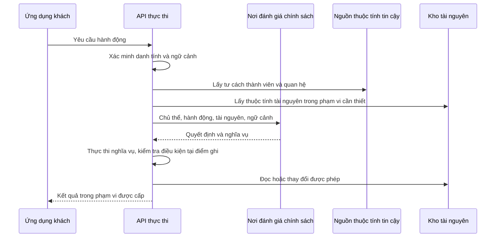

# Authorization requirement

## 1. Yêu cầu phân quyền phải trả lời được điều gì?

Authorization requirement là yêu cầu xác định **chủ thể nào được phép thực hiện hành động nào trên tài nguyên nào, trong phạm vi và điều kiện nào**. Trong chương **Yêu cầu authorization**, đây là nền tảng để chuyển mục tiêu bảo vệ dữ liệu và quy tắc nghiệp vụ thành quyết định truy cập cụ thể, đo được và có thể kiểm chứng.

Một yêu cầu như “chỉ người có quyền mới được truy cập” chưa giúp đội phát triển biết phải kiểm tra điều gì. Nó cũng không giúp người kiểm thử phân biệt kết quả đúng với một lỗ hổng phân quyền.

Ví dụ với hệ thống hoàn ứng:

> Nhân viên đang hoạt động chỉ được sửa các trường được phép trong phiếu hoàn ứng do mình tạo, thuộc tổ chức mình đang có tư cách thành viên hợp lệ và còn ở trạng thái nháp. Máy chủ phải từ chối việc sửa phiếu của người khác, phiếu ngoài tổ chức hoặc phiếu đã gửi duyệt, kể cả khi yêu cầu được gửi trực tiếp đến API.

Yêu cầu này nêu được chủ thể, hành động, tài nguyên, phạm vi, điều kiện và điểm thực thi. Từ đó có thể xây thiết kế, truy vết rủi ro và viết kiểm thử.

Bài học tập trung vào cách đặc tả các quyết định đó trong vòng đời phát triển. Chọn thư viện hoặc mô hình phân quyền chỉ là bước triển khai sau khi ý nghĩa nghiệp vụ đã rõ.

## 2. Phân biệt xác thực, phân quyền và điều kiện nghiệp vụ

### 2.1. Xác thực không tự cấp quyền

**Authentication**, hay xác thực, trả lời hệ thống đang giao tiếp với chủ thể nào và bằng chứng nhận dạng có đáng tin cậy không.

**Authorization**, hay phân quyền, trả lời chủ thể đó có được làm một việc cụ thể hay không.

| Tình huống | Đã xác thực? | Có được thực hiện hành động không? |
|---|---|---|
| Nhân viên đăng nhập và xem phiếu của mình | Có | Chỉ khi các điều kiện truy cập phiếu được đáp ứng |
| Nhân viên đổi ID trên URL để xem phiếu người khác | Có | Không nếu không có quyền tương ứng |
| Quản trị tổ chức muốn đọc dữ liệu của tổ chức khác | Có | Không chỉ từ vai trò quản trị trong tổ chức hiện tại |
| Dịch vụ nền dùng danh tính workload hợp lệ | Có | Còn phải kiểm tra phạm vi dịch vụ và quyền cho tác vụ |
| Người dùng hoàn tất MFA nhưng không có quyền xuất dữ liệu | Có, với mức xác thực cao hơn | Vẫn không được xuất dữ liệu |

MFA, token có chữ ký hoặc chứng thư hợp lệ không thay thế kiểm tra quyền. Chúng cung cấp đầu vào về danh tính và bằng chứng; quyết định truy cập còn phụ thuộc tài nguyên, hành động và chính sách.

### 2.2. Điều kiện nghiệp vụ có thể là một phần của phân quyền

Quy tắc “chỉ sửa phiếu nháp” vừa liên quan trạng thái nghiệp vụ, vừa giới hạn quyền sửa. Nếu chỉ kiểm tra vai trò ở đầu API rồi để thao tác ghi bỏ qua trạng thái, người dùng có thể sửa phiếu đã được duyệt.

Cần xác định rõ:

- Điều kiện nào quyết định được phép truy cập.
- Điều kiện nào quyết định dữ liệu đầu vào hợp lệ.
- Điều kiện nào phải được bảo vệ tại lúc thay đổi trạng thái.
- Khi nào phải tái xác thực trước một hành động đã được cấp quyền.

Không cần ép mọi điều kiện vào cùng một công cụ chính sách, nhưng chúng phải được thực thi nhất quán. Một kết quả “cho phép” của bộ chính sách không tự bảo đảm mọi bất biến nghiệp vụ đã được kiểm tra.

## 3. Thành phần của một yêu cầu phân quyền

Một mô hình khái niệm thường dùng là:

```text
decision = authorize(subject, action, resource, context, policy)
```

Đây là cách tổ chức suy nghĩ, không phải một API bắt buộc.

| Thành phần | Nội dung cần làm rõ | Ví dụ |
|---|---|---|
| Subject – chủ thể | Người dùng, dịch vụ, tác vụ; trạng thái và quan hệ liên quan | Nhân viên đang hoạt động trong tenant A |
| Action – hành động | Ý nghĩa nghiệp vụ cụ thể, không chỉ phương thức HTTP | Xem phiếu, sửa nội dung, duyệt, thanh toán, xuất dữ liệu |
| Resource – tài nguyên | Đối tượng, tập đối tượng hoặc thuộc tính được bảo vệ | Phiếu E-123, tệp đính kèm, thông tin ngân hàng |
| Scope – phạm vi | Ranh giới tổ chức, dự án, nhóm, chủ sở hữu | Cùng tenant, đúng nhóm được quản lý |
| Context – ngữ cảnh | Thời gian, mức xác thực, mục đích, trạng thái hiện hành | Phiếu còn chờ duyệt, xác thực mạnh chưa quá 5 phút |
| Policy – chính sách | Quy tắc và cách xử lý xung đột | Người tạo không được tự duyệt |
| Decision – kết quả | Cho phép, từ chối, cần điều kiện bổ sung hoặc lỗi đánh giá | Từ chối khi thiếu dữ liệu xác định tenant |
| Obligation – nghĩa vụ kèm theo | Điều kiện mà nơi thực thi phải thực hiện | Chỉ trả một số trường, ghi audit, giới hạn số lượng |

Ví dụ, “được xem hồ sơ” vẫn chưa đầy đủ nếu hồ sơ chứa cả tên hiển thị và số tài khoản ngân hàng. Yêu cầu cần xác định mức trường dữ liệu, không chỉ mức đối tượng.

Nếu bộ chính sách trả “cho phép nhưng phải che trường nhạy cảm”, thành phần thực thi phải thực hiện việc che đó. Không được bỏ qua nghĩa vụ rồi coi quyết định vẫn hợp lệ.

## 4. Đi từ tài sản và mối đe dọa đến quy tắc truy cập

### 4.1. Xác định tài sản và ranh giới

Với ứng dụng hoàn ứng nhiều tổ chức, tài sản có thể gồm:

- Nội dung phiếu, chứng từ và tệp đính kèm.
- Thông tin tài khoản thanh toán.
- Quyền duyệt, quyền thanh toán và quyền quản trị thành viên.
- Báo cáo, dữ liệu tổng hợp và file xuất.
- Tác vụ nền, đường tải file và liên kết chia sẻ.
- Chính sách, quan hệ quản lý và lịch sử cấp quyền.

Tenant là phạm vi tổ chức hoặc khách hàng cần được cô lập. Một vai trò trong tenant A không tự có hiệu lực trong tenant B, dù người dùng có cùng tên vai trò ở cả hai.

### 4.2. Lập danh sách đường tấn công

| Rủi ro | Ví dụ khai thác | Yêu cầu cần suy ra |
|---|---|---|
| Truy cập ngang | Nhân viên A sửa ID để đọc phiếu của B | Kiểm tra quyền trên từng đối tượng |
| Leo thang dọc | Nhân viên gọi trực tiếp API duyệt của quản lý | Kiểm tra hành động và điều kiện vai trò/quan hệ ở máy chủ |
| Vượt tenant | Thay tenant ID trong body hoặc header | Đối chiếu tư cách thành viên và tenant của tài nguyên |
| Sửa trường ngoài quyền | Gửi thêm ownerId, status hoặc approvedAmount | Giới hạn thuộc tính có thể ghi theo hành động |
| Tự phê duyệt | Người tạo đồng thời có vai trò quản lý | Quy tắc tách nhiệm vụ có ưu tiên xác định |
| Lạm dụng danh tính dịch vụ | Tác vụ dùng quyền rộng của dịch vụ thay cho quyền người yêu cầu | Giới hạn ủy quyền và kiểm tra tại lúc thực thi |
| Quyền đã thu hồi còn hiệu lực | Dùng token hoặc kết quả cache cũ | Thời hạn thu hồi và cơ chế cập nhật quyết định |
| Rò qua danh sách hoặc thống kê | API chi tiết từ chối nhưng kết quả tìm kiếm vẫn lộ dữ liệu | Áp dụng phạm vi cho truy vấn, đếm và tổng hợp |
| Đua trạng thái | Quyền hợp lệ lúc kiểm tra, bị thu hồi trước khi ghi | Bảo vệ điều kiện tại điểm thực thi |
| Mặc định cho phép khi lỗi | Dịch vụ chính sách timeout rồi API tiếp tục | Xử lý lỗi không tạo quyền ngoài chính sách |

Từ mỗi rủi ro cần viết điều kiện kiểm soát, chỉ ra thành phần chịu trách nhiệm và xác định bằng chứng nghiệm thu.

## 5. Viết yêu cầu từ quy tắc nghiệp vụ

### 5.1. Mẫu câu có thể kiểm chứng

Một cấu trúc hữu ích:

> Với **chủ thể**, khi thực hiện **hành động** trên **tài nguyên**, hệ thống chỉ cho phép nếu **các điều kiện cụ thể**. **Thành phần chịu trách nhiệm** phải kiểm tra tại **thời điểm xác định**. Nếu không đáp ứng, hệ thống phải **từ chối và không tạo tác dụng trái phép**, đồng thời thực hiện **nghĩa vụ ghi nhận hoặc bảo vệ dữ liệu** đã quy định.

Ví dụ:

> Nhân viên chỉ được sửa mô tả, danh mục và chứng từ của phiếu nháp do mình sở hữu trong tenant đang hoạt động. API cập nhật phải kiểm tra quyền và trạng thái hiện tại trong cơ chế ghi có kiểm soát đồng thời. Yêu cầu sửa tenant, chủ sở hữu hoặc trạng thái qua cùng endpoint phải bị từ chối; không trường nào được thay đổi nếu yêu cầu vi phạm.

Điểm đáng chú ý là “không trường nào được thay đổi” xác định tính nguyên tử của yêu cầu. Nếu sản phẩm muốn bỏ qua trường cấm và vẫn cập nhật trường hợp lệ, đó là một hành vi khác cần được đặc tả rõ; không để từng endpoint tự chọn.

### 5.2. Thông tin nên có trong bản đặc tả

| Trường | Mục đích |
|---|---|
| ID yêu cầu | Liên kết thiết kế, kiểm thử và thay đổi |
| Quy tắc nghiệp vụ | Diễn đạt quyền và giới hạn bằng ngôn ngữ sản phẩm |
| Chủ thể, hành động, tài nguyên | Tránh quyền quá chung chung |
| Nguồn dữ liệu tin cậy | Xác định lấy vai trò, tenant, quan hệ và trạng thái từ đâu |
| Điều kiện cho phép | Tạo điều kiện kiểm thử dương |
| Điều kiện từ chối và xung đột | Tạo điều kiện kiểm thử âm và quy tắc ưu tiên |
| Điểm thực thi | Chỉ rõ API, dịch vụ, lớp dữ liệu hoặc worker |
| Độ mới và thu hồi | Giới hạn thời gian quyền cũ còn tác dụng |
| Nghĩa vụ | Ghi audit, giới hạn trường, giới hạn dữ liệu |
| Tiêu chí chấp nhận | Chứng minh cả phản hồi và tác dụng thực tế |
| Rủi ro liên quan | Cho thấy yêu cầu giải quyết mối đe dọa nào |

Không phải yêu cầu nào cũng cần một biểu mẫu dài. Với quy tắc đơn giản, một đoạn rõ nghĩa và vài ca kiểm thử có thể đủ. Các hành động đặc quyền hoặc vượt nhiều dịch vụ cần đặc tả chi tiết hơn.

## 6. Mô hình phân quyền và giới hạn của từng cách

### 6.1. Vai trò, thuộc tính và quan hệ

| Cách biểu diễn | Phù hợp với | Ví dụ | Giới hạn cần bổ sung |
|---|---|---|---|
| RBAC – dựa trên vai trò | Nhóm quyền tương đối ổn định theo nhiệm vụ | Nhân viên, quản lý, kế toán | Vai trò chưa thể hiện đủ sở hữu, tenant và trạng thái |
| ABAC – dựa trên thuộc tính | Quy tắc kết hợp thuộc tính chủ thể, tài nguyên và ngữ cảnh | Cùng tenant, số tiền trong hạn mức, trạng thái chờ duyệt | Cần nguồn thuộc tính tin cậy và quy tắc thiếu dữ liệu |
| ReBAC – dựa trên quan hệ | Chia sẻ, tổ chức, quan hệ quản lý hoặc thành viên | Quản lý trực tiếp được duyệt phiếu của nhân viên trong nhóm | Cần định nghĩa đường quan hệ, độ sâu, kế thừa và thu hồi |

Có thể kết hợp các cách biểu diễn. Ví dụ, vai trò “quản lý” cho biết người dùng có loại chức năng duyệt; quan hệ quản lý xác định được duyệt phiếu của ai; thuộc tính trạng thái và số tiền xác định khi nào được duyệt.

Chọn RBAC không có nghĩa chỉ kiểm tra một chuỗi role. Chọn ABAC cũng không tự tạo ra chính sách chính xác. Ý nghĩa nghiệp vụ và chất lượng nguồn dữ liệu vẫn quyết định kết quả.

### 6.2. Định nghĩa xung đột thay vì dựa vào suy đoán

Giả sử một người vừa là nhân viên, vừa là quản lý. Quyền duyệt của vai trò quản lý có thắng quy tắc cấm tự duyệt hay không?

Một yêu cầu rõ ràng là:

> Quy tắc cấm tự duyệt luôn áp dụng cho hành động duyệt phiếu, kể cả khi chủ thể có nhiều vai trò hoặc được ủy quyền. Quyền quản trị thành viên không tự cấp quyền duyệt hoặc thanh toán.

Đây là quy tắc cụ thể cho ứng dụng mẫu. Không nên suy rộng rằng mọi hệ thống luôn dùng cùng một thuật toán ưu tiên. Với chính sách có nhiều nguồn, phải xác định cách hợp nhất: quyền nào cộng gộp, điều kiện nào giới hạn, phủ quyết nào có hiệu lực và ngoại lệ được quản lý ở đâu.

## 7. Ma trận quyền mẫu cho hệ thống hoàn ứng

### 7.1. Giả định của ví dụ

Hệ thống mẫu có bốn vai trò trong từng tenant:

- **Nhân viên:** tạo và quản lý phiếu của mình.
- **Quản lý:** duyệt phiếu của nhóm được quản lý trong hạn mức.
- **Kế toán:** xử lý thanh toán phiếu đã được duyệt.
- **Quản trị tenant:** quản lý thành viên và cấu hình trong tenant.

Vai trò có phạm vi tenant. Một người có thể giữ nhiều vai trò, nhưng các điều kiện cấm tự duyệt, cấm tự thanh toán và giới hạn phạm vi vẫn có hiệu lực. Việc quản trị thành viên không mặc nhiên cho phép đọc mọi chứng từ hoặc xuất dữ liệu tài chính.

### 7.2. Ma trận hành động

| Hành động | Chủ thể được phép | Phạm vi và điều kiện |
|---|---|---|
| Tạo phiếu | Nhân viên đang hoạt động | Tenant có tư cách thành viên hợp lệ; chủ sở hữu do máy chủ gán |
| Xem phiếu | Người sở hữu; quản lý phụ trách; kế toán được phân công | Cùng tenant; chỉ nhận trường dữ liệu được phép theo mục đích |
| Sửa nội dung phiếu | Người sở hữu | Phiếu còn nháp; chỉ các trường trong danh sách cho phép |
| Gửi duyệt | Người sở hữu | Phiếu còn nháp và đáp ứng điều kiện nghiệp vụ |
| Duyệt phiếu | Quản lý phụ trách hiện tại | Phiếu chờ duyệt, trong hạn mức, không do chính mình tạo |
| Thanh toán | Kế toán được phân công | Phiếu đã duyệt, chưa thanh toán, không phải phiếu của mình |
| Xem thông tin ngân hàng phục vụ thanh toán | Kế toán có quyền tương ứng | Chỉ đối tượng được phân công; có ghi nhận truy cập theo chính sách |
| Quản lý thành viên | Quản trị tenant | Không cấp quyền ngoài tenant hoặc vượt giới hạn được ủy quyền |
| Xuất dữ liệu tài chính | Chủ thể có quyền xuất riêng | Phạm vi tenant được phép; xác thực gần đây nếu chính sách yêu cầu |
| Thu hồi quyền | Chủ thể quản trị được ủy quyền | Chỉ các quyền nằm trong thẩm quyền; có audit |

Bảng là đầu vào thiết kế. Những khái niệm như “được phân công”, “hiện tại” và “trong hạn mức” phải tiếp tục có định nghĩa và nguồn dữ liệu cụ thể.

Ví dụ, nếu hạn mức duyệt là 20 triệu đồng, cần nói rõ có cho phép đúng 20 triệu hay không, sử dụng loại tiền nào và cách xử lý quy đổi. Nếu không, hai dịch vụ có thể diễn giải cùng một yêu cầu khác nhau.

### 7.3. Không để ma trận che mất các đường truy cập

Với cùng một tài nguyên, phải liệt kê:

- API chi tiết, danh sách, tìm kiếm và xuất dữ liệu.
- Tệp đính kèm, ảnh xem trước và liên kết tải.
- Endpoint bulk, import và xử lý hàng loạt.
- WebSocket, luồng sự kiện và webhook chứa dữ liệu.
- Worker nền, công cụ hỗ trợ và API nội bộ.
- API phiên bản cũ vẫn có thể truy cập.

Một ma trận chỉ gắn với các màn hình sẽ bỏ sót những đường không đi qua giao diện.

## 8. Những nguyên tắc cần chuyển thành yêu cầu cụ thể

### 8.1. Từ chối mặc định

Không có quy tắc cho phép phù hợp thì từ chối. Endpoint mới không được tự truy cập được chỉ vì đã nằm trong vùng “người dùng đăng nhập”.

Cần phân biệt:

- **Không được phép:** chính sách đã đánh giá và không có quyền phù hợp.
- **Không đánh giá được:** thiếu thuộc tính, lỗi dịch vụ hoặc chính sách không hợp lệ.

Cả hai đều không được tạo truy cập trái phép, nhưng có thể cần phản hồi và cảnh báo vận hành khác nhau. Ví dụ lỗi hạ tầng có thể trả lỗi dịch vụ thay vì giả thành một quyết định từ chối nghiệp vụ.

### 8.2. Quyền tối thiểu

Quyền phải đủ cho nhiệm vụ, trong đúng phạm vi và thời gian cần thiết. “Quản trị” không nên là quyền không giới hạn không có mô tả.

Đặc tả quyền tối thiểu cần làm rõ:

- Hành động nào được cấp.
- Tài nguyên hoặc tenant nào nằm trong phạm vi.
- Ai có quyền cấp và thu hồi.
- Người nhận có được cấp tiếp hay không.
- Thời hạn và điều kiện hết hiệu lực.
- Các tác dụng mà quyền đó không bao hàm.

Đối với ủy quyền, người ủy quyền không được tạo quyền vượt quá thẩm quyền của mình. Nếu quyền nguồn bị thu hồi, tác động lên quyền dẫn xuất phải được quy định.

### 8.3. Kiểm tra tại máy chủ và trên từng tài nguyên

Ẩn nút duyệt chỉ hỗ trợ trải nghiệm. API vẫn phải từ chối người không có quyền.

Đối với danh sách, không lấy dữ liệu rộng rồi chỉ ẩn vài hàng trên trình duyệt. Truy vấn phải áp dụng phạm vi được phép trước khi trả kết quả. Tổng số bản ghi, phân trang, thống kê và thông báo lỗi cũng không được làm lộ dữ liệu ngoài phạm vi.

Đối với endpoint bulk, phải chọn một quy tắc rõ:

- Tất cả phần tử phải hợp lệ, nếu có phần tử không được phép thì từ chối toàn bộ và không có tác dụng.
- Hoặc xử lý riêng từng phần tử với kết quả và giới hạn tiết lộ được đặc tả.

Ứng dụng mẫu chọn từ chối nguyên yêu cầu bulk khi có tài nguyên ngoài quyền. Không cho từng phần tử đầu tiên thay đổi rồi mới phát hiện phần tử cuối bị cấm.

### 8.4. Phân quyền đến mức trường dữ liệu

Quyền đọc một đối tượng không đồng nghĩa quyền đọc mọi trường; quyền sửa cũng không đồng nghĩa quyền gán mọi thuộc tính.

Ví dụ API sửa phiếu nháp chỉ cho phép mô tả, danh mục và chứng từ. Máy chủ gán hoặc kiểm soát tenant, chủ sở hữu, người duyệt, số tiền đã duyệt và trạng thái qua các hành động riêng.

Nếu dùng cơ chế ánh xạ body trực tiếp vào entity, phải ngăn mass assignment: người dùng gửi thêm thuộc tính ngoài quyền để thay đổi dữ liệu quan trọng. Tên trường trong DTO không thay thế việc kiểm tra ý nghĩa và quyền ghi.

### 8.5. Kiểm tra tính mới và thu hồi

Yêu cầu “thu hồi quyền ngay” cần chuyển thành giới hạn thời gian đo được và phạm vi cụ thể. Ví dụ:

> Trong vòng 60 giây sau khi lệnh thu hồi thành viên đã được ghi nhận thành công, mọi API và worker thuộc phạm vi phải từ chối hành động dựa trên quyền cũ, bao gồm yêu cầu dùng access token, refresh token hoặc kết quả cache trước đó.

Nếu nghiệp vụ yêu cầu mạnh hơn tại điểm commit cho thao tác thanh toán, cần quy định riêng. Một thời hạn lan truyền 60 giây không tự đáp ứng yêu cầu “không được thanh toán nếu quyền đã bị thu hồi trước commit”.

Cache quyết định phải xét các đầu vào liên quan như chủ thể, tenant, hành động, tài nguyên, phiên bản chính sách, quan hệ, thuộc tính và độ mới của bằng chứng. Một khóa cache chỉ gồm user ID và role có thể dùng nhầm quyết định cho tài nguyên hoặc tenant khác.

### 8.6. Kiểm soát quyền cấp quyền

Quyền quản lý thành viên có thể trở thành đường leo thang nếu người dùng tự thêm vai trò mạnh hơn.

Yêu cầu phải xác định quyền nào được cấp cho ai, giới hạn phạm vi và điều kiện phê duyệt. Ví dụ:

> Quản trị tenant chỉ được cấp các vai trò nằm trong tập được ủy quyền cho mình, không được cấp quyền quản trị nền tảng và không được bỏ qua quy tắc phê duyệt vai trò tài chính đặc quyền.

Các API quản lý role, nhóm, quan hệ, chính sách và token đặc quyền phải nằm trong cùng phạm vi kiểm thử phân quyền.

## 9. Liên kết yêu cầu với kiến trúc thực thi

### 9.1. Nơi quyết định và nơi thực thi

Có thể tách trách nhiệm theo các khái niệm:

- **Policy Enforcement Point (PEP):** nơi chặn hoặc cho tiếp tục hành động, chẳng hạn API hoặc worker.
- **Policy Decision Point (PDP):** nơi đánh giá quy tắc để đưa ra quyết định.
- **Nguồn thuộc tính và quan hệ:** nơi cung cấp thành viên tenant, chủ sở hữu, người quản lý, trạng thái tài nguyên.
- **Nơi quản lý chính sách:** nơi chỉnh sửa, phê duyệt, phát hành và theo dõi phiên bản chính sách.

Các trách nhiệm này có thể nằm trong cùng ứng dụng hoặc nhiều dịch vụ. Không bắt buộc tạo một dịch vụ riêng cho từng tên gọi.



Máy chủ có thể cần đọc một số thuộc tính nội bộ để đánh giá quyền, nhưng không được trả nội dung chưa được cho phép về khách. Việc truy cập nội bộ đó cũng cần giới hạn thích hợp.

### 9.2. Gateway không có đủ mọi ngữ cảnh

Gateway có thể kiểm tra token, tuyến API và quyền chức năng thô. Nó thường không có đầy đủ thông tin về chủ sở hữu phiếu, quan hệ quản lý hoặc trạng thái giao dịch.

Vì vậy, yêu cầu nên nêu:

> Kiểm tra tại gateway không thay thế kiểm tra quyền trên tài nguyên và điều kiện nghiệp vụ trong dịch vụ sở hữu tài nguyên. Mọi đường truy cập vào dịch vụ phải đi qua điểm thực thi có hiệu lực.

Nếu API nội bộ có thể được gọi trực tiếp, phải xác định danh tính dịch vụ và quyền tương ứng. Không dựa vào giả định “ở trong mạng nên được tin cậy”.

### 9.3. Không tin thuộc tính quan trọng từ khách

Máy chủ phải xác minh hoặc tự lấy các thuộc tính quyết định quyền:

| Thuộc tính | Nguồn có thể chấp nhận theo thiết kế | Điều cần tránh |
|---|---|---|
| Danh tính | Phiên/token được kiểm tra issuer, audience, tính toàn vẹn và hiệu lực | Tin user ID trong body là danh tính người gọi |
| Vai trò và thành viên | Kho danh tính/chính sách hoặc claim theo hợp đồng và giới hạn độ mới | Tin role do trình duyệt gửi |
| Tenant tài nguyên | Bản ghi tài nguyên và quan hệ đáng tin cậy | Chỉ so sánh với tenant ID tự khai |
| Chủ sở hữu | Dữ liệu hiện hành do máy chủ quản lý | Cho người gọi sửa ownerId rồi kiểm tra quyền theo giá trị mới |
| Trạng thái phiếu | Trạng thái được đọc và bảo vệ đồng thời phù hợp | Tin status trong body hoặc bản cache đã lỗi thời |
| Thời điểm xác thực | Bằng chứng do bên xác thực tin cậy cung cấp | Dùng thời điểm khách bấm nút làm thời điểm MFA |

Claim trong token có thể được sử dụng, nhưng phải có hợp đồng rõ về ý nghĩa và độ mới. Chữ ký hợp lệ không khiến vai trò đã bị thu hồi trong token cũ tự biến mất.

### 9.4. Worker nền và ủy quyền giữa dịch vụ

Một yêu cầu xuất dữ liệu có thể được nhận hôm nay và chạy sau đó. Đặc tả phải xác định quyền được kiểm tra khi nhận, khi thực thi hay cả hai.

Ví dụ chính sách của ứng dụng mẫu:

> Khi nhận tác vụ, kiểm tra quyền yêu cầu xuất. Trước khi truy vấn và trước khi cho tải kết quả, kiểm tra lại quyền hiện hành và phạm vi dữ liệu. Nếu thành viên đã bị thu hồi, không tiếp tục cung cấp dữ liệu theo quyền cũ.

Tác vụ cần mang định danh người yêu cầu, tenant, loại hành động và phạm vi đã được chấp nhận trong dữ liệu có bảo vệ. Không để dịch vụ chạy nền dùng quyền toàn cục của mình rồi quên người đã yêu cầu.

Với mô hình thực hiện thay mặt người dùng, quyền hiệu lực phải bị giới hạn bởi quyền dịch vụ, phạm vi ủy quyền và quyền của người dùng theo chính sách. Cần phân biệt nó với tác vụ hệ thống độc lập có thẩm quyền nghiệp vụ riêng, chẳng hạn một giao dịch đã được phê duyệt và ghi nhận bền vững. Loại tác vụ nào được tiếp tục sau khi người khởi tạo mất quyền phải được quyết định rõ.

## 10. Minh họa kiểm tra tại điểm thay đổi dữ liệu

Đoạn mã giả sau mô tả thao tác duyệt phiếu. Mục tiêu là thể hiện các điều kiện cần bảo vệ, không cung cấp một giao thức hay cơ chế đồng thời hoàn chỉnh.

```text
function approveExpense(request):
    subject = authenticate(request)
    if subject is absent:
        return authenticationRequired()

    tenant = resolveAndValidateTenantContext(subject, request.tenantReference)
    if tenant is absent:
        return deniedWithoutResourceDisclosure()

    begin protected transaction:
        membership = loadCurrentMembershipWithConcurrencyProtection(
            subject.id, tenant.id
        )
        expense = loadExpenseForUpdate(tenant.id, request.expenseId)
        policy = loadApplicablePolicyVersion()

        if membership is absent or not membership.isActive:
            abort and return accessDenied()

        if expense is absent:
            abort and return deniedWithoutResourceDisclosure()

        decision = authorize(
            subject = subject,
            action = "expense.approve",
            resource = expense,
            context = {
                membership: membership,
                currentManagerRelation: trustedManagerRelation(expense.ownerId),
                currentPolicy: policy,
                serverTime: now()
            }
        )

        if decision is not ALLOW:
            abort and return policyFailureResponse(decision)

        if not canEnforceEveryObligation(decision):
            abort and return controlledFailure()

        require(expense.status == "SUBMITTED")
        require(expense.ownerId != subject.id)
        require(expense.amount <= currentApprovalLimit(subject, tenant))

        # Quan hệ, hạn mức và chính sách cần có cơ chế bảo vệ
        # đồng thời hoặc kiểm tra phiên bản tương ứng.
        applyApproval(expense, subject.id)
        appendRequiredDurableAudit(expense, subject, policy.version)
    commit transaction

    return approvedExpenseProjectionFor(subject)
```

Không được hiểu một giao dịch cơ sở dữ liệu bất kỳ sẽ tự bảo vệ mọi thuộc tính lấy từ dịch vụ khác. Cần chọn cơ chế khóa, kiểm tra phiên bản, đồng bộ hoặc giới hạn nhất quán phù hợp với cam kết bảo mật.

Nếu quyền có thể thay đổi giữa lúc kiểm tra và ghi, phải quyết định rõ ranh giới hiệu lực. Với thao tác có tác động bên ngoài như chuyển tiền, cần thêm thiết kế về phê duyệt, idempotency, trạng thái giao dịch và thời điểm cho phép phát lệnh. Kiểm tra role ở đầu request không giải quyết toàn bộ vấn đề này.

## 11. Bộ yêu cầu mẫu có thể nghiệm thu

Các yêu cầu sau dành cho hệ thống hoàn ứng giả định. Ngưỡng thời gian và số tiền minh họa phải được thống nhất theo rủi ro thực tế.

| ID | Yêu cầu | Tiêu chí chấp nhận |
|---|---|---|
| AZ-01 | Không có quy tắc cho phép phù hợp thì từ chối; hành động mới chưa được khai báo chính sách không được mặc định mở | Tạo tuyến thử nghiệm không có quyền tương ứng: mọi chủ thể đều không được truy cập chỉ vì đã đăng nhập |
| AZ-02 | Mọi truy cập tài nguyên tenant phải kiểm tra tư cách thành viên hiện hành và tenant của tài nguyên | Người thuộc A không đọc, sửa hoặc tải tệp của B bằng cách thay ID, header hoặc body |
| AZ-03 | Chỉ chủ sở hữu đang hoạt động được sửa phiếu nháp trong cùng tenant | Người khác cùng tenant, chủ sở hữu đã bị vô hiệu hóa hoặc phiếu đã gửi đều bị từ chối |
| AZ-04 | Endpoint sửa phiếu chỉ chấp nhận các trường nghiệp vụ đã công bố; có trường bảo vệ thì từ chối toàn bộ yêu cầu | Gửi thêm ownerId, tenantId hoặc status không thay đổi bất kỳ trường nào |
| AZ-05 | Duyệt phiếu yêu cầu đúng vai trò, quan hệ quản lý, hạn mức và trạng thái; không cho tự duyệt | Thêm vai trò quản lý cho người tạo vẫn không cho duyệt phiếu của chính họ |
| AZ-06 | Quản trị thành viên không tự cấp quyền đọc chứng từ, thanh toán hoặc xuất dữ liệu | Tài khoản chỉ có vai trò quản trị tenant bị từ chối các API tài chính tương ứng |
| AZ-07 | Danh sách, tìm kiếm, đếm và báo cáo phải áp dụng phạm vi truy cập trước khi trả dữ liệu | Nội dung, tổng số và số liệu tổng hợp không chứa bản ghi ngoài phạm vi |
| AZ-08 | API bulk của ứng dụng mẫu phải kiểm tra mọi phần tử và từ chối nguyên yêu cầu khi có phần tử không được phép | Trộn một ID hợp lệ và một ID ngoài tenant không tạo tác dụng ở cả hai |
| AZ-09 | Tệp đính kèm và đường tải phải áp dụng quyền trên tài nguyên liên quan; cơ chế cấp và thu hồi quyền tải phải có giới hạn rõ | Không đọc được tệp chỉ bằng đoán object key hoặc dùng liên kết đã hết hiệu lực |
| AZ-10 | Thu hồi thành viên phải có hiệu lực tại mọi API và worker trong phạm vi không quá 60 giây từ khi lệnh thu hồi được ghi nhận thành công | Token, cache và tác vụ cũ không tiếp tục sử dụng quyền sau thời hạn |
| AZ-11 | Worker xuất dữ liệu phải kiểm tra quyền khi nhận việc, trước truy vấn và trước cho tải; thiếu quyền thì dừng cung cấp dữ liệu | Thu hồi quyền khi việc đang chờ hoặc khi file đã tạo khiến lần thực thi/tải tiếp theo bị từ chối theo thời hạn cam kết |
| AZ-12 | Lỗi đánh giá, thiếu thuộc tính bắt buộc hoặc không thực hiện được nghĩa vụ không được chuyển thành cho phép | Timeout PDP, thiếu tenant hoặc lỗi bộ lọc trường không trả dữ liệu được bảo vệ |
| AZ-13 | Chỉ chủ thể có thẩm quyền cấp vai trò mới được cấp đúng tập vai trò và phạm vi được ủy quyền | Không tự cấp vai trò mạnh hơn, không cấp quyền ngoài tenant và không vượt phê duyệt bắt buộc |
| AZ-14 | Thay đổi vai trò, duyệt, thanh toán và xuất dữ liệu phải có bản ghi audit bền vững theo chính sách | Với các hành động này, không ghi được dấu vết bắt buộc thì không hoàn tất hành động; không log bí mật |
| AZ-15 | Xuất dữ liệu tài chính yêu cầu quyền xuất riêng và xác thực đáp ứng chính sách không quá 5 phút | MFA hợp lệ nhưng không có quyền vẫn bị từ chối; có quyền nhưng bằng chứng quá cũ phải tái xác thực |
| AZ-16 | Thanh toán phải bảo vệ quyền, phân công và trạng thái tại điểm quyết định phát lệnh theo mô hình nhất quán đã đặc tả | Kịch bản đổi phân công, thu hồi quyền hoặc đổi trạng thái cạnh tranh không tạo thanh toán vượt điều kiện |

AZ-09 cần được chi tiết hóa nếu dùng URL có chữ ký. Một URL có chữ ký thường hoạt động như một khả năng truy cập cho người nắm giữ trong thời hạn được cấp; nó không tự kiểm tra lại mọi thay đổi quyền của người dùng. Nếu cần thu hồi trong 60 giây, thiết kế phải bảo đảm đường tải đáp ứng giới hạn đó, chẳng hạn qua điểm kiểm soát hoặc thời hạn và cơ chế vô hiệu hóa phù hợp.

AZ-10 là giới hạn lan truyền tổng quát, còn AZ-16 có thể có điều kiện chặt hơn ở điểm quyết định thanh toán. Không dùng TTL cache chung để tuyên bố đáp ứng một yêu cầu nhất quán mạnh hơn.

AZ-14 áp dụng cho các hành động đã liệt kê. Nếu các loại đọc thông thường có chính sách khác khi hệ thống log gặp sự cố, phải ghi rõ thay vì để mỗi nơi tự quyết.

## 12. Truy vết yêu cầu với rủi ro và thiết kế

| Rủi ro | Yêu cầu liên quan | Điểm thực thi chính | Kiểm thử đại diện |
|---|---|---|---|
| Truy cập ngang | AZ-02, AZ-03, AZ-09 | API tài nguyên, dịch vụ file | Đổi ID phiếu và file của người khác |
| Leo thang dọc | AZ-05, AZ-06, AZ-13 | API duyệt, quản trị quyền | Nhân viên gọi API quản lý; quản trị tenant tự cấp quyền tài chính |
| Vượt tenant | AZ-02, AZ-07, AZ-08 | Truy vấn, bộ chính sách, bulk API | Cùng role nhưng khác tenant |
| Sửa trường ngoài quyền | AZ-04 | Kiểm tra input và dịch vụ ghi | Gửi thêm ownerId hoặc trạng thái |
| Tự phê duyệt | AZ-05, AZ-16 | Dịch vụ nghiệp vụ, chính sách xung đột | Người có nhiều role tự duyệt/tự thanh toán |
| Quyền cũ còn tác dụng | AZ-10, AZ-11, AZ-16 | Kho quyền, cache, worker, điểm phát lệnh | Thu hồi khi token hoặc tác vụ đã tồn tại |
| Rò qua tập dữ liệu | AZ-07, AZ-09, AZ-11 | Tìm kiếm, báo cáo, kho file | Thống kê, phân trang và tải kết quả |
| Cho phép khi lỗi | AZ-01, AZ-12 | Mọi PEP, xử lý dependency | PDP timeout, thiếu dữ liệu, obligation không thi hành |
| Thiếu khả năng điều tra | AZ-14 | Audit, outbox hoặc cơ chế ghi bền vững | Hành động quan trọng có đủ bằng chứng quyết định |
| Lạm dụng phiên có quyền | AZ-15 | API xuất, dịch vụ xác thực | Quyền hợp lệ nhưng thiếu xác thực gần đây |

Một yêu cầu có thể xử lý nhiều rủi ro và một rủi ro có thể cần nhiều kiểm soát. Truy vết không thay thế thiết kế, nhưng giúp phát hiện đoạn còn thiếu trước khi triển khai.

Khi có thay đổi như thêm endpoint xuất dữ liệu, cần cập nhật hành động, phạm vi, nơi thực thi và kiểm thử liên quan. Không chỉ thêm tên quyền vào danh sách cấu hình.

## 13. Thiết kế kiểm thử để chứng minh giới hạn quyền

### 13.1. Tạo bộ dữ liệu có chủ đích

Một bộ dữ liệu kiểm thử hữu ích gồm:

- Hai tenant A và B.
- Hai nhân viên trong A, cùng loại quyền nhưng khác chủ sở hữu tài nguyên.
- Một quản lý của nhóm X và một nhân viên thuộc nhóm Y.
- Một người đồng thời có vai trò nhân viên và quản lý.
- Một quản trị tenant không có quyền tài chính.
- Một người đã bị vô hiệu hóa nhưng vẫn giữ token cũ.
- Phiếu ở trạng thái nháp, chờ duyệt, đã duyệt và đã thanh toán.
- Tệp đính kèm thuộc các phiếu và tenant khác nhau.
- Một danh tính dịch vụ với phạm vi hạn chế.

Nếu chỉ có một tenant và một người dùng trong dữ liệu kiểm thử, nhiều lỗi quan trọng sẽ không thể bộc lộ.

### 13.2. Kiểm thử dương, âm và ranh giới

| Nhóm | Kịch bản | Kết quả cần quan sát |
|---|---|---|
| Quyền hợp lệ | Chủ sở hữu sửa trường được phép trên phiếu nháp | Thay đổi thành công đúng phạm vi |
| Truy cập ngang | Nhân viên A thay ID bằng phiếu của B | Từ chối, không trả dữ liệu nhạy cảm |
| Truy cập dọc | Nhân viên gọi endpoint duyệt trực tiếp | Không duyệt được dù biết cấu trúc API |
| Vượt tenant | Dùng tài khoản A với ID và tenant B | Không truy cập được bằng mọi vị trí nhập tenant |
| Xung đột role | Người tạo có thêm role quản lý | Quy tắc cấm tự duyệt vẫn có hiệu lực |
| Thuộc tính thiếu | Không lấy được quan hệ quản lý hoặc tenant | Không tự coi thiếu dữ liệu là phù hợp |
| Giới hạn số tiền | Phiếu dưới, bằng và vượt hạn mức | Khớp chính xác quy tắc ranh giới |
| Trạng thái | Gửi sửa/duyệt ở trạng thái không cho phép | Không thay đổi dữ liệu |
| Trường bảo vệ | Trộn trường được sửa và trường cấm | Từ chối toàn bộ theo AZ-04 |
| Bulk | Trộn ID hợp lệ và không hợp lệ | Không thay đổi phần tử nào theo AZ-08 |
| Tập dữ liệu | Tìm kiếm, phân trang, đếm và xuất | Không lộ dữ liệu ngoài quyền qua nội dung hoặc số liệu |
| Thu hồi | Dùng token/cache trước thu hồi sau mốc 60 giây | Mọi điểm trong phạm vi từ chối quyền cũ |
| Đồng thời | Đổi phân công/quyền khi duyệt hoặc thanh toán | Không vi phạm điều kiện tại điểm thực thi đã cam kết |
| Dependency lỗi | PDP hoặc kho thuộc tính timeout | Không cho phép ngoài chính sách; phản hồi lỗi có kiểm soát |
| Worker | Thu hồi khi tác vụ xuất đang chờ | Không dùng quyền rộng của dịch vụ để tiếp tục trái chính sách |
| Đường tải | Dùng URL file sau khi hết hạn hoặc quyền bị thu hồi | Đáp ứng chính sách đường tải và giới hạn hiệu lực |
| Tái xác thực | Có MFA gần đây nhưng không có quyền xuất | Vẫn bị từ chối |

Kiểm thử nên đi qua cả giao diện và API trực tiếp khi có ích. Quyền được thực thi ở máy chủ phải vẫn đúng dù người gọi bỏ qua toàn bộ màn hình.

### 13.3. Bằng chứng nghiệm thu không chỉ là mã HTTP

Một phản hồi 403 không chứng minh rằng không có dữ liệu bị thay đổi. Endpoint có thể thực hiện một phần rồi mới trả lỗi.

Bằng chứng nên gồm:

- Payload và các trường được trả về.
- Trạng thái dữ liệu trước/sau và tác dụng phụ liên quan.
- Thông điệp đã phát, file đã tạo và tác vụ đã được xếp hàng.
- Quyết định quyền, phiên bản chính sách và định danh tương quan.
- Hiệu lực trên các nút, vùng và cache khi kiểm tra thu hồi.
- Kết quả tải file hoặc thực thi nền sau khi quyền thay đổi.

Với quyền đọc, cần xét cả sự tồn tại tài nguyên. Việc trả 404 thay vì 403 có thể giúp hạn chế tiết lộ trong một số thiết kế, nhưng phải được áp dụng nhất quán và không bỏ qua rò rỉ qua thông báo, thời gian hoặc các endpoint khác.

Không có phiên xác thực hợp lệ có thể dẫn đến phản hồi yêu cầu xác thực; đã xác thực nhưng thiếu quyền có thể dẫn đến từ chối; lỗi hạ tầng có thể dẫn đến lỗi dịch vụ. Quy ước mã cụ thể phải được ghi trong hợp đồng API và không được làm thay đổi nguyên tắc bảo vệ tài nguyên.

## 14. Audit, quản lý chính sách và vận hành

### 14.1. Ghi đủ để giải thích quyết định

Một sự kiện quan trọng nên thể hiện:

```text
timestamp
correlation_id
subject_id
service_identity_if_any
tenant_id
action
resource_type
resource_id_or_appropriate_reference
decision
reason_code
policy_version
relevant_authorization_version
outcome
```

Không cần ghi mọi thuộc tính đầu vào dạng thô. Log phải tránh access token, mật khẩu, nội dung chứng từ hoặc dữ liệu nhạy cảm không cần thiết. Bản thân resource ID và tenant ID cũng cần được bảo vệ theo chính sách dữ liệu.

Phân biệt **quyết định cho phép** với **thao tác thực sự thành công**. Một yêu cầu có thể được cho phép nhưng thất bại vì xung đột trạng thái; ngược lại, audit phải giúp phát hiện tác dụng đã xảy ra khi phản hồi bị lỗi.

### 14.2. Quản lý thay đổi chính sách

Chính sách là một phần của hệ thống bảo mật, cần có:

- Người có quyền đề xuất, phê duyệt và phát hành.
- Phiên bản và lịch sử thay đổi.
- Kiểm tra tính hợp lệ và các trường hợp quyền đại diện.
- Cách phát hành nhất quán giữa dịch vụ và cache.
- Kế hoạch quay lại phiên bản phù hợp khi lỗi.
- Dấu vết cho ngoại lệ, chủ sở hữu và ngày hết hạn.

Quay lại chính sách cũ không được vô tình khôi phục quyền đã bị thu hồi theo quyết định nghiệp vụ khác. Cần phân biệt phiên bản chính sách với trạng thái cấp quyền hiện hành.

Với ngoại lệ hoặc truy cập khẩn cấp, nêu người phê duyệt, phạm vi, thời hạn và cách giám sát. Không chấp nhận “tài khoản admin được bỏ qua mọi kiểm tra” như một ngoại lệ không có giới hạn.

### 14.3. Chỉ số đo có ý nghĩa

| Chỉ số | Định nghĩa mẫu | Điều cần chú ý |
|---|---|---|
| Bao phủ điểm thực thi | Số hành động thuộc phạm vi có chính sách và PEP đã kiểm chứng / tổng hành động thuộc phạm vi | Cần danh mục đầy đủ, gồm worker và file |
| Độ trễ đánh giá | p95 thời gian đánh giá quyền dưới tải và dữ liệu xác định | Tách thời gian lấy thuộc tính và cache |
| Độ trễ thu hồi | Từ ghi nhận thu hồi đến điểm kiểm soát cuối trong phạm vi từ chối quyền cũ | Trung bình thấp không chứng minh đáp ứng giới hạn tối đa |
| Lỗi đánh giá | Số quyết định không đánh giá được / tổng yêu cầu đánh giá trong kỳ | Phân biệt lỗi dependency với từ chối hợp lệ |
| Ngoại lệ quá hạn | Số ngoại lệ còn hiệu lực sau hạn / tổng ngoại lệ có hạn | Kiểm soát nợ vận hành |
| Vi phạm phát hiện khi kiểm thử | Số ca lộ dữ liệu hoặc tác dụng trái phép theo kịch bản | Không suy ra không có lỗ hổng chỉ vì số lần từ chối nhiều |

Ví dụ yêu cầu hiệu năng có thể là p95 đánh giá quyền không quá 50 ms dưới tải 200 yêu cầu/giây trong môi trường và tập dữ liệu được mô tả. Con số chỉ có giá trị khi rõ phạm vi đo, cache, dependency và tiêu chí khi quá tải.

Không bỏ kiểm tra quyền để đạt mục tiêu hiệu năng. Nếu dùng cache hoặc quyền được tính trước, phải chứng minh vẫn đáp ứng phạm vi và giới hạn thu hồi.

## 15. Những cách đặc tả dễ tạo khoảng trống

| Cách viết chưa đủ | Khoảng trống | Cách làm rõ |
|---|---|---|
| “Người đã đăng nhập được dùng hệ thống” | Đồng nhất xác thực với mọi quyền | Chỉ ra hành động, tài nguyên và phạm vi từng nhóm |
| “Admin được làm tất cả” | Không rõ loại admin và ranh giới tenant | Tách quyền quản trị, dữ liệu, tài chính và nền tảng |
| “Kiểm tra role ở frontend” | API vẫn bị gọi trực tiếp | Nêu điểm thực thi máy chủ và ca gọi API |
| “Chỉ được xem dữ liệu của mình” | Không rõ chủ sở hữu, chia sẻ, nhóm và trường dữ liệu | Định nghĩa quan hệ và projection được phép |
| “Thu hồi có hiệu lực ngay” | Không có mốc đo hoặc cơ chế | Nêu thời điểm bắt đầu, giới hạn, token, cache và worker |
| “Dịch vụ nội bộ được tin cậy” | Dễ dùng quyền dịch vụ thay người dùng | Xác định danh tính dịch vụ, ủy quyền và phạm vi |
| “Không có policy thì dùng mặc định” | Mặc định có thể cho phép quá rộng | Nêu rõ từ chối khi không có quy tắc phù hợp |
| “Có quyền đọc thì được xuất” | Xuất hàng loạt có tác động khác đọc từng bản ghi | Định nghĩa quyền xuất và phạm vi riêng |
| “Audit mọi thứ” | Dễ log dữ liệu nhạy cảm và thiếu mốc quan trọng | Chỉ ra sự kiện, trường, tính bền vững và thời hạn lưu |

## 16. Bài tập chuyển yêu cầu mơ hồ thành đặc tả

Một hệ thống quản lý chứng từ có yêu cầu ban đầu:

> Nhân viên xem chứng từ của mình, quản lý xem chứng từ của nhóm, admin quản lý toàn bộ. Dữ liệu phải được bảo mật.

Hệ thống có web, ứng dụng di động, API bulk, tác vụ xuất báo cáo và liên kết tải tệp trực tiếp.

Hãy hoàn thành các đầu ra:

1. Định nghĩa “của mình”, “của nhóm” và từng loại “admin”, bao gồm phạm vi tenant.
2. Liệt kê hành động riêng cho xem, sửa, duyệt, thanh toán, quản lý thành viên và xuất.
3. Xác định trường dữ liệu được đọc/ghi cho từng hành động.
4. Viết ít nhất tám yêu cầu có ID, nguồn thuộc tính và điều kiện từ chối.
5. Liên kết mỗi yêu cầu với rủi ro và điểm thực thi.
6. Quy định hiệu lực thu hồi đối với phiên, token, cache, tác vụ và file tải.
7. Viết ca hợp lệ, đổi ID cùng tenant, vượt tenant, nhiều role xung đột và thay đổi quyền đồng thời.
8. Nêu bằng chứng nghiệm thu cho việc từ chối không có tác dụng phụ.

Đầu ra đạt yêu cầu khi người phát triển có thể xác định phải kiểm tra gì và ở đâu, người kiểm thử có thể tạo dữ liệu chứng minh giới hạn quyền, còn người vận hành có thể giải thích một quyết định truy cập bằng dấu vết phù hợp.
