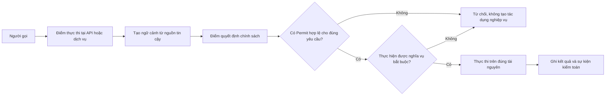

# Deny by default

## 1. Từ chối mặc định nghĩa là gì?

**Deny by default** là nguyên tắc hệ thống từ chối một yêu cầu truy cập nếu không xác định được một quyền cho phép hợp lệ, áp dụng đúng chủ thể, hành động, tài nguyên và ngữ cảnh của yêu cầu đó.

Trong authorization, việc người dùng đã đăng nhập chỉ xác định một phần ngữ cảnh. Nó không tự cho phép đọc mọi bản ghi, gọi mọi API hoặc thực hiện mọi hành động mà giao diện có thể gửi tới máy chủ.

Có thể biểu diễn yêu cầu cốt lõi như sau:

```text
Chỉ thực thi khi có quyết định Permit hợp lệ cho đúng yêu cầu.
Không có quy tắc phù hợp, quyết định không rõ hoặc thiếu điều kiện bắt buộc
    → không thực thi hành động được bảo vệ.
```

Ví dụ, một cổng học tập phục vụ nhiều tổ chức có API đọc hóa đơn. Một người dùng thuộc tổ chức A gửi mã hóa đơn của tổ chức B. Hệ thống phải kiểm tra quyền trên đúng hóa đơn và tổ chức đó. Không được cho đọc chỉ vì người dùng đã đăng nhập hoặc vì chưa có quy tắc nào ghi rõ “cấm đọc hóa đơn của B”.

Nguyên tắc này đặc biệt có giá trị khi thêm endpoint, loại tài nguyên, vai trò hoặc luồng xử lý mới. Thành phần mới chưa được khai báo quyền phải ở trạng thái không truy cập được, thay vì tự mở cho mọi người dùng có phiên.

Để biến nguyên tắc thành yêu cầu bảo mật có thể kiểm chứng, cần xác định nơi ra quyết định, nơi thực thi, cách xử lý thiếu dữ liệu và lỗi phụ thuộc, ngoại lệ công khai, thời hạn quyền đã lưu cùng ca kiểm thử chứng minh không tồn tại đường đi bỏ qua.

## 2. Phân biệt những khái niệm liên quan

| Khái niệm | Nội dung chính | Quan hệ với deny by default |
|---|---|---|
| Xác thực | Xác minh danh tính hoặc bằng chứng của chủ thể | Là đầu vào cho phân quyền; đăng nhập thành công chưa phải quyền truy cập |
| Deny by default | Không có quyền cho phép phù hợp thì từ chối | Xác định kết quả khi không tìm được căn cứ cấp quyền |
| Least privilege | Chỉ cấp những quyền cần thiết cho nhiệm vụ | Giới hạn nội dung quyền được cấp; một hệ thống từ chối mặc định vẫn có thể cấp quyền quá rộng |
| Explicit deny | Một quy tắc nêu rõ trường hợp bị cấm | Cần hợp đồng kết hợp quy tắc; không thay thế mặc định từ chối |
| Fail closed | Khi không thể thực hiện kiểm soát bắt buộc, không mở quyền truy cập | Xác định hành vi khi gặp lỗi hoặc không chắc chắn |
| Tài nguyên công khai | Được cho phép truy cập theo một chính sách dành cho chủ thể công khai | Là một quyền cho phép có phạm vi rõ, không phải bỏ toàn bộ kiểm soát |

Không thể kiểm chứng deny by default chỉ bằng cách nhìn thấy một danh sách lệnh cấm. Nếu mọi trường hợp không nằm trong danh sách đó đều được phép, hệ thống đang dùng cơ chế cho phép mặc định.

Ngược lại, việc có một danh sách quyền cho phép cũng chưa đủ. Nếu danh sách chứa quyền quá rộng như mọi hành động trên mọi tài nguyên, nguyên tắc từ chối mặc định ít giúp giới hạn tác động thực tế. Cần kết hợp nó với phạm vi quyền phù hợp.

Quy tắc ưu tiên giữa nhiều nguồn quyền phải được đặc tả. Không phải mọi thư viện hay mô hình ACL đều có cùng cách kết hợp `Permit` và `Deny`. Nếu dự án chọn “lệnh cấm tường minh có ưu tiên”, phải ghi và kiểm thử lựa chọn đó, thay vì suy ra từ tên nguyên tắc.

## 3. Bắt đầu từ rủi ro và ranh giới cần bảo vệ

| Rủi ro | Tình huống minh họa | Điều kiện bảo vệ cần đặc tả |
|---|---|---|
| Truy cập ngang giữa người dùng | Đổi mã tài liệu trong URL để đọc tài liệu của người khác | Quyền được xét trên đúng đối tượng và quan hệ với chủ thể |
| Vượt ranh giới tenant | Gửi `tenant_id` khác trong body hoặc header | Tenant của tài nguyên và quan hệ thành viên được xác minh từ nguồn tin cậy |
| Nâng đặc quyền | Người dùng thường gọi API quản trị bị ẩn trên giao diện | Máy chủ kiểm tra hành động và quyền; không dựa vào nút hiển thị |
| Endpoint mới bị mở | Tuyến mới không có khai báo chính sách nhưng vẫn nhận phiên hợp lệ | Tuyến chưa có quyền cho phép không được thực thi |
| Chính sách không tải được | Dịch vụ phân quyền lỗi và ứng dụng cho qua để tránh gián đoạn | Lỗi kiểm soát bắt buộc không biến thành quyền cho phép |
| Lộ dữ liệu qua truy vấn | API danh sách lọc thiếu tenant hoặc API đếm không lọc quyền | Cùng ranh giới quyền áp dụng cho hàng dữ liệu, số lượng và kết quả tổng hợp |
| Quyền cũ còn hiệu lực quá lâu | Cache vẫn cho phép sau khi bị thu hồi vai trò | Có thời hạn hiệu lực, cơ chế vô hiệu hóa và tiêu chí đo thu hồi |
| Dịch vụ hành động thay người dùng | Worker có quyền hệ thống rồi làm mọi thao tác người dùng yêu cầu | Tách danh tính dịch vụ với phạm vi ủy quyền của người khởi tạo |

Đặc tả phải gắn mỗi rủi ro với một hành động và tài sản cụ thể. Câu “mọi API phải an toàn” không cho nhóm phát triển biết cần kiểm tra gì, cũng không cho nhóm kiểm thử một kết quả chấp nhận rõ ràng.

## 4. Mô hình hóa một quyết định phân quyền

### 4.1. Chủ thể, hành động, tài nguyên và ngữ cảnh

Một yêu cầu phân quyền có thể được mô tả như sau:

```text
subject: chủ thể nào đang yêu cầu?
action: hành động nghiệp vụ nào sẽ được thực hiện?
resource: tài nguyên cụ thể nào chịu tác động?
context: tenant, thời điểm, trạng thái và điều kiện liên quan là gì?
```

Ví dụ:

```json
{
  "subject_id": "subject-demo-17",
  "action": "INVOICE_READ",
  "resource_id": "invoice-demo-203",
  "resource_tenant_id": "tenant-demo-a",
  "resource_version": 8,
  "membership_status": "ACTIVE"
}
```

Đây là dữ liệu minh họa cho đầu vào đã được máy chủ thiết lập. Một bản JSON có các trường này do trình duyệt tự gửi không chứng minh người gọi có vai trò hoặc tư cách thành viên tương ứng.

Máy chủ cần lấy danh tính từ ngữ cảnh xác thực đã được xác minh, lấy quan hệ quyền từ nguồn có thẩm quyền và lấy thuộc tính tài nguyên từ dữ liệu được quản lý. Định danh hoặc tenant do người gọi cung cấp có thể là tham số tra cứu; chúng không tự là căn cứ cấp quyền.

### 4.2. Định nghĩa hành động ở mức nghiệp vụ

Không nên suy quyền chỉ từ phương thức HTTP hoặc tên màn hình. `GET` có thể đọc dữ liệu rất nhạy cảm; một endpoint `POST` có thể thực hiện nhiều loại thay đổi với rủi ro khác nhau.

Cần có danh mục hành động rõ ràng, ví dụ `INVOICE_READ`, `INVOICE_APPROVE`, `INVOICE_EXPORT` và `BILLING_ROLE_GRANT`. Quyền đọc một hóa đơn không tự cho phép xuất toàn bộ hóa đơn hoặc cấp quyền đọc cho người khác.

Hành động không được nhận diện, tài nguyên không xác định được theo hợp đồng hoặc thiếu thuộc tính bắt buộc phải dẫn tới từ chối. Không dùng tên hành động trống, tenant rỗng hoặc vai trò không biết như ký hiệu đại diện cho mọi quyền.

### 4.3. Không chỉ có hai kết quả về mặt nội bộ

Một bộ máy chính sách có thể trả các trạng thái nội bộ khác nhau:

| Kết quả nội bộ | Ý nghĩa | Hành vi tại nơi bảo vệ tài nguyên |
|---|---|---|
| `Permit` | Có quyền cho phép phù hợp và đủ điều kiện | Chỉ thực thi sau khi kiểm tra hiệu lực, phạm vi và các nghĩa vụ bắt buộc |
| `Deny` | Chính sách xác định phải từ chối | Không thực thi |
| `NotApplicable` | Không có quy tắc áp dụng cho yêu cầu | Không thực thi |
| `Indeterminate` | Không đánh giá được vì lỗi hoặc thiếu dữ liệu bắt buộc | Không thực thi |

Tên trạng thái ở đây là mô hình minh họa. Điểm cốt lõi là không ánh xạ “không có kết quả” hoặc “không gặp lệnh cấm” thành `Permit`.

Nếu một thuộc tính thật sự không liên quan tới nhánh cho phép đã chọn, nó không nhất thiết phải có mặt. Tuy nhiên, hệ thống không được tự bỏ qua một điều kiện bắt buộc chỉ vì thuộc tính để đánh giá điều kiện đó đang thiếu.

## 5. Tách nơi quyết định và nơi thực thi

### 5.1. Các trách nhiệm trong kiến trúc

Có thể gọi nơi tính toán chính sách là **điểm quyết định**, còn nơi chặn hoặc cho hành động chạy là **điểm thực thi**. Hai trách nhiệm này có thể nằm trong cùng một ứng dụng hoặc ở các dịch vụ khác nhau.



Giao diện có thể ẩn nút hoặc giải thích quyền, nhưng không phải nơi thực thi duy nhất. Người gọi có thể gửi yêu cầu trực tiếp, dùng ứng dụng cũ hoặc đi qua một tuyến khác.

API gateway cũng không tự đủ nếu dịch vụ phía sau có đường truy cập khác hoặc chỉ gateway biết tên tuyến mà không biết chủ sở hữu, tenant và trạng thái tài nguyên. Mỗi đường thực thi phải đi qua kiểm soát phù hợp với dữ liệu mà nó sử dụng.

### 5.2. Mẫu xử lý phía máy chủ

```text
handle_protected_request(request):
    action = resolve_registered_action(request)
    if action is unknown:
        reject_without_business_effect()

    context = build_context_from_trusted_sources(request, action)
    if required_context_is_missing_or_invalid(context):
        reject_without_business_effect()

    decision = evaluate_policy(context)
    if evaluation_failed() or decision.result != Permit:
        reject_without_business_effect()

    if decision_is_expired_or_not_bound_to(context):
        reject_without_business_effect()

    if mandatory_obligations_cannot_be_enforced(decision):
        reject_without_business_effect()

    execute_with_required_consistency(context, decision)
```

Đây là mã giả mô tả hợp đồng, không phải một thư viện triển khai sẵn. Mọi ngoại lệ trên đường kiểm tra bắt buộc cũng phải đi về nhánh không thực thi; không được có khối xử lý lỗi trả về thành công hoặc tiếp tục chạy nghiệp vụ.

Nghĩa vụ bắt buộc là điều kiện đi kèm `Permit`, chẳng hạn chỉ trả một số trường, giới hạn tập bản ghi hoặc ghi một bằng chứng kiểm toán trước khi thực hiện thay đổi nhạy cảm. Nếu không thực hiện được nghĩa vụ, `Permit` đó chưa đủ để cho phép hành động.

## 6. Viết quyền cho phép đủ cụ thể

### 6.1. Quyền gồm hành động và phạm vi

Trong cổng học tập minh họa, có thể đặc tả một số quyền như sau:

| Chủ thể hoặc vai trò | Hành động được phép | Phạm vi và điều kiện bắt buộc |
|---|---|---|
| Học viên | `INVOICE_READ` | Hóa đơn của chính học viên trong tenant mà tài khoản còn có quan hệ hợp lệ |
| Nhân viên kế toán | `INVOICE_READ` | Hóa đơn thuộc tenant được gán trong phạm vi nghiệp vụ đã phê duyệt |
| Người phê duyệt | `INVOICE_APPROVE` | Hóa đơn trong tenant được gán, trạng thái cho phép và đáp ứng điều kiện phê duyệt |
| Dịch vụ xuất báo cáo | `INVOICE_EXPORT` | Đúng tác vụ, tập dữ liệu và tenant được ủy quyền; không suy quyền từ danh tính dịch vụ đơn thuần |
| Quản trị phân quyền | `BILLING_ROLE_GRANT` | Chỉ cấp các vai trò trong phạm vi quản trị được giao và theo quy trình thay đổi quyền |

Bảng này chỉ nêu các trường hợp cho phép. Những tổ hợp không được quy định không tự được phép. Vai trò quản trị phân quyền cũng không mặc nhiên có quyền đọc mọi hóa đơn nếu chính sách không cấp quyền đó.

Quyền cấp vai trò là một quyền nhạy cảm riêng. Nếu một người không được đọc dữ liệu nhưng có thể tùy ý cấp cho mình vai trò đọc dữ liệu, cần đánh giá đường nâng quyền đó thay vì chỉ kiểm tra quyền đọc hiện tại.

### 6.2. Quy tắc kết hợp phải có kết quả xác định

Dự án minh họa có thể chọn hợp đồng:

1. Nếu đánh giá điều kiện bắt buộc không thành công, từ chối.
2. Nếu có lệnh cấm tường minh áp dụng, từ chối.
3. Nếu có ít nhất một quyền cho phép phù hợp và tất cả ràng buộc bắt buộc được thỏa mãn, cho phép.
4. Những trường hợp còn lại đều từ chối.

Hợp đồng này cần áp dụng nhất quán cho quyền trực tiếp, vai trò, nhóm và quyền ủy quyền theo thiết kế. Không để thứ tự khai báo hoặc thứ tự duyệt danh sách vô tình quyết định trường hợp xung đột.

Mô hình RBAC, ABAC hoặc quyền theo quan hệ đều có thể áp dụng deny by default. Điều quan trọng là phép đánh giá cuối cùng có một căn cứ cho phép đúng phạm vi, thay vì phụ thuộc vào việc hệ thống có nhớ viết đủ mọi trường hợp cấm hay không.

## 7. Bao phủ dữ liệu, thao tác và mọi đường truy cập

### 7.1. Kiểm tra theo đối tượng, không chỉ theo endpoint

Cho phép gọi `GET /invoices/{id}` không có nghĩa được đọc mọi hóa đơn mà người gọi biết mã. Sau khi xác định hành động, hệ thống còn phải xét đúng đối tượng và quan hệ quyền trên đối tượng đó.

Mã khó đoán có thể làm giảm khả năng tìm kiếm tài nguyên, nhưng không thay thế phân quyền. Một mã bị lộ trong email, log hoặc liên kết không được tự trở thành quyền đọc nếu thiết kế không chủ đích dùng liên kết như một quyền được ủy quyền.

Nếu dùng liên kết chia sẻ hoặc URL có quyền truy cập, phải coi đó là một cơ chế cấp quyền rõ ràng: phạm vi tài nguyên, hành động, thời hạn, tính toàn vẹn và khả năng thu hồi cần được đặc tả. Quyền từ liên kết không nên vô tình mở rộng sang các tài nguyên lân cận.

### 7.2. Danh sách, tìm kiếm và dữ liệu tổng hợp

Một API danh sách có thể vi phạm phân quyền ngay cả khi API đọc từng bản ghi được kiểm tra đúng. Ràng buộc quyền cần được áp dụng cho tập dữ liệu trước khi trả kết quả và trước các phép tính có thể làm lộ thông tin.

Cần xem xét:

- Hàng dữ liệu được trả về, trường nhạy cảm và tài liệu đính kèm.
- Tổng số kết quả, số trang, bộ lọc gợi ý và thông tin tự động hoàn thành.
- Kết quả tìm kiếm, thống kê, báo cáo và bản xuất.
- Cache kết quả, bộ chỉ mục tìm kiếm và bản sao phục vụ phân tích.

Ví dụ, chỉ lọc hóa đơn theo tenant sau khi đã tính tổng số toàn hệ thống vẫn có thể làm lộ sự tồn tại hoặc quy mô dữ liệu của tenant khác. Lọc sau khi phân trang cũng có thể làm sai ngữ nghĩa kết quả và tạo kênh suy đoán.

Lựa chọn kỹ thuật có thể là truy vấn đã giới hạn phạm vi, kiểm soát ở kho dữ liệu hoặc kết hợp nhiều lớp. Yêu cầu chấp nhận vẫn phải mô tả rõ dữ liệu nào được phép xuất hiện, thay vì chỉ chỉ định một tên công nghệ.

### 7.3. Thao tác hàng loạt và quyền ở mức thuộc tính

Với một yêu cầu sửa nhiều tài nguyên, phải xác định kiểm tra từng đối tượng và cách xử lý khi có một đối tượng không được phép. Có thể chọn từ chối toàn bộ hoặc trả kết quả từng phần theo một hợp đồng đã đặc tả.

Nếu chọn toàn bộ hoặc không có gì, việc phát hiện một đối tượng bị từ chối phải xảy ra trước khi tạo tác dụng không thể thu hồi trên những đối tượng khác, hoặc phải có thiết kế giao dịch phù hợp. Không kiểm tra quyền chỉ trên đối tượng đầu tiên.

Đối với cập nhật thuộc tính, quyền sửa hồ sơ không tự cho phép sửa `role`, `tenant_id`, chủ sở hữu hoặc trạng thái phê duyệt. Những trường có tác động tới quyền phải có hành động và điều kiện riêng. Trường mới chưa được khai báo có thể cập nhật không được tự nhận qua cơ chế gán toàn bộ body vào đối tượng nghiệp vụ.

### 7.4. Đường truy cập ngoài HTTP

Cùng nguyên tắc phải áp dụng cho lời gọi nội bộ, WebSocket, xử lý thông điệp, công cụ quản trị và tác vụ chạy theo lịch. Một dịch vụ gọi dịch vụ khác không tự làm yêu cầu trở nên đáng tin cho mọi hành động.

Cần xác thực danh tính dịch vụ và xác định nó đang hành động với quyền độc lập hay theo ủy quyền của người dùng. Khi hành động thay người dùng, quyền kỹ thuật của worker không được che mất giới hạn nghiệp vụ của người khởi tạo.

Thông điệp trong hàng đợi phải mang đủ tham chiếu được bảo vệ để kiểm tra chủ thể, tenant, mục đích, tài nguyên và thời hạn. Không chỉ gửi một mã người dùng rồi để worker tự suy toàn bộ quyền từ đầu vào chưa được xác minh.

## 8. Kiểm soát thay đổi trạng thái, cache và thời điểm thực thi

### 8.1. Quyền có thể thay đổi giữa lúc kiểm tra và lúc sử dụng

Một yêu cầu được cho phép lúc bắt đầu có thể không còn hợp lệ khi dữ liệu được ghi: người dùng bị thu hồi quyền, hóa đơn đổi tenant hoặc trạng thái không còn cho phép phê duyệt.

Đây là rủi ro giữa thời điểm kiểm tra và thời điểm sử dụng. Yêu cầu phải chỉ rõ điều kiện nào cần đúng tại thời điểm thực thi và cơ chế giữ tính nhất quán tương ứng.

Ví dụ, phê duyệt hóa đơn có thể yêu cầu đối chiếu phiên bản và trạng thái trong cùng giao dịch cập nhật. Nếu tài nguyên đã thay đổi, hệ thống phải từ chối hoặc đánh giá lại theo chính sách; không dùng quyết định cho phiên bản cũ để tự cho phép phiên bản mới.

Không thể mặc định một lần gọi dịch vụ phân quyền trước đó đảm bảo tính nguyên tử với mọi thay đổi về quyền và dữ liệu. Nếu cần bảo đảm mạnh hơn, kiến trúc phải có cơ chế phối hợp, kiểm tra phiên bản hoặc khóa phù hợp, và nêu rõ ranh giới bảo đảm.

### 8.2. Cache quyền cũng là một quyết định cấp quyền

Một bản ghi cache cho phép cần có phạm vi và thời hạn. Khóa cache có thể cần bao gồm chủ thể, tenant, hành động, tài nguyên, phiên bản chính sách cùng những thuộc tính ảnh hưởng đến quyết định.

Nếu cache chỉ dùng `subject_id`, quyền đọc tài liệu có thể bị dùng nhầm để xóa tài liệu hoặc truy cập tenant khác. Nếu cache bỏ qua phiên bản tài nguyên, quyền có thể còn áp dụng sau khi tài nguyên đã đổi chủ sở hữu.

Cần đặc tả ít nhất:

- Cache được phép dùng cho hành động nào.
- Thời hạn hiệu lực và sự kiện làm mất hiệu lực.
- Khoảng thời gian thu hồi quyền tối đa có thể quan sát được.
- Cách xử lý khi không xác định được độ mới hoặc phiên bản.
- Cách hành xử khi dịch vụ chính sách lỗi nhưng cache vẫn còn một kết quả cũ.

Một kết quả được lưu với thời hạn và phạm vi đã được chính sách cho phép có thể tiếp tục được sử dụng trong giới hạn cam kết. Ngược lại, lấy một kết quả hết hạn hoặc không rõ độ mới để cho qua khi gặp lỗi là một đường mở quyền ngoài hợp đồng.

Nếu nghiệp vụ yêu cầu thu hồi gần như ngay tại thời điểm thực thi, một cache `Permit` sống nhiều phút không đáp ứng yêu cầu đó chỉ vì có ghi cấu hình “deny by default”. Phải thiết kế và đo khả năng thu hồi theo yêu cầu thực tế.

### 8.3. Tác vụ nền và hành động kéo dài

Đối với một tác vụ xuất hóa đơn, cần xác định quyền được xét khi nhận yêu cầu, khi worker đọc dữ liệu và khi người dùng tải tệp kết quả. Ba thời điểm này có thể cách nhau nhiều giờ.

Chính sách có thể yêu cầu kiểm tra lại trước khi đọc dữ liệu và trước khi tải tệp. Nếu dùng ủy quyền có thời hạn cho tác vụ, phải nêu rõ phạm vi được giữ và tác động khi người khởi tạo bị thu hồi quyền.

Không tự diễn giải việc tác vụ đã nằm trong hàng đợi thành một quyền vĩnh viễn. Tệp kết quả, liên kết tải và bản sao lưu tạm cũng cần kiểm soát truy cập riêng.

## 9. Ngoại lệ công khai và quyền vận hành khẩn cấp

### 9.1. Công khai là một chính sách có chủ đích

Một trang giới thiệu khóa học có thể được truy cập khi chưa đăng nhập. Có thể mô hình hóa chủ thể công khai và cấp `COURSE_PUBLIC_READ` cho đúng những khóa học đã xuất bản.

Điều đó không đồng nghĩa mọi đường dẫn dưới cùng thư mục đều công khai, mọi phương thức HTTP đều được phép hoặc bản nháp cũng có thể đọc. Khi thêm chức năng mới, hệ thống phải yêu cầu một khai báo quyền tương ứng.

Ngoại lệ nên có tên, chủ sở hữu, phạm vi tài nguyên, hành động và lý do. Ví dụ, endpoint kiểm tra tình trạng dịch vụ có thể được mở theo chính sách vận hành, nhưng không được tự trả cấu hình nội bộ, danh sách tenant hoặc dữ liệu nhạy cảm.

Nếu một giao thức cần một loại yêu cầu phụ trợ riêng, phải khai báo đúng phạm vi cần thiết. Không dùng yêu cầu hỗ trợ đó làm lý do bỏ kiểm soát trên hành động nghiệp vụ thật.

### 9.2. Tài khoản quản trị không phải ngoại lệ vô hạn

Các thao tác hỗ trợ và khẩn cấp cần quyền rõ ràng, điều kiện kích hoạt, thời hạn, log và người chịu trách nhiệm. Nếu cho phép nâng quyền tạm thời, phải có cách thu hồi và kiểm tra thời điểm hết hạn.

Không tạo nhánh “nếu là nhân viên nội bộ thì cho phép tất cả” mà không mô hình hóa nó như một quyền. Một nhánh như vậy vừa làm khó kiểm chứng, vừa có thể mở truy cập chéo tenant ngoài mục đích hỗ trợ.

Đường khẩn cấp cũng cần bằng chứng xác thực và phân quyền phù hợp. Sự cố dịch vụ chính sách không tự là căn cứ để mọi người dùng được tiếp tục bằng quyền quản trị.

## 10. Bộ yêu cầu mẫu có thể đo và kiểm chứng

Bối cảnh minh họa: cổng học tập nhiều tenant quản lý hóa đơn. Học viên được đọc hóa đơn của mình; nhân viên kế toán và người phê duyệt có quyền theo tenant; worker xuất dữ liệu hoạt động theo phạm vi ủy quyền.

Các điều kiện dưới đây là hợp đồng của hệ thống giả định. Dự án thực tế cần chọn phạm vi, thời gian và cơ chế nhất quán phù hợp với rủi ro của mình.

| Mã | Yêu cầu bảo mật | Bằng chứng chấp nhận |
|---|---|---|
| DD-01 | Mỗi hành động được bảo vệ chỉ được thực thi khi có `Permit` hợp lệ cho đúng chủ thể, hành động, tài nguyên và tenant | Yêu cầu thiếu quyền hoặc dùng quyết định của ngữ cảnh khác không tạo tác dụng nghiệp vụ |
| DD-02 | Tuyến hoặc hành động mới chưa có khai báo quyền phải bị từ chối; đăng nhập thành công không phải quyền dự phòng | Thêm một tuyến thử nghiệm chưa khai báo cho thấy cả người dùng thường lẫn quản trị đều không tự truy cập được |
| DD-03 | `Deny`, không có quy tắc áp dụng, lỗi đánh giá và thiếu thuộc tính bắt buộc đều không cho phép thực thi | Kiểm thử riêng từng kết quả nội bộ không đọc được dữ liệu và không ghi thay đổi nghiệp vụ |
| DD-04 | Danh tính, quan hệ thành viên và thuộc tính tài nguyên dùng để cấp quyền phải đến từ nguồn đã xác minh | Tự gửi vai trò, chủ sở hữu hoặc tenant trong body không làm tăng quyền |
| DD-05 | Hợp đồng mẫu áp dụng ưu tiên từ chối tường minh; kết quả không phụ thuộc thứ tự duyệt quy tắc | Đảo thứ tự các quy tắc cho cùng đầu vào vẫn có cùng quyết định |
| DD-06 | Mọi đường thực thi gồm API trực tiếp, lời gọi nội bộ và worker phải thực hiện kiểm soát tương ứng | Bỏ qua giao diện hoặc gateway không bỏ qua được phân quyền ở dịch vụ |
| DD-07 | Danh sách, tìm kiếm, đếm và xuất dữ liệu phải giới hạn cùng phạm vi quyền; không trả trường ngoài quyền được cấp | Bộ dữ liệu có hai tenant cho kết quả chỉ chứa thông tin được phép, kể cả tổng số và tệp xuất |
| DD-08 | Với thao tác hàng loạt theo hợp đồng toàn bộ hoặc không có gì, một đối tượng bị từ chối làm toàn bộ yêu cầu không tạo thay đổi | Gửi tập gồm đối tượng được phép và không được phép không làm thay đổi đối tượng nào |
| DD-09 | Hành động phê duyệt phải kiểm tra trạng thái và phiên bản tài nguyên theo cơ chế nhất quán đã thiết kế tại thời điểm ghi | Thay đổi song song trạng thái hoặc phiên bản khiến quyết định cũ không được dùng cho bản mới |
| DD-10 | Hệ thống mẫu không cache `Permit` cho thao tác ghi; cache cho phép đọc có thời hạn tối đa 30 giây và không được dùng quá giới hạn đó khi dịch vụ chính sách lỗi | Dùng thời gian kiểm soát chứng minh kết quả hết hạn bị từ chối; quyền đọc bị thu hồi không còn được dùng sau 30 giây kể từ khi thay đổi quyền đã được xác nhận |
| DD-11 | Ngoại lệ công khai phải liệt kê hành động và điều kiện tài nguyên; tuyến hoặc phương thức mới không được tự kế thừa ngoại lệ | Khóa học đã xuất bản đọc được công khai; bản nháp và thao tác cập nhật vẫn bị từ chối nếu thiếu quyền |
| DD-12 | Worker phải kiểm tra ủy quyền trước khi đọc dữ liệu; tải tệp kết quả phải kiểm tra quyền hiện tại; hai bước này phải lấy quyết định mới từ nguồn có thẩm quyền, không dùng cache `Permit` | Thu hồi quyền trước khi worker đọc hoặc trước khi tải làm bước tương ứng bị từ chối |
| DD-13 | Nghĩa vụ đi kèm quyết định phải được thực thi đầy đủ; không thực hiện được nghĩa vụ bắt buộc thì không chạy hành động | Giả lập lỗi lọc trường hoặc lỗi lưu bằng chứng bắt buộc không trả dữ liệu vượt phạm vi |
| DD-14 | Thay đổi quyền và chính sách phải có chủ thể thực hiện, phạm vi, phiên bản, lý do và sự kiện kiểm toán | Truy vết được một thay đổi quyền đến các quyết định chịu ảnh hưởng |

Giới hạn 30 giây trong DD-10 là lựa chọn minh họa, không phải một mức mặc định an toàn cho mọi hệ thống. Để cam kết thu hồi trong khoảng đó, việc đánh giá mới phải nhìn thấy nguồn quyền có thẩm quyền sau khi thay đổi đã được xác nhận; tuổi của cache và độ trễ nguồn quyền cần cùng nằm trong thiết kế bảo đảm.

Không cache `Permit` cho thao tác ghi cũng chưa tự loại bỏ rủi ro thay đổi quyền giữa hai bước. DD-09 và các yêu cầu về thời điểm thực thi vẫn cần cơ chế nhất quán tương ứng.

## 11. Phản hồi, logging và phục hồi khi bị từ chối

### 11.1. Không tạo tác dụng nghiệp vụ khi bị từ chối

Từ chối phải được thực hiện trước khi trả dữ liệu được bảo vệ hoặc tạo tác dụng nghiệp vụ trái quyền. Không trả một phần dữ liệu rồi mới kiểm tra, cũng không ghi thay đổi trước rồi chỉ sửa mã phản hồi thành lỗi.

Việc ghi sự kiện kiểm toán, tăng bộ đếm chống lạm dụng hoặc tạo tín hiệu giám sát theo chính sách vẫn có thể diễn ra khi yêu cầu bị từ chối. Cần phân biệt những hoạt động bảo vệ này với hành động nghiệp vụ mà người gọi không được phép thực hiện.

Phản hồi công khai phải có hợp đồng rõ ràng. Một ứng dụng có thể dùng phản hồi thiếu xác thực khi cần danh tính, phản hồi không đủ quyền khi đã xác định chủ thể, hoặc phản hồi che giấu sự tồn tại của tài nguyên khi mô hình rủi ro yêu cầu.

Không dùng khác biệt giữa “không tồn tại” và “không có quyền” để vô tình cho người gọi dò danh sách tài nguyên. Mã nguyên nhân chi tiết có thể được giữ trong log nội bộ thay vì trả toàn bộ chính sách, vai trò và thuộc tính cho người gọi.

### 11.2. Ghi đủ để giải thích quyết định

Một sự kiện có thể có cấu trúc như sau:

```json
{
  "event_type": "AUTHORIZATION_DENIED",
  "correlation_id": "request-demo-401",
  "subject_id": "subject-demo-17",
  "action": "INVOICE_READ",
  "resource_ref": "invoice-ref-demo-203",
  "tenant_ref": "tenant-demo-b",
  "policy_version": "billing-policy-v4",
  "decision_reason": "NO_APPLICABLE_PERMIT",
  "enforcement_point": "invoice-api",
  "occurred_at": "2026-01-15T10:00:00Z"
}
```

Đây là dữ liệu minh họa, không phải thông điệp có quyền thực thi. Sự kiện cần cho phép liên kết yêu cầu, phiên bản chính sách, thành phần thực thi và kết quả mà không chứa cookie, bearer token hoặc dữ liệu hóa đơn không cần thiết.

Log có thể chứa định danh nhạy cảm hoặc thông tin về tài nguyên mà người gọi không được xem. Vì vậy, cần quyền đọc, thời gian lưu và khả năng bảo vệ tính toàn vẹn phù hợp. Dữ liệu do người gọi đưa vào phải được giới hạn và ghi theo cấu trúc an toàn.

Cần phân biệt bị từ chối vì không có quyền, vì chính sách lỗi, vì thiếu thuộc tính hay vì quyết định đã hết hạn. Nếu chỉ có một chuỗi “forbidden” cho mọi sự kiện nội bộ, nhóm vận hành khó xác định một sự cố phụ thuộc đang chặn hàng loạt người dùng hợp lệ.

### 11.3. Phục hồi bằng cách sửa căn cứ cấp quyền

Khi người dùng hợp lệ bị từ chối, cần kiểm tra quan hệ thành viên, vai trò, thuộc tính tài nguyên, phiên bản chính sách và thời hạn quyết định. Việc sửa phải đi qua quy trình thay đổi quyền có kiểm soát.

Không xử lý sự cố bằng cách tạm bỏ toàn bộ điểm thực thi hoặc thêm quyền cho mọi tài nguyên mà không xác định phạm vi. Nếu cần một quyền khẩn cấp, phải khai báo chủ thể, hành động, tài nguyên, thời hạn, người phê duyệt và khả năng thu hồi.

Khôi phục phiên bản chính sách trước đó cũng phải được đánh giá như một thay đổi quyền. Phiên bản cũ có thể cấp lại quyền đã bị thu hồi; cache, worker và các điểm thực thi cần nhận biết phiên bản đang có hiệu lực.

## 12. Ma trận kiểm thử chấp nhận

| Nhóm kiểm thử | Tình huống | Kết quả cần kiểm chứng |
|---|---|---|
| Không có quyền | Chủ thể đăng nhập nhưng không có quy tắc phù hợp | Không trả dữ liệu được bảo vệ, không tạo thay đổi nghiệp vụ |
| Quyền tối thiểu hợp lệ | Đúng chủ thể, hành động, tài nguyên, tenant và điều kiện | Chỉ thực hiện đúng hành động đã cấp, với đúng phạm vi dữ liệu |
| Endpoint mới | Thêm tuyến chưa khai báo chính sách | Không tự mở quyền cho mọi phiên hợp lệ hoặc vai trò quản trị |
| Hành động không biết | Gửi tên hành động trống, sai hoặc mới | Không biến thành quyền đại diện hay quyền mặc định |
| Truy cập ngang | Đổi mã hóa đơn sang hóa đơn của người khác | Bị từ chối dù người gọi biết chính xác mã tài nguyên |
| Chéo tenant | Đổi tenant trong body, header hoặc URL | Máy chủ không dùng dữ liệu đó làm bằng chứng tư cách thành viên |
| Nâng quyền qua thuộc tính | Gửi thêm `role`, chủ sở hữu hoặc tenant khi sửa hồ sơ | Trường chưa được cấp quyền không được cập nhật |
| Gọi trực tiếp | Bỏ giao diện hoặc đi vòng gateway tới dịch vụ | Vẫn đi qua kiểm soát bắt buộc trước khi thực thi |
| Không có kết quả hoặc lỗi | Chính sách không tồn tại, thiếu thuộc tính, timeout, phản hồi không hợp lệ | Không ánh xạ bất kỳ trường hợp nào thành `Permit` |
| Xung đột quy tắc | Có cả quyền cho phép và lệnh cấm tường minh theo hợp đồng mẫu | Kết quả từ chối không đổi khi đảo thứ tự quy tắc |
| Quyết định sai phạm vi | Dùng lại quyết định đọc cho ghi, tenant khác hoặc tài nguyên khác | Bị từ chối do không khớp ngữ cảnh |
| Danh sách và tổng hợp | Dữ liệu của nhiều người và nhiều tenant trong cùng kho | Kết quả, số lượng, trường dữ liệu và báo cáo đều đúng phạm vi |
| Hàng loạt | Trộn đối tượng được phép và không được phép | Đúng hợp đồng toàn bộ hoặc không có gì của hệ thống mẫu |
| Thay đổi đồng thời | Đổi phiên bản hoặc trạng thái sau lúc kiểm tra | Quyết định cũ không áp dụng cho trạng thái mới trái yêu cầu |
| Cache và thu hồi | Thu hồi quyền khi cache còn hạn, hết hạn hoặc dịch vụ chính sách lỗi | Đáp ứng đúng giới hạn thu hồi và không dùng kết quả quá hạn |
| Worker và tệp xuất | Thu hồi quyền trước khi worker đọc hoặc trước khi tải | Kiểm tra mới ở từng bước chặn thao tác không còn được phép |
| Ngoại lệ công khai | Đọc nội dung đã xuất bản, rồi thử bản nháp và thao tác cập nhật | Chỉ quyền công khai đã khai báo có hiệu lực |
| Nghĩa vụ bắt buộc | Không thể áp dụng lọc trường hoặc lưu bằng chứng bắt buộc | Không thực thi dựa trên một `Permit` chưa đủ điều kiện |
| Logging | Kiểm tra một luồng bị từ chối và một thay đổi quyền | Truy vết được quyết định; không ghi bí mật hoặc dữ liệu thừa |

Cần có cả ca được phép và ca bị từ chối. Một bộ kiểm thử chỉ chứng minh “người có vai trò đọc được” chưa chứng minh những người khác bị chặn.

Các ca sát giới hạn thời gian nên dùng nguồn thời gian kiểm soát được. Kiểm thử đồng thời cần xác nhận trạng thái dữ liệu hoặc tác dụng thực tế, không chỉ nhìn mã phản hồi. Với tác vụ bất đồng bộ, cần kiểm tra cả khi nhận việc, khi chạy và khi cung cấp kết quả theo hợp đồng đã chọn.

## 13. Truy vết yêu cầu trong vòng đời phát triển

Có thể nối yêu cầu với rủi ro, kiến trúc và kiểm thử như sau:

```text
Rủi ro: endpoint mới bị mở ngoài ý muốn
  → Yêu cầu: DD-01, DD-02 và DD-03
  → Thiết kế: danh mục hành động và điểm thực thi bắt buộc
  → Bằng chứng: tuyến chưa khai báo bị chặn trước tác dụng nghiệp vụ

Rủi ro: truy cập hóa đơn của tenant khác
  → Yêu cầu: DD-04, DD-06 và DD-07
  → Thiết kế: thuộc tính tài nguyên có thẩm quyền và phạm vi truy vấn
  → Bằng chứng: đọc, tìm kiếm, đếm và xuất đều không lộ dữ liệu ngoài quyền

Rủi ro: quyền cũ tiếp tục được sử dụng
  → Yêu cầu: DD-09, DD-10 và DD-12
  → Thiết kế: phiên bản, thời hạn, kiểm tra lại và cơ chế nhất quán
  → Bằng chứng: đo thời gian thu hồi và kiểm tra worker sau thay đổi quyền
```

Khi thêm loại tài nguyên, hành động, vai trò hoặc nguồn thuộc tính, cần xác định rõ quyền nào được thêm và phạm vi nào tiếp tục bị từ chối. Không tự tạo quyền chỉ vì một lớp hoặc endpoint mới dùng chung tên với thành phần đã được cho phép.

Thay đổi chính sách cần có phiên bản, người chịu trách nhiệm, kiểm thử trường hợp xung đột và kế hoạch áp dụng tới các điểm thực thi. Trong giai đoạn triển khai nhiều phiên bản, phải biết điểm nào có thể còn dùng chính sách cũ và trong bao lâu.

Các chỉ số vận hành có thể gồm số lần không có quy tắc phù hợp, lỗi đánh giá, quyết định quá hạn và độ trễ thu hồi quyền. Tăng đột biến có thể phản ánh hành vi lạm dụng, một endpoint thiếu khai báo hoặc lỗi triển khai; cần phân tích trước khi mở rộng quyền.

## 14. Mẫu đặc tả cho một hành động được bảo vệ

> Trước khi thực hiện **[hành động]** trên **[tài nguyên]** trong **[phạm vi tenant]**, hệ thống phải xác minh **[chủ thể và thuộc tính bắt buộc]** từ **[nguồn có thẩm quyền]**. Chỉ cho phép khi có **[quy tắc Permit cụ thể]**, thỏa **[điều kiện và nghĩa vụ]**, theo **[phiên bản và quy tắc kết hợp chính sách]**. Không có quy tắc phù hợp, thiếu dữ liệu bắt buộc, lỗi đánh giá hoặc quyết định hết hiệu lực phải dẫn tới **[hành vi từ chối không tạo tác dụng nghiệp vụ]**. Quyết định có thể được tái sử dụng trong **[phạm vi và thời hạn]**; thu hồi quyền phải có hiệu lực trong **[giới hạn đo được]**. Mọi đường thực thi, kể cả **[API, worker và đường vận hành]**, phải tuân hợp đồng này và được chứng minh bằng **[ca kiểm thử, log và bằng chứng dữ liệu]**.

Một đặc tả deny by default đầy đủ xác định cả điều kiện cho phép lẫn kết quả của phần chưa được cho phép. Khi quyền, dữ liệu, điểm thực thi và thời hạn được ghi rõ, nguyên tắc trở thành một ràng buộc có thể triển khai và kiểm chứng trong toàn bộ vòng đời phát triển.
