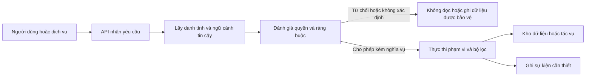

# Least privilege — Đặc tả nguyên tắc đặc quyền tối thiểu

## 1. Đặc quyền tối thiểu cần trở thành yêu cầu cụ thể

**Least privilege**, hay nguyên tắc đặc quyền tối thiểu, yêu cầu mỗi chủ thể chỉ có những quyền cần thiết để hoàn thành nhiệm vụ được giao, trên đúng tài nguyên, trong đúng điều kiện và khoảng thời gian cần thiết. Chủ thể có thể là người dùng, quản trị viên, dịch vụ, tác vụ nền hoặc hệ thống triển khai.

Trong chương **Yêu cầu authorization**, mục tiêu không dừng ở lời khuyên “hãy cấp ít quyền”. Người đặc tả phải chỉ ra hành động nào được phép, dữ liệu nào được tiếp cận, ai có quyền cấp và thu hồi, khi nào quyền hết hiệu lực, cùng bằng chứng để kiểm tra các giới hạn đó.

Ví dụ, một nhân viên cần sửa hồ sơ chi phí do mình tạo khi hồ sơ còn ở trạng thái nháp. Cấp quyền `expense:update` trên mọi hồ sơ của doanh nghiệp rộng hơn nhu cầu. Yêu cầu phù hợp phải giới hạn cả chủ sở hữu, tenant, trạng thái và những trường được sửa.

Một đặc tả có thể kiểm chứng:

> **LP-EXP-01:** Người dùng đang hoạt động chỉ được sửa các trường nội dung cho phép của hồ sơ chi phí thuộc tenant mà mình là thành viên, do chính mình tạo và đang ở trạng thái `DRAFT`. Yêu cầu thay đổi `tenant_id`, `owner_id`, trạng thái duyệt hoặc kết quả phê duyệt phải bị từ chối trên mọi API ghi hồ sơ.

Quyền tối thiểu là mức đủ để thực hiện công việc hợp lệ. Nếu cắt quyền đến mức người dùng phải chia sẻ tài khoản, tải dữ liệu ra ngoài hoặc nhờ quản trị viên thao tác thay thường xuyên, thiết kế cần được xem lại cùng quy trình nghiệp vụ.

## 2. Phân biệt các nguyên tắc liên quan

| Nguyên tắc | Câu hỏi chính | Quan hệ với least privilege |
|---|---|---|
| Xác thực | Chủ thể đang thực hiện là ai? | Danh tính đã được kiểm tra vẫn cần xét quyền trên từng hành động |
| Mặc định từ chối | Nếu không có quy tắc cấp phù hợp thì làm gì? | Ngăn việc tính năng hoặc tài nguyên mới tự được mở quyền |
| Đặc quyền tối thiểu | Có thể thu hẹp quyền nào mà vẫn đáp ứng nhiệm vụ? | Giới hạn hành động, tài nguyên, dữ liệu, điều kiện và thời hạn |
| Phân tách nhiệm vụ | Những trách nhiệm nào không được cùng một người thực hiện? | Bổ sung ràng buộc, chẳng hạn người tạo không duyệt hồ sơ của mình |
| Kiểm tra quyền đầy đủ | Mọi đường tiếp cận tài nguyên có được kiểm tra không? | Giữ giới hạn quyền có hiệu lực trên API, tác vụ nền và tải tệp |
| Phòng vệ nhiều lớp | Nếu một lớp bị vượt qua thì còn giới hạn nào? | Quyền hẹp của dịch vụ, cơ sở dữ liệu và hạ tầng hạn chế phạm vi ảnh hưởng |

Ẩn nút trên giao diện giúp trải nghiệm rõ ràng nhưng không thực thi phân quyền. Người gọi vẫn có thể gửi request trực tiếp. Cũng không thể dùng việc đã đăng nhập, biết mã tài nguyên hoặc có một vai trò tên “manager” làm bằng chứng đủ cho mọi hành động.

## 3. Phạm vi của một quyền cần được phân tích

Một quyền có thể được mô tả bằng bộ thành phần:

```text
Quyền = chủ thể + hành động + tài nguyên/phạm vi + điều kiện + thời hạn
        + các nghĩa vụ phải thực thi khi cho phép
```

| Thành phần | Câu hỏi đặc tả | Ví dụ |
|---|---|---|
| Chủ thể | Người, dịch vụ hay tác vụ nào được phép? | Thành viên đang hoạt động của tenant A |
| Hành động | Đọc, tạo, sửa, duyệt, xuất hay cấp quyền? | `expense:approve`, tách khỏi `expense:read` |
| Tài nguyên | Một đối tượng, dự án hay toàn tenant? | Hồ sơ thuộc dự án được phân công |
| Dữ liệu | Bản ghi và trường nào được thấy hoặc sửa? | Đọc số tiền nhưng che thông tin ngân hàng |
| Điều kiện | Quan hệ, trạng thái, mức rủi ro nào phải đúng? | Không phải người tạo; hồ sơ đang chờ duyệt |
| Thời gian | Quyền có hiệu lực đến khi nào? | Quyền hỗ trợ có hạn 30 phút |
| Môi trường | Development, staging hay production? | Tài khoản triển khai staging không chạm production |
| Quyền cấp tiếp | Chủ thể có được tạo hoặc trao quyền cho người khác không? | Quản trị viên chỉ cấp các vai trò tenant đã cho phép |
| Nghĩa vụ | Sau quyết định cho phép còn phải làm gì? | Che trường dữ liệu và ghi sự kiện phê duyệt |

Chỉ giảm số lượng vai trò chưa chắc giảm quyền. Một vai trò duy nhất có wildcard trên mọi tài nguyên có thể rộng hơn nhiều vai trò nhỏ có phạm vi rõ ràng. Số lượng dòng trong bảng quyền không phải thước đo độc lập cho least privilege.

### Xét quyền thực tế, không chỉ quyền trực tiếp

Quyền thực tế có thể đến từ vai trò trực tiếp, nhóm lồng nhau, quan hệ sở hữu, ACL của đối tượng, quyền chia sẻ, token ủy quyền, liên kết tải tệp hoặc một dịch vụ thao tác thay người dùng. Cần kiểm kê các đường này khi đánh giá một chủ thể.

Một người không có quyền xuất dữ liệu trên giao diện vẫn có thể tải toàn bộ dữ liệu nếu được dùng một khóa API rộng hoặc gọi tác vụ báo cáo không kiểm tra phạm vi. Đặc tả phải bao phủ đường tiếp cận gián tiếp đó.

## 4. Từ mô hình đe dọa đến mục tiêu kiểm soát

Ví dụ xuyên suốt là hệ thống quản lý hồ sơ chi phí cho nhiều doanh nghiệp. Mỗi tenant có nhân viên, người duyệt và người quản trị; hệ thống có worker xuất báo cáo và nhân viên hỗ trợ vận hành.

| Mã rủi ro | Tình huống đe dọa | Hướng yêu cầu đặc quyền tối thiểu |
|---|---|---|
| R-01 | Người dùng đổi ID để đọc hoặc sửa hồ sơ của người khác | Kiểm tra quyền trên đối tượng và tenant cho từng thao tác |
| R-02 | Tài khoản bị chiếm có quyền đọc hoặc xuất toàn doanh nghiệp | Thu hẹp phạm vi đọc, xuất và trường dữ liệu theo nhiệm vụ |
| R-03 | Người tạo tự duyệt hồ sơ bằng một vai trò khác | Ràng buộc nghiệp vụ thắng việc cộng thêm vai trò |
| R-04 | Worker có khóa quản trị nên có thể sửa dữ liệu ngoài nhiệm vụ | Danh tính dịch vụ riêng, quyền hẹp và ủy quyền có phạm vi |
| R-05 | Người chuyển bộ phận vẫn giữ quyền cũ | Cấp quyền có chủ sở hữu, rà soát và thu hồi theo sự kiện |
| R-06 | Quản trị viên tenant cấp cho mình quyền quản trị nền tảng | Giới hạn quyền cấp tiếp và phân biệt các phạm vi quản trị |
| R-07 | Cache hoặc token giữ quyền cũ sau khi thu hồi | Cam kết thời gian hội tụ trên mọi điểm thực thi |
| R-08 | Tác vụ nền hoặc tệp xuất tiếp tục lộ dữ liệu sau khi quyền mất | Kiểm tra khi thực thi và khi tải kết quả |
| R-09 | Lỗi dịch vụ chính sách dẫn tới cho phép mặc định | Quy định hành vi lỗi và điều kiện sử dụng dữ liệu cache |
| R-10 | Khôi phục bản sao lưu làm quyền đã thu hồi hoạt động lại | Đối soát trạng thái quyền trước khi mở dịch vụ |

Mỗi yêu cầu nên có mã, rủi ro nguồn, chủ sở hữu nghiệp vụ, nơi thực thi và tiêu chí nghiệm thu. Ngưỡng thời gian hoặc hạn mức phải có lý do lựa chọn; không dùng một bộ số cho mọi hệ thống mà không đánh giá.

## 5. Xây dựng ma trận quyền từ nhiệm vụ

### 5.1. Bắt đầu bằng hành động nghiệp vụ

Tách các hành động có hệ quả khác nhau: đọc hồ sơ, đọc dữ liệu nhạy cảm, sửa nháp, gửi duyệt, phê duyệt, xuất báo cáo và quản lý quyền. Không gộp tất cả thành `manage_expense` nếu không có cách mô tả khác biệt cần bảo vệ.

Ma trận dưới đây là chính sách minh họa. Các điều kiện trong ô là một phần bắt buộc của quyền, không phải ghi chú tùy chọn.

| Chủ thể hoặc vai trò | Đọc hồ sơ | Sửa và gửi duyệt | Phê duyệt | Xuất dữ liệu | Quản lý quyền |
|---|---|---|---|---|---|
| Nhân viên | Hồ sơ của mình trong tenant đang tham gia | Sửa nháp của mình; gửi khi đạt điều kiện | Không | Không có quyền xuất hàng loạt | Không |
| Người duyệt | Hồ sơ thuộc phạm vi được phân công, với trường dữ liệu cho phép | Không sửa nội dung thay người tạo | Hồ sơ được phân công, không do mình tạo, trong hạn mức và đúng trạng thái | Không tự có quyền xuất | Không |
| Quản trị viên tenant | Không tự có quyền đọc mọi nội dung nghiệp vụ | Không | Không tự có quyền duyệt | Không tự có quyền xuất | Cấp hoặc thu hồi vai trò được ủy quyền trong tenant |
| Worker báo cáo | Dữ liệu phù hợp với tác vụ xuất được cấp phép | Không | Không | Tạo kết quả theo phạm vi hợp lệ của tác vụ | Không |
| Hỗ trợ vận hành | Metadata và dữ liệu đã che trong phạm vi hỗ trợ được cấp | Không | Không | Không | Không |

Một người có thể mang nhiều vai trò, nhưng vai trò quản trị cấu hình không tự tạo quyền nghiệp vụ. Nếu doanh nghiệp muốn quản trị viên cũng xem hồ sơ, phải cấp một quyền đọc có phạm vi và lý do riêng.

### 5.2. Ràng buộc không bị vượt qua bằng cộng vai trò

Giả sử một người vừa là nhân viên vừa là người duyệt. Họ có thể gửi hồ sơ của mình và duyệt hồ sơ được phân công của người khác. Điều đó không cho phép tự duyệt.

> **LP-SOD-01:** Mọi đường phê duyệt hồ sơ phải từ chối khi chủ thể phê duyệt là người tạo hồ sơ, kể cả chủ thể có đồng thời vai trò nhân viên, người duyệt hoặc quản trị viên tenant. Luồng phê duyệt thông thường không có tham số cho phép bỏ qua ràng buộc này.

Trong hồ sơ mẫu, quyết định quyền được tính bằng cách kiểm tra các điều kiện bắt buộc trước, sau đó tìm quyền cấp phù hợp. Không có quyền phù hợp thì từ chối. Đây là ngữ nghĩa được sản phẩm lựa chọn; các hệ thống chính sách khác có thể có quy tắc kết hợp khác và phải được ghi rõ.

```text
decide(subject, action, resource, context):
    require trusted identity and current account state
    reject if tenant membership or a mandatory constraint fails
    find applicable grants for this action and resource scope
    reject if no grant satisfies all required conditions
    return permit together with mandatory field filters and audit obligations
```

Thành phần thực thi phải làm được các nghĩa vụ đi kèm quyết định. Nếu không thể che trường nhạy cảm theo yêu cầu, không được bỏ qua nghĩa vụ rồi trả toàn bộ dữ liệu.

### 5.3. Chọn mô hình phù hợp

RBAC phù hợp để nhóm quyền theo vai trò nghiệp vụ. ABAC có thể xét tenant, trạng thái hồ sơ, mức phân loại hoặc điều kiện thời gian. Mô hình quan hệ có thể diễn tả sở hữu, thành viên dự án và phân công duyệt.

Một sản phẩm có thể kết hợp các cách trên: vai trò cho biết người dùng có khả năng duyệt, quan hệ cho biết được duyệt hồ sơ nào, thuộc tính cho biết hồ sơ có đúng trạng thái và hạn mức không. Không cần tạo một vai trò mới cho từng tổ hợp người dùng, hồ sơ và trạng thái.

## 6. Cấu trúc một yêu cầu có thể kiểm chứng

Một câu “chỉ người có quyền mới được đọc” chưa chỉ rõ quyền đó là gì. Cần nêu hành động, tài nguyên, điều kiện, thời điểm kiểm tra và phản ứng khi từ chối.

| Mã | Yêu cầu mẫu | Nơi thực thi và cách nghiệm thu |
|---|---|---|
| LP-OBJ-01 | API đọc hồ sơ phải kiểm tra tenant và phạm vi đối tượng của người gọi trên server | Đổi ID sang hồ sơ người khác hoặc tenant khác không trả nội dung |
| LP-FIELD-01 | Quyền sửa nháp chỉ cho phép tập trường nội dung đã định nghĩa; các trường bảo vệ không được ghi qua payload | Thử gửi `owner_id`, `tenant_id`, `approved_by` và trạng thái duyệt |
| LP-EXP-02 | Quyền đọc không tự bao gồm quyền xuất hàng loạt; xuất cần hành động cấp riêng và phạm vi dữ liệu riêng | Người chỉ có quyền đọc không gọi được API tạo báo cáo |
| LP-GRANT-01 | Người quản trị chỉ được cấp các vai trò trong danh mục được ủy quyền, cho đúng tenant và đối tượng hợp lệ | Không thể cấp vai trò nền tảng hoặc quyền cấp tiếp ngoài phạm vi |
| LP-REV-01 | Sau khi thu hồi commit tại T0, các yêu cầu mới bắt đầu tại hoặc sau T0 cộng 60 giây phải bị từ chối tại mọi điểm thực thi thuộc phạm vi | Đo qua các vùng, API và cache có quyền cũ |
| LP-FAIL-01 | Thiếu dữ liệu bắt buộc hoặc không xác định được quyền thì không thực hiện thao tác được bảo vệ | Giả lập lỗi kho quyền, thuộc tính thiếu và timeout |

Giới hạn 60 giây là quyết định minh họa, không phải ngưỡng chung cho mọi hệ thống. Phải tính cả độ trễ đồng bộ, cache, token và đường gọi dịch vụ. Chỉ đặt TTL cho một cache chưa chứng minh toàn bộ hệ thống đạt hợp đồng.

## 7. Thực thi trên API, dữ liệu và tác vụ nền

### 7.1. Kiểm tra tại nơi kiểm soát tài nguyên

Gateway có thể chặn một số hành động thô, nhưng dịch vụ giữ dữ liệu thường có đủ ngữ cảnh để kiểm tra đối tượng, quan hệ và trạng thái. Kiểm tra tại giao diện hoặc gateway không thay thế kiểm tra đó.



`tenant_id`, `user_id`, role và cờ quản trị do client gửi không tự là dữ liệu tin cậy. Tenant yêu cầu cần được kiểm tra với membership và tài nguyên thật. Nếu lấy owner hoặc trạng thái từ cơ sở dữ liệu, phải dùng dữ liệu có thẩm quyền chứ không tin bản sao trong request.

### 7.2. Danh sách, tìm kiếm và trường dữ liệu

Quyền trên đối tượng cũng phải áp dụng cho danh sách, tìm kiếm, thống kê, autocomplete và nội dung xuất. Không lấy mọi bản ghi rồi chỉ ẩn vài dòng trên giao diện.

Yêu cầu truy vấn cần giới hạn dữ liệu theo phạm vi được phép trước khi trả về và tính các kết quả liên quan. Tổng số bản ghi, facet tìm kiếm hoặc thông báo lỗi cũng có thể làm lộ sự tồn tại của dữ liệu ngoài phạm vi. Phải định nghĩa thông tin nào được phép tiết lộ.

Đối với ghi dữ liệu, việc đã có quyền sửa đối tượng không có nghĩa được sửa mọi trường. Cần danh sách trường đầu vào cho phép và kiểm tra chuyển trạng thái riêng. Đối với đọc, cần xác định trường trả về, mức che dữ liệu và điều kiện có thể xem đầy đủ.

### 7.3. Thao tác hàng loạt

Một endpoint nhận nhiều ID phải kiểm tra mọi đối tượng. Trong ví dụ, API duyệt hàng loạt dùng ngữ nghĩa tất cả hoặc không có gì: nếu bất kỳ hồ sơ nào không đủ quyền hoặc không đủ điều kiện, toàn bộ lệnh không được ghi thay đổi.

Kiểm tra và cập nhật phải giữ được tính nhất quán khi trạng thái thay đổi đồng thời. Không kiểm tra quyền của ID đầu tiên rồi áp dụng cho cả danh sách. Nếu sản phẩm chọn kết quả từng phần, hợp đồng API phải nêu rõ từng kết quả và không tiết lộ chi tiết của đối tượng người gọi không được biết.

### 7.4. Tác vụ nền và xuất báo cáo

Quyền được kiểm tra lúc tạo tác vụ chưa đủ nếu worker chạy sau đó nhiều phút. Cần kiểm tra lại khi thực thi, giới hạn dữ liệu của tác vụ và kiểm tra quyền hiện tại khi người dùng tải kết quả.

Trong hồ sơ mẫu, phạm vi tác vụ là giao của phạm vi đã yêu cầu hợp lệ lúc tạo và phạm vi hiện còn được phép khi chạy. Người dùng được cấp thêm quyền sau đó không làm một tác vụ cũ tự mở rộng sang dữ liệu mới. Nếu quyền bị thu hồi thì tác vụ không được tiếp tục đọc hoặc xuất theo quyền đã mất.

Tệp kết quả phải nằm trong kho riêng tư. Endpoint tải cần kiểm tra tenant, chủ thể, quyền hiện tại và trạng thái tác vụ. Nếu dùng liên kết tải dạng bearer, thời hạn và cơ chế thu hồi của liên kết phải phù hợp với hợp đồng thu hồi; không để một URL sống nhiều giờ vượt qua giới hạn 60 giây đã cam kết cho dữ liệu đó.

Việc thu hồi không thể lấy lại dữ liệu người dùng đã tải hợp lệ trước đó. Phạm vi cam kết cần phân biệt yêu cầu mới, công việc đang chạy và dữ liệu đã được chuyển ra khỏi hệ thống.

## 8. Danh tính dịch vụ và quyền ủy nhiệm

### 8.1. Mỗi workload có phạm vi riêng

Worker xuất báo cáo cần đọc dữ liệu trong phạm vi tác vụ và ghi tệp kết quả; nó không cần phê duyệt hồ sơ, cấp vai trò hoặc quản lý cấu hình danh tính. Dịch vụ gửi thông báo không cần quyền đọc toàn bộ cơ sở dữ liệu nghiệp vụ.

> **LP-SVC-01:** Mỗi workload production phải có danh tính và tập quyền được quản lý riêng theo nhiệm vụ. Credential của worker báo cáo không được gọi API duyệt, API cấp quyền hoặc đọc kho secret không liên quan. Quyền đọc dữ liệu nghiệp vụ phải chịu giới hạn tenant và phạm vi tác vụ.

Việc có một danh tính riêng giúp quy trách nhiệm, nhưng chưa đủ nếu mọi danh tính đều nhận cùng quyền rộng. Cần kiểm tra quyền thực tế, bao gồm quyền tới cơ sở dữ liệu, kho tệp, hàng đợi và hệ thống quản lý bí mật.

### 8.2. Tránh dịch vụ có quyền rộng làm thay thao tác trái phép

Một dịch vụ có thể có quyền kỹ thuật đọc nhiều tenant để phục vụ nhiều yêu cầu. Nếu nó thực hiện bất kỳ `resource_id` nào người gọi gửi mà không xét quyền của người khởi tạo, kẻ tấn công có thể mượn quyền dịch vụ để vượt kiểm soát. Đây là dạng nhầm lẫn trách nhiệm thường gọi là confused deputy.

Đối với thao tác thay người dùng, đặc tả cần ràng buộc cả danh tính workload lẫn phạm vi ủy quyền của người khởi tạo. Quyền của dịch vụ và người dùng không được cộng lại thành một tập quyền rộng hơn.

```text
Cho phép tác vụ thay người dùng khi:
  workload được phép thực hiện loại tác vụ
  AND bằng chứng ủy quyền hợp lệ cho đúng workload và mục đích
  AND người khởi tạo còn quyền trên tài nguyên trong phạm vi tác vụ
  AND các ràng buộc nghiệp vụ và thời hạn vẫn đúng
```

Ngữ cảnh ủy quyền cần có nguồn tin cậy, gắn với đối tượng nhận, mục đích, phạm vi và thời hạn. Không tin một header `X-User-Id` từ Internet hoặc một trường `is_admin` trong message. Nếu hệ thống có tác vụ độc lập với người dùng, phải khai báo đó là một quyền dịch vụ riêng có chủ sở hữu và mục đích, thay vì giả làm một người có quyền cao.

## 9. Quyền quản trị, cấp tiếp và truy cập tạm thời

### 9.1. Có quyền sử dụng không đồng nghĩa có quyền cấp

Người có quyền đọc báo cáo không mặc nhiên được trao quyền đọc đó cho người khác. Ngược lại, người quản lý vai trò có thể được phép cấp một số vai trò mà bản thân không dùng cho công việc nghiệp vụ. Quyền cấp phải có hợp đồng riêng.

> **LP-DELEGATE-01:** API cấp quyền phải kiểm tra người cấp, đối tượng nhận, tenant, danh mục vai trò được phép cấp, phạm vi tối đa và hạn sử dụng. API không được cho phép người quản trị tenant tạo quyền nền tảng, thay chính sách giới hạn quyền của chính mình hoặc cấp tiếp quyền vượt phạm vi được ủy quyền.

Đặc tả cũng cần bảo vệ các đường gián tiếp: sửa group, chỉnh policy, tạo API key, cấu hình tài khoản dịch vụ hoặc đổi chủ sở hữu tài nguyên. Một người bị cấm cấp role nhưng được sửa trực tiếp bảng membership vẫn có thể đạt cùng kết quả.

### 9.2. Cấp quyền khi cần và hết hạn tự động

Với thao tác quản trị hiếm gặp, có thể dùng quyền nâng cao theo yêu cầu, thường gọi là just-in-time access. Hồ sơ mẫu lựa chọn:

| Điều kiện | Quyết định minh họa |
|---|---|
| Phạm vi | Một tenant, một nhóm tài nguyên hoặc một tác vụ đã mô tả |
| Thời hạn | Tối đa 30 phút, tính bằng thời gian server |
| Bằng chứng | Xác thực lại phù hợp, lý do và mã yêu cầu công việc |
| Phê duyệt | Người có thẩm quyền khác người yêu cầu khi chính sách yêu cầu hai người |
| Kết thúc | Hết hạn hoặc bị thu hồi thì quyền không còn dùng được, dù tab trình duyệt vẫn mở |
| Kiểm toán | Ghi yêu cầu, phê duyệt, sử dụng và kết thúc quyền |

Ba mươi phút là giá trị minh họa cần được chọn theo nhiệm vụ. Không nên cấp quyền toàn production trong nhiều ngày chỉ vì công việc thực tế kéo dài vài phút.

Hạn sử dụng phải được kiểm tra tại điểm ra quyết định. Một tác vụ dọn dữ liệu chạy mỗi đêm không đủ để cưỡng chế thời hạn 30 phút nếu mọi API vẫn chấp nhận bản ghi quyền đã quá hạn.

### 9.3. Quyền khẩn cấp và ngoại lệ

Truy cập khẩn cấp cần được thiết kế trước: ai được dùng, có những quyền gì, thời hạn, cách cảnh báo và cách rà soát. Trong ví dụ, quyền khẩn cấp có hạn tối đa 15 phút, cảnh báo mỗi lần kích hoạt và được rà soát trong 24 giờ. Đây là lựa chọn sản phẩm, không phải ngưỡng áp dụng cho mọi tổ chức.

Ngoại lệ phải có chủ sở hữu, lý do, tài nguyên, hành động, rủi ro chấp nhận, biện pháp bù, người phê duyệt và ngày hết hạn. Không dùng một cờ `super_admin=true` vô thời hạn để xử lý mọi ngoại lệ. Một đường khẩn cấp về vận hành cũng không tự bỏ ràng buộc nghiệp vụ như cấm tự duyệt hồ sơ trong luồng thông thường.

## 10. Vòng đời quyền và thu hồi trong hệ thống phân tán

### 10.1. Cấp, thay đổi và rà soát

Quyền cần có nguồn cấp và chủ sở hữu nghiệp vụ. Các sự kiện như chuyển nhóm, đổi nhiệm vụ, kết thúc dự án, nghỉ việc hoặc đình chỉ phải dẫn tới đánh giá lại quyền tương ứng.

Không chỉ thêm quyền mới khi người dùng chuyển vị trí. Phải xác định quyền nào của vị trí cũ cần kết thúc. Quyền không sử dụng có thể là tín hiệu cần rà soát, nhưng không tự chứng minh quyền đó không cần thiết; một số tác vụ hợp lệ có tần suất thấp.

Hồ sơ quản lý có thể yêu cầu rà soát quyền nhạy cảm mỗi 90 ngày và kết thúc mọi cấp quyền có hạn khi tới thời điểm hết hiệu lực. Mỗi lần rà soát cần có quyết định của chủ sở hữu, bằng chứng và xử lý các mục không còn lý do nghiệp vụ.

### 10.2. Cache, token và thời gian hội tụ

Một token có role cũ hoặc cache quyết định chưa hết hạn có thể giữ quyền sau khi bản ghi quyền đã bị thu hồi. Hệ thống phải chọn cơ chế phù hợp: đọc trạng thái hiện tại, so phiên bản quyền, vô hiệu hóa cache hoặc dùng bằng chứng có thời gian sống đủ ngắn cùng kiểm soát bổ sung.

Khóa cache cần bao phủ các yếu tố ảnh hưởng tới quyết định như chủ thể, tenant, hành động, phạm vi tài nguyên và phiên bản chính sách hoặc quyền. Nếu quyết định phụ thuộc trạng thái hồ sơ, dữ liệu đó cũng phải được xử lý đúng; không dùng lại một kết quả cho phép sau khi hồ sơ đổi trạng thái.

Không chỉ cache kết quả cho phép: cache từ chối cũng có thể làm chậm quyền mới và ảnh hưởng nghiệp vụ. Cần mô tả cả hai, với yêu cầu an toàn và trải nghiệm tương ứng.

> **LP-CACHE-01:** Các cache hoặc token chứa quyền không được làm vượt thời gian thu hồi của LP-REV-01. Thiếu khả năng xác nhận trạng thái trong điều kiện đã quy định phải dẫn tới từ chối hoặc yêu cầu thử lại, không kéo dài vô hạn một quyền cũ.

### 10.3. Quyền thay đổi giữa lúc kiểm tra và lúc ghi

Một thao tác có thể qua kiểm tra khi người dùng còn quyền nhưng ghi dữ liệu sau khi vai trò hoặc trạng thái hồ sơ đã đổi. Cần nêu rõ ngữ nghĩa cho thao tác đang chạy, không chỉ yêu cầu mới.

Trong hồ sơ mẫu, duyệt hồ sơ và cấp quyền là thao tác nhạy cảm. Việc kiểm tra trạng thái, điều kiện nghiệp vụ và phiên bản quyền phải nhất quán với lần ghi. Cách thực hiện có thể là giao dịch với bản ghi kiểm soát cùng nguồn dữ liệu hoặc cơ chế phối hợp tương đương có điểm quyết định rõ ràng.

Chỉ gọi một API kiểm tra quyền rồi gọi một API cập nhật độc lập không tự tạo tính nguyên tử. Kiến trúc phân tán phải giải thích cách phát hiện thay đổi chen ngang hoặc phạm vi bảo đảm có thể đạt. Không hứa “thu hồi có hiệu lực tức thời với mọi thao tác đang chạy” nếu không có cơ chế tương ứng.

### 10.4. Phục hồi dữ liệu

Khôi phục bản sao cũ có thể làm role đã bị thu hồi hoặc tài khoản đã đình chỉ hoạt động trở lại. Quy trình phục hồi phải đối soát lịch sử thu hồi, trạng thái tài khoản và phiên bản chính sách trước khi mở truy cập. Các quyền tạm thời không được bắt đầu lại thời hạn chỉ vì dữ liệu được phục hồi.

## 11. Least privilege ở cơ sở dữ liệu và hạ tầng

Quyền trong ứng dụng và quyền của workload cần bổ sung cho nhau. Một API kiểm tra rất chặt vẫn có phạm vi ảnh hưởng lớn nếu tiến trình bị chiếm có quyền quản trị toàn bộ cơ sở dữ liệu và đọc mọi secret.

| Thành phần | Yêu cầu thu hẹp minh họa |
|---|---|
| Kết nối cơ sở dữ liệu của ứng dụng | Chỉ có thao tác cần thiết trên schema, bảng hoặc view cần dùng; không mặc định là chủ sở hữu hoặc quản trị cơ sở dữ liệu |
| Tác vụ migration | Danh tính riêng, dùng trong cửa sổ triển khai, không để ứng dụng chạy thường xuyên với quyền thay schema |
| Kho tệp | Giới hạn bucket hoặc vùng lưu theo nhiệm vụ, không cho ghi/xóa mọi dữ liệu vì chỉ cần tạo báo cáo |
| Hệ thống quản lý secret | Chỉ đọc đúng secret của workload và môi trường; không cho phép liệt kê và đọc toàn bộ kho |
| Pipeline triển khai | Tách môi trường và giới hạn quyền tạo hoặc thay danh tính dịch vụ |
| Tiến trình và container | Quyền hệ điều hành, mount, khả năng mạng và đặc quyền phù hợp với công việc |

Tách tenant trong mã ứng dụng không tự thay thế các lớp bảo vệ dữ liệu có sẵn ở hạ tầng. Nếu dùng kiểm soát theo hàng hoặc theo schema, cần kiểm tra vai trò thực thi có thể bỏ qua lớp đó hay không và cách truyền ngữ cảnh tenant đáng tin cậy.

Hạn chế quyền hạ tầng không làm mất yêu cầu phân quyền nghiệp vụ. Một dịch vụ có thể được phép đọc bảng nhưng từng request vẫn phải bị giới hạn theo người dùng và tài nguyên.

## 12. Logging và chỉ số để chứng minh quyền được kiểm soát

### 12.1. Ghi sự kiện có ích, không sao chép dữ liệu nhạy cảm

Sự kiện quyết định và thay đổi quyền nên có mã tương quan, chủ thể, tenant, hành động, mã tài nguyên theo chính sách dữ liệu, kết quả, lý do đã phân loại, phiên bản chính sách và nguồn quyền liên quan. Không ghi token, secret hoặc toàn bộ nội dung hồ sơ chỉ để chứng minh đã kiểm tra quyền.

Các thao tác cấp quyền, nâng quyền tạm thời và phê duyệt nhạy cảm cần có dấu vết bền vững gắn với kết quả thực tế. Có thể ghi sự kiện cùng giao dịch hoặc dùng cơ chế tương đương có khả năng khôi phục. Nếu yêu cầu kiểm toán bắt buộc chưa được đáp ứng, hệ thống không được âm thầm thực hiện thao tác rồi bỏ qua dấu vết.

Lỗi từ chối công khai cần theo chính sách tiết lộ tài nguyên. Ví dụ có thể dùng cùng kiểu phản hồi cho tài nguyên không tồn tại và tài nguyên người gọi không được biết, trong khi nhật ký nội bộ phân biệt để điều tra. Không để thông báo lỗi tiết lộ tên tenant hoặc chủ sở hữu của hồ sơ trái phép.

### 12.2. Chỉ số cần gắn với một hợp đồng

| Chỉ số hoặc mục tiêu mẫu | Cách hiểu và đo |
|---|---|
| 100% API được bảo vệ có khai báo hành động và điểm thực thi | Đối chiếu danh mục endpoint, tác vụ, đường tải và kiểm thử; một annotation không tự chứng minh thực thi đúng |
| Không có quyền wildcard production ngoài ngoại lệ còn hạn được phê duyệt | Kiểm kê quyền thực tế, kể cả nhóm lồng, danh tính dịch vụ và quyền cấp tiếp |
| 100% quyền tạm thời có thời điểm hết hạn được cưỡng chế | Kiểm thử yêu cầu tại và sau thời điểm hết hạn trên mọi vùng |
| Thu hồi trong tối đa 60 giây theo LP-REV-01 | Đo từ commit đến việc từ chối yêu cầu mới tại từng điểm thực thi |
| 100% quyền nhạy cảm đến hạn được rà soát theo chu kỳ đã chọn | Kiểm tra bằng chứng quyết định và hành động xử lý, không chỉ email nhắc lịch |

Các tỷ lệ cần có mẫu số rõ ràng. Báo cáo “100% kiểm tra quyền” không có danh mục đầy đủ sẽ bỏ sót API cũ, job nền hoặc URL tải trực tiếp.

## 13. Ma trận truy vết và tiêu chí nghiệm thu

| Rủi ro | Yêu cầu hoặc nhóm kiểm soát | Điểm thực thi | Bằng chứng nghiệm thu |
|---|---|---|---|
| R-01: vượt phạm vi đối tượng | LP-EXP-01, LP-OBJ-01, LP-FIELD-01 | API và truy vấn dữ liệu | Thay chủ thể, ID, tenant và trường ghi vẫn không vượt quyền |
| R-02: đọc hoặc xuất quá rộng | LP-EXP-02 và phạm vi trường dữ liệu | API đọc, tìm kiếm và báo cáo | Quyền đọc không tạo được job xuất; kết quả chỉ có hàng và trường được phép |
| R-03: tự duyệt | LP-SOD-01 | Dịch vụ duyệt và mọi đường gọi | Người có nhiều vai trò vẫn không duyệt hồ sơ của mình |
| R-04: mượn quyền dịch vụ | LP-SVC-01 và ràng buộc ủy quyền | Worker, API nội bộ và kho dữ liệu | Workload không gọi được chức năng khác; message giả chủ thể bị từ chối |
| R-05: quyền tồn dư | Vòng đời, thời hạn và rà soát | Kho quyền và quy trình nhân sự/dự án | Chuyển nhiệm vụ hoặc hết hạn dẫn tới kết thúc quyền tương ứng |
| R-06: tự nâng quyền | LP-GRANT-01, LP-DELEGATE-01 | API vai trò, group và chính sách | Quản trị viên tenant không cấp được quyền nền tảng hoặc tự mở phạm vi cấp |
| R-07: quyền cũ trong cache | LP-REV-01, LP-CACHE-01 | Mọi verifier và cache | Đo thu hồi khi cache và token vẫn chứa quyền cũ |
| R-08: tác vụ và tệp tồn dư | Kiểm tra lúc chạy và tải kết quả | Hàng đợi, worker và endpoint tải | Thu hồi sau khi xếp hàng hoặc tạo tệp vẫn chặn truy cập mới theo hợp đồng |
| R-09: cho phép khi lỗi | LP-FAIL-01 | Dịch vụ chính sách và nơi thực thi | Timeout, thuộc tính thiếu và nghĩa vụ không thực hiện được không mở quyền |
| R-10: quyền sống lại khi phục hồi | Đối soát trạng thái thu hồi | Quy trình khôi phục | Quyền cũ không hoạt động sau phục hồi bản sao trước thời điểm thu hồi |

### Kịch bản kiểm thử hành vi

```gherkin
Scenario: Chỉ sửa nháp của chính mình
  Given người dùng A và B là thành viên cùng tenant
  And mỗi người có một hồ sơ DRAFT
  When A sửa nội dung được phép trên hồ sơ của B
  Then yêu cầu bị từ chối
  And dữ liệu hồ sơ của B không thay đổi

Scenario: Không đổi chủ sở hữu qua payload
  Given A có quyền sửa hồ sơ nháp của mình
  When A gửi payload có owner_id của B hoặc tenant_id khác
  Then các thay đổi trường bảo vệ bị từ chối
  And quyền sở hữu và tenant hiện tại không thay đổi

Scenario: Cộng vai trò không cho phép tự duyệt
  Given A vừa là người tạo vừa có vai trò người duyệt
  And hồ sơ của A đang chờ duyệt
  When A yêu cầu phê duyệt hồ sơ đó
  Then yêu cầu bị từ chối do ràng buộc tự duyệt

Scenario: Quyền của worker không vượt phạm vi tác vụ
  Given worker nhận tác vụ chỉ xuất hồ sơ được phép của tenant A
  When tác vụ đề nghị đọc dữ liệu tenant B hoặc gọi API cấp vai trò
  Then thao tác ngoài phạm vi bị từ chối
  And không có dữ liệu tenant B trong tệp kết quả

Scenario: Thu hồi có hiệu lực khi còn cache
  Given quyền đang được cache tại mọi vùng
  When thu hồi quyền commit tại T0
  Then yêu cầu mới bắt đầu tại hoặc sau T0 cộng 60 giây bị từ chối
  And token chứa role cũ không làm quyết định trở thành cho phép

Scenario: Quyền tạm thời hết hạn dù phiên còn mở
  Given một quyền quản trị có expires_at là E
  When người dùng gửi thao tác cần quyền đó tại thời điểm E
  Then thao tác bị từ chối
  And không cần chờ người dùng đóng tab hoặc tác vụ dọn dữ liệu

Scenario: Thu hồi sau khi tạo báo cáo
  Given một tệp báo cáo riêng tư đã được tạo hợp lệ
  When quyền tải của người dùng bị thu hồi và đã qua giới hạn hội tụ
  Then yêu cầu tải mới bị từ chối
  And việc biết mã tệp không cho phép truy cập trực tiếp
```

Ma trận kiểm thử cần có ca được phép để chứng minh nghiệp vụ vẫn hoạt động, cùng ca bị từ chối để chứng minh giới hạn. Cần thay từng chiều chủ thể, tenant, tài nguyên, trạng thái, trường dữ liệu và thời gian. Đặc biệt kiểm tra sự kiện đồng thời, API ít dùng, thao tác hàng loạt và phiên bản policy mới chưa có quy tắc tương ứng.

## 14. Những lỗi đặc tả thường gặp

| Cách viết hoặc quyết định | Vấn đề | Cách làm rõ |
|---|---|---|
| “Chỉ admin được làm” | Không rõ admin nào, tenant nào và hành động nào | Định nghĩa quyền cụ thể cùng phạm vi và điều kiện |
| “Ai có quyền đọc thì được xuất” | Xuất hàng loạt có quy mô và rủi ro khác đọc từng hồ sơ | Tách hành động xuất và phạm vi dữ liệu |
| “Có role là đủ” | Bỏ qua sở hữu, trạng thái và phân tách nhiệm vụ | Kết hợp vai trò với quan hệ và ràng buộc nghiệp vụ |
| “Dùng một service account chung cho tiện” | Khó thu hẹp quyền, thu hồi và quy trách nhiệm | Tách danh tính theo workload và nhiệm vụ |
| “Đã kiểm tra ở màn hình” | Client có thể gọi API trực tiếp | Thực thi tại server và nơi giữ tài nguyên |
| “Xóa role là quyền mất ngay” | Cache, token và công việc nền có thể giữ quyền cũ | Định nghĩa thời gian hội tụ và kiểm tra mọi đường truy cập |
| “Đặt ngày hết hạn trong bảng là đủ” | API có thể không kiểm tra thời gian đó | Cưỡng chế thời hạn tại điểm quyết định |
| “Người có quyền gì được cấp quyền đó” | Quyền sử dụng và quyền cấp tiếp có mục đích khác nhau | Có danh mục và phạm vi cấp tiếp riêng |
| “Khi policy lỗi thì tạm cho phép” | Sự cố phụ thuộc trở thành đường vượt quyền | Quy định từ chối hoặc thử lại theo điều kiện được phê duyệt |

## 15. Đầu ra cần có trước khi triển khai

Một đặc tả least privilege hoàn chỉnh cần có danh mục chủ thể, hành động và tài nguyên; ma trận quyền kèm điều kiện; các ràng buộc không được vượt qua; cùng vòng đời cấp, thay, hết hạn và thu hồi quyền. Các đường gián tiếp qua dịch vụ, tác vụ nền, tệp xuất và hạ tầng cũng phải có phạm vi rõ ràng.

Nhóm phát triển cần biết điểm nào thực thi mỗi giới hạn và cách xử lý khi không đủ dữ liệu ra quyết định. Nhóm kiểm thử cần có ma trận ca cho phép, ca từ chối và phép đo thu hồi. Nhóm vận hành cần kiểm kê quyền thực tế, kiểm soát ngoại lệ và phục hồi hệ thống mà không làm quyền cũ hoạt động lại.

Kết quả mong muốn là mỗi quyền đều trả lời được: cấp cho ai, để làm việc gì, trên phần dữ liệu nào, trong bao lâu, ai chịu trách nhiệm và bằng chứng nào chứng minh quyền không vượt phạm vi đó.
