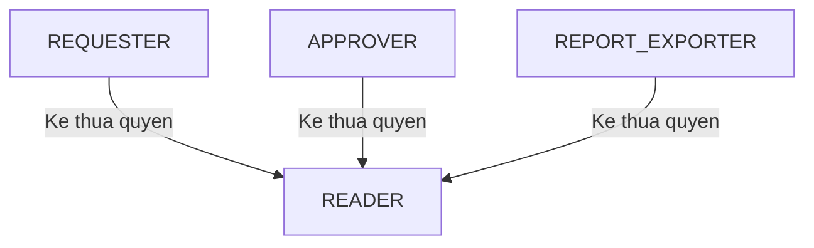

# RBAC: Phân quyền dựa trên vai trò

## 1. Mục tiêu và phạm vi

**RBAC (Role-Based Access Control)** là mô hình kiểm soát truy cập trong đó quyền được gắn với vai trò, còn chủ thể được gán các vai trò phù hợp. Thay vì cấp từng quyền riêng lẻ cho từng người, tổ chức mô tả những nhóm trách nhiệm có ý nghĩa và quản lý việc ai được đảm nhiệm các trách nhiệm đó.

Trong chương **Yêu cầu authorization**, học RBAC cần đi xa hơn việc tạo bảng người dùng và bảng vai trò. Mục tiêu là đặc tả được:

- Vai trò nào được làm những hành động nào.
- Quyền có hiệu lực trên tenant, tài nguyên và thời gian nào.
- Ai được cấp, sửa, thu hồi vai trò và theo quy trình nào.
- Các ràng buộc nào phải tiếp tục đúng khi một người có nhiều vai trò.
- Hệ thống thực thi quyết định ở đâu và hành xử thế nào khi không xác định được quyền.
- Cách kiểm chứng rằng quyền thực tế phù hợp với yêu cầu và rủi ro.

Bài học liên kết RBAC với mục tiêu của đặc tả yêu cầu bảo mật: chuyển rủi ro thành hành vi bắt buộc, có phạm vi rõ, đo được và có bằng chứng xác minh. Các giá trị thời gian và dữ liệu nghiệp vụ trong ví dụ đều là giả định minh họa, không phải ngưỡng áp dụng chung.

## 2. Phân biệt xác thực, vai trò và quyết định phân quyền

**Xác thực** xác định chủ thể đang tương tác và bằng chứng về danh tính. **Phân quyền** quyết định chủ thể đó có được thực hiện một hành động trên một tài nguyên cụ thể trong ngữ cảnh hiện tại hay không.

Một token hợp lệ hoặc một phiên đăng nhập còn hạn không đồng nghĩa người dùng được phép gọi mọi chức năng.

Ví dụ:

```text
Chủ thể: nhân viên U
Vai trò: người đề nghị mua hàng
Hành động: purchase_request.submit
Tài nguyên: phiếu mua hàng P
Ngữ cảnh: tenant A, phiên hiện tại, trạng thái phiếu
```

Để cho phép hành động, hệ thống có thể phải xác nhận đồng thời:

1. U đã được xác thực và tài khoản còn được phép hoạt động.
2. Vai trò của U có quyền gửi phiếu.
3. Vai trò đó có hiệu lực trong tenant A.
4. P thực sự thuộc tenant A.
5. U thỏa điều kiện nghiệp vụ liên quan đến P.
6. Không có ràng buộc an toàn nào bị vi phạm.

Tên vai trò chỉ trả lời một phần của bài toán. Những điều kiện như “chỉ sửa phiếu do mình tạo” hoặc “không được duyệt phiếu của chính mình” cần được mô tả riêng, vì chúng phụ thuộc vào thuộc tính hoặc quan hệ của tài nguyên.

### 2.1. Các khái niệm nền tảng

| Khái niệm | Ý nghĩa | Ví dụ |
|---|---|---|
| Chủ thể | Người dùng hoặc danh tính dịch vụ thực hiện hành động | Nhân viên, worker xử lý báo cáo |
| Vai trò | Nhóm trách nhiệm được đặt tên | Người đề nghị, người phê duyệt |
| Hành động | Thao tác nghiệp vụ cần kiểm soát | Tạo, gửi, duyệt, xuất dữ liệu |
| Tài nguyên | Đối tượng bị đọc hoặc thay đổi | Phiếu mua hàng, báo cáo, cấu hình |
| Quyền | Cho phép một hành động trên một loại hoặc tập tài nguyên theo đặc tả | `purchase_request.approve` |
| Gán vai trò | Liên kết chủ thể với vai trò và phạm vi có hiệu lực | U là người phê duyệt trong tenant A |
| Phiên | Ngữ cảnh tương tác của chủ thể | Phiên web, phiên công cụ quản trị |
| Ràng buộc | Điều kiện giới hạn việc gán, kích hoạt hoặc sử dụng quyền | Không được tự duyệt phiếu đã tạo |

Tên quyền nên gắn với hành động nghiệp vụ, có ý nghĩa ổn định. Những tên như `button_17_visible` hoặc `page_3_access` khó mô tả đầy đủ các thao tác thực tế, đặc biệt khi cùng chức năng xuất hiện qua API hoặc tác vụ nền.

## 3. Mô hình RBAC cơ bản

Ký hiệu đơn giản:

- `U`: tập chủ thể.
- `R`: tập vai trò.
- `P`: tập quyền.
- `UA`: quan hệ gán chủ thể vào vai trò.
- `PA`: quan hệ gán quyền cho vai trò.
- `S`: tập phiên, nếu hệ thống hỗ trợ ngữ nghĩa kích hoạt vai trò theo phiên.

Trong mô hình cơ bản không có phân cấp, quyền đến từ những vai trò đang có hiệu lực đối với chủ thể. Một số hệ thống dùng ngay tất cả vai trò đã gán; hệ thống khác cho phép chủ thể chỉ kích hoạt một tập con trong phiên. Đặc tả phải chọn rõ cách hiểu.

```text
Chủ thể
    → Vai trò được gán và còn hiệu lực
    → Vai trò được kích hoạt, nếu có
    → Quyền của các vai trò
    → Kiểm tra phạm vi và ràng buộc
    → Quyết định cho phép hoặc từ chối
```

Với lựa chọn mặc định là hợp các quyền cho phép:

```text
QuyenUngVien(chuThe, phien)
    = Hop quyen cua cac vai tro hop le trong phien
```

Quyền ứng viên chưa đủ để thực hiện hành động. Quyết định cuối vẫn cần kiểm tra tenant, tài nguyên, thời hạn và các ràng buộc áp dụng.

### 3.1. Không suy ra mức quyền từ tên hoặc thứ tự

Một danh sách vai trò `USER`, `MANAGER`, `ADMIN` không tự tạo ra ngữ nghĩa:

```text
ADMIN > MANAGER > USER
```

Cần đặc tả chính xác quan hệ kế thừa nếu có. “Cấp cao hơn trong sơ đồ tổ chức” cũng không tự đồng nghĩa “được đọc mọi dữ liệu của cấp dưới”.

Ví dụ, người quản trị thành viên có thể được cấp quyền quản lý membership nhưng không được đọc dữ liệu lương. Tách trách nhiệm này giúp hạn chế tác động khi tài khoản quản trị bị lạm dụng.

### 3.2. Quyền cấp trực tiếp và ngoại lệ

Một hệ thống có thể hỗ trợ cả RBAC lẫn cấp quyền trực tiếp cho người dùng. Tuy nhiên, nếu yêu cầu là quản lý truy cập thông qua vai trò, các quyền cấp trực tiếp phải được cấm hoặc quản lý như ngoại lệ có phạm vi, chủ sở hữu và thời hạn.

Nếu bỏ qua lớp cấp trực tiếp trong review, ma trận vai trò có thể trông đúng trong khi người dùng thực tế vẫn có quyền vượt ngoài ma trận.

## 4. Thiết kế danh mục vai trò và quyền

### 4.1. Bắt đầu từ hành động và rủi ro nghiệp vụ

Quy trình thiết kế có thể đi theo thứ tự:

1. Liệt kê tài sản và thao tác cần kiểm soát.
2. Phân biệt quyền đọc, tạo, sửa, chuyển trạng thái, xuất dữ liệu và quản trị.
3. Xác định trách nhiệm nào cần thực hiện từng thao tác.
4. Nhóm quyền thành vai trò có ý nghĩa.
5. Kiểm tra quyền tối thiểu và những tổ hợp trách nhiệm nguy hiểm.
6. Xác định phạm vi và quy trình gán từng vai trò.
7. Viết tiêu chí chấp nhận và ma trận kiểm thử.

Ví dụ, quyền xem một phiếu không tự bao gồm tải mọi tệp đính kèm hoặc xuất toàn bộ danh sách phiếu. Những hành động có tác động khác nhau cần được đánh giá riêng.

### 4.2. Ví dụ danh mục quyền

| Mã quyền | Ý nghĩa |
|---|---|
| `purchase_request.read` | Đọc phiếu trong phạm vi được cấp |
| `purchase_request.create` | Tạo phiếu |
| `purchase_request.edit_draft` | Sửa phiếu ở trạng thái nháp theo điều kiện |
| `purchase_request.submit` | Gửi phiếu vào quy trình phê duyệt |
| `purchase_request.approve` | Phê duyệt phiếu theo ràng buộc nghiệp vụ |
| `purchase_request.export` | Xuất tập phiếu trong phạm vi được cấp |
| `membership.manage` | Thực hiện các thao tác thành viên được phép |
| `role_binding.propose` | Đề nghị gán hoặc thu hồi vai trò |
| `role_binding.review` | Xem xét đề nghị thay đổi vai trò |

Các mã trên mô tả hành động. Phạm vi dữ liệu và điều kiện của từng hành động phải được định nghĩa thêm. Không nên ngầm hiểu rằng có `read` đồng nghĩa được đọc toàn bộ tenant.

### 4.3. Ma trận vai trò và quyền

| Vai trò | Đọc | Tạo/sửa nháp/gửi | Phê duyệt | Xuất | Quản lý thành viên | Đề nghị đổi vai trò | Xem xét đổi vai trò |
|---|---:|---:|---:|---:|---:|---:|---:|
| READER | Có | Không | Không | Không | Không | Không | Không |
| REQUESTER | Có | Có, theo điều kiện | Không | Không | Không | Không | Không |
| APPROVER | Có | Không | Có, theo điều kiện | Không | Không | Không | Không |
| REPORT_EXPORTER | Có | Không | Không | Có, theo điều kiện | Không | Không | Không |
| ACCESS_ADMIN | Không | Không | Không | Không | Có, trong phạm vi | Có | Không |
| ACCESS_REVIEWER | Không | Không | Không | Không | Không | Không | Có |

Ma trận là ví dụ thiết kế, chưa phải chính sách đầy đủ. Ví dụ, REQUESTER chỉ được sửa nháp thuộc quyền của mình; APPROVER chỉ duyệt được phiếu phù hợp với tenant và điều kiện nghiệp vụ.

Việc ghi rõ “không” giúp phát hiện giả định vô thức rằng quản trị truy cập luôn có mọi quyền nghiệp vụ. Nếu quản trị cần đọc dữ liệu để hỗ trợ, phải có quyền riêng và quy trình phù hợp.

## 5. Phạm vi quyền: tenant, tài nguyên và thời gian

### 5.1. Một gán vai trò phải có ngữ cảnh

Một mô hình gán vai trò có thể gồm:

```text
RoleBinding
  subjectId
  roleId
  tenantId
  scopeType
  scopeId
  validFrom
  expiresAt
  state
  approvedBy
  version
```

Các trường chỉ là mô hình minh họa. Không phải dự án nào cũng cần tất cả, nhưng những chiều phạm vi có ảnh hưởng đến quyết định phải được biểu diễn và kiểm tra rõ ràng.

**RBAC-SCOPE-01 — Gán vai trò có phạm vi**

> Vai trò cấp trong một tenant chỉ được tạo quyền trong tenant đó. Hệ thống phải xác nhận tenant của tài nguyên từ nguồn đáng tin cậy và đối chiếu với gán vai trò đang có hiệu lực, không chỉ dựa vào `tenantId` do người gọi truyền vào.

Người dùng có thể chọn tenant trong giao diện, nhưng lựa chọn đó là đầu vào cần xác minh. Nó không tự chứng minh người dùng có membership hoặc quyền trong tenant đã chọn.

### 5.2. Quyền trên chức năng và quyền trên đối tượng

Hai câu hỏi khác nhau:

- Chủ thể có quyền gọi chức năng phê duyệt không?
- Chủ thể có quyền phê duyệt chính phiếu này không?

**RBAC-OBJECT-01 — Kiểm tra trên tài nguyên cụ thể**

> Với mỗi thao tác trên đối tượng, hệ thống phải kiểm tra đồng thời quyền hành động và phạm vi đối tượng. Biết mã đối tượng hoặc gửi được URL không được coi là bằng chứng được truy cập.

Đối với danh sách, tìm kiếm, tổng hợp, tệp đính kèm và xuất dữ liệu, phạm vi cũng phải được áp dụng. Không chỉ bảo vệ API lấy chi tiết trong khi API danh sách vẫn trả dữ liệu ngoài phạm vi.

### 5.3. Tránh bùng nổ vai trò

Nếu tạo các vai trò như `APPROVER_TENANT_A_DEPT_1_LIMIT_10M` rồi lặp lại theo mọi tổ hợp, danh mục có thể phát triển rất nhanh và khó review.

Một lựa chọn dễ quản lý hơn là giữ vai trò có ý nghĩa ổn định, gắn nó với phạm vi rõ và dùng ràng buộc thuộc tính khi cần. Khi quyết định phụ thuộc vào phòng ban, giá trị giao dịch hoặc quan hệ sở hữu, mô hình thực tế đang kết hợp RBAC với các điều kiện khác.

Cần nói đúng điều đó trong thiết kế. Không thể chứng minh mọi kiểm soát đối tượng chỉ bằng việc đã có một cột `role`.

## 6. Phân cấp và kế thừa vai trò

Phân cấp vai trò cho phép một vai trò có các quyền được kế thừa từ vai trò khác. Ví dụ:



Trong ví dụ, REQUESTER kế thừa quyền đọc từ READER; APPROVER cũng kế thừa READER. REQUESTER và APPROVER không tự kế thừa lẫn nhau.

**RBAC-HIERARCHY-01 — Quan hệ kế thừa rõ và không có chu trình**

> Hệ thống phải xác định chiều kế thừa, tính quyền hiệu lực theo toàn bộ quan hệ kế thừa và từ chối thay đổi tạo chu trình. Kiểm tra quyền tối thiểu và xung đột phải xét quyền hiệu lực, không chỉ các quyền được gán trực tiếp.

Các trường hợp cần xem xét:

- Một vai trò cha được thêm quyền, làm tất cả vai trò kế thừa nhận thêm quyền.
- Một vai trò tổng hợp gián tiếp nhận cả hai nhóm quyền đang bị phân tách.
- Vai trò có phạm vi tenant nhưng kế thừa một quyền không được ràng buộc tenant.
- Một thay đổi tên hoặc mã vai trò làm hệ thống thực thi khác với tài liệu.

Vì thay đổi một nút có thể ảnh hưởng nhiều chủ thể, sửa quan hệ kế thừa là thay đổi chính sách bảo mật. Cần xác định tập người và quyền bị tác động trước khi áp dụng.

Không nên tạo vai trò “cao nhất” có mọi quyền chỉ để đơn giản hóa phân cấp. Nếu thực sự cần quyền khẩn cấp hoặc quyền quản trị nền tảng, phải nêu rõ phạm vi và các ràng buộc riêng.

## 7. Phân tách nhiệm vụ và giới hạn quyền tổng hợp

### 7.1. Phân tách tĩnh

**Static Separation of Duty (SSD)** giới hạn việc cùng một chủ thể được gán những vai trò xung đột.

Ví dụ, ACCESS_ADMIN được đề nghị thay đổi vai trò, còn ACCESS_REVIEWER xem xét các đề nghị đó. Thiết kế có thể cấm một người đồng thời giữ cả hai vai trò trong cùng tenant.

**RBAC-SSD-01 — Ngăn tổ hợp vai trò xung đột**

> Hệ thống phải từ chối việc gán làm một chủ thể đồng thời có các vai trò xung đột trong cùng phạm vi được định nghĩa. Kiểm tra phải bao phủ gán trực tiếp, vai trò kế thừa, nhóm danh tính và các đường cấp quyền được hỗ trợ.

Nếu ràng buộc áp dụng theo tenant, người là ACCESS_ADMIN ở tenant A không nhất thiết bị cấm làm ACCESS_REVIEWER ở tenant B. Phạm vi này phải được quyết định theo mô hình rủi ro, không suy ra từ tên ràng buộc.

### 7.2. Phân tách động theo phiên

**Dynamic Separation of Duty (DSD)** giới hạn những vai trò được kích hoạt đồng thời trong một phiên.

Ví dụ, một người được gán cả vai trò vận hành và vai trò kiểm tra, nhưng chỉ được kích hoạt một trong hai trong cùng phiên.

**RBAC-DSD-01 — Kích hoạt vai trò có kiểm soát**

> Nếu hỗ trợ kích hoạt vai trò theo phiên, hệ thống phải xác nhận vai trò được kích hoạt thuộc tập vai trò đã gán và còn hiệu lực, đồng thời từ chối tổ hợp kích hoạt vi phạm ràng buộc động.

Không phải hệ thống nào cũng cần cơ chế kích hoạt vai trò. Nếu không có, đừng dùng thuật ngữ “đổi vai trò trên giao diện” như thể nó đã giảm quyền phía máy chủ. Hệ thống phải thực sự ràng buộc quyền hiệu lực của phiên hoặc yêu cầu.

### 7.3. Không tự duyệt là ràng buộc theo đối tượng và lịch sử

Quy tắc:

> Người tạo phiếu không được phê duyệt chính phiếu đó.

không được bảo đảm chỉ bằng việc cấm kích hoạt REQUESTER và APPROVER cùng lúc. Một người vẫn có thể tạo phiếu ở phiên thứ nhất rồi chuyển sang phiên thứ hai để phê duyệt.

**RBAC-SOD-OBJECT-01 — Không tự phê duyệt**

> Khi phê duyệt phiếu, hệ thống phải so sánh danh tính người phê duyệt với người tạo được ghi nhận trên tài nguyên. Nếu cùng một chủ thể, thao tác phải bị từ chối bất kể vai trò hiện tại, phiên sử dụng hoặc thời điểm tạo phiếu.

Trong ví dụ, người dùng có thể giữ cả REQUESTER và APPROVER để làm các công việc khác nhau, nhưng không được tự duyệt. Đây là một ràng buộc nghiệp vụ kết hợp với RBAC, khác với DSD thuần túy theo phiên.

Nếu hệ thống có nhiều tài khoản cho cùng một con người, cần quyết định định danh nào được dùng cho phân tách nhiệm vụ. So sánh hai mã tài khoản không đủ nếu chính sách thực sự yêu cầu hai người độc lập. Phần này có thể cần liên kết danh tính và quy trình tổ chức bên ngoài mô hình RBAC cơ bản.

### 7.4. Kiểm tra cả trạng thái sau thay đổi

Hai yêu cầu gán vai trò đồng thời có thể vượt qua kiểm tra nếu mỗi yêu cầu đều chỉ nhìn trạng thái cũ.

**RBAC-CONSTRAINT-ATOMIC-01 — Ràng buộc không bị vượt qua bởi cạnh tranh**

> Việc xác nhận và ghi nhận thay đổi gán vai trò phải bảo đảm trạng thái sau khi hoàn tất vẫn thỏa ràng buộc. Các yêu cầu đồng thời không được cùng tạo ra tổ hợp bị cấm chỉ vì từng yêu cầu được kiểm tra riêng.

Cơ chế thực hiện có thể là giao dịch, kiểm soát phiên bản hoặc cách bảo đảm tương đương. Tiêu chí quan trọng là thuộc tính cuối cùng được giữ, không phải tên một công nghệ.

## 8. Quy tắc quyết định: hợp quyền, mặc định từ chối và lỗi

### 8.1. Quyền từ nhiều vai trò

Trong lựa chọn phổ biến, các quyền cho phép của những vai trò hợp lệ được hợp lại. Nhưng ràng buộc phải tiếp tục áp dụng sau khi hợp quyền.

```text
ChoPhep
  = CoQuyenUngVien
    AND GanVaiTroConHieuLuc
    AND DungPhamViTenantVaTaiNguyen
    AND ThoaTrangThaiNghiepVu
    AND KhongViPhamRangBuoc
```

Nếu thiếu điều kiện bắt buộc, kết quả là từ chối.

**RBAC-DEFAULT-01 — Mặc định từ chối**

> Một hành động không có quyền cho phép phù hợp hoặc không xác nhận được điều kiện bắt buộc phải bị từ chối. Vai trò, quyền hoặc hành động không được nhận diện không được tự ánh xạ sang quyền rộng hơn.

Không nên dùng điều kiện như “nếu không phải người dùng thường thì là quản trị viên”. Vai trò mới, dữ liệu lỗi hoặc chuỗi không hợp lệ có thể đi vào nhánh quyền cao ngoài dự kiến.

### 8.2. Quy tắc từ chối tường minh không tự có sẵn

RBAC không tự quy định một cơ chế `deny` chung cho mọi ứng dụng. Nếu hệ thống thêm quyền từ chối hoặc ngoại lệ, phải định nghĩa cách kết hợp:

- Từ chối có ưu tiên hơn cho phép không?
- Ngoại lệ áp dụng theo người, vai trò hay tài nguyên?
- Kế thừa có mang theo từ chối không?
- Nhiều chính sách cùng áp dụng thì kết quả nào thắng?

Trong ví dụ của bài, các quyền cho phép được hợp lại, còn vi phạm bất kỳ ràng buộc bắt buộc nào dẫn đến từ chối. Không có đường “vai trò khác cho phép nên bỏ qua không tự duyệt”.

### 8.3. Lỗi không được biến thành quyền

**RBAC-ERROR-01 — Hành vi lỗi xác định**

> Với thao tác được bảo vệ, nếu không lấy được chính sách, thuộc tính tài nguyên hoặc trạng thái gán vai trò bắt buộc, hệ thống phải trả kết quả lỗi hoặc từ chối theo hợp đồng đã định và không thực hiện tác dụng phụ được bảo vệ.

Điều này không đồng nghĩa dừng toàn bộ hệ thống. Chức năng công khai có thể tiếp tục theo thiết kế riêng; thao tác yêu cầu bằng chứng quyền thì không được suy đoán cho phép.

Nếu cho phép dùng bản chính sách cache khi nguồn chính lỗi, phải đặc tả tuổi tối đa, phạm vi thao tác và giới hạn thu hồi. “Cache vẫn có dữ liệu” chưa đủ chứng minh quyền hiện tại còn hợp lệ.

## 9. Vòng đời vai trò và gán vai trò

### 9.1. Cấp, thay đổi và thu hồi

Một đặc tả cần trả lời:

- Ai có thể đề nghị cấp vai trò?
- Ai phê duyệt và ai là đối tượng được nhận?
- Cần lý do, thời hạn hoặc bằng chứng nào?
- Phê duyệt áp dụng cho phiên bản chính sách và phạm vi nào?
- Vai trò có tự hết hạn không?
- Khi rời tenant, nghỉ việc hoặc đổi trách nhiệm, những gán nào phải thu hồi?
- Việc thu hồi có hiệu lực với phiên, token và tác vụ nền ra sao?

**RBAC-LIFECYCLE-01 — Mọi đường thay đổi đều thực thi chính sách**

> Giao diện quản trị, API, nhập hàng loạt, đồng bộ nhóm, công cụ vận hành và tác vụ tự động phải tuân thủ cùng ràng buộc cấp quyền có liên quan. Đường đồng bộ không được bỏ qua kiểm tra xung đột hoặc phạm vi chỉ vì không có tương tác người dùng.

Nguồn nhóm bên ngoài có thể là đầu vào có thẩm quyền, nhưng phải xác định cách ánh xạ, người kiểm soát nguồn và cách xử lý khi dữ liệu nguồn sai hoặc không đồng bộ.

### 9.2. Quyền cấp vai trò khác với quyền sử dụng vai trò

Một người có thể được phép quản lý việc cấp APPROVER mà bản thân không được phê duyệt phiếu. Ngược lại, người được phê duyệt phiếu không nhất thiết được cấp vai trò đó cho người khác.

**RBAC-DELEGATION-01 — Phạm vi quản trị được đặc tả riêng**

> Chủ thể quản trị chỉ được đề nghị hoặc thực hiện các thay đổi nằm trong tập vai trò, đối tượng nhận, tenant, phạm vi và thời hạn được ủy quyền. Quyền quản trị gán vai trò phải được đánh giá riêng với quyền nghiệp vụ của vai trò được cấp.

Không nên chỉ dùng quy tắc “người cấp phải có mọi quyền mình cấp” vì mô hình quản trị có thể cố ý tách hai trách nhiệm. Cần một chính sách ủy quyền rõ ràng.

**RBAC-SELF-GRANT-01 — Ngăn tự nâng quyền ngoài quy trình**

> Người đề nghị không được tự phê duyệt thay đổi làm tăng quyền cho chính mình. Nếu quy trình yêu cầu hai người độc lập, hệ thống phải kiểm tra người đề nghị, người nhận và người phê duyệt theo định danh và phạm vi đã chọn.

Quy tắc hai người không tự loại bỏ thông đồng. Review rủi ro cần xem thêm việc tạo tài khoản phụ, sửa nhóm đồng bộ hoặc thay định nghĩa vai trò.

### 9.3. Sửa vai trò cũng là cấp quyền gián tiếp

Một người không được gán vai trò cao nhưng được sửa quyền của vai trò mình đang giữ vẫn có thể tự tăng đặc quyền.

**RBAC-ROLE-CHANGE-01 — Kiểm soát quyền hiệu lực sau sửa**

> Trước khi thay quyền hoặc quan hệ kế thừa của một vai trò, hệ thống phải xác định quyền hiệu lực và ràng buộc bị tác động. Thay đổi làm tăng đặc quyền phải tuân thủ quy trình quản trị tương ứng, có phiên bản và audit.

Nếu có đề nghị đang chờ phê duyệt, cần nêu rõ nó tham chiếu phiên bản nào. Không được phê duyệt một vai trò có nội dung A rồi âm thầm cấp phiên bản B với quyền rộng hơn.

### 9.4. Vai trò tạm thời và truy cập khẩn cấp

Vai trò tạm thời nên có thời điểm bắt đầu, hết hạn, mục đích và chủ sở hữu. Hết hạn phải có hiệu lực ở quyết định phân quyền, không chỉ làm đổi nhãn trên giao diện.

Nếu cần quyền khẩn cấp, đặc tả riêng:

- Điều kiện kích hoạt và danh tính được phép sử dụng.
- Xác thực bổ sung hoặc phê duyệt phù hợp.
- Phạm vi quyền và thời hạn tối đa.
- Audit, cảnh báo và review sau sử dụng.
- Cách thu hồi và xử lý khi phụ thuộc quản trị bị lỗi.

Truy cập khẩn cấp không được tồn tại dưới dạng đường quản trị bí mật mà các lớp thực thi và audit không biết đến.

## 10. Điểm thực thi trong kiến trúc

Có thể phân biệt ba trách nhiệm:

| Trách nhiệm | Nội dung |
|---|---|
| Quản lý chính sách | Định nghĩa vai trò, quyền, phân cấp, ràng buộc và phê duyệt thay đổi |
| Ra quyết định | Đánh giá chủ thể, hành động, tài nguyên và ngữ cảnh theo chính sách |
| Thực thi | Chặn hoặc cho phép hành động tại nơi tài nguyên được sử dụng |

Các trách nhiệm có thể nằm chung hoặc tách dịch vụ. Thiết kế cần chỉ rõ điểm nào chịu trách nhiệm cuối cho từng đường truy cập.

### 10.1. Bảo vệ ở phía máy chủ

**RBAC-ENFORCEMENT-01 — Bao phủ mọi đường truy cập**

> API, worker, tác vụ theo lịch, luồng xuất dữ liệu và công cụ quản trị phải kiểm tra quyền tại điểm phù hợp trước thao tác được bảo vệ. Việc ẩn nút hoặc chặn điều hướng ở phía client không được coi là biện pháp thực thi phân quyền.

Nếu gateway chỉ kiểm tra quyền chức năng, dịch vụ sở hữu tài nguyên vẫn cần xác nhận phạm vi đối tượng. Không thể kiểm tra tenant của một phiếu chỉ bằng một tên route nếu chưa có dữ liệu đáng tin cậy về phiếu đó.

### 10.2. Token và cache quyền

**RBAC-REVOKE-01 — Giới hạn độ trễ thu hồi**

> Việc thu hồi gán vai trò phải làm mất quyền tương ứng trên các đường được bảo vệ trong thời gian tối đa đã thỏa thuận, kể cả khi phiên, token hoặc cache được tạo trước thời điểm thu hồi.

Ví dụ dự án có thể chọn giới hạn 60 giây từ lúc giao dịch thu hồi được ghi nhận thành công. Khi đó cần kiểm tra mọi instance, cache, token và worker liên quan theo cùng mốc thời gian.

Một token có chữ ký hợp lệ chỉ chứng minh các claim được phát hành và chưa bị sửa theo cơ chế xác minh. Nếu token chứa vai trò cũ, cần có thiết kế phù hợp như thời hạn ngắn, kiểm tra phiên bản hoặc cơ chế thu hồi để đáp ứng mục tiêu.

**RBAC-CACHE-01 — Cache giữ đúng phạm vi**

> Khóa và thời hạn cache quyết định phải bao gồm các yếu tố có thể làm thay đổi kết quả, như chủ thể, tenant, hành động, tài nguyên hoặc thuộc tính liên quan và phiên bản chính sách. Cơ chế vô hiệu hóa phải đáp ứng yêu cầu thu hồi.

Không phải mọi hệ thống đều cache từng đối tượng. Tuy nhiên, nếu quyết định phụ thuộc vào người tạo hoặc trạng thái phiếu, không được dùng lại một quyết định tổng quát đã bỏ qua những yếu tố đó.

### 10.3. Tác vụ bất đồng bộ và danh tính dịch vụ

Worker có danh tính riêng để truy cập hạ tầng, đồng thời có thể thực hiện tác vụ thay cho một người. Phải phân biệt quyền kỹ thuật của worker với quyền nghiệp vụ của người yêu cầu.

**RBAC-ASYNC-01 — Ngữ cảnh ủy quyền không bị mất**

> Thông điệp tác vụ phải mang hoặc tham chiếu tới ngữ cảnh ủy quyền có thể xác minh. Worker phải áp dụng chính sách về thời điểm kiểm tra quyền đã được đặc tả, và không được dùng quyền hạ tầng rộng của mình để bỏ qua phạm vi nghiệp vụ.

Nhóm cần quyết định tác vụ dùng quyền hiện hành lúc thực hiện hay một ủy quyền đã chấp thuận từ trước có phạm vi và thời hạn riêng. Không nên mặc định hai cách là tương đương.

### 10.4. Khoảng cách giữa kiểm tra và sử dụng

Phiếu có thể thay đổi trạng thái hoặc số tiền sau khi đã kiểm tra quyền nhưng trước lúc ghi nhận phê duyệt.

**RBAC-CONSISTENCY-01 — Quyết định gắn với trạng thái được sử dụng**

> Nếu điều kiện phân quyền phụ thuộc vào trạng thái tài nguyên, thao tác phải bảo đảm điều kiện vẫn đúng tại thời điểm chuyển trạng thái được ghi nhận. Khi phát hiện phiên bản tài nguyên thay đổi, hệ thống phải đánh giá lại hoặc từ chối theo hợp đồng.

Giao dịch hoặc kiểm soát phiên bản có thể hỗ trợ yêu cầu này. Chỉ thực hiện kiểm tra ở một bước đầu không liên kết với lần ghi cuối có thể để lộ khoảng trống kiểm tra rồi sử dụng.

## 11. Ví dụ xuyên suốt: hệ thống đề nghị mua hàng nhiều tenant

### 11.1. Bối cảnh

Hệ thống phục vụ tenant A và tenant B. Mỗi phiếu có:

```text
PurchaseRequest
  id
  tenantId
  departmentId
  createdBy
  status
  version
```

Danh tính người tạo được ghi từ ngữ cảnh đã xác thực, không lấy nguyên giá trị `createdBy` do client cung cấp.

Giả định nghiệp vụ của ví dụ:

- Vai trò nghiệp vụ có phạm vi phòng ban trong một tenant.
- Quyền đọc kế thừa chỉ áp dụng trong phạm vi của gán vai trò tương ứng.
- REQUESTER được tạo, sửa nháp của mình và gửi phiếu trong phạm vi được cấp.
- APPROVER được duyệt phiếu đã gửi trong phạm vi được cấp, nhưng không được duyệt phiếu do chính mình tạo.
- Một người có thể giữ REQUESTER và APPROVER để xử lý các phiếu khác nhau.
- ACCESS_ADMIN và ACCESS_REVIEWER xung đột trong cùng tenant.
- Quản trị thành viên không tự tạo quyền đọc hoặc phê duyệt phiếu.
- Vai trò nghiệp vụ của tenant A không tạo quyền trên tenant B.

Những giả định này là quyết định thiết kế của ví dụ. Với nghiệp vụ khác, phạm vi đọc hoặc điều kiện phê duyệt có thể khác và cần được đặc tả lại.

### 11.2. Mẫu yêu cầu đầy đủ

**Mã:** RBAC-APPROVAL-01  
**Nguồn rủi ro:** R-01 — Người không có thẩm quyền hoặc người tạo tự phê duyệt phiếu.  
**Điểm thực thi:** Dịch vụ chuyển trạng thái phiếu, trên mọi đường gọi trực tiếp hoặc gián tiếp.

**Phát biểu bắt buộc:**

> Dịch vụ chỉ được chuyển một phiếu từ SUBMITTED sang APPROVED khi người gọi có quyền hiệu lực `purchase_request.approve` trên đúng tenant và phòng ban của phiếu, gán vai trò còn hiệu lực, người gọi khác người tạo phiếu và phiên bản phiếu dùng để đánh giá vẫn là phiên bản được chuyển trạng thái. Nếu bất kỳ điều kiện nào không được xác nhận, dịch vụ không được ghi nhận phê duyệt.

**Tiêu chí chấp nhận:**

1. APPROVER hợp lệ duyệt được phiếu của người khác trong đúng phạm vi.
2. REQUESTER không có quyền phê duyệt bị từ chối.
3. Người có cả REQUESTER và APPROVER vẫn không tự duyệt phiếu mình.
4. Dùng phiên khác hoặc đăng nhập lại không làm mất ràng buộc không tự duyệt.
5. Thay mã phiếu sang tenant hoặc phòng ban ngoài phạm vi không tạo được phê duyệt.
6. Phiếu không ở trạng thái SUBMITTED không được duyệt qua thao tác này.
7. Thay đổi phiên bản phiếu trong lúc xử lý dẫn đến đánh giá lại hoặc từ chối đã định.
8. Lỗi lấy chính sách hoặc dữ liệu bắt buộc không tạo tác dụng phụ phê duyệt.
9. Có sự kiện phù hợp cho lần phê duyệt và các lần từ chối nhạy cảm; không ghi bí mật phiên.

**Bằng chứng:** kiểm thử tích hợp các điều kiện trên, kiểm tra điểm thực thi quyền, kết quả kiểm thử đồng thời và đối chiếu trạng thái dữ liệu sau thao tác.

### 11.3. Luồng xử lý minh họa

```text
1. Xác thực chủ thể và ngữ cảnh phiên.
2. Xác nhận ngữ cảnh tenant được chọn.
3. Lấy phiếu cùng phiên bản từ nguồn dữ liệu đáng tin cậy.
4. Xác định các gán vai trò đang có hiệu lực trong phạm vi liên quan.
5. Tính quyền hiệu lực và kiểm tra purchase_request.approve.
6. Đối chiếu tenant, phòng ban, người tạo và trạng thái phiếu.
7. Ghi chuyển trạng thái theo cơ chế bảo đảm nhất quán.
8. Ghi nhận sự kiện và trả kết quả theo hợp đồng.
```

Đây là thứ tự logic, không phải yêu cầu phải có đúng tám lời gọi tách biệt. Một triển khai có thể kết hợp nhiều bước trong giao dịch hoặc truy vấn, miễn vẫn giữ các thuộc tính được yêu cầu.

Nếu dữ liệu bị từ chối, phản hồi công khai cần tuân thủ chính sách tiết lộ thông tin của ứng dụng. Ví dụ, có thể dùng phản hồi không phân biệt đối tượng không tồn tại với đối tượng ngoài phạm vi khi điều đó cần thiết. Chi tiết lý do nội bộ được giữ trong kênh có quyền truy cập phù hợp.

### 11.4. Tình huống nhiều vai trò

Người dùng U có:

```text
REQUESTER: tenant A, phòng ban D1
APPROVER:  tenant A, phòng ban D1
```

U được tạo phiếu P1 ở A/D1. U cũng có thể duyệt phiếu P2 do V tạo ở A/D1. Tuy nhiên:

- U không được duyệt P1 vì vi phạm ràng buộc không tự duyệt.
- U không được duyệt phiếu ở A/D2 vì ngoài phạm vi.
- U không được duyệt phiếu ở B/D1 vì sai tenant.
- U không được sửa nháp của V chỉ vì có quyền phê duyệt.
- Việc kích hoạt một vai trò khác không làm đổi người tạo đã ghi nhận trên P1.

Ví dụ cho thấy quyền tổng hợp phải đi cùng ràng buộc theo hành động. Một vai trò bổ sung không được vô tình làm mất điều kiện bắt buộc.

### 11.5. Gán vai trò có phê duyệt

Quy trình minh họa:

1. ACCESS_ADMIN tạo đề nghị, nêu người nhận, vai trò, phạm vi, thời hạn và phiên bản vai trò.
2. Hệ thống kiểm tra thẩm quyền đề nghị, phạm vi ủy quyền và xung đột có thể phát sinh.
3. ACCESS_REVIEWER độc lập xem xét đề nghị; người xem xét không được là người đề nghị hoặc người hưởng thay đổi tăng quyền.
4. Khi áp dụng, hệ thống kiểm tra lại ràng buộc và phiên bản; không dựa hoàn toàn vào kết quả lúc đề nghị.
5. Gán vai trò được ghi nhận với mốc hiệu lực và audit.
6. Cache hoặc cơ chế phát hành quyền được cập nhật theo mục tiêu độ trễ.

Nếu hai đề nghị riêng rẽ cùng tạo tổ hợp ACCESS_ADMIN và ACCESS_REVIEWER cho một người, bước áp dụng phải giữ được ràng buộc SSD ngay cả khi cả hai được xử lý đồng thời.

### 11.6. Hết hạn và thu hồi

Ví dụ chọn thời gian thu hồi tối đa 60 giây:

> Tính từ khi giao dịch thu hồi thành công, chậm nhất sau 60 giây mọi quyết định mới trên các đường được bảo vệ phải loại bỏ quyền đến từ gán vai trò đã thu hồi.

Đối với tác vụ dài và thao tác đang chạy, cần quy định điểm kiểm tra lại hoặc dừng phù hợp. Ví dụ, tác vụ xuất phải kiểm tra quyền trước truy vấn và trước khi cung cấp file; thao tác phê duyệt phải gắn quyết định với trạng thái được ghi nhận.

Thu hồi quyền không thể lấy lại nội dung mà người dùng đã đọc hoặc tải hợp lệ trước đó. Nếu có yêu cầu kiểm soát dữ liệu sau xuất, phải thiết kế thêm cơ chế và nêu rõ giới hạn thực tế.

## 12. Logging, audit và rà soát quyền

### 12.1. Sự kiện quản trị quyền

**RBAC-AUDIT-01 — Truy vết thay đổi đặc quyền**

> Việc tạo, sửa, xóa vai trò; thay quyền hoặc phân cấp; đề nghị, phê duyệt, cấp, thu hồi và hết hạn gán vai trò phải có sự kiện audit. Sự kiện phải xác định được người thực hiện, đối tượng, phạm vi, thời điểm, kết quả, mã tương quan và phiên bản liên quan.

Đối với thay đổi nhạy cảm, cần đủ thông tin để xác định quyền nào đã thay đổi, người hưởng lợi và cơ sở phê duyệt. Không ghi mật khẩu, token hoặc toàn bộ nội dung dữ liệu nghiệp vụ vào sự kiện.

Một cấu trúc minh họa:

```json
{
  "eventType": "ROLE_BINDING_REVOKED",
  "actorId": "operator-example",
  "subjectId": "user-example",
  "roleId": "APPROVER",
  "tenantId": "tenant-A",
  "scopeType": "DEPARTMENT",
  "scopeId": "D1",
  "bindingVersion": 8,
  "policyVersion": "policy-v4",
  "approvalRef": "review-example",
  "outcome": "SUCCESS",
  "correlationId": "change-example"
}
```

Thời điểm thực tế cần được ghi theo định dạng thống nhất. Quyền đọc và sửa kho audit cần tách phù hợp khỏi quyền quản trị vai trò để người thay quyền không dễ xóa dấu vết của chính mình.

### 12.2. Sự kiện quyết định truy cập

Với hành động nhạy cảm, sự kiện nên cho biết chủ thể, hành động, định danh tài nguyên, tenant, kết quả, mã lý do và phiên bản chính sách. Mức ghi nhận với hành động đọc số lượng lớn cần được lựa chọn theo rủi ro, chi phí và mục tiêu điều tra.

Không cần trả toàn bộ lý do nội bộ cho client. Một thông báo từ chối chung có thể phù hợp, trong khi audit lưu mã như:

```text
NO_APPLICABLE_PERMISSION
TENANT_SCOPE_MISMATCH
ROLE_BINDING_EXPIRED
SELF_APPROVAL_FORBIDDEN
POLICY_UNAVAILABLE
RESOURCE_VERSION_CHANGED
```

Mã lý do phải có ý nghĩa ổn định và không chứa dữ liệu do client chèn tùy ý. Hệ thống cũng cần hành vi xác định nếu không ghi được sự kiện audit bắt buộc, chẳng hạn vùng đệm bền vững có giới hạn hoặc từ chối thao tác nhạy cảm theo chính sách.

### 12.3. Rà soát định kỳ

**RBAC-REVIEW-01 — Xác nhận quyền còn phù hợp**

> Các gán vai trò nhạy cảm phải được rà soát theo chu kỳ hoặc sự kiện được xác định, có chủ sở hữu xác nhận, kết quả và thời hạn xử lý quyền không còn phù hợp.

Rà soát không chỉ hỏi “người này còn trong công ty không?”. Cần xem:

- Người dùng còn thuộc tenant hoặc bộ phận tương ứng không.
- Quyền có còn cần cho nhiệm vụ hiện tại không.
- Vai trò đã thay đổi nội dung kể từ lần xác nhận trước chưa.
- Có gán tạm thời chưa hết hạn đúng cách không.
- Có quyền trực tiếp, nhóm đồng bộ hoặc vai trò kế thừa ngoài dự kiến không.
- Tài khoản dịch vụ có còn được sử dụng và có chủ sở hữu không.

Thời điểm rà soát nên phù hợp với độ nhạy cảm và tốc độ thay đổi trách nhiệm. Một báo cáo liệt kê vai trò mà không ai xác nhận hoặc xử lý chưa đủ chứng minh việc rà soát đã hoàn tất.

## 13. Truy vết từ rủi ro đến bằng chứng

| Rủi ro | Yêu cầu chủ yếu | Điểm thực thi | Bằng chứng cần có |
|---|---|---|---|
| R-01: người tạo tự duyệt phiếu | RBAC-SOD-OBJECT-01, RBAC-APPROVAL-01 | Chuyển trạng thái phiếu | Cùng người, khác phiên vẫn bị từ chối |
| R-02: đọc hoặc duyệt chéo tenant | RBAC-SCOPE-01, RBAC-OBJECT-01 | API, truy vấn, worker, xuất dữ liệu | Thay đối tượng và tenant không trả dữ liệu hoặc tạo tác dụng phụ ngoài phạm vi |
| R-03: quản trị tự tăng quyền | RBAC-DELEGATION-01, RBAC-SELF-GRANT-01 | Đề nghị, phê duyệt, sửa vai trò | Cấp ngoài ủy quyền và tự phê duyệt bị chặn |
| R-04: quyền cũ tiếp tục có hiệu lực | RBAC-REVOKE-01, RBAC-CACHE-01 | Điểm ra quyết định, cache, token | Đo hiệu lực thu hồi qua nhiều instance trong hạn đã chọn |
| R-05: kế thừa làm phát sinh quyền nguy hiểm | RBAC-HIERARCHY-01, RBAC-ROLE-CHANGE-01 | Quản lý định nghĩa vai trò | Kiểm tra quyền hiệu lực và xung đột sau thay đổi |
| R-06: gán đồng thời tạo tổ hợp bị cấm | RBAC-SSD-01, RBAC-CONSTRAINT-ATOMIC-01 | Giao dịch gán vai trò | Trạng thái cuối luôn giữ ràng buộc |
| R-07: đường nền bỏ qua phân quyền | RBAC-ENFORCEMENT-01, RBAC-ASYNC-01 | Worker, lịch chạy, nhập hàng loạt | Tác vụ giữ đúng ngữ cảnh và chính sách thời điểm kiểm tra |
| R-08: lỗi phụ thuộc tạo nhánh cho phép | RBAC-ERROR-01 | Quyết định và thực thi | Thử lỗi không tạo hành động được bảo vệ |
| R-09: thay quyền không có dấu vết | RBAC-AUDIT-01 | Kho sự kiện quản trị | Chuỗi đề nghị, phê duyệt, áp dụng và thu hồi có thể đối chiếu |

Bảng truy vết giúp nhận diện một yêu cầu chưa có nơi thực thi hoặc một rủi ro chưa có cách kiểm chứng. Nó không thay thế nội dung đầy đủ của yêu cầu.

## 14. Thiết kế kiểm chứng cho RBAC

### 14.1. Kiểm thử theo nhiều chiều

Một bộ kiểm thử chỉ có “ADMIN được vào, USER không được vào” thường bỏ sót phần lớn yêu cầu. Cần kết hợp:

```text
Chủ thể
  × Vai trò hiệu lực
  × Tenant và phạm vi
  × Hành động
  × Tài nguyên và trạng thái
  × Thời điểm / phiên bản chính sách
  × Đường truy cập
```

Không nhất thiết thử mọi tổ hợp bằng cùng một loại kiểm thử. Nhóm nên ưu tiên rủi ro, dùng dữ liệu đại diện và ghi rõ trường hợp nào được xác minh ở mức chính sách, tích hợp hoặc vận hành.

### 14.2. Ma trận tình huống trọng yếu

| Tình huống | Kết quả cần quan sát |
|---|---|
| Người có quyền trên tài nguyên đúng phạm vi | Thao tác thành công đúng nghiệp vụ |
| Chủ thể xác thực nhưng không có vai trò phù hợp | Từ chối, không có tác dụng phụ được bảo vệ |
| Vai trò không được nhận diện hoặc dữ liệu gán không hợp lệ | Không ánh xạ sang quyền cao hơn |
| Cùng vai trò nhưng khác tenant | Không được truy cập tài nguyên tenant kia |
| Đúng tenant nhưng khác phòng ban ngoài phạm vi | Từ chối theo phạm vi đã cấp |
| Có cả REQUESTER và APPROVER, duyệt phiếu của mình | Từ chối bất kể dùng cùng hay khác phiên |
| Vai trò kế thừa quyền hợp lệ | Quyền có hiệu lực trong đúng phạm vi kế thừa |
| Thêm quan hệ gây chu trình | Thay đổi bị từ chối, đồ thị cũ vẫn hợp lệ |
| Kế thừa gián tiếp gây xung đột | Không được vượt qua kiểm tra chỉ vì không gán trực tiếp |
| Hai yêu cầu gán vai trò xung đột chạy đồng thời | Trạng thái cuối không vi phạm SSD |
| Gán vai trò hết hạn | Không dùng được quyền từ gán đó |
| Thu hồi khi token và cache vẫn còn dữ liệu cũ | Mất quyền trong thời gian tối đa đã đặc tả |
| Chuyển giữa API, worker và đường xuất | Không có đường bỏ qua phạm vi hoặc quyền |
| Phiếu đổi trạng thái giữa kiểm tra và ghi | Không ghi phê duyệt trên điều kiện cũ không còn đúng |
| Nguồn chính sách hoặc thuộc tính tài nguyên lỗi | Không tạo tác dụng phụ được bảo vệ |
| Người quản trị sửa vai trò đang giữ để thêm quyền | Tuân thủ kiểm soát thay đổi đặc quyền và phê duyệt |
| Người phê duyệt thay đổi vai trò cho chính mình | Bị xử lý theo ràng buộc độc lập đã chọn |
| Thao tác quản trị qua nhập hàng loạt hoặc đồng bộ nhóm | Vẫn giữ phạm vi, xung đột và audit |

Với thao tác bị từ chối, cần kiểm tra trạng thái dữ liệu, thông điệp và file phát sinh. Mã phản hồi lỗi chưa đủ nếu dữ liệu đã thay đổi trước khi phản hồi được tạo.

### 14.3. Một kịch bản chấp nhận

```gherkin
Feature: Khong tu phe duyet phieu mua hang

  Scenario: Nguoi tao doi phien nhung van khong duoc tu duyet
    Given U co vai tro REQUESTER va APPROVER trong tenant A phong ban D1
    And U da tao phieu P trong pham vi A va D1
    And P dang o trang thai SUBMITTED
    When U dang nhap bang mot phien khac
    And U yeu cau phe duyet P
    Then he thong tu choi phe duyet
    And P van o trang thai SUBMITTED
    And khong phat sinh su kien nghiep vu cho biet P da duoc duyet
    And co su kien tu choi voi ly do noi bo phu hop
```

Đây là kịch bản yêu cầu, không phải bằng chứng rằng hệ thống đã được kiểm thử. Khi triển khai, nhóm phải gắn nó với bộ dữ liệu, môi trường, phiên bản và kết quả thực tế.

### 14.4. Đo độ trễ thu hồi

Kế hoạch kiểm chứng mục tiêu 60 giây trong ví dụ:

1. Cấp vai trò thử nghiệm và xác nhận quyền thực sự đang có hiệu lực.
2. Tạo phiên hoặc token trước thời điểm thu hồi trên các đường liên quan.
3. Ghi nhận mốc giao dịch thu hồi thành công.
4. Tiếp tục gửi yêu cầu được bảo vệ qua các instance và thành phần có cache.
5. Đối chiếu thời điểm quyết định cuối cùng còn dùng quyền đã thu hồi.
6. Xác nhận sau giới hạn không còn đường được bảo vệ nào cho phép dựa trên gán đó.
7. Thử thêm trường hợp mất sự kiện vô hiệu hóa cache hoặc nguồn quyền không phản hồi.

Các đồng hồ và mốc đo cần được thống nhất. Nếu chỉ quan sát giao diện quản trị đã bỏ tên vai trò, chưa thể kết luận API và worker đã thu hồi quyền.

### 14.5. Bằng chứng nên lưu

Một hồ sơ xác minh có thể gồm:

- Phiên bản ma trận vai trò, định nghĩa quyền và ràng buộc.
- Phiên bản ứng dụng, chính sách, cấu hình và dữ liệu thử.
- Tình huống được phép và bị từ chối.
- Kết quả dữ liệu trước và sau thao tác.
- Kết quả thử đồng thời, lỗi phụ thuộc và thu hồi.
- Mã sự kiện hoặc tham chiếu audit đã loại bỏ bí mật.
- Giới hạn của môi trường và những trường hợp chưa xác minh.

Sự tồn tại của annotation kiểm tra vai trò hoặc một thư viện phân quyền không thay thế bằng chứng rằng mọi đường truy cập đều áp dụng đúng chính sách.

## 15. Những sai lầm thường gặp

| Sai lầm | Vì sao nguy hiểm? | Cách cải thiện |
|---|---|---|
| Dùng một vai trò ADMIN cho mọi trách nhiệm | Quyền rộng và khó tách nhiệm vụ | Tách quản trị truy cập, dữ liệu và thao tác nghiệp vụ |
| Coi tên chức danh là chính sách hoàn chỉnh | Chức danh không diễn tả hành động và phạm vi | Lập ma trận quyền và điều kiện theo trách nhiệm |
| Chỉ kiểm tra ở giao diện | API hoặc tác vụ nền có thể được gọi trực tiếp | Thực thi phía máy chủ tại điểm dùng tài nguyên |
| Chỉ kiểm tra quyền chức năng | Người có quyền có thể tác động đối tượng ngoài phạm vi | Kiểm tra tenant và đối tượng cụ thể |
| Cấm hai vai trò cùng phiên để ngăn tự duyệt | Người dùng có thể đổi phiên hoặc đổi vai trò | Thêm ràng buộc theo người tạo và tài nguyên |
| Kiểm tra xung đột chỉ trên gán trực tiếp | Kế thừa hoặc nhóm có thể tạo quyền tương đương | Xét quyền và vai trò hiệu lực |
| Cho rằng token có chữ ký luôn chứa quyền hiện hành | Token có thể giữ gán đã thu hồi | Đối chiếu với yêu cầu độ trễ và thiết kế phiên bản, cache, thu hồi |
| Chỉ bảo vệ API gán vai trò | Sửa vai trò hoặc đồng bộ nhóm vẫn có thể nâng quyền | Bao phủ mọi đường thay đổi đặc quyền |
| Tạo một vai trò cho mọi tổ hợp thuộc tính | Danh mục khó quản trị và kiểm thử | Tách vai trò ổn định khỏi phạm vi và ràng buộc |
| Đóng việc sau khi cập nhật ma trận | Ma trận chưa chứng minh triển khai đúng | Đóng theo bằng chứng tại mức cần thiết |

RBAC phù hợp khi trách nhiệm có thể nhóm thành những vai trò tương đối ổn định. Khi quyết định phụ thuộc nhiều vào thuộc tính, quan hệ hoặc trạng thái, cần kết hợp thêm cơ chế phù hợp và chỉ rõ phần trách nhiệm của từng cơ chế. Việc giữ tên RBAC không làm các điều kiện ngoài vai trò tự được thực thi.

## 16. Bài tập vận dụng

Một hệ thống có ba vai trò: EMPLOYEE, MANAGER và ADMIN. MANAGER được kế thừa EMPLOYEE; ADMIN được kế thừa MANAGER. Người có ADMIN được sửa danh sách quyền của mọi vai trò.

Nhóm dự án nêu các yêu cầu nghiệp vụ:

- Nhân viên gửi đề nghị chi phí.
- Quản lý duyệt đề nghị trong bộ phận.
- Người tạo không được tự duyệt.
- Quản trị tài khoản không được tự đọc dữ liệu chi phí.
- Quyền quản lý bị thu hồi phải hết hiệu lực trong một khoảng thời gian xác định.
- Có công cụ nhập hàng loạt vai trò và một worker xuất báo cáo.

Hãy thực hiện:

1. Chỉ ra những giả định chưa được định nghĩa và các quyền có thể bị cấp quá rộng.
2. Đề xuất danh mục vai trò, quyền và phạm vi phù hợp hơn.
3. Phân biệt ràng buộc gán vai trò, kích hoạt theo phiên và không tự duyệt theo đối tượng.
4. Viết một yêu cầu cho thu hồi quyền, bao gồm mốc đo, các thành phần chịu ảnh hưởng và hành vi khi cache lỗi.
5. Viết một yêu cầu ngăn việc sửa định nghĩa vai trò để tự nâng quyền.
6. Lập tối thiểu sáu tình huống kiểm chứng, có API, nhập hàng loạt và worker.
7. Xác định sự kiện audit cần có để giải thích ai đã cấp quyền cho ai và vì sao.

Gợi ý tự đối chiếu:

- ADMIN kế thừa MANAGER có thể vô tình tạo quyền đọc hoặc duyệt dữ liệu nghiệp vụ.
- Cần định nghĩa “trong bộ phận” bằng nguồn thuộc tính và phạm vi đáng tin cậy.
- Cấm kích hoạt hai vai trò cùng phiên không đủ ngăn một người tự duyệt qua hai phiên.
- Quyền sửa vai trò có thể tạo quyền gián tiếp cho nhiều người.
- Tác vụ nền phải có chính sách rõ về danh tính và thời điểm đánh giá quyền.
- Độ trễ thu hồi phải được kiểm chứng ở nơi quyền thực sự được sử dụng.

## 17. Danh sách tự kiểm tra đặc tả RBAC

Trước khi chốt thiết kế, hãy xác nhận:

- Danh mục hành động nghiệp vụ có đủ rõ và không phụ thuộc vào tên nút giao diện.
- Mỗi vai trò có chủ sở hữu, mục đích và tập quyền được xác định.
- Phạm vi tenant, đối tượng và thời gian của gán vai trò được mô tả.
- Quan hệ kế thừa và quyền hiệu lực được tính nhất quán.
- Quy tắc hợp quyền, từ chối và xử lý lỗi không mâu thuẫn.
- Phân tách nhiệm vụ áp dụng đúng cấp: gán, phiên hoặc đối tượng.
- Cấp, sửa, thu hồi và hết hạn được kiểm soát trên mọi đường.
- Quyền quản trị cấp vai trò được tách khỏi quyền sử dụng nghiệp vụ.
- Cache, token và tác vụ nền đáp ứng yêu cầu thu hồi.
- Mỗi rủi ro quan trọng có yêu cầu, điểm thực thi và bằng chứng kiểm chứng.
- Audit cho phép đối chiếu quyết định mà không thu thập bí mật không cần thiết.
- Thay đổi trách nhiệm, chính sách và kiến trúc có cơ chế đánh giá lại.

Đặc tả RBAC có giá trị khi nhóm có thể đi từ **trách nhiệm nghiệp vụ → vai trò và quyền → phạm vi, ràng buộc → điểm thực thi → bằng chứng**. Chuỗi này giúp việc cấp quyền có thể giải thích, việc thu hồi có thể đo và những quyết định từ chối có thể kiểm chứng.
