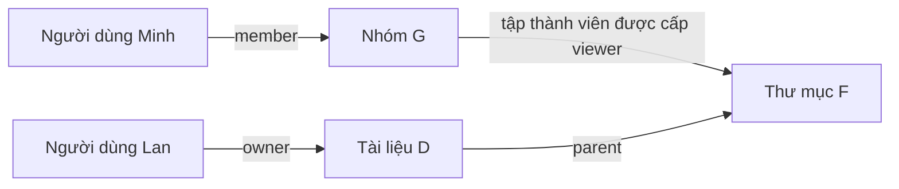
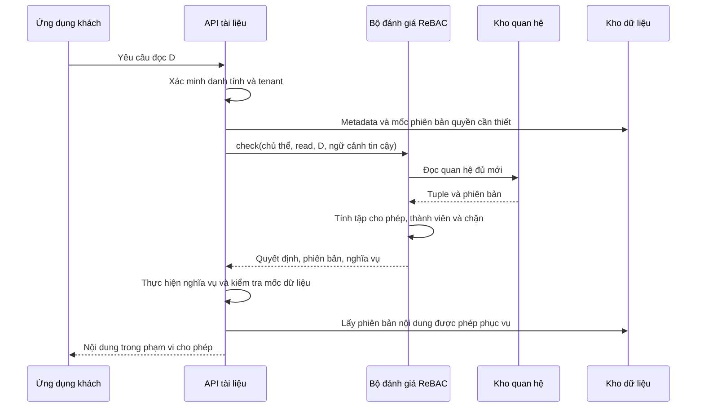

# ReBAC

## 1. ReBAC giải quyết vấn đề phân quyền nào?

ReBAC là viết tắt của **Relationship-Based Access Control**, tức kiểm soát truy cập dựa trên quan hệ. Thay vì chỉ hỏi người dùng có vai trò gì, hệ thống xét quan hệ giữa chủ thể, tài nguyên và các đối tượng liên quan để quyết định quyền.

Ví dụ trong một hệ thống tài liệu:

- Lan là chủ sở hữu tài liệu D.
- Minh là thành viên nhóm G.
- Nhóm G được chia sẻ quyền xem thư mục F.
- Tài liệu D nằm trong thư mục F.
- Minh có thể xem D thông qua quan hệ thành viên nhóm và quan hệ kế thừa từ thư mục.

Điểm quan trọng không phải là có một đường nối bất kỳ trong đồ thị. Chỉ những loại quan hệ, hướng đi và phép kết hợp được **chính sách cho phép** mới tạo thành quyền.

Trong chương **Yêu cầu authorization**, học ReBAC cần dẫn đến khả năng viết đặc tả rõ: ai được truy cập, thông qua quan hệ nào, trong tenant nào, quan hệ được thay đổi bởi ai và quyền mất hiệu lực khi nào. Mục tiêu là liên kết mô hình này với rủi ro, kiến trúc thực thi, logging và tiêu chí kiểm thử.

Yêu cầu “phân quyền theo nhóm và thư mục” chưa đủ. Nó chưa xác định quyền có đi qua nhóm lồng nhau không, chủ thư mục có được chia sẻ tài liệu con không, lệnh chặn có thắng quyền sở hữu không, hoặc xóa một quan hệ có thực sự làm mất quyền hay vẫn còn đường khác.

## 2. Phân biệt ReBAC với vai trò và thuộc tính

| Cách tiếp cận | Câu hỏi chính | Ví dụ | Điều cần đặc tả |
|---|---|---|---|
| RBAC – dựa trên vai trò | Chủ thể có vai trò nào? | Người dùng có vai trò biên tập viên | Vai trò có phạm vi nào, chứa những hành động gì? |
| ABAC – dựa trên thuộc tính | Những thuộc tính nào thỏa điều kiện? | Cùng tenant, tài liệu chưa khóa, xác thực đủ mới | Thuộc tính lấy từ đâu, có còn mới không? |
| ReBAC – dựa trên quan hệ | Chủ thể có quan hệ hợp lệ nào với tài nguyên? | Thành viên nhóm được chia sẻ thư mục chứa tài liệu | Quan hệ nào, được đi qua bao nhiêu cấp, kế thừa ra sao? |

Ba cách có thể kết hợp. Trong một quyết định ReBAC, hệ thống vẫn có thể yêu cầu tài khoản đang hoạt động, đúng tenant, tài liệu không bị khóa và phiên có mức xác thực phù hợp.

Xác thực chỉ cung cấp danh tính tin cậy cho quyết định. Người dùng đã đăng nhập hoặc hoàn tất MFA chưa chắc có quan hệ tạo quyền với một tài liệu cụ thể.

ReBAC cũng không bắt buộc sử dụng cơ sở dữ liệu đồ thị. Quan hệ có thể được lưu trong bảng, dịch vụ chuyên dụng hoặc cấu trúc khác. Điều quyết định mô hình là ý nghĩa và cách đánh giá quan hệ, không phải tên công nghệ lưu trữ.

## 3. Các khái niệm cốt lõi

### 3.1. Chủ thể, đối tượng và tuple quan hệ

Một cách biểu diễn quan hệ là bộ ba:

```text
(object, relation, subject)
```

Ví dụ:

```text
(document:D, owner, user:lan)
(group:G, member, user:minh)
(folder:F, viewer, group:G#member)
(document:D, parent, folder:F)
```

Trong đó:

- **Object:** đối tượng ở phía nhận quan hệ, như tài liệu, nhóm hoặc thư mục.
- **Relation:** loại quan hệ đã được định nghĩa, như owner, member, viewer hoặc parent.
- **Subject:** chủ thể hoặc đối tượng được liên kết; tùy kiểu quan hệ, nó có thể là người dùng, tập chủ thể hoặc thư mục cha.

Tuple `folder:F viewer group:G#member` không có nghĩa nhóm G là một người dùng. Nó biểu diễn rằng tập thành viên của nhóm G được đưa vào quan hệ xem F.

Ký hiệu trên dùng để minh họa khái niệm, không phải cú pháp bắt buộc của một sản phẩm cụ thể.

### 3.2. Tập chủ thể

`group:G#member` là một **tập chủ thể**: tất cả người dùng hiện thuộc quan hệ member của G theo chính sách.

Nếu G chứa một nhóm con H, tập thành viên có thể được mở rộng qua H, nhưng chỉ khi schema cho phép quan hệ lồng nhau và quy tắc đánh giá định nghĩa rõ điều đó.

Một tập chủ thể không nhất thiết chỉ là danh sách người dùng được sao chép tại thời điểm chia sẻ. Nếu chính sách sử dụng thành viên hiện hành, người mới vào nhóm có thể nhận quyền và người rời nhóm có thể mất quyền mà không cần sửa từng tài liệu.

Đây là lợi ích vận hành của ReBAC, đồng thời là lý do phải bảo vệ việc sửa quan hệ thành viên.

### 3.3. Quan hệ trực tiếp và quyền suy ra

Phân biệt:

- **Quan hệ trực tiếp:** một sự kiện được lưu hoặc cung cấp bởi nguồn có thẩm quyền, chẳng hạn Lan là owner của D.
- **Quyền suy ra:** kết quả tính từ chính sách và các quan hệ, chẳng hạn Minh được read D nhờ nhóm và thư mục cha.

Không cho phép khách ghi trực tiếp “Minh có read” nếu read chỉ là quyền được tính. Việc cho sửa quan hệ nguồn và việc đánh giá quyền phải có hợp đồng rõ ràng.

### 3.4. Đồ thị có kiểu và hướng

Một đồ thị minh họa:



Sơ đồ giúp thấy liên kết nghiệp vụ; hướng mũi tên khi vẽ không thay thế định nghĩa tuple. Máy chủ phải dùng một quy ước nhất quán để tránh diễn giải ngược chiều kế thừa.

Một tài liệu có cha F không làm cho chủ tài liệu tự có quyền xem mọi tài liệu khác trong F. Quyền đi từ cha xuống con chỉ khi chính sách định nghĩa; không được suy ngược để tạo quyền rộng hơn.

## 4. Xây mô hình mẫu trước khi viết yêu cầu

Bài học sử dụng ứng dụng quản lý tài liệu nhiều tenant. Tenant là phạm vi tổ chức cần cô lập dữ liệu và quyền.

### 4.1. Các kiểu đối tượng và ràng buộc

| Kiểu | Quan hệ mẫu | Ràng buộc của ví dụ |
|---|---|---|
| tenant | active_member → user | Chỉ thành viên đang hoạt động mới đủ điều kiện nhận quyền tài liệu |
| group | member → user hoặc group#member | Nhóm lồng nhau cùng tenant, không có chu trình |
| folder | owner → user; viewer/editor/blocked → user hoặc group#member; parent → folder | Mỗi thư mục có tối đa một cha; thư mục gốc không có cha |
| document | owner → user; viewer/editor/blocked → user hoặc group#member; parent → folder | Mỗi tài liệu có đúng một thư mục cha |

Trong ví dụ, mỗi tài liệu hoặc thư mục có một chủ sở hữu trực tiếp. Các quan hệ nhóm, thư mục và tài liệu phải nằm trong cùng tenant. Một người có thể thuộc nhiều tenant, nhưng quyền tại tenant này không chuyển sang tenant khác.

ID phải xác định đúng kiểu và phạm vi. Nếu hai tenant cùng có ID cục bộ “D-1”, việc lưu khóa hoặc cache chỉ theo “D-1” sẽ dễ trộn quyền.

Ràng buộc kiểu là kiểm soát bảo mật. Ví dụ không được ghi `document:D parent user:minh` hoặc liên kết thư mục của tenant A với cha thuộc tenant B.

### 4.2. Phép hợp, giao và loại trừ

Gọi các quan hệ là tập người dùng:

- **Hợp:** được cấp bởi ít nhất một nguồn cho phép.
- **Giao:** phải thỏa đồng thời các điều kiện.
- **Loại trừ:** bỏ người dùng thuộc tập bị chặn.

```text
candidates_read(r)
    = owner(r)
      ∪ editor(r)
      ∪ viewer(r)
      ∪ inherited_read_from_parent(r)

effective_blocked(r)
    = blocked(r)
      ∪ inherited_blocked_from_parent(r)

read(r)
    = (candidates_read(r) ∩ active_member(tenant(r)))
      \ effective_blocked(r)
```

Dấu `\` biểu diễn phép loại trừ tập hợp. Với thư mục gốc, các tập kế thừa từ cha là rỗng.

Quyền sửa trong ví dụ:

```text
edit(r)
    = ((owner(r) ∪ editor(r) ∪ inherited_edit_from_parent(r))
       ∩ active_member(tenant(r)))
      \ effective_blocked(r)
```

Quyền chia sẻ:

```text
share(r)
    = (owner(r) ∩ active_member(tenant(r)))
      \ effective_blocked(r)
```

Như vậy:

- Editor có thể đọc và sửa theo chính sách.
- Viewer chỉ có quyền đọc.
- Quyền đọc và sửa của cha có thể được kế thừa xuống con.
- Quyền share không tự kế thừa từ cha trong mô hình này.
- Lệnh chặn ở một thư mục áp dụng xuống các đối tượng con.
- Lệnh chặn có hiệu lực cả khi người dùng là owner hoặc được cấp viewer trực tiếp.

Đây là chính sách của ví dụ, không phải ý nghĩa bắt buộc của mọi hệ thống ReBAC. Một sản phẩm khác có thể cho phép ngắt kế thừa hoặc cho editor chia sẻ, nhưng phải đặc tả rõ và có kiểm thử tương ứng.

### 4.3. Vì sao cần định nghĩa chặn kế thừa riêng?

Giả sử Minh bị chặn ở F nhưng lại có viewer trực tiếp trên tài liệu D bên trong F.

Nếu chỉ định nghĩa “quyền từ F không đi xuống cho Minh”, quyền viewer trực tiếp của D vẫn có thể cho phép truy cập. Trong ví dụ này, yêu cầu nghiệp vụ là lệnh chặn trên tổ tiên thắng cả cấp quyền trực tiếp ở con, nên `effective_blocked` phải được tính tại D và loại trừ khỏi kết quả cuối cùng.

Chỉ tìm thấy một đường cho phép chưa đủ để kết luận cho phép khi chính sách còn điều kiện chặn, tenant hoặc trạng thái tài khoản chưa được kiểm tra.

## 5. Theo dõi một quyết định cụ thể

Giả sử có:

```text
(tenant:A, active_member, user:minh)
(group:G, member, user:minh)
(folder:F, viewer, group:G#member)
(document:D, parent, folder:F)
(document:D, owner, user:lan)
```

D và F đều thuộc tenant A; không có quan hệ blocked liên quan.

Khi kiểm tra Minh có được read D:

1. Xác minh Minh là chủ thể của phiên, không lấy user ID tự khai làm danh tính.
2. Xác định D và các quan hệ liên quan thuộc tenant A.
3. Kiểm tra Minh đang là thành viên hoạt động của A.
4. Tính viewer của F thông qua tập thành viên G.
5. Áp dụng quyền read của F cho D theo quan hệ parent.
6. Kiểm tra tập chặn trực tiếp và kế thừa.
7. Trả cho phép kèm các nghĩa vụ như giới hạn trường hoặc ghi audit nếu chính sách yêu cầu.

Nếu xóa quan hệ thành viên G, đường cho phép đó mất. Tuy nhiên, kết quả cuối cùng còn phụ thuộc các đường khác. Nếu Minh cũng là viewer trực tiếp của D, Minh vẫn có thể đọc D.

Cần phân biệt hai yêu cầu khác nhau:

> Xóa quan hệ thành viên nhóm G phải làm mất tác dụng của quan hệ đó.

và:

> Minh phải mất mọi quyền đọc D.

Yêu cầu thứ hai có thể cần thu hồi nhiều quan hệ hoặc thêm một lệnh chặn theo chính sách. Không được báo “đã thu hồi hoàn toàn” chỉ vì đã xóa một cạnh.

## 6. Mối đe dọa cần đưa vào đặc tả

| Rủi ro | Cách xảy ra | Yêu cầu cần suy ra |
|---|---|---|
| R-01: Vượt tenant | Ghi quan hệ chia sẻ hoặc parent nối hai tenant | Kiểm tra kiểu và tenant của mọi đầu quan hệ |
| R-02: Tự cấp quyền | Người không có share ghi viewer/editor cho mình | Phân quyền thao tác ghi quan hệ tại máy chủ |
| R-03: Leo thang qua nhóm | Người chỉ được quản lý thành viên tự thêm mình vào nhóm đặc quyền | Xác định thẩm quyền quản lý nhóm và giới hạn cấp quyền dẫn xuất |
| R-04: Kế thừa quá rộng | Di chuyển tài liệu vào thư mục chia sẻ rộng mà không có quyền phù hợp | Kiểm tra quyền ở nguồn, đích và tác động chia sẻ |
| R-05: Bỏ qua lệnh chặn | Tìm được một đường allow rồi dừng trước khi xét blocked | Đánh giá đầy đủ phép giao và loại trừ |
| R-06: Quyền đã thu hồi còn tác dụng | Cache hoặc bản sao đồ thị chậm cập nhật | Cam kết độ mới và thời hạn thu hồi |
| R-07: Lạm dụng độ phức tạp | Tạo chu trình hoặc chuỗi nhóm quá sâu | Giới hạn cấu trúc và chi phí đánh giá |
| R-08: Lộ dữ liệu qua danh sách | API check đúng nhưng search/list/count không lọc quyền | Cùng ngữ nghĩa quyền trên mọi đường truy cập |
| R-09: Dữ liệu mới đi với quyền cũ | Nội dung đã đổi phạm vi nhạy cảm nhưng kiểm tra bằng snapshot quan hệ trước thay đổi | Phối hợp phiên bản dữ liệu và quan hệ |
| R-10: Giả quan hệ ngữ cảnh | Khách gửi claim “là thành viên nhóm” không được kiểm chứng | Chỉ dùng nguồn và bằng chứng có thẩm quyền |
| R-11: Dùng danh tính dịch vụ quá rộng | Worker xuất mọi dữ liệu thay vì phạm vi người yêu cầu | Giới hạn ủy quyền và kiểm tra lại quyền |
| R-12: Lộ đồ thị quyền | API trả đường suy luận hoặc danh sách nhóm nhạy cảm | Phân quyền chức năng xem và giải thích quan hệ |

Đồ thị quyền là tài sản cần bảo vệ. Nó có thể tiết lộ cơ cấu tổ chức, dự án bí mật, người có quyền trên tài liệu và tài khoản đặc quyền.

## 7. Đặc tả việc ghi, sửa và xóa quan hệ

### 7.1. Ai được thay đổi nguồn tạo quyền?

Mọi thao tác ghi quan hệ phải được phân quyền như một hành động nhạy cảm.

| Thao tác | Điều cần kiểm tra trong ví dụ |
|---|---|
| Thêm viewer/editor vào tài liệu | Người gọi có share trên tài liệu, đối tượng nhận hợp lệ, cùng tenant |
| Thêm người vào nhóm | Người gọi có thẩm quyền quản lý nhóm cụ thể và không vượt giới hạn ủy quyền |
| Lồng nhóm H vào G | Đúng kiểu, cùng tenant, không tạo chu trình, không vượt độ sâu |
| Chuyển tài liệu sang thư mục khác | Đủ quyền di chuyển ở nguồn và đích; không vượt tenant; xử lý ảnh hưởng kế thừa |
| Chuyển quyền sở hữu | Có quyền chuyển riêng hoặc share theo chính sách đã định; người nhận hợp lệ |
| Thêm/xóa blocked | Có thẩm quyền kiểm soát chặn được định nghĩa riêng |
| Xóa thành viên tenant | Đúng thẩm quyền; thu hồi tư cách thành viên và quyền dẫn xuất trong giới hạn thời gian |

Có quyền edit nội dung không tự đồng nghĩa có quyền sửa tuple. Có quyền quản lý một nhóm cũng không tự được thay quan hệ parent của tài liệu.

Quyền sửa các quan hệ tạo quyền phải tránh vòng tự chứng minh. Không cho phép người dùng gửi một tập thay đổi gồm “cấp share cho tôi” và “dùng share vừa cấp để cấp editor” nếu bước cấp share ban đầu chưa có thẩm quyền.

### 7.2. Di chuyển tài nguyên làm thay đổi quyền

Di chuyển D từ F sang H có thể:

- Mất quyền được kế thừa từ F.
- Nhận quyền được kế thừa từ H.
- Nhận hoặc mất lệnh chặn tổ tiên.
- Giữ nguyên các quan hệ chia sẻ trực tiếp nếu chính sách cho phép.
- Thay đổi khả năng truy cập của nhiều người mà không sửa viewer của D.

Một yêu cầu mẫu:

> Máy chủ chỉ chuyển tài liệu trong cùng tenant khi người gọi có quyền quản lý di chuyển trên tài liệu, được thao tác ở thư mục nguồn và được thêm tài liệu vào thư mục đích. Thay đổi parent và điều kiện áp dụng quyền mới phải được thực hiện theo cơ chế nhất quán đã đặc tả. Không có trạng thái trung gian cho phép cả phạm vi cũ và mới ngoài chủ đích.

Nếu giao diện hiển thị cảnh báo thay đổi chia sẻ, cảnh báo hỗ trợ quyết định của người dùng nhưng không thay kiểm tra quyền phía máy chủ.

### 7.3. Tính nguyên tử, idempotency và xóa

Thay đổi nhiều tuple liên quan cần xác định tính nguyên tử. Ví dụ chuyển owner không nên để một cửa sổ không có chủ sở hữu hoặc cấp quyền cho cả hai lâu hơn chính sách cho phép.

Retry cần có ngữ nghĩa ổn định. Thêm lại cùng một quan hệ thường có thể được xử lý idempotent; chuyển quyền sở hữu hoặc thực thi tác dụng ngoài cần giao dịch và định danh thao tác phù hợp.

Xóa một nhóm hoặc thư mục phải quy định cách xử lý quan hệ tham chiếu và tài nguyên con. Không tái sử dụng ID theo cách khiến quan hệ cũ tự gắn sang một đối tượng mới không liên quan.

## 8. Độ mới, nhất quán và thu hồi quyền

### 8.1. Một quyết định phụ thuộc nhiều loại phiên bản

Quyền đọc D có thể phụ thuộc vào:

- Phiên bản chính sách xác định read.
- Quan hệ viewer/editor/owner của D.
- Parent và các thư mục tổ tiên.
- Thành viên của các nhóm lồng nhau.
- Tư cách thành viên tenant.
- Quan hệ blocked và trạng thái tài khoản.
- Những điều kiện bổ sung như trạng thái tài liệu hoặc mức xác thực.

Không được chỉ làm mới tuple của D rồi dùng kết quả thành viên nhóm cũ mà không có cam kết nhất quán phù hợp.

Nếu quyết định trộn “trước thu hồi” và “sau thu hồi”, hệ thống có thể tạo một đường quyền chưa từng tồn tại trong một trạng thái hợp lệ. Đặc tả cần nêu mức nhất quán, cách lấy snapshot hoặc cách kiểm tra phiên bản thay vì chỉ nói “dữ liệu cuối cùng sẽ đồng bộ”.

### 8.2. Yêu cầu thu hồi có thời hạn đo được

Một yêu cầu mẫu:

> Trong vòng 60 giây kể từ khi lệnh thu hồi quan hệ được ghi nhận thành công tại nguồn có thẩm quyền, mọi điểm thực thi thuộc phạm vi phải ngừng sử dụng quan hệ đã thu hồi để cấp quyền. Các lần cấp quyền khác còn hợp lệ vẫn được đánh giá theo chính sách.

Cần định nghĩa mốc bắt đầu, điểm kiểm soát, cache, bản sao, worker và đường tải tệp thuộc phạm vi. Trung bình đồng bộ 5 giây không chứng minh mọi điểm đều đáp ứng giới hạn tối đa 60 giây.

Nếu mục tiêu là “người dùng không còn được truy cập tài nguyên”, phải kiểm tra tất cả đường cho phép hoặc áp dụng cơ chế chặn đã được phê duyệt. Xóa một đường không tương đương thu hồi mọi quyền.

Với hành động đặc biệt nhạy cảm, có thể yêu cầu kiểm tra đủ mới ngay sau thay đổi hoặc tại điểm commit thay vì chấp nhận cửa sổ 60 giây. Hai mức cam kết cần được mô tả riêng.

### 8.3. Dữ liệu mới không được phục vụ bằng quyền cũ

Giả sử F từng chia sẻ cho toàn nhóm G. Sau đó chủ tài liệu chuyển D sang thư mục hạn chế H và cập nhật nội dung nhạy cảm. Nếu dịch vụ nội dung phục vụ bản mới nhưng bộ kiểm tra quyền vẫn thấy D thuộc F, thành viên G có thể đọc nội dung ngoài chủ đích.

Một cách đặc tả là:

> Tài nguyên phải mang phiên bản quyền tối thiểu cần thiết cho việc phục vụ phiên bản dữ liệu đó. Điểm thực thi không được dùng snapshot quan hệ cũ hơn mốc bắt buộc; nếu chưa đọc được phiên bản đủ mới thì chờ trong giới hạn hoặc từ chối có kiểm soát.

Phiên bản này phải đến từ máy chủ hoặc bằng chứng được kiểm chứng. Khách không được tự yêu cầu dùng phiên bản cũ để vượt thu hồi.

Nếu thay đổi nằm ở hai kho riêng biệt, giao dịch cục bộ trong một kho không tự bảo đảm nhất quán toàn hệ thống. Có thể cần outbox, hàng rào phiên bản, trạng thái chuyển tiếp bị hạn chế hoặc cơ chế phối hợp khác. Thiết kế phải chứng minh dữ liệu không được công bố trước khi điều kiện quyền tương ứng có hiệu lực.

### 8.4. Cache phải nhận biết phụ thuộc

Một kết quả cache kiểu “Minh đọc được D” có thể mất hiệu lực vì Minh rời nhóm G, dù tuple trực tiếp của D không đổi.

Khóa và quy tắc vô hiệu hóa cần tính đến:

- Chủ thể và tenant.
- Hành động và loại tài nguyên.
- Phiên bản chính sách.
- Phiên bản hoặc mốc đủ mới của các quan hệ liên quan.
- Điều kiện ngữ cảnh và thời hạn của bằng chứng nếu có.
- Thay đổi nhóm, parent và blocked.

Không nhất thiết liệt kê mọi cạnh vào khóa cache; có thể dùng phiên bản, chỉ mục phụ thuộc hoặc cơ chế khác. Nhưng TTL và invalidation phải đáp ứng yêu cầu thu hồi trong tình huống xấu nhất, không chỉ khi mọi thông báo cập nhật đều đến đúng lúc.

Cache từ chối cũ chủ yếu có thể làm chậm cấp quyền mới; cache cho phép cũ có thể làm chậm thu hồi. Cả hai cần cam kết về khả năng sử dụng và an toàn phù hợp.

## 9. Giới hạn cấu trúc và chi phí đánh giá

### 9.1. Nhóm lồng nhau và chu trình

Ví dụ ứng dụng đặt giới hạn:

- Không có chu trình trong quan hệ nhóm lồng nhau.
- Tối đa 5 cạnh liên tiếp từ nhóm này sang nhóm khác trên một đường thành viên.
- Tối đa 20 cạnh parent từ thư mục đến gốc.
- Mỗi tài liệu có một parent, mỗi thư mục có tối đa một parent.

Đây là tham số giả định để đặc tả, không phải giới hạn chung của ReBAC.

Kiểm tra chu trình và độ sâu phải an toàn trước cập nhật đồng thời. Hai yêu cầu thêm G vào H và H vào G có thể đều vượt kiểm tra nếu mỗi yêu cầu chỉ nhìn trạng thái trước khi yêu cầu kia commit.

Quy tắc phải được bảo vệ tại điểm ghi bằng cơ chế phù hợp. Nếu dữ liệu cũ đã vi phạm giới hạn, cần có hành vi từ chối có kiểm soát và quy trình sửa, không âm thầm bỏ bớt cạnh rồi cấp quyền.

### 9.2. Ngân sách đánh giá và kết quả chưa xác định

Ngoài độ sâu, có thể cần giới hạn độ rộng, số nút thăm, thời gian và số truy vấn phụ thuộc. Tất cả phải gắn với dữ liệu và tải thực tế.

Kết quả đánh giá nên phân biệt:

```text
ALLOW          Đã chứng minh mọi điều kiện cho phép và nghĩa vụ.
DENY           Đã đánh giá và chính sách không cho phép.
INDETERMINATE  Không đủ dữ liệu hoặc không hoàn tất đánh giá.
```

Nếu timeout khi chưa xét xong tập blocked, không được coi “chưa thấy chặn” là “không bị chặn”. INDETERMINATE phải không cấp quyền và có phản hồi/cảnh báo phù hợp.

Với biểu thức chỉ có phép hợp dương, một bằng chứng hợp lệ có thể đủ cho phần đó. Nhưng kết quả cuối cùng vẫn phải thỏa mọi phép giao, loại trừ, điều kiện tenant và nghĩa vụ. Không áp dụng lối dừng sớm của một biểu thức đơn giản cho mọi chính sách.

## 10. Nơi đánh giá và nơi thực thi trong kiến trúc

### 10.1. Luồng kiểm tra mẫu

- **PEP – Policy Enforcement Point:** nơi thực thi quyết định, như API tài liệu, dịch vụ file hoặc worker.
- **PDP – Policy Decision Point:** nơi đánh giá chính sách và quan hệ.
- **Kho quan hệ:** lưu tuple và thông tin phiên bản theo cam kết.
- **Nguồn danh tính/ngữ cảnh:** cung cấp chủ thể, trạng thái và bằng chứng đáng tin cậy.
- **Kho dữ liệu:** chứa nội dung và metadata tài liệu.



Các thành phần có thể nằm cùng ứng dụng. Tách ra nhiều dịch vụ chỉ hữu ích khi phù hợp yêu cầu, không phải điều kiện để sử dụng ReBAC.

### 10.2. Mã giả tại điểm thực thi

```text
function readDocument(request):
    subject = authenticate(request)
    require(subject is valid)

    tenant = resolveTrustedTenantContext(subject, request.tenantReference)
    metadata = loadInternalMetadata(tenant, request.documentId)
    if metadata is absent:
        return responseWithoutUnnecessaryExistenceDisclosure()

    minimumRevision = trustedMinimumRevisionFor(
        subject, tenant, metadata
    )

    result = rebac.check(
        subject = subject.id,
        action = "document.read",
        resource = metadata.typedResourceId,
        tenant = tenant.id,
        minimumRevision = minimumRevision,
        trustedContext = verifiedContext(subject, request)
    )

    if result.decision == INDETERMINATE:
        return controlledServiceFailure()

    if result.decision != ALLOW:
        return accessDeniedWithoutSensitiveDetails()

    if not canEnforce(result.obligations):
        return controlledServiceFailure()

    # Phải phối hợp kiểm tra phiên bản/quyền với việc đọc dữ liệu.
    # Nếu metadata hoặc mốc quyền đổi, có thể cần kiểm tra lại.
    document = loadContentConsistentWithAuthorization(metadata, result)
    return authorizedProjection(document, result.obligations)
```

Mã giả không khẳng định hai lần đọc rời nhau luôn an toàn. Thiết kế thực tế cần chứng minh cách xử lý việc tài liệu hoặc parent thay đổi giữa các bước.

Không trả toàn bộ đồ thị hoặc đường suy luận cho khách chỉ để giải thích lỗi. Chức năng giải thích quyền phải có phân quyền riêng.

### 10.3. Cấp quyền qua ngữ cảnh

Một số hệ thống kết hợp quan hệ với điều kiện tạm thời như ca trực, phiên hỗ trợ hoặc thời hạn chia sẻ.

Nếu dùng quan hệ hoặc thuộc tính ngữ cảnh, cần nêu:

- Thành phần nào có quyền xác nhận chúng.
- Cách bảo vệ nguồn gốc và tính toàn vẹn.
- Phạm vi tài nguyên, người dùng và hành động.
- Thời hạn, chống phát lại và thu hồi.
- Việc chúng có được thay quan hệ bền vững hay không.

Không chấp nhận `groupMember=true`, `tenantAdmin=true` hoặc tuple giả do trình duyệt gửi như đầu vào có thẩm quyền.

## 11. Danh sách, tìm kiếm, file và tác vụ nền

### 11.1. Check một đối tượng chưa đủ

Ngoài câu hỏi “Minh có đọc được D không?”, sản phẩm cần:

- Liệt kê tài liệu Minh được đọc.
- Tìm tài liệu theo từ khóa.
- Đếm hoặc tổng hợp kết quả.
- Liệt kê ai có quyền trên một tài liệu.
- Tạo và tải file xuất.

API danh sách phải có cùng ngữ nghĩa quyền với check cho từng đối tượng trong phiên bản và ngữ cảnh tương ứng. Mọi đối tượng trả về đều phải được phép; số lượng, trang và snippet không được làm lộ dữ liệu ngoài quyền.

Nếu danh sách dựa vào chỉ mục có độ trễ, cần đặc tả độ đầy đủ và độ trễ xuất hiện của quyền mới. Chỉ mục cũ không được là lý do trả thêm tài nguyên đã bị thu hồi quyền. Có thể cần kiểm tra lại trước khi trả dữ liệu.

Không cho khách chọn một bộ lọc tenant rộng hơn để bỏ qua phạm vi thực thi. Bộ lọc nghiệp vụ được kết hợp với phạm vi được phép, không thay thế nó.

### 11.2. Liệt kê người có quyền là một quyền riêng

Danh sách “ai đọc được tài liệu này” có thể chứa thành viên nhóm, quan hệ nội bộ và tài khoản nhạy cảm. Có quyền read nội dung không mặc nhiên được xem toàn bộ đồ thị chia sẻ.

Đặc tả cần xác định:

- Ai được xem người nhận trực tiếp.
- Ai được xem thành viên được mở rộng từ nhóm.
- Ai được xem đường suy luận và quan hệ tổ tiên.
- Có giới hạn số lượng, phân trang và che danh tính nào.
- Phản hồi nào được trả khi không thể liệt kê đầy đủ.

### 11.3. File tải và URL có chữ ký

Nếu API kiểm tra ReBAC rồi trả URL có chữ ký, URL có thể tiếp tục dùng được đến hết hạn dù quan hệ đã bị thu hồi. Vì vậy, yêu cầu thu hồi phải bao gồm đường tải thực tế.

Các lựa chọn có thể là tải qua điểm kiểm tra quyền, dùng thời hạn đủ ngắn kết hợp giới hạn phù hợp, hoặc có cơ chế vô hiệu hóa khác. Không tuyên bố đáp ứng mốc 60 giây nếu URL đã cấp vẫn đọc được trong 1 giờ.

Không đặt giả định “object key khó đoán” thay cho phân quyền tài liệu và file.

### 11.4. Worker thực hiện thay người dùng

Tác vụ xuất cần lưu ngữ cảnh người yêu cầu và tenant theo nguồn tin cậy. Chính sách mẫu:

> Kiểm tra quyền khi nhận tác vụ, trước khi truy vấn dữ liệu và trước khi cho tải kết quả. Mọi đối tượng xuất phải thuộc phạm vi được phép tại mốc quyền đã cam kết. Quyền rộng của danh tính dịch vụ không được thay quyền của người yêu cầu.

Nếu một tác vụ có thẩm quyền hệ thống độc lập, cần đặc tả riêng. Không mặc định mọi tác vụ tiếp tục vô điều kiện sau khi người dùng đã rời tổ chức.

## 12. Bộ yêu cầu mẫu có thể nghiệm thu

Các yêu cầu sau áp dụng cho mô hình tài liệu trong bài. Tham số thời gian, độ sâu và hiệu năng là ví dụ thiết kế.

| ID | Yêu cầu | Tiêu chí kiểm chứng |
|---|---|---|
| RB-01 | Chỉ quan hệ có kiểu và subject phù hợp schema mới được ghi | Không ghi được parent trỏ đến user hoặc relation không tồn tại |
| RB-02 | Mọi quan hệ nhóm, parent và chia sẻ phải thỏa ranh giới tenant | Ghi cạnh từ tài nguyên A đến nhóm/thư mục B bị từ chối, kể cả qua API bulk |
| RB-03 | Read/edit chỉ được cấp cho thành viên hoạt động của tenant và phải loại trừ effective_blocked | Người có viewer trực tiếp nhưng đã rời tenant hoặc bị chặn tổ tiên không truy cập được |
| RB-04 | Quyền share chỉ thuộc owner hợp lệ và không kế thừa trong mô hình mẫu | Editor hoặc người chỉ có quyền từ parent không tự thêm viewer/editor được |
| RB-05 | Ghi quan hệ phải kiểm tra thẩm quyền hiện hành trước khi áp dụng thay đổi | Người dùng không tự cấp owner/share rồi dùng nó trong cùng yêu cầu để mở quyền |
| RB-06 | Nhóm lồng nhau không có chu trình và không vượt 5 cạnh group-to-group | Kiểm tra dưới, đúng và vượt giới hạn; cập nhật cạnh tranh không tạo chu trình |
| RB-07 | Cây thư mục không có chu trình, mỗi thư mục tối đa một cha và sâu tối đa 20 cạnh parent đến gốc | Ghi cha thứ hai, tự làm cha hoặc nối về hậu duệ đều bị từ chối |
| RB-08 | Quyền kế thừa chỉ theo các đường và hành động đã định nghĩa | Viewer thư mục đọc được tài liệu con nhưng không có share; owner tài liệu không tự đọc tài liệu anh em |
| RB-09 | Di chuyển tài liệu phải kiểm tra quyền nguồn/đích, cùng tenant và áp dụng quyền mới nhất quán | Không có cửa sổ đọc ngoài phạm vi khi parent và nội dung thay đổi |
| RB-10 | Quan hệ thu hồi không được tiếp tục tạo quyền sau tối đa 60 giây tại mọi điểm thuộc phạm vi | Token, cache, bản sao, worker và đường tải không dựa vào cạnh cũ sau hạn |
| RB-11 | Hệ thống phải phân biệt xóa một đường với mất toàn bộ quyền | Khi còn viewer trực tiếp, xóa membership nhóm vẫn cho đọc; khi không còn đường hợp lệ thì từ chối |
| RB-12 | Nội dung phải được phục vụ với snapshot quyền đáp ứng mốc tối thiểu do máy chủ xác định | Replica chậm hơn mốc bắt buộc không làm lộ nội dung mới theo quyền cũ |
| RB-13 | Timeout, vượt ngân sách hoặc thiếu dữ liệu bắt buộc không được tạo ALLOW | Lỗi giữa lúc tính blocked hoặc membership khiến truy cập thất bại có kiểm soát |
| RB-14 | Danh sách/search/count phải thực thi phạm vi quyền tương ứng và không lộ tài nguyên ngoài quyền | Kết quả, snippet, tổng số và phân trang không tiết lộ tài liệu không được phép |
| RB-15 | Xem đồ thị, giải thích quyền và liệt kê người có quyền cần thẩm quyền riêng | Người chỉ có read không nhận được toàn bộ danh sách nhóm hoặc đường suy luận |
| RB-16 | Worker và API file phải có điểm thực thi đáp ứng cùng cam kết thu hồi | Thu hồi khi tác vụ chờ hoặc URL đang còn hạn được xử lý theo chính sách đã chọn |
| RB-17 | Thêm/xóa quan hệ đặc quyền và thay policy phải có audit bền vững, actor và phiên bản | Truy ra được ai đổi cạnh nào theo thẩm quyền nào; không ghi bearer token |
| RB-18 | Quyết định cache phải gắn với đủ phạm vi và bị vô hiệu hóa/giới hạn tuổi theo phụ thuộc | Thay thành viên nhóm, blocked hoặc parent làm thay đổi quyết định trong thời hạn cam kết |

RB-04 không có nghĩa chủ thư mục không thể quản trị cây trong mọi sản phẩm. Nó diễn đạt chính sách hạn chế của ví dụ; nếu cần quyền quản trị kế thừa, hãy tạo hành động và quy tắc riêng.

RB-10 đo tác dụng của quan hệ bị thu hồi. Để nghiệm thu mất toàn bộ quyền, cần thêm điều kiện không còn đường cho phép khác hoặc một lệnh chặn có hiệu lực.

RB-13 không bắt buộc phản hồi DENY và lỗi dịch vụ giống nhau. Điều bắt buộc là không phục vụ dữ liệu trái quyền; mã lỗi, retry và cảnh báo cần phản ánh đúng nguyên nhân.

## 13. Ma trận truy vết rủi ro – yêu cầu – kiến trúc

| Rủi ro | Yêu cầu | Thành phần thực thi | Bằng chứng kiểm thử |
|---|---|---|---|
| R-01: Vượt tenant | RB-01, RB-02, RB-03 | API ghi tuple, schema, bộ đánh giá | Cạnh sai tenant bị từ chối; tài nguyên không được trả |
| R-02: Tự cấp quyền | RB-04, RB-05 | API chia sẻ, chính sách ghi quan hệ | Gọi API trực tiếp không vượt được share |
| R-03: Leo thang qua nhóm | RB-05, RB-17 | Quản lý nhóm, cấp quyền dẫn xuất | Người quản lý nhóm không được thêm quan hệ ngoài thẩm quyền |
| R-04: Kế thừa quá rộng | RB-08, RB-09 | Di chuyển tài nguyên, policy kế thừa | Quyền sau move đúng cây mới và không cấp quyền anh em |
| R-05: Bỏ qua chặn | RB-03, RB-13 | Tính effective_blocked, PEP | Có đường viewer nhưng bị chặn vẫn bị từ chối |
| R-06: Quyền cũ | RB-10, RB-11, RB-18 | Cache, replica, điểm thực thi | Đo sau thu hồi và kiểm tra các đường thay thế |
| R-07: Chi phí đồ thị | RB-06, RB-07, RB-13 | Kiểm tra ghi, bộ đánh giá | Chu trình, độ sâu, độ rộng và timeout |
| R-08: Rò qua danh sách | RB-14, RB-16 | Search/list/count, xuất dữ liệu, file | Không lộ qua payload hoặc metadata |
| R-09: Trộn nội dung/quyền | RB-09, RB-12 | Kho dữ liệu, hàng rào phiên bản | Nội dung mới không được đọc bằng snapshot cũ |
| R-10: Giả ngữ cảnh | RB-03, RB-05, RB-12 | Xác thực, nguồn thuộc tính | Khách tự khai membership/revision không vượt kiểm tra |
| R-11: Quyền dịch vụ quá rộng | RB-16 | Worker và dịch vụ file | Phạm vi người yêu cầu vẫn giới hạn kết quả |
| R-12: Lộ đồ thị | RB-15, RB-17 | Explain API, audit, công cụ hỗ trợ | Không tiết lộ đường quyền cho người không có thẩm quyền |

Ma trận hỗ trợ rà soát trong thiết kế, triển khai và kiểm thử. Một yêu cầu chưa có nơi thực thi hoặc một đường truy cập chưa có ca kiểm thử là phần cần làm rõ trước nghiệm thu.

## 14. Thiết kế kiểm thử cho đồ thị quyền

### 14.1. Bộ dữ liệu tối thiểu có chủ đích

Chuẩn bị:

- Hai tenant A và B.
- Lan, Minh, một người ngoài tenant và một người đã bị vô hiệu hóa.
- Nhóm G chứa Minh; nhóm H được lồng vào G.
- Hai thư mục cùng cấp, một nhánh thư mục nhiều tầng.
- D là tài liệu con của F; E là tài liệu ở nhánh khác.
- Một cấp viewer trực tiếp và một cấp viewer thông qua nhóm cho cùng người.
- Một blocked trực tiếp và một blocked trên tổ tiên.
- Một replica hoặc cache được chủ động làm chậm.
- Một tác vụ xuất đang chờ và một đường tải file đã được cấp.

Dữ liệu chỉ gồm một người, một nhóm và một tài liệu sẽ khó phát hiện lỗi kế thừa, vượt tenant và thu hồi nhiều đường.

### 14.2. Các ca kiểm thử điển hình

| Tình huống | Thao tác | Kết quả mong đợi |
|---|---|---|
| Quan hệ trực tiếp | Lan là owner D và còn active_member | Cho phép read/edit/share theo mô hình |
| Thành viên nhóm | Minh thuộc G, G là viewer F, D thuộc F | Minh đọc được D |
| Nhóm lồng nhau | Minh thuộc H, H là thành viên G | Quyền được mở rộng trong giới hạn đã định |
| Quan hệ một chiều | Owner D yêu cầu đọc E cùng thư mục | Không tự có quyền E chỉ từ owner D |
| Phạm vi hành động | Viewer F gọi API edit/share D | Không được sửa/chia sẻ chỉ từ viewer |
| Chặn trực tiếp | Minh có viewer D nhưng bị blocked D | Từ chối |
| Chặn kế thừa | Minh có viewer trực tiếp D nhưng bị blocked F | Từ chối theo effective_blocked |
| Rời tenant | Giữ tuple viewer nhưng mất active_member | Không được read/edit/share |
| Xóa một đường | Bỏ membership G, còn viewer trực tiếp D | Vẫn đọc được nhờ đường hợp lệ còn lại |
| Xóa mọi đường | Bỏ cả membership tạo quyền và viewer trực tiếp | Từ chối sau thời hạn cam kết |
| Khác tenant | Thêm group B làm viewer tài liệu A | Không ghi được cạnh; không cấp quyền |
| Ghi quan hệ trái phép | Editor tự thêm viewer cho người khác | API từ chối, không có tuple mới |
| Chu trình | G chứa H rồi thêm H chứa G | Từ chối |
| Chu trình đồng thời | Hai giao dịch cạnh tranh cùng tạo vòng | Không commit được trạng thái có chu trình |
| Ranh giới độ sâu | Tạo đường đúng giới hạn và vượt một cạnh | Đúng giới hạn được xử lý; vượt bị từ chối |
| Đánh giá chưa xong | Timeout khi chưa xác định đủ blocked | Không trả ALLOW |
| Di chuyển | D chuyển F sang H, quyền hai nơi khác nhau | Quyền sau move đúng chính sách, không lộ trong trung gian |
| Replica cũ | Đọc nội dung mới bằng kho quan hệ chậm | Chờ hoặc lỗi có kiểm soát, không dùng quyền cũ |
| Danh sách | Search/count khi có tài liệu ngoài phạm vi | Không lộ nội dung, snippet hoặc số lượng ngoài quyền |
| Quyền giải thích | Người chỉ có read gọi explain hoặc list subjects | Không nhận đồ thị nhạy cảm |
| Tác vụ nền | Thu hồi khi xuất đang chờ hoặc trước tải | Không vượt phạm vi bằng danh tính dịch vụ |
| ID tái sử dụng | Xóa nhóm rồi tạo nhóm khác | Quan hệ cũ không tự gắn sang nhóm mới |

Kiểm thử phải thay đổi đúng một hoặc một nhóm điều kiện có chủ đích để biết vì sao quyết định thay đổi. Đối với bộ chính sách có loại trừ, cần có ca vừa tồn tại đường cho phép vừa tồn tại đường chặn.

### 14.3. Bằng chứng nghiệm thu

Thu thập ít nhất:

- Quyết định và nghĩa vụ ở phiên bản chính sách xác định.
- Phiên bản/mốc quan hệ đã dùng.
- Trạng thái trước/sau của tuple và tài nguyên.
- Nội dung thực tế được trả hoặc tác dụng ghi đã xảy ra.
- Mốc ghi nhận thu hồi và mốc mọi PEP trong phạm vi ngừng dùng quyền cũ.
- Kết quả từ nhiều nút hoặc replica nếu có.
- Audit thay đổi quan hệ và thực thi hành động quan trọng.

Không chỉ kiểm tra API ghi quan hệ trả thành công. Cần chứng minh hệ thống đọc đã áp dụng thay đổi theo cam kết. Tương tự, một phản hồi lỗi không chứng minh không có tuple hoặc dữ liệu bị thay đổi.

## 15. Logging, quản lý policy và vận hành

### 15.1. Audit thay đổi quan hệ

Một sự kiện thay đổi nên có:

```text
timestamp
actor_id
service_identity_if_any
tenant_id
operation
object_type
object_id
relation
subject_reference
authorization_reason_code
policy_version
relationship_revision
correlation_id
outcome
```

Đối với batch, phải biết thay đổi nào đã commit, thay đổi nào bị từ chối và tính nguyên tử được áp dụng. Không log access token hoặc dữ liệu ngữ cảnh bí mật.

Subject reference và quan hệ cũng có thể là dữ liệu nhạy cảm. Hệ thống audit cần phân quyền, bảo vệ tính toàn vẹn và thời hạn lưu phù hợp.

Dấu vết giải thích quyết định có thể lưu tham chiếu đến nguồn quyền hoặc phiên bản cần thiết, nhưng không nhất thiết sao chép toàn bộ đồ thị vào từng log.

### 15.2. Thay schema và policy

Một thay đổi như “editor được share” có thể cấp quyền cho hàng loạt người mà không thêm tuple nào. Vì vậy, thay policy cần được coi như thay đổi bảo mật quan trọng.

Cần xác định:

- Ai đề xuất, phê duyệt và phát hành.
- Phiên bản policy và điều kiện tương thích schema.
- Cách kiểm tra trên các đồ thị đại diện và các ca phủ quyết.
- Phát hành đồng bộ, xử lý cache và replica.
- Cách quay lại phiên bản trước mà không làm mất dấu vết.
- Cách phát hiện mở rộng quyền ngoài dự kiến.

Khi bổ sung loại quan hệ hoặc ngắt kế thừa, phải kiểm tra tác động lên tài nguyên cũ. Không mặc định dữ liệu cũ sẽ có ý nghĩa an toàn trong schema mới.

### 15.3. Chỉ số và giới hạn hiệu năng

| Chỉ số | Định nghĩa mẫu | Ý nghĩa |
|---|---|---|
| Độ trễ check | p95 từ lúc PEP gửi yêu cầu hợp lệ đến lúc nhận quyết định, dưới tải và đồ thị xác định | Đánh giá trải nghiệm và dependency |
| Độ trễ thu hồi | Từ ghi nhận thay đổi đến mọi điểm trong phạm vi ngừng dùng quan hệ cũ | Kiểm chứng giới hạn an toàn |
| Tỷ lệ chưa xác định | Số INDETERMINATE / tổng yêu cầu đánh giá trong kỳ | Phát hiện timeout, thiếu dữ liệu hoặc vượt ngân sách |
| Độ trễ chỉ mục | Từ thay quan hệ đến khi kết quả danh sách phản ánh theo hợp đồng | Đánh giá khả năng sử dụng và độ đầy đủ |
| Tỷ lệ lỗi ghi quan hệ | Thay đổi bị từ chối vì sai kiểu, tenant, chu trình hoặc thiếu thẩm quyền / tổng yêu cầu ghi | Phát hiện lỗi tích hợp hoặc lạm dụng |
| Số quan hệ mồ côi | Quan hệ trỏ đến đối tượng đã xóa nhưng chưa được xử lý theo chính sách | Giám sát vòng đời dữ liệu |

Ví dụ có thể yêu cầu p95 check không quá 50 ms dưới tải 200 yêu cầu/giây, với số tuple, độ rộng nhóm, độ sâu và cấu hình cache được nêu trước. Đây là ngưỡng minh họa.

Đo trên đồ thị nhỏ, cache luôn nóng không chứng minh hiệu năng cho nhóm có hàng chục nghìn thành viên hoặc cây sâu sát giới hạn. Ngược lại, không bỏ kiểm tra chặn hay giảm độ mới quyền để đạt mục tiêu độ trễ.

## 16. Những cách đặc tả dễ gây hiểu sai

| Cách viết chưa đủ | Vấn đề | Cách làm rõ |
|---|---|---|
| “Có đường nối thì được truy cập” | Có thể đi sai loại quan hệ, sai hướng hoặc bỏ chặn | Nêu schema, biểu thức quyền và điều kiện phủ quyết |
| “Thành viên nhóm được xem” | Không rõ nhóm nào, lồng bao nhiêu cấp, cùng tenant không | Định nghĩa tập thành viên và giới hạn cấu trúc |
| “Chủ thư mục quản lý tất cả” | Chưa rõ read/edit/share/ownership có kế thừa giống nhau không | Đặc tả riêng từng hành động |
| “Xóa cạnh là hết quyền” | Có thể còn đường cấp quyền khác | Phân biệt mất tác dụng cạnh và mất toàn bộ quyền |
| “Block chỉ là bỏ viewer” | Người dùng vẫn có quyền qua owner, editor hoặc parent | Định nghĩa effective_blocked và ưu tiên loại trừ |
| “Đồng bộ cuối cùng là đủ” | Không có cam kết cho khoảng lộ dữ liệu | Nêu độ trễ thu hồi và trường hợp cần snapshot đủ mới |
| “Cache theo user và document” | Bỏ tenant, action, policy và phụ thuộc nhóm | Định nghĩa phạm vi và vô hiệu hóa phù hợp |
| “Chỉ cần check API chi tiết” | Search, count, file và worker có thể lộ dữ liệu | Liệt kê mọi PEP và hợp đồng truy cập |
| “Dịch vụ chính sách lỗi thì bỏ qua” | Lỗi trở thành đường vượt quyền | INDETERMINATE không được cấp quyền |
| “Giải thích quyền cho mọi người” | Làm lộ cấu trúc và người có quyền | Phân quyền explain và liệt kê quan hệ riêng |

## 17. Bài tập áp dụng

Một kho tài liệu có ba đặc điểm:

- Nhóm có thể lồng nhau và được chia sẻ thư mục.
- Tài liệu kế thừa quyền từ thư mục nhưng cũng có viewer trực tiếp.
- API chi tiết dùng ReBAC, còn search và file tải dùng chỉ mục/cơ chế riêng.

Người dùng phản ánh rằng sau khi bị xóa khỏi nhóm vẫn có thể mở một số tài liệu. Đội vận hành chưa biết đó là cache cũ, URL còn hiệu lực hay một đường chia sẻ trực tiếp khác.

Hãy lập đặc tả gồm:

1. Schema quan hệ có kiểu, tenant và giới hạn cấu trúc.
2. Biểu thức read/edit/share và quy tắc chặn trực tiếp, chặn kế thừa.
3. Phân biệt ba mục tiêu: xóa membership, thu hồi một nguồn quyền, cấm mọi truy cập.
4. Yêu cầu về độ mới cho API chi tiết, search, worker và đường tải.
5. Quyền và kiểm tra cần có khi ghi tuple hoặc di chuyển tài liệu.
6. Ca kiểm thử nhiều đường cấp quyền, chu trình đồng thời, replica cũ và nội dung mới sau thay quyền.
7. Dấu vết cần thiết để giải thích chính xác vì sao một lần truy cập vẫn được cho phép.
8. Ma trận liên kết rủi ro, yêu cầu, nơi thực thi và bằng chứng nghiệm thu.

Một đặc tả đạt yêu cầu phải giúp phân biệt quyền còn hợp lệ qua đường khác với quyền cũ bị dùng quá hạn. Từ đó, đội phát triển có thể sửa đúng cơ chế và người kiểm thử có thể chứng minh ranh giới truy cập thay vì chỉ xác nhận một cạnh đã bị xóa.
