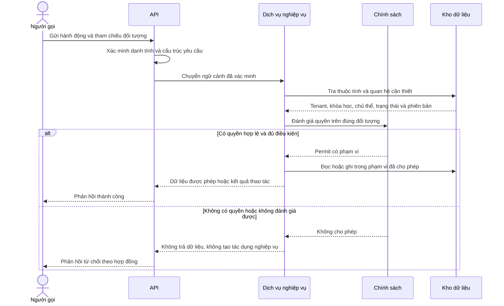

# Object-level authorization

## 1. Vì sao quyền gọi API chưa đủ?

**Object-level authorization** là việc kiểm tra chủ thể có được thực hiện một hành động trên **đúng đối tượng cụ thể** hay không. Đối tượng có thể là bài nộp, hóa đơn, tệp, hồ sơ, khóa học hoặc một bản ghi nghiệp vụ khác.

Một người dùng có quyền sử dụng chức năng “xem bài nộp” chưa chắc được xem mọi bài nộp trong hệ thống. Máy chủ cần phân biệt bài của chính người đó, bài của người khác, bài thuộc lớp mà người đó phụ trách và bài ở tổ chức khác.

Ví dụ:

```http
GET /courses/course-demo-a/submissions/submission-demo-17
```

Người gọi thay `submission-demo-17` bằng mã bài nộp của một học viên khác. Nếu máy chủ chỉ kiểm tra phiên đăng nhập rồi lấy bản ghi theo mã, dữ liệu có thể bị lộ dù cơ chế xác thực hoạt động đúng.

Lỗ hổng do thiếu hoặc sai kiểm tra quyền trên đối tượng thường được gọi là **broken object-level authorization**. Việc thay tham chiếu trực tiếp tới đối tượng là một cách khai thác phổ biến, thường được nhắc tới dưới tên **insecure direct object reference**. Tham chiếu có thể nằm trong URL, query, body, header, thông điệp hàng đợi hoặc liên kết tải tệp, không chỉ trong một tham số có tên `id`.

Trong thiết kế yêu cầu bảo mật, mục tiêu là chuyển câu “người dùng chỉ được truy cập dữ liệu của mình” thành quy tắc cụ thể: dữ liệu nào, hành động nào, quan hệ nào tạo quyền, nguồn nào xác minh quan hệ và kiểm thử nào chứng minh không thể vượt ranh giới.

## 2. Phân biệt các lớp kiểm soát quyền

| Lớp kiểm soát | Câu hỏi cần trả lời | Ví dụ |
|---|---|---|
| Xác thực | Chủ thể nào đang yêu cầu và bằng chứng có hợp lệ không? | Phiên thuộc học viên A |
| Quyền ở mức chức năng | Chủ thể có được dùng chức năng này không? | Học viên được gọi chức năng xem bài nộp |
| Quyền ở mức đối tượng | Chủ thể có được thực hiện hành động trên bản ghi này không? | A chỉ được đọc bài nộp phù hợp với quan hệ học tập của A |
| Quyền ở mức thuộc tính | Những trường nào được đọc hoặc sửa? | Học viên không được tự sửa điểm hoặc chủ sở hữu |
| Điều kiện nghiệp vụ | Trạng thái hiện tại có cho phép hành động không? | Chỉ sửa bài nháp trước hạn nộp |

Các lớp này bổ sung cho nhau. Kiểm tra vai trò `STUDENT` không thay thế kiểm tra bài nộp thuộc học viên nào. Kiểm tra chủ sở hữu cũng không tự cho phép sửa mọi trường hoặc bỏ qua trạng thái đã chấm điểm.

Không đồng nhất “đối tượng do người dùng tạo” với “người dùng có toàn quyền”. Một người tạo yêu cầu có thể không được tự phê duyệt yêu cầu đó; một học viên tạo bài nộp có thể không được xóa sau khi đã chấm điểm.

Tương tự, vai trò quản trị không mặc nhiên có quyền truy cập mọi đối tượng ở mọi tenant. Phạm vi quản trị phải là một phần của chính sách, bao gồm cả quyền hỗ trợ hoặc hành động thay người dùng nếu có.

## 3. Xác định chủ thể, hành động, đối tượng và quan hệ

### 3.1. Mô hình quyết định

Một quyết định có thể được biểu diễn như sau:

```text
authorize(
    subject,
    action,
    resource,
    trusted_context
) → Permit hoặc không cho phép
```

Để quyết định có ý nghĩa, cần biết:

- **Chủ thể:** mã nội bộ ổn định, trạng thái tài khoản, tenant được phép hoạt động và các quan hệ quyền cần thiết.
- **Hành động:** đọc nội dung, sửa bài nháp, chấm điểm, xóa, xuất, chia sẻ hoặc chuyển quyền sở hữu.
- **Đối tượng:** mã, loại, tenant, quan hệ cha–con, chủ thể liên quan, trạng thái và phiên bản.
- **Quan hệ tạo quyền:** sở hữu, được phân công phụ trách, được chia sẻ, là thành viên hợp lệ hoặc nhận ủy quyền.
- **Ngữ cảnh:** thời điểm, hạn nộp, điều kiện xác thực bổ sung hoặc phạm vi của một tác vụ.

Các quan hệ phải được lấy từ nguồn có thẩm quyền. Trường `owner_id`, `role` hoặc `tenant_id` do trình duyệt gửi không tự chứng minh người gọi có quyền tương ứng.

### 3.2. Một chính sách mẫu cho bài nộp

Giả sử hệ thống quản lý bài nộp trong các khóa học của nhiều tổ chức. Chính sách minh họa được chọn như sau:

| Chủ thể | Hành động | Điều kiện trên đối tượng và quan hệ |
|---|---|---|
| Học viên | `SUBMISSION_READ` | Bài nộp của chính học viên, cùng tenant hợp lệ và còn quan hệ học viên hoạt động trong khóa học |
| Học viên | `SUBMISSION_UPDATE_DRAFT` | Thỏa điều kiện đọc, bài ở trạng thái `DRAFT`, chưa qua hạn nộp và phiên bản còn khớp |
| Giảng viên | `SUBMISSION_READ` | Được phân công hoạt động trong đúng khóa học và tenant của bài nộp |
| Giảng viên | `SUBMISSION_GRADE` | Được phân công trong đúng khóa học, bài ở trạng thái cho phép chấm và đáp ứng điều kiện chấm điểm |
| Dịch vụ xuất dữ liệu | `SUBMISSION_EXPORT` | Có quyền kỹ thuật và ủy quyền hợp lệ cho đúng tác vụ, tenant, khóa học và tập đối tượng |
| Nhân viên hỗ trợ | Hành động hỗ trợ được chỉ định | Có quyền riêng theo phạm vi, mục đích và thời hạn; không suy quyền từ việc là nhân viên nội bộ |

Đây là quyết định của hệ thống giả định, không phải quy tắc bắt buộc cho mọi nền tảng học tập. Chẳng hạn, một sản phẩm khác có thể cho học viên đã kết thúc khóa vẫn đọc bài của mình; khi đó phải đặc tả quan hệ quyền tương ứng thay vì vô tình dùng dữ liệu cũ để cho qua.

Các trường hợp không có quyền cho phép phù hợp phải bị từ chối. Không dùng “có cùng tenant” như một quyền đọc toàn bộ dữ liệu của mọi thành viên trong tenant đó.

### 3.3. Ranh giới tenant và ranh giới người dùng là hai lớp

Có hai học viên A và B trong cùng tổ chức, học viên C ở tổ chức khác. A cần bị chặn khi đọc bài của B nếu không có quyền chia sẻ, và cũng cần bị chặn khi đọc bài của C.

Một kiểm tra chỉ có `resource.tenant_id == currentTenant` có thể ngăn chéo tổ chức nhưng vẫn cho phép truy cập ngang trong cùng tổ chức. Một kiểm tra chỉ có `resource.owner_id == subjectId` có thể bỏ sót điều kiện tenant hoặc quan hệ học tập theo chính sách.

Cần xác định đầy đủ tổ hợp điều kiện. Thiết kế có thể sử dụng vai trò, thuộc tính hoặc quan hệ, nhưng không được bỏ một ranh giới bắt buộc vì một ranh giới khác đã thỏa mãn.

## 4. Nhận diện mọi tham chiếu tới đối tượng

### 4.1. Mã định danh không phải bằng chứng cấp quyền

Số thứ tự, UUID hay chuỗi khó đoán đều có thể là mã đối tượng. Dùng mã khó đoán có thể giảm khả năng dò tìm, nhưng không thay kiểm tra quyền: mã vẫn có thể xuất hiện trong email, lịch sử trình duyệt, log hoặc liên kết chia sẻ.

Tương tự, việc mã đã được mã hóa hoặc ký không tự chứng minh người đang gửi mã được quyền thực hiện mọi hành động trên đối tượng. Phải biết mã chỉ bảo vệ tính toàn vẹn của tham chiếu hay thực sự biểu diễn một quyền được ủy quyền có phạm vi.

Nếu thiết kế cố ý dùng liên kết như một quyền truy cập, cần đặc tả hành động, đối tượng, thời hạn, khả năng chuyển tiếp và cách thu hồi. Một URL chỉ cho phép tải một tệp không tự cấp quyền sửa bài nộp chứa tệp đó.

### 4.2. Kiểm tra quan hệ cha–con

Xét đường dẫn:

```http
GET /courses/course-demo-a/submissions/submission-demo-b
```

Máy chủ không được chỉ kiểm tra người gọi có quyền trên `course-demo-a`, rồi lấy `submission-demo-b` theo mã mà không xác minh bài đó thuộc đúng khóa học A.

Cần kiểm tra cả:

1. Chủ thể có quyền thực hiện hành động trong khóa học tương ứng.
2. Bài nộp thực sự thuộc khóa học được tham chiếu.
3. Tenant và các quan hệ khác nhất quán theo dữ liệu có thẩm quyền.
4. Hành động được phép trên chính bài nộp và trạng thái hiện tại của nó.

Nguyên tắc này tiếp tục áp dụng cho tài nguyên lồng sâu như khóa học → bài nộp → tệp đính kèm → phiên bản tệp. Quyền trên một cha không tự lan xuống mọi con nếu chính sách không quy định việc kế thừa đó.

### 4.3. Tham chiếu gián tiếp và đối tượng mới

Một yêu cầu sao chép bài, gắn tệp, nhập dữ liệu hoặc tạo bản xuất có thể chứa nhiều mã đối tượng dù không có mã trong URL. Mỗi tham chiếu cần được đánh giá theo hành động tương ứng.

Khi tạo đối tượng mới, đối tượng chưa tồn tại không có nghĩa được bỏ phân quyền. Cần kiểm tra quyền tạo trong phạm vi cha hoặc tenant, xác minh các tham chiếu đầu vào và đặt thuộc tính nhạy cảm theo chính sách phía máy chủ.

Ví dụ, học viên tạo bài nộp không được tự chọn `student_id` của người khác hoặc một `course_id` ngoài quan hệ được phép. Nếu có chức năng tạo thay người khác, đó phải là một quyền riêng có điều kiện rõ ràng.

## 5. Kiến trúc thực thi quyền trên đối tượng

### 5.1. Kiểm tra tại nơi có đủ thông tin đáng tin cậy



Giao diện có thể giúp người dùng chọn đối tượng được phép, nhưng người gọi có thể sửa yêu cầu sau đó. API gateway có thể xác minh phiên và tuyến, nhưng thường chưa có đủ quan hệ nghiệp vụ để quyết định quyền trên từng bản ghi.

Thành phần thực thi cần nằm trên mọi đường tới dữ liệu hoặc tác dụng nghiệp vụ được bảo vệ. Nếu cùng một thao tác có thể gọi qua HTTP, tác vụ nền và công cụ hỗ trợ, cả ba đường phải tuân chính sách tương ứng.

### 5.2. Hai cách tổ chức tra cứu thường gặp

**Tra cứu đã giới hạn phạm vi** chỉ tìm đối tượng trong tập mà chủ thể được phép thao tác. **Tra cứu ngữ cảnh bảo mật rồi đánh giá** lấy những thuộc tính tối thiểu để kiểm tra chính sách trước khi trả hoặc sửa dữ liệu.

Cả hai cách đều có thể phù hợp. Cần bảo đảm việc lấy dữ liệu nội bộ để đánh giá quyền không làm lộ nội dung ra phản hồi, log hoặc cache trước khi quyết định cho phép.

Không dùng một hàm `findById` không giới hạn ở nhiều nơi rồi dựa vào trí nhớ của từng người gọi để tự thêm kiểm tra sau đó. Hợp đồng của tầng nghiệp vụ và kho dữ liệu phải làm rõ thao tác nào đã kiểm tra quyền, thao tác nào chỉ phục vụ kiểm tra và ai chịu trách nhiệm thực thi.

### 5.3. Tách ngữ cảnh quyền khỏi dữ liệu tự khai

Ngữ cảnh chủ thể cần bắt nguồn từ cơ chế xác thực đã được xác minh. Tenant hoạt động có thể được người dùng lựa chọn, nhưng máy chủ phải kiểm tra người đó có quan hệ phù hợp với tenant đã chọn.

Thuộc tính chủ sở hữu, tenant, khóa học và trạng thái của bài nộp phải được đọc hoặc xác minh từ dữ liệu quản lý. Không đối chiếu hai giá trị cùng do người gọi tự gửi rồi coi là đã xác thực quan hệ.

Nếu một dịch vụ phía trước gửi ngữ cảnh quyền cho dịch vụ phía sau, cần bảo vệ nguồn gửi, tính toàn vẹn, đích sử dụng và phạm vi của thông tin đó. Một header mang tên `X-User-Id` không tự đáng tin chỉ vì tên của nó trông như dữ liệu nội bộ.

## 6. Ví dụ tra cứu có phạm vi và cập nhật an toàn

### 6.1. Truy vấn minh họa cho học viên đọc bài của mình

Với chính sách mẫu, có thể giới hạn truy vấn theo chủ thể, tenant, khóa học trong đường dẫn và quan hệ học tập:

```sql
SELECT s.id, s.course_id, s.status, s.version, s.content
FROM submission s
JOIN course c
  ON c.id = s.course_id
 AND c.tenant_id = s.tenant_id
WHERE s.id = :submission_id
  AND s.course_id = :path_course_id
  AND s.tenant_id = :authorized_tenant_id
  AND s.student_id = :authenticated_subject_id
  AND EXISTS (
      SELECT 1
      FROM tenant_membership m
      WHERE m.tenant_id = s.tenant_id
        AND m.subject_id = :authenticated_subject_id
        AND m.status = 'ACTIVE'
  )
  AND EXISTS (
      SELECT 1
      FROM course_enrollment e
      WHERE e.tenant_id = s.tenant_id
        AND e.course_id = s.course_id
        AND e.student_id = :authenticated_subject_id
        AND e.status = 'ACTIVE'
  );
```

Đây là ví dụ cấu trúc dữ liệu giả định, không phải câu SQL áp dụng nguyên trạng cho mọi hệ thống. Các giá trị phải được truyền bằng tham số phù hợp; ngữ cảnh chủ thể và tenant phải do máy chủ xác minh.

Nếu không có hàng trả về, ứng dụng không được tự chuyển sang truy vấn chỉ theo `submission_id` để “thử tìm lại”. Một bước dự phòng như vậy có thể bỏ toàn bộ phạm vi quyền vừa thiết lập.

Truy vấn trên chỉ mô tả nhánh học viên. Nhánh giảng viên cần điều kiện phân công phụ trách tương ứng. Không được bỏ điều kiện học viên rồi coi mọi người có vai trò `TEACHER` là được đọc mọi bài nộp.

Việc truy vấn không trả hàng có thể là do đối tượng không tồn tại hoặc không nằm trong phạm vi được phép. Phản hồi công khai và mức phân biệt nội bộ cần theo hợp đồng tránh lộ thông tin của hệ thống.

### 6.2. Cập nhật cần ràng buộc cả quyền và trạng thái

Với hành động sửa bài nháp, hệ thống cần kiểm tra chủ thể, quan hệ học tập, tenant, khóa học, trạng thái `DRAFT`, hạn nộp và phiên bản dữ liệu.

Một điều kiện cập nhật có thể yêu cầu phiên bản hiện tại khớp phiên bản đã được kiểm tra. Nếu số hàng bị cập nhật không đúng kỳ vọng, không được coi thao tác là thành công hoặc tự ghi lại bằng một câu lệnh không có điều kiện.

Chỉ điều kiện phiên bản của bài nộp chưa chắc bảo vệ được thay đổi đồng thời của quan hệ quyền. Ví dụ, phân công giảng viên có thể bị thu hồi mà phiên bản bài nộp không đổi. Thiết kế phải xác định cách giữ nhất quán giữa dữ liệu quyền và dữ liệu đối tượng theo mức bảo đảm đã cam kết.

Có thể cần giao dịch với cách khóa phù hợp, phiên bản của quan hệ quyền, cập nhật có điều kiện hoặc một cơ chế phối hợp khác. Việc gọi kiểm tra quyền rồi gọi `save` trong hai bước rời rạc không tự tạo ra tính nguyên tử.

Thời gian dùng để kiểm tra hạn nộp phải lấy từ nguồn phía máy chủ theo chính sách, không dựa vào trường `current_time` mà người gọi gửi. Các trường điểm, chủ sở hữu và tenant không nằm trong tập thuộc tính được cập nhật bởi hành động sửa bài nháp.

## 7. Danh sách, tìm kiếm, hàng loạt và dữ liệu dẫn xuất

### 7.1. Mỗi đường trả dữ liệu phải giữ cùng ranh giới quyền

API đọc từng bài có thể đúng nhưng API danh sách lại trả toàn bộ bài trong khóa học. Vì vậy, cần đặc tả quyền cho:

- Danh sách và kết quả tìm kiếm.
- Tổng số bản ghi, phân trang, bộ lọc gợi ý và tự động hoàn thành.
- Báo cáo, thống kê và tệp xuất.
- Nội dung xem trước, ảnh thu nhỏ, tệp đính kèm và phiên bản cũ.
- Dữ liệu được trả qua sự kiện, thông báo hoặc luồng kết nối dài.

Ví dụ, học viên không được nhìn thấy bài của người khác thì một kết quả tìm kiếm cũng không nên trả tiêu đề, tác giả hoặc đoạn trích của những bài đó. Một API `count` không được tính toàn bộ dữ liệu rồi trả số lượng làm lộ hoạt động của lớp khác.

Nên giới hạn tập dữ liệu được phép trước khi thực hiện những phép tính hoặc phân trang có thể làm lộ thông tin. Nếu kiến trúc dùng chỉ mục tìm kiếm hoặc kho phân tích riêng, cần cơ chế truyền và thực thi phạm vi quyền tại đó; kiểm tra ở cơ sở dữ liệu chính không tự bảo vệ mọi bản sao.

### 7.2. Hàng loạt phải có hợp đồng theo từng đối tượng

Một yêu cầu chấm hoặc xóa nhiều bài cần đánh giá quyền cho từng đối tượng. Không kiểm tra bài đầu tiên rồi áp dụng kết quả cho cả danh sách, cũng không giả định mọi mã trong body thuộc cùng khóa học.

Có thể chọn một trong hai hợp đồng:

| Hợp đồng | Hành vi bắt buộc |
|---|---|
| Toàn bộ hoặc không có gì | Nếu một đối tượng không được phép, không tạo thay đổi trên bất kỳ đối tượng nào trong tập |
| Kết quả từng phần | Chỉ thao tác trên đối tượng được phép; phản hồi từng phần không làm lộ nội dung hoặc trạng thái bí mật của đối tượng bị từ chối |

Dự án phải chọn rõ cho từng hành động. Các tác dụng bên ngoài như gửi thông báo hoặc tạo tệp cũng cần nằm trong thiết kế, tránh thông báo đã được gửi dù giao dịch dữ liệu sau đó bị hủy.

### 7.3. Dữ liệu dẫn xuất vẫn có quyền truy cập

Một bản xuất ZIP hoặc PDF được tạo từ nhiều bài nộp là một tài nguyên mới có nội dung chịu ràng buộc quyền. Nó không được trở thành tệp công khai chỉ vì việc tạo tệp đã được thực hiện bởi một worker.

Cần quản lý ai được tải, tệp chứa tập dữ liệu nào, thời hạn tồn tại, cách thu hồi và tác động khi quyền đối với dữ liệu nguồn thay đổi. Một kho tệp chỉ biết khóa lưu trữ không tự biết quan hệ giảng viên, học viên hoặc tenant.

Ứng dụng nên ánh xạ tham chiếu nghiệp vụ tới tệp qua metadata có thẩm quyền. Không nhận một khóa lưu trữ tùy ý từ người gọi rồi tải dữ liệu bằng quyền hệ thống.

## 8. Vòng đời đối tượng, cache và xử lý bất đồng bộ

### 8.1. Thay đổi đối tượng có thể làm thay đổi quyền

Chuyển khóa học, đổi người phụ trách, thay tenant, chia sẻ, thu hồi chia sẻ, khóa tài khoản, kết thúc quan hệ học tập hoặc xóa mềm đều có thể tác động tới quyết định truy cập.

Cần đặc tả quyền đối với đối tượng đã xóa, phiên bản cũ và bản sao được khôi phục. Khôi phục dữ liệu không nên tự phục hồi một quyền chia sẻ đã bị thu hồi nếu chính sách không cho phép điều đó.

Chuyển chủ sở hữu hoặc chuyển tenant là hành động nhạy cảm riêng. Không cho phép người chỉ có quyền sửa nội dung tự thay các trường làm biến đổi ranh giới phân quyền.

### 8.2. Cache phải gắn với ngữ cảnh đủ chi tiết

Cache quyết định hoặc cache dữ liệu có thể làm lộ đối tượng nếu khóa chỉ có mã tài nguyên mà bỏ qua chủ thể, tenant, hành động hoặc phạm vi trường được phép.

Ví dụ, giảng viên được xem bài và điểm nội bộ, còn học viên chỉ được xem một tập trường hạn chế. Cache chung theo `submission_id` có thể trả bản phản hồi của giảng viên cho học viên dù lần kiểm tra quyền đọc đối tượng đã thành công.

Cần phân biệt cache dữ liệu thô nội bộ với cache phản hồi đã phân quyền. Bản phản hồi phải được ràng buộc với phạm vi truy cập phù hợp, hoặc được kiểm tra và lọc lại trước khi trả.

Đặc tả cần quy định thời hạn, phiên bản, sự kiện vô hiệu hóa và độ trễ thu hồi tối đa. Khi không chứng minh được độ mới bắt buộc, không dùng một kết quả `Permit` cũ để cho qua chỉ vì dịch vụ chính sách đang lỗi.

### 8.3. Worker phải biết mình đang hành động với quyền nào

Worker có thể có quyền kỹ thuật để đọc nhiều dữ liệu nhưng chỉ được thực hiện một tác vụ trong phạm vi đã được cho phép. Cần xác định danh tính dịch vụ, người khởi tạo nếu có, nội dung ủy quyền, tenant, tập đối tượng và thời hạn.

Chính sách phải nêu quyền được xét khi nhận tác vụ, khi worker đọc dữ liệu và khi người dùng nhận kết quả. Không tự coi một thông điệp đã vào hàng đợi là một quyền không hết hạn.

Trong hệ thống mẫu, worker xuất bài nộp kiểm tra lại quyền từ nguồn có thẩm quyền trước khi đọc; endpoint tải kết quả cũng kiểm tra lại quyền hiện tại. Hai bước này không tái sử dụng một `Permit` từ lúc tạo yêu cầu.

Đối với tác vụ hệ thống độc lập với người dùng, cần một quyền dịch vụ được cấp có chủ đích. Không giả lập một người dùng quản trị chỉ để tránh xác định chính sách của tác vụ.

### 8.4. Liên kết tải và luồng kéo dài

Nếu dùng liên kết tải có thời hạn thay cho kiểm tra lại tại mỗi lần tải, đó là một lựa chọn ủy quyền khác. Cần làm rõ liệu thu hồi quyền có chặn được liên kết ngay hay chỉ khi liên kết hết hạn.

Không hứa thu hồi ngay nếu cơ chế thực tế chỉ kiểm tra chữ ký và thời hạn mà không tra trạng thái thu hồi. Thời hạn liên kết, khả năng chuyển tiếp và giới hạn số lần sử dụng phải khớp với mô hình đe dọa.

Với tải tệp lớn hoặc luồng sự kiện kéo dài, cần xác định quyền được kiểm tra tại lúc bắt đầu hay được đánh giá lại trong quá trình chạy. Một lần kiểm tra đầu kết nối không tự đáp ứng yêu cầu thu hồi giữa luồng.

## 9. Bộ yêu cầu mẫu có thể đo và kiểm chứng

Bối cảnh áp dụng là chính sách bài nộp ở mục 3. Hệ thống dùng định danh nội bộ ổn định, dữ liệu tenant và quan hệ học tập có thẩm quyền. Các yêu cầu sau là đặc tả minh họa, không phải chính sách mặc định cho mọi sản phẩm.

| Mã | Yêu cầu bảo mật | Bằng chứng chấp nhận |
|---|---|---|
| OA-01 | Mọi hành động đọc, sửa, chấm, xóa, xuất và chia sẻ phải có điều kiện quyền trên từng đối tượng liên quan; thiếu quy tắc phù hợp thì từ chối | Đăng nhập hợp lệ và gọi được chức năng vẫn không truy cập được đối tượng ngoài phạm vi |
| OA-02 | Chủ thể dùng đánh giá quyền phải lấy từ ngữ cảnh xác thực đã xác minh; thuộc tính quyền không được tin chỉ vì có trong body hoặc header | Tự gửi mã chủ thể, vai trò hoặc tenant khác không thay đổi quyền thực tế |
| OA-03 | Học viên chỉ được đọc bài của mình khi thỏa quan hệ tenant và khóa học theo chính sách mẫu | A đọc được bài của A; không đọc được bài của B cùng tenant hoặc C khác tenant |
| OA-04 | Giảng viên chỉ được đọc hoặc chấm bài thuộc khóa học mà họ được phân công hợp lệ, với điều kiện trạng thái tương ứng | Đổi sang mã bài ở khóa học khác bị từ chối dù người gọi vẫn có vai trò giảng viên |
| OA-05 | Mọi tham chiếu cha–con phải được đối chiếu với dữ liệu có thẩm quyền trước khi cấp quyền trên đối tượng con | Dùng khóa học được phép với mã bài hoặc mã tệp của khóa học khác không trả dữ liệu |
| OA-06 | Hành động tạo hoặc sửa bài không được tự thay chủ thể sở hữu, tenant, điểm hoặc thuộc tính nhạy cảm ngoài quyền riêng | Gửi thêm các trường này không tạo thay đổi trái quyền; không có đường ghi dữ liệu trước khi từ chối |
| OA-07 | Danh sách, tìm kiếm, đếm, báo cáo và tệp xuất phải giữ cùng ranh giới đối tượng; trường trả về còn phải đúng quyền thuộc tính | Dữ liệu thử nghiệm trộn nhiều người và tenant không làm lộ nội dung, số lượng hoặc trường ngoài phạm vi |
| OA-08 | Thao tác hàng loạt của hệ thống mẫu dùng hợp đồng toàn bộ hoặc không có gì; từng đối tượng phải được kiểm tra trước tác dụng nghiệp vụ | Trộn một bài được phép và một bài không được phép không làm thay đổi bài nào |
| OA-09 | Cập nhật bài nháp phải kiểm tra quyền, trạng thái, hạn nộp và phiên bản theo cơ chế nhất quán đã thiết kế | Bài chuyển trạng thái, quá hạn hoặc đổi phiên bản trước lúc ghi không bị cập nhật bằng quyết định cũ |
| OA-10 | Hệ thống mẫu không tái sử dụng cache `Permit` giữa các yêu cầu trên bài nộp; mỗi yêu cầu phải đánh giá từ nguồn có thẩm quyền | Sau khi xác nhận thu hồi quan hệ quyền, yêu cầu mới bị từ chối thay vì dùng quyết định thành công trước đó |
| OA-11 | Worker phải kiểm tra lại quyền trước khi đọc; tải tệp kết quả phải kiểm tra quyền hiện tại; cả hai không dùng quyết định từ lúc xếp hàng | Thu hồi quyền trước khi worker bắt đầu hoặc trước khi tải làm bước tương ứng bị chặn |
| OA-12 | Không xác định được đối tượng, quan hệ bắt buộc hoặc quyết định chính sách hợp lệ thì không trả dữ liệu hoặc tạo tác dụng nghiệp vụ | Giả lập lỗi phụ thuộc, quan hệ thiếu và quyết định sai phạm vi đều không mở quyền |
| OA-13 | Mọi đường truy cập, gồm API trực tiếp, tác vụ nền và công cụ hỗ trợ, phải tuân chính sách trên đối tượng | Bỏ qua giao diện hoặc gọi một tuyến thay thế vẫn không vượt quyền |
| OA-14 | Sự kiện từ chối và thay đổi quan hệ quyền phải ghi được chủ thể, hành động, tham chiếu đối tượng, phiên bản chính sách và mã liên kết phù hợp | Có thể giải thích một quyết định mà không ghi token, nội dung bài hoặc dữ liệu thừa |

OA-10 quy định hành vi đối với yêu cầu mới sau khi thay đổi quyền đã được xác nhận tại nguồn có thẩm quyền. Yêu cầu đang chạy phải theo hợp đồng nhất quán của OA-09 hoặc quy tắc về luồng kéo dài; việc không dùng cache không tự làm mọi thao tác phân tán trở nên nguyên tử.

Nếu dự án cho phép cache quyền, phải thay OA-10 bằng giới hạn tuổi quyết định và thời gian thu hồi cụ thể, kèm cơ chế đo. Không dùng các từ “cập nhật nhanh” hoặc “thu hồi ngay” khi chưa xác định được ranh giới bảo đảm.

## 10. Phản hồi, logging và xử lý từ chối

### 10.1. Không để phản hồi làm lộ đối tượng

Ứng dụng cần chọn hợp đồng cho trường hợp đối tượng không tồn tại và đối tượng tồn tại nhưng người gọi không được phép biết. Tùy mô hình rủi ro, có thể dùng phản hồi chung để giảm khả năng dò sự tồn tại.

Điều quan trọng là không trả nội dung bài, tên học viên, tên tệp hoặc thuộc tính nhạy cảm trong một thông báo lỗi. Ví dụ “Bạn không được đọc bài của học viên B thuộc lớp X” có thể đã làm lộ thông tin dù body chính không chứa nội dung bài.

Cần kiểm tra cả mã trạng thái, cấu trúc body, header, URL chuyển hướng, nội dung xem trước và hành vi cache. Chỉ đổi câu hiển thị ở giao diện không che được dữ liệu mà API đã trả.

Không ghi thay đổi nghiệp vụ trước rồi trả lỗi để thể hiện đã từ chối. Với thao tác bị chặn, có thể ghi sự kiện bảo mật hoặc tăng bộ đếm lạm dụng theo chính sách, nhưng không được tạo tác dụng nghiệp vụ trái quyền.

### 10.2. Sự kiện cần đủ để giải thích quyết định

```json
{
  "event_type": "OBJECT_ACCESS_DENIED",
  "correlation_id": "request-demo-309",
  "subject_id": "subject-demo-a",
  "action": "SUBMISSION_READ",
  "resource_ref": "submission-ref-demo-17",
  "resource_type": "SUBMISSION",
  "enforcement_point": "submission-service",
  "policy_version": "submission-policy-v3",
  "reason_code": "REQUIRED_RELATION_NOT_SATISFIED",
  "occurred_at": "2026-01-15T11:00:00Z"
}
```

Đây là ví dụ cấu trúc sự kiện với dữ liệu giả lập. Khi có đủ dữ liệu đáng tin cậy, có thể thêm tham chiếu tenant, khóa học hoặc phiên bản quan hệ quyền theo nhu cầu kiểm toán.

Không ghi cookie, bearer token, liên kết tải còn hiệu lực, toàn bộ nội dung bài hoặc toàn bộ body chỉ để tiện điều tra. Tham chiếu đối tượng và định danh trong log vẫn có thể là dữ liệu nhạy cảm; cần quyền đọc, thời hạn lưu và cách bảo vệ phù hợp.

Mã tham chiếu do người gọi cung cấp phải được ghi theo cấu trúc an toàn, giới hạn độ dài và xử lý ký tự điều khiển. Cần phân biệt dữ liệu tự khai với thuộc tính đối tượng đã được máy chủ xác minh để tránh điều tra dựa trên một tenant hoặc chủ sở hữu giả.

### 10.3. Quan sát và phục hồi

Có thể theo dõi nhiều lần đổi mã đối tượng, truy cập chéo tenant, dùng quyết định sai phạm vi hoặc tăng đột biến lỗi quan hệ quyền. Tuy nhiên, một đợt từ chối tăng cao cũng có thể do thay đổi phân công, dữ liệu quan hệ lỗi hoặc triển khai thiếu chính sách.

Khi người hợp lệ bị chặn, cần sửa đúng quan hệ, dữ liệu hoặc chính sách qua quy trình có quyền. Không xử lý bằng cách bỏ kiểm tra đối tượng ở một endpoint hoặc cấp quyền toàn tenant ngoài nhu cầu.

Phục hồi dữ liệu và phân công cũng phải tạo dấu vết thay đổi. Nhóm vận hành cần biết việc sửa có ảnh hưởng tới cache, worker đang chờ, tệp đã xuất và liên kết đã phát hành hay không.

## 11. Bộ dữ liệu và ma trận kiểm thử chấp nhận

### 11.1. Tạo các quan hệ khác nhau có chủ đích

Một bộ dữ liệu giả lập có thể gồm:

- Tenant T1 có khóa học K1 và K2; tenant T2 có khóa học K3.
- Học viên A và B thuộc T1, có quan hệ học tập hoạt động trong K1; C thuộc T2 và K3.
- A sở hữu bài S-A trong K1; B sở hữu S-B trong K1; C sở hữu S-C trong K3.
- Giảng viên I1 phụ trách K1, I2 chỉ phụ trách K2, I3 chỉ phụ trách K3.
- Mỗi bài có tệp đính kèm và phiên bản riêng; có một số bài nháp, bài đã nộp và bài đã chấm.
- Một quan hệ bị thu hồi và một quyền chia sẻ có thời hạn để kiểm tra vòng đời nếu sản phẩm hỗ trợ chia sẻ.

Bộ dữ liệu cần có cả khác chủ sở hữu trong cùng khóa học, khác khóa học trong cùng tenant và khác tenant. Nếu chỉ dùng một người hoặc một tổ chức, nhiều lỗi phân quyền sẽ không xuất hiện.

### 11.2. Kiểm tra cả quyền hợp lệ và cách vượt ranh giới

| Ca kiểm thử | Yêu cầu hoặc thay đổi | Kết quả mong đợi |
|---|---|---|
| Quyền học viên hợp lệ | A đọc S-A khi mọi quan hệ còn hợp lệ | Chỉ trả các trường A được phép đọc |
| Truy cập ngang | A đọc S-B trong cùng K1 | Từ chối, không lộ nội dung hoặc thuộc tính bí mật của S-B |
| Chéo tenant | A đọc S-C hoặc đổi tenant đầu vào sang T2 | Không tạo quyền trên T2 từ dữ liệu tự khai |
| Giảng viên đúng phân công | I1 đọc hoặc chấm bài K1 theo trạng thái cho phép | Thực thi đúng hành động và phạm vi được cấp |
| Giảng viên sai khóa học | I2 đọc bài K1 hoặc I1 đọc bài K3 | Từ chối dù người gọi có vai trò giảng viên |
| Sai quan hệ cha–con | Dùng K1 trong URL nhưng mã bài thuộc K3 | Không trả bài K3 và không dùng quyền trên K1 để cho qua |
| Tệp con không khớp | Dùng S-A với mã tệp của S-B | Không trả tệp ngoài quan hệ được phép |
| Đổi nơi chứa tham chiếu | Thay mã trong query, body, thông điệp hoặc tuyến thay thế | Vẫn kiểm tra cùng chính sách trên đối tượng |
| Giả mạo thuộc tính | Gửi `student_id`, vai trò hoặc tenant của người khác | Không thay đổi chủ thể hiệu lực hoặc quyền thực tế |
| Sửa trường ngoài quyền | A gửi thêm điểm, chủ sở hữu hoặc trạng thái đặc quyền | Không ghi các trường ngoài hành động được cấp |
| Tạo thay người khác | A tạo bài với mã học viên B hoặc khóa học không được phép | Không tạo đối tượng trái phạm vi |
| Trạng thái và thời gian | Sửa bài đã nộp hoặc bài quá hạn theo chính sách mẫu | Không cập nhật nội dung bằng quyền sửa bài nháp |
| Đồng thời | Đổi trạng thái, phiên bản hoặc quan hệ quyền giữa các bước | Đúng hợp đồng nhất quán; quyết định cũ không tạo thay đổi trái quyền |
| Danh sách và tìm kiếm | A tìm kiếm hoặc đếm trên dữ liệu trộn A, B và C | Không lộ hàng, đoạn trích, số lượng hoặc trường ngoài phạm vi |
| Hàng loạt | Tập yêu cầu chứa cả S-A và S-B do A gửi | Theo hợp đồng mẫu, không có bài nào bị thay đổi |
| Thu hồi quyền | Thu hồi phân công hoặc quan hệ học tập rồi gửi yêu cầu mới | Không dùng một `Permit` trước đó để cho qua |
| Worker và tệp xuất | Thu hồi quyền trước khi worker đọc hoặc trước khi tải tệp | Bước tương ứng bị từ chối bằng kiểm tra mới |
| Cache phản hồi | Giảng viên đọc trước, sau đó học viên đọc cùng bài được phép | Học viên không nhận các trường chỉ giảng viên được xem |
| Lỗi phụ thuộc | Không lấy được quan hệ, chính sách hoặc thuộc tính bắt buộc | Không tự cho phép và không trả dữ liệu đã tra nội bộ |
| Logging và lỗi | Gửi yêu cầu bị từ chối với mã đối tượng giả lập | Có dấu vết phù hợp; phản hồi và log không chứa bí mật hoặc dữ liệu thừa |

Nên kiểm tra bằng cách thay quan hệ giữa các tài khoản và đối tượng đã chuẩn bị sẵn. Không cần dò tài nguyên của người dùng thật để chứng minh cơ chế kiểm soát.

Với thao tác ghi, kết quả cần được xác nhận ở dữ liệu hoặc tác dụng thực tế, không chỉ qua mã HTTP. Với truy cập đọc, cần kiểm tra cả body, trường phụ, metadata và bản xuất. Một mã lỗi đúng không chứng minh dữ liệu chưa bị thay đổi hoặc chưa bị gửi qua một kênh khác.

## 12. Liên kết yêu cầu với rủi ro và vòng đời phát triển

Có thể truy vết các yêu cầu như sau:

```text
Rủi ro: học viên đọc bài của người khác
  → Yêu cầu: OA-01, OA-02 và OA-03
  → Thiết kế: chủ thể đã xác minh, quan hệ sở hữu và truy vấn có phạm vi
  → Kiểm thử: A đọc S-A được phép, A đọc S-B bị từ chối

Rủi ro: dùng quyền trên cha để truy cập con không liên quan
  → Yêu cầu: OA-04 và OA-05
  → Thiết kế: quan hệ khóa học, bài nộp và tệp từ nguồn có thẩm quyền
  → Kiểm thử: trộn mã khóa học, bài nộp và tệp giữa các phạm vi

Rủi ro: bản xuất còn truy cập được sau khi mất quyền
  → Yêu cầu: OA-10 và OA-11
  → Thiết kế: đánh giá mới ở worker và endpoint tải, bảo vệ tệp dẫn xuất
  → Kiểm thử: thu hồi trước khi chạy và trước khi tải
```

Khi thêm API, trường tham chiếu, hành động hàng loạt hoặc loại tệp mới, cần cập nhật danh mục đối tượng và những quan hệ tạo quyền. Đừng chỉ thêm kiểm tra vào endpoint từng bị phát hiện lỗi; cùng một đối tượng có thể được truy cập qua nhiều chức năng.

Thay đổi schema, chuyển tenant, tách dịch vụ hoặc thêm kho tìm kiếm đều có thể ảnh hưởng nơi kiểm tra quyền và độ mới của quan hệ. Yêu cầu, thiết kế dữ liệu và kiểm thử phải cùng phản ánh ranh giới mới.

Dữ liệu phân quyền cũng cần cơ chế bảo vệ thay đổi. Nếu người dùng có thể tự thêm quan hệ sở hữu, phân công giảng viên hoặc quyền chia sẻ mà không kiểm soát, một bộ máy kiểm tra đúng vẫn có thể cấp quyền từ dữ liệu đã bị sửa trái phép.

## 13. Mẫu đặc tả cho một loại đối tượng

> Với hành động **[action]** trên **[loại và mã đối tượng]**, hệ thống phải xác minh **[chủ thể]** từ **[nguồn xác thực]**, lấy **[tenant, quan hệ cha–con, chủ sở hữu, trạng thái và phiên bản cần thiết]** từ **[nguồn có thẩm quyền]**, rồi kiểm tra **[quan hệ và điều kiện tạo quyền]**. Quyền chỉ áp dụng cho **[phạm vi đối tượng và thuộc tính]** tại **[thời điểm kiểm tra hoặc thực thi]**. Không có quyền phù hợp, thiếu dữ liệu bắt buộc hoặc lỗi đánh giá phải dẫn tới **[phản hồi và hành vi không tạo tác dụng nghiệp vụ]**. Quy tắc này áp dụng cho **[đọc đơn lẻ, danh sách, hàng loạt, tệp và tác vụ nền]**, với **[cơ chế nhất quán, cache và thu hồi]**, và được chứng minh bằng **[ca kiểm thử cùng sự kiện kiểm toán]**.

Đặc tả tốt làm rõ vì sao một chủ thể được phép tác động tới một đối tượng cụ thể, thay vì chỉ mô tả cách tìm đối tượng theo mã. Khi quan hệ quyền, nguồn dữ liệu, thời điểm kiểm tra và tiêu chí chấp nhận đều rõ ràng, object-level authorization trở thành một yêu cầu bảo mật có thể triển khai và kiểm chứng.
