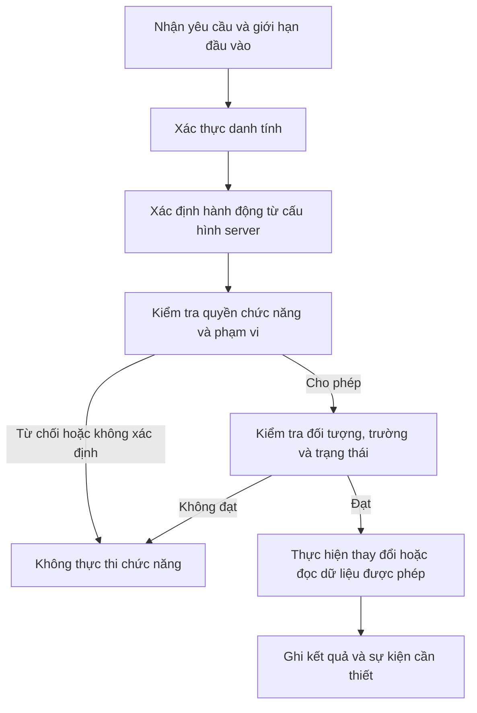

# Function-level authorization — Yêu cầu phân quyền theo chức năng

## 1. Phân quyền theo chức năng bảo vệ điều gì?

**Function-level authorization** là việc kiểm tra một chủ thể có được phép thực hiện một chức năng hoặc hành động nghiệp vụ hay không. Chức năng có thể là xuất báo cáo, công bố tài liệu, quản lý thành viên, thay chính sách hoặc chạy một tác vụ vận hành. Endpoint, resolver GraphQL, thông điệp trong hàng đợi và lệnh nội bộ là những đường vào để thực hiện chức năng đó.

Trong chương **Yêu cầu authorization**, mục tiêu của đặc tả là chuyển câu “chỉ người có quyền mới được dùng tính năng” thành hợp đồng cụ thể: chủ thể nào được gọi hành động nào, trong phạm vi nào, qua những đường vào nào, hệ thống kiểm tra ở đâu và sẽ phản ứng thế nào khi không đủ quyền.

Ví dụ, người viết tài liệu có thể sửa bản nháp nhưng không được công bố. Nếu ứng dụng chỉ ẩn nút “Công bố”, người dùng vẫn có thể gọi trực tiếp `POST /documents/{id}/publish`. Nếu server thực hiện mà không xét quyền công bố, đây là lỗi phân quyền theo chức năng, thường gọi là **broken function-level authorization**.

Một yêu cầu có thể kiểm chứng:

> **FLA-PUB-01:** Mọi đường thực hiện công bố tài liệu phải yêu cầu quyền `document:publish` trong tenant đích trước khi thay đổi trạng thái, phát sự kiện công bố hoặc gọi hệ thống phân phối nội dung. Người chỉ có quyền đọc hoặc sửa tài liệu không được thực hiện chức năng này, kể cả với tài liệu do chính mình tạo.

Chức năng được phép còn phải chịu các kiểm tra đối tượng và điều kiện nghiệp vụ. Có quyền công bố không tự cho phép công bố tài liệu của tenant khác hoặc tài liệu chưa hoàn tất quy trình duyệt.

## 2. Phân biệt ba lớp kiểm tra quyền

| Lớp kiểm tra | Câu hỏi cần trả lời | Ví dụ bị từ chối |
|---|---|---|
| Theo chức năng | Chủ thể có được thực hiện hành động này không? | Người viết gọi chức năng quản lý thành viên |
| Theo đối tượng | Chủ thể có được thực hiện hành động trên đối tượng cụ thể này không? | Biên tập viên công bố tài liệu ngoài dự án được phân công |
| Theo trường hoặc thuộc tính | Chủ thể có được đọc hoặc thay đổi phần dữ liệu này không? | Người sửa bản nháp ghi thêm `approved_by` hoặc trường phân loại nhạy cảm |

Ba lớp bổ sung cho nhau. Chỉ kiểm tra chủ sở hữu tài liệu không đủ nếu chủ sở hữu không có quyền công bố. Chỉ kiểm tra quyền công bố cũng không đủ nếu tài liệu thuộc tenant khác. Cho phép sửa tài liệu không có nghĩa được ghi mọi trường trong payload.

Trong bài này, ví dụ xuyên suốt là một hệ thống quản lý tài liệu nhiều tenant. Các vai trò minh họa gồm người viết, biên tập viên, quản trị viên tenant, nhân viên hỗ trợ và worker xuất dữ liệu. Các quyền và con số được đưa ra là lựa chọn thiết kế cho ví dụ, không phải yêu cầu mặc định cho mọi sản phẩm.

## 3. Xác định chức năng trước khi gắn quyền vào endpoint

### 3.1. Hành động nghiệp vụ khác tên đường dẫn

Một chức năng có thể được gọi qua nhiều đường. Ngược lại, một endpoint tổng quát có thể thực hiện nhiều chức năng khác nhau tùy nội dung yêu cầu.

| Đường gọi | Hành động thực tế | Điều cần đặc tả |
|---|---|---|
| `POST /documents/{id}/publish` | Công bố tài liệu | Yêu cầu `document:publish` |
| `POST /v2/documents/{id}/publication` | Cùng chức năng công bố qua API phiên bản khác | Không được yếu hơn đường gọi còn lại |
| GraphQL mutation `publishDocument` | Công bố tài liệu | Resolver phải áp dụng cùng điều kiện quyền |
| `PATCH /documents/{id}` với trạng thái mới | Có thể vô tình biến sửa nháp thành công bố | Cấm chuyển trạng thái qua đường sửa hoặc kiểm tra hành động chuyên biệt |
| `POST /actions` với một mã lệnh | Nhiều chức năng tùy lệnh | Server ánh xạ lệnh vào danh mục tin cậy và kiểm tra từng hành động |
| Thông điệp `PublishDocument` | Công bố qua đường bất đồng bộ | Consumer kiểm tra nguồn gọi và quyền ủy nhiệm phù hợp |

Không suy luận quyền chỉ từ tiền tố `/admin`. Một chức năng đặc quyền có thể nằm ngoài tiền tố đó, còn một endpoint trong vùng quản trị có thể chỉ trả metadata ít nhạy cảm. Tên URL giúp tổ chức API nhưng không thay thế mô hình quyền.

### 3.2. Danh mục đường vào là đầu vào bắt buộc

Danh mục cần bao phủ:

- Endpoint HTTP theo phương thức và phiên bản, gồm alias và đường tương thích cũ.
- Resolver GraphQL, thao tác trong RPC và các lệnh được dispatch từ endpoint tổng quát.
- Consumer hàng đợi, job nền, công cụ quản trị và tác vụ theo lịch.
- API nội bộ giữa các dịch vụ và đường truy cập trực tiếp tới backend.
- Các tùy chọn làm thay đổi hành động, như xuất hàng loạt, công bố ngay, chạy lại hoặc bỏ qua bước.

Mỗi mục phải có chủ sở hữu, hành động nghiệp vụ, yêu cầu quyền, phạm vi tenant, điểm thực thi và tiêu chí kiểm thử. Chức năng công khai cũng phải được phân loại rõ; không để “chưa khai báo quyền” mặc nhiên có nghĩa công khai.

> **FLA-CAT-01:** Mọi đường vào đã đăng ký phải được ánh xạ tới một hành động hoặc phân loại công khai đã phê duyệt. Đường vào thực hiện nghiệp vụ nhưng thiếu ánh xạ không được thực thi mặc định. Quy trình phát hành phải phát hiện mục thiếu trước khi đưa vào production.

Các request như CORS preflight có thể được xử lý riêng theo giao thức nếu không thực hiện chức năng nghiệp vụ. Không dùng quy tắc “mọi OPTIONS đều được phép” để cho phép một handler thực hiện hành động được bảo vệ.

## 4. Từ rủi ro đến yêu cầu có thể kiểm chứng

| Mã rủi ro | Kịch bản đe dọa | Mục tiêu kiểm soát |
|---|---|---|
| R-01 | Người dùng thường gọi trực tiếp API đặc quyền | Server kiểm tra quyền chức năng trước khi thực thi |
| R-02 | API cũ, alias hoặc resolver bỏ qua kiểm tra | Ánh xạ và bảo vệ mọi đường tới cùng hành động |
| R-03 | Payload sửa tài liệu chuyển luôn sang trạng thái công bố | Tách chuyển trạng thái khỏi cập nhật trường thông thường |
| R-04 | Client giả role, scope, tenant hoặc cờ quản trị | Chỉ dùng dữ liệu có nguồn tin cậy, kiểm tra quyền hiện tại |
| R-05 | Dịch vụ nội bộ thực hiện lệnh với quyền rộng thay người gọi | Kiểm tra cả workload và phạm vi ủy quyền |
| R-06 | Vai trò đã thu hồi vẫn được dùng qua cache hoặc token cũ | Thời gian hội tụ và cơ chế vô hiệu hóa đo được |
| R-07 | Lỗi dịch vụ chính sách làm hệ thống tự cho phép | Từ chối hoặc yêu cầu thử lại khi không xác định được quyền |
| R-08 | Kiểm tra diễn ra sau khi đã xếp hàng hoặc tạo tác động | Chặn trước tác động nghiệp vụ và kiểm tra lại lúc thực thi |
| R-09 | Nhân viên tenant cấp hoặc gọi chức năng nền tảng | Tách quyền quản trị tenant và quản trị nền tảng |
| R-10 | Kết quả API trông như từ chối nhưng thao tác vẫn đã chạy | Kiểm tra trạng thái, message, sự kiện và lời gọi phụ trợ khi nghiệm thu |

Một yêu cầu cần nêu được chủ thể, hành động, phạm vi, điều kiện, điểm kiểm tra và kết quả quan sát được. “API phải có authorization” không đủ vì chưa biết quyền nào được xét hoặc một quyết định từ chối có thật sự ngăn tác động hay không.

## 5. Thiết kế danh mục quyền và ma trận chức năng

### 5.1. Quyền mô tả hành động, vai trò nhóm quyền

Các quyền minh họa:

```text
document:read          đọc tài liệu trong phạm vi được phép
document:update        sửa nội dung theo điều kiện trạng thái và trường dữ liệu
document:publish       thực hiện quy trình công bố
document:export        yêu cầu xuất dữ liệu theo phạm vi được cấp
membership:manage      quản lý thành viên và vai trò tenant trong giới hạn
platform-policy:manage thay chính sách cấp nền tảng
export-job:execute     thực thi tác vụ xuất đã được cấp phép
```

Quyền `document:update` không bao gồm `document:publish`. Quyền `document:read` không tự bao gồm xuất hàng loạt. Quyền quản lý thành viên tenant không tự bao gồm quyền sửa chính sách nền tảng.

Ma trận mẫu:

| Chủ thể hoặc vai trò | Đọc | Sửa nháp | Công bố | Yêu cầu xuất | Quản lý thành viên | Chính sách nền tảng |
|---|---|---|---|---|---|---|
| Người viết | Theo phạm vi được cấp | Bản nháp được phép | Không | Không | Không | Không |
| Biên tập viên | Theo dự án được phân công | Theo nhiệm vụ được cấp | Trong phạm vi được phân công, đủ điều kiện | Chỉ khi có quyền xuất riêng | Không | Không |
| Quản trị viên tenant | Không tự có quyền nội dung | Không tự có | Không tự có | Không tự có | Trong tenant và danh mục vai trò được ủy quyền | Không |
| Hỗ trợ vận hành | Metadata hoặc dữ liệu đã che theo nhiệm vụ | Không | Không | Không | Không | Không |
| Worker xuất | Chỉ dữ liệu của tác vụ hợp lệ | Không | Không | Không nhận quyền yêu cầu thay người dùng | Không | Không |

Worker có quyền `export-job:execute` để chạy tác vụ đã được kiểm tra; quyền đó không đồng nghĩa có quyền tự tạo mọi yêu cầu xuất. Nếu có một tác vụ hệ thống độc lập với người dùng, phải có chính sách dịch vụ riêng cho mục đích đó.

### 5.2. Tách vai trò khỏi quyết định cuối cùng

Server có thể ánh xạ vai trò thành quyền, nhưng quyết định còn xét tenant, membership hiện tại và ràng buộc nghiệp vụ. Khi một người có nhiều vai trò, phải xác định cách kết hợp và các điều kiện không được vượt qua.

Trong hồ sơ ví dụ, các điều kiện bắt buộc được xét trước; sau đó phải có quyền hành động phù hợp trong phạm vi đích. Nếu token có scope giới hạn việc sử dụng API, scope là một giới hạn bổ sung theo hồ sơ token, không thay thế quyền nghiệp vụ hiện tại.

```text
Cho phép hành động khi:
  danh tính hợp lệ và chủ thể đang hoạt động
  AND hành động đã được ánh xạ từ đường gọi ở server
  AND chủ thể có quyền hành động trong phạm vi đích
  AND giới hạn của credential hoặc token, nếu áp dụng, được đáp ứng
  AND các ràng buộc tenant và nghiệp vụ vẫn đúng
```

Các trường `role`, `permission`, `is_admin` hoặc header do người gọi tự cung cấp không phải nguồn quyền có thẩm quyền. Token được ký hợp lệ cũng cần đúng issuer, audience, thời hạn và hồ sơ sử dụng trước khi các claim được tin; role trong token có thể còn cần đối chiếu trạng thái thu hồi hiện tại.

## 6. Điểm thực thi và thứ tự kiểm tra

### 6.1. Kiểm tra trước tác động nghiệp vụ

Điểm thực thi chính sách, thường gọi là PEP, phải ngăn handler tiếp tục khi không được phép. Thành phần ra quyết định có thể nằm trong cùng dịch vụ hoặc là một dịch vụ chính sách riêng. Cần biết thành phần nào ra quyết định và thành phần nào bảo đảm quyết định được thực hiện.



Việc phân tích cú pháp có giới hạn và lấy ngữ cảnh tối thiểu có thể cần trước quyết định. Tuy nhiên, khi bị từ chối quyền chức năng, hệ thống không được thay đổi dữ liệu nghiệp vụ, đưa tác vụ vào hàng đợi để thực thi, gửi thư công bố hoặc gọi bên thứ ba thực hiện hành động đó. Ghi nhận sự kiện từ chối là hoạt động kiểm toán hợp lệ, cần tách khỏi tác động của chức năng bị cấm.

> **FLA-ENF-01:** Quyết định từ chối quyền chức năng phải chặn mọi tác động nghiệp vụ của hành động. Nghiệm thu phải xác minh cả dữ liệu, tác vụ, sự kiện và lời gọi phụ trợ, không chỉ mã phản hồi HTTP.

### 6.2. Gateway và dịch vụ giữ tài nguyên

Gateway có thể kiểm tra credential hoặc phạm vi API thô. Dịch vụ thực hiện chức năng vẫn cần kiểm tra quyền ở nơi có đủ ngữ cảnh và bao phủ cả đường nội bộ. Không cho rằng request đi qua mạng riêng hoặc có mTLS thì đã được phép gọi mọi chức năng.

Một cơ chế bảo vệ có thể được dùng chung để tránh khác biệt giữa các handler. Dù dùng middleware, interceptor, annotation hay kiểm tra ở lớp ứng dụng, cần chứng minh nó hoạt động trên đường gọi thực tế. Tên annotation hoặc một dòng cấu hình không tự là bằng chứng đã thực thi.

### 6.3. Chức năng mới mặc định chưa được phép

Một handler mới, một phương thức HTTP mới hoặc một resolver mới không được tự thừa hưởng quyền rộng do nằm cùng controller. Phải có ánh xạ hành động rõ ràng hoặc một quy tắc bao phủ đã được phê duyệt có thể kiểm tra.

Nếu runtime nhận đường gọi không tồn tại, hệ thống có thể trả lỗi không tìm thấy. Nếu đường gọi đã tồn tại nhưng thiếu chính sách, không được tiếp tục handler. Có thể làm ứng dụng không khởi động hoặc chặn phát hành khi phát hiện cấu hình thiếu, tùy quy trình triển khai.

## 7. Ngăn các đường gọi tương đương vượt quyền

### 7.1. Phương thức HTTP, alias và phiên bản

Danh mục quyền phải dùng phương thức thực tế mà ứng dụng thực thi sau các quy tắc định tuyến hoặc method override đã cho phép. Gateway và backend cần thống nhất cách diễn giải. Nếu không hỗ trợ method override, phải từ chối hoặc bỏ qua theo một quy tắc nhất quán, không để nó đổi hành động ngoài kiểm soát.

Mọi alias và phiên bản còn hoạt động của chức năng công bố phải có cùng ràng buộc an toàn. Một endpoint cũ ít được dùng vẫn là đường truy cập có hiệu lực.

GET và HEAD không được dùng để âm thầm thay trạng thái nghiệp vụ. Nếu một tham số như `download=all` hoặc `export=true` làm chuyển từ đọc từng tài liệu sang xuất dữ liệu, server phải xét hành động xuất tương ứng thay vì chỉ dựa vào quyền đọc.

### 7.2. Endpoint cập nhật tổng quát

Trong hồ sơ mẫu, `PATCH /documents/{id}` chỉ sửa các trường nội dung cho phép và không thực hiện công bố. Payload có `status=PUBLISHED`, `published_by` hoặc cờ bỏ qua quy trình phải bị từ chối. Công bố được thực hiện qua một lệnh riêng yêu cầu `document:publish`.

Nếu sản phẩm cho phép một API tổng quát chuyển trạng thái, API đó phải ánh xạ chuyển trạng thái thành hành động tương ứng và kiểm tra trước khi ghi. Không để cùng kết quả nghiệp vụ có một đường kiểm tra quyền và một đường chỉ kiểm tra quyền sửa.

### 7.3. Dispatch lệnh theo dữ liệu đầu vào

Với endpoint nhận `action`, server cần danh sách lệnh cho phép và ánh xạ cố định từ mã lệnh sang chức năng. Giá trị người gọi gửi chỉ chọn trong danh mục; nó không được quyết định tên permission có thẩm quyền hoặc tên phương thức tùy ý để thực thi.

Lệnh không biết, biến thể không hỗ trợ hoặc tham số nâng hành động sang quyền cao hơn phải được xử lý rõ ràng. Không dùng nhánh mặc định thực hiện một lệnh quản trị khi không nhận diện được action.

## 8. GraphQL và thao tác hàng loạt

### 8.1. Một endpoint không có nghĩa chỉ có một quyền

GraphQL thường có nhiều chức năng sau cùng một đường HTTP. Chỉ kiểm tra người gọi được dùng `/graphql` không phân biệt quyền đọc, công bố hay quản lý thành viên.

> **FLA-GQL-01:** Mỗi resolver thực hiện chức năng được bảo vệ phải áp dụng quyền hành động tương ứng trước khi thực thi. Alias, fragment, nhiều field hoặc nhiều operation không được làm thay đổi điều kiện quyền của chức năng.

Các field dữ liệu cần kiểm tra quyền đọc đối tượng và trường tương ứng. Với truy vấn cho phép kết quả từng phần, field trái phép không được trả dữ liệu; field được phép có thể xử lý theo hợp đồng của schema. Thông báo lỗi không được tiết lộ dữ liệu nhạy cảm hoặc chi tiết chính sách không cần thiết.

HTTP `200` có thể đi cùng lỗi trong phản hồi GraphQL, vì vậy nghiệm thu phải kiểm tra dữ liệu, lỗi và việc resolver có thực hiện tác động hay không. Chỉ kiểm tra status code không đủ chứng minh phân quyền.

Để giảm độ phức tạp của các lệnh thay đổi, hồ sơ sản phẩm minh họa chỉ cho phép một top-level mutation trong một operation. Nếu muốn hỗ trợ nhiều mutation, cần đặc tả thứ tự kiểm tra, kết quả từng phần và tính nguyên tử; không giả định từ chối một mutation sẽ tự hoàn tác mutation trước đó.

### 8.2. Batch và bulk cần hợp đồng riêng

Batch nhiều request phải kiểm tra mỗi operation theo danh tính và hành động của nó. Không được dùng kết quả cho phép của một request làm quyền cho toàn bộ batch.

Một chức năng bulk, chẳng hạn công bố nhiều tài liệu, cần quyền gọi chức năng và quyền trên từng tài liệu. Trong ví dụ, lệnh công bố hàng loạt dùng ngữ nghĩa tất cả hoặc không có gì: nếu một mục không đủ quyền hoặc trạng thái, không mục nào được công bố. Kiểm tra và ghi cần được thiết kế nhất quán với cam kết đó.

Nếu sản phẩm chọn kết quả từng phần, phải ghi rõ từng tác động được phép và cách phản hồi mà không làm lộ đối tượng ngoài quyền. Hạn mức số lượng hoặc kích thước batch là yêu cầu chống lạm dụng bổ sung, không thay thế kiểm tra quyền.

## 9. Dịch vụ nội bộ và thực thi bất đồng bộ

### 9.1. Phân biệt người khởi tạo và workload thực hiện

Một worker có quyền kỹ thuật đọc dữ liệu không có nghĩa mọi người được nhờ worker đọc dữ liệu đó. Nếu API chỉ xếp yêu cầu vào hàng đợi rồi worker thực hiện bằng một tài khoản rộng, người dùng có thể mượn quyền dịch vụ để gọi chức năng bị cấm.

Yêu cầu cần xác định đồng thời:

1. Workload nào được thực thi loại tác vụ.
2. Ai khởi tạo và có quyền gọi chức năng nào.
3. Tenant, tài nguyên và giới hạn được ủy quyền.
4. Thời hạn và trạng thái quyền phải kiểm tra khi chạy.
5. Điều kiện truy cập kết quả sau khi hoàn tất.

> **FLA-ASYNC-01:** Tạo tác vụ xuất phải yêu cầu `document:export` trước khi ghi tác vụ có thể thực thi. Worker chỉ chạy tác vụ từ nguồn được tin cậy, có quyền `export-job:execute` và kiểm tra người khởi tạo còn được phép xuất trong phạm vi tác vụ. Không có quyền hiện tại thì không thực hiện xuất bằng quyền cũ.

Phạm vi khi chạy không được rộng hơn phạm vi đã được chấp thuận lúc tạo. Nếu người dùng được cấp thêm quyền sau đó, một tác vụ cũ không tự bao gồm mọi tài liệu vừa được mở quyền. Nếu người dùng mất quyền, worker phải thu hẹp hoặc hủy theo hợp đồng đã định nghĩa.

### 9.2. Ngữ cảnh ủy quyền phải có nguồn tin cậy

Thông tin chủ thể và tenant trong message phải được bảo vệ và xác minh theo kiến trúc, chẳng hạn thông qua bản ghi tác vụ có thẩm quyền và nguồn phát được xác thực. Không tin một trường `requested_by_admin=true` chỉ vì message nằm trong hàng đợi nội bộ.

Với lời gọi giữa dịch vụ, workload phải có danh tính riêng và chỉ được gọi những chức năng phù hợp. Ngữ cảnh thay người dùng cần gắn với đối tượng nhận, mục đích, phạm vi và thời hạn. Quyền của workload và quyền người dùng là các điều kiện cần đồng thời, không cộng lại thành một tập quyền rộng hơn.

### 9.3. Kết quả cũng cần phân quyền

Tạo tệp báo cáo thành công không biến tệp thành dữ liệu công khai. Chức năng tải cần kiểm tra người gọi, tenant, quyền hiện tại và phạm vi kết quả. Biết mã job hoặc URL không tự là quyền truy cập.

Nếu dùng liên kết tải dạng bearer, thời hạn và khả năng thu hồi phải phù hợp với hợp đồng quyền của dữ liệu. Không cam kết thu hồi trong một phút trong khi một đường tải trực tiếp vẫn chấp nhận liên kết cũ nhiều giờ.

## 10. Quyền thay đổi, cache và tính nhất quán

### 10.1. Định nghĩa thời gian thu hồi

> **FLA-REV-01:** Trong hồ sơ sản phẩm minh họa, sau khi thu hồi quyền chức năng commit tại T0, mọi yêu cầu mới bắt đầu tại hoặc sau T0 cộng 60 giây phải bị chặn tại mọi điểm thực thi thuộc phạm vi. Phạm vi bao gồm API trực tiếp, resolver, đường nội bộ và kiểm tra khi worker bắt đầu thực thi.

Sáu mươi giây là giá trị thiết kế minh họa. Cần đo tổng độ trễ của đồng bộ, token, cache, replica và phát tán policy. Token chứa role cũ không được giữ quyền lâu hơn hợp đồng chỉ vì chữ ký và thời hạn token còn hợp lệ.

Cache quyết định phải có khóa đủ ngữ cảnh: chủ thể, tenant, hành động, các giới hạn credential liên quan và phiên bản quyền hoặc chính sách. Nếu quyết định phụ thuộc dữ liệu động, phải xử lý đúng dữ liệu đó thay vì dùng một kết quả cho phép đã không còn phù hợp.

Khi mất kết nối tới nguồn quyền, việc dùng cache phải có điều kiện và giới hạn tuổi đã phê duyệt. Không kéo dài một quyền cũ vô hạn vì dịch vụ chính sách lỗi. Cache từ chối cũng cần được xem xét để quyền mới không bị chậm ngoài mục tiêu nghiệp vụ.

### 10.2. Thao tác đang chạy cần ngữ nghĩa riêng

FLA-REV-01 nói rõ yêu cầu mới; nó không tự xác định điều gì xảy ra với thao tác đã bắt đầu trước khi thu hồi. Với công bố hoặc thay chính sách, hồ sơ mẫu yêu cầu điều kiện quyền và trạng thái liên quan còn hợp lệ tại điểm quyết định ghi có tính nhất quán đã thiết kế.

Một cách thực thi có thể dùng giao dịch với phiên bản quyền hoặc bản ghi kiểm soát cùng miền dữ liệu. Trong kiến trúc phân tán cần cơ chế phối hợp tương ứng, hoặc phải mô tả giới hạn bảo đảm. Hai lời gọi độc lập “kiểm tra quyền” rồi “ghi dữ liệu” không tự bảo đảm không có thay đổi chen ngang.

Với tác vụ dài, cần nêu các điểm kiểm tra tiếp theo hoặc cách hủy khi quyền mất. Không hứa dừng tức thời mọi byte dữ liệu đang truyền nếu hệ thống không có khả năng đó. Dữ liệu đã tải hợp lệ ra ngoài hệ thống cũng không thể được thu hồi bằng cách đổi role.

### 10.3. Policy mới và khôi phục dữ liệu

Thay đổi ma trận quyền phải có phiên bản, chủ sở hữu và khả năng theo dõi triển khai. Khi các phiên bản ứng dụng chạy đồng thời, không để phiên bản cũ tiếp tục mở một chức năng mà policy mới đã thu hồi ngoài giới hạn cam kết.

Khôi phục bản sao cũ không được làm role đã thu hồi hoặc mapping thiếu an toàn hoạt động trở lại. Quy trình phục hồi phải đối soát trạng thái quyền và chính sách trước khi mở truy cập.

## 11. Phản hồi lỗi và bằng chứng kiểm toán

### 11.1. Tách kết quả bên ngoài và nguyên nhân nội bộ

| Tình huống | Hành vi HTTP minh họa | Điều phải bảo đảm |
|---|---|---|
| Chưa có danh tính hợp lệ ở chức năng cần đăng nhập | `401 Unauthorized` theo hợp đồng xác thực | Không thực thi chức năng |
| Đã xác thực nhưng không có quyền chức năng | `403 Forbidden` | Không có tác động nghiệp vụ; không tiết lộ danh mục quyền nội bộ không cần thiết |
| Không được phép biết đối tượng tồn tại | Phản hồi theo chính sách tiết lộ, có thể là `404` | Không lộ dữ liệu hoặc sự tồn tại ngoài phạm vi |
| Không xác định được quyền do phụ thuộc lỗi | Có thể là `503 Service Unavailable` và hướng dẫn thử lại phù hợp | Không xem lỗi phụ thuộc là một quyết định cho phép |
| Phương thức hoặc lệnh không được hỗ trợ | Lỗi định tuyến hoặc phương thức phù hợp hợp đồng | Không rơi vào một nhánh thực thi rộng hơn |

Đây là hồ sơ phản hồi mẫu; các giao thức khác có cách biểu diễn riêng. Điều kiện bảo mật chính là chức năng trái phép không được thực hiện. Không trả thành công kèm một trường `authorized=false` rồi vẫn tạo tác vụ phía sau.

### 11.2. Sự kiện cần ghi

Một sự kiện kiểm toán hữu ích có thể gồm mã tương quan, chủ thể gốc, workload thực hiện nếu có, tenant, hành động, mã tài nguyên được phép ghi, kết quả, nhãn nguyên nhân và phiên bản policy. Thay đổi quyền, thao tác đặc quyền và các chuỗi từ chối bất thường cần có khả năng truy vết.

Không ghi token, cookie, client secret hoặc toàn bộ nội dung tài liệu vào log. Khi một request bị từ chối trước khi đọc đối tượng, không đọc thêm dữ liệu nhạy cảm chỉ để làm log chi tiết.

Nếu một chức năng đặc quyền bắt buộc có dấu vết bền vững, phải thiết kế việc ghi ý định kiểm toán hoặc sự kiện cùng kết quả thực tế bằng giao dịch hoặc cơ chế có khả năng khôi phục. Không âm thầm bỏ yêu cầu đó khi hệ thống ghi log lỗi.

Các chỉ số có thể theo dõi gồm tỷ lệ từ chối theo hành động, đường vào thiếu mapping, độ trễ thu hồi, tuổi cache và chênh lệch quyết định giữa các phiên bản. Cần định nghĩa mẫu số và ngưỡng; số lượng annotation không chứng minh mức bao phủ của kiểm soát.

## 12. Đặc tả một chức năng từ đầu đến cuối

Ví dụ cho lệnh công bố tài liệu:

| Thuộc tính | Hợp đồng minh họa |
|---|---|
| Hành động | `document:publish` |
| Đường vào | Các API và mutation đã đăng ký cùng thực hiện công bố |
| Chủ thể | Tài khoản đang hoạt động, có quyền công bố trong tenant đích |
| Đối tượng | Tài liệu thuộc tenant và phạm vi biên tập được phân công |
| Điều kiện nghiệp vụ | Tài liệu đã qua bước duyệt bắt buộc, chưa bị lưu trữ và đúng phiên bản |
| Nguồn dữ liệu | Danh tính được xác thực; quyền, membership và trạng thái từ nguồn có thẩm quyền |
| Điểm thực thi | Trước tác động công bố; kiểm tra tính nhất quán tại điểm ghi theo thiết kế |
| Kết quả thành công | Chuyển trạng thái và phát sự kiện tin cậy theo hợp đồng |
| Kết quả từ chối | Không đổi trạng thái, không tạo job hoặc sự kiện công bố; ghi nhãn từ chối đã lọc dữ liệu |
| Thu hồi | Theo FLA-REV-01 cho yêu cầu mới; thao tác đang chạy có quy tắc riêng |
| Chủ sở hữu | Nhóm nghiệp vụ nội dung và nhóm sở hữu dịch vụ thực thi |

Mã giả minh họa trách nhiệm, không phải mã triển khai sẵn:

```text
publishDocument(requestContext, documentId):
    principal = requireAuthenticatedIdentity(requestContext)
    tenantContext = resolveAndValidateTenantContext(requestContext)

    requireFunctionPermission(
        principal, DOCUMENT_PUBLISH, tenantContext
    )

    document = loadDocumentWithinTenant(documentId, tenantContext)
    requireObjectPermission(principal, DOCUMENT_PUBLISH, document)
    requirePublishConditions(document)

    commitPublicationWithConsistentChecks(
        principal,
        document,
        expectedDocumentVersion,
        currentAuthorizationVersion,
        durablePublicationAndAuditEvents
    )

    return publicationResult
```

`DOCUMENT_PUBLISH` là hành động do server xác định. Không thay nó bằng permission người gọi gửi trong payload. Hàm commit trong ví dụ phải hiện thực được tính nhất quán đã cam kết; tên hàm không tự tạo bảo đảm giao dịch.

## 13. Ma trận truy vết yêu cầu và kiểm thử

| Rủi ro | Yêu cầu hoặc kiểm soát | Điểm thực thi | Bằng chứng nghiệm thu |
|---|---|---|---|
| R-01: gọi chức năng đặc quyền trực tiếp | FLA-PUB-01 và ma trận quyền | Handler, lớp ứng dụng hoặc resolver | Người viết gọi công bố bị từ chối dù tự tạo tài liệu |
| R-02: bỏ sót đường tương đương | FLA-CAT-01, FLA-GQL-01 | Danh mục đường vào và mọi nơi thực thi | API cũ, alias, RPC và mutation có cùng giới hạn |
| R-03: nâng hành động qua payload | Quy tắc cập nhật và dispatch | Parser lệnh và handler cập nhật | Sửa nháp không chuyển được trạng thái thành công bố |
| R-04: giả thông tin quyền | Nguồn quyền tin cậy | Xác thực, nạp policy và kiểm tra tenant | Role, scope hoặc cờ client tự gửi không tăng quyền |
| R-05: mượn quyền workload | FLA-ASYNC-01 | API tạo job và worker | Message giả hoặc người khởi tạo mất quyền không thực hiện được chức năng |
| R-06: quyền cũ | FLA-REV-01 | Token, cache và mọi verifier | Đo từ commit thu hồi tới từ chối trên các vùng |
| R-07: cho phép khi lỗi | Quy tắc lỗi phụ thuộc | PEP và dịch vụ policy | Timeout, dữ liệu thiếu và lỗi cache không làm handler tiếp tục |
| R-08: tác động trước kiểm tra | FLA-ENF-01 | Handler, giao dịch và producer sự kiện | Không có thay đổi, message hay lời gọi phụ trợ của chức năng bị cấm |
| R-09: nhầm phạm vi quản trị | Tách quyền tenant và nền tảng | API quản trị | Quản trị viên tenant không sửa policy nền tảng |
| R-10: chỉ từ chối trên giao diện | Kiểm chứng tác động thực tế | Toàn bộ đường xử lý | Kết quả từ chối đi cùng trạng thái nghiệp vụ không đổi |

### Kịch bản nghiệm thu hành vi

```gherkin
Scenario: Chủ tài liệu không tự có quyền công bố
  Given A có quyền sửa bản nháp do mình tạo nhưng không có document:publish
  When A gọi trực tiếp chức năng công bố bản nháp đó
  Then yêu cầu bị từ chối quyền chức năng
  And trạng thái tài liệu không đổi
  And không phát sự kiện công bố hoặc tạo job công bố

Scenario: Payload cập nhật không vượt quyền chức năng
  Given A có document:update trong phạm vi tài liệu
  When A gửi PATCH với status là PUBLISHED
  Then yêu cầu chuyển trạng thái bị từ chối theo hợp đồng cập nhật
  And không xảy ra công bố qua đường sửa nội dung

Scenario: API cũ và GraphQL không tạo đường vòng
  Given A không có document:publish
  When A gọi API phiên bản cũ hoặc mutation publishDocument
  Then mỗi đường gọi đều từ chối thực hiện chức năng
  And alias trong GraphQL không thay đổi kết quả quyền

Scenario: Quản trị viên tenant không quản trị nền tảng
  Given A chỉ có membership:manage trong tenant A
  When A gọi chức năng thay chính sách nền tảng
  Then yêu cầu bị từ chối
  And không có phiên bản policy mới được tạo

Scenario: Thu hồi chặn tác vụ chưa thực thi
  Given một tác vụ xuất được tạo hợp lệ bởi A
  When quyền document:export của A bị thu hồi
  And worker bắt đầu sau giới hạn hội tụ đã cam kết
  Then worker không xuất dữ liệu bằng quyền đã mất
  And không mở rộng tác vụ bằng quyền kỹ thuật của workload

Scenario: Lỗi policy không trở thành cho phép
  Given thao tác cần một quyết định quyền hiện tại
  And không có dữ liệu cache được phép sử dụng
  When dịch vụ policy timeout
  Then chức năng không được thực thi
  And phản hồi công khai phù hợp hợp đồng lỗi phụ thuộc

Scenario: Quyền hợp lệ vẫn cần đúng đối tượng
  Given A có document:publish trong tenant A
  When A đề nghị công bố một tài liệu của tenant B
  Then yêu cầu bị từ chối phạm vi đối tượng hoặc tenant
  And quyền chức năng không cho phép vượt phạm vi đó
```

Cần có cả ca thành công để chứng minh người đúng quyền vẫn thực hiện được công việc. Ma trận kiểm thử nên thay từng chiều: chủ thể, vai trò, tenant, credential, đường vào, phương thức, action, trạng thái đối tượng và thời điểm thu hồi.

Đối với ca từ chối, kiểm tra trạng thái cuối, hàng đợi, sự kiện và lời gọi tới hệ thống khác. Với GraphQL, kiểm tra nội dung dữ liệu và resolver. Với job nền, kiểm tra cả tạo, thực thi và tải kết quả. Dùng tài khoản và dữ liệu thử; không đưa credential thật vào bằng chứng.

## 14. Những lỗi đặc tả thường gặp

| Cách viết hoặc quyết định | Vì sao chưa đủ | Cách làm rõ |
|---|---|---|
| “Ẩn nút với người không phải admin” | Client có thể gọi server trực tiếp | Quyền được kiểm tra trên mọi đường thực thi |
| “Bảo vệ các URL bắt đầu bằng /admin” | Chức năng đặc quyền có thể nằm ở đường khác | Ánh xạ hành động nghiệp vụ thay vì chỉ dựa tiền tố |
| “Đã là chủ sở hữu thì được mọi thao tác” | Quyền đối tượng không thay quyền chức năng | Kiểm tra độc lập hành động và phạm vi đối tượng |
| “Quyền sửa bao gồm mọi đổi trạng thái” | Có thể biến cập nhật thành công bố hoặc phê duyệt | Tách lệnh hoặc yêu cầu quyền cho chuyển trạng thái |
| “Nội bộ nên không cần authorization” | Workload hoặc người gọi có thể bị chiếm hay dùng sai | Kiểm tra danh tính dịch vụ và phạm vi ủy quyền |
| “Trả 403 là đã chặn” | Handler có thể đã tạo tác động trước đó | Nghiệm thu cả dữ liệu và hệ thống phụ trợ |
| “Có annotation là đủ” | Một đường gọi có thể không đi qua cơ chế kiểm tra | Kiểm thử đường chạy thực tế và bao phủ danh mục |
| “Token còn hạn thì role luôn hợp lệ” | Quyền có thể đã bị thu hồi | Có phiên bản quyền hoặc cơ chế hội tụ đáp ứng thời hạn |
| “Một quyền cho endpoint GraphQL” | Nhiều chức năng khác nhau dùng chung endpoint | Bảo vệ từng resolver và action tương ứng |

## 15. Đầu ra cần có trước khi triển khai

Đặc tả phân quyền theo chức năng cần cung cấp danh mục hành động và mọi đường vào, ma trận quyền theo chủ thể và tenant, điều kiện bắt buộc cùng quy tắc mặc định từ chối. Mỗi hành động phải có điểm thực thi, hành vi khi lỗi và hợp đồng tác động khi được cho phép hoặc bị từ chối.

Nhóm phát triển cần biết cách giữ kiểm tra nhất quán giữa API, GraphQL, dịch vụ và worker. Nhóm kiểm thử cần liên kết rủi ro với ca được phép, ca bị từ chối và bằng chứng không có tác động trái phép. Nhóm vận hành cần theo dõi thay đổi policy, độ trễ thu hồi và phục hồi dữ liệu quyền an toàn.

Một yêu cầu tốt cho phép trả lời cụ thể: ai được gọi chức năng nào, qua mọi đường nào, trong phạm vi gì, dựa vào dữ liệu có thẩm quyền nào, và bằng chứng nào chứng minh người không đủ quyền không thể làm chức năng đó xảy ra.
