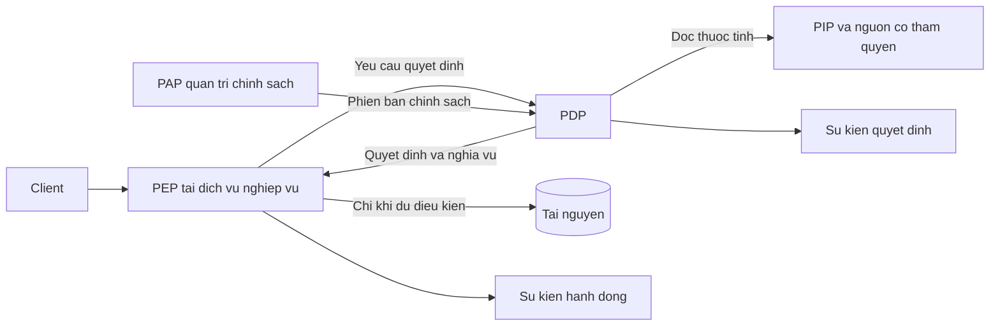

# Authorization decision point

## 1. Mục tiêu và phạm vi bài học

**Authorization decision point** là nơi hệ thống đánh giá một yêu cầu truy cập theo chính sách phân quyền để đưa ra kết quả cho phép, từ chối hoặc một trạng thái xử lý được đặc tả. Trong kiến trúc tách trách nhiệm, thành phần này thường được gọi là **Policy Decision Point (PDP)**.

Một decision point có thể là hàm trong ứng dụng, thư viện, tiến trình bên cạnh dịch vụ hoặc dịch vụ dùng chung. Tính đúng đắn không đến từ việc nó có một API riêng; tính đúng đắn phụ thuộc vào dữ liệu được dùng để đánh giá, chính sách có hiệu lực, hợp đồng kết quả và cách các thành phần thực thi kết quả đó.

Trong chương **Yêu cầu authorization**, trọng tâm là biến mục tiêu “chỉ người có quyền mới được thao tác” thành những yêu cầu có thể kiểm chứng:

- Quyết định dựa trên chủ thể, hành động, tài nguyên và ngữ cảnh nào?
- Các thuộc tính có nguồn gốc, độ mới và phạm vi tin cậy ra sao?
- Kết quả gắn với yêu cầu nào và có hiệu lực đến khi nào?
- Thành phần nào chịu trách nhiệm ngăn hành động khi điều kiện không thỏa?
- Cache, timeout, thay đổi chính sách và thu hồi quyền được xử lý thế nào?
- Bằng chứng nào chứng minh quyết định và hành động thực tế phù hợp?

Các ví dụ dùng hệ thống phê duyệt mua hàng nhiều tenant. Số liệu và thời hạn trong bài là giả định để minh họa cách đặc tả, không phải ngưỡng mặc định cho mọi ứng dụng.

## 2. Quyết định phân quyền khác với xác thực và thực thi

### 2.1. Ba câu hỏi khác nhau

| Trách nhiệm | Câu hỏi | Ví dụ |
|---|---|---|
| Xác thực | Chủ thể là ai và bằng chứng có hợp lệ không? | Kiểm tra phiên và nhận diện người dùng U |
| Quyết định phân quyền | U có được thực hiện hành động A trên tài nguyên R trong ngữ cảnh C không? | U có được duyệt phiếu P của tenant T không? |
| Thực thi | Hệ thống có thực sự chặn hoặc cho phép đúng hành động đã đánh giá không? | Dịch vụ chỉ chuyển trạng thái P khi mọi điều kiện được đáp ứng |

Một token xác thực hợp lệ không tự chứng minh người dùng có quyền phê duyệt. Tương tự, PDP trả kết quả cho phép không tự làm cho dữ liệu an toàn nếu dịch vụ vẫn có đường bỏ qua kiểm tra.

Có thể mô tả quyết định:

```text
Decision = Evaluate(
    subject,
    action,
    resource,
    context,
    policy,
    authoritativeAttributes
)
```

Trong đó:

- `subject`: chủ thể có danh tính đã được xác nhận.
- `action`: hành động nghiệp vụ chuẩn hóa.
- `resource`: tài nguyên hoặc phạm vi tập tài nguyên.
- `context`: tenant, thời điểm, phương thức xác thực hoặc ngữ cảnh liên quan.
- `policy`: phiên bản chính sách được áp dụng.
- `authoritativeAttributes`: thuộc tính từ nguồn có thẩm quyền theo thiết kế.

### 2.2. Vai trò của PDP, PEP, PIP và PAP

| Thành phần logic | Trách nhiệm |
|---|---|
| PDP: điểm ra quyết định chính sách | Đánh giá yêu cầu theo chính sách và thuộc tính, trả kết quả có cấu trúc |
| PEP: điểm thực thi chính sách | Chặn hoặc thực hiện hành động, đáp ứng nghĩa vụ bắt buộc đi kèm kết quả |
| PIP: điểm cung cấp thông tin chính sách | Cung cấp thuộc tính như membership, quan hệ sở hữu, trạng thái tài nguyên |
| PAP: điểm quản trị chính sách | Quản lý định nghĩa, phiên bản, phê duyệt và phân phối chính sách |

Đây là sự phân chia trách nhiệm. Bốn trách nhiệm có thể cùng nằm trong một tiến trình hoặc được triển khai riêng.



Nếu PEP gửi sẵn thuộc tính tới PDP, trách nhiệm kiểm soát nguồn gốc thuộc tính vẫn phải được xác định. Việc đổi đường truyền không làm thuộc tính trở nên đáng tin cậy hơn.

## 3. Bắt đầu từ tài sản, rủi ro và ranh giới tin cậy

Giả sử hệ thống lưu phiếu mua hàng thuộc nhiều tenant. Người phê duyệt chỉ được duyệt phiếu thuộc phạm vi được cấp và không được tự duyệt phiếu do mình tạo.

Những rủi ro điển hình:

| Mã | Kịch bản |
|---|---|
| R-01 | Client sửa tenant hoặc thuộc tính chủ thể để PDP trả kết quả cho phép |
| R-02 | PDP đánh giá phiếu P1 nhưng PEP thực hiện trên phiếu P2 |
| R-03 | Cache giữ kết quả cho phép sau khi quyền bị thu hồi |
| R-04 | PEP coi timeout, phản hồi không hợp lệ hoặc lỗi chính sách là cho phép |
| R-05 | Một API hoặc worker không gọi điểm quyết định cần thiết |
| R-06 | Tài nguyên thay đổi sau kiểm tra nhưng trước lúc ghi nhận hành động |
| R-07 | Chính sách trả nghĩa vụ che dữ liệu hoặc ghi audit nhưng PEP bỏ qua |
| R-08 | Không thể đối chiếu quyết định cho phép với hành động thực tế |
| R-09 | Người quản trị chính sách thay đổi quyền mà không được kiểm soát |

Các ranh giới cần nhận diện gồm:

- Từ client tới dịch vụ nghiệp vụ.
- Từ danh tính người dùng tới danh tính dịch vụ gọi PDP.
- Từ PEP tới PDP và từ PDP tới nguồn thuộc tính.
- Từ chính sách được quản trị tới chính sách đang chạy.
- Từ một quyết định ở thời điểm kiểm tra tới hành động ở thời điểm sử dụng.
- Giữa tenant, giữa tài nguyên và giữa các hành động khác nhau.

Kết quả review phải nêu được cơ chế nào bảo vệ từng ranh giới và yêu cầu nào buộc cơ chế đó tồn tại.

## 4. Hợp đồng đầu vào của một quyết định

### 4.1. Chủ thể và chuỗi ủy quyền

**ADP-SUBJECT-01 — Danh tính có nguồn gốc xác định**

> PDP chỉ được đánh giá các thông tin chủ thể đã được xác minh theo hợp đồng tin cậy với PEP hoặc nguồn danh tính. Client không được tự khai vai trò, membership hoặc mức xác thực rồi được coi là nguồn có thẩm quyền.

Cần phân biệt:

- **Người hưởng hoặc thực hiện nghiệp vụ:** ví dụ người dùng U.
- **Dịch vụ gọi:** ví dụ dịch vụ mua hàng.
- **Bối cảnh thay mặt:** dịch vụ có đang thực hiện thao tác thay cho U không?
- **Giới hạn ủy quyền:** được thay mặt làm gì, trong tenant nào và đến khi nào?

Một worker có quyền kỹ thuật đọc kho dữ liệu không tự có quyền nghiệp vụ xuất dữ liệu cho mọi người. Ngược lại, việc ghi `onBehalfOf: U` trong thông điệp không chứng minh worker đã nhận một ủy quyền hợp lệ từ U.

### 4.2. Hành động phải có nghĩa ổn định

**ADP-ACTION-01 — Danh mục hành động rõ ràng**

> Hành động dùng để đánh giá phải được ánh xạ từ thao tác phía máy chủ và thuộc danh mục được quản lý. Hành động không được nhận diện phải bị từ chối hoặc xử lý lỗi theo hợp đồng; không được tự chuyển thành hành động rộng hơn.

Ví dụ:

```text
purchase_request.read
purchase_request.approve
purchase_request.export
role_binding.grant
```

Tên HTTP route hoặc nút giao diện không nhất thiết trùng với hành động nghiệp vụ. Một endpoint có thể thực hiện nhiều hành động và cần kiểm tra riêng.

Không để client gửi `action=read` trong khi máy chủ thực sự ghi nhận phê duyệt. PEP phải quyết định mã hành động từ chính thao tác đang thực hiện.

### 4.3. Tài nguyên và phạm vi

**ADP-RESOURCE-01 — Tài nguyên được đánh giá là tài nguyên được sử dụng**

> Yêu cầu quyết định phải xác định loại, định danh và phạm vi tài nguyên cần thiết. PEP phải ràng buộc kết quả với đúng tài nguyên thực tế, không dùng quyết định cho một đối tượng để thực hiện trên đối tượng khác.

Nếu chính sách phụ thuộc vào tenant, người tạo hoặc trạng thái phiếu, các giá trị đó phải được lấy từ nguồn đáng tin cậy. Tham số client có thể được dùng để tìm đối tượng, nhưng không tự là bằng chứng về thuộc tính của đối tượng.

Ví dụ, dịch vụ có thể đọc metadata tối thiểu để đánh giá quyền trước khi đọc nội dung đầy đủ. Việc đọc metadata nội bộ này không được làm lộ thông tin cho người chưa được phép thông qua phản hồi hoặc log.

### 4.4. Thuộc tính: thẩm quyền, độ mới và phiên bản

| Thuộc tính | Nguồn minh họa | Ràng buộc cần làm rõ |
|---|---|---|
| Danh tính chủ thể | Phiên hoặc bằng chứng xác thực đã kiểm tra | Bên phát hành, bên nhận, thời hạn và trạng thái phiên |
| Membership của tenant | Nguồn quản lý thành viên | Phiên bản, thời điểm thu hồi và độ trễ đồng bộ |
| Vai trò hoặc quyền | Kho quản trị quyền | Phạm vi gán và hiệu lực hiện tại |
| Người tạo phiếu | Kho dữ liệu nghiệp vụ | Ghi từ máy chủ và không bị client sửa tùy ý |
| Trạng thái phiếu | Kho dữ liệu nghiệp vụ | Phiên bản gắn với lần chuyển trạng thái |
| Mức xác thực | Kết quả xác thực đã xác minh | Không suy ra từ một cờ client tự đặt |
| Thời gian đánh giá | Đồng hồ máy chủ theo thiết kế | Cách xử lý sai lệch và mốc hết hiệu lực |

**ADP-ATTRIBUTE-01 — Không suy đoán khi thiếu dữ liệu bắt buộc**

> Mỗi thuộc tính có ảnh hưởng đến quyết định phải có nguồn có thẩm quyền, ngữ nghĩa, yêu cầu độ mới và hành vi khi thiếu hoặc lỗi. Thiếu thuộc tính bắt buộc không được tự thay bằng giá trị làm rộng quyền.

Ví dụ, thiếu `createdBy` không được hiểu là “phiếu không thuộc về người gọi nên được duyệt”. Kết quả đúng là không đủ điều kiện cho phép cho tới khi có dữ liệu phù hợp.

### 4.5. Ví dụ yêu cầu quyết định

```json
{
  "requestId": "authz-request-example",
  "caller": {
    "serviceId": "purchase-service"
  },
  "subject": {
    "id": "user-U",
    "sessionRef": "session-reference"
  },
  "action": "purchase_request.approve",
  "resource": {
    "type": "purchase_request",
    "id": "PR-42",
    "tenantId": "tenant-A",
    "version": 17
  },
  "context": {
    "activeTenant": "tenant-A"
  }
}
```

Ví dụ chỉ mô tả nội dung logic, không có nghĩa mọi trường trên đều đáng tin ngay khi được nhận. Hợp đồng phải xác định trường nào do PEP đã xác minh, trường nào PDP phải đối chiếu và dịch vụ nào được quyền gửi loại yêu cầu này.

## 5. Hợp đồng đầu ra và ngữ nghĩa kết quả

### 5.1. Không rút kết quả về một giá trị không rõ nghĩa

Một hợp đồng minh họa có thể dùng bốn trạng thái:

| Trạng thái | Ý nghĩa trong hợp đồng minh họa | Cách PEP xử lý |
|---|---|---|
| PERMIT | Chính sách xác nhận được phép, với điều kiện và nghĩa vụ kèm theo | Chỉ thực hiện nếu ràng buộc kết quả và mọi nghĩa vụ bắt buộc được đáp ứng |
| DENY | Chính sách xác định không được phép | Không thực hiện hành động được bảo vệ |
| NOT_APPLICABLE | Không tìm được chính sách cho phép phù hợp theo ngữ nghĩa đã chọn | Không tự chuyển thành cho phép |
| INDETERMINATE | Không đánh giá được đầy đủ, ví dụ thiếu dữ liệu hoặc lỗi đánh giá | Không thực hiện; ghi nhận lỗi hoặc từ chối theo hợp đồng |

Không phải engine nào cũng sử dụng đúng bốn trạng thái này. Khi tích hợp, phải ánh xạ rõ trạng thái thực tế sang hành vi của ứng dụng.

**ADP-RESULT-01 — Chỉ cho phép từ kết quả hợp lệ tường minh**

> PEP chỉ được thực hiện hành động được bảo vệ khi nhận kết quả PERMIT hợp lệ cho đúng yêu cầu. Phản hồi rỗng, không phân tích được, trạng thái lạ, phiên bản hợp đồng không được hỗ trợ hoặc timeout không được coi là cho phép.

Không dùng sự tồn tại của một object, mã HTTP thành công từ PDP hoặc chuỗi không rỗng làm bằng chứng được cấp quyền. Một lời gọi PDP thành công về vận chuyển vẫn có thể mang kết quả DENY hoặc INDETERMINATE.

### 5.2. Ràng buộc kết quả với yêu cầu

Kết quả cần có đủ thông tin để PEP không nhầm lẫn giữa các lần đánh giá:

- Mã quyết định và mã tương quan yêu cầu.
- Chủ thể hoặc tham chiếu tới chủ thể đã được chuẩn hóa.
- Hành động.
- Tài nguyên, tenant và phiên bản tài nguyên khi có liên quan.
- Phiên bản chính sách và các phiên bản trạng thái quan trọng.
- Thời điểm đánh giá và giới hạn hiệu lực.
- Nghĩa vụ bắt buộc, nếu có.
- Mã lý do nội bộ và thông tin chẩn đoán đã giới hạn.

**ADP-BINDING-01 — Không hoán đổi quyết định**

> PEP phải kiểm tra kết quả tương ứng với chủ thể, hành động, tài nguyên và phạm vi đang được thực hiện. Kết quả của yêu cầu khác hoặc kết quả không còn hiệu lực phải bị từ chối.

```json
{
  "requestId": "authz-request-example",
  "decisionId": "decision-example-91",
  "decision": "PERMIT",
  "subjectId": "user-U",
  "action": "purchase_request.approve",
  "resource": {
    "id": "PR-42",
    "tenantId": "tenant-A",
    "version": 17
  },
  "policyVersion": "purchase-policy-v8",
  "evaluatedAt": "2026-01-15T10:00:00Z",
  "validUntil": "2026-01-15T10:00:05Z",
  "obligations": [
    {
      "type": "AUDIT_APPROVAL_ATTEMPT",
      "required": true
    }
  ],
  "reasonCode": "APPROVAL_CONDITIONS_SATISFIED"
}
```

Thời hạn năm giây trong ví dụ không tự bảo đảm an toàn trước mọi thay đổi xảy ra trong năm giây đó. Nếu điều kiện phụ thuộc vào trạng thái phiếu, PEP vẫn phải bảo đảm phiên bản và điều kiện tại điểm ghi nhận hành động.

### 5.3. Mã quyết định không phải giấy thông hành

`decisionId` phục vụ tham chiếu và điều tra, không mặc định là bí mật trao quyền. Client không được gửi một mã quyết định cũ rồi yêu cầu thực hiện bất kỳ thao tác nào.

Nếu thiết kế sử dụng một chứng thư quyết định có thể mang qua nhiều thành phần, phải đặc tả riêng:

- Bên phát hành và bên được phép sử dụng.
- Cơ chế bảo vệ tính toàn vẹn và xác thực.
- Chủ thể, hành động, tài nguyên và phạm vi ràng buộc.
- Thời hạn và điều kiện thu hồi.
- Có được dùng nhiều lần hay chỉ một lần.
- Cách chống phát lại và kiểm tra tiêu thụ khi cần.

Một phản hồi PDP thông thường qua kênh nội bộ không tự trở thành loại chứng thư đó.

## 6. Nghĩa vụ bắt buộc và thông tin tư vấn

### 6.1. Cho phép có điều kiện

Một quyết định có thể yêu cầu PEP thực hiện nghĩa vụ như:

- Chỉ trả một tập trường được phép.
- Áp dụng bộ lọc dữ liệu theo tenant và phạm vi.
- Có bằng chứng xác thực bổ sung phù hợp.
- Ghi sự kiện bắt buộc trước hoặc gắn với thao tác nhạy cảm.
- Giới hạn hành động vào một phiên bản hoặc một phần tài nguyên.

**ADP-OBLIGATION-01 — Không bỏ qua nghĩa vụ**

> Nếu quyết định PERMIT kèm nghĩa vụ bắt buộc, PEP chỉ được cho hành động hoàn tất theo đúng nghĩa vụ đó. Nghĩa vụ không được nhận diện, không hỗ trợ hoặc không thực hiện được phải dẫn đến hành vi từ chối hoặc lỗi đã định, không được âm thầm bỏ qua.

Ví dụ, dịch vụ không được trả toàn bộ hồ sơ vì chưa triển khai cơ chế che trường mà PDP yêu cầu.

Thông tin **tư vấn** có thể được dùng để giải thích hoặc tối ưu nhưng không bắt buộc cho tính đúng đắn. Hợp đồng phải phân biệt rõ tư vấn và nghĩa vụ. Không đổi một nghĩa vụ thành tư vấn chỉ để tránh phải xử lý lỗi.

### 6.2. Nghĩa vụ có giai đoạn thực hiện

Không phải mọi nghĩa vụ đều được hoàn thành trước khi đọc dữ liệu. Ví dụ:

| Nghĩa vụ | Giai đoạn minh họa |
|---|---|
| Xác nhận mức xác thực | Trước khi thực hiện thao tác được bảo vệ |
| Kiểm tra phiên bản tài nguyên | Gắn với lần ghi hoặc chuyển trạng thái |
| Lọc trường nhạy cảm | Trước khi nội dung rời ranh giới được bảo vệ |
| Ghi ý định thao tác | Trước hoặc trong giao dịch tùy thiết kế |
| Ghi kết quả thực tế | Sau khi biết kết quả, với cơ chế bảo đảm ghi nhận phù hợp |

Đặc tả cần mô tả cách bảo đảm nghĩa vụ ở đúng giai đoạn. Không thể luôn sửa một sự cố lộ dữ liệu bằng cách trả lỗi sau khi dữ liệu đã được gửi.

Với audit, có thể cần ghi bền vững cùng giao dịch nghiệp vụ hoặc dùng cơ chế sự kiện đi kèm có bảo đảm phù hợp. Nếu bộ thu sự kiện từ xa ngừng hoạt động, cơ chế lưu tạm phải có giới hạn và hành vi khi đầy được xác định.

### 6.3. Bộ lọc dữ liệu không được trở thành lệnh tùy ý

Nếu PDP trả điều kiện lọc, hợp đồng nên dùng cấu trúc được giới hạn và kiểm chứng, hoặc tham chiếu tới quy tắc đã biết. PEP không được mặc định nối chuỗi không tin cậy thành SQL hoặc lệnh truy vấn.

**ADP-FILTER-01 — Thực thi bộ lọc đúng ngữ nghĩa**

> Mọi biểu diễn bộ lọc được trả về phải thuộc dạng được hỗ trợ, được kiểm tra và chuyển thành điều kiện truy vấn an toàn. Cách chuyển đổi phải giữ đúng ngữ nghĩa phân quyền, bao gồm giới hạn tenant, tổ hợp điều kiện và xử lý giá trị thiếu.

Một lỗi dịch bộ lọc có thể làm PDP ra quyết định đúng nhưng dữ liệu trả về vẫn sai.

## 7. Đặt decision point ở đâu trong kiến trúc?

### 7.1. Các lựa chọn triển khai

| Lựa chọn | Lợi ích | Yêu cầu cần giải quyết |
|---|---|---|
| Trong mã hoặc thư viện của dịch vụ | Gọi cục bộ, dễ gắn với dữ liệu nghiệp vụ | Tránh lệch chính sách giữa các dịch vụ, quản lý phiên bản thư viện |
| Tiến trình cục bộ hoặc sidecar | Tách phần đánh giá, giảm phụ thuộc mạng xa | Phân phối chính sách, đồng bộ thuộc tính, bảo vệ kênh cục bộ |
| PDP từ xa dùng chung | Quản trị và quan sát tập trung | Độ trễ, tải, danh tính bên gọi, khả dụng và phân vùng mạng |
| Kết hợp | Có thể quản trị tập trung và đánh giá gần tài nguyên | Phải định nghĩa rõ quyền quyết định và độ mới ở mỗi lớp |

Lựa chọn phải xuất phát từ độ nhạy cảm, nguồn dữ liệu, mục tiêu độ trễ và khả năng vận hành. “Tập trung” có thể chỉ nói về quản trị chính sách, không bắt buộc mọi lần đánh giá đều đi qua một máy chủ trung tâm.

### 7.2. Gateway và dịch vụ sở hữu tài nguyên

Gateway có thể kiểm tra danh tính, tenant dự kiến hoặc quyền gọi nhóm API. Dịch vụ sở hữu tài nguyên thường có thông tin chính xác hơn về đối tượng và trạng thái nghiệp vụ.

**ADP-COVERAGE-01 — Quyết định đủ thông tin tại điểm phù hợp**

> Mọi đường sử dụng tài nguyên được bảo vệ phải đi qua điểm thực thi có quyết định đủ cho hành động đó. Kiểm tra thô ở gateway không được thay thế kiểm tra đối tượng khi gateway không có các thuộc tính bắt buộc.

Có thể có nhiều mức kiểm tra, nhưng phải nêu rõ mỗi mức bảo vệ điều gì. Không để các nhóm cùng giả định rằng nhóm khác đã kiểm tra quyền trên đối tượng.

### 7.3. Bảo vệ chính dịch vụ ra quyết định

**ADP-CHANNEL-01 — Xác thực và giới hạn bên gọi**

> Kênh giữa PEP, PDP và nguồn thuộc tính phải bảo vệ tính xác thực và toàn vẹn theo ranh giới tin cậy. PDP phải xác định dịch vụ gọi và giới hạn loại yêu cầu, phạm vi tenant hoặc nguồn thuộc tính mà dịch vụ đó được phép sử dụng.

PDP không nên trở thành một giao diện công khai cho phép bất kỳ client nào hỏi về quyền của người khác hoặc dò tìm tài nguyên. Chi tiết chính sách, quan hệ và kết quả có thể là dữ liệu nhạy cảm.

Các yêu cầu còn cần bao gồm kích thước thông điệp, giới hạn độ phức tạp đánh giá, timeout, hạn mức theo bên gọi và kiểm soát truy cập dữ liệu chẩn đoán.

## 8. Quản lý chính sách và quy tắc kết hợp

**ADP-POLICY-01 — Phiên bản có thể truy vết**

> Mọi quyết định phải xác định được phiên bản chính sách và trạng thái dữ liệu quan trọng đã dùng. Thay đổi chính sách phải có người chịu trách nhiệm, kiểm tra, phê duyệt theo mức rủi ro và lịch sử áp dụng.

Chính sách cần nêu rõ:

- Khi không có quy tắc phù hợp thì kết quả nào được trả.
- Khi nhiều quy tắc cùng áp dụng thì kết hợp thế nào.
- Một điều kiện từ chối bắt buộc có được ưu tiên hơn cho phép hay không.
- Xung đột hoặc lỗi đánh giá được biểu diễn ra sao.
- Phiên bản thuộc tính hoặc schema nào được hỗ trợ.

Ví dụ của bài chọn: chỉ cho phép khi có căn cứ cho phép phù hợp và không vi phạm ràng buộc bắt buộc; thiếu dữ liệu bắt buộc dẫn đến không cho phép. Đây là lựa chọn phải được thể hiện trong cả PDP lẫn PEP.

Thay đổi chính sách cần được kiểm tra bằng các tình huống được phép và bị từ chối. Chỉ thử rằng chính sách mới cho người cần quyền truy cập được là chưa đủ; phải thử cả những người phải tiếp tục bị chặn.

Khi triển khai nhiều phiên bản đồng thời, cần quy định cách PEP nhận biết phiên bản chưa tương thích và cách tránh dùng kết quả cache của ngữ nghĩa cũ. Quay lại một phiên bản trước cũng là thay đổi bảo mật, có thể làm sống lại quyền đã bị bỏ.

## 9. Cache quyết định và giới hạn độ mới

### 9.1. Cache là một phần của mô hình bảo mật

Cache có thể giảm độ trễ và tải, nhưng kéo dài thời gian một kết quả được sử dụng. Cần phân biệt:

- Cache bản chính sách.
- Cache thuộc tính chủ thể hoặc tài nguyên.
- Cache kết quả quyết định.
- Cache ngữ cảnh phiên hoặc claim quyền.

Các lớp có thể cộng dồn độ trễ. Đặt TTL ngắn cho kết quả không đủ nếu mỗi lần hết TTL, PDP lại đánh giá trên nguồn thuộc tính cũ không có giới hạn độ mới.

**ADP-CACHE-01 — Khóa cache giữ đủ ngữ nghĩa**

> Khóa cache quyết định phải phân biệt mọi yếu tố có thể làm thay đổi kết quả, gồm chủ thể, bên gọi hoặc ngữ cảnh ủy quyền khi liên quan, tenant, hành động, tài nguyên, tham số có ảnh hưởng và phiên bản chính sách hoặc dữ liệu tương ứng.

Ví dụ, không dùng chung cache cho:

- Hai người dùng khác nhau.
- Hai tenant có cùng mã tài nguyên cục bộ.
- Đọc phiếu và phê duyệt phiếu.
- Hai phiên bản phiếu có người tạo hoặc trạng thái khác nhau.
- Xuất tập trường thông thường và xuất thêm trường nhạy cảm.
- Chủ thể đã xác thực bổ sung và chủ thể chưa đáp ứng mức xác thực đó.

Không nhất thiết đưa mọi giá trị nguyên văn vào khóa. Dù dùng biểu diễn dẫn xuất, nhóm vẫn phải chứng minh các yêu cầu khác nghĩa không dùng nhầm kết quả.

### 9.2. Hiệu lực không được vượt bằng chứng

**ADP-FRESHNESS-01 — Thời hạn dựa trên dữ liệu đánh giá**

> Kết quả chỉ được dùng khi chính sách, thuộc tính và bằng chứng liên quan còn trong giới hạn độ mới đã định. PEP không được gia hạn hiệu lực của một kết quả chỉ vì nó vừa được đọc từ cache.

Có thể mô tả giới hạn:

```text
Hạn dùng kết quả
  không vượt quá hạn chính sách được phép sử dụng
  không vượt quá hạn độ mới của thuộc tính bắt buộc
  không vượt quá hạn bằng chứng phiên hoặc ủy quyền
  không vượt quá hạn riêng của loại hành động
```

Nếu một nguồn không cung cấp phiên bản hoặc thời hạn, hệ thống cần cơ chế khác để chứng minh giới hạn độ cũ, hoặc không sử dụng cache cho quyết định phụ thuộc nguồn đó.

Khi tái sử dụng cache, nghĩa vụ theo từng lần truy cập vẫn phải được thực hiện. Ví dụ, một sự kiện audit của lần đánh giá đầu không thay thế sự kiện sử dụng tài nguyên ở các lần sau.

Mã tương quan của lời gọi mới và mã quyết định gốc nên được ghi riêng. Việc dùng lại một kết quả đã xác minh trong PEP không cho phép client tự phát lại phản hồi PDP.

### 9.3. Đặc tả độ trễ thu hồi từ đầu đến cuối

**ADP-REVOCATION-01 — Có mốc đo và phạm vi**

> Khi quyền hoặc membership bị thu hồi, mọi quyết định mới trong phạm vi được bảo vệ phải loại bỏ quyền đã thu hồi trong thời gian tối đa xác định, tính từ mốc ghi nhận thay đổi thành công tại nguồn có thẩm quyền.

Ví dụ chọn mục tiêu 60 giây. Nhóm phải xem toàn chuỗi:

```text
Nguồn quyền ghi nhận thu hồi
  → Bản sao và nguồn thuộc tính thấy thay đổi
  → PDP đánh giá trên dữ liệu phù hợp
  → Kết quả cache cũ không còn được dùng
  → PEP ra quyết định cho thao tác mới
```

Ngân sách minh họa có thể dành tối đa 20 giây cho lan truyền dữ liệu, 20 giây cho cache kết quả, 10 giây cho phần xử lý liên quan và 10 giây dự phòng sai lệch theo mô hình đã xác định. Đây chỉ là cách phân bổ; phải chứng minh không còn một lớp cache hoặc luồng nào kéo dài thêm ngoài ngân sách.

Một giá trị p95 hoặc thời gian trung bình không chứng minh cận trên 60 giây. Cần xác định giả định, trường hợp lỗi và hành vi khi không còn bảo đảm cận trên, chẳng hạn từ chối thao tác nhạy cảm.

Cache kết quả từ chối cũng cần thời hạn. Giữ một DENY quá lâu có thể khiến người vừa được cấp quyền vẫn không truy cập được, làm hỏng mục tiêu khả dụng.

## 10. Timeout, lỗi và khả dụng

### 10.1. Không có kết quả không phải là có quyền

**ADP-FAILURE-01 — Hành vi lỗi tường minh**

> Với mỗi loại hành động, đặc tả phải xác định cách xử lý timeout, lỗi kết nối, thiếu thuộc tính, lỗi chính sách và quá tải. Các trường hợp đó không được tự tạo kết quả cho phép.

Ứng dụng có thể trả phản hồi lỗi dịch vụ hoặc từ chối theo hợp đồng. Cách ánh xạ ra mã HTTP cần phù hợp với API và chính sách tiết lộ thông tin; không được nhầm lỗi vận hành với bằng chứng rằng người dùng chắc chắn không có quyền.

Trong mọi trường hợp, thao tác được bảo vệ chỉ được thực hiện khi đã có căn cứ cho phép hợp lệ.

### 10.2. Phương án suy giảm

Một phương án suy giảm có thể sử dụng bản chính sách đã xác minh còn trong hạn và nguồn thuộc tính đủ mới cho một tập hành động được phê duyệt. Nó phải được thiết kế trước, có giới hạn và có cảnh báo.

Ví dụ:

| Loại thao tác | Quyết định minh họa khi PDP từ xa lỗi |
|---|---|
| Đọc thông tin công khai | Xử lý theo chính sách công khai riêng |
| Đọc dữ liệu thông thường | Chỉ dùng kết quả cache nếu còn đầy đủ điều kiện đã phê duyệt |
| Phê duyệt chi phí | Không dùng PERMIT cache; trả lỗi hoặc từ chối nếu không có đánh giá hợp lệ |
| Cấp quyền quản trị | Không hạ điều kiện phê duyệt hoặc bỏ nguồn thuộc tính bắt buộc |

Cần nêu cách thoát chế độ suy giảm, thời gian tối đa và cách phát hiện dữ liệu đã không còn đủ mới. Không để một ngoại lệ tạm thời trở thành chế độ hoạt động không có hạn kết thúc.

### 10.3. Ngân sách xử lý và thử lại

**ADP-CAPACITY-01 — Tài nguyên hữu hạn**

> PDP và PEP phải có timeout, giới hạn yêu cầu đang xử lý, hàng đợi hữu hạn và hành vi quá tải. Việc thử lại phải có giới hạn, không làm mất deadline tổng hoặc tạo thêm hành động nghiệp vụ ngoài dự kiến.

Cần đo riêng:

- Thời gian lấy thuộc tính.
- Thời gian đánh giá.
- Thời gian vận chuyển và chờ.
- Thời gian thực thi nghĩa vụ.
- Thời gian từ nhận yêu cầu đến phản hồi.

Một deadline ngắn không hữu ích nếu sau khi client nhận lỗi, tác vụ phía sau vẫn tiếp tục ghi nhận hành động mà không theo hợp đồng.

Thử lại lời gọi quyết định và thử lại thao tác nghiệp vụ là hai việc khác nhau. `requestId` của PDP không tự bảo đảm rằng một phê duyệt hoặc một khoản chi chỉ được ghi nhận một lần. Nếu cần tính lũy đẳng, phải thiết kế ở thao tác nghiệp vụ.

## 11. Giữ quyết định đúng tại thời điểm sử dụng

### 11.1. Khoảng trống giữa kiểm tra và thực hiện

Ví dụ:

1. PDP đọc phiếu phiên bản 17, trạng thái SUBMITTED.
2. PDP cho phép U phê duyệt.
3. Một thao tác khác đổi phiếu sang phiên bản 18.
4. PEP vẫn ghi phê duyệt dựa trên kết quả cũ.

**ADP-CONSISTENCY-01 — Gắn điều kiện với lần sử dụng**

> Khi quyền phụ thuộc vào trạng thái tài nguyên, PEP phải bảo đảm trạng thái được sử dụng phù hợp với trạng thái đã đánh giá. Nếu có thay đổi ảnh hưởng kết quả, hệ thống phải đánh giá lại hoặc từ chối trước tác dụng phụ được bảo vệ.

Một cách triển khai là dùng phiên bản tài nguyên và thao tác ghi có điều kiện. Nếu phiên bản không khớp, không được tiếp tục bằng cách bỏ kiểm tra phiên bản.

Đây là yêu cầu bảo đảm thuộc tính, không bắt buộc một loại cơ sở dữ liệu cụ thể.

### 11.2. Thay đổi tài nguyên và thu hồi quyền là hai vấn đề khác nhau

Kiểm tra `resource.version` có thể bảo vệ trước thay đổi của phiếu. Nó không tự phát hiện membership vừa bị thu hồi ở một nguồn khác.

Vì vậy, thiết kế cần đồng thời xử lý:

- Nhất quán của trạng thái tài nguyên tại lần ghi.
- Giới hạn độ mới của quyền và membership.
- Thời hạn của kết quả.
- Điều kiện đối với thao tác đang chạy.

Nếu nghiệp vụ yêu cầu một thứ tự chặt chẽ giữa thu hồi quyền và mọi lần ghi ở nhiều hệ thống, cần cơ chế phối hợp tương ứng. Không thể chứng minh yêu cầu đó chỉ bằng một TTL ngắn hoặc một phiên bản tài nguyên cục bộ.

### 11.3. Quyết định nhiều bước

Một quy trình có thể gồm tạo phiếu, đính kèm tài liệu, gửi và duyệt. Cho phép tạo phiếu không tự cho phép tất cả các bước sau.

**ADP-WORKFLOW-01 — Mỗi hành động giữ đúng phạm vi quyết định**

> Quyết định chỉ được dùng cho hành động hoặc nhóm hành động đã đặc tả. Các bước mới phải được đánh giá theo chính sách và trạng thái phù hợp, trừ khi đã có ủy quyền nhiều bước được định nghĩa rõ về phạm vi, thời hạn và điều kiện.

## 12. Danh sách, xử lý hàng loạt và tác vụ nền

### 12.1. Quyết định cho tập dữ liệu

Với API danh sách hoặc xuất báo cáo, tài nguyên không chỉ là một mã đối tượng. Hệ thống cần quyết định phạm vi tập dữ liệu và trường được phép cung cấp.

Hai hướng thường gặp:

- Đánh giá từng đối tượng và chỉ cung cấp đối tượng được phép.
- Chuyển điều kiện phân quyền thành bộ lọc truy vấn có ngữ nghĩa tương đương.

**ADP-COLLECTION-01 — Phạm vi nhất quán trên dữ liệu tập hợp**

> Danh sách, tìm kiếm, tổng số, phân trang, tổng hợp và xuất dữ liệu phải áp dụng cùng giới hạn phân quyền liên quan. Không được chỉ lọc nội dung cuối nhưng vẫn làm lộ metadata hoặc tổng số ngoài phạm vi.

Lọc sau khi phân trang có thể tạo trang thiếu dữ liệu hoặc làm lộ thông tin qua tổng số. Cần đánh giá thứ tự xử lý, chi phí và dữ liệu mà client thực sự quan sát được.

Nếu dùng bộ lọc truy vấn thay cho đánh giá từng đối tượng, kế hoạch kiểm chứng cần đối chiếu hai cách trên tập dữ liệu đại diện, bao gồm trường hợp thiếu thuộc tính và sai tenant.

### 12.2. Xử lý hàng loạt

**ADP-BATCH-01 — Kết quả từng phần được định nghĩa**

> Một yêu cầu hàng loạt phải xác định quyết định theo từng phần tử hay theo toàn bộ lô, và khi một phần tử bị từ chối hoặc không đánh giá được thì những phần tử khác được xử lý thế nào.

Ví dụ, nghiệp vụ có thể chọn “tất cả hoặc không có gì” cho phê duyệt nhiều phiếu. Khi đó một phần tử không đủ quyền không được để các phiếu khác đã bị ghi trước ngoài hợp đồng.

Nếu cho phép kết quả từng phần, phản hồi và audit phải chỉ rõ những phần nào đã thực hiện, đồng thời không tiết lộ nội dung của phần ngoài quyền.

### 12.3. Tác vụ bất đồng bộ

**ADP-ASYNC-01 — Thời điểm đánh giá có chủ ý**

> Tác vụ nền phải có ngữ cảnh chủ thể, tenant, hành động và tài nguyên có thể xác minh. Chính sách phải chọn rõ việc dùng quyền hiện hành lúc thực hiện hay một ủy quyền trước đó có phạm vi, thời hạn và giới hạn riêng.

Đưa tác vụ vào hàng đợi không đóng băng mọi quyền vĩnh viễn. Nếu worker thực hiện sau nhiều giờ, cần kiểm tra lại hoặc xác minh ủy quyền vẫn còn hợp lệ theo thiết kế.

Danh tính dịch vụ của worker chỉ giải quyết việc worker được truy cập thành phần hạ tầng nào. Nó không thay thế quyền nghiệp vụ của người mà worker đang phục vụ.

## 13. Ví dụ đặc tả hoàn chỉnh cho phê duyệt phiếu

### 13.1. Bối cảnh

Một phiếu có:

```text
PurchaseRequest
  id
  tenantId
  departmentId
  createdBy
  status
  version
```

Người phê duyệt phải có quyền `purchase_request.approve` trong đúng tenant và phòng ban. Người tạo không được tự duyệt. Chỉ phiếu SUBMITTED được chuyển sang APPROVED.

### 13.2. Yêu cầu mẫu

**Mã:** ADP-APPROVE-01  
**Rủi ro:** phê duyệt trái quyền, tự phê duyệt hoặc sử dụng kết quả đánh giá của phiên bản cũ.  
**Chủ sở hữu thực thi:** dịch vụ phiếu mua hàng cùng thành phần PDP liên quan.

**Phát biểu bắt buộc:**

> Trước khi phê duyệt phiếu, PEP phải yêu cầu PDP đánh giá chủ thể đã xác thực, hành động phê duyệt, đúng tài nguyên và ngữ cảnh tenant. PDP chỉ được trả PERMIT khi chủ thể có quyền hiệu lực trong phạm vi tương ứng, phiếu ở trạng thái SUBMITTED và chủ thể khác người tạo. PEP chỉ được ghi nhận phê duyệt khi kết quả hợp lệ, còn hạn, các nghĩa vụ bắt buộc được đáp ứng và phiên bản phiếu vẫn phù hợp với phiên bản đã đánh giá. Mọi lỗi hoặc điều kiện không xác nhận được phải không làm phát sinh phê duyệt.

**Tham số minh họa:**

- Không dùng cache kết quả PERMIT cho hành động này.
- Kết quả có hiệu lực tối đa 5 giây và không vượt hạn của bằng chứng liên quan.
- Mục tiêu thu hồi quyền trên toàn bộ đường được bảo vệ là tối đa 60 giây.
- Nếu PDP hoặc nguồn thuộc tính bắt buộc không đáp ứng điều kiện hoạt động, không cấp phép phê duyệt.
- Quyết định, lần sử dụng quyết định và kết quả nghiệp vụ có thể đối chiếu bằng mã tương quan.

### 13.3. Luồng chấp nhận

```text
1. PEP xác minh phiên, xác định chủ thể và mã hành động.
2. Dịch vụ lấy metadata cần thiết của phiếu từ nguồn đáng tin cậy.
3. PDP nhận yêu cầu và lấy các thuộc tính quyền cần thiết.
4. PDP đánh giá phiên bản chính sách được quản lý.
5. PEP kiểm tra tính hợp lệ, liên kết yêu cầu và hạn dùng của kết quả.
6. PEP chuẩn bị hoặc đáp ứng các nghĩa vụ đúng giai đoạn.
7. Dịch vụ chuyển trạng thái có kiểm soát phiên bản và điều kiện nghiệp vụ.
8. Hệ thống ghi nhận kết quả thực tế, rồi trả phản hồi phù hợp.
```

Nếu bước 7 phát hiện phiếu đã đổi, kết quả cũ không được dùng tiếp. Hệ thống có thể yêu cầu đánh giá lại trên phiên bản mới, với giới hạn thử lại và hợp đồng nghiệp vụ rõ ràng.

### 13.4. Tiêu chí chấp nhận

| Điều kiện thử | Kết quả bắt buộc |
|---|---|
| Người có quyền duyệt phiếu người khác, đúng phạm vi | Có thể duyệt khi mọi điều kiện khác thỏa |
| Người tạo có cả vai trò tạo và vai trò duyệt | Không tự duyệt được |
| Client sửa tenant hoặc mã tài nguyên | Không dùng được quyền của đối tượng hoặc tenant cũ |
| PDP trả PERMIT cho một phiếu khác | PEP từ chối sử dụng kết quả |
| PDP trả PERMIT thiếu nghĩa vụ được hợp đồng yêu cầu | Xử lý phản hồi không hợp lệ; không phê duyệt |
| PEP không hỗ trợ một nghĩa vụ bắt buộc | Không phê duyệt |
| Kết quả đã hết hạn | Không được sử dụng |
| Phiếu thay đổi phiên bản trước lần ghi | Đánh giá lại hoặc từ chối; không ghi dựa trên trạng thái cũ |
| Quyền đã bị thu hồi quá giới hạn 60 giây | Mọi quyết định mới trong phạm vi phải từ chối quyền đã thu hồi |
| PDP, nguồn quyền hoặc nguồn tài nguyên bắt buộc lỗi | Không phát sinh phê duyệt |

Các trường hợp này phải được kiểm tra ở đường thực thi, không chỉ gọi trực tiếp PDP và so sánh chuỗi kết quả.

## 14. Logging và khả năng giải thích

### 14.1. Tách sự kiện quyết định và hành động

**ADP-AUDIT-01 — Có thể đối chiếu từ đánh giá đến sử dụng**

> Hệ thống phải ghi nhận đủ thông tin để đối chiếu yêu cầu quyết định, kết quả đánh giá, lần sử dụng tại PEP và kết quả hành động thực tế đối với thao tác nhạy cảm.

Ví dụ các sự kiện khác nhau:

```text
AUTHORIZATION_EVALUATED
AUTHORIZATION_RESULT_REJECTED
AUTHORIZATION_RESULT_USED
PURCHASE_REQUEST_APPROVAL_COMMITTED
```

Một sự kiện PERMIT không chứng minh phiếu đã được duyệt. Sau quyết định, thao tác có thể thất bại vì phiên bản phiếu đổi, hết hạn hoặc lỗi lưu trữ.

Thông tin hữu ích gồm:

- Mã yêu cầu, mã quyết định và mã lần sử dụng.
- Danh tính dịch vụ gọi và chủ thể nghiệp vụ.
- Hành động, tham chiếu tài nguyên và tenant.
- Phiên bản chính sách, phiên bản tài nguyên và trạng thái quyền cần thiết.
- Kết quả, mã lý do nội bộ và loại lỗi.
- Thời điểm đánh giá, sử dụng và kết thúc.
- Nghĩa vụ được yêu cầu và kết quả thực thi ở mức phù hợp.

Không ghi token, bí mật phiên hoặc toàn bộ payload nghiệp vụ chỉ để tăng khả năng chẩn đoán. Quyền đọc log và thời hạn lưu cần tương ứng với dữ liệu bên trong.

### 14.2. Giải thích đúng đối tượng

Client có thể chỉ cần biết thao tác không được phép hoặc tạm không thể thực hiện. Nhóm vận hành cần thông tin cụ thể hơn để phân biệt:

- Chính sách từ chối hợp lệ.
- Thiếu chính sách.
- Thuộc tính không đủ mới.
- Lỗi nguồn dữ liệu.
- Kết quả hết hạn hoặc sai liên kết.
- Nghĩa vụ chưa thực hiện được.
- PEP bỏ sót đường kiểm tra.

Chi tiết giải thích chỉ nên được cung cấp qua kênh có quyền phù hợp. Thông tin về vai trò, cấu trúc tenant hoặc tài nguyên người khác có thể làm tăng khả năng dò tìm nếu trả công khai.

### 14.3. Chỉ số vận hành

| Chỉ số | Cách diễn giải |
|---|---|
| Thời gian lấy thuộc tính và đánh giá | Xác định phụ thuộc gây chậm, kiểm tra ngân sách |
| Tỷ lệ INDETERMINATE hoặc lỗi vận chuyển | Tín hiệu chất lượng nguồn và khả dụng |
| Tỷ lệ cache hit theo loại hành động | Đánh giá hiệu quả cache trong phạm vi được phép |
| Kết quả hết hạn hoặc sai liên kết tại PEP | Tìm lỗi phối hợp hoặc dấu hiệu sử dụng sai |
| Nghĩa vụ bắt buộc thất bại | Tìm khoảng trống thực thi |
| Độ trễ thu hồi quan sát được | Đối chiếu mục tiêu độ mới từ đầu đến cuối |
| Lưu lượng quyết định theo dịch vụ gọi | Phát hiện đường mới, tăng tải hoặc lạm dụng |
| Hành động nhạy cảm thiếu tham chiếu quyết định | Tìm khả năng bỏ qua PEP hoặc lỗi audit |

Không dùng tỷ lệ PERMIT cao làm thước đo chất lượng phân quyền. Chính sách sai có thể cho phép rất nhanh và rất ổn định.

## 15. Ma trận kiểm chứng và truy vết

### 15.1. Từ rủi ro đến bằng chứng

| Rủi ro | Yêu cầu liên quan | Bằng chứng |
|---|---|---|
| Giả mạo chủ thể hoặc thuộc tính | ADP-SUBJECT-01, ADP-ATTRIBUTE-01 | Đầu vào client không ghi đè thuộc tính có thẩm quyền |
| Dùng quyết định sai đối tượng | ADP-RESOURCE-01, ADP-BINDING-01 | Hoán đổi chủ thể, hành động hoặc tài nguyên đều bị chặn |
| Giữ quyền quá lâu | ADP-FRESHNESS-01, ADP-REVOCATION-01 | Đo thu hồi qua các lớp cache và instance |
| Timeout hoặc lỗi tạo quyền | ADP-RESULT-01, ADP-FAILURE-01 | Mỗi loại lỗi không phát sinh hành động được bảo vệ |
| Bỏ qua nghĩa vụ | ADP-OBLIGATION-01 | Nghĩa vụ lạ hoặc lỗi không làm lộ dữ liệu hay cho phép hành động |
| Kiểm tra trên trạng thái cũ | ADP-CONSISTENCY-01 | Thử thay đổi tài nguyên giữa đánh giá và ghi |
| Đường truy cập bỏ qua phân quyền | ADP-COVERAGE-01, ADP-ASYNC-01 | Kiểm kê và kiểm thử API, worker, công cụ quản trị |
| Chính sách thay đổi ngoài kiểm soát | ADP-POLICY-01 | Lịch sử, phê duyệt, phiên bản và kết quả kiểm tra thay đổi |
| Không đối chiếu được hành động | ADP-AUDIT-01 | Chuỗi sự kiện có thể liên kết mà không chứa bí mật |

### 15.2. Các nhóm kiểm thử cần phối hợp

- **Kiểm thử chính sách:** cùng đầu vào và bộ thuộc tính xác định tạo đúng kết quả, bao gồm xung đột và thuộc tính thiếu.
- **Kiểm thử hợp đồng:** kiểm tra enum lạ, schema không hỗ trợ, thiếu trường, sai kiểu dữ liệu và sai liên kết.
- **Kiểm thử tích hợp:** xác nhận PEP thực sự chặn hành động và thực thi nghĩa vụ.
- **Kiểm thử cạnh tranh:** đổi phiên bản tài nguyên hoặc trạng thái quyền trong khi yêu cầu đang xử lý.
- **Kiểm thử lỗi:** ngắt phụ thuộc có kiểm soát, gây timeout, lỗi phân tích phản hồi và quá tải.
- **Kiểm thử vận hành:** triển khai phiên bản chính sách, thu hồi quyền, diễn tập suy giảm và đối chiếu audit.

Nên dùng dữ liệu tổng hợp và môi trường kiểm soát. Không cần truy cập trái phép tài nguyên thật để chứng minh hợp đồng có hoạt động hay không.

### 15.3. Kịch bản chấp nhận mẫu

```gherkin
Feature: Khong su dung quyet dinh cua phien ban tai nguyen cu

  Scenario: Phieu thay doi sau khi PDP cho phep
    Given U co quyen phe duyet phieu P cua tenant A
    And P o trang thai SUBMITTED voi version 17
    And PDP da tra PERMIT gan voi P va version 17
    When P duoc cap nhat thanh version 18 truoc lan ghi phe duyet
    And PEP thu su dung ket qua cu
    Then he thong khong ghi phe duyet dua tren version 17
    And he thong danh gia lai hoac tra ket qua tu choi da dinh
    And co the doi chieu quyet dinh cu voi ket qua xu ly thuc te
```

Kịch bản là đặc tả kiểm chứng, chưa phải bằng chứng đã chạy thành công. Bằng chứng thực tế phải ghi phiên bản phần mềm, chính sách, cấu hình, dữ liệu thử và kết quả.

### 15.4. Kiểm tra thuộc tính bất biến

Một số thuộc tính có thể dùng để tổ chức kiểm thử:

```text
DENY hoặc lỗi không tạo hành động được bảo vệ.

PERMIT chỉ được dùng đúng chủ thể, hành động và tài nguyên đã đánh giá.

Nghĩa vụ bắt buộc không được biến mất trên đường thực thi.

Quyết định không được dùng ngoài giới hạn hiệu lực.

Mọi đường dùng tài nguyên phải có căn cứ phân quyền phù hợp.

Thu hồi quyền đáp ứng giới hạn từ đầu đến cuối đã công bố.
```

Các thuộc tính này cần được áp dụng cùng ngoại lệ được đặc tả rõ. Không dùng một ngoại lệ mơ hồ như “dịch vụ nội bộ đáng tin” để bỏ qua toàn bộ mô hình.

## 16. Những sai lầm thường gặp

| Sai lầm | Hệ quả | Cách cải thiện |
|---|---|---|
| Có PDP là coi như đã có phân quyền đầy đủ | PEP hoặc đường nền vẫn có thể bỏ qua | Kiểm kê điểm thực thi và kiểm thử tác dụng phụ |
| Tin mọi thuộc tính PEP gửi | PEP có thể truyền tiếp đầu vào client chưa xác minh | Chỉ rõ nguồn có thẩm quyền và hợp đồng tin cậy |
| Dùng HTTP thành công làm PERMIT | Phản hồi có thể là DENY hoặc lỗi đánh giá | Phân tích trạng thái theo schema tường minh |
| Dùng lại PERMIT cho hành động khác | Quyền bị mở rộng ngoài phạm vi đánh giá | Ràng buộc chủ thể, hành động, tài nguyên và tham số |
| Đặt TTL rồi bỏ qua nguồn dữ liệu | Cache mới vẫn có thể chứa thông tin cũ | Định nghĩa độ mới cho toàn chuỗi |
| Timeout thì cho qua | Phụ thuộc lỗi trở thành đường vượt quyền | Có chế độ suy giảm giới hạn và điều kiện cho phép rõ |
| Bỏ nghĩa vụ chưa hỗ trợ | Dữ liệu không được che hoặc hành động thiếu điều kiện | Nghĩa vụ bắt buộc thất bại dẫn tới không cho phép |
| Kiểm tra rồi ghi không ràng buộc phiên bản | Quyết định cũ áp lên trạng thái mới | Gắn đánh giá với lần sử dụng và kiểm tra nhất quán |
| Ghi PERMIT thành sự kiện hành động thành công | Điều tra hiểu sai việc đã xảy ra | Tách quyết định, lần dùng và kết quả nghiệp vụ |
| Chỉ bảo vệ API chi tiết | Danh sách, xuất hoặc tổng số vẫn có thể rò rỉ | Áp dụng phạm vi cho cả tập dữ liệu và metadata |

## 17. Bài tập vận dụng

Một nền tảng dùng PDP từ xa. PEP cache PERMIT theo `userId` trong 10 phút. Client được gửi `tenantId` và `resourceOwner` trong yêu cầu. Nếu PDP timeout, dịch vụ dùng kết quả cho phép gần nhất. Worker xuất báo cáo chỉ kiểm tra rằng yêu cầu ban đầu đã được tiếp nhận.

Hãy thực hiện:

1. Xác định những thông tin đang được tin mà chưa có cơ sở.
2. Chỉ ra vì sao khóa cache và thời hạn đang thiếu ngữ nghĩa.
3. Viết hợp đồng đầu vào và đầu ra tối thiểu cho một hành động cụ thể.
4. Đặc tả hành vi khi PDP hoặc nguồn membership lỗi.
5. Chọn mục tiêu thu hồi quyền, mốc đo và phạm vi thành phần.
6. Xác định chính sách cho worker: quyền hiện hành hoặc ủy quyền có giới hạn.
7. Viết sáu tình huống kiểm chứng, có hoán đổi tài nguyên, thu hồi và timeout.
8. Nêu cách nối một kết quả PERMIT với hành động thực tế bằng audit.

Gợi ý tự đối chiếu:

- `userId` không phân biệt hành động, tenant và tài nguyên.
- `resourceOwner` phải có nguồn đáng tin cậy.
- Kết quả gần nhất có thể thuộc yêu cầu khác hoặc đã hết hiệu lực.
- Tác vụ được tiếp nhận trước đây không chứng minh người yêu cầu còn quyền lúc chạy.
- Cần bảo vệ cả dữ liệu trả về, tác dụng phụ và thông tin trong log.
- Mục tiêu thu hồi phải bao phủ dữ liệu nguồn, PDP, cache và PEP.

## 18. Danh sách tự kiểm tra đặc tả

Trước khi chốt yêu cầu, cần trả lời được:

- Chủ thể nghiệp vụ, dịch vụ gọi và chuỗi ủy quyền có được phân biệt không?
- Hành động và tài nguyên có mã, phạm vi và ngữ nghĩa ổn định không?
- Mỗi thuộc tính bắt buộc có nguồn có thẩm quyền và giới hạn độ mới không?
- PERMIT, DENY và các trạng thái lỗi có hành vi thực thi rõ không?
- Kết quả có được ràng buộc với đúng yêu cầu và hạn hiệu lực không?
- Nghĩa vụ bắt buộc có giai đoạn thực hiện và cách xử lý lỗi không?
- Mọi API, worker, luồng xuất và công cụ quản trị đã được bao phủ chưa?
- Cache và phương án suy giảm có đáp ứng mục tiêu thu hồi không?
- Thay đổi trạng thái tài nguyên giữa kiểm tra và sử dụng được xử lý chưa?
- Danh sách, tổng số, batch và tác vụ trễ có hợp đồng riêng phù hợp chưa?
- Phiên bản chính sách và quyền quản trị thay đổi được kiểm soát chưa?
- Có bằng chứng nối rủi ro, yêu cầu, quyết định và hành động thực tế không?

Một authorization decision point đáng tin cậy cần giữ được chuỗi **đầu vào có thẩm quyền → chính sách xác định → quyết định có phạm vi → thực thi đầy đủ → bằng chứng đối chiếu**. Chỉ khi cả chuỗi được đặc tả, nhóm mới có thể kiểm chứng rằng một quyết định cho phép thực sự dẫn đến đúng hành động trên đúng tài nguyên trong đúng điều kiện.
