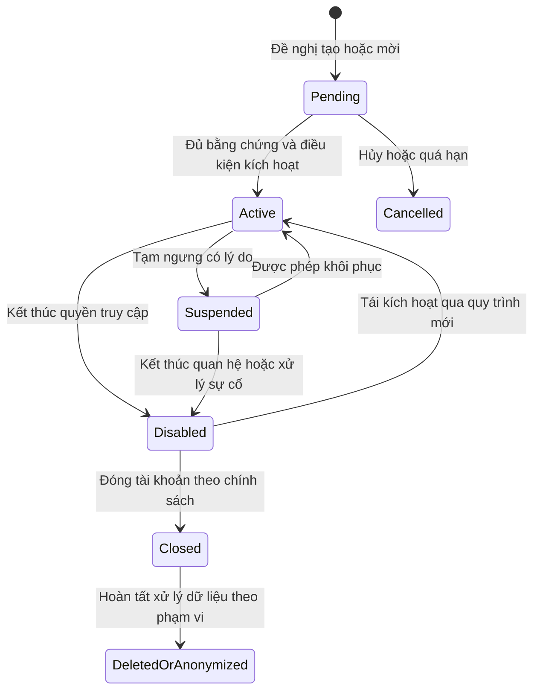

# User lifecycle — Đặc tả vòng đời người dùng

## 1. Vòng đời người dùng là một yêu cầu bảo mật

**User lifecycle** là quá trình quản lý một người dùng từ lúc có nhu cầu tạo danh tính, được cấp quyền sử dụng, thay đổi nhiệm vụ, bị tạm ngưng, rời hệ thống đến khi dữ liệu liên quan được xử lý theo chính sách lưu giữ. Vòng đời không chỉ là tạo và xóa một dòng trong bảng `users`.

Trong chương **Quản trị identity**, nhiệm vụ của người đặc tả là biến các sự kiện như “nhân viên bắt đầu làm việc”, “chuyển dự án” hoặc “chấm dứt hợp tác” thành điều kiện chuyển trạng thái cụ thể. Mỗi chuyển trạng thái cần nêu ai có thẩm quyền, khi nào có hiệu lực, quyền nào được cấp hoặc mất, credential và phiên nào bị ảnh hưởng, cùng bằng chứng nghiệm thu.

Một tài khoản có cơ chế đăng nhập mạnh vẫn có thể gây rủi ro nếu giữ quyền sau khi chủ tài khoản chuyển vị trí hoặc rời tổ chức. Ngược lại, vô hiệu hóa nhầm một tài khoản có thể làm gián đoạn công việc. Vì vậy, vòng đời người dùng phải kết hợp tính đúng của danh tính, giới hạn quyền, tính kịp thời và khả năng phục hồi vận hành.

Ví dụ xuyên suốt là một cổng làm việc nhiều tenant dành cho nhân viên và đối tác. Một người có thể tham gia nhiều tenant với nhiệm vụ khác nhau. Một số người dùng được quản lý từ hệ thống nhân sự hoặc IdP; những người khác được mời bởi quản trị viên tenant.

## 2. Phân biệt người, tài khoản, membership và credential

| Khái niệm | Ý nghĩa | Hệ quả với vòng đời |
|---|---|---|
| Người hoặc chủ thể thực tế | Cá nhân mà tổ chức đang quản lý quan hệ | Cần bằng chứng phù hợp để liên kết với danh tính số |
| Identity | Bản ghi và định danh dùng để nhận diện chủ thể trong một phạm vi | Có mã ổn định và nguồn quản lý rõ ràng |
| Tài khoản ứng dụng | Đối tượng có trạng thái truy cập trong sản phẩm | Có thể bị đình chỉ dù người đó vẫn tồn tại ở nguồn danh tính |
| Membership | Quan hệ giữa tài khoản với tenant, dự án hoặc nhóm | Kết thúc một quan hệ không nhất thiết đóng mọi quan hệ khác |
| Assignment hoặc entitlement | Vai trò, quyền hay phạm vi được cấp | Phải thay đổi theo nhiệm vụ và có nguồn cấp chịu trách nhiệm |
| Credential và authenticator | Bằng chứng hoặc phương tiện dùng để xác thực | Cần cấp, bảo vệ, thu hồi hoặc đăng ký lại theo sự kiện |
| Phiên và token | Trạng thái truy cập được phát sau xác thực | Không tự mất hiệu lực chỉ vì sửa bản ghi tài khoản |

Ví dụ, người dùng Linh có membership tại tenant A và tenant B. Khi kết thúc hợp tác với A, hệ thống phải thu hồi quyền thuộc A. Nếu quan hệ tại B độc lập và vẫn hợp lệ, không mặc định đóng tài khoản toàn cục. Ngược lại, khi tài khoản nghi bị chiếm quyền, biện pháp đình chỉ toàn cục có thể cần chặn cả hai.

> **UL-SCOPE-01:** Mỗi sự kiện vòng đời phải xác định phạm vi tác động: tài khoản toàn cục, membership tenant, quan hệ dự án hay một tập quyền cụ thể. Người quản trị tenant không được đóng tài khoản toàn cục hoặc thay đổi membership của tenant khác chỉ từ quyền quản trị tenant của mình.

Phải xác định phạm vi của từng loại credential. Khóa API của người dùng cho tenant A có thể cần thu hồi khi rời A; credential dịch vụ độc lập do người đó từng quản lý cần xử lý theo quy trình chuyển giao và đánh giá rủi ro riêng.

## 3. Nguồn có thẩm quyền và khóa định danh ổn định

### 3.1. Không để mọi nguồn cùng ghi mọi thuộc tính

Một hệ thống có thể nhận dữ liệu từ HR, IdP, quản trị viên, người dùng tự phục vụ và tác vụ đồng bộ. Cần quy định nguồn có thẩm quyền theo thuộc tính và theo chuyển trạng thái.

| Dữ liệu hoặc quyết định | Nguồn có thẩm quyền minh họa | Kiểm soát cần có |
|---|---|---|
| Quan hệ lao động và ngày kết thúc | Hệ thống nhân sự đã tích hợp | Xác thực nguồn, phiên bản và thời điểm có hiệu lực |
| Định danh đăng nhập liên kết | IdP được phê duyệt | Liên kết bằng định danh ổn định có phạm vi nhà phát hành |
| Vai trò trong tenant | Chủ sở hữu nghiệp vụ hoặc quản trị viên được ủy quyền | Giới hạn vai trò được cấp và kiểm tra phân tách nhiệm vụ |
| Tên hiển thị và tùy chọn cá nhân | Người dùng trong tập trường cho phép | Không cho tự sửa trạng thái hoặc quyền qua cùng API |
| Đình chỉ do sự cố bảo mật | Vai trò ứng cứu được phê duyệt | Có lý do, phạm vi và điều kiện gỡ đình chỉ riêng |
| Đóng hoặc xóa tài khoản | Quy trình được phê duyệt theo phạm vi | Không đánh đồng yêu cầu gửi đi với kết quả đã hoàn tất |

Trong mô hình minh họa, một bản cập nhật HR “đang làm việc” không tự gỡ lệnh đình chỉ bảo mật. Đó là hai điều kiện có nguồn và mục đích khác nhau. Cần tách chúng trong mô hình trạng thái thay vì cho nguồn ghi sau cùng thắng mọi quyết định.

### 3.2. Định danh không được phụ thuộc vào email

Mã tài khoản nội bộ cần ổn định, không tái cấp cho người khác. Email, tên đăng nhập và mã nhân sự có thể thay đổi hoặc được tái sử dụng theo hệ thống nguồn; không mặc định mọi giá trị đó là khóa bất biến.

Với danh tính liên kết OIDC, cặp issuer và subject là cơ sở thường dùng để nhận diện trong phạm vi nhà phát hành. Các nguồn khác cần thỏa thuận tương đương về tính ổn định và khả năng tái cấp định danh.

> **UL-ID-01:** Việc tạo, đồng bộ hoặc khôi phục tài khoản không được tự ghép hai người chỉ vì email hoặc tên hiển thị giống nhau. Liên kết phải dựa trên khóa nguồn đã được phê duyệt hoặc quy trình chứng minh quyền kiểm soát phù hợp. Mã tài khoản nội bộ đã dùng không được cấp lại cho người khác.

Nếu email cũ được cấp cho một nhân viên mới, nhân viên mới không được nhận lịch sử, quyền hoặc tệp của người trước. Khi phát hiện xung đột định danh, hệ thống cần chuyển sang trạng thái xử lý có kiểm soát thay vì tự chọn một tài khoản để cập nhật.

## 4. Mô hình trạng thái và điều kiện chuyển

Một mô hình tài khoản minh họa:



Tên trạng thái có thể khác giữa sản phẩm. Điều quan trọng là định nghĩa hành vi, không chỉ danh sách giá trị.

| Trạng thái | Truy cập thông thường | Điều kiện hoặc trách nhiệm chính |
|---|---|---|
| `Pending` | Chưa được dùng chức năng nghiệp vụ | Chờ xác minh, phê duyệt hoặc ngày bắt đầu; token kích hoạt có phạm vi hẹp |
| `Active` | Chỉ trong quyền và membership còn hiệu lực | Không đồng nghĩa có mọi quyền của tổ chức |
| `Suspended` | Chặn theo phạm vi đình chỉ | Có nguyên nhân, nguồn quyết định và điều kiện mở lại |
| `Disabled` | Không được tạo hoặc dùng truy cập thuộc phạm vi đã kết thúc | Thu hồi phiên, credential và quyền liên quan theo hợp đồng |
| `Closed` | Tài khoản đã đóng, không có đường đăng nhập thông thường | Chờ hoặc đang thực hiện xử lý dữ liệu theo chính sách |
| `DeletedOrAnonymized` | Không còn khả năng truy cập qua bản ghi đã xử lý | Tác động dữ liệu phải được mô tả cụ thể, không chỉ đổi nhãn trạng thái |

Membership và assignment có vòng đời riêng. Không nên ép mọi thay đổi nhóm hoặc dự án thành một thay đổi trạng thái toàn cục. Khi xét truy cập, cần kết hợp tài khoản hoạt động, không có lệnh chặn áp dụng, membership còn hiệu lực và quyền hiện tại.

Một bản ghi có thể có nhiều lý do chặn cùng lúc. Gỡ lý do tạm ngưng bảo mật không được tự bỏ một quyết định kết thúc hợp tác vẫn còn hiệu lực. Thiết kế phải quản lý được các điều kiện độc lập đó.

## 5. Từ mô hình đe dọa đến yêu cầu vòng đời

| Mã rủi ro | Tình huống đe dọa | Mục tiêu kiểm soát |
|---|---|---|
| R-01 | Tạo tài khoản nhầm người hoặc liên kết theo email tái cấp | Xác minh nguồn và định danh ổn định |
| R-02 | Tài khoản được kích hoạt trước ngày bắt đầu hoặc chưa được duyệt | Điều kiện kích hoạt rõ và được cưỡng chế ở server |
| R-03 | Người chuyển nhiệm vụ tích lũy quyền cũ | Tính lại quyền từ nhiệm vụ hiện tại, kết thúc quyền không còn căn cứ |
| R-04 | Người đã rời tổ chức vẫn dùng phiên hoặc khóa cũ | Thu hồi đồng bộ trên mọi đường truy cập thuộc phạm vi |
| R-05 | Sự kiện cũ làm tài khoản bị vô hiệu hóa hoạt động lại | Phiên bản, thứ tự và kiểm tra trạng thái mong muốn |
| R-06 | Quản trị viên tenant tác động tài khoản ngoài quyền | Ràng buộc chức năng và phạm vi quản trị |
| R-07 | Tái kích hoạt làm sống lại credential và quyền cũ | Quy trình cấp lại có kiểm soát, không khôi phục mù quáng |
| R-08 | Tài khoản nghỉ việc để lại tác vụ, tệp và tích hợp vô chủ | Kiểm kê, chuyển giao và chấm dứt các phụ thuộc |
| R-09 | Xóa thiếu hoặc giữ thừa dữ liệu danh tính | Chính sách xử lý theo loại dữ liệu và bằng chứng hoàn tất |
| R-10 | Khôi phục bản sao cũ mở lại truy cập đã thu hồi | Đối soát trạng thái bảo mật trước khi mở hệ thống |

Yêu cầu vòng đời cần gắn rủi ro với điểm thực thi, chủ sở hữu và phép đo. Các giới hạn như “thu hồi ngay” hoặc “xóa sớm” phải được thay bằng mốc bắt đầu, mốc kết thúc và phạm vi đo cụ thể.

## 6. Joiner — Tiếp nhận và kích hoạt người dùng

### 6.1. Cấp trước tài khoản không đồng nghĩa cấp trước truy cập

Hệ thống có thể tạo bản ghi trước ngày bắt đầu để chuẩn bị thiết bị, membership hoặc lời mời. Trong thời gian đó, trạng thái `Pending` không được cho phép dùng nghiệp vụ nếu chưa đủ điều kiện.

> **UL-JOIN-01:** Tài khoản chỉ được kích hoạt khi nguồn tạo hợp lệ, bằng chứng cần thiết đã hoàn tất, các phê duyệt bắt buộc còn hiệu lực và thời gian server không sớm hơn thời điểm bắt đầu được phép. Các quyền ban đầu phải thuộc danh mục tối thiểu của nhiệm vụ được phê duyệt.

Không cho người dùng tự điền role quản trị, trạng thái active hoặc tenant bất kỳ qua form đăng ký. Gói quyền mặc định cũng cần có chủ sở hữu và được rà soát; “mặc định” không có nghĩa không cần căn cứ nghiệp vụ.

### 6.2. Lời mời và xác minh

Lời mời cần gắn với tenant, vai trò hoặc gói quyền đã duyệt, người nhận dự kiến và thời hạn. Token phải khó đoán, có mục đích hẹp, dùng một lần và được bảo vệ khỏi log hoặc chuyển tiếp ngoài ý muốn.

Trong ví dụ, lời mời có hạn 24 giờ tính từ lúc cấp tại server. Người nhận cần đăng nhập hoặc xác minh kênh phù hợp, và hệ thống phải kiểm tra danh tính nhận đúng với điều kiện của lời mời trước khi tạo membership. Token hết hạn hoặc đã thu hồi không tạo được quyền.

Quyền kiểm soát email chứng minh quyền kiểm soát kênh đó trong bối cảnh xác minh, không tự chứng minh quan hệ lao động, chức danh hoặc quyền quản trị. Nếu nghiệp vụ cần các bằng chứng khác, phải có điều kiện bổ sung.

> **UL-INV-01:** Việc tiêu thụ lời mời và cấp membership phải nhất quán; hai yêu cầu đồng thời không được tạo hai kết quả cấp quyền trái hợp đồng. Mở liên kết để xem hướng dẫn không được tự hoàn tất một thao tác cấp quyền ngoài luồng xác nhận đã thiết kế.

### 6.3. Provisioning xuống các hệ thống đích

Tạo tài khoản có thể kéo theo tạo thư mục, cấp license hoặc đăng ký vào ứng dụng khác. Cần có trạng thái từng hệ thống đích: đang chờ, thành công, thất bại và cần can thiệp.

Không báo hoàn tất toàn bộ nếu mới ghi được sự kiện vào hàng đợi. Nếu chỉ một phần hoàn tất, hệ thống phải biết phần nào đã hoạt động và quyền nào chưa được mở. Tác vụ thử lại không được tạo tài khoản trùng hoặc cấp thêm quyền mỗi lần chạy.

## 7. Mover — Thay đổi nhiệm vụ và phạm vi truy cập

### 7.1. Thay quyền, không chỉ cộng quyền

Khi người dùng đổi nhóm, tenant hoặc chức năng, cần xác định tập quyền mong muốn từ các quan hệ hiện tại. Một quyền có thể vẫn hợp lệ vì còn nguồn cấp độc lập khác; cũng có thể phải kết thúc ngay khi nhiệm vụ cũ chấm dứt.

Ví dụ, Linh chuyển từ dự án Đỏ sang dự án Xanh trong tenant A. Quyền của dự án Đỏ phải kết thúc theo thời điểm chuyển, còn quyền dự án Xanh được cấp sau các điều kiện phê duyệt tương ứng. Quyền không liên quan tại tenant B chỉ được giữ nếu vẫn có căn cứ độc lập.

> **UL-MOVE-01:** Mỗi thay đổi nhiệm vụ phải tính lại assignment thuộc phạm vi từ các nguồn cấp còn hợp lệ. Hệ thống phải ghi nhận quyền được giữ, được thêm và bị kết thúc cùng lý do. Không mặc định cộng gói quyền mới vào toàn bộ quyền cũ.

### 7.2. Không tạo khoảng chồng quyền ngoài ý muốn

Nếu hai nhiệm vụ không được cùng tồn tại do phân tách trách nhiệm, quy trình chuyển phải ngăn giai đoạn người dùng có cả hai. Trong hồ sơ mẫu, hệ thống kết thúc quyền xung đột trước khi mở quyền mới; khoảng chờ được thể hiện rõ để vận hành xử lý.

Nếu các hệ thống đích không cập nhật nguyên tử, cần thiết kế thứ tự, điểm chặn và cơ chế bù phù hợp. “Gửi hai sự kiện” không chứng minh không có giai đoạn chồng quyền. Ngoại lệ chuyển giao cần thời hạn, phạm vi, phê duyệt và giám sát riêng.

### 7.3. Thay thuộc tính nhạy cảm

Đổi email chính, kênh phục hồi, liên kết IdP hoặc thông tin nguồn cần xác thực và kiểm soát riêng. Không cho API sửa tên hiển thị đồng thời ghi các trường ảnh hưởng đến danh tính và quyền.

Thông báo thay đổi phải gửi tới kênh phù hợp theo chính sách, không chỉ địa chỉ mới vừa được nhập. Các phiên, token phục hồi hoặc credential bị ảnh hưởng cần được xử lý theo loại thay đổi và mô hình đe dọa.

## 8. Leaver — Kết thúc quyền truy cập

### 8.1. Xác định mốc hiệu lực và phạm vi thu hồi

Một sự kiện kết thúc có thể có hiệu lực ngay hoặc tại thời điểm đã lên lịch. Cần phân biệt lúc nguồn ghi nhận, lúc ứng dụng nhận, lúc commit trạng thái cục bộ và lúc từng hệ thống đích thực sự từ chối truy cập.

| Mã | Yêu cầu minh họa | Cách đo |
|---|---|---|
| UL-LEAVE-01 | Sau khi quyết định đình chỉ hoặc vô hiệu hóa cục bộ commit tại T0, mọi yêu cầu mới bắt đầu tại hoặc sau T0 cộng 60 giây phải bị từ chối trong phạm vi đã chặn | Kiểm tra mọi vùng, API, phiên và credential thuộc phạm vi |
| UL-LEAVE-02 | Với sự kiện kết thúc có hiệu lực ngay tại nguồn quản lý, truy cập thuộc phạm vi phải dừng trong tối đa 5 phút từ lúc nguồn ghi nhận sự kiện | Đo toàn bộ đường từ nguồn, connector, xử lý đến điểm thực thi |
| UL-LEAVE-03 | Với ngày kết thúc đã được tiếp nhận và lên lịch hợp lệ, truy cập phải dừng không muộn hơn 60 giây sau thời điểm có hiệu lực | Kiểm thử thời gian tại biên và khi tác vụ định kỳ bị trễ |

Các giá trị 60 giây và 5 phút là quyết định minh họa. Để đạt 5 phút, ngân sách phát hiện, vận chuyển và áp dụng phải cộng lại trong giới hạn đó. Phát hiện tối đa 4 phút và áp dụng tối đa 1 phút là một phân bổ có thể đánh giá; polling mỗi 5 phút cộng thêm thời gian xử lý không tự đáp ứng.

Nếu hệ thống nguồn không cung cấp tín hiệu đủ nhanh, cần thay kiến trúc hoặc ghi nhận quyết định điều chỉnh yêu cầu và rủi ro. Không cam kết thời gian mà ứng dụng không có khả năng quan sát hay cưỡng chế.

Đối với thời điểm lên lịch, không chỉ dựa vào một job chạy thưa để đổi nhãn trạng thái. Điểm quyết định truy cập cần tôn trọng `active_until` hoặc điều kiện tương đương. Quy tắc múi giờ, thời gian server và độ lệch đồng hồ phải được quản lý để không mở truy cập ngoài thời hạn.

### 8.2. Những gì phải bị ảnh hưởng

Khi kết thúc truy cập cần kiểm kê:

- Khả năng tạo phiên mới, kể cả đăng nhập qua IdP vẫn trả bằng chứng hợp lệ.
- Phiên web, phiên di động, refresh token và access token do ứng dụng quản lý.
- Khóa API và credential cá nhân thuộc quan hệ đã kết thúc.
- Token kích hoạt, đặt lại mật khẩu và phục hồi có thể tạo lại truy cập trái phạm vi.
- Membership, role, group và các quyền chia sẻ hoặc liên kết tải đang có hiệu lực.
- Tác vụ nền đã xếp hàng, lịch xuất dữ liệu và quyền tải kết quả.
- Tài khoản hoặc quyền tại những hệ thống đích thuộc hợp đồng quản lý.

Đổi trạng thái trong bảng `users` không tự vô hiệu hóa token tự chứa. Nếu API chỉ kiểm tra chữ ký và thời hạn, token cũ có thể vẫn dùng được. Cần kiểm tra trạng thái, phiên bản bảo mật hoặc cơ chế tương đương để đáp ứng giới hạn đã chọn.

Một lần đăng nhập thành công tại IdP không được tự kích hoạt lại tài khoản cục bộ đã bị chặn. Luồng tạo tài khoản khi đăng nhập lần đầu cũng phải nhận ra liên kết đã bị vô hiệu hóa, không tạo tài khoản thay thế để vượt quyết định kết thúc.

### 8.3. Chuyển giao dữ liệu và trách nhiệm vận hành

Hồ sơ, tài liệu, tác vụ phê duyệt và tích hợp có thể cần chủ sở hữu mới. Chuyển giao không được sửa lịch sử tác giả hoặc làm người nhận thừa hưởng credential cá nhân của người rời hệ thống.

Nếu người đó quản lý một service account, cần chuyển trách nhiệm, kiểm tra quyền truy cập secret và quyết định có phải thay secret hay không theo rủi ro. Không xóa một danh tính dịch vụ đang chạy nghiệp vụ chỉ vì tên người phụ trách đã nghỉ, nhưng cũng không để danh tính đó vô chủ.

Tác vụ đang chạy cần ngữ nghĩa riêng: có thể hủy, dừng ở điểm kiểm tra tiếp theo hoặc chuyển sang quyền dịch vụ độc lập đã được phê duyệt. Không tự tiếp tục bằng quyền cá nhân đã mất. Dữ liệu đã được tải hợp lệ ra ngoài hệ thống trước đó không thể được lấy lại chỉ bằng thao tác vô hiệu hóa.

## 9. Tạm ngưng, tái kích hoạt và người quay lại

### 9.1. Tạm ngưng cần lý do và điều kiện kết thúc

Tài khoản có thể tạm ngưng vì nghi bị chiếm quyền, yêu cầu quản trị, chưa đủ bằng chứng hoặc một điều kiện nghiệp vụ. Mỗi lý do cần có phạm vi, nguồn quyết định và người được phép gỡ.

Không coi mọi tài khoản ít đăng nhập là người đã rời hệ thống. Một đối tác theo mùa hoặc người trực dự phòng có thể ít sử dụng nhưng vẫn còn nhiệm vụ. Tín hiệu không hoạt động nên kích hoạt rà soát theo chính sách thay vì tự suy ra sự kiện nhân sự.

### 9.2. Tái kích hoạt là một quyết định mới

> **UL-REACT-01:** Tái kích hoạt phải kiểm tra căn cứ quan hệ hiện tại, quyền thực hiện thao tác, các lý do chặn còn tồn tại và tập quyền mong muốn. Không tự khôi phục credential đã thu hồi, phiên cũ hoặc toàn bộ assignment lịch sử.

Nếu tạm ngưng do sự cố, có thể cần đặt lại credential hoặc đăng ký lại authenticator sau khi xác minh phù hợp. Mở lại trạng thái không có nghĩa các khóa đã bị lộ trở nên an toàn. Nếu quan hệ đã kết thúc, cần quy trình cấp quyền mới dựa trên nhiệm vụ hiện tại.

Người quay lại có thể được liên kết với tài khoản cũ nếu có căn cứ ổn định và chính sách cho phép, hoặc được tạo tài khoản mới. Quyết định phải rõ ràng và không dựa duy nhất vào email giống nhau. Dù chọn cách nào, quyền của nhiệm vụ cũ không tự quay lại.

Nếu bản ghi đã được xử lý dữ liệu đến mức không còn khả năng xác minh liên kết cũ, không được suy đoán để ghép lại. Cần quy trình tiếp nhận phù hợp với bằng chứng hiện có.

## 10. Sự kiện, đồng bộ và tính nhất quán

### 10.1. Hợp đồng dữ liệu sự kiện

Một sự kiện vòng đời cần đủ ngữ cảnh để xử lý đúng chủ thể, đúng phạm vi và đúng thứ tự. Ví dụ khái niệm:

```text
UserLifecycleEvent
  event_id                 định danh chống xử lý trùng
  source_id                nguồn phát đã được xác thực
  source_subject_id        khóa chủ thể trong phạm vi nguồn
  entity_scope             ACCOUNT / TENANT_MEMBERSHIP / PROJECT_ASSIGNMENT
  target_scope_id          phạm vi đích nếu áp dụng
  source_revision          phiên bản của thực thể tại nguồn
  event_type               loại thay đổi được phép
  effective_at             thời điểm bắt đầu có hiệu lực
  emitted_at               thời điểm nguồn phát
  received_at              thời điểm hệ thống nhận
  reason_code              lý do đã phân loại, hạn chế dữ liệu cá nhân
  correlation_id           mã theo dõi xuyên thành phần
```

Đây là cấu trúc minh họa trách nhiệm, không phải lược đồ bắt buộc cho mọi hệ thống. `received_at` không thay `effective_at`; thời điểm nhận muộn không được làm lùi thời điểm kết thúc đã có thẩm quyền.

### 10.2. Chống trùng và sự kiện sai thứ tự

> **UL-SYNC-01:** Xử lý lại cùng một sự kiện không được tạo thêm tài khoản, cấp thêm quyền hoặc kéo dài thời hạn. Sự kiện cũ từ cùng nguồn và phạm vi không được ghi đè trạng thái mới hơn theo quy tắc phiên bản đã thỏa thuận.

Không chỉ dùng thời gian trên message để so thứ tự nếu đồng hồ nguồn không đáng tin hoặc có thể trùng. Có thể dùng revision tăng đơn điệu hoặc cơ chế thứ tự khác được nguồn hỗ trợ. Phiên bản của HR và phiên bản của một lệnh chặn bảo mật là hai phạm vi khác nhau; không lấy số lớn hơn giữa chúng để quyết định bên nào thắng.

Một sự kiện có hiệu lực trong tương lai cần được hủy hoặc thay thế đúng khi nguồn gửi bản sửa mới hơn. Nếu không, lịch kết thúc cũ có thể chạy sau khi hợp đồng đã được gia hạn hợp lệ. Việc thực thi lịch phải kiểm tra phiên bản mong muốn hiện tại.

### 10.3. Tách trạng thái mong muốn và kết quả đã áp dụng

```text
Sự kiện được chấp nhận
  -> Kiểm tra nguồn, phạm vi, phiên bản và chuyển trạng thái
  -> Commit trạng thái mong muốn, phiên bản bảo mật và ý định đồng bộ
  -> Connector áp dụng tại từng hệ thống đích
  -> Ghi kết quả, thử lại có kiểm soát và đối soát
  -> Chỉ xác nhận hoàn tất theo tiêu chí của phạm vi cam kết
```

Có thể dùng giao dịch cùng outbox để tránh trạng thái cục bộ đã đổi nhưng mất sự kiện cần gửi. Consumer phải có tính lặp an toàn và kiểm tra trạng thái hiện tại trước khi áp dụng. Không để một lệnh tạo tài khoản cũ còn trong hàng đợi bật lại người dùng vừa bị vô hiệu hóa.

Với sự kiện rời hệ thống, cổng truy cập cục bộ cần chặn theo trạng thái có thẩm quyền ngay trong ngân sách thiết kế; không chờ mọi thao tác dọn dữ liệu hoàn tất. Kết quả provisioning xuống hệ thống đích vẫn phải được theo dõi đến khi đạt phạm vi cam kết.

### 10.4. Đối soát và lỗi một phần

Đối soát định kỳ cần phát hiện tài khoản mồ côi, membership dư, trạng thái lệch và assignment không còn nguồn cấp. Thử lại phải có giới hạn tải, cảnh báo và đường can thiệp; không giấu lỗi bằng một trạng thái “đã gửi”.

Khi nguồn danh tính gián đoạn, hệ thống cần ngưỡng độ cũ cho dữ liệu, hành vi với đăng nhập mới, quyền nhạy cảm và yêu cầu cấp mới. Không tự cấp quyền từ dữ liệu thiếu hoặc bỏ lệnh chặn vì không liên lạc được với nguồn. Nếu có cơ chế vận hành khẩn cấp, phải có phạm vi và kiểm toán riêng.

## 11. Đóng tài khoản và xử lý dữ liệu

Vô hiệu hóa truy cập, đóng tài khoản và xóa dữ liệu là ba việc khác nhau. Dữ liệu nghiệp vụ có thể thuộc tenant; một số sự kiện kiểm toán có thể cần lưu theo chính sách; credential và token phục hồi thường không cần tiếp tục tồn tại sau khi hết mục đích.

| Loại dữ liệu | Quyết định cần đặc tả |
|---|---|
| Credential, authenticator và token phục hồi | Thu hồi khi nào, xóa vật liệu nào và cách ngăn dùng lại |
| Hồ sơ cá nhân và kênh liên hệ | Trường cần giữ, xóa hoặc biến đổi; mốc bắt đầu tính thời hạn |
| Tài liệu và dữ liệu nghiệp vụ | Quyền sở hữu tenant, người nhận chuyển giao và quyền truy cập sau khi người dùng rời hệ thống |
| Audit và lịch sử quyết định | Nội dung tối thiểu, quyền đọc, thời hạn và cách giữ tính quy trách nhiệm |
| Liên kết định danh bên ngoài | Cách ngăn tái cấp nhầm hoặc tự tạo lại tài khoản trái quyết định |
| Bản sao lưu, chỉ mục và hệ thống đích | Thời gian xử lý bản sao và hành vi khi phục hồi |

> **UL-DATA-01:** Kết quả đóng hoặc xóa tài khoản phải được báo theo phạm vi thực tế. Không đánh dấu “đã xóa toàn bộ” nếu dữ liệu còn trong hệ thống đích hoặc đang chờ xử lý theo chính sách. Mỗi loại dữ liệu phải có chủ sở hữu, thời hạn và bằng chứng xử lý tương ứng.

Giữ một mã thay tên không tự làm dữ liệu trở thành ẩn danh nếu vẫn có thể liên kết ngược với cá nhân. Nếu giữ bản ghi tối thiểu để ngăn tái sử dụng định danh hoặc phục vụ kiểm toán, cần mô tả dữ liệu đó, mục đích và quyền truy cập, thay vì gọi chung là đã xóa.

Yêu cầu lưu giữ và xóa phải dựa trên chính sách dữ liệu cùng nghĩa vụ áp dụng đã được tổ chức xác định. Không tự chọn một thời hạn cho mọi loại dữ liệu chỉ vì cùng gắn với một người dùng.

## 12. Logging, phép đo và phục hồi an toàn

### 12.1. Bằng chứng cần ghi

Một chuyển trạng thái cần truy được người hoặc nguồn khởi tạo, phạm vi tác động, trạng thái trước và sau, mã lý do, nguồn phê duyệt, revision, thời điểm có hiệu lực và kết quả tại các hệ thống đích. Các sự kiện cấp quyền, thu hồi và tái kích hoạt cần có mã tương quan xuyên thành phần.

Không đưa mật khẩu, token, seed MFA hoặc nội dung nhân sự chi tiết vào log. Mã lý do và quyền đọc audit cần hạn chế để việc điều tra không trở thành đường tiết lộ dữ liệu cá nhân.

| Mục tiêu minh họa | Cách đo |
|---|---|
| 100% assignment nhạy cảm có nguồn cấp và chủ sở hữu | Đối chiếu danh mục assignment đang hiệu lực với nguồn quản lý |
| Thu hồi cục bộ trong tối đa 60 giây | Từ commit đến lần từ chối tại từng điểm thực thi |
| Sự kiện kết thúc từ nguồn có hiệu lực trong tối đa 5 phút | Từ lúc nguồn ghi nhận tới truy cập bị chặn, không chỉ tới lúc nhận message |
| Không có tài khoản mới trùng do thử lại | Gửi lại cùng sự kiện và kiểm tra tài khoản, membership, quyền |
| Mọi lỗi deprovisioning đều có trạng thái và trách nhiệm xử lý | Đối chiếu công việc thất bại, cảnh báo và kết quả khắc phục |

Các chỉ số phần trăm phải có mẫu số rõ ràng. Nếu chưa kiểm kê API cũ, hệ thống đích hoặc credential cá nhân, báo cáo thu hồi hoàn tất có thể bỏ sót đường truy cập vẫn hoạt động.

### 12.2. Phục hồi không được làm sống lại truy cập cũ

> **UL-REC-01:** Trước khi mở dịch vụ sau khôi phục dữ liệu, hệ thống phải đối soát tài khoản đã bị chặn, membership đã kết thúc, quyền đã thu hồi và phiên bản bảo mật phát sinh sau thời điểm sao lưu. Khi không xác định được trạng thái hiện tại, không được tự khôi phục truy cập từ bản ghi cũ.

Tùy kiến trúc, có thể cần phát lại lịch sử có thẩm quyền, đồng bộ lại trạng thái mong muốn hoặc vô hiệu hóa phiên và token cũ. Các message còn tồn và lịch kích hoạt cũng phải kiểm tra lại để không cấp quyền ngoài trạng thái hiện tại.

## 13. Ma trận truy vết và tiêu chí nghiệm thu

| Rủi ro | Yêu cầu hoặc nhóm kiểm soát | Thành phần thực thi | Bằng chứng nghiệm thu |
|---|---|---|---|
| R-01: nhầm danh tính | UL-ID-01 | Kho danh tính và connector | Email tái cấp không ghép vào người trước; xung đột được xử lý có kiểm soát |
| R-02: kích hoạt sớm | UL-JOIN-01, UL-INV-01 | API tiếp nhận, lời mời và điểm kiểm tra truy cập | Chưa tới ngày bắt đầu hoặc chưa đủ bằng chứng thì không có truy cập nghiệp vụ |
| R-03: tích lũy quyền | UL-MOVE-01 | Dịch vụ quyền và provisioning | Chuyển nhiệm vụ kết thúc quyền cũ không còn căn cứ, giữ quyền độc lập hợp lệ |
| R-04: truy cập tồn dư | UL-LEAVE-01 đến UL-LEAVE-03 | Kho phiên, API, worker và hệ thống đích | Token, phiên và khóa cũ bị chặn theo thời gian cam kết |
| R-05: sự kiện cũ | UL-SYNC-01 | Consumer và kho trạng thái mong muốn | Bản cập nhật cũ không mở lại tài khoản; thử lại không cấp trùng |
| R-06: sai phạm vi quản trị | UL-SCOPE-01 | API quản trị và service layer | Quản trị viên A không sửa membership B hoặc đóng tài khoản toàn cục |
| R-07: tái kích hoạt quá rộng | UL-REACT-01 | Luồng phục hồi và cấp quyền | Phiên, credential đã thu hồi và role cũ không tự sống lại |
| R-08: tài nguyên vô chủ | Kiểm kê và chuyển giao | Quản lý tác vụ, dữ liệu và tích hợp | Tác vụ có người chịu trách nhiệm mới hoặc bị chấm dứt đúng chính sách |
| R-09: xử lý dữ liệu thiếu | UL-DATA-01 | Kho dữ liệu và hệ thống đích | Báo cáo chỉ hoàn tất khi đạt phạm vi xử lý đã công bố |
| R-10: khôi phục trạng thái cũ | UL-REC-01 | Quy trình phục hồi | Tài khoản và membership đã kết thúc vẫn bị chặn sau phục hồi |

### Kịch bản kiểm thử hành vi

```gherkin
Scenario: Tài khoản được chuẩn bị nhưng chưa được kích hoạt sớm
  Given tài khoản có active_from là T và còn ở trạng thái Pending
  And các điều kiện khác đã được đáp ứng
  When người dùng yêu cầu truy cập nghiệp vụ trước T
  Then hệ thống từ chối truy cập
  And việc đã có bản ghi tài khoản không bỏ qua điều kiện thời gian

Scenario: Chuyển nhiệm vụ không tích lũy quyền
  Given Linh có quyền dự án Đỏ từ nhiệm vụ cũ
  And nhiệm vụ mới chỉ cấp quyền dự án Xanh
  When thay đổi nhiệm vụ có hiệu lực
  Then quyền dự án Đỏ không còn nguồn hợp lệ bị kết thúc
  And quyền dự án Xanh chỉ được mở sau điều kiện phê duyệt tương ứng

Scenario: Rời một tenant không đóng quan hệ độc lập khác
  Given Linh có membership hợp lệ tại tenant A và B
  When sự kiện chỉ kết thúc membership tại A
  Then yêu cầu thuộc A bị chặn theo hợp đồng
  And membership tại B không bị đóng bởi sự kiện sai phạm vi

Scenario: Phiên và khóa cũ không vượt quyết định kết thúc
  Given tài khoản có phiên và khóa API thuộc phạm vi đang hoạt động
  When quyết định vô hiệu hóa cục bộ commit tại T0
  Then yêu cầu mới bắt đầu tại hoặc sau T0 cộng 60 giây đều bị từ chối
  And đăng nhập liên kết thành công không tự mở lại tài khoản

Scenario: Sự kiện cũ không kích hoạt lại người đã rời hệ thống
  Given revision 12 đã kết thúc một membership
  When consumer nhận lại revision 11 yêu cầu active cho cùng nguồn và phạm vi
  Then membership vẫn bị kết thúc
  And không tạo lại assignment hoặc phiên cho quan hệ đó

Scenario: HR không tự gỡ đình chỉ bảo mật
  Given tài khoản có một lệnh đình chỉ bảo mật còn hiệu lực
  When nguồn HR cập nhật quan hệ lao động vẫn active
  Then lệnh đình chỉ vẫn được giữ
  And truy cập chỉ mở khi mọi điều kiện chặn tương ứng được giải quyết

Scenario: Tái kích hoạt không khôi phục credential cũ
  Given tài khoản đã bị vô hiệu hóa và credential cũ đã thu hồi
  When quy trình tái kích hoạt được phê duyệt
  Then chỉ các quyền hiện tại được cấp theo chính sách
  And credential cũ cùng phiên cũ vẫn không dùng được

Scenario: Email tái cấp không chuyển quyền cho người mới
  Given tài khoản cũ có email E và định danh nguồn S1
  When nguồn tạo người mới S2 với cùng email E
  Then không tự ghép S2 vào tài khoản của S1
  And người mới không nhận quyền hoặc lịch sử của người trước
```

Cần kiểm thử thêm tại biên thời gian kết thúc, sự kiện trùng, hai yêu cầu đồng thời, sự kiện sửa lịch và lỗi một phần ở hệ thống đích. Ca thu hồi phải kiểm tra cả cache đang có dữ liệu cũ và phiên đang tồn tại. Dùng nguồn thời gian có thể điều khiển trong môi trường thử để chứng minh chính xác các mốc hiệu lực.

## 14. Những lỗi đặc tả thường gặp

| Cách viết hoặc quyết định | Vấn đề | Cách làm rõ |
|---|---|---|
| “Tạo user là cho đăng nhập” | Bỏ qua xác minh, phê duyệt và ngày bắt đầu | Tách bản ghi chuẩn bị với điều kiện kích hoạt |
| “Email giống nhau thì cùng người” | Email có thể thay hoặc tái cấp | Khóa định danh ổn định và quy trình liên kết |
| “Chuyển nhóm thì thêm role mới” | Quyền cũ tích lũy qua thời gian | Tính lại quyền từ các nguồn còn hợp lệ |
| “Disabled trong bảng là đã thu hồi” | Phiên, token và hệ thống đích có thể còn hoạt động | Có hợp đồng thời gian và kiểm tra mọi điểm thực thi |
| “Nguồn gửi active thì mở lại” | Có thể bỏ qua đình chỉ bảo mật hoặc sự kiện mới hơn | Tách nguồn có thẩm quyền, phiên bản và lý do chặn |
| “Rời tenant là xóa tài khoản toàn cục” | Có thể ảnh hưởng quan hệ độc lập khác | Xác định phạm vi sự kiện và quyền quản trị |
| “Tái kích hoạt là phục hồi mọi role” | Nhiệm vụ mới có thể khác nhiệm vụ cũ | Cấp lại theo căn cứ hiện tại, giữ credential đã thu hồi vô hiệu |
| “Đã gửi deprovision là hoàn tất” | Hệ thống đích có thể chưa áp dụng hoặc đang lỗi | Theo dõi kết quả thực tế và đối soát |
| “Xóa user là xóa mọi dữ liệu” | Tệp, audit, bản sao và dữ liệu tenant có vòng đời khác | Chính sách xử lý theo loại dữ liệu và phạm vi công bố |

## 15. Đầu ra cần có trước khi triển khai

Đặc tả user lifecycle cần có mô hình tài khoản, membership và assignment; nguồn có thẩm quyền; trạng thái và điều kiện chuyển; cùng quy trình joiner, mover, leaver, tạm ngưng và tái kích hoạt. Mỗi chuyển trạng thái phải chỉ ra tác động tới quyền, credential, phiên, dữ liệu và hệ thống đích.

Nhóm phát triển cần hợp đồng sự kiện, quy tắc xử lý trùng và sai thứ tự, cơ chế nhất quán cùng hành vi khi lỗi. Nhóm kiểm thử cần ma trận ca hợp lệ, ca bị từ chối và phép đo từ sự kiện nguồn đến truy cập thực tế. Nhóm vận hành cần biết phần nào đã hoàn tất, phần nào đang lỗi và cách phục hồi mà không mở lại quyền cũ.

Kết quả mong muốn là mỗi thay đổi vòng đời trả lời được: ai có thẩm quyền yêu cầu, tác động đến danh tính và phạm vi nào, có hiệu lực khi nào, cần đóng hoặc mở những đường truy cập nào và bằng chứng nào xác nhận hệ thống đã thực hiện đầy đủ.
