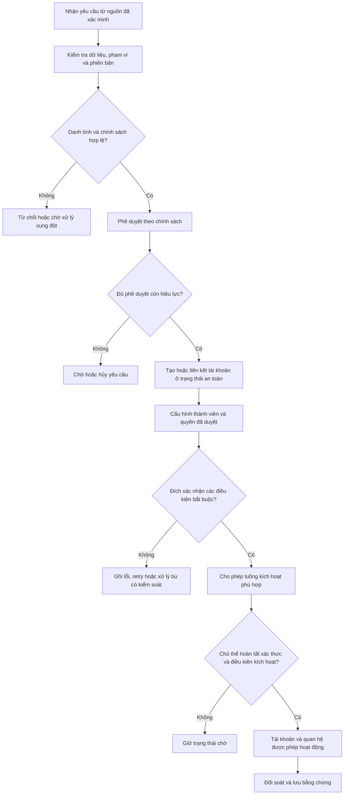

# Provisioning account

## 1. Provisioning account là gì?

**Provisioning account** là quá trình tạo lập và cấu hình tài khoản trong một hệ thống đích dựa trên một yêu cầu hợp lệ, một nguồn danh tính được tin cậy và một chính sách cấp quyền đã được xác định.

Kết quả không chỉ là có thêm một dòng trong bảng `account`. Một tài khoản sử dụng được còn cần được gắn đúng chủ thể, đúng tổ chức, có trạng thái phù hợp, có phương thức kích hoạt an toàn và chỉ nhận những quyền đã được cho phép.

Ví dụ, khi một nhân viên gia nhập doanh nghiệp, nền tảng học tập có thể cần:

1. Nhận thông tin từ nguồn nhân sự đã được cấu hình có thẩm quyền.
2. Xác định đúng danh tính và tenant mà người đó được gia nhập.
3. Kiểm tra chính sách hoặc phê duyệt yêu cầu cấp tài khoản.
4. Tạo hoặc liên kết tài khoản theo mã chủ thể ổn định.
5. Tạo quan hệ thành viên và cấp tập quyền cơ bản được duyệt.
6. Cho phép người dùng kích hoạt bằng một luồng xác thực phù hợp.
7. Ghi lại bằng chứng và đối soát trạng thái thực tế ở hệ thống đích.

Nếu bỏ qua một mắt xích, hệ thống có thể tạo tài khoản cho người không hợp lệ, gắn tài khoản của hai người khác nhau, cấp quyền quá mức hoặc báo hoàn tất trong khi một phần cấu hình chưa được áp dụng.

Trong thiết kế yêu cầu bảo mật, provisioning cần được mô tả bằng điều kiện cụ thể: ai được yêu cầu, nguồn nào có thẩm quyền, dữ liệu nào được tin, quyền nào được cấp, thời điểm nào được kích hoạt và bằng chứng nào chứng minh quá trình hoàn tất đúng.

## 2. Phân biệt tài khoản, danh tính và quyền truy cập

| Khái niệm | Vai trò | Điều không được tự suy ra |
|---|---|---|
| Bản ghi danh tính | Mô tả một chủ thể theo nguồn quản lý | Có bản ghi không tự chứng minh người đang thao tác là chủ thể đó |
| Tài khoản ứng dụng | Danh tính mà ứng dụng quản lý và tham chiếu | Tạo tài khoản không tự cho phép dùng mọi chức năng |
| Quan hệ thành viên tenant | Gắn tài khoản với một tổ chức hoặc miền quản trị | Thành viên tenant này không tự là thành viên tenant khác |
| Quyền hoặc vai trò | Xác định hành động được phép trong phạm vi cụ thể | Tên chức danh hoặc địa chỉ email không tự là quyền quản trị |
| Phương thức xác thực | Bằng chứng giúp chủ thể sử dụng danh tính | Cấp phương thức không thay thế phê duyệt quyền nghiệp vụ |
| Lời mời kích hoạt | Hỗ trợ hoàn tất một bước gia nhập | Gửi email thành công không chứng minh người nhận đã hoàn tất xác thực |
| Quy trình provisioning | Điều phối tạo và cấu hình ở một hoặc nhiều đích | Lệnh gửi đi thành công chưa chắc trạng thái đích đã đúng |

Một người có thể có nhiều tài khoản cho các mục đích khác nhau, chẳng hạn tài khoản thông thường và tài khoản quản trị. Ngược lại, một tài khoản ứng dụng có thể có quan hệ với nhiều tenant. Đặc tả phải chọn mô hình rõ ràng để không tự nhân bản tài khoản hoặc gộp các phạm vi quyền ngoài chủ đích.

Provisioning thường là phần khởi tạo của vòng đời quản lý danh tính. Thay đổi vai trò, tạm ngưng và thu hồi truy cập là các bước liên quan, nhưng không được dùng việc “đã cấp tài khoản một lần” như một quyền tồn tại vô thời hạn.

## 3. Bắt đầu từ nguồn có thẩm quyền và mô hình đe dọa

### 3.1. Nguồn nào quyết định thuộc tính nào?

Một hệ thống có thể nhận dữ liệu từ nhân sự, thư mục danh tính, hệ thống đối tác, quản trị viên hoặc một yêu cầu tự đăng ký. Không phải nguồn nào cũng được quyền quyết định mọi thuộc tính.

| Thuộc tính hoặc quyết định | Nguồn có thể được giao thẩm quyền | Kiểm soát cần có |
|---|---|---|
| Mã nhân sự và tình trạng gia nhập | Nguồn nhân sự được chỉ định | Xác minh nguồn, phiên bản và phạm vi tổ chức |
| Danh tính đăng nhập liên kết | Nguồn xác thực đã cấu hình tin cậy | Xác minh mã chủ thể và không gian phát hành |
| Tenant được gia nhập | Hợp đồng tổ chức hoặc người quản trị có quyền | Không cho người dùng tự khai tenant rồi được cấp thành viên |
| Vai trò cơ bản | Chính sách cấp quyền theo nhóm đối tượng | Có tập quyền cụ thể và phiên bản chính sách |
| Quyền nhạy cảm | Người hoặc quy trình phê duyệt được chỉ định | Kiểm soát người duyệt, phạm vi và thời hạn |
| Tên hiển thị, tùy chọn giao diện | Người dùng hoặc nguồn hồ sơ theo chính sách | Không dùng thuộc tính tự sửa để suy ra quyền |

Cần định nghĩa cách giải quyết khi các nguồn mâu thuẫn. Ví dụ, nguồn hồ sơ cho biết “giảng viên” không được ghi đè quyết định phân công khóa học từ hệ thống quản lý đào tạo nếu nguồn hồ sơ không có thẩm quyền cấp quyền đó.

### 3.2. Các rủi ro điển hình

| Rủi ro | Tình huống | Yêu cầu cần đặc tả |
|---|---|---|
| Cấp tài khoản trái phép | Gọi API tạo tài khoản bằng một yêu cầu tự khai | Xác thực người gọi và kiểm tra quyền provisioning |
| Gắn nhầm chủ thể | Dùng email để khớp rồi nhập quyền của hai người | Dùng khóa liên kết ổn định và quy trình xử lý xung đột |
| Nâng đặc quyền | Người gửi yêu cầu tự đặt vai trò quản trị | Chỉ cấp quyền từ chính sách hoặc phê duyệt có thẩm quyền |
| Vượt tenant | Connector của tổ chức A tạo thành viên trong B | Giới hạn danh tính connector và phạm vi đích |
| Tạo trùng | Gửi lại sự kiện hoặc timeout sau khi đích đã tạo | Tính lặp an toàn và tra cứu trạng thái thực tế |
| Kích hoạt sớm | Tài khoản sử dụng được trước khi kiểm tra hoặc phê duyệt đủ | Trạng thái chờ và điều kiện kích hoạt rõ ràng |
| Cấp lại quyền cũ | Sự kiện gia nhập đến sau một sự kiện hủy hoặc thu hồi | Xử lý thứ tự, phiên bản và trạng thái mong muốn hiện hành |
| Lộ dữ liệu bootstrap | Gửi mật khẩu chung hoặc log token lời mời | Cơ chế thiết lập phương thức xác thực an toàn |
| Hoàn tất giả | Chỉ nhận phản hồi đã tiếp nhận từ đích rồi báo thành công | Xác nhận tài khoản, quan hệ và quyền thực tế |

Không nên chỉ đặt mục tiêu “tự động tạo nhanh”. Provisioning tự động cần giữ được ranh giới tin cậy và bằng chứng kiểm soát giống như quy trình thủ công đã được phê duyệt.

## 4. Định danh, liên kết và xử lý xung đột

### 4.1. Dùng khóa ổn định có không gian rõ ràng

Một khóa nguồn có thể được mô tả như sau:

```text
source_identity_key = (source_instance_id, source_subject_id)
```

`source_instance_id` xác định nguồn cụ thể đã được cấu hình tin cậy. `source_subject_id` là mã chủ thể trong nguồn đó theo hợp đồng vòng đời đã xác minh. Nếu nguồn chỉ bảo đảm mã duy nhất trong một tổ chức hoặc thư mục, không gian đó cũng phải là một phần của khóa.

Hệ thống cần ánh xạ khóa nguồn tới mã tài khoản nội bộ và mã tài khoản tại từng đích. Không tự chuyển chữ thường hoặc sửa một mã opaque nếu nguồn không quy định phép biến đổi đó.

```text
Khóa danh tính nguồn
    → Mã chủ thể nội bộ
    → Quan hệ thành viên theo tenant
    → Mã tài khoản tại từng hệ thống đích
```

Tên đăng nhập và địa chỉ liên hệ có thể đổi, trong khi các quan hệ quyền phải tiếp tục tham chiếu đúng chủ thể. Nếu email cũ được cấp lại cho người khác, người mới không được kế thừa tài khoản, bài học, dữ liệu hoặc quyền của người cũ chỉ vì chuỗi email giống nhau.

### 4.2. Không tự gộp tài khoản bằng email

Hai nguồn có thể cung cấp cùng email nhưng trỏ tới hai chủ thể khác nhau. Một nguồn có thể chưa xác minh địa chỉ, địa chỉ có thể dùng chung hoặc thuộc tính có thể bị thay đổi.

Vì vậy, khi phát hiện trùng email hoặc tên đăng nhập, hệ thống phải thực hiện quy tắc xung đột đã đặc tả: dừng chờ xử lý, yêu cầu chứng minh quyền kiểm soát các tài khoản hoặc chuyển sang quy trình liên kết có quyền.

Không tự hợp nhất dữ liệu hay chuyển quyền chỉ để hoàn tất provisioning. Việc liên kết, tách hoặc hợp nhất danh tính là hành động có tác động bảo mật riêng và cần bằng chứng kiểm toán.

### 4.3. Tái gia nhập và tài khoản đã bị ngưng

Một người quay lại tổ chức có thể giữ cùng danh tính nguồn hoặc nhận một danh tính mới theo chính sách. Cần xác định tài khoản cũ được phục hồi hay một tài khoản mới được tạo, dữ liệu nào được nối lại và quyền nào phải được duyệt lại.

Không mặc định bật lại tất cả vai trò cũ. Quan hệ đã thu hồi hoặc quyền có thời hạn đã hết không được phục hồi chỉ vì tài khoản được chuyển về trạng thái hoạt động.

Các dấu vết tối thiểu giúp tránh tái gán mã hoặc xử lý sai sự kiện cũ cần có mục đích và thời gian lưu phù hợp. Điều đó không đồng nghĩa phải giữ vô hạn toàn bộ hồ sơ cá nhân.

## 5. Đặc tả quy trình và trạng thái

### 5.1. Tách trạng thái yêu cầu khỏi trạng thái tài khoản

Một yêu cầu có thể đã được phê duyệt nhưng tài khoản đích chưa được tạo; tài khoản có thể đã tồn tại nhưng còn bị vô hiệu hóa. Không nên nén tất cả vào một cờ `created=true`.

| Đối tượng quản lý | Trạng thái minh họa | Ý nghĩa |
|---|---|---|
| Yêu cầu provisioning | Nhận, kiểm tra, chờ duyệt, đã duyệt, đang thực hiện, hoàn tất, lỗi, hủy | Tiến độ và kết quả điều phối |
| Tài khoản | Chờ kích hoạt, hoạt động, bị ngưng | Khả năng sử dụng danh tính trong ứng dụng |
| Quan hệ tenant | Được mời, hoạt động, bị thu hồi | Quyền gia nhập một tổ chức cụ thể |
| Gán quyền | Đang chờ, có hiệu lực, hết hạn, bị thu hồi | Khả năng thực hiện hành động theo phạm vi |
| Trạng thái đích | Mong muốn và quan sát được | Đối chiếu cấu hình cần có với cấu hình thực tế |

Tên trạng thái là ví dụ thiết kế. Điều quan trọng là mỗi trạng thái có điều kiện chuyển, người hoặc thành phần được phép chuyển và kết quả quan sát được.

### 5.2. Luồng tham chiếu



Quy trình có thể không cần người phê duyệt từng tài khoản nếu một chính sách tự động đã được phê duyệt cho tập quyền cụ thể. Khi đó, cần lưu phiên bản chính sách và điều kiện đã làm phát sinh quyền, không coi việc tự động hóa là bỏ bước cho phép.

Nếu hệ thống đích không hỗ trợ trạng thái chờ hoặc không có cách ngăn sử dụng trước khi đủ điều kiện, phải thiết kế một cơ chế kiểm soát tương ứng hoặc đánh giá lại khả năng tích hợp. Không giả định đã có giai đoạn an toàn chỉ vì bộ điều phối chưa đánh dấu hoàn tất.

## 6. Chọn cách provisioning và kiểm soát cấp quyền

### 6.1. Các cách cấp tài khoản thường gặp

| Cách thực hiện | Phù hợp với | Kiểm soát không được thiếu |
|---|---|---|
| Quản trị viên tạo thủ công | Số lượng nhỏ hoặc ngoại lệ có xử lý riêng | Quyền quản trị, xác minh đối tượng, phạm vi tenant và log |
| Nhập theo lô | Gia nhập theo đợt từ một danh sách | Xác minh nguồn, kiểm tra từng dòng, xử lý trùng và báo cáo kết quả |
| API hoặc sự kiện | Tích hợp tự động giữa các hệ thống | Danh tính dịch vụ, phạm vi thao tác, phiên bản, chống lặp và xử lý lỗi |
| Đồng bộ thư mục | Quản lý tập tài khoản theo trạng thái nguồn | Quy tắc ánh xạ, quyền sở hữu thuộc tính, đối soát và xử lý xung đột |
| Just-in-time, JIT | Tạo tài khoản khi chủ thể đăng nhập lần đầu | Nguồn xác thực tin cậy, điều kiện được gia nhập và tập quyền đã được cho phép |

Một giao thức provisioning như SCIM có thể hỗ trợ trao đổi trạng thái tài khoản giữa các hệ thống. Giao thức không tự quyết định ai được làm quản trị viên hoặc thuộc tính nào là nguồn có thẩm quyền; những quyết định đó vẫn cần chính sách và hợp đồng tích hợp.

JIT cũng không có nghĩa “bất kỳ ai xác thực được ở bất kỳ nguồn nào đều có tài khoản trong tenant”. Phải giới hạn nguồn, miền danh tính, điều kiện gia nhập và quyền phát sinh. Kết quả đăng nhập phải được xác minh trước khi dùng thuộc tính để tạo hoặc liên kết tài khoản.

### 6.2. Cấp quyền theo chính sách, không theo dữ liệu tự khai

Một yêu cầu có trường `requested_role=ADMIN` chỉ mô tả điều người gửi muốn, không phải quyết định cho phép. Hệ thống phải đánh giá người gửi có quyền đề nghị hoặc cấp vai trò đó trong phạm vi nào.

Cần đặc tả riêng:

- Quyền tối thiểu được cấp tự động theo một chính sách đã được duyệt.
- Quyền cần phê duyệt bổ sung, người được duyệt và thời hạn hiệu lực.
- Các tổ hợp quyền không được đồng thời tồn tại theo nghiệp vụ.
- Phạm vi tenant, khóa học, tài nguyên hoặc hệ thống đích của từng quyền.
- Hành vi khi thiếu một nhóm hoặc thuộc tính dùng để ánh xạ quyền.

Không tìm được quy tắc ánh xạ hợp lệ phải dẫn tới không cấp quyền đó hoặc chờ xử lý theo hợp đồng. Không dùng một vai trò rộng làm mặc định để tránh lỗi provisioning.

Nếu quyền nhạy cảm yêu cầu người duyệt độc lập, người yêu cầu không được tự phê duyệt bằng một API hoặc đường vận hành khác. Các đường thủ công, API và nhập theo lô phải giữ cùng ràng buộc.

### 6.3. Phê duyệt phải gắn với nội dung được cấp

Phê duyệt cần liên kết tới chủ thể, tenant, hệ thống đích, tập quyền, thời hạn và phiên bản yêu cầu. Nếu sau khi duyệt có người đổi tenant hoặc thêm quyền quản trị, phê duyệt cũ không được tự áp dụng cho nội dung mới.

Có thể lưu một biểu diễn chuẩn của nội dung và dấu kiểm tra được bảo vệ để phát hiện thay đổi. Giá trị hash đơn lẻ không chứng minh ai đã duyệt; nó phải nằm trong một bản ghi hoặc thông điệp có nguồn và tính toàn vẹn đáng tin cậy.

Cần kiểm tra phê duyệt còn hiệu lực tại thời điểm thực hiện. Một yêu cầu đã bị hủy hoặc một chính sách đã thay đổi không được tiếp tục cấp quyền chỉ vì bản tin cũ vẫn nằm trong hàng đợi.

## 7. Bootstrap và kích hoạt tài khoản an toàn

### 7.1. Điều kiện kích hoạt phải có bằng chứng

Tạo tài khoản và chứng minh người dùng được quyền sử dụng tài khoản là hai việc khác nhau. Một hệ thống có thể tạo trước ở trạng thái chờ, rồi yêu cầu chủ thể hoàn tất luồng xác thực hoặc đăng ký phương thức theo chính sách.

Với doanh nghiệp dùng nguồn đăng nhập tập trung, tài khoản có thể được liên kết với một mã chủ thể tại nguồn đã được cấu hình tin cậy. Lần kích hoạt phải xác minh người đăng nhập khớp liên kết đó, không chỉ khớp email hiển thị.

Với tài khoản cục bộ, cần một quy trình bootstrap phù hợp: xác minh điều kiện gia nhập, thiết lập bí mật hoặc phương thức xác thực, đăng ký yếu tố bổ sung nếu bắt buộc và kiểm tra trạng thái tài khoản trước khi phát hành phiên.

Không gửi cùng một mật khẩu mặc định cho nhiều người, không lưu mật khẩu rõ trong yêu cầu provisioning và không coi “bắt đổi ở lần đăng nhập sau” là biện pháp đủ để bảo vệ một mật khẩu đã bị lộ.

### 7.2. Nếu dùng lời mời kích hoạt

Một lời mời cần có mã khó đoán được tạo bằng nguồn ngẫu nhiên phù hợp, gắn với mục đích, tài khoản, tenant và thời hạn. Mã chỉ nên được dùng theo số lần đã đặc tả, thường là một lần cho một bước kích hoạt.

Nếu chỉ cần kiểm tra mã do máy chủ phát hành, có thể lưu giá trị kiểm tra một chiều thay vì lưu nguyên mã có thể sử dụng. Cần bảo vệ mã trong URL, lịch sử, log, hệ thống phân tích và các kênh hỗ trợ.

Những quy tắc cần ghi rõ gồm:

1. Mã có hiệu lực bao lâu và được kiểm tra bằng thời gian phía máy chủ nào.
2. Mã có thể dùng cho tài khoản hoặc tenant khác không.
3. Gửi lại lời mời có vô hiệu hóa mã trước đó hay không.
4. Hai yêu cầu đồng thời dùng một mã được xử lý thế nào.
5. Điều gì xảy ra khi yêu cầu bị hủy, tài khoản bị ngưng hoặc điều kiện gia nhập thay đổi.
6. Việc giữ mã có đủ để kích hoạt hay vẫn phải đáp ứng bằng chứng xác thực khác.

Một email được chuyển tiếp có thể làm lộ mã cho người khác. Nếu mô hình rủi ro yêu cầu xác minh danh tính mạnh hơn, mã lời mời chỉ là một điều kiện trong luồng, không thay cho bằng chứng đó.

### 7.3. Không cấp phiên quá sớm

Hoàn thành một bước như xác minh email hoặc nhập mã lời mời không tự thỏa toàn bộ chính sách xác thực. Nếu tài khoản bắt buộc có MFA, trạng thái chờ đăng ký MFA không được có quyền nghiệp vụ như tài khoản đã hoàn tất.

Đồng thời, một tài khoản đã hoạt động ở tenant A không tự được coi là đã gia nhập tenant B. Việc kích hoạt quan hệ tenant mới phải theo điều kiện riêng mà không chuyển quyền giữa hai tổ chức.

## 8. Tính lặp an toàn, đồng thời và lỗi từng phần

### 8.1. Thiết kế cho việc giao nhận ít nhất một lần

Một sự kiện có thể được gửi lại, worker có thể chạy lại và phản hồi có thể mất sau khi hệ thống đích đã tạo tài khoản. Vì vậy, cần **tính lặp an toàn**, thường gọi là idempotency: xử lý lại cùng một ý định hợp lệ không tạo thêm tài khoản hoặc cấp thêm quyền ngoài ý định đó.

Một khóa chống lặp nên có không gian người gọi, loại thao tác, hệ thống đích và mã yêu cầu ổn định. Cùng khóa nhưng nội dung khác phải bị phát hiện và từ chối, không âm thầm dùng kết quả của một yêu cầu khác.

Ngoài khóa theo yêu cầu, cần ràng buộc duy nhất cho ánh xạ danh tính nguồn tới tài khoản trong phạm vi đã chọn. Nếu hai yêu cầu khác mã cùng muốn tạo một tài khoản cho cùng chủ thể, khóa chống lặp riêng lẻ chưa ngăn được trùng.

### 8.2. Timeout không chứng minh đích chưa tạo

Xét tình huống:

```text
Bộ điều phối gửi lệnh tạo tài khoản
    → Hệ thống đích tạo thành công
    → Phản hồi bị mất
    → Bộ điều phối nhận timeout
```

Hành vi tiếp theo phải là tra cứu hoặc đối chiếu bằng mã liên kết ổn định, hoặc gửi lại theo cơ chế chống lặp mà đích hỗ trợ. Không tự tạo một tài khoản mới với tên khác chỉ để vượt qua lỗi.

Nếu đích không có khả năng chống lặp, tra cứu hoặc ràng buộc duy nhất đủ tin cậy, cần đánh giá khả năng bảo đảm của tích hợp. Khi không xác định được kết quả, có thể phải dừng chờ xử lý thay vì tiếp tục tạo mù.

Khóa hoặc lease ở bộ điều phối có thể giảm chạy trùng nhưng không tự giải quyết mọi trường hợp worker cũ vẫn tiếp tục gọi đích sau khi lease hết hạn. Bảo đảm cuối cùng cần xét cả hành vi của đích và cơ chế xác nhận tác dụng.

### 8.3. Sự kiện đến sai thứ tự

Một sự kiện gia nhập phiên bản cũ có thể đến sau sự kiện hủy hoặc thay đổi phạm vi. Hệ thống cần số phiên bản, thứ tự có ý nghĩa hoặc một cách đọc lại trạng thái hiện hành từ nguồn có thẩm quyền.

Không chỉ so thời điểm trên máy gửi nếu hợp đồng nguồn chưa bảo đảm cách sử dụng thời điểm đó. Trước khi cấp hoặc kích hoạt, phải kiểm tra yêu cầu vẫn phản ánh trạng thái mong muốn hiện hành.

Sự kiện cũ không được làm tài khoản đã bị ngưng hoạt động lại hoặc khôi phục một vai trò đã bị thu hồi. Nếu xung đột không giải quyết được tự động, phải có trạng thái chờ xử lý và log giải thích.

### 8.4. Lỗi một phần và hành động bù

Provisioning qua nhiều hệ thống thường không có một giao dịch cơ sở dữ liệu chung. Có thể tạo tài khoản ở đích A thành công nhưng gán quyền ở đích B thất bại.

Cần phân loại bước bắt buộc và bước tùy chọn, lưu kết quả từng bước, quy định thứ tự kích hoạt và có hành vi lỗi xác định. Một bước bắt buộc chưa hoàn tất không được bị che bằng trạng thái “thành công” chung.

Hành động bù phải có phạm vi chính xác. Không tự xóa một tài khoản đã tồn tại trước yêu cầu, hoặc thu hồi quyền do một quy trình khác cấp, chỉ vì một bước của yêu cầu hiện tại thất bại.

Nếu chọn giữ tài khoản ở trạng thái bị vô hiệu hóa để retry, phải có thời hạn theo dõi và đối soát. Nếu chọn thu hồi phần đã cấp, cần chứng minh phần đó thực sự thuộc ý định provisioning đang được hoàn tác.

### 8.5. Retry cần giới hạn và có quan sát

Lỗi tạm thời có thể được retry theo lịch có khoảng cách và giới hạn. Lỗi dữ liệu, xung đột danh tính hoặc thiếu phê duyệt không nên được gửi lại vô hạn như lỗi mạng.

Cần có số lần thử, thời điểm thử tiếp, nguyên nhân, thời hạn tổng và nơi tiếp nhận các yêu cầu cần can thiệp. Retry không được bỏ qua kiểm tra phiên bản, quyền người gọi hoặc nội dung đã duyệt.

## 9. Đối soát trạng thái mong muốn và thực tế

Một kết quả thành công ở thời điểm tạo không đảm bảo trạng thái luôn đúng. Quản trị viên có thể sửa trực tiếp ở đích, connector có thể bỏ lỡ sự kiện hoặc ánh xạ quyền có thể thay đổi.

Đối soát cần so sánh ít nhất:

- Tài khoản dự kiến tồn tại với tài khoản thực tế và mã liên kết.
- Trạng thái hoạt động, quan hệ tenant và tập quyền được quản lý.
- Các bước provisioning còn treo hoặc có kết quả không rõ.
- Quyền thừa, quyền thiếu, tài khoản trùng hoặc tài khoản không có nguồn quản lý hợp lệ.

Cần xác định thuộc tính nào do nguồn nào quản lý. Nếu một quyền được phép cấp riêng bởi quy trình khác, bộ đối soát không được tự xóa quyền đó vì không thấy trong một bản ghi nguồn không có thẩm quyền.

Không coi một snapshot nguồn rỗng, tải chưa đủ hoặc bị lỗi là bằng chứng mọi tài khoản phải bị loại bỏ. Cần kiểm tra tính đầy đủ, phạm vi, phiên bản và điều kiện an toàn trước khi sửa hàng loạt trạng thái đích.

Có thể tách bước phát hiện, đề xuất sửa và tự sửa theo mức rủi ro. Chỉnh sửa nhạy cảm hoặc tác động lớn cần quy tắc giới hạn phạm vi và phê duyệt đã được xác định; không dùng “đối soát tự động” như một quyền sửa mọi thứ.

Mỗi sai lệch cần có mức độ, người chịu trách nhiệm, thời hạn xử lý và bằng chứng đã khôi phục đúng. Một dashboard hiển thị số sai lệch nhưng không liên kết tới hành động xử lý chưa đủ chứng minh yêu cầu quản lý danh tính đã được đáp ứng.

## 10. Tài khoản dịch vụ và danh tính phi con người

Tài khoản phục vụ ứng dụng, connector hoặc tác vụ nền cũng cần provisioning có kiểm soát. Chúng không nên được tạo như một người dùng bình thường rồi dùng chung một mật khẩu trong nhóm vận hành.

Mỗi danh tính dịch vụ cần có chủ sở hữu chịu trách nhiệm, mục đích, môi trường, tập quyền, phạm vi đích và điều kiện thu hồi. Nếu có bí mật hoặc khóa, phải quy định nơi lưu, cách phân phối, thay đổi và thu hồi theo cơ chế xác thực đã chọn.

Không cấp tài khoản production bằng cùng một quy trình mở dành cho môi trường thử nghiệm. Danh tính connector cần quyền tối thiểu đủ tạo hoặc cấu hình tài khoản trong phạm vi được giao; quyền quản trị toàn bộ hệ thống không nên là mặc định của tích hợp.

Nếu hệ thống hỗ trợ danh tính workload hoặc thông tin xác thực ngắn hạn phù hợp, có thể dùng chúng thay cho bí mật tĩnh. Dù chọn phương thức nào, quyền provisioning vẫn phải được xác định và kiểm toán riêng.

Khi người sở hữu tài khoản dịch vụ rời vai trò, cần chuyển trách nhiệm hoặc thu hồi theo chính sách. Không để tài khoản trở thành tài nguyên không có người quản lý chỉ vì nó vẫn đang chạy được.

## 11. Bộ yêu cầu mẫu có thể đo và kiểm chứng

Bối cảnh minh họa: một doanh nghiệp cấp quyền vào nền tảng học tập nhiều tenant từ nguồn nhân sự và nguồn đăng nhập tập trung đã được chỉ định. Chính sách cơ bản chỉ cấp vai trò học viên trong tenant được duyệt; phân công giảng viên và quyền quản trị cần quyết định riêng.

Các thời hạn và ngưỡng dưới đây là **tham số của hệ thống giả định**, không phải giá trị mặc định bắt buộc cho mọi sản phẩm.

| Mã | Yêu cầu bảo mật | Bằng chứng chấp nhận |
|---|---|---|
| PA-01 | Chỉ danh tính người hoặc dịch vụ có quyền provisioning trong tenant và hệ thống đích tương ứng mới được gửi yêu cầu có hiệu lực | Connector của tenant A không tạo thành viên hoặc cấp quyền trong tenant B |
| PA-02 | Danh tính phải được liên kết bằng khóa nguồn có không gian rõ ràng; email và tên hiển thị không được dùng làm căn cứ tự gộp | Hai chủ thể khác mã nguồn nhưng cùng email không tự nhận chung tài khoản hoặc quyền |
| PA-03 | Trước khi tạo hoặc cấp quyền, phải xác minh trạng thái nguồn hiện hành, phạm vi tenant và phiên bản yêu cầu | Sự kiện gia nhập cũ đến sau sự kiện hủy không tạo hoặc kích hoạt lại tài khoản |
| PA-04 | Quyền cấp tự động chỉ gồm tập quyền đã được chính sách cho phép; quyền nhạy cảm phải có phê duyệt đúng phạm vi còn hiệu lực | Tự gửi vai trò quản trị hoặc đổi quyền sau khi duyệt không làm phát sinh quyền đó |
| PA-05 | Phê duyệt phải gắn với chủ thể, tenant, đích, tập quyền, thời hạn và phiên bản nội dung; thay đổi nội dung bảo mật phải được đánh giá lại | Yêu cầu đã duyệt không thể chuyển sang người khác hoặc thêm quyền bằng cách sửa body |
| PA-06 | Tài khoản mới phải ở trạng thái không có quyền sử dụng trái chính sách cho đến khi đủ điều kiện kích hoạt | Tài khoản đã tạo nhưng thiếu bước bắt buộc không đăng nhập được vào chức năng nghiệp vụ tương ứng |
| PA-07 | Luồng kích hoạt phải xác minh chủ thể theo phương thức đã chọn và mọi điều kiện bắt buộc; gửi email thành công không được coi là kích hoạt | Người nhận mã nhưng không đáp ứng bằng chứng bắt buộc không có phiên ứng dụng hoàn chỉnh |
| PA-08 | Nếu dùng lời mời trong hệ thống mẫu, mã có hiệu lực tối đa 24 giờ, dùng một lần, gắn tài khoản và tenant; gửi lại vô hiệu hóa mã trước | Mã cũ, sai tenant, quá hạn hoặc dùng lại không hoàn tất kích hoạt; hai yêu cầu đồng thời không tạo hai lần kích hoạt |
| PA-09 | Cùng ý định provisioning được gửi lại không tạo thêm tài khoản hoặc gán quyền lặp; cùng khóa chống lặp nhưng khác nội dung phải bị từ chối | Mô phỏng gửi trùng và timeout sau tạo thành công chỉ để lại một tài khoản theo ánh xạ chuẩn |
| PA-10 | Mọi bước bắt buộc phải có trạng thái và xác nhận từ đích; kết quả không rõ không được tự báo hoàn tất | Đích đã nhận lệnh nhưng chưa xác nhận cấu hình không tạo trạng thái hoàn tất giả |
| PA-11 | Với một bước lỗi tạm thời, hệ thống mẫu cho tối đa 5 lần gửi lệnh trong 30 phút tính từ lần thử đầu; đạt giới hạn hoặc hết thời hạn thì chuyển chờ can thiệp và thông báo trong 60 giây | Kiểm thử thời gian và lỗi cho thấy không retry vô hạn, không bỏ qua kiểm tra trạng thái trước khi gửi lại |
| PA-12 | 95% yêu cầu hợp lệ đã được duyệt và đến thời điểm hiệu lực phải sẵn sàng kích hoạt tại mọi đích bắt buộc trong 5 phút; thời gian người dùng tự hoàn tất kích hoạt được đo riêng | Báo cáo có thời điểm bắt đầu, xác nhận từng đích, thời điểm sẵn sàng và mọi trường hợp quá hạn |
| PA-13 | Mỗi tenant phải hoàn tất một lượt đối soát trong mỗi 24 giờ theo chính sách mẫu; nguồn tải lỗi hoặc chưa đầy đủ không được dùng để sửa hàng loạt trạng thái đích | Cố tình trả snapshot thiếu hoặc lỗi không làm thay đổi hàng loạt tài khoản; có sự kiện lỗi đối soát |
| PA-14 | Hành động bù chỉ tác động tới tài nguyên hoặc quyền có căn cứ thuộc phạm vi yêu cầu cần hoàn tác | Lỗi một đích không xóa tài khoản có sẵn hoặc thu hồi quyền do quy trình độc lập cấp |
| PA-15 | Tạo, liên kết, phê duyệt, cấp quyền, kích hoạt, retry, lỗi và sửa sai lệch phải có sự kiện liên kết; không ghi bí mật hoặc dữ liệu cá nhân thừa | Truy vết được toàn bộ một yêu cầu và không có mật khẩu, token lời mời hoặc khóa dịch vụ trong log |

PA-12 đo **sẵn sàng kích hoạt**, không đo việc người dùng đã mở email hoặc hoàn tất đăng nhập. Thời điểm bắt đầu là lúc yêu cầu đã được duyệt, đến thời điểm hiệu lực và đủ điều kiện xử lý theo hợp đồng. Lỗi connector và các yêu cầu quá hạn phải xuất hiện trong số liệu, không bị loại bỏ để làm đẹp tỷ lệ.

PA-11 áp dụng cho lỗi được phân loại là có thể retry. Trước mỗi lần gửi lại phải xử lý trường hợp kết quả trước đó không rõ và kiểm tra ý định vẫn hợp lệ; một lỗi danh tính hoặc thiếu phê duyệt không được tiêu thụ thêm lượt như thể chỉ là lỗi mạng.

Nếu một đích không thể kiểm chứng một yêu cầu như PA-08 hoặc PA-09, phải nêu giới hạn và thiết kế kiểm soát phù hợp trước khi coi tích hợp là đáp ứng. Một cờ cấu hình ở bộ điều phối không tự tạo ra khả năng mà hệ thống đích chưa hỗ trợ.

## 12. Logging, dữ liệu và bằng chứng vận hành

### 12.1. Sự kiện cần giải thích được điều gì?

Một sự kiện có thể có cấu trúc như sau:

```json
{
  "event_type": "ACCOUNT_PROVISIONING_STEP_COMPLETED",
  "correlation_id": "request-demo-518",
  "provisioning_request_id": "provision-demo-092",
  "source_instance_id": "hr-source-demo-a",
  "subject_ref": "subject-ref-demo-17",
  "tenant_id": "tenant-demo-a",
  "target_system": "learning-platform-demo",
  "step": "BASE_ENTITLEMENT_CONFIGURED",
  "source_revision": 42,
  "policy_version": "joiner-policy-v3",
  "approval_ref": "approval-demo-61",
  "occurred_at": "2026-01-15T12:00:00Z"
}
```

Các mã trên là dữ liệu giả lập. Thông tin cần đủ để biết ai hoặc chính sách nào cho phép, nguồn nào đã được sử dụng, bước nào đã hoàn tất và trạng thái nào còn thiếu.

Không đưa mật khẩu, mã lời mời, token quản trị connector hoặc toàn bộ hồ sơ nhân sự vào log. Với dữ liệu định danh và thông tin liên hệ, cần xác định mục đích, quyền truy cập, thời hạn lưu và cách dọn dữ liệu.

Tham chiếu phê duyệt, phiên bản nguồn và phiên bản chính sách cần có thể đối chiếu với bằng chứng còn được lưu theo chính sách. Chỉ ghi “tạo thành công” mà không biết tài khoản nào, tenant nào và quyền nào được cấp là chưa đủ để giải thích một sự cố cấp nhầm.

### 12.2. Phân biệt chỉ số kỹ thuật và kết quả bảo mật

Có thể theo dõi thời gian nhận yêu cầu, thời gian chờ duyệt, độ trễ từng đích, số retry, số xung đột, số sai lệch và thời gian sẵn sàng kích hoạt.

Tỷ lệ API trả thành công không thay thế số tài khoản đã có đúng trạng thái và quyền. Tương tự, tăng tốc provisioning bằng cách bỏ phê duyệt hoặc bật tài khoản trước khi đủ điều kiện là thay đổi chính sách, không chỉ tối ưu hiệu năng.

Các yêu cầu treo cần người chịu trách nhiệm và cách xử lý rõ ràng. Khả năng truy tìm một yêu cầu từ sự kiện nguồn tới tài khoản đích là một phần của yêu cầu phục hồi và kiểm toán.

## 13. Ma trận kiểm thử chấp nhận

| Nhóm kiểm thử | Tình huống | Kết quả cần kiểm chứng |
|---|---|---|
| Luồng hợp lệ | Danh tính hợp lệ, đúng tenant, đủ phê duyệt | Một tài khoản đúng chủ thể, đúng quan hệ và đúng tập quyền |
| Quyền người gọi | Người hoặc connector không có quyền tạo ở đích | Không tạo tài khoản hoặc gán quyền |
| Chéo tenant | Connector A gửi yêu cầu cho tenant B | Không mở rộng quyền từ dữ liệu đầu vào |
| Xung đột danh tính | Hai mã nguồn khác nhau dùng cùng email | Không tự gộp tài khoản, dữ liệu hoặc quyền |
| Thay đổi thuộc tính | Đổi email nhưng giữ danh tính nguồn ổn định | Không tạo chủ thể mới chỉ vì địa chỉ liên hệ đổi |
| Tái gia nhập | Kích hoạt lại một chủ thể có quyền cũ đã bị thu hồi | Không tự phục hồi mọi quyền cũ |
| Nội dung sau phê duyệt | Đổi chủ thể, tenant, đích hoặc thêm quyền | Phê duyệt cũ không được dùng cho nội dung mới |
| Cấp quyền ngoài chính sách | Gửi vai trò quản trị trong yêu cầu tự khai | Không cấp vai trò nếu thiếu quyết định cho phép |
| Kích hoạt | Thiếu phương thức bắt buộc, sai danh tính liên kết hoặc sai tenant | Không tạo trạng thái sử dụng hoàn chỉnh |
| Lời mời | Dùng mã hết hạn, mã trước khi gửi lại, mã đã dùng | Không hoàn tất kích hoạt; đúng quy tắc thời gian và chống dùng lại |
| Đồng thời | Hai worker hoặc hai yêu cầu kích hoạt chạy cùng lúc | Không tạo tài khoản trùng hoặc tiêu thụ một mã nhiều lần |
| Mất phản hồi | Đích tạo thành công nhưng bộ điều phối nhận timeout | Đối chiếu được kết quả và không tạo thêm tài khoản |
| Sự kiện cũ | Gia nhập đến sau một thay đổi hủy hoặc thu hồi mới hơn | Không bật lại tài khoản hoặc quyền từ trạng thái cũ |
| Lỗi từng phần | Tạo tài khoản thành công nhưng gán quyền bắt buộc lỗi | Không báo hoàn tất giả; đúng trạng thái chờ, retry hoặc hành động bù |
| Phạm vi hành động bù | Tài khoản hoặc quyền đã có từ một quy trình khác | Không xóa hoặc thu hồi ngoài phạm vi yêu cầu đang hoàn tác |
| Retry và thời hạn | Lỗi tạm thời kéo dài tới giới hạn mẫu | Chuyển chờ can thiệp và thông báo đúng hạn; không retry vô hạn |
| Đối soát | Đích lệch quyền, snapshot nguồn thiếu hoặc lỗi | Phát hiện sai lệch; không sửa hàng loạt từ nguồn không hợp lệ |
| Dữ liệu và log | Kiểm tra luồng thành công, thất bại và hỗ trợ thủ công | Có bằng chứng liên kết, không chứa bí mật hoặc dữ liệu thừa |

Kiểm thử nên dùng danh tính, tenant và hệ thống đích giả lập có quan hệ khác nhau. Với thời hạn lời mời hoặc lịch retry, có thể dùng nguồn thời gian được kiểm soát để kiểm tra trước, tại và sau giới hạn.

Kết quả cần được xác nhận ở trạng thái đích, quan hệ thành viên và quyền thực tế, không chỉ qua phản hồi của bộ điều phối. Với lỗi từng phần, cần kiểm tra cả điều không được phát sinh, như quyền quản trị hoặc tài khoản trùng.

## 14. Truy vết yêu cầu và mẫu đặc tả

Có thể nối rủi ro, yêu cầu, thiết kế và kiểm thử theo chuỗi:

```text
Rủi ro: cấp tài khoản nhầm người
  → Yêu cầu: PA-02, PA-03 và PA-07
  → Thiết kế: khóa nguồn ổn định, liên kết danh tính và điều kiện kích hoạt
  → Kiểm thử: email trùng, email đổi, danh tính kích hoạt không khớp

Rủi ro: cấp quyền quản trị trái phép
  → Yêu cầu: PA-04 và PA-05
  → Thiết kế: ánh xạ quyền có phiên bản và phê duyệt gắn nội dung
  → Kiểm thử: quyền tự khai, nội dung đổi sau phê duyệt và chéo tenant

Rủi ro: tạo trùng hoặc báo hoàn tất giả
  → Yêu cầu: PA-09, PA-10 và PA-14
  → Thiết kế: chống lặp, ánh xạ đích và trạng thái từng bước
  → Kiểm thử: mất phản hồi, xử lý đồng thời và lỗi từng phần
```

Khi thêm nguồn danh tính, tenant, hệ thống đích hoặc quy tắc ánh xạ, cần đánh giá lại thẩm quyền thuộc tính, phạm vi connector, điều kiện kích hoạt và khả năng đối soát. Thay đổi tên nhóm hoặc cấu hình tích hợp cũng có thể làm phát sinh quyền ngoài ý định.

Một yêu cầu cho một loại tài khoản có thể viết theo mẫu:

> Khi nhận **[sự kiện hoặc yêu cầu]** từ **[nguồn và người gọi được phép]**, hệ thống phải xác minh **[danh tính, tenant, phiên bản và điều kiện gia nhập]**, áp dụng **[chính sách hoặc phê duyệt]**, rồi tạo hoặc liên kết **[tài khoản đích]** bằng **[khóa ổn định]**. Chỉ cấp **[tập quyền và phạm vi]** và cho phép kích hoạt khi **[điều kiện xác thực cùng xác nhận bắt buộc]** được đáp ứng. Xử lý lại phải **[không tạo trùng]**; lỗi từng phần phải dẫn tới **[trạng thái, retry hoặc hành động bù]**. Kết quả phải được xác nhận trong **[thời hạn]**, đối soát theo **[chu kỳ và phạm vi]**, và chứng minh bằng **[sự kiện cùng ca kiểm thử]**.

Một đặc tả provisioning đầy đủ làm rõ vì sao tài khoản được tạo, thuộc về ai, được nhận quyền nào và khi nào có thể sử dụng. Khi các quyết định đó có nguồn tin cậy, trạng thái quan sát được và tiêu chí chấp nhận, việc cấp tài khoản trở thành một yêu cầu bảo mật có thể triển khai và kiểm chứng.
