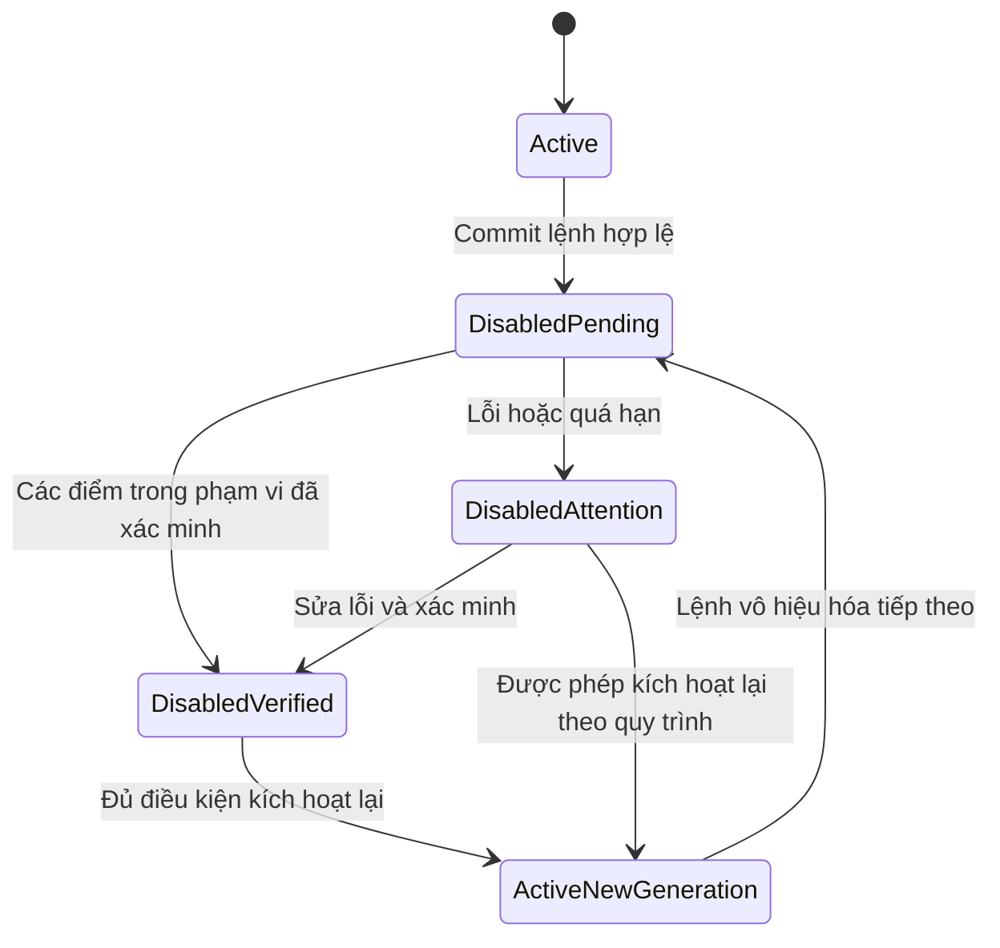

# Disable account

## 1. Vô hiệu hóa tài khoản là một thay đổi quyền truy cập

Disable account là thao tác làm cho một tài khoản không còn được sử dụng để truy cập trong phạm vi đã xác định. Tình huống thường gặp gồm nhân viên nghỉ việc, tài khoản bị nghi chiếm đoạt, nhà thầu hết thời hạn hoặc quản trị viên cần tạm dừng quyền truy cập để điều tra.

Trong chương **Quản trị identity**, yêu cầu vô hiệu hóa phải gắn với toàn bộ vòng đời danh tính và đường truy cập. Một cột `enabled=false` chỉ có ý nghĩa bảo mật khi các thành phần liên quan thực sự kiểm tra hoặc áp dụng nó.

Nếu hệ thống chặn đăng nhập mới nhưng access token cũ vẫn đọc dữ liệu trong nhiều giờ, tài khoản chưa bị vô hiệu hóa theo mục tiêu “ngừng truy cập”. Nếu refresh token vẫn đổi được token mới, việc đăng xuất giao diện cũng chưa đủ.

Bài học tập trung vào cách chuyển mục tiêu ngừng truy cập thành yêu cầu cụ thể, đo được và có thể kiểm chứng; liên kết yêu cầu với rủi ro, kiến trúc xác thực/phân quyền, logging và phục hồi vận hành.

Ví dụ yêu cầu ban đầu:

> Khi nhân viên nghỉ việc, quản trị viên phải vô hiệu hóa tài khoản.

Một đặc tả rõ hơn:

> Khi lệnh vô hiệu hóa được ghi nhận thành công tại nguồn trạng thái có thẩm quyền, hệ thống phải từ chối việc tạo phiên mới cho tài khoản trong phạm vi chỉ định. Trong tối đa 60 giây, mọi API, worker và đường tải thuộc phạm vi phải ngừng cung cấp truy cập dựa trên phiên hoặc thông tin xác thực cũ của tài khoản đó. Mở lại tài khoản không được làm sống lại những phiên đã bị thu hồi.

Mốc 60 giây là ví dụ thiết kế, cần được thống nhất theo rủi ro và năng lực hệ thống thực tế.

## 2. Phân biệt các trạng thái và thao tác gần nhau

| Khái niệm | Ý nghĩa | Điều không được tự suy ra |
|---|---|---|
| Disable account | Ngừng khả năng truy cập theo chính sách quản trị | Không tự xóa dữ liệu hoặc mọi tài nguyên do người dùng tạo |
| Khóa do thử sai | Hạn chế xác thực để chống dò hoặc lạm dụng | Không nhất thiết là quyết định đình chỉ danh tính |
| Đăng xuất | Kết thúc một phiên hoặc tập phiên | Không tự chặn đăng nhập lại bằng thông tin xác thực còn hiệu lực |
| Thu hồi token | Làm mất hiệu lực một token hoặc chuỗi token | Không tự vô hiệu hóa mọi phương thức đăng nhập |
| Thu hồi vai trò | Bỏ một nguồn quyền | Người dùng có thể còn quyền từ nhóm hoặc quan hệ khác |
| Xóa thành viên tenant | Ngừng tư cách thành viên trong một tổ chức | Không tự chặn tài khoản ở tổ chức khác |
| Xóa tài khoản | Xử lý vòng đời bản ghi và dữ liệu theo chính sách | Không đồng nghĩa với vô hiệu hóa tạm thời hoặc xóa ngay mọi lịch sử |
| Kích hoạt lại | Cho phép tài khoản tiếp tục hoạt động theo điều kiện | Không tự phục hồi phiên cũ hoặc mọi quyền từng có |

Không gộp các trạng thái này vào một cờ nếu chúng có nguyên nhân, thẩm quyền và đường khôi phục khác nhau.

Ví dụ, tài khoản có thể bị vô hiệu hóa vì nghỉ việc đồng thời đang bị giữ ở trạng thái đình chỉ do sự cố. Gỡ hạn chế của đội hỗ trợ không được tự bỏ quyết định nghỉ việc của hệ thống nhân sự.

## 3. Xác định đối tượng và phạm vi vô hiệu hóa

### 3.1. Danh tính, tài khoản và membership

Một mô hình có thể gồm:

- **Chủ thể/danh tính nội bộ:** định danh ổn định dùng để liên kết các hoạt động.
- **Tài khoản truy cập:** trạng thái và phương thức cho phép chủ thể đăng nhập.
- **Membership:** quan hệ thành viên trong một tenant, tổ chức hoặc dự án.
- **Danh tính bên ngoài:** cặp định danh của nhà cung cấp và chủ thể được ánh xạ vào tài khoản nội bộ.
- **Danh tính dịch vụ:** tài khoản máy hoặc workload có vòng đời riêng.

Một người có thể thuộc tenant A và B. Vô hiệu hóa membership A không nhất thiết phải khóa khả năng truy cập B. Ngược lại, vô hiệu hóa tài khoản toàn cục cần áp dụng cho mọi membership và đường truy cập thuộc phạm vi của tài khoản đó.

### 3.2. Mỗi lệnh phải có phạm vi rõ

| Phạm vi | Tác động mẫu | Thẩm quyền cần định nghĩa |
|---|---|---|
| Một phiên | Chấm dứt phiên trên thiết bị cụ thể | Chủ tài khoản hoặc quản trị có quyền |
| Một membership | Không truy cập tenant được chỉ định | Quản trị của tenant trong phạm vi được ủy quyền |
| Một tài khoản toàn cục | Không truy cập các tenant qua tài khoản đó | Bộ phận có thẩm quyền quản trị danh tính toàn cục |
| Một danh tính dịch vụ | Dừng khả năng xác thực của workload | Chủ sở hữu vận hành và chính sách sự cố tương ứng |
| Một tập tài khoản | Offboarding hàng loạt hoặc xử lý sự cố | Quyền thao tác hàng loạt và cơ chế kiểm soát phù hợp |

Lệnh “disable user 123” là chưa đủ nếu ID không xác định rõ tenant, loại chủ thể và nguồn danh tính. Máy chủ phải phân giải và kiểm tra đối tượng đích từ nguồn tin cậy, không chỉ tin tenant hoặc user ID trong body.

Nếu một token chứa quyền của nhiều tenant, việc thu hồi phạm vi A phải có cách thực thi tương ứng. Không thể tuyên bố cô lập theo tenant nếu nơi kiểm tra chỉ hiểu một trạng thái active toàn cục.

## 4. Từ mối đe dọa đến yêu cầu

| Rủi ro | Ví dụ | Kiểm soát cần đặc tả |
|---|---|---|
| R-01: Phiên cũ tiếp tục truy cập | Nhân viên nghỉ việc vẫn giữ cookie hoặc access token | Thu hồi phiên và kiểm tra trạng thái đủ mới |
| R-02: Cấp token mới từ bằng chứng cũ | Refresh token, SSO hoặc API key tiếp tục tạo truy cập | Chặn mọi đường cấp và sử dụng thông tin xác thực liên quan |
| R-03: Vượt phạm vi quản trị | Quản trị tenant A disable tài khoản toàn cục hoặc thành viên B | Phân quyền lệnh theo phạm vi và thẩm quyền |
| R-04: Tự khôi phục trái phép | Password reset hoặc đăng nhập SSO tự chuyển tài khoản về active | Tách khôi phục thông tin xác thực khỏi trạng thái quản trị |
| R-05: Sự kiện cũ làm sống lại tài khoản | Bản đồng bộ active cũ đến sau lệnh disable | Phiên bản, thứ tự và quy tắc ưu tiên nguồn |
| R-06: Phiên cũ sống lại sau enable | Hệ thống chỉ kiểm tra active, không kiểm tra thế hệ phiên | Phiên bản bảo mật không quay lùi, bắt buộc phiên mới |
| R-07: Tác vụ và stream còn chạy | Job xuất dữ liệu hoặc WebSocket tiếp tục sau disable | Điểm kiểm tra trong worker và kết nối dài |
| R-08: Thu hồi chưa hoàn tất nhưng báo thành công | API chỉ đổi cờ hoặc xếp hàng mà không theo dõi điểm cuối | Phân biệt ghi nhận lệnh với hoàn tất thực thi |
| R-09: Gây gián đoạn bằng lệnh trái phép | Người ngoài hoặc nhân viên hỗ trợ khóa hàng loạt tài khoản | Xác thực, quyền thao tác, chống giả mạo và audit |
| R-10: Mất dữ liệu hoặc dịch vụ ngoài ý muốn | Disable người sở hữu rồi xóa tài nguyên hoặc khóa workload dùng chung | Tách quyền truy cập cá nhân khỏi vòng đời tài sản và dịch vụ |
| R-11: Không điều tra được | Không biết ai disable, vì sao và tác động đến đâu | Audit bền vững, định danh thao tác và trạng thái thực thi |

Danh sách rủi ro giúp xác định phạm vi kiểm thử. Không chỉ kiểm tra màn hình đăng nhập có báo tài khoản bị vô hiệu hóa hay không.

## 5. Mô hình trạng thái và nguồn có thẩm quyền

### 5.1. Trạng thái truy cập và tiến độ thu hồi là hai việc khác nhau

Khi lệnh hợp lệ được commit, tài khoản cần chuyển sang trạng thái không cho phép truy cập theo quyết định. Việc lan truyền sang các hệ thống khác có thể chưa hoàn tất ngay.

Có thể theo dõi riêng:

```text
accountAccessState:
    ACTIVE
    DISABLED

enforcementProgress:
    PENDING
    VERIFIED
    PARTIAL_FAILURE
    OVERDUE
```

Ví dụ, tài khoản có `accountAccessState=DISABLED` và `enforcementProgress=PENDING`. Điều đó nghĩa là nguồn có thẩm quyền đã chặn truy cập, nhưng hệ thống đang hoàn tất hoặc xác minh việc áp dụng ở các điểm liên quan.

Không để tài khoản vẫn ACTIVE chỉ vì hàng đợi thu hồi đang bận. Không tự chuyển lại ACTIVE khi một connector lỗi để “khôi phục nhất quán”.



Sơ đồ biểu diễn cả trạng thái truy cập lẫn tiến độ để dễ đọc. Thiết kế dữ liệu thực tế nên giữ được sự phân biệt này.

### 5.2. Nhiều nguyên nhân đình chỉ

Một thiết kế có thể lưu tập điều kiện ngăn truy cập:

```text
suspensionConstraints:
    employment-ended
    security-incident-open
    contract-expired
```

Tài khoản chỉ đủ điều kiện ACTIVE khi mọi điều kiện bắt buộc đã được giải quyết và các yêu cầu vòng đời khác được đáp ứng.

Mỗi điều kiện phải có nguồn, người hoặc dịch vụ có quyền đặt/gỡ, thời điểm hiệu lực và dấu vết quyết định. Không cho một hệ thống gỡ điều kiện do nguồn khác quản lý nếu không có thẩm quyền.

Một cờ duy nhất vẫn có thể được dùng trong hệ thống đơn giản, nhưng phải có cách bảo vệ các quyết định quản trị đồng thời tương đương.

### 5.3. Nguồn sự thật và xung đột

Cần chỉ ra nguồn chịu trách nhiệm cho từng dữ liệu:

| Dữ liệu | Nguồn mẫu | Điều cần quy định |
|---|---|---|
| Trạng thái làm việc | Hệ thống nhân sự | Sự kiện có hiệu lực khi nào, xử lý nhân sự quay lại ra sao |
| Đình chỉ do sự cố | Hệ thống quản trị an toàn | Ai được gỡ, cần bằng chứng xử lý nào |
| Membership tenant | Dịch vụ quản trị tổ chức | Phạm vi mà quản trị tenant được thao tác |
| Trạng thái truy cập hiệu lực | Dịch vụ danh tính hoặc bộ tổng hợp có thẩm quyền | Cách kết hợp điều kiện và phát hành version |
| Phiên/token | Dịch vụ xác thực và các điểm kiểm tra | Cách ràng buộc với trạng thái hiệu lực |

Một sự kiện mới hơn về thời gian nhận không nhất thiết có thẩm quyền cao hơn. Timestamp đơn lẻ cũng không thay thế version và quy tắc nguồn.

## 6. Phân quyền và kiểm soát lệnh disable

### 6.1. Kiểm tra người thực hiện và đối tượng đích

Yêu cầu mẫu:

> Chỉ chủ thể có quyền disable tương ứng với phạm vi tài khoản đích mới được gửi lệnh có tác dụng. Máy chủ phải kiểm tra trạng thái, quyền và điều kiện phê duyệt của người thực hiện tại điểm commit. Quản trị tenant không được dùng API membership để thay trạng thái toàn cục.

Các yếu tố cần kiểm tra:

- Danh tính người thực hiện hoặc danh tính dịch vụ tự động.
- Quyền theo tenant và loại tài khoản.
- Tài khoản đích có thuộc phạm vi được quản lý không.
- Mức xác thực và độ mới nếu là thao tác đặc quyền.
- Lý do và tham chiếu sự kiện hoặc hồ sơ công việc.
- Phê duyệt bổ sung cho thao tác hàng loạt hoặc tài khoản quan trọng.
- Chống CSRF nếu dùng phiên cookie, cùng kiểm soát API phù hợp.

Các cơ chế này phải được thực thi phía máy chủ. Ẩn nút hoặc yêu cầu ghi lý do trên giao diện không ngăn người gọi API trực tiếp.

### 6.2. Không biến disable thành công cụ gây gián đoạn

Một người chưa xác minh không được làm tài khoản bị vô hiệu hóa chỉ bằng cách gửi yêu cầu hỗ trợ, báo “tài khoản bị hack” hoặc bấm quên mật khẩu.

Nếu có chức năng tự đình chỉ, cần định nghĩa bằng chứng đủ mạnh, phạm vi, hành vi với phiên hiện tại và đường khôi phục. Nếu muốn hỗ trợ phản ứng nhanh qua thông báo sự cố, tác dụng của đường đó cũng phải giới hạn và được đánh giá rủi ro riêng.

Thao tác hàng loạt cần danh sách đích có xác minh, giới hạn phù hợp, tính nguyên tử hoặc kết quả từng phần rõ ràng. Không nhận một bộ lọc không được ràng buộc rồi disable ngoài tenant của người thực hiện.

### 6.3. Tài khoản quản trị cuối cùng và truy cập khẩn cấp

Ngừng tài khoản quản trị cuối cùng có thể làm tổ chức mất khả năng vận hành. Tuy nhiên, cấm tuyệt đối cũng có thể giữ một tài khoản đã bị chiếm ở trạng thái hoạt động.

Đặc tả cần xác định cách bảo đảm khả năng quản trị hoặc khôi phục qua một cơ chế độc lập. Trong tình huống sự cố được xác nhận, phải có quy trình phù hợp để đình chỉ tài khoản bị chiếm mà không dựa vào chính tài khoản đó.

Truy cập khẩn cấp cần danh tính, quyền, thời hạn, bảo quản thông tin xác thực và audit riêng. Nó không phải quyền bỏ qua mọi kiểm soát được cấp cho nhân viên hỗ trợ thông thường.

## 7. Đặc tả tác động lên từng đường truy cập

### 7.1. Ma trận tác động

| Đường hoặc đối tượng | Yêu cầu cần làm rõ |
|---|---|
| Đăng nhập bằng mật khẩu | Từ chối cấp phiên mới dù mật khẩu đúng |
| MFA và passkey | Bằng chứng hợp lệ không vượt trạng thái DISABLED |
| Đăng nhập SSO/liên kết | IdP xác thực thành công không tự mở lại tài khoản cục bộ |
| Access token | Token còn chữ ký và chưa hết hạn vẫn phải bị hạn chế theo chính sách thu hồi |
| Refresh token | Không cấp token mới cho phạm vi bị disable; thu hồi chuỗi liên quan theo thiết kế |
| Cookie phiên | Không tiếp tục tạo truy cập chỉ vì cookie còn tồn tại ở trình duyệt |
| API key cá nhân | Bị chặn hoặc thu hồi theo phạm vi đã định nghĩa |
| Token đặt lại mật khẩu/khôi phục | Không được chuyển trạng thái quản trị hoặc tạo phiên vượt hạn chế |
| Ghi nhớ thiết bị | Không bỏ qua trạng thái disable khi xác thực lại |
| URL tải có chữ ký | Thời hạn và điểm kiểm tra phải đáp ứng hợp đồng ngừng truy cập |
| WebSocket/stream | Ngừng gửi dữ liệu mới trong giới hạn đã định |
| Job và tác vụ nền | Kiểm tra chủ thể/phạm vi tại các điểm cần thiết |
| Phiên trên ứng dụng phụ thuộc | Có cơ chế chấm dứt hoặc kiểm tra trạng thái trong giới hạn đã cam kết |

Đăng xuất ở Identity Provider, hay IdP, không mặc nhiên chấm dứt mọi phiên cục bộ của mọi ứng dụng. Ngược lại, disable ở ứng dụng cũng không tự vô hiệu hóa tài khoản IdP trên toàn tổ chức.

### 7.2. Không chỉ kiểm tra lúc tạo token

Nếu chỉ kiểm tra ACTIVE ở thời điểm đăng nhập, access token có thời gian sống dài vẫn cho truy cập sau disable.

Các lựa chọn thực thi có thể gồm:

- Tra trạng thái phiên/tài khoản đủ mới tại điểm sử dụng.
- Dùng phiên bản bảo mật và so sánh với mốc hiện hành.
- Kiểm tra token qua dịch vụ có hỗ trợ trạng thái thu hồi.
- Hạn chế thời gian sống của khả năng truy cập trong ngân sách thu hồi.
- Kết hợp nhiều cơ chế theo mức rủi ro.

Không có lựa chọn nào tự đúng chỉ từ tên gọi. Cần chứng minh thời hạn hiệu lực từ nguồn đến API thực tế, gồm cache, replica và điều kiện sự cố.

### 7.3. Danh tính dịch vụ không đồng nhất với chủ sở hữu con người

Disable một nhân viên không nên tự động xóa mọi workload hoặc khóa tích hợp của tổ chức chỉ vì người đó được ghi là người tạo. Nhưng việc tiếp tục giữ thông tin xác thực mà người nghỉ việc có thể biết cũng là rủi ro.

Cần phân loại:

- API key gắn trực tiếp với tài khoản cá nhân.
- Danh tính dịch vụ chạy độc lập cho tổ chức.
- Thông tin xác thực dùng chung mà cá nhân có thể đã tiếp cận.
- Tác vụ thực hiện thay mặt cá nhân.
- Tác vụ hệ thống có thẩm quyền nghiệp vụ riêng.

Quy trình offboarding cần thu hồi quyền cá nhân, chuyển trách nhiệm sở hữu và xoay thông tin xác thực có rủi ro theo chính sách. Không dùng một quy tắc “disable người tạo thì tắt tất cả” cho mọi loại tài sản.

## 8. Thực thi lệnh và lan truyền trạng thái

### 8.1. Giao dịch tại nguồn có thẩm quyền

Một lệnh disable nên tạo ra quyết định bền vững, phiên bản bảo mật mới và công việc lan truyền có thể theo dõi.

Mã giả:

```text
function disableAccount(actorSession, command):
    actor = authenticate(actorSession)
    target = resolveTypedTarget(command.target, command.scope)

    begin protected transaction:
        actorAuthority = loadCurrentActorAuthority(actor, target.scope)
        require(actorAuthority.allows("account.disable", target))
        require(requiredApprovalsAreValid(command))
        require(requestMatchesIdempotencyRecordOrIsNew(command))

        account = lockTargetAccessState(target)

        if sameOperationAlreadyCommitted(command):
            return recordedOperationResult(command)

        addAuthorizedSuspensionConstraint(
            account,
            source = command.trustedSource,
            reasonCode = command.reasonCode
        )

        account.accessState = DISABLED
        account.securityVersion = nextSecurityVersion(account)
        operation = recordDisableOperation(account, actor, command)

        appendDurableAudit(operation)
        appendOutboxEvent(
            type = "account.disabled",
            target = target,
            version = account.securityVersion,
            operationId = operation.id
        )
    commit transaction

    return acceptedWithEnforcementProgress(operation)
```

Mã giả minh họa các bất biến. Cơ chế bảo vệ quyền người thực hiện, khóa, version và giao dịch phải phù hợp với kiến trúc thực tế. Nếu các dữ liệu nằm ở nhiều hệ thống, một giao dịch cục bộ không tự bảo vệ tất cả thay đổi đồng thời.

Định danh idempotency phải được ràng buộc với phạm vi, đối tượng và nội dung thao tác phù hợp. Retry cùng lệnh không được gây tác dụng khác hoặc tạo hàng loạt quyết định mới; cùng khóa nhưng đổi đích hoặc phạm vi phải bị phát hiện.

### 8.2. Ngăn phiên mới trong cuộc đua với disable

Xét hai thao tác cùng chạy:

1. Người dùng xác thực bằng mật khẩu đúng.
2. Quản trị viên commit lệnh disable.
3. Dịch vụ đăng nhập hoàn tất việc cấp phiên từ kết quả ở bước 1.

Nếu yêu cầu là không cấp phiên mới sau khi nguồn đã disable, dịch vụ phát phiên phải có kiểm tra hoặc cơ chế giao dịch đủ mạnh tại điểm cấp. Không chỉ kiểm tra trạng thái trước khi xác minh mật khẩu.

Hai thứ tự hợp lệ cần được xác định:

- Phiên được cấp trước lệnh disable: xử lý như phiên tồn tại, bị thu hồi theo cam kết.
- Lệnh disable có hiệu lực trước điểm cấp phiên: không cấp phiên truy cập mới.

Nếu các thành phần phát hành ở nhiều vùng chỉ có tính nhất quán giới hạn, đặc tả phải nói đúng giới hạn đó hoặc thêm cơ chế kiểm soát đáp ứng yêu cầu mạnh hơn. Không gọi một kiểm tra cache cũ là “đã kiểm tra trạng thái hiện hành”.

### 8.3. Thu hồi phân tán và bằng chứng hoàn tất

Các đích có thể gồm dịch vụ xác thực, API, hệ thống file, cache, worker, cổng quản trị và ứng dụng tích hợp.

Với mỗi đích cần xác định:

- Cách chuyển trạng thái: sự kiện, gọi API hoặc đọc nguồn.
- Mốc version mà đích đã áp dụng.
- Giới hạn độ trễ.
- Retry, sự kiện trùng và sai thứ tự.
- Cách phát hiện thiếu đích hoặc mất sự kiện.
- Bằng chứng áp dụng, không chỉ bằng chứng gửi.
- Hành vi khi quá hạn.

Thông báo “đã xếp hàng” hoặc “connector đã nhận” không chứng minh API ở đích đã từ chối phiên cũ. Bảng tiến độ cần phân biệt lệnh được tiếp nhận, trạng thái đã áp dụng và kết quả đã xác minh.

Nếu một đích quá hạn, tài khoản vẫn DISABLED tại nguồn; hệ thống ghi trạng thái cần xử lý, cảnh báo và áp dụng phương án cô lập bổ sung nếu chính sách đã định nghĩa. Không tự gỡ disable chỉ vì việc thu hồi khó hoàn tất.

### 8.4. Cache và sự kiện phải giữ thứ tự bảo mật

Ví dụ version 12 là DISABLED. Một sự kiện ACTIVE version 11 đến muộn không được ghi đè trạng thái đó.

Consumer cần xử lý idempotent và chỉ áp dụng sự kiện phù hợp với quy tắc version trong cùng miền nguồn. Không so hai số thứ tự từ hai hệ thống độc lập như cùng một chuỗi toàn cục.

Một sự kiện ACTIVE có số lớn hơn cũng chưa chắc đủ để kích hoạt lại nếu nó không có thẩm quyền gỡ mọi điều kiện đình chỉ. Version giải quyết thứ tự; chính sách nguồn giải quyết ý nghĩa và quyền thay đổi.

Khi dùng cache, phải tính cả tuổi dữ liệu nguồn, TTL của quyết định, cache cục bộ và chậm lan truyền. Việc đọc ALLOW cũ rồi ghi lại với TTL mới có thể kéo dài truy cập vượt cam kết. Cần giới hạn hiệu lực và ngăn kết quả cũ làm sống lại trạng thái sau invalidation.

## 9. Tác vụ đang chạy, kết nối dài và giao dịch nghiệp vụ

### 9.1. Job thực hiện thay người dùng

Một job xuất dữ liệu đang chờ không được dùng danh tính dịch vụ có quyền rộng để tiếp tục cung cấp dữ liệu cho tài khoản đã bị disable.

Yêu cầu mẫu:

> Job thực hiện thay người dùng phải kiểm tra trạng thái và phạm vi quyền tại thời điểm nhận, trước bước đọc dữ liệu nhạy cảm và trước khi cấp kết quả. Nếu tài khoản hoặc membership liên quan đã bị vô hiệu hóa, job không được tiếp tục cấp dữ liệu ngoài giới hạn thu hồi.

Điều này không có nghĩa mọi tác vụ do người dùng từng khởi tạo đều phải hủy. Ví dụ một giao dịch đã được phê duyệt và ghi nhận như nghĩa vụ của tổ chức có thể có thẩm quyền thực hiện độc lập. Cần phân loại rõ, thay vì suy luận chỉ từ trường createdBy.

### 9.2. WebSocket, stream và download

Nếu chỉ kiểm tra lúc mở kết nối, dữ liệu mới có thể tiếp tục được gửi sau disable.

Đặc tả phải nêu:

- Kiểm tra lại theo sự kiện hay định kỳ.
- Khoảng tối đa đến khi ngừng gửi hoặc ngắt.
- Phạm vi kênh và tài nguyên bị ảnh hưởng.
- Cách xử lý khi mất kết nối đến nguồn trạng thái.
- Trạng thái của file đã được tạo nhưng chưa tải.

Một URL có chữ ký hiệu lực một giờ không đáp ứng cam kết ngừng truy cập trong 60 giây nếu không có cơ chế kiểm soát bổ sung. Cần điểm kiểm tra, giới hạn thời gian sống phù hợp hoặc khả năng vô hiệu hóa tương ứng.

Dữ liệu đã được gửi và lưu ở thiết bị không thể bị thu lại chỉ bằng disable. Yêu cầu nên đo khả năng tiếp tục lấy dữ liệu mới và sử dụng đường truy cập, không hứa xóa mọi bản sao đã tồn tại.

### 9.3. Quyền tại điểm gây tác dụng

Với thao tác cấp quyền quản trị hoặc phát lệnh thanh toán, có thể cần điều kiện chặt hơn giới hạn thu hồi chung:

> Nếu tài khoản bị disable trước điểm commit hoặc trước điểm quyết định phát lệnh đã định nghĩa, thao tác không được gây tác dụng.

Cần cơ chế đồng thời phù hợp để bảo vệ điều kiện đó. Kiểm tra tài khoản ở đầu request rồi chờ hàng phút trước khi ghi không đáp ứng yêu cầu này.

Những tác dụng đã hoàn tất hợp lệ trước mốc disable không tự bị đảo ngược. Hoàn tiền, hủy lệnh hoặc xử lý thay đổi do kẻ tấn công gây ra là quy trình nghiệp vụ/sự cố riêng, phải có thẩm quyền và kiểm tra tương ứng.

## 10. Không cho khôi phục hoặc SSO vượt trạng thái disable

### 10.1. Đặt lại mật khẩu không phải kích hoạt lại

Người bị disable có thể còn kiểm soát email. Nếu bấm quên mật khẩu là lấy lại được phiên đầy đủ, quyết định quản trị bị vô hiệu hóa.

Yêu cầu cần nêu:

- Đặt lại mật khẩu có được phép trong trạng thái DISABLED hay không.
- Nếu được, thay đổi bí mật vẫn không làm chuyển ACTIVE.
- Token khôi phục không cấp quyền nghiệp vụ vượt phạm vi.
- Kết quả khôi phục không tự gỡ đình chỉ do nhân sự hoặc an toàn.
- Nhân viên hỗ trợ không được dùng endpoint reset như đường tắt để enable.

Tương tự, đăng ký lại MFA hoặc chứng minh quyền sở hữu email không tự chứng minh đã được phép trở lại tổ chức.

### 10.2. SSO và tự cấp tài khoản khi đăng nhập

Nếu hệ thống tự tạo tài khoản khi lần đầu đăng nhập liên kết, cần tránh việc một tài khoản bị disable lại được tạo mới vì thay email hoặc dùng đường ánh xạ khác.

Định danh liên kết phải dựa vào khóa ổn định theo hợp đồng của nhà cung cấp và chủ thể, đồng thời có tenant/phạm vi phù hợp. Email có thể thay đổi hoặc được cấp lại, nên không tự là bằng chứng đủ để gộp, chuyển quyền hoặc tạo lại tài khoản đã bị đình chỉ.

Một yêu cầu mẫu:

> Đăng nhập liên kết thành công phải kiểm tra ánh xạ danh tính hiện có và trạng thái quản trị hiệu lực trước khi cấp tài khoản hoặc phiên. Không được tái tạo cùng principal đã bị disable bằng luồng tự cấp, lời mời hoặc liên kết tài khoản.

Hệ thống không thể suy ra chắc chắn hai danh tính không liên quan là cùng một người chỉ từ tên hiển thị. Mọi quy tắc liên kết cần có bằng chứng và phạm vi rõ, tránh vừa vượt đình chỉ vừa chiếm nhầm tài khoản.

### 10.3. Nguồn đồng bộ không được tự mở lại trái phép

Đồng bộ từ hệ thống nhân sự, directory hoặc công cụ cấp tài khoản phải có:

- Định danh ổn định của đối tượng và nguồn.
- Phiên bản hoặc cơ chế xác định sự kiện đã cũ.
- Quy tắc ưu tiên khi có nhiều nguồn.
- Phân biệt cập nhật hồ sơ với thay trạng thái truy cập.
- Quy trình kích hoạt lại hợp lệ.
- Đối soát khi nguồn hoặc connector ngừng hoạt động.

Một bản ghi hồ sơ mới không tự là lệnh enable. Xóa rồi tạo lại bản ghi ở nguồn cũng cần quy tắc chống gắn các quyền cũ sang một đối tượng khác do tái sử dụng ID.

## 11. Kích hoạt lại mà không làm sống lại quyền cũ

### 11.1. Enable là một quyết định riêng

Điều kiện có thể gồm:

- Nguồn có thẩm quyền xác nhận được quay lại hoạt động.
- Mọi điều kiện đình chỉ bắt buộc đã được gỡ.
- Xử lý sự cố hoặc kiểm chứng danh tính đã hoàn tất.
- Rà soát membership, vai trò và quyền đặc biệt.
- Thay thông tin xác thực hoặc yếu tố khi có nguy cơ đã bị lộ.
- Xác định lại chủ sở hữu, trách nhiệm và thời hạn hợp đồng khi cần.
- Ghi audit và thông báo theo chính sách.

Không mặc định tài khoản sau nhiều tháng sẽ nhận lại mọi vai trò trước đây. Có thể giữ dữ liệu lịch sử nhưng yêu cầu cấp lại quyền hoặc rà soát trước khi sử dụng.

### 11.2. Phiên bản bảo mật phải tiếp tục tăng

Ví dụ:

```text
Trước disable:
    accountState = ACTIVE
    securityVersion = 7
    oldSession.version = 7

Sau disable:
    accountState = DISABLED
    securityVersion = 8

Sau enable được phê duyệt:
    accountState = ACTIVE
    securityVersion = 9
    người dùng phải xác thực để lấy phiên mới version 9
```

Phiên version 7 không được hợp lệ trở lại chỉ vì accountState chuyển ACTIVE. Không quay version về 7 hoặc xóa dấu vết thu hồi.

Version trong token phải được đối chiếu với nguồn đủ mới hoặc một cơ chế thực thi tương đương. Chỉ đọc version từ token rồi tin rằng nó hiện hành sẽ không giải quyết vấn đề.

Mã khôi phục, token reset hoặc phiên giới hạn cũ cũng cần quy tắc vô hiệu hóa sau thay đổi vòng đời. Hãy liệt kê từng loại, không chỉ access token.

### 11.3. Dữ liệu và quyền được giữ lại có điều kiện

Disable thường giữ lại hồ sơ và lịch sử theo chính sách để hỗ trợ audit, nghiệp vụ hoặc kích hoạt lại. Điều đó không có nghĩa các quyền đang được lưu vẫn có hiệu lực.

Một mô hình là giữ quan hệ cũ ở trạng thái không sử dụng, đồng thời yêu cầu tài khoản/membership hoạt động ở mọi quyết định. Mô hình khác thu hồi các grant và cấp lại sau rà soát.

Cách nào cũng cần xác định hành vi khi enable. Không để tài khoản phục hồi vô tình lấy lại quyền cao từng được cấp tạm thời hoặc quyền thuộc phòng ban trước đây.

## 12. Bộ yêu cầu mẫu có thể nghiệm thu

Các yêu cầu sau áp dụng cho nền tảng giả định có tài khoản toàn cục, membership theo tenant, API, worker và ứng dụng liên kết. Các ngưỡng là ví dụ thiết kế.

| ID | Yêu cầu | Tiêu chí chấp nhận |
|---|---|---|
| DA-01 | Mọi lệnh disable phải xác định kiểu đối tượng, phạm vi, nguồn và định danh ổn định | Cùng ID cục bộ ở hai tenant không bị nhầm; lệnh membership không thay trạng thái toàn cục |
| DA-02 | Chỉ chủ thể có thẩm quyền hiện hành mới được disable trong phạm vi được ủy quyền | Quản trị A không disable B hoặc tài khoản toàn cục; gọi API trực tiếp không bỏ kiểm tra |
| DA-03 | Lệnh hợp lệ phải ghi trạng thái DISABLED, version mới, audit và công việc lan truyền bền vững theo giao dịch phù hợp | Sau commit không mất quyết định hoặc sự kiện chỉ vì tiến trình khởi động lại |
| DA-04 | Sau khi disable có hiệu lực tại nguồn, thành phần phát hành có thẩm quyền không được commit phiên truy cập mới cho phạm vi đó | Cuộc đua đăng nhập–disable có thứ tự được bảo vệ; mật khẩu/MFA đúng không vượt trạng thái |
| DA-05 | Trong tối đa 60 giây từ commit disable, mọi điểm thuộc phạm vi phải ngừng truy cập dựa trên phiên, token hoặc thông tin xác thực cũ | Kiểm tra API, refresh, cookie, API key cá nhân, cache và replica trên các vùng liên quan |
| DA-06 | SSO, tự cấp tài khoản, lời mời và liên kết danh tính không được tạo đường vượt disable của principal đã biết | Đăng nhập IdP thành công hoặc đổi email không tự tái tạo quyền truy cập |
| DA-07 | Password reset, khôi phục MFA và hỗ trợ không được tự gỡ trạng thái quản trị | Reset thành công, nếu được phép, vẫn không tạo phiên đầy đủ hoặc chuyển ACTIVE |
| DA-08 | Worker thay người dùng và đường tải/stream phải đáp ứng cùng hợp đồng ngừng cấp dữ liệu | Thu hồi khi job chờ, URL còn hiệu lực hoặc kết nối mở không để dữ liệu mới tiếp tục ngoài hạn |
| DA-09 | Hành động đặc quyền được chỉ định phải bảo vệ trạng thái tài khoản ở điểm commit/phát lệnh theo chính sách | Disable cạnh tranh với cấp quyền hoặc phát lệnh không tạo tác dụng vượt điều kiện |
| DA-10 | Sự kiện trùng, cũ hoặc sai thứ tự không được hạ version hoặc tự enable | ACTIVE cũ đến sau DISABLED mới không làm sống lại tài khoản |
| DA-11 | Nhiều nguyên nhân đình chỉ phải có thẩm quyền gỡ riêng; chỉ gỡ một nguyên nhân chưa đủ để ACTIVE | Đóng hồ sơ sự cố nhưng còn trạng thái nghỉ việc thì tài khoản vẫn bị chặn |
| DA-12 | Trạng thái tiếp nhận lệnh, áp dụng và xác minh thu hồi phải được theo dõi riêng; quá hạn phải có cảnh báo | Một connector chỉ nhận lệnh không làm toàn bộ operation được ghi VERIFIED |
| DA-13 | Enable phải được phê duyệt đúng thẩm quyền, tăng thế hệ bảo mật và yêu cầu xác thực mới | Access/refresh token, cookie và bằng chứng khôi phục cũ không sống lại sau enable |
| DA-14 | Disable không tự xóa dữ liệu, lịch sử hay workload độc lập; tài sản phải được xử lý theo loại và chính sách | Dữ liệu còn để audit; API key cá nhân bị chặn nhưng dịch vụ độc lập không bị xóa ngoài chủ đích |
| DA-15 | Không xác minh được trạng thái đủ mới thì không được cấp truy cập ngoài giới hạn đã chấp nhận | Cache/nguồn lỗi không chuyển sang cho phép vô hạn; có lỗi vận hành được kiểm soát |
| DA-16 | Retry cùng thao tác phải idempotent và không thay đối tượng/phạm vi qua cùng khóa thao tác | Gửi lại không tạo tác dụng mới; cùng khóa với payload khác bị phát hiện |
| DA-17 | Audit phải ghi actor, target, scope, reason code, version, operation ID và outcome, không ghi bí mật | Truy ra quyết định và tiến độ mà không lộ token, mật khẩu hoặc hồ sơ nhạy cảm không cần thiết |

DA-05 yêu cầu xác định danh mục điểm thực thi. Chỉ kiểm tra gateway hoặc một ứng dụng không đủ để tuyên bố mọi đường đã bị chặn.

DA-04 có tính nhất quán mạnh tại điểm cấp phiên. Nếu kiến trúc không thể đáp ứng, cần thay thiết kế hoặc thống nhất lại yêu cầu cụ thể, không nghiệm thu bằng một phép đọc trạng thái có thể đã cũ.

DA-13 nói về phiên cũ, không hứa người dùng lấy lại mọi quyền trước đó. Các quyền được khôi phục phải theo quyết định rà soát riêng.

## 13. Ma trận truy vết rủi ro – yêu cầu – kiến trúc

| Rủi ro | Yêu cầu chính | Thành phần thực thi | Bằng chứng nghiệm thu |
|---|---|---|---|
| R-01: Phiên cũ còn dùng | DA-05, DA-15 | Kho phiên, API, cache, replica | Token/cookie cũ bị từ chối trong thời hạn |
| R-02: Cấp mới từ bằng chứng cũ | DA-04, DA-05, DA-06 | Dịch vụ phát phiên, refresh, SSO | Không tạo phiên mới sau điểm disable có hiệu lực |
| R-03: Vượt phạm vi quản trị | DA-01, DA-02 | API quản trị, nguồn membership | Đối tượng khác tenant/toàn cục không bị tác động |
| R-04: Tự khôi phục | DA-06, DA-07 | Reset, MFA recovery, liên kết danh tính | Không đổi trạng thái quản trị qua luồng bí mật |
| R-05: Đồng bộ làm sống lại | DA-10, DA-11 | Connector, nguồn trạng thái, consumer | Sự kiện cũ và nguồn thiếu thẩm quyền không enable |
| R-06: Phiên cũ sống sau enable | DA-13 | Security version, điểm kiểm tra token | Phiên trước disable tiếp tục bị từ chối |
| R-07: Job/stream còn chạy | DA-08, DA-09 | Worker, file, WebSocket, dịch vụ nghiệp vụ | Ngừng dữ liệu mới hoặc tác dụng trong giới hạn |
| R-08: Báo hoàn tất sai | DA-03, DA-12 | Outbox, bộ điều phối, đối soát | Phân biệt ACK, applied và verified, có cảnh báo quá hạn |
| R-09: Gây gián đoạn | DA-02, DA-16, DA-17 | Quyền quản trị, idempotency, audit | Lệnh trái quyền không làm thay đổi tài khoản |
| R-10: Mất tài sản ngoài ý muốn | DA-14 | Quy trình offboarding, quản lý workload | Tài sản độc lập được giữ/chuyển theo chính sách |
| R-11: Thiếu dấu vết | DA-17 | Audit và vận hành | Liên kết được actor, version và tiến độ các đích |

Ma trận hỗ trợ kiểm tra thiết kế trước triển khai và làm đầu vào cho kế hoạch kiểm thử. Mỗi ứng dụng phụ thuộc mới cần được đưa vào danh mục và hợp đồng thu hồi.

## 14. Kiểm thử toàn bộ vòng đời disable–enable

### 14.1. Bộ dữ liệu và môi trường cần có

Chuẩn bị:

- Hai tenant A/B và một người là thành viên cả hai.
- Quản trị tenant, quản trị toàn cục và chủ thể không có quyền.
- Tài khoản đăng nhập cục bộ và tài khoản liên kết SSO.
- Access token, refresh token, cookie và API key cá nhân đã phát trước disable.
- Một danh tính dịch vụ độc lập do người dùng làm chủ sở hữu.
- Một job xuất đang chờ, một stream đang mở, một URL file chưa hết hạn.
- Cache và một điểm thực thi có thể chủ động làm chậm.
- Hai nguồn đình chỉ và khả năng gửi sự kiện sai thứ tự.

Môi trường cần cho phép điều khiển cuộc đua hoặc dừng tại mốc cụ thể. Chỉ thử đăng nhập sau khi disable vài phút sẽ bỏ sót khoảng truy cập quan trọng.

### 14.2. Các tình huống kiểm thử

| Tình huống | Thao tác | Kết quả mong đợi |
|---|---|---|
| Disable hợp lệ | Người có quyền vô hiệu hóa đúng đích | Nguồn commit DISABLED, version mới và operation có thể theo dõi |
| Ngoài thẩm quyền | Quản trị A disable B hoặc tài khoản toàn cục | Từ chối, đích không thay đổi |
| Phạm vi membership | Disable A cho người còn thuộc B | A bị chặn; B theo chính sách độc lập |
| Mật khẩu/MFA đúng | Đăng nhập sau disable | Không cấp phiên truy cập dù bằng chứng hợp lệ |
| Cuộc đua cấp phiên | Dừng đăng nhập trước commit, commit disable rồi cho chạy tiếp | Không phát phiên mới theo DA-04 |
| Phiên cũ | Gọi API bằng token/cookie trước disable | Bị từ chối trong thời hạn 60 giây ở mọi điểm thuộc phạm vi |
| Refresh | Dùng refresh token sau disable | Không tạo truy cập mới trong phạm vi bị chặn |
| API key | Gọi API bằng key cá nhân | Bị chặn theo hợp đồng, không chỉ mật khẩu bị tác động |
| SSO | IdP tiếp tục xác thực người dùng | Ứng dụng vẫn không cấp phiên cho principal disabled |
| Tự cấp lại | Đổi email hoặc dùng lời mời/luồng tạo tài khoản cho cùng principal | Không tạo đường vượt trạng thái cũ |
| Reset/khôi phục | Dùng email còn kiểm soát để reset hoặc thay yếu tố | Không tự enable hoặc lấy phiên đầy đủ |
| Job/file/stream | Disable khi các luồng đã bắt đầu | Không tiếp tục cấp dữ liệu mới ngoài giới hạn |
| Đặc quyền đang chờ | Disable trước điểm commit/phát lệnh | Không gây tác dụng nếu chính sách yêu cầu trạng thái hoạt động tại điểm đó |
| Sự kiện cũ | Gửi ACTIVE version thấp hơn sau DISABLED | Không lùi trạng thái |
| Nhiều lý do | Gỡ security hold nhưng còn employment-ended | Vẫn bị vô hiệu hóa |
| Connector lỗi | Một đích không nhận hoặc không áp dụng | Nguồn vẫn DISABLED; operation không báo VERIFIED sai; có cảnh báo |
| Mất sự kiện | Chặn sự kiện đến một nút | Cơ chế dự phòng/đối soát vẫn đáp ứng cam kết hoặc báo vi phạm rõ |
| Retry | Gửi cùng operation nhiều lần | Idempotent, không thay phạm vi hoặc tạo lại trạng thái ngoài ý định |
| Enable hợp lệ | Gỡ đúng các điều kiện, hoàn tất rà soát | Thế hệ mới, chỉ phiên mới được cấp theo chính sách |
| Phiên cũ sau enable | Gọi lại bằng mọi bằng chứng trước disable | Không sống lại |
| Tài sản độc lập | Disable người sở hữu workload của tổ chức | Không xóa/tắt workload ngoài chính sách; trách nhiệm được chuyển đúng |
| Dữ liệu lịch sử | Xem audit qua chủ thể có thẩm quyền sau disable | Lịch sử còn chính xác, không mất liên kết chủ thể |

### 14.3. Bằng chứng kỹ thuật cần thu thập

Một phản hồi “disable thành công” không đủ. Bằng chứng nên gồm:

- Trạng thái và version ở nguồn có thẩm quyền.
- Thời điểm commit làm mốc bắt đầu thu hồi.
- Danh mục đích, mốc applied và kết quả xác minh.
- Phản hồi API cùng dữ liệu hoặc tác dụng nghiệp vụ thực tế.
- Kết quả dùng access/refresh token, cookie, key, URL và stream.
- Tác vụ đã xếp hàng, file đã tạo và khả năng tiếp tục tải.
- Trạng thái trước/sau enable và kết quả thử lại phiên cũ.
- Audit và cảnh báo khi có đích lỗi hoặc quá hạn.

Phải dùng tài khoản và bí mật thử nghiệm. Không chép token sản xuất vào log hoặc báo cáo chỉ để chứng minh đã thu hồi được chúng.

## 15. Logging, thông báo và đối soát

### 15.1. Sự kiện quan trọng

```text
identity.disable.requested
identity.disable.rejected
identity.disable.committed
identity.disable.target_applied
identity.disable.target_verified
identity.disable.propagation_failed
identity.disable.deadline_exceeded
identity.suspension_constraint.removed
identity.enable.approved
identity.enable.committed
identity.disabled_access.denied
```

Audit cần phân biệt yêu cầu, quyết định và tác dụng. Log một sự kiện requested không chứng minh đã disable; log committed không chứng minh mọi hệ thống phụ thuộc đã từ chối truy cập.

Không đưa mật khẩu, bearer token, mã khôi phục hoặc toàn bộ hồ sơ nhân sự vào sự kiện. Lý do nên dùng mã phù hợp và tham chiếu đến hồ sơ có phân quyền, tránh làm lộ thông tin điều tra cho mọi người đọc log.

### 15.2. Thông báo có mục đích

Chính sách cần xác định ai được thông báo: chủ tài khoản, quản lý, quản trị tenant, đội an toàn hoặc vận hành.

Thông báo cho tài khoản bị nghi chiếm phải cân nhắc kênh còn tin cậy và nội dung tối thiểu. Không gửi bí mật mới hoặc hướng dẫn vượt đình chỉ qua một kênh có thể đang bị kẻ tấn công kiểm soát.

Thông báo đăng nhập công khai cũng không nên tiết lộ chi tiết nhân sự hoặc sự cố. Người dùng có thể nhận hướng xử lý phù hợp, còn lý do chi tiết được lưu ở nơi có kiểm soát truy cập.

### 15.3. Đối soát để phát hiện sai lệch

Ngay cả khi có sự kiện, cần khả năng đối chiếu giữa nguồn và các ứng dụng phụ thuộc:

- Tài khoản nguồn đã DISABLED nhưng đích vẫn active.
- Đích báo applied nhưng API vẫn chấp nhận phiên.
- Tài khoản đã enable nhưng còn một điều kiện đình chỉ chưa được gỡ.
- Membership bị xóa nhưng tác vụ hoặc khóa cá nhân còn hoạt động.
- Một principal bị tạo trùng sau thay đổi ánh xạ.
- Sự kiện tồn đọng hoặc consumer chậm hơn mốc bắt buộc.

Đối soát định kỳ là lớp bổ sung, không thay cơ chế thu hồi trong 60 giây nếu chu kỳ đối soát dài hơn. Mọi đường dự phòng phải được tính vào hợp đồng.

## 16. Chỉ số và tiêu chí vận hành

| Chỉ số | Định nghĩa mẫu | Mục đích |
|---|---|---|
| Độ trễ ghi nhận lệnh | Từ lệnh hợp lệ đến commit tại nguồn | Đo xử lý quyết định, tách khỏi thời gian thu hồi |
| Độ trễ ngừng truy cập | Từ commit đến mọi điểm thuộc phạm vi ngừng nhận bằng chứng cũ | Đo kết quả bảo mật |
| Tỷ lệ thu hồi đúng hạn | Operation có mọi điểm bắt buộc đạt hạn / tổng operation đến hạn trong kỳ | Không chỉ tính điểm đã phản hồi |
| Đích quá hạn | Số đích chưa xác minh sau thời hạn theo operation | Phát hiện điểm yếu tích hợp |
| Độ trễ sự kiện | Từ commit đến áp dụng ở consumer | Hỗ trợ điều tra nguồn chậm |
| Truy cập sau disable | Yêu cầu thử truy cập theo tài khoản/phạm vi disabled, phân biệt bị chặn và được chấp nhận | Phát hiện hành vi tiếp diễn hoặc vi phạm |
| Phiên cũ hợp lệ sau enable | Số lần bằng chứng trước disable được chấp nhận lại | Mục tiêu của chính sách mẫu là 0 |
| Sai lệch đối soát | Số tài khoản/đích khác trạng thái hiệu lực theo định nghĩa | Theo dõi chất lượng vòng đời |

Một ví dụ tiêu chí là 100% operation thuộc phạm vi đã kiểm chứng ngừng truy cập trong 60 giây dưới tải và cấu hình được mô tả. Đây là cam kết mạnh: số trung bình hoặc p95 tốt không chứng minh giới hạn tối đa.

Nếu hệ thống không thể bảo đảm ở một đích ngoài kiểm soát, phải chỉ ra giới hạn, thay cơ chế truy cập hoặc thống nhất phạm vi yêu cầu thực tế. Không ghi hoàn tất chỉ từ một thông báo gửi thành công.

Nhãn metric cần tránh chứa bí mật, lý do điều tra nhạy cảm hoặc ID cá nhân không cần thiết. Thông tin chi tiết theo operation có thể nằm trong audit được phân quyền.

## 17. Những đặc tả dễ tạo khoảng trống

| Cách viết chưa đủ | Vấn đề | Cách làm rõ |
|---|---|---|
| “Set enabled=false” | Không chỉ ra điểm thực thi | Liệt kê đường cấp và dùng truy cập phải kiểm tra trạng thái |
| “Disable là logout” | Có thể đăng nhập lại hoặc dùng token cũ | Tách chặn cấp mới, thu hồi phiên và thông tin xác thực |
| “JWT còn hạn thì hợp lệ” | Không xét trạng thái vòng đời | Có kiểm tra đủ mới hoặc giới hạn hiệu lực đáp ứng thu hồi |
| “SSO đã khóa là xong” | Ứng dụng giữ phiên cục bộ | Đưa các ứng dụng và phiên đích vào hợp đồng |
| “Reset mật khẩu để mở lại” | Dùng luồng bí mật để vượt quyết định quản trị | Enable có thẩm quyền và điều kiện riêng |
| “Bật lại cờ active” | Phiên trước disable có thể sống lại | Tăng thế hệ bảo mật, yêu cầu phiên mới và rà soát quyền |
| “Connector ACK là hoàn tất” | Chỉ chứng minh tiếp nhận | Phân biệt applied, verified và deadline |
| “Disable người tạo thì xóa mọi thứ” | Gây mất tài sản hoặc ngừng dịch vụ ngoài ý định | Phân loại tài sản, quyền cá nhân và workload độc lập |
| “Sự kiện mới nhất thắng” | Nguồn có thể thiếu thẩm quyền hoặc sự kiện cũ đến muộn | Version theo nguồn và quy tắc gỡ từng điều kiện |
| “Không được disable admin cuối cùng” | Có thể giữ tài khoản bị chiếm hoạt động | Có đường quản trị/khôi phục độc lập và quy trình sự cố |

## 18. Bài tập áp dụng

Một nền tảng đang có các hành vi:

- Disable chỉ ngăn đăng nhập bằng mật khẩu.
- Access token sống 2 giờ, refresh token sống 30 ngày.
- SSO tự tạo tài khoản nếu không tìm thấy email.
- Job xuất dữ liệu dùng danh tính dịch vụ.
- Bật lại tài khoản chỉ đổi cờ active.
- API quản trị trả “hoàn tất” ngay sau khi đưa yêu cầu vào hàng đợi.

Hãy viết đặc tả cải tiến gồm:

1. Phạm vi disable toàn cục và membership tenant.
2. Nguồn trạng thái, version và cách xử lý nhiều nguyên nhân đình chỉ.
3. Ma trận tác động lên phiên, token, key, SSO, reset, job, URL và stream.
4. Yêu cầu ngừng truy cập có mốc đo và giới hạn rõ.
5. Trạng thái tiếp nhận, áp dụng, xác minh và quá hạn.
6. Quy trình enable không làm sống lại bằng chứng cũ.
7. Kiểm thử cuộc đua đăng nhập–disable, thu hồi khi job chờ, sự kiện cũ và phiên cũ sau enable.
8. Ma trận liên kết rủi ro, yêu cầu, thành phần thực thi và bằng chứng nghiệm thu.

Một đặc tả đạt yêu cầu phải giúp đội phát triển xác định chính xác nơi chặn truy cập, người kiểm thử chứng minh các bằng chứng cũ không tiếp tục dùng được, và người vận hành biết đích nào chưa áp dụng quyết định. Chỉ đổi một cờ hoặc báo đăng xuất thành công chưa thể thay thế những bằng chứng đó.
