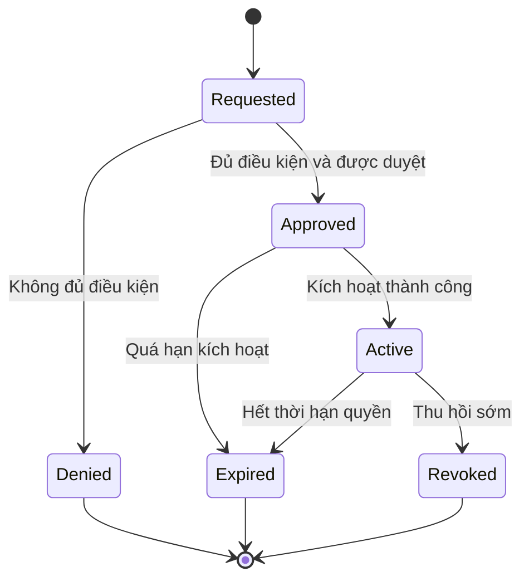

# Privileged account

## 1. Tài khoản đặc quyền là gì?

**Privileged account** là tài khoản có thể thực hiện hành động gây ảnh hưởng lớn đến tính bí mật, toàn vẹn hoặc khả dụng của hệ thống. Đặc quyền có thể cho phép sửa chính sách truy cập, quản lý identity, đọc hàng loạt dữ liệu, thay đổi cấu hình bảo mật hoặc vô hiệu hóa cơ chế giám sát.

Điểm quyết định là **khả năng thực tế của tài khoản**, không phải tên tài khoản hay chức danh của người sử dụng. Một tài khoản không có chữ `admin` vẫn có thể là tài khoản đặc quyền nếu được phép cấp role, sửa pipeline triển khai hoặc đọc kho bí mật chứa thông tin đăng nhập quản trị.

Ví dụ trong một nền tảng học tập:

- Quản trị viên identity có thể đặt lại phương thức xác thực hoặc cấp role cho người khác.
- Nhân viên hỗ trợ có thể truy cập chức năng giả lập người dùng để xử lý sự cố.
- Tài khoản vận hành cơ sở dữ liệu có thể xuất toàn bộ thông tin học viên.
- Identity của pipeline có thể triển khai phiên bản mới và đọc bí mật ứng dụng.
- Người quản lý cloud có thể tạo access key hoặc thay đổi chính sách IAM.

Các tài khoản này không nhất thiết có cùng mức quyền, nhưng đều cần kiểm soát tương xứng với phạm vi tác động. Mục tiêu của việc đặc tả yêu cầu là làm rõ **ai có thể nhận đặc quyền nào, trên tài nguyên nào, trong bao lâu, với bằng chứng kiểm soát gì**.

## 2. Phân biệt identity, tài khoản và đặc quyền

Ba khái niệm cần tách biệt khi viết yêu cầu:

| Khái niệm | Ý nghĩa | Ví dụ |
|---|---|---|
| Identity | Chủ thể được hệ thống nhận diện | Một nhân viên, một workload triển khai |
| Account | Bản thể của identity trong một hệ thống | Tài khoản quản trị trên cổng vận hành |
| Privilege | Khả năng thực hiện hành động được bảo vệ | Cấp role, đổi cấu hình, đọc secret |
| Privileged session | Phiên làm việc đang sử dụng đặc quyền | Phiên truy cập cơ sở dữ liệu production |

Một người có thể có tài khoản làm việc hằng ngày và tài khoản quản trị riêng. Một tài khoản cũng có thể chỉ trở thành tài khoản đặc quyền trong khoảng thời gian một role được kích hoạt. Vì vậy, kiểm kê chỉ dựa vào danh sách thành viên nhóm `Administrators` sẽ bỏ sót nhiều đường đi đến đặc quyền.

**Quyền trực tiếp** là quyền được gán ngay cho tài khoản. **Quyền gián tiếp** là khả năng đạt được quyền mạnh hơn thông qua một hành động khác. Ví dụ, quyền sửa mã pipeline có thể dẫn đến quyền sử dụng identity triển khai; quyền sửa liên kết nhóm có thể dẫn đến quyền quản trị ứng dụng.

Khi xác định phạm vi, cần xem cả hai dạng và trả lời: “Tài khoản này có thể khiến hệ thống thực hiện hành động đặc quyền thay mình hay không?”.

## 3. Các nhóm tài khoản cần nhận diện

### 3.1. Tài khoản quản trị do con người sử dụng

Nhóm này gồm quản trị identity, quản trị hệ điều hành, quản trị dữ liệu, vận hành cloud và quản trị ứng dụng. Mỗi loại cần phạm vi quyền riêng; quản trị ứng dụng không mặc nhiên cần quyền quản trị identity hoặc quyền đọc dữ liệu nhạy cảm.

Tài khoản quản trị nên gắn với một cá nhân có thể truy vết. Nếu công cụ đích chỉ hỗ trợ một tài khoản dùng chung, hệ thống trung gian phải giữ được liên kết giữa người yêu cầu, lần cấp quyền và phiên sử dụng. Nhật ký chỉ ghi `root` hoặc `administrator` không đủ để xác định ai đã thực hiện thao tác.

### 3.2. Identity máy và tài khoản dịch vụ

Service account, workload identity và identity của công cụ tự động cũng có thể mang đặc quyền. Chúng không đăng nhập giống con người nên không thể áp dụng máy móc yêu cầu “mọi tài khoản đặc quyền phải nhập MFA mỗi lần chạy”.

Kiểm soát phù hợp có thể gồm danh tính workload được xác minh, credential ngắn hạn, giới hạn audience, giới hạn môi trường và hạn chế nơi được phép sử dụng. Nếu hệ thống buộc phải dùng secret dài hạn, cần đặc tả nơi lưu, quyền đọc, lịch thay đổi, xử lý rò rỉ và cách triển khai credential mới mà không gây gián đoạn ngoài dự kiến.

### 3.3. Tài khoản khẩn cấp

Tài khoản **break-glass** phục vụ tình huống đường truy cập quản trị thông thường không còn sử dụng được, chẳng hạn dịch vụ identity gặp sự cố. Đây là ngoại lệ có điều kiện, có giám sát và có quy trình kết thúc rõ ràng.

Thiết kế phải cân bằng hai nhu cầu: tài khoản thực sự sử dụng được khi có sự cố, đồng thời việc sử dụng vẫn bị giới hạn và được phát hiện. Một tài khoản khẩn cấp phụ thuộc hoàn toàn vào đúng dịch vụ đang cần cứu sẽ không đáp ứng mục đích khôi phục.

## 4. Từ rủi ro đến yêu cầu bảo mật

Không nên bắt đầu bằng câu “cần triển khai PAM” rồi coi đó là yêu cầu hoàn chỉnh. **Privileged Access Management**, viết tắt PAM, là nhóm biện pháp và công cụ quản lý truy cập đặc quyền. Tên giải pháp chưa mô tả hành vi mà hệ thống phải bảo đảm.

Trước tiên cần xác định hành động nguy hiểm, đường truy cập và hậu quả:

| Rủi ro | Hành vi có thể dẫn đến rủi ro | Yêu cầu cần làm rõ |
|---|---|---|
| Chiếm tài khoản quản trị | Dùng credential bị lộ từ thiết bị người dùng | Xác thực mạnh, giới hạn nguồn truy cập, kiểm soát phiên |
| Lạm dụng quyền hợp lệ | Xuất dữ liệu ngoài nhiệm vụ | Phạm vi tài nguyên, mục đích sử dụng, phê duyệt và phát hiện |
| Tồn đọng quyền | Nhân viên đổi việc nhưng còn role production | Nguồn sự kiện nhân sự, thời hạn thu hồi, rà soát quyền |
| Leo thang đặc quyền | Người vận hành tự cấp role mạnh hơn | Tách quyền yêu cầu, phê duyệt và quản lý chính sách |
| Xóa dấu vết | Quản trị viên sửa hoặc xóa log của chính mình | Tách quyền quản trị log và lưu bằng chứng độc lập |
| Mất khả năng khôi phục | Không có lối vào khi identity provider lỗi | Đường truy cập khẩn cấp được thử nghiệm và kiểm soát |

Mỗi yêu cầu nên có định danh, chủ thể, tài nguyên, điều kiện, hành vi bắt buộc, giới hạn thời gian, bằng chứng và cách kiểm chứng. Các giá trị thời gian trong bài dưới đây là **ví dụ thiết kế** cho một hệ thống giả định; chủ sở hữu phải quyết định giá trị phù hợp dựa trên rủi ro và năng lực vận hành của hệ thống thực tế.

## 5. Kiểm kê và phân loại đặc quyền

### 5.1. Thông tin tối thiểu của một tài khoản đặc quyền

Một bản ghi kiểm kê hữu ích cần thể hiện:

- Identity và mã tài khoản ổn định; tên hiển thị có thể thay đổi.
- Loại chủ thể: con người, workload hoặc tài khoản khẩn cấp.
- Người chịu trách nhiệm và đơn vị sở hữu hệ thống.
- Môi trường và phạm vi tài nguyên được quản trị.
- Quyền trực tiếp, đường nhận quyền gián tiếp và khả năng cấp quyền cho chủ thể khác.
- Hình thức credential, nguồn xác thực và đường truy cập được phép.
- Thời hạn hiệu lực, ngày rà soát gần nhất và căn cứ duy trì quyền.

Không ghi giá trị password, private key hoặc token vào bản kiểm kê. Bản kiểm kê mô tả phương thức quản lý credential và vị trí tham chiếu được bảo vệ, không trở thành một kho bí mật thứ hai.

### 5.2. Ví dụ yêu cầu kiểm kê

> **PA-INV-01:** Mỗi tài khoản có khả năng cấp hoặc thu hồi role quản trị production phải có bản ghi kiểm kê với chủ sở hữu, loại identity, phạm vi tài nguyên và căn cứ cấp quyền trước khi được kích hoạt. Tài khoản không xác định được chủ sở hữu không được nhận quyền mới và phải được đưa vào quy trình xử lý có người chịu trách nhiệm.

Yêu cầu này có thể được kiểm chứng bằng cách tạo tài khoản quản trị mới thiếu chủ sở hữu, thử kích hoạt quyền và đối chiếu kết quả từ chối cùng sự kiện ghi nhận. Việc phát hiện tài khoản cũ không có chủ sở hữu cần quy trình xử lý riêng, tránh vô hiệu hóa tùy tiện một tài khoản đang phục vụ chức năng khôi phục thiết yếu.

## 6. Tách tài khoản và hạn chế quyền thường trực

### 6.1. Tách hoạt động thông thường khỏi quản trị

Tài khoản quản trị không nên được sử dụng cho email, duyệt web thông thường hoặc hoạt động hằng ngày không cần đặc quyền. Sự tách biệt giúp hạn chế việc một phiên làm việc phổ thông bị chiếm rồi được dùng trực tiếp để quản trị production.

Tách tài khoản không tự giải quyết mọi rủi ro. Nếu hai tài khoản dùng chung password hoặc credential quản trị nằm trên thiết bị đã bị chiếm, rủi ro vẫn còn. Yêu cầu cần đi cùng kiểm soát credential, thiết bị và đường truy cập phù hợp.

> **PA-SEP-01:** Người quản trị production phải dùng tài khoản quản trị gắn với identity cá nhân riêng biệt với tài khoản làm việc thông thường. Tài khoản làm việc thông thường không được trực tiếp nhận role quản trị production. Mọi cơ chế kích hoạt role qua hệ thống trung gian phải xác minh identity quản trị và ghi lại người thực hiện.

### 6.2. Standing privilege, JIT và JEA

**Standing privilege** là đặc quyền có sẵn liên tục. Nó thuận tiện nhưng tạo khoảng thời gian dài để quyền bị sử dụng sai mục đích hoặc bị kẻ tấn công chiếm dụng.

**Just-in-time access**, viết tắt JIT, cấp quyền trong khoảng thời gian cần thiết. **Just-enough administration**, thường viết JEA, giới hạn quyền vào đúng thao tác và tài nguyên cần cho nhiệm vụ. JIT giảm thời gian tồn tại quyền; JEA giảm phạm vi quyền. Hai mục tiêu bổ sung cho nhau.

Ví dụ, thay vì cấp toàn quyền cơ sở dữ liệu suốt tháng, người vận hành được phép chạy một tác vụ khôi phục trên một database trong cửa sổ 30 phút. Một role ngắn hạn vẫn quá rộng nếu có thể đọc mọi database; một role hẹp vẫn có thể gây rủi ro nếu tồn tại vô thời hạn.

> **PA-JIT-01:** Role vận hành production theo cơ chế JIT phải gắn với tài nguyên, tập hành động, lý do và thời điểm hết hạn. Với luồng vận hành thông thường trong ví dụ này, thời gian kích hoạt tối đa là 30 phút. Mọi yêu cầu kéo dài phải được đánh giá như yêu cầu mới và không được tự gia hạn chỉ bằng cách duy trì phiên hoạt động.

Khi xác định ngoại lệ cho công việc dài hơn, cần ghi rõ ai được chấp thuận, giới hạn mới và cách giám sát. Không nên dùng ngoại lệ chung “theo nhu cầu công việc” để biến JIT thành quyền thường trực.

## 7. Yêu cầu và phê duyệt quyền

Một luồng cấp quyền có thể gồm các trạng thái sau:



Phê duyệt không đồng nghĩa với đã cấp quyền thành công. Bản ghi cần phân biệt thời điểm được duyệt, thời điểm kích hoạt và kết quả thay đổi trên hệ thống đích. Nếu công cụ quản lý báo thành công nhưng hệ thống đích chưa nhận quyền, người vận hành phải thấy trạng thái thực tế để không lặp thao tác gây cấp quyền ngoài ý muốn.

> **PA-APR-01:** Người yêu cầu không được phê duyệt yêu cầu đặc quyền của chính mình. Với role có thể thay đổi chính sách IAM production, người phê duyệt phải thuộc nhóm được chỉ định và không được thay đổi nội dung yêu cầu sau khi duyệt. Thay đổi tài nguyên, tập hành động hoặc thời hạn phải tạo phiên bản yêu cầu cần phê duyệt lại.

Không phải mọi thao tác đều cần phê duyệt thủ công. Một tác vụ có rủi ro được giới hạn rõ có thể được duyệt bằng chính sách tự động. Khi đó, phải đặc tả điều kiện tự động, người sở hữu chính sách, cách thay đổi chính sách và log quyết định. “Đã được hệ thống cho phép” không thay thế cho chính sách có thể giải thích và kiểm chứng.

## 8. Xác thực và credential

### 8.1. Xác thực đối với con người

Đối với người dùng đặc quyền, cần quy định các phương thức xác thực được chấp nhận, điều kiện xác thực lại và cách xử lý khi phương thức bị mất hoặc bị thu hồi. Các thao tác khôi phục tài khoản cũng cần mức bảo đảm phù hợp, vì chúng có thể trở thành đường vòng để chiếm đặc quyền.

Ví dụ, hệ thống giả định yêu cầu phương thức MFA chống phishing cho truy cập quản trị production thông thường. Điều kiện này phải được thực thi tại đường truy cập quản trị, đồng thời hạn chế các giao thức cũ có thể bỏ qua yêu cầu tương ứng. Một lần xác thực mạnh ở cổng vào không đủ nếu tài khoản vẫn có thể đăng nhập trực tiếp bằng một đường yếu hơn.

> **PA-AUTH-01:** Trước khi kích hoạt role quản trị production, hệ thống phải xác minh tài khoản đang hoạt động, phương thức MFA thuộc danh sách được chấp nhận và thời điểm xác thực mạnh nằm trong cửa sổ hiệu lực được cấu hình. Nếu cần xác thực lại mà không hoàn tất được, hệ thống không kích hoạt role và phải ghi lý do từ chối mà không ghi credential.

### 8.2. Credential của workload

Đối với workload, yêu cầu nên giới hạn identity nguồn, môi trường thực thi, audience của token, thời hạn credential và các hành động được phép. Pipeline build từ nhánh hoặc repository không được tin cậy không nên tự động nhận credential triển khai production.

> **PA-WID-01:** Identity triển khai production chỉ được nhận credential ngắn hạn khi thông tin identity nguồn khớp repository, môi trường và điều kiện phê duyệt triển khai đã cấu hình. Token phát hành cho môi trường thử nghiệm không được sử dụng để truy cập tài nguyên production.

Nếu nền tảng cần key dài hạn, phải chỉ rõ cơ chế luân chuyển và xử lý sự cố. Việc thay key trong vault chưa bảo đảm key cũ đã mất hiệu lực ở hệ thống đích. Bằng chứng hoàn tất cần bao gồm cả kết quả vô hiệu hóa credential cũ và xác nhận workload đã sử dụng credential mới.

## 9. Kiểm soát đường truy cập và phiên đặc quyền

Các đường truy cập cần được kiểm kê gồm giao diện quản trị web, API, SSH, kết nối cơ sở dữ liệu, cloud console và công cụ tự động. Nếu chính sách yêu cầu truy cập qua gateway, những đường kết nối trực tiếp tương đương cũng phải bị giới hạn; nếu không, người dùng có thể bỏ qua gateway cùng các kiểm soát của nó.

Một thiết kế kiểm soát phiên cần xác định:

- Tài khoản nào được mở phiên trên tài nguyên nào.
- Điều kiện thiết bị, mạng hoặc trạng thái rủi ro trước khi mở phiên.
- Thời hạn tuyệt đối của phiên và thời gian không hoạt động.
- Những sự kiện làm phiên bị chấm dứt sớm.
- Các sự kiện hoặc thao tác cần ghi nhận, cùng giới hạn dữ liệu được ghi.

Thời hạn của phiên ứng dụng, thời hạn token và thời hạn role có thể khác nhau. Hệ thống cần đặc tả cách phối hợp chúng. Ví dụ, nếu role chỉ có hiệu lực 30 phút nhưng token quản trị vẫn được chấp nhận thêm một giờ sau đó, quyền JIT trên thực tế chưa kết thúc theo yêu cầu.

### 9.1. Thu hồi phải bao gồm quyền còn tồn tại trong phiên

Đổi mật khẩu thường không tự vô hiệu hóa mọi phiên hoặc access token đã phát hành. Tương tự, xóa người dùng khỏi nhóm có thể chưa tác động ngay tới token hoặc cache phân quyền.

> **PA-REV-01:** Khi nhận sự kiện thu hồi tài khoản quản trị production tại thời điểm `t0`, hệ thống không được cấp quyền hoặc mở phiên đặc quyền mới cho tài khoản đó. Trong tối đa 5 phút kể từ `t0` ở hệ thống ví dụ, mọi yêu cầu đặc quyền tiếp theo từ các phiên và credential còn tồn tại phải bị từ chối tại các điểm thực thi thuộc phạm vi quản lý. Ngoại lệ kỹ thuật phải được liệt kê cùng biện pháp hạn chế và cách xác minh.

Mốc `t0` phải rõ ràng: đây là thời điểm hệ thống kiểm soát nhận được sự kiện hợp lệ. Nếu cần cam kết từ lúc quyết định nhân sự có hiệu lực, phải có thêm yêu cầu về thời gian truyền sự kiện đến hệ thống kiểm soát.

Thu hồi không luôn đảo ngược được một tác vụ đã được hệ thống chấp nhận trước đó. Ví dụ, bản sao lưu đang chạy có thể cần quy trình hủy riêng. Khi tác vụ dài hạn hoặc bất đồng bộ có tác động lớn, cần đặc tả việc kiểm tra lại quyền, khả năng hủy và cách xử lý đầu ra, thay vì giả định việc đóng phiên sẽ hủy mọi tác vụ.

## 10. Nhật ký và khả năng quy trách nhiệm

Một sự kiện sử dụng đặc quyền nên cho phép liên kết người hoặc workload thực hiện với quyền đã dùng và kết quả trên tài nguyên đích.

Ví dụ cấu trúc sự kiện:

```json
{
  "eventType": "PRIVILEGED_ACTION",
  "eventTime": "2026-01-15T08:30:00Z",
  "actorIdentityId": "person-1042",
  "privilegedAccountId": "account-772",
  "accessRequestId": "request-20260115-019",
  "sessionId": "session-61c9",
  "targetResourceId": "prod-learning-db",
  "action": "RESTORE_BACKUP",
  "outcome": "DENIED",
  "reasonCode": "GRANT_EXPIRED"
}
```

Đây là sự kiện minh họa, không phải schema bắt buộc cho mọi hệ thống. Các định danh phải đủ ổn định để truy vết khi tài khoản đổi tên. Không đưa password, access token, secret hoặc toàn bộ dữ liệu nghiệp vụ nhạy cảm vào log.

> **PA-AUD-01:** Mọi yêu cầu, quyết định phê duyệt, lần kích hoạt, hành động quản trị thuộc danh mục bắt buộc và sự kiện thu hồi phải có định danh liên kết. Người sử dụng đặc quyền trên tài nguyên đích không được sửa hoặc xóa bản log dùng để kiểm toán hành động của chính mình thông qua cùng tập quyền đó.

Ghi hình phiên có thể hữu ích nhưng không thay thế cho sự kiện có cấu trúc từ ứng dụng. Hình ảnh có thể chứa dữ liệu cá nhân hoặc bí mật; cần kiểm soát ai được xem, thời hạn lưu, cơ chế che dữ liệu phù hợp và truy vết việc truy cập bản ghi. Không nên mặc định ghi mọi nội dung của mọi phiên mà không xác định mục đích và phạm vi.

Yêu cầu cũng cần nêu hành vi khi kênh log lỗi. Với một số thao tác rủi ro cao, có thể từ chối nếu không lưu được bằng chứng bắt buộc. Với đường khôi phục khẩn cấp, có thể cần một cơ chế ghi cục bộ được bảo vệ và đồng bộ sau. Cả hai lựa chọn đều phải có quyết định rõ, giới hạn và cảnh báo vận hành.

## 11. Tài khoản break-glass và quản lý ngoại lệ

Tài khoản khẩn cấp phải được thiết kế từ tình huống sự cố cụ thể, không chỉ tồn tại như một tài khoản quản trị “để dự phòng”. Cần xác định nó khắc phục được loại sự cố nào, phụ thuộc nào vẫn còn và ai có thể kích hoạt.

Một yêu cầu có thể quy định:

> **PA-EMG-01:** Việc sử dụng tài khoản break-glass phải tạo sự kiện khẩn cấp và thông báo đến kênh giám sát độc lập khi kênh đó còn khả dụng. Nếu không gửi được thông báo, hệ thống phải lưu bằng chứng trong cơ chế dự phòng đã chỉ định. Sau khi khôi phục, mọi lần sử dụng phải được đối soát với sự cố, người kích hoạt, thao tác đã thực hiện và kết quả xử lý credential.

Quy trình kết thúc cần bao gồm việc đóng phiên, thu hồi quyền tạm thời và vô hiệu hóa hoặc thay credential có thể đã bị lộ khi sử dụng. Không phải credential nào cũng cần cùng một thao tác; cần căn cứ loại credential và khả năng hệ thống đích.

Các bài diễn tập nên xác minh rằng đường khẩn cấp hoạt động trong kịch bản lỗi mục tiêu. Nếu xác thực, phê duyệt, kho secret và cảnh báo đều đặt sau cùng một dịch vụ đang mất khả dụng, tài khoản dự phòng có thể không sử dụng được đúng lúc cần.

Ngoại lệ phải có chủ sở hữu, lý do, phạm vi, thời điểm hết hạn và biện pháp bù. Ngoại lệ không thời hạn hoặc không có người chịu trách nhiệm rất dễ trở thành một đường truy cập đặc quyền ít được kiểm soát hơn luồng chính.

## 12. Ví dụ đặc tả cho cổng vận hành nền tảng học tập

Giả sử nhóm vận hành cần khôi phục cơ sở dữ liệu khóa học khi một bản triển khai làm hỏng dữ liệu cấu hình. Người vận hành không có quyền quản trị dữ liệu thường trực và chỉ được yêu cầu quyền đối với database nằm trong nhiệm vụ được giao.

Luồng nghiệp vụ được thiết kế như sau:

1. Người vận hành đăng nhập tài khoản quản trị và hoàn tất phương thức xác thực được chấp nhận.
2. Người đó yêu cầu role `BackupRestorer` trên `prod-course-db`, kèm mã sự cố và thời hạn cần dùng.
3. Chính sách kiểm tra người yêu cầu có đủ điều kiện, yêu cầu có nằm trong phạm vi nhiệm vụ và người duyệt có độc lập hay không.
4. Sau khi được duyệt, hệ thống cấp quyền có thời hạn và chỉ mở đường truy cập được quản lý.
5. Hệ thống đích kiểm tra quyền trước khi chấp nhận thao tác khôi phục và ghi sự kiện gắn với yêu cầu.
6. Khi hết hạn hoặc bị thu hồi, hệ thống ngăn thao tác đặc quyền mới và xử lý phiên đang hoạt động theo chính sách đã công bố.

Role `BackupRestorer` không được kèm khả năng cấp role, sửa cấu hình giám sát hoặc đọc toàn bộ dữ liệu người dùng chỉ vì các quyền đó thuận tiện cho quản trị viên. Nếu thao tác khôi phục thực tế cần quyền rộng hơn do giới hạn của sản phẩm, phải ghi nhận giới hạn và thiết kế biện pháp hạn chế tương ứng; không mô tả role là quyền hẹp khi quyền hiệu lực vẫn rộng.

Ví dụ bản ghi yêu cầu dạng khái niệm:

```yaml
requirementId: PA-RESTORE-01
subject: operator-with-production-recovery-duty
action: restore-approved-backup
resource: prod-course-db
preconditions:
  - active-admin-identity
  - accepted-strong-authentication
  - approved-incident-linked-request
constraints:
  maximumGrantMinutes: 30
  selfApprovalAllowed: false
  directUnmanagedAccessAllowed: false
evidence:
  - access-request-and-approval-events
  - grant-activation-and-expiry-events
  - target-system-restore-result
```

Đây là tài liệu mô tả yêu cầu, không phải cấu hình triển khai sẵn. Nhóm triển khai phải ánh xạ từng ràng buộc sang các điểm thực thi cụ thể, đồng thời xác minh rằng không có đường truy cập tương đương bỏ qua các điểm đó.

## 13. Định nghĩa tiêu chí chấp nhận

Tiêu chí chấp nhận cần bao gồm cả trường hợp được phép, bị từ chối, hết hạn và lỗi phụ thuộc. Các ví dụ sau là cách kiểm chứng yêu cầu đã đặc tả, không phải bằng chứng hệ thống thực tế đã đáp ứng.

| Tình huống | Thao tác kiểm chứng | Kết quả mong đợi |
|---|---|---|
| Đúng người, đúng tài nguyên, đúng hạn | Thực hiện thao tác khôi phục qua đường quản lý | Chấp nhận; log liên kết đúng người, yêu cầu và tài nguyên |
| Vượt tài nguyên được duyệt | Dùng cùng grant để thao tác trên database khác | Từ chối ở hệ thống đích hoặc điểm thực thi được chỉ định |
| Tự phê duyệt | Người yêu cầu dùng quyền phê duyệt của chính mình | Không được duyệt; có lý do và log tương ứng |
| Sửa nội dung sau khi duyệt | Thay tài nguyên hoặc tăng thời hạn | Phiên bản cũ không cấp được quyền theo nội dung mới |
| Hết hạn quyền | Gửi thao tác mới từ phiên vẫn đang mở | Từ chối theo thời hạn đã cam kết |
| Thu hồi khẩn cấp | Thu hồi tài khoản rồi thử lại với token và phiên cũ | Không còn thực hiện được thao tác mới trong giới hạn thu hồi |
| Truy cập trực tiếp | Bỏ qua gateway và dùng credential đến hệ thống đích | Bị giới hạn theo yêu cầu về đường truy cập |
| Credential workload sai môi trường | Dùng credential từ thử nghiệm truy cập production | Từ chối; không cấp role triển khai production |
| Mất kênh log bắt buộc | Thực hiện thao tác thuộc chính sách yêu cầu log | Áp dụng đúng hành vi lỗi đã đặc tả, có tín hiệu vận hành |
| Sự cố identity provider | Kích hoạt đường break-glass trong diễn tập | Đạt mục tiêu khôi phục đã xác định và giữ được bằng chứng |

Đối với thời hạn, cần đo từ mốc bắt đầu đến khi hiệu lực thực tế đạt được trên tất cả điểm thực thi trong phạm vi. Chỉ nhìn thấy role biến mất trên giao diện quản trị chưa chứng minh token cũ, kết nối cũ và cache phân quyền đã hết quyền.

## 14. Theo dõi vòng đời và rà soát quyền

Vòng đời tài khoản đặc quyền bắt đầu từ nhu cầu nghiệp vụ, tiếp tục qua cấp phát, sử dụng, thay đổi trách nhiệm và kết thúc ở thu hồi. Rà soát định kỳ giúp phát hiện quyền không còn phù hợp nhưng không thay thế cho thu hồi theo sự kiện khi một người nghỉ việc hoặc chuyển vai trò.

Một yêu cầu vòng đời cần phân biệt:

- **Thay đổi identity:** người dùng không còn được phép quản trị hoặc workload đã ngừng hoạt động.
- **Thay đổi nhiệm vụ:** identity vẫn hợp lệ nhưng không còn cần một nhóm quyền.
- **Thay đổi tài nguyên:** hệ thống chuyển môi trường, tách tenant hoặc thay cơ chế quản trị.
- **Thay đổi credential:** credential hết hạn, bị nghi lộ hoặc cần luân chuyển.

Các chỉ số có ích gồm tỷ lệ tài khoản có chủ sở hữu, tỷ lệ quyền thường trực, số grant quá hạn chưa mất hiệu lực, thời gian thu hồi thực tế và số ngoại lệ đã hết hạn. Chỉ số cần có phạm vi và nguồn đo rõ ràng; việc giảm số lượng tài khoản không bảo đảm giảm rủi ro nếu đặc quyền lại tập trung vào một tài khoản dùng chung khó truy vết.

## 15. Những cách viết yêu cầu dễ gây hiểu sai

| Cách viết chưa đủ | Vấn đề | Cách làm rõ |
|---|---|---|
| “Admin phải bảo mật” | Không xác định hành vi kiểm chứng | Nêu phương thức xác thực, đường truy cập và điều kiện từ chối |
| “Cấp ít quyền nhất” | Không có danh mục hành động và tài nguyên | Liệt kê role, quyền hiệu lực, phạm vi và điều kiện cấp |
| “Dùng PAM cho mọi thứ” | Chỉ định công cụ nhưng bỏ trống kết quả | Mô tả luồng cấp quyền, kiểm soát phiên và bằng chứng |
| “Hết hạn là hết quyền” | Bỏ qua token, cache và kết nối cũ | Quy định giới hạn thời gian và các điểm phải mất hiệu lực |
| “Có log đầy đủ” | Chưa nói log gì và ai có thể sửa | Nêu sự kiện, định danh liên kết, quyền truy cập và bảo vệ log |
| “Có tài khoản khẩn cấp” | Chưa biết có hoạt động khi sự cố hay không | Nêu kịch bản lỗi, phụ thuộc, kích hoạt và diễn tập |

Một đặc tả tài khoản đặc quyền có thể triển khai được phải nối liền nhu cầu quản trị với rủi ro, điểm thực thi và bằng chứng. Người dùng hợp lệ nhận đúng quyền cho đúng nhiệm vụ; khi điều kiện không còn phù hợp, hệ thống chấm dứt khả năng thực hiện thao tác đặc quyền theo thời hạn đã cam kết và để lại dấu vết đủ để giải thích quyết định.
