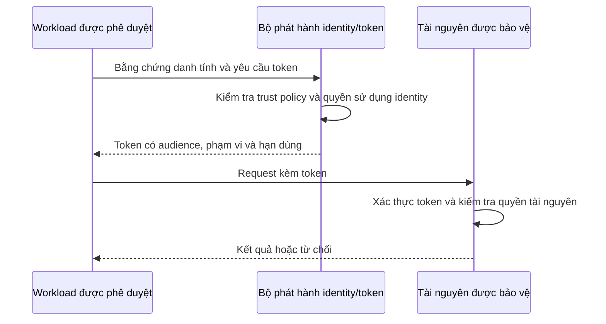

# Service account

## 1. Service account là gì?

**Service account** là tài khoản hoặc principal đại diện cho phần mềm khi phần mềm cần tương tác với một tài nguyên được bảo vệ. Chủ thể sử dụng tài khoản có thể là một ứng dụng backend, tác vụ định kỳ, tiến trình tích hợp, pipeline triển khai hoặc một thành phần hạ tầng. Đây là một dạng **định danh phi con người**: hệ thống cần biết chương trình nào đang gọi, thay vì chỉ biết một người dùng nào đang đăng nhập.

Ví dụ, tác vụ `daily-sales-report` cần đọc dữ liệu bán hàng và ghi kết quả vào kho báo cáo. Nếu tác vụ dùng tài khoản cá nhân của lập trình viên, quyền truy cập có thể mất khi người đó nghỉ việc; nếu dùng chung tài khoản quản trị với các ứng dụng khác, một lỗ hổng ở tác vụ báo cáo có thể mở đường tới toàn bộ hệ thống. Service account giúp tách trách nhiệm và quyền của tác vụ khỏi tài khoản cá nhân cũng như khỏi những workload không liên quan.

Trong thiết kế yêu cầu bảo mật, câu hỏi không dừng ở “có tạo service account hay chưa”. Cần xác định:

- Tài khoản đại diện cho workload nào, ở môi trường nào và do ai chịu trách nhiệm?
- Bằng chứng nào cho phép workload sử dụng định danh đó?
- Nó được làm gì, trên tài nguyên nào và trong điều kiện nào?
- Một kẻ kiểm soát workload hoặc lấy được credential có thể đi xa đến đâu?
- Khi cần thu hồi, quyền truy cập thực tế mất sau bao lâu và được chứng minh thế nào?

Mục tiêu của bài học là chuyển các câu hỏi này thành yêu cầu cụ thể, đo được và có tiêu chí nghiệm thu.

### 1.1. Phân biệt các thành phần thường bị gọi chung là “tài khoản”

| Thành phần | Ý nghĩa | Ví dụ |
| --- | --- | --- |
| Workload | Phần mềm thực sự đang chạy | Tác vụ tổng hợp báo cáo doanh thu |
| Service account/principal | Định danh mà hệ thống nhận diện | `sales-report-prod` với ID ổn định |
| Credential | Bằng chứng để chứng minh quyền dùng định danh | Khóa riêng, mật khẩu, chứng thư hoặc assertion từ môi trường chạy |
| Access token | Bằng chứng truy cập được phát hành cho một khoảng thời gian và phạm vi nhất định | Token dành cho API báo cáo |
| Permission/policy | Quy tắc quyết định định danh được phép làm gì | Chỉ đọc tập dữ liệu doanh thu đã tổng hợp |
| Owner | Người hoặc nhóm chịu trách nhiệm nghiệp vụ và vận hành | Nhóm Data Reporting |

Một credential không phải là toàn bộ identity. Thay credential không nhất thiết thay principal; xóa một khóa cũng không tự động hủy mọi token đã phát hành từ khóa đó. Tương tự, workload có service account riêng không có nghĩa quyền của nó đã phù hợp.

Tên gọi khác nhau giữa các nền tảng: service principal, application identity, managed identity, workload identity hoặc tài khoản kỹ thuật. Điều cần kiểm tra là cơ chế thực tế: định danh nào được xác thực, credential do ai quản lý và tài nguyên nào thực thi phân quyền.

### 1.2. Tài khoản dịch vụ và tài khoản người dùng

Con người có thể thực hiện xác thực tương tác, xác nhận bằng thiết bị hoặc làm thủ tục khôi phục tài khoản. Workload thường phải hoạt động tự động, kể cả khi không có người trực tiếp ở đó. Vì vậy, không thể chỉ sao chép yêu cầu mật khẩu và MFA của người dùng rồi coi như đã bảo vệ service account.

Đối với workload, cần kiểm soát môi trường thực thi, nguồn phát hành credential, ràng buộc tin cậy, quyền lấy token và khả năng thu hồi. Con người quản trị service account vẫn phải được xác thực và phân quyền bằng tài khoản cá nhân phù hợp. Không dùng chung credential của service account để che giấu việc quản trị thủ công.

## 2. Chọn ranh giới identity đúng với ranh giới rủi ro

### 2.1. Một identity cho một trách nhiệm có thể quản lý

Thông thường nên tách identity theo **workload logic, môi trường và ranh giới quyền hạn**. Ví dụ:

```text
sales-report-dev        -> dữ liệu thử nghiệm, kho báo cáo dev
sales-report-prod       -> dữ liệu tổng hợp production, kho báo cáo prod
invoice-export-prod     -> tập dữ liệu và điểm nhận hóa đơn riêng
deployment-prod         -> triển khai ứng dụng production theo phạm vi được duyệt
```

Các bản sao ngang hàng của cùng một workload có thể dùng cùng principal khi chúng có cùng trách nhiệm và cùng phạm vi tin cậy. Nếu cần truy vết từng lần chạy hoặc từng instance, bổ sung execution ID, instance ID và thông tin phiên. Không nhất thiết tạo một tài khoản vĩnh viễn cho mỗi container ngắn hạn.

Ngược lại, hai workload khác quyền, khác owner hoặc khác mức độ tin cậy không nên dùng chung chỉ vì cùng một nhóm viết mã. Một pipeline thử nghiệm không được hưởng identity production của pipeline phát hành.

Ranh giới identity quá rộng làm tăng phạm vi ảnh hưởng khi bị xâm nhập. Ranh giới quá nhỏ mà không có quản lý tự động có thể sinh ra hàng nghìn tài khoản không có owner, không còn được sử dụng và khó thu hồi. Yêu cầu cần diễn đạt nguyên tắc phân tách và cách duy trì inventory, thay vì chỉ áp đặt số lượng tài khoản.

### 2.2. Ba loại quyền phải được xem xét riêng

Một thiết kế chỉ liệt kê quyền đọc/ghi dữ liệu thường bỏ sót quyền điều khiển identity.

| Loại quyền | Câu hỏi cần trả lời | Nguy cơ nếu cấp quá rộng |
| --- | --- | --- |
| Quyền tài nguyên | Account đọc, ghi, xóa hoặc thực thi được gì? | Lộ dữ liệu, phá hủy hoặc thay đổi nghiệp vụ |
| Quyền sử dụng identity | Ai được lấy token, impersonate hoặc gắn identity vào workload? | Kẻ có quyền triển khai mượn được quyền production |
| Quyền quản trị identity | Ai được tạo khóa, đổi trust policy hoặc thêm role? | Tự tạo credential và nâng quyền lâu dài |

Ví dụ, một lập trình viên không có quyền đọc dữ liệu khách hàng nhưng lại được gắn bất kỳ service account nào vào máy do mình điều khiển. Nếu họ gắn account có quyền đọc khách hàng, quyền quản lý máy trở thành đường đi vòng tới dữ liệu. Do đó, yêu cầu phân quyền phải bao gồm cả thao tác **attach**, **impersonate**, **issue credential** và **modify policy**, không chỉ API nghiệp vụ.

## 3. Mô hình đe dọa cho service account

Các kịch bản dưới đây giúp nối rủi ro với yêu cầu thiết kế. Không phải hệ thống nào cũng có cùng mức ảnh hưởng; mỗi dự án cần chọn phạm vi và ngưỡng phù hợp.

| Kịch bản | Điều kiện dẫn đến sự cố | Yêu cầu cần xem xét |
| --- | --- | --- |
| Credential lọt vào mã nguồn hoặc log | Secret tĩnh được sao chép và lưu lâu dài | Cấp phát an toàn, hạn chế xuất credential, kiểm soát log và cơ chế thu hồi |
| Workload bị chiếm quyền | RCE, dependency độc hại hoặc quyền shell quá rộng | Quyền tối thiểu, hạn chế mạng, token có thời hạn và cô lập workload |
| Workload khác lấy được token | Endpoint credential hoặc metadata truy cập quá rộng | Ràng buộc identity với môi trường chạy và chống truy cập chéo |
| Pipeline không đáng tin được nhận quyền prod | Trust policy chấp nhận subject quá rộng | Kiểm tra issuer, audience, subject và ngữ cảnh phát hành đáng tin |
| Tài khoản còn hoạt động sau khi ứng dụng ngừng dùng | Không có owner hoặc thiếu quy trình offboarding | Inventory, phát hiện tài khoản mồ côi và thu hồi theo vòng đời |
| Đã vô hiệu hóa account nhưng request vẫn thành công | Token cũ còn hiệu lực hoặc cache chưa cập nhật | Định nghĩa thời gian chặn thực tế tại nơi thực thi quyền |
| Không tìm được nguồn gây thay đổi | Nhiều workload hoặc nhiều người dùng chung một account | Tách identity và audit được nguồn sử dụng |

Token ngắn hạn làm giảm thời gian sử dụng một token bị lộ. Tuy nhiên, nếu kẻ tấn công còn kiểm soát workload và workload vẫn được quyền xin token mới, chúng có thể tiếp tục truy cập. Ứng phó phải chặn cả đường phát hành token mới lẫn quyền sử dụng token đang tồn tại theo yêu cầu của hệ thống.

## 4. Đặc tả yêu cầu về ownership và inventory

Mỗi service account cần có bản ghi quản lý đủ để trả lời ai chịu trách nhiệm, vì sao nó tồn tại và làm thế nào để dừng nó an toàn.

Một mẫu inventory có thể gồm:

```yaml
# Mẫu dữ liệu quản trị minh họa, không phải cấu hình cho một sản phẩm IAM.
principalId: svc-7b43
displayName: sales-report-prod
principalType: service-account
workload: daily-sales-report
environment: production
businessPurpose: Tạo báo cáo doanh thu tổng hợp hằng ngày
ownerTeam: data-reporting
technicalContact: reporting-oncall
approvalRef: ACCESS-1842
credentialMode: federated-workload-identity
allowedResources:
  - sales-aggregate-view
  - report-output-prefix
reviewDueDate: 2027-02-01
lifecycleState: active
```

ID ổn định dùng để liên kết quyền và audit; tên hiển thị phục vụ con người và có thể đổi. Không dùng tên hiển thị làm bằng chứng duy nhất về danh tính, vì tên có thể được đổi hoặc tái sử dụng.

Yêu cầu tốt cần xác định các trường bắt buộc, nơi lưu nguồn chuẩn và cách kiểm tra thiếu dữ liệu. Ví dụ:

> Mọi service account production phải có workload, môi trường, owner team và tham chiếu phê duyệt trong inventory trước khi được cấp quyền. Quy trình cấp phát từ chối yêu cầu thiếu bất kỳ trường bắt buộc nào.

Owner nên là một nhóm có trách nhiệm duy trì liên tục, với đầu mối hỗ trợ rõ ràng. Khi nhóm giải thể hoặc chuyển giao workload, phải có người nhận ownership trước khi duy trì quyền. Owner không đương nhiên có quyền tự phê duyệt mọi quyền mà workload yêu cầu.

Tài khoản không có hoạt động trong một thời gian không luôn đồng nghĩa với tài khoản vô dụng: có thể đó là tác vụ cuối quý hoặc phương án khôi phục. Tín hiệu không hoạt động cần được đối chiếu với lịch chạy, mục đích và owner. Nếu quyết định giữ, cần ghi lý do và kỳ rà soát tiếp theo; nếu thu hồi, phải kiểm tra các phụ thuộc đã biết.

## 5. Yêu cầu xác thực: ưu tiên credential gắn với workload

### 5.1. Giảm secret tĩnh khi có cơ chế phù hợp

Nếu nền tảng hỗ trợ, workload có thể chứng minh danh tính bằng cơ chế do môi trường chạy cung cấp rồi nhận token có thời hạn. Ứng dụng không cần mang một khóa dùng lâu dài trong mã nguồn hoặc ảnh triển khai.



Mô hình này giảm nhu cầu sao chép secret tĩnh, nhưng không loại bỏ việc quản trị tin cậy. Cần chỉ rõ workload nào được nhận identity, thành phần nào phát hành token và tài nguyên nào kiểm tra token. “Không có mật khẩu trong cấu hình” chưa đủ chứng minh rằng workload khác không thể mượn identity.

Các yêu cầu thường cần làm rõ:

- Chỉ môi trường và workload đã đăng ký được lấy token cho account tương ứng.
- Assertion từ nguồn liên kết phải được xác thực, bao gồm nguồn phát hành, đối tượng nhận và các claim cần thiết cho quyết định tin cậy.
- Quy tắc ánh xạ subject phải đủ hẹp để phân biệt workload hoặc pipeline được duyệt với workload không được duyệt.
- Token phải có audience phù hợp với tài nguyên đích; token cho dịch vụ A không được dịch vụ B chấp nhận chỉ vì cùng nguồn phát hành.
- Quyền lấy token, quyền impersonate và quyền sửa trust policy được cấp riêng và được audit.

Đối với pipeline, cần kiểm tra tính đáng tin của thông tin repository, nhánh, môi trường hoặc loại sự kiện mà chính sách sử dụng. Một tên nhánh do người gọi tự khai báo không có cùng giá trị với claim đã được bên phát hành đáng tin xác thực. Pipeline xử lý thay đổi chưa được tin cậy phải được đánh giá riêng trước khi cho quyền production.

### 5.2. Khi bắt buộc dùng secret tĩnh

Một hệ thống cũ có thể chỉ hỗ trợ username/password hoặc khóa API dài hạn. Khi đó, cần đặc tả phần rủi ro còn lại và biện pháp quản lý:

1. Credential được tạo qua quy trình được kiểm soát và lưu trong hệ thống quản lý secret phù hợp.
2. Chỉ workload và thành phần vận hành được phê duyệt có quyền đọc credential; quyền quản trị kho secret cũng được kiểm soát.
3. Credential không được đưa vào repository, image, thông báo lỗi, URL hay log. Cơ chế cấp vào runtime phải tính đến khả năng lộ qua process arguments, biến môi trường, file, dump và công cụ chẩn đoán.
4. Có quy trình thay credential định kỳ theo chính sách rủi ro và thay ngay khi nghi ngờ bị lộ; quy trình phải chứng minh credential cũ không còn sử dụng được tại các thành phần liên quan.
5. Có cách khôi phục hoạt động sau thay credential mà không duy trì vô hạn credential cũ.

Đưa secret vào vault không tự giải quyết câu hỏi ban đầu: workload xác thực với vault bằng gì? Credential để truy cập vault cũng cần cơ chế cấp phát, giới hạn quyền và thu hồi. Nếu ứng dụng dùng một “master secret” cố định để lấy mọi secret khác, điểm tập trung rủi ro vẫn còn.

## 6. Yêu cầu phân quyền: từ tên role đến quyền có hiệu lực

### 6.1. Mô tả theo hành động, tài nguyên và điều kiện

Yêu cầu “service account chỉ có quyền cần thiết” đúng về hướng nhưng chưa đủ để nghiệm thu. Nên mô tả quyền qua ba phần:

```text
Principal: sales-report-prod
Action: đọc dữ liệu doanh thu đã tổng hợp
Resource: sales-aggregate-view trong production
Conditions: chỉ từ workload báo cáo được phê duyệt

Principal: sales-report-prod
Action: tạo đối tượng báo cáo
Resource: prefix /daily-sales/ trong kho đầu ra production
Conditions: theo chính sách lưu trữ đã xác định
```

Sau đó chỉ rõ các thao tác phải bị từ chối: đọc bảng khách hàng gốc, sửa giao dịch, xóa báo cáo hoặc sửa policy IAM. Nếu mô hình quyền của nền tảng không biểu diễn được đúng phạm vi, phải ghi nhận hạn chế và chọn biện pháp khác, chẳng hạn cung cấp một view hoặc API trung gian có hợp đồng hẹp hơn.

Quyền tối thiểu là **quyền có hiệu lực**, không chỉ quyền gán trực tiếp. Cần tính quyền từ group, role kế thừa, resource policy, khả năng impersonate và quyền tự sửa cấu hình. Một account không có quyền quản trị dữ liệu trực tiếp vẫn có thể trở thành quản trị nếu được phép tự gắn role mạnh hơn.

### 6.2. Tách quyền vận hành khỏi quyền nghiệp vụ

Workload xử lý báo cáo thường không cần tạo service account, tạo khóa hoặc cấp quyền cho chính nó. Các thao tác điều khiển này nên thuộc quy trình quản trị riêng, có phê duyệt và ghi nhận nguồn thay đổi.

Quyền triển khai cũng cần ranh giới. Nếu người có quyền sửa mã production có thể chạy bất kỳ mã nào dưới identity của ứng dụng, trên thực tế họ có thể thực hiện các hành động mà identity đó được phép. Thiết kế phải cân nhắc điều này trong phân tách nhiệm vụ, kiểm soát phát hành và đánh giá quyền của người vận hành.

Không dùng một account quyền cao để “cho chạy trước rồi siết sau” mà thiếu thời hạn và trách nhiệm thu hồi. Ngoại lệ cần có lý do, phạm vi, owner, thời điểm hết hạn và cách xác nhận đã loại bỏ quyền dư.

### 6.3. Khi ứng dụng hành động thay người dùng

Một API backend có thể truy cập kho dữ liệu bằng service account nhưng phục vụ yêu cầu của nhiều người dùng. Xác thực backend thành công không chứng minh rằng người dùng hiện tại được phép xem mọi bản ghi mà backend đọc được.

Yêu cầu phải chỉ rõ mô hình:

- Với tác vụ nền thuộc về hệ thống, service account là chủ thể nghiệp vụ trực tiếp trong phạm vi đã duyệt.
- Với thao tác thay người dùng, ứng dụng còn phải kiểm tra quyền người dùng và phạm vi tenant/tài nguyên tương ứng trước khi truy cập hoặc trả dữ liệu.
- Nếu có cơ chế delegation/impersonation, phải bảo toàn danh tính bên khởi tạo và chuỗi ủy quyền cần thiết cho quyết định quyền và audit.

Không tin một header tùy ý như `X-User-Id` chỉ vì request nội bộ. Nguồn của ngữ cảnh người dùng phải được xác thực và bảo vệ khỏi việc một bên gọi tự nhận mình là người khác.

## 7. Vòng đời, rotation và thu hồi

### 7.1. Vòng đời cần có điểm kiểm soát

```text
Đề nghị -> Phê duyệt -> Cấp identity/quyền -> Sử dụng và giám sát
        -> Rà soát hoặc thay đổi -> Thu hồi -> Kiểm chứng và đóng hồ sơ
```

Khi workload thay đổi chức năng, account phải được rà soát lại thay vì chỉ cộng thêm quyền mới. Khi workload ngừng hoạt động, cần xử lý cả account, credential, liên kết federation, quyền impersonate, quyền tài nguyên và cấu hình runtime còn tham chiếu đến identity.

Việc xóa bản ghi inventory trước khi hoàn tất thu hồi làm mất dấu theo dõi nhưng chưa chắc đã ngăn truy cập. Hồ sơ quản trị và audit cần được giữ theo chính sách của hệ thống để có thể giải thích những hành động đã xảy ra trước khi đóng tài khoản.

### 7.2. Rotation thông thường và ứng phó lộ credential

Trong rotation thông thường, một khoảng chuyển tiếp có giới hạn giữa credential mới và cũ có thể cần thiết để tránh gián đoạn. Trình tự minh họa:

1. Tạo credential mới bằng quyền quản trị được kiểm soát.
2. Cấp credential mới cho đúng workload và xác nhận nó truy cập được đúng phạm vi.
3. Chuyển các instance và tác vụ định kỳ còn dùng credential cũ.
4. Vô hiệu hóa credential cũ trước hạn chuyển tiếp đã định.
5. Kiểm tra credential cũ bị từ chối, credential mới hoạt động và không còn bản sao cũ đang được sử dụng.

Nếu nghi ngờ credential cũ bị lộ, việc tiếp tục chấp nhận nó trong khoảng chuyển tiếp có thể không phù hợp. Quy trình sự cố cần chọn thứ tự cô lập, thu hồi và khôi phục theo mức ảnh hưởng đã được phê duyệt. Rollback vận hành không được tự động bật lại credential bị nghi xâm phạm.

Khóa riêng, chứng thư, mật khẩu và access token có vòng đời khác nhau. Thay khóa xác thực nguồn không có nghĩa mọi token được phát hành trước đó đều mất hiệu lực. Cần kiểm tra từng lớp thay vì ghi chung “đã rotate account”.

### 7.3. Định nghĩa thu hồi ở nơi request được chấp nhận

Một yêu cầu thu hồi phải trả lời ít nhất ba câu hỏi:

1. Sau khi vô hiệu hóa account, khi nào nó không thể nhận credential hoặc token mới?
2. Token, phiên kết nối và quyền cache đã tồn tại còn dùng được đến khi nào?
3. Cơ chế nào đảm bảo tài nguyên đích bắt đầu từ chối request trong thời gian yêu cầu?

Token tự chứa được kiểm tra ngoại tuyến có thể vẫn được chấp nhận tới lúc hết hạn nếu tài nguyên không có cơ chế thu hồi sớm tương ứng. Đóng account tại bộ phát hành chưa chắc đã chặn request dùng token đó. Nếu yêu cầu nghiệp vụ đòi chặn nhanh hơn thời hạn token, kiến trúc cần cơ chế thực thi bổ sung, chẳng hạn kiểm tra trạng thái phù hợp, cập nhật quyền tại tài nguyên hoặc cô lập đường truy cập. Giải pháp cụ thể phải phù hợp với hệ thống đang xây dựng.

Ví dụ yêu cầu đo được:

> Trong tình huống ứng phó sự cố của workload báo cáo production, từ thời điểm bộ điều khiển ghi nhận yêu cầu vô hiệu hóa thành công, mọi yêu cầu đọc mới sử dụng identity đó phải bị từ chối tại API dữ liệu trong tối đa 5 phút, kể cả khi dùng token được cấp trước thời điểm vô hiệu hóa.

Con số 5 phút ở đây là **mục tiêu minh họa**, không phải mặc định của mọi hệ thống. Nếu kiến trúc chỉ bảo đảm tối đa 30 phút, phải điều chỉnh kiến trúc hoặc quyết định rủi ro; không ghi một mục tiêu không thể chứng minh.

Phạm vi “yêu cầu mới” cũng cần được định nghĩa cho kết nối sống lâu, stream và tác vụ đã bắt đầu. Ngăn truy cập tương lai không thu hồi được dữ liệu đã tải về. Đối với công việc đang chạy, yêu cầu có thể cần thêm việc hủy job, đóng kết nối hoặc cô lập máy thực thi.

## 8. Audit và phát hiện bất thường

Audit cần giúp ghép một hành động trên tài nguyên với identity, workload và người hoặc tiến trình đã thay đổi cấu hình liên quan.

Các sự kiện quan trọng gồm cấp account, thay owner, thêm/bớt quyền, sửa trust policy, phát hành hoặc thu hồi credential, impersonation và truy cập tài nguyên nhạy cảm. Không phải tài nguyên nào cũng ghi lại mọi thao tác theo cùng cơ chế; yêu cầu phải xác định nguồn log và mức bao phủ cần đạt.

Ví dụ một sự kiện truy cập:

```json
{
  "eventType": "resource.access",
  "eventTime": "2027-01-10T01:30:00Z",
  "principalId": "svc-7b43",
  "workloadId": "daily-sales-report",
  "environment": "production",
  "executionId": "run-d91f",
  "action": "sales.aggregate.read",
  "resourceId": "sales-aggregate-view",
  "decision": "ALLOW",
  "correlationId": "req-c842"
}
```

Nếu có bên khởi tạo hoặc chuỗi delegation, cần ghi thêm ngữ cảnh đã được xác thực tương ứng. Không ghi raw token, mật khẩu, khóa riêng hoặc payload nhạy cảm chỉ để “đủ log”. ID tham chiếu credential, thời điểm và nguồn phát hành thường hữu ích hơn việc lưu credential thực.

Một số điều kiện có thể đưa vào yêu cầu phát hiện:

- Identity production được sử dụng từ nguồn thực thi ngoài phạm vi cho phép.
- Có credential mới hoặc thay đổi trust policy ngoài quy trình được phê duyệt.
- Account đã đóng hoặc không có workload hợp lệ vẫn phát sinh yêu cầu.
- Có truy cập bị từ chối tới tài nguyên mà workload chưa từng cần sử dụng.
- Quyền có hiệu lực tăng lên so với baseline được duyệt.

Mỗi cảnh báo cần có nơi nhận, người chịu trách nhiệm và thời gian xử lý phù hợp. Một dashboard không có quy trình tiếp nhận chưa tạo thành yêu cầu ứng phó hoàn chỉnh. Đồng thời, log phục vụ điều tra phải được bảo vệ khỏi sửa/xóa bởi chính account đang được giám sát.

## 9. Ví dụ chuyển rủi ro thành bộ yêu cầu và tiêu chí nghiệm thu

Giả sử `daily-sales-report` chạy trong production, đọc dữ liệu doanh thu tổng hợp và tạo báo cáo. Tác vụ không cần dữ liệu cá nhân của khách hàng, không sửa giao dịch và không quản trị IAM. Các ngưỡng dưới đây chỉ minh họa cách đặc tả; dự án phải chốt giá trị theo yêu cầu thực tế.

| ID | Yêu cầu | Bằng chứng nghiệm thu |
| --- | --- | --- |
| SA-01 | Identity production có workload, môi trường, owner team và tham chiếu phê duyệt trước khi được cấp quyền | Yêu cầu cấp phát thiếu từng trường bị từ chối; bản ghi hợp lệ có đủ dữ liệu |
| SA-02 | Workload dev không được sử dụng identity production | Từ môi trường dev, thử nhận token hoặc impersonate prod đều bị từ chối |
| SA-03 | Chỉ workload báo cáo được duyệt được sử dụng identity `sales-report-prod` | Workload đúng nhận được token; workload khác trên cùng nền tảng không nhận được token cho identity này |
| SA-04 | Identity chỉ đọc view doanh thu tổng hợp và tạo file dưới prefix đầu ra đã định | Kiểm tra allow đúng hai hành động; deny đọc bảng khách hàng, sửa giao dịch, ghi ngoài prefix và sửa IAM |
| SA-05 | Token dành cho API báo cáo không được chấp nhận tại API quản trị | Gửi token có audience khác tới API quản trị bị từ chối trước khi thực hiện nghiệp vụ |
| SA-06 | Sau khi nhận yêu cầu vô hiệu hóa thành công, API dữ liệu chặn mọi yêu cầu đọc mới của identity trong tối đa 5 phút | Dùng cả token cấp trước và thử xin token mới; đo đến khi các điểm thực thi thuộc phạm vi đều từ chối |
| SA-07 | Mọi thay đổi quyền hoặc trust policy phải truy được người/thành phần thực hiện và tham chiếu quy trình phê duyệt | Sự kiện mẫu có actor, target, thời điểm, kết quả và tham chiếu; account bị quản lý không xóa được bằng chứng |
| SA-08 | Mỗi lần chạy báo cáo truy được các lần đọc/ghi thông qua principal ID và execution ID | Đối chiếu một lần chạy với audit của API và kho báo cáo theo các định danh tương ứng |
| SA-09 | Account đang hoạt động được rà soát không quá 90 ngày một lần | Inventory có kết quả owner xác nhận, quyền được giữ/thu hồi và thời điểm; bản ghi quá hạn được phát hiện |

Với workload dùng federation, tiêu chí SA-03 phải bao phủ các thuộc tính tin cậy thực tế: sai issuer, sai audience, subject ngoài phạm vi, bằng chứng hết hạn và nguồn phát hành không đáng tin. Chỉ thử một workload sai tên chưa đủ kiểm tra toàn bộ trust policy.

Với SA-04, cần kiểm tra cả quyền gián tiếp. Ví dụ, account không được tự sửa một policy để sau đó truy cập bảng khách hàng. Nếu quyền cuối cùng phụ thuộc nhiều lớp, bằng chứng nghiệm thu phải phản ánh tổ hợp quyền có hiệu lực tại thời điểm kiểm tra.

### 9.1. Kịch bản nghiệm thu thu hồi

```gherkin
Feature: Thu hồi service account báo cáo

  Scenario: Token đã cấp không vượt quá thời gian thu hồi được yêu cầu
    Given workload production có token còn hạn trước khi account bị vô hiệu hóa
    And token đó đọc được view doanh thu theo quyền đã cấp
    When bộ điều khiển ghi nhận vô hiệu hóa account thành công tại thời điểm T0
    Then việc cấp token mới cho account phải bị chặn theo thời gian đã đặc tả
    And trong tối đa 5 phút kể từ T0, mọi yêu cầu đọc mới phải bị từ chối
    And phép kiểm tra dùng lại token cũ tại các điểm thực thi trong phạm vi
    And audit liên kết được thao tác vô hiệu hóa với các quyết định từ chối
```

Khi đo, cần ghi rõ T0 lấy từ đâu, các điểm thực thi được kiểm tra, sai số đồng hồ và trạng thái cache/kết nối. Một lần thử ở một node chưa chứng minh toàn hệ thống đã đạt giới hạn tối đa. Đây là tiêu chí để thiết kế và nghiệm thu sau này; việc soạn bài học không thay thế phép kiểm tra trên hệ thống thật.

### 9.2. Kịch bản nghiệm thu không làm gián đoạn rotation thường lệ

Với hệ thống phải dùng secret tĩnh, có thể đặc tả:

> Trong rotation thường lệ, workload phải chuyển sang credential mới trong cửa sổ chuyển tiếp đã duyệt; sau khi đóng cửa sổ, mọi lần xác thực bằng credential cũ đều bị từ chối. Bằng chứng phải bao gồm các instance đang chạy và các tác vụ định kỳ nằm trong phạm vi, cùng kết quả xác nhận hoạt động bằng credential mới.

Nếu yêu cầu còn có mục tiêu sẵn sàng, phải định nghĩa tỷ lệ lỗi hoặc thời gian gián đoạn chấp nhận được riêng. “Không gián đoạn” không nên chỉ được suy ra từ việc một instance đã dùng được credential mới.

## 10. Các lỗi đặc tả thường gặp

### “Mỗi ứng dụng có một tài khoản là đủ”

Một ứng dụng có thể gồm workload xử lý thanh toán, sinh báo cáo và triển khai hạ tầng với ranh giới quyền khác nhau. Cần phân tách theo trách nhiệm và rủi ro thực tế, đồng thời tách môi trường phù hợp. Tạo tên account khác nhau nhưng dùng cùng credential hoặc cùng quyền quản trị rộng cũng chưa đạt mục tiêu cô lập.

### “Có managed identity thì không cần lo credential”

Credential có thể được nền tảng quản lý, nhưng workload bị chiếm quyền vẫn có thể sử dụng identity trong phạm vi được cấp. Cần bảo vệ runtime, đường lấy token và quyền gắn identity. Đặc biệt phải xem xét endpoint metadata/credential khi thiết kế chống SSRF và giới hạn truy cập giữa workload.

### “Credential nằm trong vault nên mọi ứng dụng được đọc cũng được”

Vault chỉ bảo vệ được trong phạm vi chính sách truy cập của nó. Quyền đọc secret quá rộng làm mất ranh giới identity. Cần cấp quyền theo đúng secret và workload, đồng thời audit cả truy cập secret lẫn quyền quản trị kho.

### “Disable account nghĩa là chặn ngay mọi request”

Điều này phụ thuộc vào cơ chế token, phiên, cache và nơi thực thi quyền. Yêu cầu cần có mốc đo và giới hạn thời gian rõ ràng, bao gồm credential/token đã tồn tại. Chỉ thấy trạng thái `disabled` trên màn hình quản trị chưa đủ.

### “Có principal ID trong log là truy được tất cả”

Nếu nhiều workload hoặc nhiều người dùng chung principal, ID đó chỉ xác định được nhóm hoạt động. Cần tách identity phù hợp và bảo toàn nguồn khởi tạo, execution ID hoặc ngữ cảnh ủy quyền khi cần. Dữ liệu audit phải đến từ nguồn đáng tin, không chỉ do request tự khai báo.

### “Tài khoản không hoạt động thì xóa ngay”

Một tác vụ theo quý có thể không xuất hiện trong cửa sổ quan sát ngắn. Cần đối chiếu owner và lịch sử sử dụng theo mục đích đã khai báo, sau đó thực hiện thu hồi có kiểm soát. Ngược lại, lý do “có thể còn dùng” cũng không đủ để giữ tài khoản vô thời hạn mà không có owner và kỳ rà soát.

## 11. Câu hỏi tự kiểm tra

1. Vì sao account dùng riêng cho workload vẫn có thể là đường nâng quyền nếu quyền attach hoặc impersonate được cấp quá rộng?
2. Trong thiết kế đang xét, principal, credential và access token có vòng đời khác nhau như thế nào?
3. Nếu một token còn hạn sau khi account bị vô hiệu hóa, tài nguyên đích dựa vào cơ chế nào để đáp ứng mục tiêu thu hồi?
4. Khi backend dùng service account đọc dữ liệu thay người dùng, quyền người dùng và tenant được kiểm tra ở đâu?
5. Có thể chứng minh account chỉ có quyền tối thiểu khi chỉ xem danh sách role gán trực tiếp hay không?
6. Với pipeline được phép liên kết identity production, thông tin nào được bên phát hành xác thực và thông tin nào do người gọi kiểm soát?
7. Nếu owner nghỉ việc hoặc workload ngừng chạy, ai tiếp nhận trách nhiệm và quy trình nào bảo đảm credential, quyền và trust mapping được xử lý đầy đủ?

Một đặc tả service account có thể kiểm chứng phải nối được **workload → identity → bằng chứng xác thực → quyền có hiệu lực → tài nguyên → audit và thu hồi**. Mỗi mắt xích cần có owner và bằng chứng phù hợp với mức rủi ro mà workload tạo ra.
