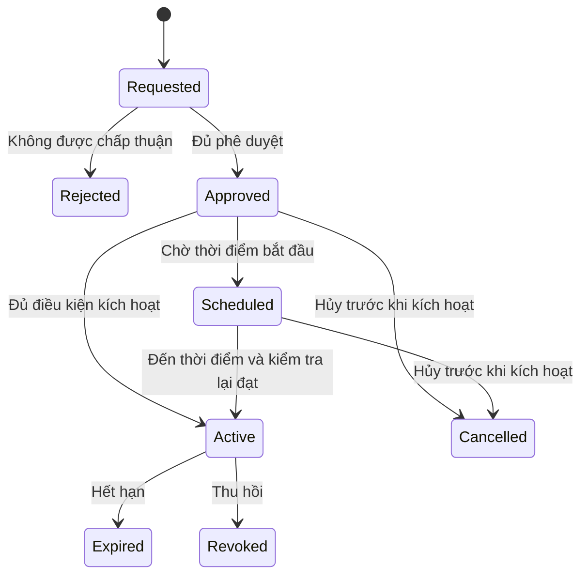

# Role assignment

## 1. Role assignment là một quyết định cấp quyền

Role assignment là việc gắn một role đã được định nghĩa với một identity trong một phạm vi và khoảng thời gian cụ thể. Ví dụ, câu “Lan có role người duyệt thanh toán” chưa đủ để triển khai an toàn. Hệ thống còn cần biết Lan thuộc tổ chức nào, được duyệt thanh toán cho đơn vị nào, ai phê duyệt việc cấp role, quyền bắt đầu khi nào và khi nào phải thu hồi.

Trong thiết kế yêu cầu bảo mật, role assignment phải trả lời được:

- Ai được nhận role và identity đó được định danh bằng nguồn nào?
- Role có ý nghĩa gì, thuộc phiên bản hoặc tập quyền nào?
- Quyền có hiệu lực ở tenant, dự án, đơn vị hoặc nhóm tài nguyên nào?
- Điều kiện cấp, người phê duyệt và bằng chứng chấp thuận là gì?
- Quyền có hiệu lực từ lúc nào, hết hạn hoặc bị thu hồi theo sự kiện nào?
- Thành phần nào thực thi quyết định và làm sao kiểm chứng toàn bộ đường truyền quyền?

Đây là phần chuyển một mục tiêu như “chỉ người có trách nhiệm mới được duyệt chi” thành các yêu cầu có thể đặc tả, triển khai và kiểm thử. Một hàng dữ liệu trong bảng liên kết user–role mới là một phần của giải pháp.

### Phân biệt các khái niệm gần nhau

| Khái niệm | Câu hỏi chính | Ví dụ |
|---|---|---|
| Định nghĩa role | Role bao gồm những khả năng nào? | `payment_approver` được gửi quyết định phê duyệt thanh toán |
| Role assignment | Identity nào nhận role, ở đâu và khi nào? | Lan nhận `payment_approver` tại công ty C01 trong 30 ngày |
| Authentication | Ai đang thực hiện yêu cầu? | Phiên hiện tại đã xác thực identity của Lan |
| Authorization | Yêu cầu hiện tại có được phép không? | Lan có được duyệt khoản thanh toán P17 ngay lúc này không? |
| Access review | Quyền đã cấp còn phù hợp không? | Chủ sở hữu nghiệp vụ xác nhận lại quyền của Lan |

Một assignment hợp lệ không bảo đảm mọi hành động đều được phép. Quyết định authorization còn có thể kiểm tra trạng thái tài nguyên, hạn mức, người tạo giao dịch, điều kiện xác thực hoặc các ràng buộc nghiệp vụ khác.

## 2. Mô hình hóa assignment đầy đủ

Có thể biểu diễn một assignment theo mô hình:

```text
Assignment =
    identity
  + role
  + scope
  + validity
  + provenance
  + approval evidence
  + lifecycle state
```

Các thành phần không được thay thế lẫn nhau. “Được trưởng phòng phê duyệt” không xác định scope; “thuộc nhóm kế toán” không tự chứng minh người đó được nhận role duyệt thanh toán.

### 2.1. Identity phải ổn định và có nguồn rõ ràng

Không nên dùng tên hiển thị hoặc email làm khóa duy nhất của assignment. Những thuộc tính này có thể đổi hoặc được tái sử dụng. Thiết kế cần một định danh ổn định, chẳng hạn cặp `identitySource` và `subjectId`, cùng ràng buộc tenant nếu hệ thống quản trị danh tính theo tenant.

Yêu cầu có thể viết như sau:

> Mỗi role assignment phải tham chiếu identity bằng định danh không tái sử dụng trong nguồn quản trị tương ứng. Việc thay đổi email hoặc tên hiển thị không được chuyển quyền sang một identity khác.

Đối tượng nhận role có thể là người dùng, tài khoản dịch vụ hoặc workload. Mỗi loại cần chính sách riêng. Tài khoản dịch vụ không có sự kiện nghỉ việc như nhân viên, nhưng vẫn phải có chủ sở hữu, mục đích sử dụng và sự kiện chấm dứt quyền.

### 2.2. Scope là thành phần bắt buộc của quyền

Các role có cùng tên có thể tồn tại trong nhiều phạm vi. Ví dụ, `project_admin` của dự án A không mặc nhiên là quản trị viên của dự án B.

Đặc tả scope cần chỉ rõ:

- Loại phạm vi: tenant, tổ chức, dự án hoặc tài nguyên cụ thể.
- Định danh phạm vi và quan hệ với tenant.
- Quy tắc kế thừa: cấp ở tổ chức có áp dụng xuống dự án con không?
- Cách xử lý tài nguyên được chuyển sang tổ chức hoặc dự án khác.
- Role toàn cục có được phép tồn tại không, ai được cấp và ai được nhận.

Không dùng giá trị rỗng để ngầm hiểu “mọi nơi”. Nếu có role toàn cục, phạm vi toàn cục phải là một lựa chọn có tên và có chính sách phê duyệt riêng.

### 2.3. Role có thể thay đổi sau ngày cấp

Giả sử hôm nay `support_agent` chỉ cho phép đọc ticket. Tuần sau, người quản trị bổ sung quyền xuất dữ liệu khách hàng vào role đó. Các assignment cũ có thể lập tức nhận thêm khả năng dù không ai tạo assignment mới.

Vì vậy, chính sách role assignment phải thống nhất với quản lý thay đổi role. Có hai cách mô hình hóa thường gặp:

| Cách mô hình hóa | Ý nghĩa với assignment đang có | Điều cần đặc tả |
|---|---|---|
| Tham chiếu role đang được duy trì | Assignment nhận tập quyền hiện hành của role | Quy trình đánh giá và phê duyệt khi role tăng quyền |
| Gắn với phiên bản role | Assignment gắn với một phiên bản tập quyền | Điều kiện chuyển sang phiên bản mới và cách duy trì phiên bản cũ |

Không mặc định cách thứ hai luôn cần thiết. Điều quan trọng là ghi rõ lựa chọn và kiểm soát việc tăng quyền. Chỉ lưu một trường `roleVersion` để tra cứu lịch sử không có nghĩa hệ thống đang thực thi quyền theo phiên bản đó.

## 3. Nguồn hình thành role assignment

Quyền có thể đến từ nhiều nguồn. Khi kiểm kê hoặc thu hồi, chỉ nhìn vào assignment trực tiếp sẽ bỏ sót quyền được suy ra.

| Nguồn | Cách hình thành | Rủi ro cần kiểm soát |
|---|---|---|
| Cấp trực tiếp | Một yêu cầu được phê duyệt cho một identity | Cấp nhầm role, sai scope hoặc không có thời hạn |
| Thành viên nhóm | Role được ánh xạ từ nhóm | Thay đổi thành viên nhóm có thể làm thay đổi quyền |
| Quy tắc thuộc tính | Role được suy từ đơn vị, vị trí hoặc quan hệ hợp đồng | Thuộc tính sai hoặc nguồn dữ liệu bị sửa trái phép |
| Federation | Nhận thông tin role hoặc group từ nguồn danh tính bên ngoài | Tin vào claim không thuộc nguồn hoặc tenant được phép |
| Kích hoạt tạm thời | Identity đủ điều kiện yêu cầu bật role trong một khoảng thời gian | Nhầm trạng thái đủ điều kiện với quyền đang có hiệu lực |

Mỗi đường cấp quyền phải có provenance: vì sao identity đang có role này và nguồn nào chịu trách nhiệm duy trì nó. Với role có nhiều nguồn cấp đồng thời, xóa một nguồn không nhất thiết loại bỏ quyền hiệu lực.

Ví dụ, Minh có role `report_reader` do được cấp trực tiếp và do thuộc nhóm `regional_auditors`. Xóa assignment trực tiếp vẫn để lại quyền từ nhóm. Giao diện quản trị cần thể hiện hai nguồn, còn quy trình thu hồi phải phân biệt:

- Thu hồi một assignment cụ thể.
- Loại bỏ mọi đường cấp role trong phạm vi đã chỉ định.
- Đình chỉ identity để ngăn sử dụng các quyền hiệu lực theo chính sách đình chỉ.

Ba thao tác này có phạm vi tác động khác nhau và cần các quyền quản trị khác nhau.

## 4. Phân tách người yêu cầu, phê duyệt và thực thi

Một quy trình cấp role thường có ít nhất bốn chủ thể:

1. Người yêu cầu: đề xuất cấp role và cung cấp mục đích.
2. Người nhận: identity sẽ có quyền.
3. Người phê duyệt: xác nhận sự cần thiết trong phạm vi phụ trách.
4. Thành phần thực thi: tạo hoặc kích hoạt assignment sau khi chính sách được đáp ứng.

Người yêu cầu và người nhận có thể trùng nhau. Với role nhạy cảm, người nhận không được đồng thời là người phê duyệt quyết định cấp quyền cho chính mình.

### 4.1. Quyền cấp role là một quyền riêng

Có role nghiệp vụ không đồng nghĩa được cấp role đó cho người khác. Một người được duyệt thanh toán không mặc nhiên được bổ nhiệm người duyệt thanh toán mới.

Đặc tả quyền cấp role cần xác định một tập ràng buộc:

```text
GrantAuthority =
    roles allowed to grant
  + scopes allowed to manage
  + recipient constraints
  + maximum duration
  + required approvals
```

Yêu cầu “admin được quản lý role” quá rộng. Một đặc tả cụ thể hơn là:

> Quản trị viên dự án chỉ được cấp các role được ủy quyền trong chính dự án mình quản lý; không được cấp role quản trị tenant, mở rộng scope sang dự án khác hoặc bỏ qua phê duyệt của role nhạy cảm.

Ràng buộc này phải được kiểm tra ở phía máy chủ tại thời điểm tạo hoặc kích hoạt assignment. Danh sách lựa chọn trên giao diện chỉ giúp sử dụng đúng, không phải ranh giới bảo mật.

### 4.2. Phê duyệt phải gắn với đúng nội dung yêu cầu

Một phê duyệt cần gắn với một phiên bản cụ thể của yêu cầu gồm người nhận, role, scope, thời hạn và điều kiện liên quan. Nếu những nội dung này thay đổi, hệ thống phải xác định phê duyệt cũ còn hợp lệ hay cần phê duyệt lại.

Ví dụ, yêu cầu ban đầu là quyền đọc trong dự án A trong ba ngày. Nếu sau khi duyệt, người yêu cầu đổi thành quyền quản trị toàn tenant trong một năm mà vẫn giữ chữ ký phê duyệt cũ, quy trình đã mất ý nghĩa.

Trước khi kích hoạt, hệ thống còn phải kiểm tra lại những điều có thể đã thay đổi: identity đã bị đình chỉ chưa, người phê duyệt còn thẩm quyền không, role còn được phép cấp không và các xung đột quyền hiện tại là gì.

## 5. Vòng đời và thời gian hiệu lực

Đừng đồng nhất “đã phê duyệt” với “đang có quyền”. Một yêu cầu có thể được duyệt hôm nay nhưng chỉ bắt đầu vào tuần tới.

Một mô hình vòng đời minh họa:



Đây là mô hình tham khảo. Hệ thống có thể lưu yêu cầu và assignment trong hai đối tượng khác nhau: yêu cầu đi đến `Approved`, sau đó sinh assignment `Scheduled` hoặc `Active`. Khi chọn mô hình, cần mô tả rõ trạng thái nào thực sự tạo quyền và trạng thái nào chỉ phục vụ workflow.

Với thời gian được biểu diễn bằng timestamp tuyệt đối, một quy tắc hiệu lực có thể là:

```text
effective(assignment, now) =
    assignment.state == ACTIVE
    AND assignment.validFrom <= now
    AND now < assignment.validUntil
    AND identity is enabled
    AND assignment scope matches target
    AND applicable policy constraints pass
```

Khoảng thời gian nửa mở `[validFrom, validUntil)` giúp xác định rõ hành vi tại đúng thời điểm hết hạn. Đây chỉ là điều kiện của một đường cấp role; quyết định authorization cuối cùng phải xét các đường cấp khác và các quy tắc từ chối áp dụng.

### Quyền hết hạn không được phụ thuộc duy nhất vào tác vụ dọn dữ liệu

Tác vụ nền có thể chuyển trạng thái `Active` thành `Expired` và cập nhật giao diện. Tuy nhiên, nếu tác vụ đó chạy chậm, hệ thống thực thi quyền vẫn phải từ chối sử dụng assignment sau `validUntil` theo mô hình thời gian đã chọn.

Gia hạn cũng là một quyết định cấp quyền mới về thời hạn. Không nên biến việc sửa ngày hết hạn thành một đường vòng bỏ qua giới hạn thời gian hoặc phê duyệt ban đầu.

Với quyền khẩn cấp, chính sách cần nêu rõ điều kiện kích hoạt, thời hạn ngắn, yêu cầu giải trình, người nhận cảnh báo và việc rà soát sau sử dụng. Không biến trạng thái “khẩn cấp” thành quyền vô thời hạn hoặc khả năng tắt audit.

## 6. Least privilege và separation of duties

### 6.1. Cấp ít quyền nhất cần thiết

Một yêu cầu hợp lệ cần chọn role và scope đáp ứng nhiệm vụ với mức quyền phù hợp, thay vì chọn role lớn nhất có thể cấp.

Ví dụ, nhà thầu cần xem báo cáo của dự án A trong bảy ngày. Yêu cầu `tenant_admin` vô thời hạn không tương đương với yêu cầu `report_reader` của dự án A trong khoảng thời gian hợp đồng.

Hệ thống có thể hỗ trợ bằng danh mục role được phê duyệt, thời hạn tối đa, gợi ý role theo nhiệm vụ và khả năng từ chối các scope quá rộng. Việc tự động gợi ý không thay thế thẩm quyền phê duyệt.

### 6.2. Xung đột role phải có phạm vi

Separation of duties, hay phân tách nhiệm vụ, ngăn một chủ thể tích lũy những khả năng không nên đồng thời có.

Ví dụ, chính sách quy định một người không đồng thời có role sửa thông tin tài khoản ngân hàng nhà cung cấp và role duyệt thanh toán trong cùng một công ty. Để kiểm thử được, cần làm rõ:

- Xung đột được xét ở cùng công ty hay trên toàn tenant?
- Có xét role từ nhóm và role được kế thừa không?
- Có xét các assignment đã được duyệt, chờ kích hoạt và có khoảng hiệu lực chồng lấn không?
- Khi thay đổi chính sách, assignment đang tồn tại được xử lý thế nào?
- Ngoại lệ có được phép không, ai phê duyệt và ngoại lệ hết hạn khi nào?

Không thể phát hiện đúng xung đột nếu chỉ kiểm tra tên role mà bỏ qua scope và thời gian. Hai role xung đột ở cùng phạm vi nhưng có khoảng hiệu lực không giao nhau có thể được chính sách xử lý khác với hai role có hiệu lực đồng thời.

### 6.3. Phân tách tĩnh không thay thế kiểm tra trên giao dịch

Quy tắc “người tạo hóa đơn không được duyệt chính hóa đơn đó” phụ thuộc một giao dịch cụ thể. Một người có thể hợp lệ sở hữu cả khả năng tạo và duyệt hóa đơn, nhưng không được thực hiện cả hai trên cùng một hóa đơn.

Đây là kiểm soát authorization ở thời điểm thao tác, không thể giải quyết đầy đủ chỉ bằng việc kiểm tra role assignment. Yêu cầu bảo mật cần đặt đúng nơi thực thi: quy trình cấp role kiểm soát tổ hợp quyền; quyết định trên giao dịch kiểm soát quan hệ giữa người thao tác và đối tượng nghiệp vụ.

## 7. Cấp quyền đồng thời, retry và tính nhất quán

### 7.1. Hai yêu cầu riêng lẻ có thể tạo ra tổ hợp bị cấm

Giả sử identity chưa có role nào trong hai role xung đột. Hai quản trị viên đồng thời gửi yêu cầu cấp từng role:

```text
Yêu cầu A: đọc quyền hiện tại → chưa thấy role B → cho phép role A
Yêu cầu B: đọc quyền hiện tại → chưa thấy role A → cho phép role B
Kết quả: identity nhận đồng thời cả hai role xung đột
```

Vì vậy, “kiểm tra xung đột trước khi ghi” chưa đủ nếu kiểm tra và ghi không có bảo đảm nhất quán phù hợp. Đặc tả nên yêu cầu bất biến nghiệp vụ được giữ khi có các giao dịch cạnh tranh. Khóa, mức cô lập giao dịch, kiểm soát phiên bản hoặc cơ chế tuần tự hóa là những lựa chọn triển khai; cách nào được chọn cũng phải chứng minh bất biến đó.

Nếu assignment đến từ các hệ thống độc lập, cần xác định nơi tổng hợp quyết định và cách xử lý trong lúc nguồn quyền chưa hội tụ. Không thể bảo đảm xung đột toàn hệ thống chỉ bằng ràng buộc duy nhất trong một bảng cục bộ.

### 7.2. Retry không được tạo thêm quyền hoặc kéo dài thời hạn

API cấp quyền thường bị gọi lại khi mất phản hồi. Một yêu cầu được xử lý thành công nhưng client chưa nhận được kết quả có thể được gửi lần hai.

Yêu cầu về tính lặp an toàn có thể quy định:

> Trong thời gian lưu khóa yêu cầu, các lần gửi lại cùng khóa và cùng nội dung phải trả về cùng kết quả nghiệp vụ, không sinh assignment bổ sung và không tính lại thời hạn từ thời điểm retry. Cùng khóa nhưng khác nội dung phải bị từ chối.

Phải đặc tả phạm vi và thời gian lưu khóa, chẳng hạn theo tenant và người gọi. Khóa chống lặp không thay thế kiểm tra quyền của người gọi và không tự giải quyết các assignment trùng nhau đến từ hai yêu cầu độc lập.

## 8. Thu hồi quyền phải đi hết đường thực thi

Role assignment không kết thúc ở việc xóa một bản ghi. Quyền có thể đã được đưa vào token, phiên đăng nhập, cache hoặc hệ thống đích.

```text
Nguồn assignment
    → hệ thống quản trị identity
    → nguồn danh tính / token / nhóm
    → cache quyết định
    → dịch vụ kiểm tra quyền
    → thao tác trên tài nguyên
```

Tùy kiến trúc, một số thành phần không tồn tại hoặc các thành phần được gộp chung. Đặc tả vẫn cần xác định điểm nào có thể tiếp tục cho phép quyền cũ sau khi nguồn assignment đã thay đổi.

### 8.1. Định nghĩa chính xác thời hạn thu hồi

Yêu cầu “thu hồi ngay lập tức” không đủ rõ nếu hệ thống phân tán có token hoặc cache. Một yêu cầu đo được cần xác định sự kiện bắt đầu, thời hạn và điểm quan sát.

Ví dụ sau dùng số liệu minh họa cho một hệ thống nghiệp vụ giả định, không phải ngưỡng áp dụng cho mọi hệ thống:

> Từ thời điểm `T0` mà quyết định thu hồi được commit tại nguồn assignment có thẩm quyền, trong tối đa 60 giây, mọi quyết định authorization mới tại các dịch vụ thuộc phạm vi phải từ chối quyền chỉ có được từ assignment đã thu hồi. Thuộc tính này phải được kiểm tra cả với phiên, token và cache tạo trước `T0`.

Nếu một token chứa role và được dịch vụ tin đến khi hết hạn sau 30 phút, việc chỉ cập nhật nguồn assignment không đáp ứng giới hạn 60 giây đó. Thiết kế phải bổ sung cách kiểm tra trạng thái, vô hiệu hóa hoặc làm mới dữ liệu phù hợp với yêu cầu đã chọn.

Đồng hồ giữa các hệ thống, độ trễ truyền sự kiện và thời gian cache phải được đưa vào ngân sách trễ. Nếu không đo được `T0` và thời điểm quyết định tại dịch vụ đích, cũng khó chứng minh đã đáp ứng giới hạn.

### 8.2. Phân biệt quyết định mới và công việc đang chạy

Thu hồi quyền không tự hoàn tác một thao tác đã thực hiện. Đối với công việc dài hoặc được đưa vào hàng đợi, cần quyết định rõ:

- Quyền được kiểm tra khi gửi lệnh, khi lấy lệnh ra xử lý hay trước từng bước nhạy cảm?
- Một công việc đã bắt đầu trước lúc thu hồi có được chạy tiếp không?
- Có điểm thực hiện không thể đảo ngược cần kiểm tra lại quyền không?
- Ai được phép hủy hoặc bù trừ một công việc đã tạo tác động?

Ví dụ, quyền xuất dữ liệu bị thu hồi trong lúc job còn nằm trong hàng đợi. Nếu chính sách yêu cầu kiểm tra lại trước khi thực hiện xuất, job phải bị từ chối dù lúc tạo job người dùng còn có quyền.

### 8.3. Nguồn quyền không truy cập được

Với một hành động nhạy cảm, yêu cầu có thể quy định từ chối khi dữ liệu assignment đã quá giới hạn độ cũ cho phép và không làm mới được. Khi đó cần đặc tả cả giới hạn độ cũ và cách xác định nó, thay vì viết chung chung “fail closed”.

Nếu một số thao tác ít nhạy cảm được phép dùng dữ liệu cũ để duy trì hoạt động, ngoại lệ phải có phạm vi và thời lượng rõ ràng. Không để từng dịch vụ tự chọn cách xử lý khác nhau mà không có quyết định kiến trúc.

## 9. Ví dụ đặc tả cho hệ thống thanh toán nhiều công ty

Giả sử một tenant quản lý nhiều công ty. Mỗi công ty có người đọc báo cáo, người sửa thông tin nhà cung cấp và người duyệt thanh toán.

Mục tiêu bảo mật là chỉ người có trách nhiệm hiện hành mới được thao tác tài chính, các quyền nhạy cảm có bằng chứng chấp thuận và không vượt phạm vi công ty được giao.

### 9.1. Dữ liệu assignment minh họa

```json
{
  "assignmentId": "asg-7012",
  "tenantId": "tenant-17",
  "subject": {
    "identitySource": "workforce-directory",
    "subjectId": "person-2048"
  },
  "roleId": "payment-approver",
  "scope": {
    "type": "COMPANY",
    "id": "company-01"
  },
  "state": "ACTIVE",
  "validFrom": "2026-01-01T00:00:00Z",
  "validUntil": "2026-01-31T00:00:00Z",
  "source": {
    "type": "APPROVED_REQUEST",
    "requestId": "req-9981",
    "requestRevision": 2
  },
  "approvalEvidenceId": "approval-6621",
  "policyVersionEvaluated": "role-assignment-policy-12"
}
```

Đây là mô hình dữ liệu để giải thích yêu cầu, không phải API công khai bắt buộc. Các trường như `state`, nguồn cấp và bằng chứng phê duyệt phải do thành phần có thẩm quyền xác lập hoặc kiểm chứng; không tin các giá trị client tự khai báo. Hệ thống còn phải xác minh `company-01` thực sự thuộc `tenant-17`.

`policyVersionEvaluated` ghi nhận chính sách đã được đánh giá khi cấp quyền. Nó không có nghĩa assignment được miễn các chính sách có hiệu lực về sau hoặc bỏ qua kiểm tra authorization hiện hành.

### 9.2. Tập yêu cầu có thể kiểm chứng

Các con số trong bảng thuộc ví dụ này; khi áp dụng cho hệ thống thật phải lựa chọn theo rủi ro và khả năng vận hành đã được chấp thuận.

| ID | Yêu cầu | Bằng chứng kiểm chứng |
|---|---|---|
| RA-01 | Chỉ identity đang được kích hoạt trong nguồn cho phép mới được nhận assignment có hiệu lực | Yêu cầu cấp cho identity bị đình chỉ bị từ chối; không sinh quyền hiệu lực |
| RA-02 | Mỗi assignment phải có tenant và scope hợp lệ; scope công ty phải thuộc tenant đó | Sửa `scope.id` sang công ty thuộc tenant khác bị từ chối tại máy chủ |
| RA-03 | Người quản trị công ty chỉ cấp được role được ủy quyền trong công ty mình quản lý | Gọi API trực tiếp để cấp role tenant hoặc role của công ty khác bị từ chối |
| RA-04 | Role duyệt thanh toán cần người phê duyệt độc lập có thẩm quyền tại công ty nhận quyền | Tự phê duyệt hoặc phê duyệt từ công ty khác không làm yêu cầu đủ điều kiện kích hoạt |
| RA-05 | Phê duyệt phải tham chiếu đúng phiên bản yêu cầu; sửa người nhận, role, scope hoặc thời hạn sau phê duyệt phải qua đánh giá lại | Sửa một trường được bảo vệ không được sử dụng phê duyệt cũ để kích hoạt |
| RA-06 | Role duyệt thanh toán tạm thời có thời lượng không quá 30 ngày; gia hạn tuân thủ quy trình phê duyệt tương ứng | Khoảng hiệu lực dài hơn 30 ngày bị từ chối kể cả khi gọi API bỏ qua giao diện |
| RA-07 | Chưa đến `validFrom` hoặc đã đến `validUntil` thì assignment không cấp quyền | Kiểm tra thời điểm trước, đúng và sau cả hai biên; trì hoãn tác vụ nền không làm quyền hết hạn tiếp tục dùng được |
| RA-08 | Trong cùng công ty, không cho phép quyền sửa ngân hàng nhà cung cấp và quyền duyệt thanh toán có hiệu lực chồng lấn trên một identity | Thử cấp trực tiếp, qua nhóm, kế thừa và hai yêu cầu đồng thời; không tạo tổ hợp bị cấm |
| RA-09 | Quyền chỉ phát sinh từ assignment bị thu hồi phải ngừng được chấp nhận cho quyết định mới trong tối đa 60 giây từ `T0` | Dùng phiên, token và cache đã có trước thu hồi để đo tại từng dịch vụ trong phạm vi |
| RA-10 | Retry cùng khóa và cùng nội dung trong cửa sổ chống lặp 24 giờ không sinh assignment mới hoặc kéo dài thời hạn | Gửi lặp sau mất phản hồi; cùng khóa nhưng khác payload bị từ chối |
| RA-11 | Mọi lần yêu cầu, phê duyệt, từ chối, kích hoạt, thay đổi thời hạn và thu hồi phải có sự kiện audit truy vết được | Đối chiếu assignment, phiên bản yêu cầu, chủ thể thao tác, thời điểm, kết quả và lý do |
| RA-12 | Công việc xuất dữ liệu đang chờ phải đánh giá lại quyền khi bắt đầu thực thi | Tạo job khi còn quyền rồi thu hồi trước khi xử lý; job không được xuất dữ liệu |
| RA-13 | Màn hình và API quản trị được ủy quyền phải cho biết các nguồn đang tạo quyền hiệu lực trong scope được xem | Thu hồi nguồn trực tiếp nhưng giữ nguồn nhóm; kết quả phải thể hiện quyền còn từ nhóm |
| RA-14 | Trước khi kích hoạt assignment đã duyệt, phải kiểm tra lại trạng thái identity, thẩm quyền phê duyệt và các ràng buộc cấp quyền còn áp dụng | Vô hiệu hóa identity hoặc thu hồi thẩm quyền sau phê duyệt nhưng trước kích hoạt; assignment không được kích hoạt |

Một yêu cầu có thể cần nhiều lớp bằng chứng. Ví dụ, RA-08 cần kiểm tra cả luồng cấp quyền và thay đổi thành viên nhóm; chỉ kiểm thử nút “Add role” không bao phủ toàn bộ các đường tạo quyền.

## 10. Tình huống kiểm thử từ góc nhìn lạm dụng

### Tình huống A — Nâng quyền bằng cách đổi role trong request

Người quản trị dự án được giao quyền cấp `project_reader` nhưng gửi request với `roleId=tenant_admin`.

Kết quả mong đợi là máy chủ từ chối dựa trên grant authority. Không tạo assignment, không tự hạ thành role khác, đồng thời ghi nhận lần cấp quyền bị từ chối đủ để điều tra. Thông báo trả cho người gọi phải phù hợp với quyền xem thông tin của họ.

### Tình huống B — Thay scope sau khi được duyệt

Một yêu cầu nhận role tại công ty A đã được duyệt. Người yêu cầu sửa scope thành công ty B trước khi kích hoạt.

Kết quả mong đợi là thay đổi làm phát sinh phiên bản yêu cầu cần đánh giá lại; phê duyệt cho công ty A không được dùng để cấp quyền ở công ty B. Nếu thiết kế không cho sửa yêu cầu đã duyệt, thao tác sửa phải bị từ chối và cần tạo yêu cầu mới.

### Tình huống C — Tăng quyền qua nhóm

Một người không có quyền cấp `payment_approver` nhưng có quyền sửa thành viên nhóm đang được ánh xạ sang role đó.

Đây là đường cấp quyền thực tế. Chính sách cần giới hạn quản trị nhóm hoặc bắt buộc workflow phê duyệt tương đương. Khi kiểm thử, thêm thành viên qua API nhóm cũng phải tôn trọng ràng buộc cấp role và phân tách nhiệm vụ đã chọn.

### Tình huống D — Thu hồi không đầy đủ

Người quản trị xóa assignment trực tiếp và giao diện báo “đã thu hồi”. Người dùng vẫn có quyền từ nhóm.

Kết quả phải mô tả đúng phạm vi thao tác: đã xóa assignment trực tiếp, quyền hiệu lực còn từ nguồn nhóm. Nếu yêu cầu của người quản trị là loại bỏ toàn bộ quyền trong scope, quy trình phải giải quyết các nguồn còn lại hoặc báo chưa hoàn tất; không báo thành công cho một kết quả chưa đạt.

### Tình huống E — Assignment đã hết hạn nhưng session vẫn còn

Người dùng đăng nhập trước khi hết hạn, giữ nguyên phiên rồi thực hiện hành động sau `validUntil`.

Kết quả phải tuân thủ quy tắc hết hạn ở nơi thực thi. Nếu kiến trúc chỉ nhúng role trong token và không có cách đáp ứng thời hạn, đó là khoảng trống giữa yêu cầu và thiết kế, không phải lý do để bỏ qua ca kiểm thử.

### Tình huống F — Hai role xung đột được cấp đồng thời

Hai yêu cầu cấp role xung đột được gửi đồng thời cho cùng identity và cùng công ty. Cả hai bắt đầu từ trạng thái chưa có role đối nghịch.

Kết quả hợp lệ không được để cả hai assignment cùng có hiệu lực trong khoảng thời gian bị cấm. Kiểm thử cần quan sát trạng thái cuối và quyết định authorization, không chỉ kiểm tra mã phản hồi của từng request.

## 11. Audit và bằng chứng quản trị

Audit phục vụ hai câu hỏi: “quyền đã thay đổi thế nào?” và “ai có cơ sở cho phép thay đổi đó?”. Một sự kiện chỉ ghi “update user success” không đủ trả lời.

Những dữ liệu thường cần có gồm:

- ID sự kiện, assignment và yêu cầu liên quan.
- Tenant, scope, identity nhận quyền và loại identity.
- Role, nguồn cấp và mốc phiên bản phù hợp với mô hình đã chọn.
- Identity người thao tác, người phê duyệt và thành phần thực thi.
- Trạng thái trước và sau, khoảng hiệu lực trước và sau.
- Thời điểm, kết quả, lý do, chính sách đã đánh giá và correlation ID.
- Lý do thu hồi hoặc sự kiện vòng đời làm thay đổi quyền.

Không đưa token, thông tin xác thực hoặc dữ liệu cá nhân không cần thiết vào audit. Chính sách phải xác định ai được đọc audit, cách bảo vệ tính toàn vẹn và thời gian lưu phù hợp. Người được cấp quyền không được mặc nhiên có khả năng xóa bằng chứng về chính lần cấp đó.

Với giao dịch thay đổi quyền, cần xác định cách bảo đảm sự kiện audit được ghi nhận hoặc có thể phục hồi tin cậy. Ví dụ, trạng thái assignment và bản ghi sự kiện chờ phát có thể được commit cùng giao dịch, sau đó chuyển đến hệ thống audit. Chỉ ghi log sau commit mà không có cơ chế phục hồi có thể để lại thay đổi quyền không truy vết khi tiến trình gặp lỗi.

Access review cần dựa trên quyền hiệu lực và nguồn cấp, không chỉ danh sách assignment trực tiếp. Người rà soát cũng cần biết quyền đã được sử dụng hay chưa nếu hệ thống có dữ liệu này, nhưng “chưa sử dụng” không tự chứng minh quyền là thừa và “đã sử dụng” không tự chứng minh quyền còn phù hợp.

## 12. Những cách đặc tả dễ gây sai

| Cách viết thiếu rõ ràng | Vì sao khó triển khai hoặc kiểm chứng | Cách làm rõ |
|---|---|---|
| Admin được cấp mọi role | Không xác định loại admin và ranh giới ủy quyền | Liệt kê role, scope, đối tượng nhận và điều kiện phê duyệt được phép |
| Cấp quyền theo phòng ban | Chưa xác định nguồn thuộc tính, độ trễ và ngoại lệ | Nêu nguồn dữ liệu có thẩm quyền, ánh xạ, điều kiện thay đổi và cách thu hồi |
| Đã được duyệt thì có quyền | Bỏ qua ngày bắt đầu, đình chỉ và ràng buộc thay đổi sau phê duyệt | Tách phê duyệt với kích hoạt và kiểm tra lại trước khi có hiệu lực |
| Xóa user-role là thu hồi xong | Có thể còn quyền từ nhóm, token hoặc hệ thống đích | Định nghĩa phạm vi thu hồi, mọi nguồn quyền và thời hạn truyền đến điểm thực thi |
| Quyền tạm thời tự hết hạn | Không nêu thời điểm biên và cách thực thi khi tác vụ nền chậm | Định nghĩa khoảng hiệu lực và kiểm tra tại quyết định authorization |
| Không được có role xung đột | Thiếu scope, khoảng thời gian và hành vi khi có cạnh tranh | Nêu tổ hợp bị cấm, nguồn quyền cần xét và bất biến dưới giao dịch đồng thời |
| Ghi log mọi thay đổi | Thiếu dữ liệu, tính tin cậy và quyền đọc/xóa | Định nghĩa sự kiện, định danh truy vết, bảo vệ và cơ chế phục hồi khi phát sự kiện lỗi |

Role assignment được đặc tả đầy đủ khi từ một mục tiêu bảo mật có thể lần theo đến quy tắc cấp quyền, bằng chứng phê duyệt, phạm vi và thời hạn hiệu lực, đường thu hồi, rồi đến các ca kiểm thử quan sát được. Khi đó, quyết định “identity này có role này” có một vòng đời rõ ràng và một cơ sở có thể kiểm chứng.
