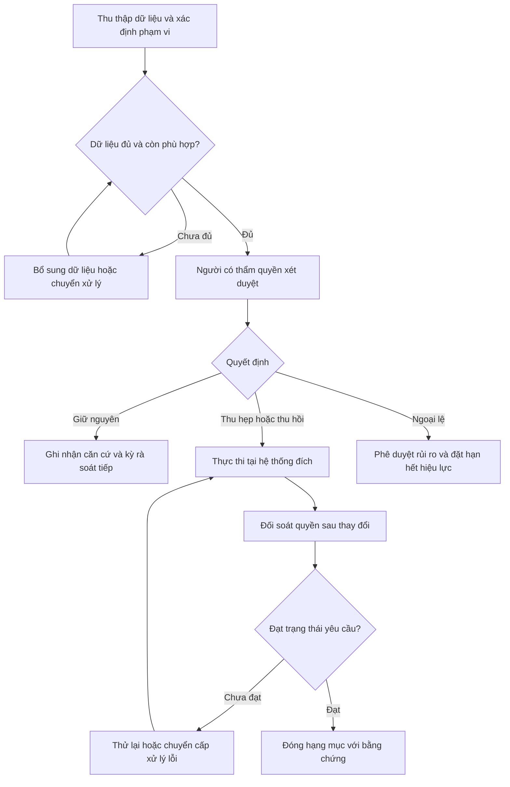

# Role review

## 1. Role review kiểm tra điều gì?

Role review là hoạt động xem xét một vai trò có còn phù hợp với công việc, mức rủi ro và cơ cấu tổ chức hay không. Hoạt động này cần trả lời đồng thời hai câu hỏi: **vai trò được thiết kế có đúng không** và **những identity đang có vai trò đó có còn cần quyền không**.

Một vai trò ban đầu chỉ cho phép xem hồ sơ có thể dần được bổ sung quyền xuất dữ liệu, chỉnh sửa thông tin và phê duyệt giao dịch. Tên vai trò vẫn là `support-agent`, nhưng ảnh hưởng bảo mật đã khác xa thiết kế ban đầu. Ngược lại, vai trò vẫn hợp lý nhưng một nhân viên đã chuyển bộ phận vẫn giữ vai trò cũ. Rà soát riêng danh sách thành viên sẽ bỏ sót vấn đề thứ nhất; rà soát riêng định nghĩa vai trò sẽ bỏ sót vấn đề thứ hai.

Trong đặc tả yêu cầu bảo mật, viết “định kỳ rà soát role” chưa đủ. Cần xác định đối tượng rà soát, dữ liệu đầu vào, người được quyết định, thời hạn, cách xử lý khi không có phản hồi và bằng chứng cho thấy thay đổi quyền đã có hiệu lực.

| Đối tượng rà soát | Câu hỏi chính | Ví dụ phát hiện |
|---|---|---|
| Định nghĩa vai trò | Tập quyền và phạm vi tài nguyên có còn đúng nhiệm vụ không? | Vai trò hỗ trợ có quyền xóa dữ liệu không cần thiết |
| Điều kiện được cấp vai trò | Những tiêu chí nào cho phép identity nhận vai trò? | Quy tắc cấp tự động vẫn dựa trên mã phòng ban đã ngừng sử dụng |
| Thành viên và từng lần cấp quyền | Identity này còn cần vai trò trong phạm vi hiện tại không? | Nhân viên chuyển nhóm vẫn truy cập tenant cũ |
| Quan hệ kế thừa và cấp gián tiếp | Vai trò có mang theo quyền ngoài dự kiến không? | Một nhóm lồng nhau dẫn đến quyền quản trị |
| Quyền hiệu lực | Sau khi tổng hợp các đường cấp quyền, identity thực sự làm được gì? | Bỏ một role nhưng quyền xuất dữ liệu vẫn đến từ nhóm khác |

Rà soát quyền truy cập của từng identity thường được gọi là access review hoặc access recertification. Role review bao gồm phần giao nhau này nhưng còn xem xét bản thân mô hình vai trò. Phạm vi của mỗi đợt phải ghi rõ để tránh hiểu rằng xác nhận thành viên đồng nghĩa với xác nhận toàn bộ thiết kế quyền.

## 2. Từ rủi ro đến yêu cầu rà soát

Lý do thực hiện role review không chỉ là hoàn thành một thủ tục. Mỗi yêu cầu nên nối được với rủi ro và kết quả kiểm chứng.

| Rủi ro | Yêu cầu cần đặc tả | Bằng chứng mong đợi |
|---|---|---|
| Tích lũy quyền sau nhiều lần chuyển việc | Rà soát khi thay đổi chức vụ, bộ phận hoặc quan hệ hợp đồng | Sự kiện thay đổi nhân sự gắn với hồ sơ quyết định |
| Vai trò mở rộng quá mức | Rà soát thay đổi tập quyền, phạm vi tài nguyên và quan hệ kế thừa | Chênh lệch giữa phiên bản vai trò trước và sau |
| Người dùng giữ quyền đặc biệt không còn cần thiết | Từng lần cấp quyền đặc biệt phải có lý do, người phê duyệt và thời hạn | Hồ sơ cấp quyền và kết quả xác nhận hoặc thu hồi |
| Một người vừa tạo vừa phê duyệt giao dịch | Đánh giá xung đột phân tách nhiệm vụ trên quyền hiệu lực | Kết quả kiểm tra xung đột và quyết định xử lý |
| Chủ sở hữu vai trò đã nghỉ việc | Phát hiện vai trò không còn người chịu trách nhiệm và chuyển xử lý | Chủ sở hữu hợp lệ hoặc trạng thái chờ xử lý có hạn |
| Quyết định thu hồi không được thực thi | Đóng hạng mục chỉ sau khi xác nhận thay đổi tại hệ thống đích | Kết quả đối soát sau thu hồi |

Không nên quy định cùng một chu kỳ cho mọi vai trò chỉ để dễ quản lý. Vai trò quản trị hệ thống, thao tác tài chính hoặc đọc dữ liệu nhạy cảm thường cần được xem xét chặt hơn vai trò xem thông tin công khai. Chu kỳ cụ thể là quyết định dựa trên rủi ro của hệ thống, không phải một hằng số áp dụng cho mọi tổ chức.

Ngoài lịch định kỳ, có thể kích hoạt rà soát theo sự kiện: thay đổi người quản lý, chuyển bộ phận, kết thúc dự án, thay đổi quyền trong vai trò, phát hiện sử dụng bất thường hoặc thay đổi chủ sở hữu tài nguyên. Việc khóa tài khoản khi nghỉ việc và xử lý quyền khẩn cấp phải có luồng riêng đủ nhanh; không chờ đến đợt rà soát kế tiếp.

## 3. Phạm vi và dữ liệu đầu vào

### 3.1. Định danh đầy đủ một lần cấp quyền

Tên vai trò không đủ để định danh một quyền cần rà soát. `tenant-admin` tại tenant A khác với cùng vai trò tại tenant B; quyền có thời hạn khác với quyền thường trực.

Một hạng mục rà soát nên tham chiếu tối thiểu:

- ID ổn định và loại identity: nhân viên, đối tác, service account hoặc workload.
- ID vai trò, phiên bản định nghĩa và chủ sở hữu vai trò.
- Hệ thống đích, tenant, môi trường và phạm vi tài nguyên.
- ID của lần cấp quyền, nguồn cấp trực tiếp hoặc gián tiếp, thời điểm cấp và thời điểm hết hạn nếu có.
- Lý do nghiệp vụ, người phê duyệt ban đầu và hồ sơ yêu cầu cấp quyền liên quan.
- Người chịu trách nhiệm hiện tại và thời điểm quan sát dữ liệu.

Phải sử dụng ID ổn định thay vì chỉ tên hiển thị hoặc email. Việc đổi tên tài khoản không được làm mất liên kết lịch sử; một tài khoản mới tái sử dụng email cũ không được kế thừa quyết định dành cho identity trước đó.

### 3.2. Tách quyền được gán khỏi quyền hiệu lực

Quyền có thể đến từ vai trò được gán trực tiếp, nhóm lồng nhau, vai trò cha, chính sách theo thuộc tính hoặc cơ chế ủy quyền. Ngược lại, điều kiện tenant, thời gian, phạm vi dữ liệu và quy tắc từ chối có thể giới hạn quyền.

Vì vậy, không được mặc định quyền hiệu lực luôn bằng phép hợp đơn giản của mọi quyền được gán. Nó phụ thuộc quy tắc đánh giá chính sách của từng hệ thống. Khi hệ thống không thể tính chính xác quyền hiệu lực, giao diện phải biểu thị giới hạn đó và cung cấp đường kiểm tra bổ sung; không trình bày dữ liệu suy đoán như kết luận đầy đủ.

Ví dụ, nhân viên An có `support-export` trực tiếp và còn nằm trong nhóm `regional-ops` cũng cho phép xuất dữ liệu. Thu hồi `support-export` chỉ loại bỏ một đường cấp quyền. Nếu mục tiêu quyết định là “An không được xuất dữ liệu khách hàng”, cần xác định và xử lý mọi đường cấp quyền liên quan trong phạm vi được phê duyệt.

### 3.3. Xác định độ đầy đủ và độ mới của dữ liệu

Người xét duyệt cần biết dữ liệu được thu thập lúc nào, từ nguồn nào và có thiếu hệ thống đích nào không. Hồ sơ rà soát nên lưu phiên bản chính sách, mốc chụp dữ liệu và trạng thái đồng bộ của các nguồn liên quan.

Nếu connector chỉ trả về một phần danh sách thành viên hoặc không đọc được quan hệ nhóm, đợt rà soát không được kết luận “không có quyền dư thừa” dựa trên tập dữ liệu đó. Hạng mục phải được đánh dấu thiếu dữ liệu, chuyển người xử lý hoặc chờ thu thập lại theo thời hạn đã quy định.

Quyền phát sinh sau thời điểm chụp cần được đưa vào phần chênh lệch để rà soát bổ sung hoặc một đợt mới. Quyền đã hết hạn hoặc đã bị thu hồi trong lúc chờ quyết định cần được đối soát, tránh áp dụng lại kết luận cũ lên một lần cấp quyền mới.

## 4. Ai được quyết định?

Người quản lý trực tiếp có thể biết nhân viên cần làm công việc gì nhưng không hiểu hết ảnh hưởng của từng permission. Chủ sở hữu vai trò hiểu thiết kế quyền nhưng có thể không biết nhân viên đã chuyển dự án. Chủ sở hữu dữ liệu biết mức nhạy cảm và phạm vi sử dụng. Với quyền có rủi ro cao, có thể cần quyết định của nhiều bên.

| Trách nhiệm | Nội dung cần xác nhận |
|---|---|
| Người quản lý hoặc người phụ trách nghiệp vụ | Identity còn làm nhiệm vụ cần quyền này không? |
| Chủ sở hữu vai trò | Tập quyền có phù hợp mục đích và nguyên tắc tối thiểu quyền không? |
| Chủ sở hữu tài nguyên hoặc dữ liệu | Việc truy cập có phù hợp phạm vi dữ liệu và mục đích sử dụng không? |
| Bộ phận quản trị truy cập | Quyết định đã được thực thi và đối soát chưa? |
| Bộ phận kiểm soát bảo mật | Ngoại lệ, xung đột nhiệm vụ và bằng chứng có được xử lý đúng chính sách không? |

Không nhất thiết mọi hạng mục đều cần tất cả các bên. Đặc tả phải nêu rõ vai trò nào có quyền quyết định, khi nào cần thêm phê duyệt, và ai chịu trách nhiệm nếu các bên không thống nhất.

Các ràng buộc chống xung đột lợi ích cũng phải cụ thể. Một người không được tự xác nhận quyền đặc biệt của mình. Người được ủy quyền không được nhận quyền xét duyệt ngoài phạm vi đã giao. Nếu người xét duyệt nghỉ việc, vắng mặt hoặc chính họ là đối tượng rà soát, hệ thống phải chuyển đến người thay thế độc lập theo chính sách.

Tài khoản dịch vụ cần chủ sở hữu nghiệp vụ hoặc kỹ thuật còn hiệu lực. Việc workload vẫn phát sinh lưu lượng chỉ chứng minh quyền đang được sử dụng, không chứng minh quyền đó là cần thiết hoặc được phép.

## 5. Kết quả rà soát và vòng đời xử lý

Một hạng mục có thể dẫn đến các quyết định khác nhau:

- **Giữ nguyên:** nhu cầu, phạm vi và điều kiện cấp quyền vẫn hợp lệ.
- **Thu hẹp:** giảm phạm vi tenant, tài nguyên, thao tác hoặc chuyển thành quyền có thời hạn.
- **Thu hồi:** nhu cầu không còn hoặc không có căn cứ cấp quyền hợp lệ.
- **Yêu cầu bổ sung thông tin:** chưa đủ dữ liệu để quyết định; đây không phải kết quả đã xác nhận quyền.
- **Ngoại lệ có thời hạn:** chấp nhận tạm thời một rủi ro cụ thể với người chịu trách nhiệm và biện pháp kiểm soát đi kèm.

Không phản hồi không được tự động hiểu là “giữ nguyên”. Với từng loại quyền, chính sách cần chỉ rõ thời hạn nhắc việc, thời điểm chuyển cấp và hành động khi quá hạn. Một số quyền có thể bị thu hồi hoặc tạm khóa theo chính sách đã phê duyệt; quyền có nguy cơ làm gián đoạn dịch vụ cần phương án chuyển đổi phù hợp. Không chọn một hành vi tự động chung cho mọi quyền mà chưa phân tích tác động.

Có thể mô hình hóa vòng đời như sau:



Đợt rà soát có thể dùng trạng thái khác trong triển khai, nhưng phải tách được **đã ra quyết định**, **đang thực thi**, **thực thi lỗi** và **đã xác nhận kết quả**. Một nút “Hoàn thành” trên giao diện không thay thế được bằng chứng thay đổi quyền tại nơi thực thi.

## 6. Viết yêu cầu có thể kiểm chứng

Các con số dưới đây là ví dụ của một hệ thống giả định, cần điều chỉnh theo rủi ro và khả năng vận hành thực tế. Chúng không phải thời hạn chuẩn cho mọi hệ thống.

| ID | Yêu cầu mẫu | Cách kiểm chứng dự kiến |
|---|---|---|
| RR-01 | Hệ thống phải tạo hạng mục rà soát cho mọi lần cấp vai trò quản trị còn hiệu lực trong tập hệ thống đích đã đăng ký, với chu kỳ tối đa 30 ngày. | Đối chiếu danh sách lần cấp quyền tại các hệ thống đích với danh sách hạng mục và lịch sử tạo đợt. |
| RR-02 | Mỗi hạng mục phải hiển thị nguồn cấp, phạm vi tenant, phiên bản vai trò và mốc thu thập dữ liệu trước khi cho phép xác nhận giữ quyền. | Kiểm tra hạng mục có quyền trực tiếp, quyền qua nhóm và dữ liệu nguồn bị thiếu. |
| RR-03 | API quyết định phải từ chối tự phê duyệt quyền quản trị của chính identity đang xét duyệt, kể cả qua thao tác hàng loạt. | Gửi yêu cầu trực tiếp và yêu cầu hàng loạt từ identity có xung đột. |
| RR-04 | Người xét duyệt phải cung cấp căn cứ nghiệp vụ khi giữ quyền đặc biệt; nhận xét rỗng không được chấp nhận. | Gửi quyết định thiếu căn cứ và xác nhận hệ thống trả lỗi mà không đổi trạng thái. |
| RR-05 | Quyết định phải gắn với ID lần cấp quyền và phiên bản dữ liệu đã xem; khi tập quyền hoặc phạm vi liên quan thay đổi, hệ thống phải yêu cầu xem lại trước khi chấp nhận quyết định. | Thay đổi quyền giữa lúc mở màn hình và lúc gửi quyết định. |
| RR-06 | Trong điều kiện vận hành bình thường, quyền quản trị trực tuyến thuộc phạm vi hỗ trợ phải bị từ chối không muộn hơn 15 phút sau quyết định thu hồi; hạng mục chỉ được đóng khi có kết quả đối soát. | Đo từ thời điểm chấp nhận quyết định đến kiểm tra quyền tại điểm thực thi, gồm cache và phiên hiện hữu. |
| RR-07 | Nếu hệ thống đích không xác nhận thu hồi trong 15 phút, hạng mục phải ở trạng thái chưa hoàn tất và phát cảnh báo cho nhóm trực; lỗi connector không được chuyển thành thành công. | Mô phỏng timeout, mất kết nối và phản hồi lỗi từ hệ thống đích. |
| RR-08 | Ngoại lệ phải có người chấp nhận rủi ro, lý do, phạm vi, biện pháp bù và thời điểm hết hạn; ví dụ chính sách của hệ thống chỉ cho phép tối đa 7 ngày cho loại quyền này. | Tạo ngoại lệ thiếu trường, vượt hạn và đến thời điểm hết hiệu lực. |
| RR-09 | Kết quả quyết định và thực thi phải được ghi lại với người thực hiện, đối tượng, thời gian, căn cứ và mã liên kết; người xét duyệt thông thường không được sửa lịch sử đó. | Đối chiếu quyết định với bằng chứng thực thi và thử thao tác sửa lịch sử bằng quyền xét duyệt. |

Yêu cầu về thời gian cần xác định rõ thời điểm bắt đầu, thời điểm kết thúc và phạm vi áp dụng. Nếu một hệ thống chỉ có thể vô hiệu hóa token bằng cách chờ hết hạn dài hơn 15 phút, không thể tuyên bố đáp ứng RR-06 chỉ vì đã xóa role trong cơ sở dữ liệu. Cần thay đổi cơ chế thực thi hoặc đặc tả một giới hạn khác cùng xử lý rủi ro được phê duyệt.

## 7. Thu hồi quyền phải đi đến điểm thực thi

Role review thường phát hiện đúng vấn đề nhưng thất bại ở bước áp dụng. Có thể tồn tại nhiều lớp cần xử lý:

1. Nguồn quản trị quyền, như hệ thống quản lý identity hoặc danh mục nhóm.
2. Hệ thống đích giữ bản sao thành viên và quyền ứng dụng.
3. Cache quyết định phân quyền tại ứng dụng, gateway hoặc dịch vụ trung gian.
4. Phiên đăng nhập, access token, refresh token và thông tin xác thực được cấp từ trước.
5. Công việc bất đồng bộ hoặc phiên kết nối dài có quyền đã được xác định khi khởi tạo.

Không phải mọi trường hợp đều phải đăng xuất toàn bộ phiên hoặc hủy mọi tác vụ. Yêu cầu cần xác định quyền nào phải ngừng hiệu lực ở đâu, trong bao lâu và cơ chế nào thực hiện việc đó. Token tự chứa có thể còn được chấp nhận đến khi hết hạn nếu bên xác thực không kiểm tra trạng thái thu hồi hay phiên bản quyền. Xóa thành viên khỏi nhóm không tự giải quyết giới hạn này.

Khi thu hồi một đường cấp quyền nhưng đường khác vẫn tồn tại, kết quả đối soát cần phản ánh chính xác. Có hai mục tiêu khác nhau: “loại bỏ lần cấp quyền X” và “identity không còn được thực hiện thao tác Y”. Hồ sơ quyết định phải nêu mục tiêu nào được phê duyệt để bộ thực thi không xóa rộng hơn thẩm quyền hoặc đóng hạng mục khi mục tiêu chưa đạt.

Tác vụ thực thi cần chịu được thử lại. Có thể sử dụng khóa chống xử lý lặp dựa trên ID quyết định và ID lần cấp quyền; lần thử lại một quyết định thu hồi không được tạo một lần cấp quyền mới hoặc đảo ngược kết quả đã thành công. Nếu quyền đã bị thu hồi trước đó, đối soát có thể ghi nhận trạng thái đích đã đạt cùng bằng chứng phù hợp.

Nếu một số hệ thống đã thu hồi thành công và một số hệ thống thất bại, phải giữ kết quả riêng từng đích và tiếp tục xử lý phần còn lỗi. Không tự cấp lại quyền đã thu hồi thành công chỉ để làm mọi hệ thống trở về trạng thái giống nhau.

## 8. Ví dụ: rà soát vai trò hỗ trợ khách hàng

Một nền tảng nhiều tenant có vai trò `support-case-handler`, cho phép xem và cập nhật yêu cầu hỗ trợ trong tenant được giao. Vì có nhu cầu xử lý sự cố, trước đây vai trò được bổ sung quyền xuất danh sách khách hàng. Sau khi dự án kết thúc, quyền này vẫn tồn tại.

Trong đợt rà soát, nhóm vận hành phát hiện ba vấn đề độc lập:

- Định nghĩa vai trò cho phép xuất dữ liệu dù công việc xử lý yêu cầu thông thường không cần thao tác đó.
- Bình đã chuyển khỏi nhóm hỗ trợ nhưng còn một lần cấp vai trò trực tiếp tại tenant A.
- Một tài khoản tích hợp vẫn thuộc nhóm lồng nhau dẫn đến cùng quyền xuất dữ liệu; chủ sở hữu tài khoản chưa được cập nhật sau khi nhóm cũ giải thể.

Quyết định phù hợp cần xử lý từng lớp. Chủ sở hữu vai trò loại bỏ quyền xuất dữ liệu khỏi vai trò thông thường và đưa nhu cầu xuất dữ liệu vào một quyền riêng có điều kiện phê duyệt. Người quản lý xác nhận thu hồi lần cấp quyền của Bình. Chủ sở hữu hệ thống xác định lại trách nhiệm cho tài khoản tích hợp và đánh giá nhu cầu thực tế trước khi quyết định giữ, thu hẹp hoặc thu hồi quyền của nó.

Thay đổi định nghĩa vai trò phải được đánh giá trên toàn bộ thành viên chịu ảnh hưởng, không chỉ một hạng mục cá nhân. Đồng thời, không được hợp thức hóa quyền dư thừa bằng cách tạo hàng loạt ngoại lệ thiếu căn cứ chỉ để tránh việc chuyển đổi.

Một hồ sơ quyết định thu hồi có thể chứa các trường minh họa sau. Đây là dữ liệu nghiệp vụ minh họa, không phải schema bắt buộc của một sản phẩm cụ thể:

```yaml
reviewItemId: review-2026-11-tenant-a-042
subjectId: employee-184
subjectType: HUMAN
grantId: grant-7831
roleId: support-case-handler
roleVersion: 12
resourceScope:
  tenantId: tenant-a
assignmentSource: DIRECT
snapshotVersion: snapshot-2026-11-01-003
decision: REVOKE
decisionReason: Nhân viên đã chuyển khỏi bộ phận hỗ trợ tenant A
reviewerId: manager-061
decidedAt: '2026-11-03T03:00:00Z'
executionState: PENDING
requiredOutcome: REMOVE_THIS_GRANT
correlationId: access-review-042
```

`decision: REVOKE` đi cùng `executionState: PENDING` thể hiện đã có quyết định nhưng chưa thể kết luận quyền được thu hồi. Sau thực thi, cần lưu kết quả từ hệ thống đích và mốc đối soát; dữ liệu quyết định ban đầu phải được bảo toàn hoặc có lịch sử thay đổi rõ ràng.

## 9. Tình huống nghiệm thu cần đưa vào đặc tả

Các tình huống sau mô tả hành vi mong đợi để triển khai và kiểm chứng sau này; việc viết chúng không đồng nghĩa hệ thống đã được kiểm thử.

**Tự xét duyệt qua API:** Khi identity đang giữ vai trò quản trị gửi quyết định giữ quyền cho chính mình, API phải từ chối theo chính sách, kể cả khi giao diện đã ẩn nút xác nhận. Sự kiện từ chối phải đủ thông tin để điều tra mà không ghi bí mật xác thực.

**Quyền thay đổi sau khi mở màn hình:** Người xét duyệt mở phiên bản vai trò chỉ có quyền xem. Trong lúc đó, vai trò được bổ sung quyền xuất dữ liệu. Quyết định gửi từ phiên bản cũ phải bị yêu cầu xem lại; không được dùng sự đồng ý với quyền xem để hợp thức hóa quyền mới.

**Connector chỉ trả về một phần dữ liệu:** Một nguồn báo lỗi khi lấy nhóm lồng nhau. Hệ thống phải hiển thị dữ liệu chưa đầy đủ và chặn kết luận xác nhận toàn bộ phạm vi phụ thuộc nguồn đó, thay vì coi phần không đọc được là danh sách trống.

**Thu hồi nhưng cache còn quyền:** Sau quyết định thu hồi, kiểm tra một phiên đã đăng nhập trước đó tại điểm thực thi. Nếu thao tác vẫn được cho phép ngoài giới hạn thời gian đã cam kết, hạng mục chưa đạt trạng thái yêu cầu dù bản ghi thành viên đã bị xóa.

**Thu hồi lặp và quyền được cấp lại:** Nếu connector thử lại sau khi đã thu hồi thành công, tác vụ phải giữ kết quả nhất quán. Nếu sau đó có một lần cấp quyền mới được phê duyệt hợp lệ, quyết định cũ gắn với `grantId` cũ không được tự động xóa lần cấp mới; đồng thời quyền mới phải chịu chính sách rà soát và điều kiện cấp quyền tương ứng.

**Ngoại lệ hết hạn:** Khi đến thời điểm hết hiệu lực, hệ thống phải thực hiện hành động đã định trong chính sách, đối soát và chuyển cấp nếu lỗi. Gửi email nhắc việc đơn thuần không đủ để chứng minh ngoại lệ đã chấm dứt hiệu lực.

## 10. Bằng chứng và chỉ số vận hành

Hồ sơ rà soát cần trả lời được: ai đã xem tập dữ liệu nào, quyết định gì, căn cứ ra sao, ai thực thi, trạng thái đích là gì và điều đó được quan sát lúc nào. Mã liên kết giữa đợt rà soát, hạng mục, quyết định và tác vụ thực thi giúp truy vết mà không phụ thuộc việc tìm kiếm theo tên người dùng.

Chỉ người có thẩm quyền mới được xem các dữ liệu nhạy cảm trong hồ sơ. Lịch sử quyết định cần được bảo vệ khỏi sửa hoặc xóa trái phép; thay đổi hợp lệ phải để lại dấu vết. Thời gian lưu giữ cần được đặc tả theo nhu cầu kiểm soát và chính sách dữ liệu, thay vì mặc định lưu vô hạn. Nhật ký không nên chứa mật khẩu, token hoặc toàn bộ dữ liệu nghiệp vụ chỉ để chứng minh một quyền đã tồn tại.

Các chỉ số có ích gồm:

- Tỷ lệ lần cấp quyền trong phạm vi đã được đưa vào rà soát, đối soát với nguồn đích và trạng thái thu thập dữ liệu.
- Tỷ lệ hạng mục quá hạn, tách theo mức rủi ro và nguyên nhân.
- Thời gian từ quyết định thu hồi đến khi điểm thực thi từ chối quyền theo yêu cầu.
- Số hạng mục đã quyết định nhưng thực thi lỗi hoặc chưa có bằng chứng đối soát.
- Số ngoại lệ còn hiệu lực, quá hạn hoặc được gia hạn nhiều lần.
- Số vai trò không có chủ sở hữu hợp lệ và số xung đột nhiệm vụ chưa xử lý.

Tỷ lệ “100% người quản lý đã bấm xác nhận” không chứng minh quyền đã phù hợp. Chỉ số cần có mẫu số và phạm vi rõ ràng; nếu một hệ thống đích chưa đồng bộ dữ liệu, không được tính việc hoàn tất trên phần dữ liệu đã biết thành bao phủ toàn bộ hệ thống.

## 11. Các lỗi đặc tả thường gặp

| Cách đặc tả dễ gây lỗi | Vấn đề | Cách làm rõ |
|---|---|---|
| “Rà soát role định kỳ” | Không biết ai, rà soát gì, khi nào và căn cứ nào để đóng | Nêu phạm vi, chu kỳ, sự kiện kích hoạt, người quyết định và bằng chứng |
| Chỉ kiểm tra tài khoản đã đăng nhập gần đây | Sử dụng thường xuyên không chứng minh quyền hợp lệ; ít dùng không tự chứng minh có thể xóa an toàn | Kết hợp nhiệm vụ, quyền hiệu lực, chủ sở hữu và nhu cầu vận hành |
| Giữ quyền nếu người quản lý không trả lời | Quyền dư thừa tự tồn tại qua nhiều đợt | Quy định nhắc việc, chuyển cấp và xử lý quá hạn theo rủi ro |
| Bỏ role là coi như hết quyền | Có thể còn đường cấp khác, cache hoặc token cũ | Đối soát theo mục tiêu thu hồi tại điểm thực thi |
| Cho phép duyệt hàng loạt không thấy phạm vi quyền | Dễ xác nhận nhầm quyền nhạy cảm hoặc tự phê duyệt | Hiển thị thay đổi quan trọng và áp dụng kiểm soát cho từng hạng mục |
| Đóng đợt khi đã phát lệnh thu hồi | Lệnh có thể thất bại hoặc chưa được hệ thống đích áp dụng | Tách quyết định khỏi thực thi và xác nhận kết quả |
| Không đưa service account vào rà soát | Quyền máy tồn tại lâu dài ngoài kiểm soát con người | Gắn chủ sở hữu, mục đích, phạm vi và điều kiện hết hiệu lực |

Role review tạo giá trị khi nối được nhu cầu nghiệp vụ với quyền đang có hiệu lực, rồi đưa quyết định đến nơi thực thi. Một đặc tả đầy đủ phải cho phép kiểm chứng cả chất lượng quyết định lẫn kết quả xử lý quyền, thay vì chỉ ghi nhận rằng đợt rà soát đã diễn ra.
