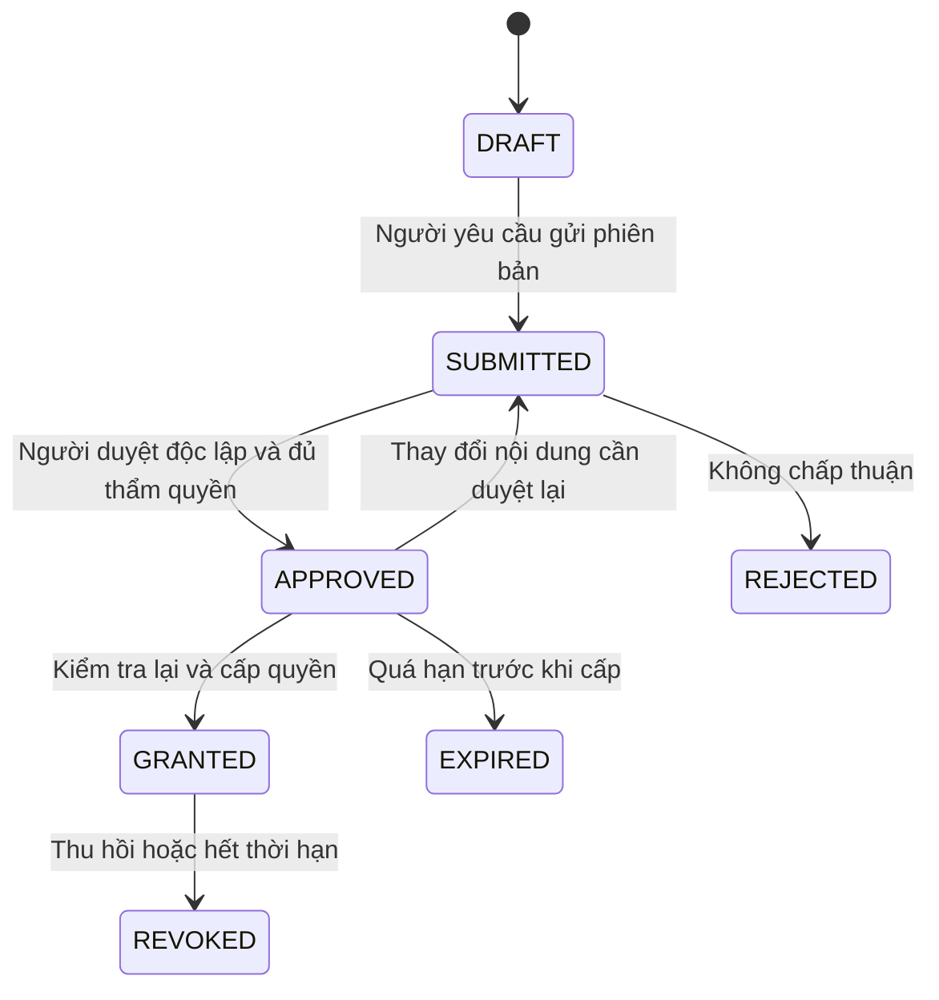

# Separation of duties

## 1. Tách nhiệm vụ giải quyết rủi ro gì?

**Separation of duties (SoD), hay tách nhiệm vụ**, là nguyên tắc phân chia các hành động nhạy cảm giữa những chủ thể độc lập để một chủ thể không thể tự mình hoàn tất toàn bộ chuỗi hành động có rủi ro cao.

Trong quản trị identity, vấn đề không chỉ là “ai có quyền gì”, mà còn là:

- Một người có đồng thời giữ các quyền xung đột không?
- Người khởi tạo yêu cầu có thể tự phê duyệt bằng tài khoản khác không?
- Người quản trị quyền có thể cấp quyền cho mình rồi sử dụng ngay không?
- Người thực hiện hành động có thể sửa hoặc xóa bằng chứng kiểm tra không?

Ví dụ, hệ thống cho phép nhân viên yêu cầu quyền quản trị môi trường production. Nếu cùng nhân viên đó có thể phê duyệt yêu cầu, tự cấp quyền, dùng quyền và xóa lịch sử cấp quyền, các bước kiểm soát chỉ tồn tại về hình thức.

Một yêu cầu bảo mật tốt phải chỉ rõ **các nhiệm vụ xung đột, phạm vi áp dụng, tiêu chuẩn độc lập, điểm thực thi và bằng chứng kiểm chứng**. Câu “hệ thống phải hỗ trợ SoD” chưa đủ để thiết kế hoặc nghiệm thu.

Bài học này tập trung chuyển rủi ro từ identity và quyền truy cập thành yêu cầu SoD cụ thể. Các ngưỡng thời gian và số liệu bên dưới là ví dụ cho một hệ thống giả định, cần được lựa chọn theo rủi ro thực tế.

## 2. Phân biệt SoD với các nguyên tắc liên quan

| Nguyên tắc | Câu hỏi chính | Ví dụ |
|---|---|---|
| Least privilege | Chủ thể cần ít quyền nhất nào để làm việc? | Người hỗ trợ chỉ xem thông tin cần thiết, không được cấp quyền quản trị |
| Separation of duties | Các quyền hoặc hành động nào không được tập trung vào cùng một chủ thể? | Người yêu cầu quyền production không được phê duyệt chính yêu cầu đó |
| Dual control | Hành động nào cần sự tham gia độc lập của nhiều chủ thể? | Cấp quyền đặc biệt cần người yêu cầu và một người phê duyệt khác |
| Need to know | Chủ thể cần biết dữ liệu nào cho nhiệm vụ cụ thể? | Người duyệt thấy lý do và phạm vi yêu cầu, không thấy bí mật xác thực |

Các nguyên tắc có thể bổ trợ nhau nhưng không thay thế nhau. Một người có ít quyền vẫn có thể nắm đúng hai quyền xung đột. Ngược lại, hai tài khoản khác nhau không tạo ra hai chủ thể độc lập nếu cùng một người điều khiển cả hai.

SoD cũng không bảo đảm chống được mọi trường hợp thông đồng. Khi hai người có thể cùng thông đồng, cần đánh giá thêm cơ chế phát hiện, giám sát độc lập, giới hạn giao dịch và hậu kiểm.

## 3. Các hình thức tách nhiệm vụ

### 3.1. Tách nhiệm vụ tĩnh: cấm kết hợp quyền

**Static separation of duties** áp dụng ràng buộc khi gán vai trò hoặc quyền. Một chủ thể không được đồng thời giữ một tổ hợp quyền xung đột trong phạm vi được xác định.

Ví dụ:

> Trong cùng một tenant, một identity con người không được đồng thời có quyền quản trị chính sách cấp quyền production và quyền phê duyệt việc thay đổi chính sách đó.

Kiểm tra phải xét quyền hiệu lực, bao gồm quyền trực tiếp, quyền từ nhóm, vai trò kế thừa và ủy quyền còn hiệu lực. Chỉ kiểm tra tên vai trò trực tiếp có thể bỏ sót xung đột.

Cần xác định ý nghĩa của phạm vi. Vai trò người lập và người duyệt ở hai tenant khác nhau có thể được phép cùng tồn tại nếu mô hình rủi ro cho phép; cùng hai vai trò đó trong một tenant có thể bị cấm.

### 3.2. Tách nhiệm vụ động: giới hạn quyền được sử dụng

**Dynamic separation of duties** cho phép một chủ thể đủ điều kiện giữ nhiều vai trò nhưng hạn chế việc kích hoạt hoặc sử dụng chúng trong một ngữ cảnh.

Có hai trường hợp cần phân biệt:

- **Theo phiên:** các vai trò xung đột không được cùng hoạt động trong một phiên.
- **Theo nghiệp vụ:** một người có thể làm người lập ở yêu cầu A và người duyệt ở yêu cầu B, nhưng không được làm cả hai trên cùng một yêu cầu.

Cấm kích hoạt đồng thời hai vai trò trong một phiên **không tự động** ngăn tự duyệt. Người dùng vẫn có thể mở phiên khác. Nếu mục tiêu là ngăn tự phê duyệt một yêu cầu, chính sách phải xét lịch sử và trạng thái của yêu cầu đó qua mọi phiên.

### 3.3. Tách nhiệm vụ theo lịch sử hành động

Một số ràng buộc phụ thuộc vào hành động đã xảy ra, không chỉ quyền hiện tại.

Ví dụ:

> Người từng là người khởi tạo yêu cầu R không được phê duyệt R, kể cả khi đã đổi vai trò, đăng nhập lại hoặc chuyển sang một tài khoản khác được liên kết với cùng identity con người.

Vì vậy, khi người khởi tạo chuyển bộ phận, việc thu hồi vai trò cũ không được làm mất thông tin lịch sử cần cho quyết định SoD.

### 3.4. Kiểm soát phòng ngừa và kiểm soát phát hiện

Kiểm soát phòng ngừa chặn hành động trước khi nó có hiệu lực. Kiểm soát phát hiện tìm tổ hợp quyền hoặc chuỗi hành động vi phạm để xử lý.

Nếu rủi ro yêu cầu ngăn tự cấp đặc quyền, báo cáo vi phạm vào ngày hôm sau không tương đương với việc chặn cấp quyền. Báo cáo vẫn hữu ích để phát hiện sai lệch cấu hình hoặc đường đi ngoài quy trình.

Một đặc tả cần nói rõ kiểm soát nào phải chặn trực tiếp và kiểm soát nào chỉ cung cấp giám sát bổ sung.

## 4. Xác định chủ thể độc lập trong mô hình identity

### 4.1. Account khác với person identity

Một con người có thể có tài khoản nhân viên, tài khoản quản trị và tài khoản hỗ trợ tạm thời. SoD phải chọn đúng cấp nhận diện.

| Định danh | Vai trò trong quyết định |
|---|---|
| Account ID | Tài khoản đang xác thực hoặc thực hiện thao tác |
| Person identity ID | Định danh ổn định của con người để đối chiếu các tài khoản liên quan |
| Service identity ID | Định danh workload hoặc tài khoản dịch vụ |
| Delegator identity | Chủ thể trao quyền hoặc ủy quyền |
| Effective actor | Chủ thể thực tế mà hành động được quy trách nhiệm theo mô hình đã định nghĩa |

Ví dụ, nếu `employee-17` và `admin-42` thuộc cùng một person identity, người dùng không được dùng `admin-42` để duyệt yêu cầu do `employee-17` tạo.

Không nên so sánh tên hiển thị hoặc địa chỉ email làm cơ sở duy nhất: chúng có thể thay đổi và không nhất thiết biểu diễn một con người duy nhất. Việc liên kết account với person identity phải có nguồn tin cậy, lịch sử thay đổi và quyền sửa được kiểm soát.

Nếu hệ thống không xác định được person identity trong một luồng cấp đặc quyền bắt buộc SoD, phải từ chối hoặc chuyển sang quy trình xử lý được phê duyệt. Không được coi “không biết có cùng người hay không” là bằng chứng độc lập.

### 4.2. Service account không phải người duyệt độc lập mặc định

Một dịch vụ cấp quyền tự động có thể thực thi kết quả phê duyệt mà không tạo ra một người phê duyệt thứ hai. Cần phân biệt:

- Người chịu trách nhiệm khởi tạo yêu cầu.
- Người có thẩm quyền phê duyệt.
- Workload thực hiện cấp quyền theo quyết định hợp lệ.

Bot tự duyệt mọi yêu cầu của người sở hữu bot không đáp ứng yêu cầu phê duyệt độc lập chỉ vì bot có account ID riêng.

Nếu quy trình cho phép phê duyệt tự động theo chính sách, phải đặc tả đó là một loại quyết định riêng: điều kiện được tự động hóa, người quản trị chính sách, giới hạn áp dụng và bằng chứng đánh giá. Không ghi nhận quyết định đó như sự tham gia của hai người.

### 4.3. Ủy quyền không được làm mất dấu chủ thể

Một người không được vượt ràng buộc tự duyệt bằng cách ủy quyền cho một tài khoản khác mà họ vẫn kiểm soát.

Yêu cầu phải xác định cách đánh giá người được ủy quyền, người ủy quyền và các quan hệ kiểm soát có liên quan. Không mặc định mọi người cùng nhóm đều không độc lập; mức độ độc lập về quản lý hoặc tổ chức phải xuất phát từ rủi ro của nghiệp vụ.

## 5. Xây dựng ma trận nhiệm vụ xung đột

Bắt đầu từ tài sản và hành động có tác động đáng kể, rồi xác định những tổ hợp có thể dẫn đến lạm dụng.

Ví dụ cho hệ thống quản trị quyền:

| Nhiệm vụ A | Nhiệm vụ B | Phạm vi xung đột | Ràng buộc |
|---|---|---|---|
| Khởi tạo yêu cầu đặc quyền | Phê duyệt yêu cầu | Cùng yêu cầu và cùng person identity | Không được cùng thực hiện |
| Soạn chính sách cấp quyền | Phê duyệt phiên bản chính sách | Cùng phiên bản | Người soạn không được tự duyệt |
| Quản trị cấp quyền production | Quản trị cơ chế chấp thuận thay đổi chính sách | Cùng tenant production | Cấm tổ hợp quyền nếu đây là quyết định thiết kế đã chọn |
| Thực hiện cấp quyền | Sửa hoặc xóa nhật ký cấp quyền | Cùng miền bằng chứng | Tách quyền thực thi khỏi quyền quản lý lưu trữ bằng chứng |
| Yêu cầu quyền tạm thời | Gia hạn chính yêu cầu đó | Cùng khoản cấp quyền | Gia hạn phải được phê duyệt độc lập theo chính sách |

Ma trận cần có người chịu trách nhiệm nghiệp vụ và người chịu trách nhiệm chính sách. Không đưa mọi cặp vai trò vào danh sách xung đột một cách máy móc; điều đó làm quy trình khó vận hành nhưng chưa chắc giảm đúng rủi ro.

Đối với mỗi dòng, cần trả lời:

1. Xung đột được đánh giá theo quyền đang có hay hành động đã thực hiện?
2. Ràng buộc áp dụng trong tenant, dự án, môi trường hay giao dịch nào?
3. Quyền từ nhóm, vai trò kế thừa và ủy quyền được tính ra sao?
4. Hành động nào bị chặn, tại thời điểm nào?
5. Trường hợp thiếu dữ liệu hoặc dịch vụ kiểm tra không khả dụng xử lý thế nào?
6. Ai được cho phép ngoại lệ, với bằng chứng và thời hạn nào?

## 6. Chuyển nguyên tắc thành yêu cầu bảo mật đo được

Một yêu cầu SoD nên có cấu trúc:

> Trong phạm vi S, trước khi hành động A có hiệu lực, hệ thống phải đánh giá ràng buộc C trên các chủ thể và dữ liệu D. Nếu vi phạm hoặc không đủ dữ liệu để quyết định, hệ thống phải xử lý theo F và ghi bằng chứng E.

### 6.1. Ngăn tự phê duyệt

**SOD-01 — Phê duyệt độc lập**

> Trước khi chuyển yêu cầu đặc quyền sang trạng thái APPROVED, hệ thống phải xác nhận person identity của người phê duyệt khác person identity của người khởi tạo. Ràng buộc áp dụng xuyên tài khoản và xuyên phiên. Khi không xác định được một trong hai person identity, yêu cầu không được chuyển sang APPROVED.

Tiêu chí chấp nhận:

- Cùng tài khoản: từ chối.
- Hai tài khoản thuộc cùng người: từ chối.
- Hai người khác nhau nhưng người duyệt không có thẩm quyền trong tenant: từ chối.
- Hai người khác nhau, đủ thẩm quyền và yêu cầu còn hiệu lực: cho phép xét các điều kiện còn lại.

Sự khác nhau giữa hai người là điều kiện cần, không phải toàn bộ điều kiện cấp quyền.

### 6.2. Ngăn xung đột khi thay đổi entitlement

**SOD-02 — Kiểm tra quyền hiệu lực**

> Trước khi một thay đổi gán quyền có hiệu lực, hệ thống phải kiểm tra các tổ hợp bị cấm trên tập quyền hiệu lực sau thay đổi, bao gồm gán trực tiếp, thành viên nhóm, kế thừa và ủy quyền còn hiệu lực trong cùng phạm vi.

Điều kiện này phải áp dụng cho cả thay đổi membership và thay đổi định nghĩa vai trò. Nếu chỉ kiểm tra lúc gán vai trò cho người dùng, người quản trị vẫn có thể thêm quyền xung đột vào một vai trò đã được gán.

### 6.3. Ràng buộc phê duyệt với đúng nội dung

**SOD-03 — Phê duyệt gắn với phiên bản**

> Quyết định phê duyệt phải gắn với phiên bản yêu cầu, identity nhận quyền, phạm vi tài nguyên, tập quyền và thời hạn đã được duyệt. Thay đổi một trường làm tăng hoặc thay đổi phạm vi cấp quyền phải vô hiệu hóa phê duyệt cũ và yêu cầu đánh giá lại.

Ví dụ, duyệt quyền đọc trong một giờ không được dùng để cấp quyền quản trị trong một ngày.

### 6.4. Chặn cấp quyền bằng quyết định không còn hợp lệ

**SOD-04 — Thực thi có kiểm tra trạng thái**

> Dịch vụ cấp quyền chỉ được thực thi quyết định gắn với đúng yêu cầu và phiên bản còn hợp lệ, chưa bị thu hồi và chưa được tiêu thụ theo quy tắc của quy trình. Việc đánh dấu thực thi phải chống lặp và bảo toàn ràng buộc khi có nhiều yêu cầu đồng thời.

Chính sách cũng phải xác định ảnh hưởng khi người duyệt mất thẩm quyền trước lúc cấp quyền. Ví dụ được chọn ở đây: hệ thống phải đánh giá lại thẩm quyền của người duyệt trước khi thực thi; nếu không còn hợp lệ, chuyển yêu cầu về trạng thái cần phê duyệt lại.

### 6.5. Bao phủ mọi đường vào

**SOD-05 — Thực thi tại phía máy chủ**

> Các ràng buộc SoD phải được thực thi tại điểm quyết định có thẩm quyền trước khi thay đổi trạng thái hoặc quyền có hiệu lực, áp dụng cho giao diện web, API, tác vụ nền, thao tác bulk và công cụ quản trị được hỗ trợ.

Ẩn nút “Approve” trên UI không đáp ứng yêu cầu này. Một endpoint quản trị bỏ qua kiểm tra cũng tạo đường vượt chính sách.

## 7. Mô hình luồng yêu cầu đặc quyền

Một luồng minh họa:



Các trạng thái là ví dụ thiết kế, không phải một schema bắt buộc. Điều cần bảo toàn là các bất biến:

- Không có quyết định APPROVED hợp lệ do chính person identity khởi tạo tạo ra.
- Quyền được cấp không vượt nội dung của phiên bản đã duyệt.
- Việc gửi lại cùng thông điệp không tạo thêm khoản cấp quyền ngoài ý muốn.
- Hai thao tác cạnh tranh không làm mất một điều kiện kiểm tra.
- Mọi chuyển trạng thái nhạy cảm đều có bằng chứng phù hợp.

### 7.1. Kiểm tra và cập nhật phải bảo toàn tính nhất quán

Đoạn mã giả sau thể hiện một điểm quyết định; không phải triển khai hoàn chỉnh:

```text
approve(requestId, expectedVersion, authenticatedActor):
    begin consistent transaction
    request = load request with concurrency protection
    require request.state == SUBMITTED
    require request.version == expectedVersion

    approverPerson = resolveTrustedPerson(authenticatedActor)
    requesterPerson = request.originalRequesterPerson

    require approverPerson is known
    require requesterPerson is known
    require approverPerson != requesterPerson
    require currentApprovalAuthority(approverPerson, request.scope)
    require delegationPolicyAllows(authenticatedActor, request)

    bind approval to request.version and approved attributes
    update state to APPROVED with version check
    record durable audit event
    commit
```

Nguồn của `authenticatedActor` phải được máy chủ xác thực; không lấy person identity tùy ý từ request body.

Khi quyết định phụ thuộc vào dữ liệu ở nhiều dịch vụ, một transaction cơ sở dữ liệu cục bộ không tự giải quyết toàn bộ race condition. Thiết kế cần cơ chế phù hợp như phiên bản chính sách, thông tin quyết định có thời hạn, kiểm tra lại ở điểm cấp quyền hoặc một giao thức phối hợp được xác định rõ.

Nếu dùng cache quyền, phải đặc tả giới hạn độ cũ chấp nhận được và cách xử lý quyết định nhạy cảm khi không xác minh được dữ liệu. Không mô tả cache như thể luôn phản ánh trạng thái mới nhất.

## 8. Quản trị chính sách SoD cũng cần được kiểm soát

Một hệ thống có thể thực thi đúng chính sách nhưng vẫn thất bại nếu một người dễ dàng sửa chính sách để tự loại mình khỏi ràng buộc.

Các thao tác cần đưa vào mô hình đe dọa gồm:

- Thêm hoặc xóa một cặp quyền xung đột.
- Đổi phạm vi tenant hoặc môi trường mà chính sách áp dụng.
- Sửa liên kết account với person identity.
- Tạo nhóm, vai trò kế thừa hoặc ủy quyền để đưa quyền đi vòng.
- Thay đổi cơ chế ghi và lưu nhật ký kiểm tra.
- Dùng quyền nền tảng để chỉnh dữ liệu ngoài API nghiệp vụ.

Yêu cầu quản trị có thể bao gồm:

> Thay đổi chính sách SoD production phải có phiên bản, người soạn, người phê duyệt độc lập, thời điểm hiệu lực và lịch sử thay đổi được bảo vệ khỏi người vận hành nghiệp vụ thông thường.

Quyền quản trị nền tảng, cơ sở dữ liệu hoặc identity provider có thể tạo khả năng vượt kiểm soát ở tầng ứng dụng. Phải xác định rõ ranh giới tin cậy và những quyền quản trị nào nằm trong hoặc ngoài cơ chế phòng ngừa. Với đường quản trị không thể chặn hoàn toàn, cần kiểm soát quyền đặc biệt, giám sát và hậu kiểm tương xứng; không tuyên bố SoD ứng dụng ngăn được mọi quản trị viên hạ tầng.

## 9. Ngoại lệ và break-glass

Một số tình huống sự cố cần truy cập khẩn cấp khi người phê duyệt thông thường không sẵn sàng. Ngoại lệ phải được đặc tả thành quy trình riêng.

Một hồ sơ ngoại lệ nên ghi:

| Thành phần | Nội dung cần xác định |
|---|---|
| Điều kiện kích hoạt | Loại sự cố và lý do không dùng được quy trình bình thường |
| Chủ thể đủ điều kiện | Những identity được phép đề nghị hoặc kích hoạt |
| Phạm vi | Tài nguyên và quyền tối thiểu được mở |
| Thời hạn | Thời điểm hết hiệu lực và cơ chế thu hồi |
| Bằng chứng | Sự kiện, người kích hoạt, lý do, khoản cấp quyền liên quan |
| Thông báo | Nhóm độc lập nào phải nhận cảnh báo |
| Hậu kiểm | Ai rà soát và trong khoảng thời gian nào |

Ví dụ yêu cầu cho hệ thống giả định:

> Khoản cấp quyền khẩn cấp phải hết hiệu lực sau tối đa 30 phút, phát cảnh báo tới nhóm giám sát độc lập trong 60 giây và được một người không tham gia kích hoạt rà soát trong một ngày làm việc.

Những con số này cần được đối chiếu với khả năng vận hành. Thời hạn trong database chưa đủ nếu credential hoặc phiên đã cấp vẫn tiếp tục được chấp nhận; thiết kế phải nêu cách giới hạn hoặc thu hồi các phương tiện truy cập liên quan.

Nếu ngoại lệ cho phép một người tự kích hoạt, sự kiện phải được đánh dấu rõ là break-glass. Không ghi nhận nó như một phê duyệt hai người thông thường. Hậu kiểm không biến hành động đơn phương trước đó thành dual control phòng ngừa.

Không nên có ngoại lệ vĩnh viễn cho một cá nhân mà không có cơ chế rà soát. Chính sách ngoại lệ cũng cần người sở hữu, thời hạn và điều kiện chấm dứt.

## 10. Nhật ký và bằng chứng kiểm chứng

Để giải thích một quyết định SoD, bằng chứng cần liên kết được giữa yêu cầu, phiên bản, chủ thể, chính sách và kết quả.

Các trường minh họa:

```yaml
eventType: PRIVILEGED_REQUEST_APPROVAL_DENIED
requestId: req-731
requestVersion: 3
tenantId: tenant-a
actorAccountId: admin-42
actorPersonId: person-17
requesterPersonId: person-17
policyId: SOD-SELF-APPROVAL
policyVersion: 5
decision: DENY
reasonCode: SAME_PERSON
correlationId: flow-915
```

Một sự kiện thực tế còn cần thời gian đáng tin cậy và thông tin nguồn phù hợp. Không ghi mật khẩu, access token, khóa bí mật hoặc dữ liệu nghiệp vụ nhạy cảm không cần thiết.

Nhật ký phải được kiểm soát truy cập và lưu trữ theo chính sách. Người dùng thực hiện nghiệp vụ không được có quyền tùy ý sửa hoặc xóa bằng chứng về chính hành động đó.

Khi gửi sự kiện tới hệ thống nhật ký ngoài, cần xác định cách bảo đảm bằng chứng bền vững. Nếu quy trình yêu cầu bằng chứng bắt buộc mà không thể ghi bền vững, hành động phải thất bại hoặc chuyển sang chế độ xử lý đã được đặc tả; không âm thầm bỏ nhật ký.

Các định danh con người trong log cũng là dữ liệu cần bảo vệ. Hãy giới hạn người xem, mục đích sử dụng và thời gian lưu thay vì thu thập mọi thông tin “phòng khi cần”.

## 11. Tiêu chí kiểm thử và bằng chứng nghiệm thu

Các tình huống dưới đây là đầu vào để kiểm chứng yêu cầu khi triển khai; chúng không thay thế việc phân tích rủi ro.

| Tình huống | Kết quả mong đợi | Bằng chứng cần quan sát |
|---|---|---|
| Người lập tự duyệt bằng cùng account | Từ chối | Trạng thái không đổi, lý do SAME_PERSON |
| Người lập dùng account quản trị khác của mình | Từ chối | Đối chiếu cùng person identity |
| Người duyệt khác người nhưng sai tenant | Từ chối | Kiểm tra thẩm quyền theo phạm vi |
| Quyền xung đột đến từ membership nhóm | Chặn thay đổi vi phạm | Tính quyền hiệu lực có nhóm |
| Vai trò được sửa để thêm quyền xung đột | Chặn theo chính sách hoặc không cho thay đổi có hiệu lực | Đánh giá tác động đến người đang giữ vai trò |
| Mở phiên thứ hai để duyệt yêu cầu đã tạo | Từ chối | Ràng buộc gắn với yêu cầu xuyên phiên |
| Đổi phạm vi sau khi đã được duyệt | Phê duyệt cũ không còn dùng được | Phiên bản và thuộc tính được ràng buộc |
| Gửi hai yêu cầu approve đồng thời | Không phá vỡ chuyển trạng thái | Kiểm soát phiên bản và kết quả cạnh tranh |
| Gửi lại thông điệp cấp quyền | Không tạo thêm khoản cấp ngoài quy tắc | Dấu vết chống thực thi lặp |
| Không phân giải được person identity | Không cho duyệt đặc quyền | Lý do rõ ràng, không coi thiếu dữ liệu là độc lập |
| Dịch vụ cấp quyền nhận quyết định đã thu hồi | Không cấp quyền | Kiểm tra hiệu lực tại thời điểm thực thi |
| Break-glass hết thời hạn | Quyền và phương tiện truy cập bị xử lý theo đặc tả | Bằng chứng thu hồi hoặc hết hiệu lực |
| Người cấp quyền cố xóa nhật ký cấp quyền | Bị chặn theo ranh giới quyền đã thiết kế | Quyền lưu trữ bằng chứng độc lập |

Một bài kiểm tra chỉ đi qua UI chưa chứng minh API và tác vụ nền đã được bao phủ. Cần kiểm chứng tại các đường vào có thể tạo ra cùng tác động bảo mật.

Với thay đổi quyền hoặc thay đổi chính sách, cần có cả kiểm tra trước khi thay đổi có hiệu lực và cơ chế phát hiện sai lệch về sau. Nếu phát hiện quyền xung đột đã tồn tại, đặc tả phải nêu cách cách ly, thu hồi hoặc yêu cầu xử lý; không chỉ tạo báo cáo rồi bỏ mặc.

## 12. Truy vết từ rủi ro tới yêu cầu

Một chuỗi truy vết ngắn giúp tránh yêu cầu hình thức:

| Rủi ro | Yêu cầu | Điểm thực thi | Bằng chứng |
|---|---|---|---|
| Nhân viên tự nâng đặc quyền bằng hai account | SOD-01 | Chuyển trạng thái phê duyệt | Test cùng person identity, log quyết định |
| Chỉnh membership để tích lũy quyền xung đột | SOD-02 | Thay đổi entitlement có hiệu lực | Test nhóm và kế thừa |
| Dùng phê duyệt cũ để cấp quyền rộng hơn | SOD-03 | Phê duyệt và thực thi cấp quyền | Version mismatch, nội dung cấp thực tế |
| Chạy lại quyết định đã dùng hoặc bị thu hồi | SOD-04 | Dịch vụ cấp quyền | Kết quả chống lặp, kiểm tra hiệu lực |
| Bỏ qua UI để gọi API trực tiếp | SOD-05 | Điểm quyết định phía máy chủ | Test API, bulk và tác vụ nền |

Khi đánh giá một yêu cầu SoD, hãy kiểm tra xem có thể xác định rõ **ai không được làm gì với ai, trên đối tượng nào, vào thời điểm nào, bằng đường nào và hệ thống chứng minh điều đó ra sao**.

SoD có giá trị khi sự độc lập được biểu diễn đúng trong mô hình identity, ràng buộc được thực thi tại nơi tác động có hiệu lực và bằng chứng đủ để kiểm chứng. Việc chia tên vai trò hoặc thêm một bước “Approve” vào quy trình chỉ là điểm bắt đầu.

