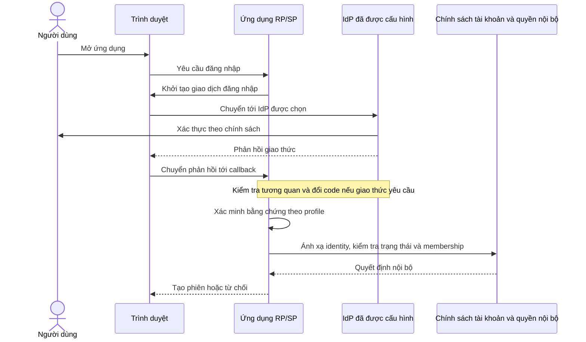

# Identity federation

## 1. Identity federation là gì?

**Identity federation, hay liên kết định danh**, cho phép một hệ thống dựa vào thông tin xác thực hoặc thuộc tính identity do một bên khác cung cấp, trong một quan hệ tin cậy được thiết lập rõ ràng.

Ví dụ, một doanh nghiệp cho nhân viên dùng tài khoản công ty để đăng nhập cổng quản lý dự án của nhà cung cấp. Doanh nghiệp quản lý việc xác thực nhân viên; cổng dự án kiểm tra kết quả nhận được và quyết định người đó được truy cập dữ liệu nào.

Liên kết định danh không có nghĩa là ứng dụng “tin mọi thứ do bên đăng nhập gửi”. Ứng dụng phải xác định:

- Tin tổ chức phát hành nào và trong phạm vi nào.
- Chấp nhận loại bằng chứng nào.
- Kiểm tra bằng chứng ra sao.
- Ánh xạ identity bên ngoài vào tài khoản nội bộ thế nào.
- Thuộc tính nào có thể ảnh hưởng tới quyền truy cập.
- Điều gì xảy ra khi người dùng bị khóa, khóa ký thay đổi hoặc bên cung cấp identity gặp sự cố.

Trong thiết kế yêu cầu bảo mật, mục tiêu là biến “hỗ trợ đăng nhập bằng tài khoản doanh nghiệp” thành một hợp đồng có thể triển khai, kiểm thử và vận hành. Các cấu hình và ngưỡng thời gian trong bài là ví dụ của một hệ thống giả định, không phải mặc định của mọi sản phẩm.

## 2. Các bên và ranh giới tin cậy

### 2.1. Các vai trò chính

| Thành phần | Trách nhiệm |
|---|---|
| Người dùng | Bắt đầu đăng nhập và thực hiện yêu cầu nghiệp vụ |
| Identity provider — IdP | Xác thực người dùng, phát hành bằng chứng theo giao thức và chính sách đã thống nhất |
| Relying party — RP / Service provider — SP | Kiểm tra bằng chứng, liên kết tài khoản, tạo phiên và thực thi chính sách truy cập |
| Trình duyệt | Chuyển hướng hoặc vận chuyển thông điệp; không phải nguồn đáng tin cho nội dung nhận được |
| Dịch vụ tài nguyên / API | Kiểm tra bằng chứng truy cập dành cho mình và quyền trên tài nguyên |
| Người quản trị federation | Thiết lập issuer, endpoint, khóa, ánh xạ thuộc tính và phạm vi tenant |

Tên RP thường dùng trong OpenID Connect; SP thường dùng trong SAML. Một sản phẩm có thể đóng nhiều vai trò, nhưng đặc tả phải làm rõ vai trò trong từng kết nối.

Chẳng hạn, một identity broker là RP đối với IdP doanh nghiệp nhưng lại đóng vai trò IdP đối với ứng dụng cuối. Ứng dụng cuối đang tin broker và các quy tắc chuyển đổi của broker; không được bỏ qua mắt xích này khi phân tích rủi ro.

### 2.2. Luồng tin cậy tổng quát



Đây là luồng khái quát. Với OIDC Authorization Code Flow, callback mang authorization code; ứng dụng đổi code tại token endpoint rồi kiểm tra ID token. Với SAML Web Browser SSO dùng POST, phản hồi có thể mang assertion theo profile được lựa chọn.

Điểm quan trọng là bằng chứng đi qua trình duyệt vẫn phải được xác minh ở phía máy chủ trước khi tạo phiên hoặc cấp quyền.

## 3. Federation, SSO, OAuth và provisioning khác nhau ra sao?

| Khái niệm | Vấn đề giải quyết | Điều không tự bảo đảm |
|---|---|---|
| Federation | Tin cậy identity giữa các hệ thống hoặc miền quản trị | Quyền nghiệp vụ chính xác tại ứng dụng |
| Single sign-on — SSO | Giảm việc xác thực lặp lại khi đi qua nhiều ứng dụng | Tài khoản cục bộ và phiên đều bị thu hồi ngay khi khóa ở IdP |
| OAuth 2.0 | Cấp quyền truy cập tài nguyên theo mô hình ủy quyền | Định nghĩa đầy đủ một giao thức đăng nhập người dùng |
| OpenID Connect — OIDC | Lớp identity trên OAuth 2.0 phục vụ xác thực người dùng | Thay ứng dụng quyết định quyền trên mọi đối tượng |
| SAML 2.0 | Trao đổi assertion theo các profile, trong đó có đăng nhập liên kết | Mọi cấu hình SAML đều có cùng thuộc tính bảo mật |
| Provisioning / deprovisioning | Tạo, cập nhật, vô hiệu hóa tài khoản và liên kết liên quan | Phiên hoặc token đã cấp tự động mất hiệu lực |

OIDC xác định một lớp identity và các claim phục vụ xác thực trên OAuth 2.0. Không nên coi mọi OAuth access token là bằng chứng đăng nhập có thể dùng tùy ý. Xem [OpenID Connect Core](https://openid.net/specs/openid-connect-core-1_0.html).

SCIM là một giao thức phục vụ quản lý identity giữa các hệ thống; nó bổ trợ quản trị vòng đời tài khoản, không thay thế giao thức đăng nhập. Xem [RFC 7644 — SCIM Protocol](https://www.rfc-editor.org/rfc/rfc7644.html).

Một hệ thống có federation và SSO vẫn cần quy định riêng về tạo tài khoản, membership, quyền, phiên, thu hồi và kiểm toán.

## 4. Thiết lập hợp đồng tin cậy trước khi cho đăng nhập

Một kết nối federation cần được quản trị như một cấu hình bảo mật có phiên bản.

### 4.1. Những quyết định phải ghi rõ

| Nhóm quyết định | Nội dung cần đặc tả |
|---|---|
| Bên tin cậy | Issuer hoặc entity ID chính xác; tenant nào được phép dùng |
| Giao thức | OIDC hay SAML; profile, flow và binding được hỗ trợ |
| Điểm đến | Redirect URI hoặc assertion consumer service đã đăng ký |
| Khóa và thuật toán | Nguồn khóa tin cậy; thuật toán cho phép; quy trình thay khóa |
| Subject | Định danh bên ngoài nào dùng để liên kết với tài khoản nội bộ |
| Thuộc tính | Claim nào bắt buộc, nguồn nào có thẩm quyền, cách chuẩn hóa |
| Assurance | Mức xác thực cần thiết, độ mới của lần xác thực, quy tắc step-up |
| Vòng đời | Cách tạo, vô hiệu hóa, khôi phục và xóa liên kết |
| Sự cố | Hành vi khi IdP lỗi, metadata cũ hoặc khóa bị lộ |
| Bằng chứng | Nhật ký, người quản trị thay đổi, kết quả kiểm thử |

Issuer hợp lệ về cú pháp không đồng nghĩa issuer được ứng dụng chấp thuận. Việc thêm một IdP mới phải qua quy trình cấu hình được cấp quyền, thay vì tự chấp nhận issuer xuất hiện trong token.

Metadata và discovery giúp tự động hóa cấu hình nhưng không tự tạo ra thẩm quyền tin cậy. Phải xác định trước issuer được chấp thuận, cách lấy metadata, kiểm tra sự nhất quán và các giới hạn truy cập mạng.

### 4.2. Mô hình nhiều tenant

Giả sử ứng dụng phục vụ hai khách hàng:

- Tenant A tin IdP A.
- Tenant B tin IdP B.

Một token hợp lệ từ IdP A không được cấp quyền vào tenant B chỉ vì người dùng sửa tenant ID trong URL, cookie hoặc request body.

Nếu một issuer phục vụ nhiều tổ chức, chỉ kiểm tra issuer có thể chưa đủ để phân biệt tổ chức. Hợp đồng phải định nghĩa thuộc tính tổ chức có thẩm quyền và ràng buộc nó với tenant nội bộ. Không mặc định tên miền email là bằng chứng membership.

Một yêu cầu mẫu:

> Kết nối federation chỉ được sử dụng cho tenant đã liên kết trong cấu hình phía máy chủ. Hệ thống phải từ chối đăng nhập hoặc truy cập khi identity không có membership hợp lệ trong tenant đích, kể cả khi chữ ký và thời hạn bằng chứng đều hợp lệ.

## 5. Ánh xạ identity và liên kết tài khoản

### 5.1. Không dùng email làm khóa identity duy nhất

Email có thể thay đổi, được tái cấp, có bí danh hoặc đến từ một IdP mà ứng dụng chỉ tin cho phạm vi khác. Việc tự động gộp tài khoản theo email có thể dẫn đến chiếm đoạt tài khoản.

Đối với thiết kế OIDC thông thường, dùng cặp issuer và subject làm cơ sở nhận diện identity bên ngoài:

```text
external identity = (issuer, subject)
external identity + cấu hình kết nối đã xác minh
    -> internal principal
internal principal + membership nội bộ
    -> phạm vi tenant và quyền
```

Ứng dụng nhiều tenant có thể cần thêm định danh kết nối hoặc phạm vi tổ chức theo mô hình đã chọn. Điều đó không thay thế việc kiểm tra issuer, subject và membership.

Đối với SAML, hợp đồng cần lựa chọn định danh subject phù hợp, có quy tắc về phạm vi và tính ổn định. Không mặc định mọi NameID đều bền vững; định danh tạm thời không đủ để duy trì liên kết tài khoản lâu dài nếu không có cơ chế bổ sung.

Một bộ ánh xạ minh họa:

```yaml
connectionId: federation-tenant-a
tenantId: tenant-a
protocol: OIDC
issuer: https://identity.example/tenant-a
clientId: project-portal
identityMapping:
  subjectClaim: sub
  allowAutomaticEmailLinking: false
provisioning:
  mode: INVITATION_REQUIRED
roleMapping:
  defaultRole: NONE
```

Đây là cấu hình mô tả ý tưởng, không phải schema của một thư viện cụ thể.

### 5.2. Liên kết tài khoản cần chứng minh quyền kiểm soát

Nếu người dùng muốn nối identity liên kết vào tài khoản đã có, ứng dụng cần một quy trình riêng: xác thực tài khoản hiện tại với độ mới phù hợp, xác thực identity muốn liên kết và kiểm tra chính sách membership.

Không chỉ hỏi người dùng nhập email của tài khoản muốn nối. Tương tự, không cho phép người quản trị tenant A nối identity của mình vào principal đặc quyền thuộc tenant B.

Thay đổi IdP, chuyển issuer hoặc thay đổi subject mapping là migration identity. Cần kế hoạch đối chiếu, xử lý trùng lặp và khôi phục; không âm thầm đổi khóa ánh xạ trên hệ thống đang chạy.

### 5.3. Cấp tài khoản tại lần đăng nhập đầu

Just-in-time provisioning có thể tạo tài khoản khi đăng nhập lần đầu. Điều kiện tạo phải rõ: kết nối được phép, membership đã được xác nhận, lời mời còn hiệu lực hoặc nguồn thuộc tính có thẩm quyền.

Không nên hiểu “xác thực thành công” là “được tạo tài khoản có quyền mặc định rộng”. Với tài nguyên nhạy cảm, một thiết kế hợp lệ là tạo tài khoản ở trạng thái chưa có quyền cho đến khi hoàn tất cấp quyền nội bộ.

## 6. Yêu cầu kiểm tra bằng chứng giao thức

### 6.1. Chọn một profile có thể kiểm chứng

Yêu cầu “token phải hợp lệ” quá mơ hồ. Cần xác định profile, loại token hoặc assertion, tập kiểm tra bắt buộc và kết quả khi kiểm tra thất bại.

Đối với một ứng dụng web giả định, có thể chọn:

> Ứng dụng dùng OIDC Authorization Code Flow với PKCE S256, redirect URI HTTPS đã đăng ký chính xác, giao dịch đăng nhập một lần và ID token có chữ ký theo thuật toán đã phê duyệt.

Đây là lựa chọn thiết kế của ví dụ. Các biện pháp bảo vệ redirect và PKCE cần đối chiếu với [RFC 9700 — OAuth 2.0 Security BCP](https://www.rfc-editor.org/rfc/rfc9700.html).

### 6.2. Profile OIDC của ví dụ

Trước khi tạo phiên, ứng dụng phải hoàn tất kiểm tra bằng thư viện giao thức phù hợp, gồm:

1. Đối chiếu phản hồi với giao dịch đăng nhập đã khởi tạo và IdP dự kiến.
2. Kiểm tra giá trị tương quan theo thiết kế, chẳng hạn state gắn với trình duyệt và giao dịch một lần.
3. Đổi code tại token endpoint đã được cấu hình; dùng code verifier đúng giao dịch.
4. Xác minh chữ ký ID token bằng khóa của issuer được tin cậy và thuật toán nằm trong danh sách cho phép.
5. Kiểm tra issuer khớp chính xác cấu hình; audience chứa client ID phù hợp; xử lý các điều kiện nhiều audience và authorized party theo profile.
6. Kiểm tra thời hạn và các điều kiện thời gian bắt buộc; chỉ chấp nhận độ lệch đồng hồ trong giới hạn đã công bố.
7. Vì ví dụ này luôn gửi nonce, kiểm tra nonce của ID token khớp giao dịch, rồi tiêu thụ giao dịch để chặn dùng lại.
8. Kiểm tra các thuộc tính assurance cần thiết cho hành động dự định.
9. Ánh xạ subject, trạng thái tài khoản và tenant trước khi tạo phiên.

Chi tiết các quy tắc ID token nằm trong [OIDC Core, mục ID Token Validation](https://openid.net/specs/openid-connect-core-1_0.html#IDTokenValidation). Không thay thư viện xác minh bằng thao tác decode JWT hoặc tự viết vài phép so sánh claim.

ID token phục vụ RP xác thực người dùng. API cần loại bằng chứng truy cập được thiết kế cho API đó; không chấp nhận ID token thay access token chỉ vì cùng định dạng JWT. Các bộ quy tắc kiểm tra phải phân biệt được token dành cho mục đích khác nhau. Xem [RFC 8725, mục 3.12](https://www.rfc-editor.org/rfc/rfc8725.html#section-3.12).

Một số access token không phải JWT. Cách xác minh phải theo hợp đồng giữa bên phát hành và dịch vụ tài nguyên, không suy từ hình dạng chuỗi.

### 6.3. Profile SAML cần được chỉ rõ tương tự

Nếu lựa chọn SAML Web Browser SSO, đặc tả phải nêu binding, cách bắt đầu luồng và yêu cầu ký hoặc mã hóa theo profile đã chọn.

Đối với luồng SP-initiated của ví dụ:

- Kiểm tra issuer và nguồn khóa từ quan hệ tin cậy đã cấu hình.
- Xác minh chữ ký theo profile; bảo đảm nội dung dùng tạo phiên chính là nội dung đã được xác minh.
- Kiểm tra audience, recipient và destination theo quy tắc áp dụng.
- Đối chiếu InResponseTo với yêu cầu còn hiệu lực.
- Kiểm tra điều kiện thời gian, subject confirmation và các điều kiện bắt buộc.
- Chặn dùng lại assertion theo chính sách và thời gian hiệu lực.
- Chỉ ánh xạ tài khoản sau khi hoàn tất kiểm tra.

Các quy tắc cụ thể phụ thuộc profile và binding; đối chiếu [OASIS SAML 2.0 Profiles, Web Browser SSO](https://docs.oasis-open.org/security/saml/v2.0/saml-profiles-2.0-os.pdf).

Luồng IdP-initiated có thể không có yêu cầu SP tương ứng. Nếu hỗ trợ, phải đặc tả một profile và các biện pháp chống replay, sai đích và nhầm phiên phù hợp; không tùy ý bỏ kiểm tra của SP-initiated để “làm cho đăng nhập được”.

Đối với XML, dùng parser và thư viện SAML được cấu hình bảo mật; không tự tìm một phần tử có tên Assertion rồi dùng nội dung của nó mà bỏ qua quan hệ với phần đã ký.

## 7. Thuộc tính từ IdP và quyết định phân quyền

Chữ ký hợp lệ chứng minh nguồn và tính toàn vẹn theo quan hệ tin cậy; nó không chứng minh mọi claim đều có quyền quyết định mọi chính sách nội bộ.

| Thuộc tính nhận được | Cách dùng có kiểm soát |
|---|---|
| Subject ổn định | Ánh xạ identity bên ngoài |
| Email và tên hiển thị | Hồ sơ hoặc liên lạc theo chính sách; không tự gộp tài khoản |
| Organization / tenant claim | Kiểm tra theo hợp đồng nguồn có thẩm quyền |
| Group hoặc role | Ánh xạ qua danh sách cho phép, giới hạn phạm vi tenant |
| Authentication context | Đánh giá mức xác thực theo thỏa thuận cụ thể |
| Thời điểm xác thực | Đánh giá độ mới khi hành động cần step-up |

Ví dụ, claim `role=admin` từ IdP khách hàng không được tự biến người dùng thành quản trị viên nền tảng SaaS. Nếu được hỗ trợ, nó chỉ ánh xạ tới vai trò nội bộ cụ thể của tenant đó và trong giới hạn cấu hình.

Tên nhóm trùng nhau giữa hai IdP cũng không tạo cùng ý nghĩa. Ánh xạ phải gắn với kết nối và nguồn, không chỉ chuỗi tên nhóm.

Thiếu claim bắt buộc, claim sai kiểu hoặc giá trị không được hỗ trợ phải dẫn đến kết quả xác định. Không mặc định thiếu nhóm nghĩa là người dùng có mọi nhóm; cũng không âm thầm giữ quyền cũ mãi khi chính sách yêu cầu làm mới.

### Mức xác thực và step-up

Yêu cầu “đã đăng nhập bằng SSO thì được làm mọi việc” bỏ qua mức rủi ro của hành động.

Một yêu cầu mẫu:

> Trước khi thay đổi cấu hình federation production, hệ thống phải yêu cầu mức xác thực đáp ứng profile assurance đã thống nhất với IdP và thời điểm xác thực không quá 5 phút, hoặc thực hiện quy trình step-up được phê duyệt.

Không chỉ tìm chuỗi “mfa” bất kỳ trong token. Phải định nghĩa claim, giá trị được chấp nhận, ý nghĩa do IdP cam kết và hành vi khi IdP không đáp ứng. Tên phương thức xác thực không tự biểu diễn đầy đủ chất lượng hay độ mới của việc xác thực.

## 8. Quản trị phiên, thu hồi và deprovisioning

### 8.1. Phân biệt các trạng thái độc lập

Sau một lần đăng nhập liên kết, hệ thống có thể tồn tại đồng thời:

- Phiên đăng nhập tại IdP.
- Giao dịch đăng nhập đang chờ tại RP.
- Phiên cục bộ của ứng dụng.
- Access token và refresh token nếu luồng có phát hành.
- Trạng thái tài khoản và membership nội bộ.

Khóa tài khoản tại IdP có thể chặn lần đăng nhập mới nhưng không tự động xóa mọi phiên hoặc vô hiệu hóa mọi token đã phát hành. Phải đặc tả cơ chế lan truyền và thời gian tối đa để quyền truy cập thực sự chấm dứt.

### 8.2. Yêu cầu thu hồi có thể đo được

Một ví dụ cho cổng quản trị:

> Sau khi hệ thống nhận và xác thực sự kiện vô hiệu hóa identity từ nguồn có thẩm quyền, ứng dụng phải đánh dấu tài khoản không được phép truy cập và vô hiệu hóa phiên liên quan trong 60 giây. Các API phải chấm dứt chấp nhận quyền đã thu hồi trong tối đa 2 phút theo cơ chế được thiết kế.

Đây là hai mốc sau khi nhận sự kiện, chưa phải cam kết đầu cuối từ lúc người dùng bị khóa tại IdP. Nếu mục tiêu đầu cuối là 5 phút, phải phân bổ ngân sách cho phát hiện ở nguồn, truyền sự kiện, xử lý, cache và việc chấp nhận token.

Một JWT còn hạn có thể vẫn được kiểm tra chữ ký ngoại tuyến thành công. Để đạt mục tiêu thu hồi ngắn hơn thời hạn token, cần cơ chế bổ sung như kiểm tra trạng thái, phiên có thể thu hồi hoặc danh sách từ chối theo thiết kế. Không chỉ giảm TTL trong tài liệu mà không kiểm chứng mọi đường truy cập.

### 8.3. Logout không phải một khái niệm duy nhất

Đặc tả cần phân biệt đăng xuất khỏi ứng dụng, kết thúc phiên IdP, lan truyền logout và thu hồi credential. Một thao tác logout ở trình duyệt không mặc định bảo đảm access token đã mất hiệu lực tại mọi API.

Nếu hỗ trợ thông báo logout hoặc sự kiện bảo mật, hệ thống phải kiểm tra nguồn, đối tượng đích, thời gian và chống replay của thông báo. Từ đó cập nhật đúng phiên hoặc identity, không vô hiệu hóa nhầm toàn tenant.

## 9. Khóa, metadata và vận hành khi sự cố

### 9.1. Nguồn khóa phải nằm trong quan hệ tin cậy

Không để token tự chỉ định một URL tùy ý rồi tải khóa từ đó để xác minh chính token ấy. Việc tin một khóa phải bắt nguồn từ cấu hình hoặc metadata đã được chấp thuận.

Một `kid` lạ chỉ là yêu cầu tìm khóa, không phải bằng chứng rằng khóa mới được tin. Cần giới hạn tần suất làm mới, timeout, kích thước phản hồi và điểm đến mạng để tránh lạm dụng. Những rủi ro liên quan tới header chỉ tới khóa và xử lý claim được nêu tại [RFC 8725, mục 3.10](https://www.rfc-editor.org/rfc/rfc8725.html#section-3.10).

### 9.2. Thay khóa định kỳ và xử lý lộ khóa khác nhau

Với thay khóa định kỳ, có thể cần khoảng chồng lấn được xác định để bằng chứng còn hạn vẫn được kiểm tra. Với khóa bị lộ, tiếp tục chấp nhận khóa cũ theo cùng lịch định kỳ có thể kéo dài khả năng giả mạo.

Yêu cầu nên chỉ rõ:

- Ai được cập nhật khóa và metadata.
- Cách xác minh thay đổi thuộc đúng issuer.
- Giới hạn độ cũ của cache.
- Hành vi khi gặp khóa chưa biết.
- Cách vô hiệu hóa khẩn cấp một khóa hoặc kết nối.
- Cách xử lý phiên và khoản cấp quyền đã tạo bằng bằng chứng đáng ngờ.

Ngắt kết nối IdP chỉ ngăn bằng chứng mới nếu ứng dụng vẫn giữ phiên cũ. Kịch bản sự cố cần bao quát cả trạng thái đã phát sinh.

### 9.3. IdP không khả dụng

Một chính sách vận hành có thể chọn:

> Không tạo phiên mới nếu không hoàn tất xác minh bắt buộc. Phiên cục bộ còn hợp lệ chỉ tiếp tục trong giới hạn đã định, tùy mức rủi ro và khả năng kiểm tra trạng thái tài khoản.

Đây là quyết định phải được thiết kế, không phải hành vi ngầm định. Cache khóa còn tin cậy có thể giúp kiểm tra một số bằng chứng mà không gọi trực tiếp IdP, nhưng không tự cung cấp trạng thái thu hồi mới nhất.

Tài khoản truy cập khẩn cấp, nếu có, phải có điều kiện sử dụng, thời hạn, giám sát và hậu kiểm. Không tự động chuyển mọi người sang đăng nhập cục bộ yếu hơn khi SSO lỗi.

## 10. Các mối đe dọa và yêu cầu tương ứng

| Mối đe dọa | Sai sót thiết kế | Yêu cầu cần có |
|---|---|---|
| Giả issuer | Tin giá trị issuer do token khai báo mà không giới hạn | Chỉ dùng kết nối đã được chấp thuận và kiểm tra khớp chính xác |
| Dùng token sai đích | Chỉ kiểm tra chữ ký | Kiểm tra audience và profile của bên nhận |
| Token substitution | Chấp nhận mọi JWT có chữ ký | Phân biệt mục đích và bộ quy tắc xác minh |
| Replay | Nhận lại phản hồi cũ để tạo phiên | Tương quan giao dịch một lần và chống dùng lại theo giao thức |
| Nhầm IdP trong hệ thống nhiều kết nối | Callback không ràng buộc IdP dự kiến | Bảo vệ giao dịch khỏi mix-up |
| Chiếm tài khoản bằng email trùng | Tự gộp tài khoản từ nguồn khác | Liên kết có chứng minh quyền kiểm soát |
| Vượt tenant | Membership lấy trực tiếp từ tham số người dùng | Ràng buộc kết nối, identity và tenant phía máy chủ |
| Leo thang quyền bằng claim | Role ngoài được dùng như đặc quyền toàn hệ thống | Ánh xạ giới hạn và kiểm tra quyền nội bộ |
| Tải khóa do kẻ tấn công chọn | Tin URL khóa trong thông điệp chưa xác minh | Nguồn khóa tin cậy và giới hạn mạng |
| Quyền còn tồn tại sau nghỉ việc | Chỉ ngăn đăng nhập mới | Deprovisioning, vô hiệu phiên và giới hạn thu hồi API |
| Lạm dụng cấu hình federation | Người dùng tự đổi issuer hoặc role mapping | Phân quyền quản trị, phê duyệt và audit thay đổi |

Đây là đầu vào cho đặc tả, không phải khẳng định rằng chỉ cần triển khai một hàng là loại bỏ toàn bộ rủi ro của loại tấn công đó.

## 11. Bộ yêu cầu mẫu có thể nghiệm thu

### FED-01 — Giới hạn kết nối tin cậy

> Ứng dụng chỉ được xác thực thông qua kết nối federation đang được phê duyệt và kích hoạt cho tenant đích. Mọi thay đổi issuer, endpoint, khóa tin cậy hoặc ánh xạ đặc quyền phải được phân quyền, có phiên bản và có bằng chứng quản trị.

### FED-02 — Xác minh trước khi tạo phiên

> Trước khi tạo phiên, ứng dụng phải hoàn tất bộ kiểm tra của profile đã chọn, bao gồm nguồn phát hành, chữ ký theo chính sách, đích nhận, thời hạn và ràng buộc giao dịch. Bất kỳ kiểm tra bắt buộc nào thất bại đều phải ngăn tạo phiên.

### FED-03 — Tách identity khỏi quyền

> Kết quả xác thực liên kết không tự cấp đặc quyền nội bộ. Mọi truy cập phải dựa trên principal đã ánh xạ, trạng thái tài khoản, membership tenant và chính sách quyền tương ứng.

### FED-04 — Liên kết tài khoản có kiểm soát

> Hệ thống không được tự liên kết tài khoản chỉ dựa trên email. Quy trình liên kết phải xác minh quyền kiểm soát các identity theo chính sách và ngăn liên kết chéo tenant trái phép.

### FED-05 — Thu hồi có ngân sách thời gian

> Hệ thống phải công bố giới hạn thời gian chấm dứt truy cập cho từng loại phiên và credential, đo từ mốc sự kiện được xác định rõ. Kiểm thử phải bao gồm các credential đã được phát hành trước khi identity bị vô hiệu hóa.

### FED-06 — Bằng chứng và bảo vệ dữ liệu

> Quyết định federation phải có mã kết quả, kết nối, tenant, principal nội bộ khi xác định được, phiên bản chính sách và mã tương quan. Không ghi đầy đủ token, assertion, authorization code, refresh token hoặc client secret vào log.

Số liệu nhạy cảm phải được giảm thiểu. Có thể dùng định danh nội bộ hoặc định danh được bảo vệ phù hợp cho kiểm toán; việc debug không được biến kho log thành nơi lưu credential.

## 12. Kiểm thử các ranh giới quan trọng

| Tình huống | Kết quả mong đợi |
|---|---|
| Bằng chứng hợp lệ từ issuer chưa đăng ký | Từ chối |
| Issuer và chữ ký hợp lệ nhưng audience là ứng dụng khác | Từ chối |
| Sửa subject hoặc group sau khi ký | Xác minh thất bại |
| Dùng ID token tại endpoint chỉ nhận access token | Từ chối theo profile |
| State hoặc nonce không khớp giao dịch của ví dụ | Không tạo phiên |
| Gửi lại callback sau khi giao dịch đã tiêu thụ | Không tạo thêm phiên theo giao dịch đó |
| Dùng SAML response của yêu cầu khác trong SP-initiated | Từ chối |
| Hai IdP trả cùng email nhưng khác identity | Không tự gộp tài khoản |
| Identity thuộc tenant A truy cập tenant B | Từ chối nếu không có membership hợp lệ |
| Claim role ngoài yêu cầu đặc quyền toàn nền tảng | Không tự cấp đặc quyền |
| Thay khóa theo lịch với cache đang tồn tại | Đăng nhập hoạt động đúng trong chính sách thay khóa |
| Token khai URL khóa không được chấp thuận | Không tải hoặc tin khóa tùy ý |
| IdP timeout khi cần xác minh bắt buộc | Không tạo phiên bằng cách bỏ kiểm tra |
| Vô hiệu identity sau khi đã có phiên và access token | Truy cập chấm dứt trong từng ngân sách thời gian đã cam kết |
| Kết nối bị đình chỉ do sự cố | Bằng chứng mới bị từ chối; phiên cũ được xử lý đúng kế hoạch |
| Kiểm tra log của cả luồng thành công và lỗi | Có bằng chứng quyết định, không lộ credential |

Để đo thu hồi, phải kiểm tra đến API tài nguyên thực tế, không chỉ nhìn trạng thái tài khoản trong màn hình quản trị. Để đo cách ly tenant, phải kiểm tra dữ liệu của tenant đích, không chỉ kiểm tra tên tenant hiển thị sau đăng nhập.

Các ca thử này là tiêu chí cho vòng triển khai và nghiệm thu; việc viết yêu cầu chưa chứng minh hệ thống đã đáp ứng chúng.

## 13. Hoàn thiện đặc tả federation

Một đặc tả đầy đủ cần trả lời được ba lớp câu hỏi.

**Lớp tin cậy:** ai được phát hành bằng chứng, ứng dụng tin họ cho mục đích nào, khóa và metadata được quản trị ra sao?

**Lớp quyết định:** bằng chứng nào được nhận, cách kiểm tra, cách ánh xạ identity và cách giới hạn quyền theo tenant?

**Lớp vòng đời:** tài khoản và quyền thay đổi thế nào, phiên sống bao lâu, thu hồi mất bao lâu, sự cố và migration được xử lý bằng quy trình nào?

Identity federation giúp tập trung xác thực và giảm việc quản lý nhiều credential, đồng thời đưa một phần phụ thuộc bảo mật sang bên cung cấp identity. Yêu cầu bảo mật phải làm rõ phần phụ thuộc đó và giữ quyền quyết định tài nguyên ở đúng nơi có thẩm quyền.

