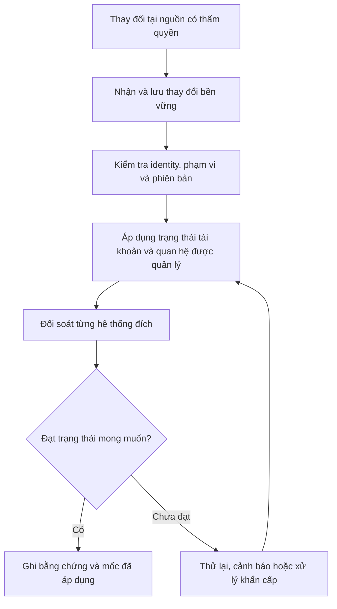

# Directory synchronization

## 1. Đồng bộ directory giải quyết vấn đề gì?

Directory synchronization là quá trình truyền và đối soát dữ liệu identity giữa các kho danh tính, hệ thống quản trị nhân sự, dịch vụ quản lý nhóm và ứng dụng đích. Dữ liệu có thể gồm tài khoản, thuộc tính hồ sơ, trạng thái làm việc, quan hệ nhóm và phạm vi tổ chức.

Ví dụ, hệ thống nhân sự ghi nhận nhân viên chuyển từ bộ phận hỗ trợ sang kế toán. Directory trung tâm cần nhận thay đổi, còn ứng dụng hỗ trợ phải loại bỏ các quyền không còn phù hợp. Nếu đồng bộ chỉ cập nhật tên phòng ban nhưng bỏ qua nhóm truy cập cũ, hồ sơ hiển thị đúng trong khi quyền hiệu lực vẫn sai.

Trong thiết kế yêu cầu bảo mật, mục tiêu không đơn thuần là làm hai bảng dữ liệu giống nhau. Cần bảo đảm **đúng identity, đúng nguồn có thẩm quyền, đúng thuộc tính, đúng phạm vi và đúng thời hạn**, đồng thời phát hiện được thay đổi chưa áp dụng hoặc đã áp dụng sai.

Directory synchronization có liên quan nhưng không đồng nghĩa với các hoạt động sau:

| Hoạt động | Câu hỏi chính | Quan hệ với đồng bộ directory |
|---|---|---|
| Xác thực | Ai đang yêu cầu truy cập và họ chứng minh danh tính thế nào? | Có thể sử dụng dữ liệu directory nhưng đồng bộ tài khoản không tự xác thực người dùng |
| Liên kết đăng nhập | Ứng dụng có chấp nhận kết quả xác thực từ nguồn khác không? | Đăng nhập liên kết không tự bảo đảm dữ liệu nhóm hoặc vòng đời tài khoản được đồng bộ |
| Provisioning | Tài khoản và quan hệ truy cập được tạo, cập nhật hoặc vô hiệu hóa ra sao? | Là một nhóm tác vụ thường được triển khai trong quá trình đồng bộ |
| Phân quyền | Identity được làm gì trong ngữ cảnh hiện tại? | Dữ liệu đồng bộ là đầu vào, còn quyết định phụ thuộc chính sách và nơi thực thi |
| Đối soát | Trạng thái đích có khớp trạng thái được phép hay không? | Phát hiện sai lệch do sự kiện mất, lỗi áp dụng hoặc sửa trực tiếp tại đích |

Một hệ thống có đăng nhập tập trung vẫn có thể còn tài khoản cục bộ, phiên cũ hoặc nhóm truy cập chưa được thu hồi. Đặc tả phải chỉ rõ từng lớp được đồng bộ và từng lớp có cơ chế kiểm soát riêng.

## 2. Xác định nguồn có thẩm quyền

### 2.1. Quyền quyết định theo từng loại dữ liệu

Một directory không nhất thiết là nguồn chuẩn cho mọi thuộc tính. Hệ thống nhân sự có thể quyết định trạng thái hợp đồng; directory doanh nghiệp quyết định tên đăng nhập; hệ thống quản trị truy cập quyết định quyền đặc biệt; ứng dụng sở hữu các tùy chọn hiển thị của người dùng.

| Dữ liệu | Nguồn có thẩm quyền trong ví dụ | Quy tắc bảo mật cần làm rõ |
|---|---|---|
| Mã nhân viên và trạng thái làm việc | Hệ thống nhân sự | Ứng dụng đích không được tự đổi nhân viên đã nghỉ thành đang hoạt động |
| Tên hiển thị và thông tin liên hệ công việc | Directory doanh nghiệp | Chỉ đồng bộ các trường đã cho phép, có xử lý giá trị không hợp lệ |
| Nhóm tổ chức | Directory hoặc hệ thống nhân sự theo thiết kế | Không tự coi mọi nhóm tổ chức là một quyền ứng dụng |
| Nhóm quản trị đặc quyền | Hệ thống quản trị truy cập được phê duyệt | Thay đổi phải đáp ứng điều kiện cấp quyền và phân tách nhiệm vụ |
| Sở thích giao diện | Ứng dụng đích | Connector không ghi đè ngoài phạm vi được giao |
| Liên kết identity nguồn với tài khoản đích | Dịch vụ liên kết identity được kiểm soát | Đổi liên kết cần căn cứ và dấu vết, không dựa riêng vào email |

Đặc tả cần xác định thẩm quyền theo thuộc tính, quan hệ nhóm và thao tác, không chỉ ghi “đồng bộ hai chiều”. Một nguồn có thể được cập nhật tên nhưng không được kích hoạt lại tài khoản hoặc thêm thành viên vào nhóm quản trị.

### 2.2. Đồng bộ một chiều và hai chiều

Đồng bộ một chiều có hướng quyết định rõ: nguồn A gửi trạng thái được quản lý sang B. Thay đổi trực tiếp tại B cần được bảo toàn, từ chối hoặc đối soát sửa lại theo chính sách từng trường.

Đồng bộ hai chiều cần quy tắc giải quyết xung đột và chống lặp. Nếu A đổi trạng thái tài khoản thành vô hiệu hóa trong khi B đổi thành hoạt động, quy tắc “thay đổi sau cùng thắng” có thể khôi phục quyền trái phép. Thời gian máy chủ cũng có thể lệch, nên dấu thời gian không phải căn cứ duy nhất để chọn nguồn đúng.

Với dữ liệu bảo mật, nên quy định nguồn có thẩm quyền rõ ràng hoặc một quy trình phê duyệt cho xung đột. Mỗi thay đổi cần nhận diện được nguồn phát sinh và phiên bản tương ứng để tránh việc A nhận lại chính thay đổi mình đã đẩy sang B rồi phát sinh vòng lặp cập nhật.

## 3. Định danh và ánh xạ identity

### 3.1. Không dùng tên hiển thị làm khóa liên kết

Họ tên, tên đăng nhập và email có thể thay đổi hoặc được tái sử dụng. Nếu connector tìm tài khoản theo email rồi ghi đè, một nhân viên mới có thể bị liên kết vào tài khoản của người cũ và nhận quyền còn sót.

Khóa liên kết nên dựa trên ID ổn định của đối tượng trong nguồn, kèm không gian định danh nguồn và tenant khi cần. ID tài khoản tại đích phải được lưu cùng liên kết để các lần cập nhật sau tác động đúng đối tượng.

```text
Khóa identity nguồn:
    sourceSystemId + sourceTenantId + sourceObjectId

Liên kết quản lý:
    khóa identity nguồn -> targetSystemId + targetTenantId + targetObjectId
```

Không được mặc định `sourceObjectId` là duy nhất giữa mọi directory hoặc tenant. Khi nguồn không bảo đảm ID không bị tái sử dụng, cần thêm thông tin phân biệt vòng đời đối tượng hoặc quy trình xác minh trước khi khôi phục liên kết cũ.

Việc chuẩn hóa email, chữ hoa/chữ thường hoặc ký tự đặc biệt phải theo contract thực tế của hệ thống nguồn và đích. Chuẩn hóa không được âm thầm gộp hai identity khác nhau. Trường hợp nhiều đối tượng cùng khớp một tiêu chí cần chuyển xử lý, không chọn kết quả đầu tiên.

### 3.2. Liên kết tài khoản có sẵn

Ứng dụng đích có thể đã chứa tài khoản trước khi triển khai đồng bộ. Đặc tả phải nêu điều kiện được liên kết với identity nguồn, người có quyền xác nhận và cách bảo toàn lịch sử nghiệp vụ.

Nếu không có căn cứ liên kết đủ mạnh, connector không nên tự chiếm tài khoản có sẵn chỉ vì tên hoặc địa chỉ liên hệ giống nhau. Tài khoản quản trị, tài khoản dùng chung và service account cần quy trình riêng; không tự ánh xạ chúng thành tài khoản nhân viên thông thường.

## 4. Đặc tả vòng đời và ánh xạ quyền

Các trạng thái nghiệp vụ như chưa bắt đầu làm việc, đang hoạt động, tạm nghỉ, nghỉ việc và tái tuyển dụng cần có ánh xạ rõ sang trạng thái kỹ thuật ở từng đích. “Không còn trong kết quả truy vấn” là một quan sát dữ liệu, chưa phải bằng chứng chắc chắn rằng nhân viên đã nghỉ việc.

| Sự kiện nguồn | Hành vi đích cần đặc tả | Điểm cần kiểm chứng |
|---|---|---|
| Nhân viên mới đủ điều kiện | Tạo hoặc liên kết tài khoản, cấp đúng quyền cơ bản | Không tạo trùng và không cấp quyền trước mốc hiệu lực |
| Chuyển bộ phận | Tính lại quan hệ nhóm thuộc phạm vi quản lý | Loại bỏ quyền cũ khi chính sách yêu cầu, không chỉ bổ sung nhóm mới |
| Tạm ngưng tài khoản | Vô hiệu hóa khả năng truy cập theo chính sách | Tài khoản, phiên và thông tin xác thực hiện hữu được xử lý theo yêu cầu |
| Nghỉ việc | Ưu tiên thu hồi truy cập, sau đó xử lý dữ liệu theo vòng đời | Không chờ hết đợt đồng bộ thông thường nếu có yêu cầu khẩn cấp |
| Thay đổi nhóm | Áp dụng đúng thay đổi thành viên và đánh giá ảnh hưởng quyền | Không đưa nhóm ngoài phạm vi vào quyền ứng dụng |
| Tái tuyển dụng | Xác minh vòng đời và phê duyệt quyền hiện tại | Không tự phục hồi toàn bộ quyền của lần làm việc trước |
| Xóa đối tượng nguồn | Xử lý theo chính sách vô hiệu hóa, lưu dấu xóa và xóa cuối cùng | Không xóa nhầm do nguồn trả thiếu hoặc connector mất quyền đọc |

Ánh xạ nhóm sang role phải được cho phép rõ ràng. Không nên coi chuỗi tên nhóm bất kỳ là tên role hợp lệ tại đích. Một người có quyền tạo nhóm trong directory không vì thế được quyền tạo ra nhóm mang tên `application-admin` rồi tự nhận đặc quyền ứng dụng.

Quan hệ nhóm lồng nhau cũng cần được quy định: có mở rộng thành viên gián tiếp hay không, giới hạn độ sâu, phát hiện chu trình và cách xử lý khi thiếu quyền đọc một nhóm trung gian. Không thể tính đủ thành viên phải được ghi nhận là trạng thái chưa xác định, không phải nhóm rỗng.

## 5. Đồng bộ toàn bộ và đồng bộ thay đổi

### 5.1. Đồng bộ toàn bộ

Đồng bộ toàn bộ đọc tập đối tượng thuộc phạm vi quản lý để xây dựng trạng thái mong muốn và đối chiếu với đích. Nó có ích khi khởi tạo, đối soát định kỳ hoặc khôi phục sau khi mất mốc đọc thay đổi.

Đặc tả cần làm rõ phân trang, bộ lọc, tính nhất quán của kết quả và điều kiện xác nhận một lượt đọc hoàn tất. Connector đọc được trang đầu rồi lỗi ở trang sau không được xem đó là danh sách đầy đủ.

Việc suy ra xóa từ đối tượng vắng mặt chỉ được thực hiện khi có đủ bằng chứng về tính đầy đủ, phạm vi và tính nhất quán của lượt đọc, hoặc khi đã xác minh lại sự vắng mặt theo cơ chế phù hợp. Với nguồn thay đổi trong lúc phân trang, cần dựa vào khả năng đọc nhất quán của nguồn hoặc quy trình đối soát bổ sung; không mặc định nhiều trang đọc ở các thời điểm khác nhau tạo thành một ảnh chụp nhất quán.

Có thể tách bước thu thập, đánh giá chênh lệch và áp dụng để phát hiện bất thường trước khi thay đổi. Tuy nhiên, lưu một bản dữ liệu trung gian không tự bảo đảm dữ liệu đó đúng; vẫn cần kiểm tra điều kiện hoàn tất và phiên bản nguồn.

### 5.2. Đồng bộ thay đổi

Đồng bộ thay đổi xử lý sự kiện hoặc đọc các thay đổi kể từ cursor đã lưu. Cách này có thể giảm độ trễ, nhưng cần chịu được sự kiện trùng, đến sai thứ tự, mất kết nối và việc mốc đọc hết hiệu lực.

Những yêu cầu quan trọng gồm:

- Mỗi thay đổi phải gắn với đúng đối tượng, nguồn và thông tin phiên bản hoặc thứ tự mà nguồn bảo đảm.
- Việc nhận lặp cùng một thay đổi không được tạo thêm tài khoản hay khôi phục quyền đã thu hồi.
- Thay đổi cũ không được ghi đè trạng thái mới hơn nếu nguồn cung cấp cơ sở để so sánh.
- Cursor chỉ được chuyển qua phần dữ liệu đã áp dụng thành công hoặc đã được lưu bền vững để chắc chắn xử lý tiếp.
- Nếu có hàng đợi lưu bền vững, phải theo dõi riêng vị trí đã nhận và vị trí đã áp dụng; lỗi đang chờ xử lý vẫn phải được tính là chưa hội tụ.
- Khi cursor hết hiệu lực hoặc không thể chứng minh đã nhận đủ thay đổi, phải chuyển sang quy trình khôi phục và đối soát phù hợp.

Không so sánh tùy tiện phiên bản từ hai nguồn độc lập. Nếu nguồn chỉ cung cấp token phiên bản không có thứ tự, không được coi token lớn hơn theo chuỗi là thay đổi mới hơn. Có thể cần điều kiện ghi theo phiên bản đích hoặc đọc lại trạng thái hiện tại từ nguồn có thẩm quyền.

Sự kiện từ nguồn, nếu có, không loại bỏ nhu cầu đối soát. Việc nhận thành công chỉ chứng minh connector đã nhận thông báo, chưa chứng minh tài khoản và quyền tại đích đã đạt trạng thái mong muốn.

## 6. Xử lý lỗi, trạng thái cũ và khôi phục

### 6.1. Thử lại mà không nhân đôi tác động

Giả sử yêu cầu tạo tài khoản đã thành công tại đích nhưng connector timeout trước khi nhận phản hồi. Thử lại bằng một lệnh tạo mới có thể sinh tài khoản trùng. Connector cần khóa xử lý lặp, ràng buộc duy nhất hoặc bước tra cứu liên kết đủ tin cậy để xác định kết quả trước khi lặp thao tác.

Với cập nhật nhóm, thao tác phải gắn với quan hệ thành viên cụ thể và phiên bản phù hợp. Nếu có nhiều bên cùng quản lý nhóm, connector không được thay thế toàn bộ danh sách thành viên bằng tập dữ liệu chỉ thuộc quyền quản lý của mình.

Lỗi không thể xử lý tự động cần được giữ trong vùng chờ xử lý lỗi kèm nguyên nhân, mức ưu tiên và người chịu trách nhiệm. Đẩy lỗi sang hàng đợi rồi bỏ qua vô thời hạn không đáp ứng yêu cầu đồng bộ.

### 6.2. Chống sự kiện cũ kích hoạt lại tài khoản

Một tình huống nguy hiểm là sự kiện nghỉ việc đã được áp dụng nhưng sau đó connector nhận bản cập nhật hồ sơ cũ có trạng thái hoạt động. Nếu chỉ dùng thao tác ghi đè, tài khoản bị kích hoạt lại.

Thiết kế cần bảo đảm cập nhật cũ không đảo ngược quyết định vô hiệu hóa mới hơn. Có thể dùng phiên bản nguồn, quy tắc chuyển trạng thái và kiểm tra điều kiện cập nhật. Với nguồn không có thứ tự đủ tin cậy, cần đọc lại trạng thái có thẩm quyền trước khi thực hiện thao tác nhạy cảm như kích hoạt hoặc cấp quyền.

Sau khi xóa, có thể giữ tombstone: bản ghi tối thiểu đánh dấu đối tượng hoặc liên kết đã kết thúc vòng đời. Tombstone giúp ngăn sự kiện cũ tạo lại tài khoản. Thời gian giữ phải liên hệ với khoảng phát lại sự kiện, khả năng chậm đồng bộ và chính sách dữ liệu. Nếu khoảng mất kết nối vượt quá giả định giữ tombstone, quy trình phục hồi phải đối soát lại trước khi phát lại dữ liệu cũ.

### 6.3. Phát hiện thay đổi hàng loạt bất thường

Một lỗi bộ lọc hoặc việc tài khoản connector mất quyền đọc có thể làm danh sách nguồn từ hàng nghìn tài khoản giảm xuống còn vài tài khoản. Tự động xóa mọi đối tượng vắng mặt sẽ biến lỗi đọc thành sự cố diện rộng.

Có thể đặt ngưỡng cảnh báo và tạm giữ các thay đổi suy ra từ dữ liệu chưa đủ tin cậy. Ngưỡng chỉ là tín hiệu điều tra; nó không tự chứng minh thay đổi là sai hoặc đúng. Các sự kiện vô hiệu hóa đã được xác thực qua luồng khẩn cấp vẫn cần được xử lý theo thời hạn riêng, tránh việc hàng rào chống xóa hàng loạt vô tình giữ lại quyền của người đã nghỉ việc.

Khi nguồn hoặc đích không truy cập được, đặc tả phải nêu cách xử lý quyền hiện hữu, quyền mới và yêu cầu thu hồi khẩn cấp. Không có một lựa chọn duy nhất phù hợp mọi hệ thống: tiếp tục cấp mới bằng dữ liệu cũ có thể mở quyền sai, còn vô hiệu hóa toàn bộ khi mất kết nối có thể gây gián đoạn nghiêm trọng.

## 7. Thu hồi truy cập và tính nhất quán giữa các hệ thống

Không nên giả định tồn tại một giao dịch nguyên tử bao trùm hệ thống nhân sự, directory, dịch vụ identity và mọi ứng dụng đích. Có thể một ứng dụng đã vô hiệu hóa tài khoản trong khi ứng dụng khác vẫn đang thử lại.



Với sự kiện nghỉ việc, “đã vô hiệu hóa trong directory” không đồng nghĩa “mọi truy cập đã bị chặn”. Có thể còn phiên đăng nhập, token tự chứa, khóa API, thông tin xác thực của ứng dụng cục bộ hoặc cache phân quyền.

Yêu cầu cần chỉ rõ điểm kết thúc của thu hồi: tài khoản không thể đăng nhập mới, phiên hiện hữu không còn thực hiện thao tác nhạy cảm, khóa được quản lý đã bị thu hồi, hay tất cả những điều đó trong phạm vi xác định. Nếu token cũ còn được chấp nhận đến khi hết hạn, giới hạn này phải được phản ánh trong thời hạn thu hồi hoặc được giải quyết bằng cơ chế kiểm tra trạng thái thích hợp.

Không cấp lại quyền ở những đích đã thu hồi thành công chỉ để làm chúng giống với đích đang lỗi. Khi trạng thái nguồn đã xác nhận là vô hiệu hóa, hướng khôi phục phải tiếp tục đưa phần chưa thành công về trạng thái được phép và ghi nhận rõ độ trễ.

## 8. Bảo vệ chính kênh đồng bộ

Connector thường có quyền đọc số lượng lớn dữ liệu identity và thay đổi tài khoản tại đích. Vì vậy, nó là một thành phần có ảnh hưởng bảo mật lớn, không chỉ là công việc nền vận chuyển dữ liệu.

Các yêu cầu cần bao gồm:

- Xác thực nguồn và đích, bảo vệ dữ liệu trên đường truyền và kiểm tra chứng thư hoặc thông tin định danh kết nối theo cơ chế được chọn.
- Cấp quyền tối thiểu cho connector: chỉ đọc thuộc tính cần thiết, chỉ sửa đối tượng, nhóm và trường thuộc phạm vi được quản lý.
- Quản lý bí mật kết nối trong nơi lưu trữ phù hợp, có thay đổi bí mật và xử lý khi bị lộ; không ghi token hoặc mật khẩu vào log.
- Kiểm tra schema, kích thước, giá trị và phạm vi tenant của dữ liệu nhận trước khi áp dụng.
- Bảo vệ kênh nhận sự kiện khỏi giả mạo và xử lý phát lại theo khả năng của nguồn.
- Kiểm soát thay đổi cấu hình ánh xạ và danh sách nhóm đặc quyền, có dấu vết ai thay đổi và ảnh hưởng dự kiến.
- Bảo đảm lỗi một tenant không dẫn đến việc đọc hoặc sửa đối tượng của tenant khác.

Không mặc định đồng bộ mật khẩu hoặc thông tin xác thực chỉ vì đã đồng bộ hồ sơ. Nếu có yêu cầu riêng về dữ liệu xác thực, cần xác định cơ chế và giới hạn bảo vệ chuyên biệt; không xuất mật khẩu thô hoặc bí mật từ nguồn để làm dữ liệu hồ sơ thông thường.

Các thuộc tính nhận được từ nguồn cũng không tự động đáng tin cho mọi mục đích. Một trường người dùng được tự sửa, chẳng hạn mô tả chức danh, không nên trở thành căn cứ cấp quyền quản trị chỉ vì nó xuất hiện trong directory.

## 9. Chuyển thành yêu cầu đo được

Các giá trị thời gian và ngưỡng trong bảng sau chỉ là ví dụ cho một hệ thống giả định. Khi áp dụng, cần thay bằng giá trị được chốt theo rủi ro, khả năng của nguồn và đích, cùng yêu cầu vận hành.

| ID | Yêu cầu mẫu | Bằng chứng hoặc tình huống kiểm chứng dự kiến |
|---|---|---|
| DS-01 | Mỗi đối tượng đồng bộ phải được liên kết bằng bộ ID nguồn và đích có phạm vi tenant; không được tự liên kết chỉ theo email. | Hai identity khác nhau dùng cùng email ở hai thời điểm không nhận chung tài khoản và quyền. |
| DS-02 | Connector chỉ được cập nhật các thuộc tính và nhóm đã đăng ký; yêu cầu ngoài phạm vi phải bị từ chối và ghi sự kiện. | Thử cập nhật trường không được quản lý và nhóm quản trị ngoài danh sách cho phép. |
| DS-03 | Tài khoản mới phải giữ trạng thái chưa được phép truy cập cho đến khi hoàn tất các kiểm soát tạo tài khoản và cấp quyền bắt buộc. | Tạo tài khoản thành công nhưng bước áp dụng điều kiện bắt buộc thất bại. |
| DS-04 | Trong điều kiện vận hành bình thường, 99% thay đổi hồ sơ hợp lệ phải hội tụ ở các đích được chỉ định trong 10 phút tính từ thời điểm thay đổi có hiệu lực tại nguồn. | Đối chiếu thời điểm nguồn và bằng chứng trạng thái đích trên tập thay đổi thuộc cửa sổ đo đã xác định. |
| DS-05 | Sự kiện nghỉ việc đã xác nhận phải dẫn đến trạng thái từ chối truy cập tại các điểm thực thi thuộc phạm vi trong tối đa 5 phút; nếu chưa xác nhận kết quả, hệ thống phải cảnh báo và kích hoạt quy trình xử lý khẩn cấp. | Kiểm tra đăng nhập mới, phiên cũ và từng hệ thống đích sau sự kiện; không chỉ kiểm tra thời điểm nhận sự kiện. |
| DS-06 | Lượt đọc toàn bộ thiếu trang, mất quyền đọc hoặc không đạt điều kiện nhất quán đã định không được dùng để suy ra xóa các đối tượng vắng mặt. | Làm lỗi trang giữa và xác nhận không phát sinh xóa hàng loạt từ dữ liệu thiếu. |
| DS-07 | Xử lý lặp cùng một thay đổi không được tạo thêm tài khoản hay quan hệ thành viên; thay đổi cũ không được kích hoạt lại trạng thái mới hơn đã vô hiệu hóa. | Phát lại sự kiện trùng và đảo thứ tự giữa cập nhật hồ sơ với sự kiện nghỉ việc. |
| DS-08 | Cursor đã áp dụng chỉ được cập nhật sau khi trạng thái xử lý và kết quả liên quan được lưu bền vững; thay đổi chưa áp dụng phải còn đường phục hồi xác định. | Dừng connector sau khi đích áp dụng nhưng trước khi lưu cursor, rồi khởi động lại. |
| DS-09 | Đối soát đầy đủ phạm vi quản lý phải được thực hiện ít nhất mỗi 24 giờ và phát cảnh báo cho sai lệch quyền chưa được xử lý trong thời hạn đã định. | Sửa trực tiếp một quan hệ nhóm tại đích và quan sát kết quả phát hiện, phân loại, xử lý. |
| DS-10 | Nếu số đối tượng bị suy ra là xóa vượt 10% tập đang quản lý trong một lượt, hệ thống phải giữ phần suy luận đó để xác minh; quy tắc này không được chặn luồng thu hồi khẩn cấp đã được xác nhận. | Mô phỏng lỗi bộ lọc đồng thời gửi một sự kiện nghỉ việc hợp lệ. |
| DS-11 | Mỗi thay đổi quyền phải truy vết được từ nguồn, phiên bản cấu hình ánh xạ, identity, thao tác đích đến kết quả đối soát. | Theo dõi một thay đổi nhóm xuyên suốt luồng mà không cần ghi bí mật xác thực. |

DS-04 là một mục tiêu đo trên phân bố thay đổi, còn DS-05 đặt giới hạn cho một sự kiện bảo mật thuộc phạm vi cụ thể. Phải mô tả cách xử lý các sự kiện vượt giới hạn; việc đạt chỉ số chung không làm cho một lần thu hồi khẩn cấp bị trễ trở thành hợp lệ.

Thời gian tại nguồn có thể là thời điểm sự kiện có hiệu lực, không phải thời điểm connector đọc được. Khi không quan sát được mốc nguồn một cách tin cậy, phải ghi rõ giới hạn đo; không thay nó bằng thời điểm nhận rồi tuyên bố đã đo được toàn bộ độ trễ. Các chỉ số phụ thuộc đồng hồ cần giả định đồng bộ thời gian và xử lý sai lệch được nêu rõ.

## 10. Ví dụ: chuyển bộ phận trong nền tảng nhiều tenant

Nhân viên Lan có identity nguồn `hr-a/employee-246` và tài khoản đích `support-app/tenant-a/user-915`. Lan chuyển từ nhóm hỗ trợ tenant A sang nhóm kế toán nội bộ. Hệ thống nhân sự có thẩm quyền về bộ phận và trạng thái làm việc; nhóm quyền đặc biệt do hệ thống quản trị truy cập quản lý riêng.

Một luồng xử lý phù hợp gồm:

1. Nhận thay đổi bộ phận, kiểm tra nguồn và liên kết đúng `employee-246`; không tìm tài khoản chỉ qua email của Lan.
2. Tính lại các nhóm được quản lý từ bộ quy tắc ánh xạ đã phê duyệt. Việc chuyển sang kế toán không tự cấp vai trò phê duyệt thanh toán nếu vai trò đó cần phê duyệt riêng.
3. Loại bỏ quan hệ nhóm hỗ trợ thuộc quyền quản lý của connector và áp dụng nhóm cơ bản mới khi các điều kiện cấp quyền đã đạt.
4. Đối soát ứng dụng hỗ trợ để xác định quyền truy cập tenant A đã được xử lý theo yêu cầu, kể cả phiên hoặc cache còn hiệu lực trong phạm vi quy định.
5. Ghi lại phiên bản dữ liệu, cấu hình ánh xạ, kết quả từng đích và các lỗi còn chờ; chỉ xác nhận hội tụ khi có bằng chứng.

Nếu ứng dụng kế toán đang lỗi, hệ thống phải giữ trạng thái cấp quyền mới chưa hoàn tất. Không khôi phục nhóm hỗ trợ cũ chỉ vì phần tạo quyền mới thất bại, trừ khi có một quyết định nghiệp vụ và bảo mật mới đủ thẩm quyền.

Một cấu hình minh họa giúp thể hiện phạm vi, không phải schema bắt buộc của sản phẩm:

```yaml
sourceSystem: hr-a
targetSystem: support-app
targetTenant: tenant-a
direction: SOURCE_TO_TARGET
identityKey:
  fields:
    - sourceSystemId
    - sourceTenantId
    - sourceObjectId
managedAttributes:
  - displayName
  - employmentStatus
  - departmentCode
managedGroups:
  - support-basic
  - support-tenant-a
privilegedRolePolicy: SEPARATE_APPROVAL_REQUIRED
missingObjectPolicy: VERIFY_BEFORE_LIFECYCLE_ACTION
partialScanPolicy: DO_NOT_INFER_DELETION
```

Việc khai báo `managedGroups` không được hiểu là connector có thể xóa mọi thành viên khác khỏi các nhóm đó. Contract còn phải phân định những quan hệ nào do connector sở hữu và những quan hệ nào do nguồn khác quản lý.

## 11. Các tình huống cần đưa vào nghiệm thu

Các tình huống dưới đây phục vụ thiết kế kiểm chứng sau này, không phải kết quả kiểm thử đã thực hiện.

**Đổi email:** Identity giữ nguyên ID nguồn nhưng đổi email. Hệ thống phải cập nhật đúng tài khoản đã liên kết, không tạo tài khoản mới và không mất lịch sử quyền.

**Tái sử dụng email:** Nhân viên mới nhận email từng dùng bởi nhân viên cũ. Nếu ID nguồn khác, hệ thống không được tự gắn vào liên kết cũ và phục hồi các nhóm trước đây.

**Cùng ID cục bộ ở hai tenant:** Hai nguồn đều có `objectId=123`. Thay đổi tại một tenant không được sửa tài khoản thuộc tenant còn lại.

**Timeout sau khi tạo thành công:** Connector không nhận được phản hồi tạo tài khoản. Sau thử lại, chỉ tồn tại một tài khoản được liên kết đúng, với lịch sử thể hiện kết quả xử lý.

**Đảo thứ tự sự kiện:** Bản cập nhật hồ sơ cũ đến sau sự kiện vô hiệu hóa. Trạng thái cuối không được trở về hoạt động do áp dụng dữ liệu cũ.

**Lượt đọc thiếu:** Một trang nhóm trả lỗi hoặc tài khoản connector mất quyền xem một nhánh directory. Hệ thống phải báo không đủ dữ liệu thay vì thu hồi hàng loạt dựa trên tập rỗng giả.

**Mất cursor:** Connector khởi động lại khi mốc đọc thay đổi đã hết hiệu lực. Hệ thống phải chạy quy trình đối soát phục hồi; không đánh dấu đã bắt kịp bằng cách bỏ qua khoảng dữ liệu bị mất.

**Đích áp dụng một phần:** Hồ sơ cập nhật thành công nhưng thu hồi nhóm thất bại. Hạng mục phải thể hiện riêng lỗi quyền còn tồn tại, tiếp tục thử lại hoặc chuyển xử lý theo mức ưu tiên.

**Sửa trái phép cấu hình ánh xạ:** Người chỉ có quyền vận hành đồng bộ cố ánh xạ một nhóm thường sang quyền quản trị. Thay đổi phải bị kiểm soát theo thẩm quyền cấu hình và điều kiện cấp quyền đặc biệt.

**Khôi phục sau thời gian mất kết nối dài:** Dữ liệu sự kiện cũ có thể vượt thời hạn giữ tombstone hoặc lịch sử thay đổi. Hệ thống phải xác minh trạng thái hiện tại từ nguồn phù hợp trước khi tạo lại tài khoản hoặc cấp quyền.

## 12. Quan sát vận hành và những lỗi đặc tả thường gặp

Theo dõi một dòng log “sync successful” là chưa đủ. Cần phân biệt dữ liệu đã nhận, dữ liệu đã áp dụng và trạng thái quyền đã được đối soát. Các chỉ số nên bao gồm độ trễ theo loại thay đổi, số lỗi chưa xử lý, tuổi của lỗi cũ nhất, thời gian từ lần đọc nguồn thành công cuối, phạm vi đối soát và số tài khoản còn sai trạng thái.

Mẫu số phải rõ ràng. Nếu một nguồn đang mất kết nối, không thể chỉ đo các sự kiện connector đã biết rồi kết luận toàn bộ thay đổi đạt thời hạn. Tình trạng không quan sát được nguồn cần xuất hiện như một giới hạn hoặc cảnh báo riêng.

Hồ sơ vận hành nên giữ mã identity ổn định, nguồn, đích, phiên bản, thao tác, kết quả, mã lỗi và mã liên kết. Nội dung cần đủ điều tra nhưng không chứa token, mật khẩu hoặc toàn bộ hồ sơ cá nhân không cần thiết. Quyền xem log và thời gian giữ dữ liệu cũng phải được đặc tả.

| Đặc tả dễ gây lỗi | Hậu quả | Điều cần bổ sung |
|---|---|---|
| “Đồng bộ người dùng mỗi vài phút” | Không biết dữ liệu nào, đích nào và khi nào được coi là hoàn tất | Phạm vi thuộc tính, quan hệ, mốc thời gian và điểm xác nhận kết quả |
| “Đồng bộ hai chiều, bản mới nhất thắng” | Nguồn ít thẩm quyền có thể khôi phục quyền hoặc tạo vòng lặp | Quyền quyết định từng trường, phiên bản và cách giải quyết xung đột |
| “Không có trong nguồn thì xóa” | Nguồn trả thiếu dẫn đến mất tài khoản diện rộng | Điều kiện đọc đầy đủ, xác minh vắng mặt và chính sách vòng đời |
| “Nhận sự kiện là đã đồng bộ” | Thay đổi còn nằm trong hàng đợi nhưng báo thành công | Phân biệt nhận, áp dụng và đối soát |
| “Xóa nhóm là thu hồi xong” | Phiên cũ, token hoặc đường cấp khác vẫn cho truy cập | Yêu cầu tại điểm thực thi và thời hạn hiệu lực |
| “Connector quản lý toàn bộ người dùng” | Quyền connector vượt nhu cầu, khó phân định sửa trực tiếp | Ranh giới đối tượng, tenant, thuộc tính và quan hệ do connector quản lý |
| “Lỗi sẽ tự thử lại” | Lỗi bảo mật có thể tồn tại vô hạn | Giới hạn thời gian, cảnh báo, người chịu trách nhiệm và phương án khẩn cấp |

Directory synchronization phải tạo ra một chuỗi có thể truy vết từ thay đổi hợp lệ ở nguồn đến trạng thái được phép tại đích. Yêu cầu bảo mật cần làm rõ cả đường đi bình thường lẫn những thời điểm dữ liệu thiếu, sự kiện cũ hoặc hệ thống đích chưa áp dụng được thay đổi.
