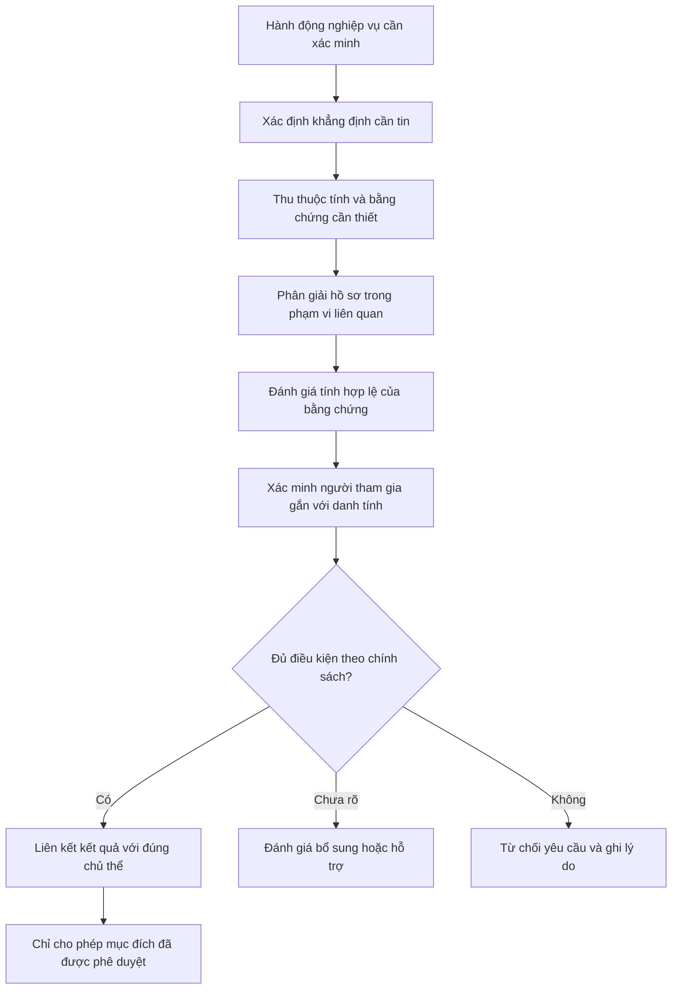

# Identity proofing

## 1. Identity proofing giải quyết vấn đề gì?

**Identity proofing** là quá trình thu thập và đánh giá bằng chứng để thiết lập mức tin cậy rằng chủ thể đang tham gia một quy trình thực sự gắn với danh tính mà họ khai báo. Quá trình này thường xuất hiện khi đăng ký tài khoản, xác minh người nhận chứng chỉ, tiếp nhận nhân viên hoặc thiết lập quyền truy cập có tác động cao.

Ví dụ, một nền tảng học tập cho phép bất kỳ ai đăng ký để đọc bài miễn phí. Khi người học yêu cầu một chứng chỉ có tên thật, nền tảng cần quyết định cách xác minh người nhận chứng chỉ. Việc người dùng đăng nhập được bằng email chưa đủ chứng minh tên được khai báo là danh tính của chính họ.

Identity proofing không đồng nghĩa với việc thu thật nhiều thông tin cá nhân. Mục tiêu là tạo ra mức tin cậy phù hợp với mục đích nghiệp vụ bằng những bằng chứng cần thiết, đồng thời giới hạn rủi ro từ giả mạo, sai sót và việc xử lý dữ liệu nhạy cảm.

Trong đặc tả yêu cầu bảo mật, câu hỏi cần trả lời là: **hệ thống phải tin điều gì về chủ thể, dựa trên bằng chứng nào, trong phạm vi nào và phải làm gì nếu không đủ bằng chứng?**

## 2. Phân biệt với các khái niệm liên quan

| Khái niệm | Câu hỏi chính | Điều không thể tự suy ra |
|---|---|---|
| Identity proofing | Người tham gia có gắn với danh tính được khai báo không? | Người đó được phép truy cập mọi tài nguyên |
| Authentication | Chủ thể hiện tại có chứng minh được quyền kiểm soát yếu tố xác thực không? | Hồ sơ danh tính ban đầu luôn chính xác |
| Authorization | Chủ thể được thực hiện hành động nào trên tài nguyên nào? | Chủ thể đã được xác minh tên thật |
| Email hoặc phone verification | Chủ thể có kiểm soát địa chỉ hoặc số điện thoại tại thời điểm kiểm tra không? | Chủ thể là người có tên trên hồ sơ |
| Identity federation | Hệ thống nhận được khẳng định nào từ bên cung cấp identity? | Khẳng định đó đã qua quy trình proofing phù hợp với mục đích sử dụng |

Một tài khoản có MFA vẫn có thể được tạo từ một danh tính giả. Ngược lại, một hồ sơ được proofing tốt vẫn có thể bị chiếm nếu credential đăng nhập bị đánh cắp. Vì vậy, proofing và authentication cần được thiết kế phối hợp, nhưng phải giữ rõ chúng cung cấp những loại bảo đảm khác nhau.

“Danh tính” cũng không luôn đồng nghĩa với tên pháp lý của một cá nhân. Một ứng dụng có thể chỉ cần biết chủ thể thuộc một tổ chức, có một thuộc tính đủ điều kiện hoặc là người đã hoàn thành một quy trình trước đó. Phải xác định đúng loại khẳng định cần tin trước khi yêu cầu giấy tờ hoặc dữ liệu sinh trắc học.

## 3. Xác định phạm vi từ rủi ro nghiệp vụ

Trước khi chọn công nghệ, nhóm thiết kế cần xác định hành động nào đòi hỏi proofing và hậu quả của việc chấp nhận sai hoặc từ chối sai.

**Chấp nhận sai** xảy ra khi người không hợp lệ được công nhận là chủ thể của danh tính. **Từ chối sai** xảy ra khi người hợp lệ không hoàn tất được quy trình. Cả hai đều có tác động: một bên có thể gây gian lận, bên còn lại có thể ngăn người dùng hợp lệ tiếp cận dịch vụ hoặc buộc họ chuyển sang quy trình hỗ trợ yếu hơn.

Ví dụ trong nền tảng học tập:

| Hoạt động | Khẳng định cần thiết | Hướng tiếp cận theo rủi ro |
|---|---|---|
| Đọc tài liệu công khai | Không cần khẳng định tên thật | Không yêu cầu proofing chỉ để truy cập nội dung công khai |
| Lưu tiến độ cá nhân | Tài khoản hiện tại kiểm soát được phương thức đăng nhập | Quản lý tài khoản và authentication phù hợp |
| Cấp chứng chỉ định danh | Người nhận gắn với danh tính được in trên chứng chỉ | Proofing theo chính sách của loại chứng chỉ |
| Cấp quyền quản trị học vụ | Chủ thể thuộc tổ chức và được giao nhiệm vụ | Xác minh quan hệ tổ chức, kết hợp phê duyệt và phân quyền |
| Khôi phục tài khoản có giá trị cao | Người yêu cầu có căn cứ đủ mạnh để nhận lại tài khoản | Quy trình phục hồi riêng, tránh chỉ dựa vào hồ sơ dễ tìm trên mạng |

Không áp dụng một yêu cầu thu giấy tờ giống nhau cho mọi hoạt động chỉ vì hệ thống đã tích hợp sẵn công cụ xác minh. Các mức tin cậy nội bộ phải mô tả rõ bằng chứng và giới hạn của chúng; không tự coi nhãn `HIGH` là tương đương một mức bảo đảm của tiêu chuẩn bên ngoài.

## 4. Các bước cốt lõi của quy trình

Một cách phân rã hữu ích gồm xác định hồ sơ danh tính, đánh giá bằng chứng và xác minh mối liên hệ giữa người tham gia với danh tính đó. Sau quyết định còn phải liên kết kết quả với đúng tài khoản hoặc chủ thể được quản lý.



### 4.1. Phân giải danh tính

**Identity resolution** nhằm xác định hồ sơ đang được đề cập trong phạm vi hệ thống hoặc tập dữ liệu liên quan. Có thể cần chuẩn hóa thuộc tính, phát hiện trùng lặp và giải quyết các trường hợp nhiều người có thông tin gần giống nhau.

Tên giống nhau không chứng minh hai hồ sơ là cùng một người. Tên khác nhau cũng không luôn chứng minh đó là hai người khác nhau, do thay đổi tên, khác biệt cách viết hoặc lỗi dữ liệu. Quy tắc đối chiếu phải xử lý những trường hợp này và không tự động hợp nhất tài khoản chỉ dựa trên tên hoặc email.

### 4.2. Đánh giá bằng chứng

**Evidence validation** đánh giá xem bằng chứng có thuộc loại được chấp nhận, có nhất quán, còn phù hợp với chính sách và có dấu hiệu bị sửa hoặc không đáng tin hay không. Khi có nguồn đối chiếu được phép sử dụng, cần xác định nguồn đó có thẩm quyền xác nhận thuộc tính nào.

Một ảnh giấy tờ đọc được không tự chứng minh giấy tờ thật. Việc OCR trích xuất đúng thông tin cũng không chứng minh người gửi là chủ thể trên giấy tờ. Cần tách kết quả trích xuất dữ liệu khỏi kết quả kiểm tra tính hợp lệ.

### 4.3. Xác minh liên hệ giữa người tham gia và danh tính

**Identity verification** trong ngữ cảnh quy trình này đánh giá mối liên hệ giữa người đang tham gia với danh tính đã được đưa ra. Tùy bối cảnh, có thể dùng tương tác trực tiếp, nguồn xác nhận đáng tin, kiểm tra quyền kiểm soát một kênh đã được gắn với hồ sơ hoặc phương thức đối chiếu phù hợp khác.

Một mã gửi đến số điện thoại do người yêu cầu vừa tự khai chỉ chứng minh quyền kiểm soát số điện thoại đó. Nó không tự trở thành bằng chứng độc lập về danh tính. Tính độc lập và nguồn gốc của kênh kiểm tra là một phần của thiết kế.

### 4.4. Liên kết với tài khoản đích

Kết quả phải gắn với đúng identity nội bộ, đúng phiên giao dịch và đúng mục đích. Nếu kẻ tấn công có thể thay tài khoản đích sau khi người hợp lệ đã xác minh, toàn bộ proofing có thể bị lợi dụng để xác minh cho một tài khoản khác.

Khi quy trình bao gồm việc đăng ký phương thức xác thực mới, cần bảo vệ bước liên kết phương thức đó với tài khoản. Proofing thành công không làm cho mọi credential được thêm sau đó trở nên đáng tin một cách tự động.

## 5. Thiết kế chính sách bằng chứng

Một chính sách bằng chứng cần mô tả rõ các thuộc tính bắt buộc, loại bằng chứng được chấp nhận, nguồn phát hành hoặc nguồn xác nhận, thời hạn sử dụng và trường hợp cần đánh giá bổ sung.

Không nên gộp tất cả thành điều kiện “có upload giấy tờ”. Ví dụ, ảnh một tài liệu có thể thiếu mặt chứa thông tin cần thiết, tài liệu có thể không được chấp nhận cho loại yêu cầu đó hoặc một thuộc tính có thể đã thay đổi sau khi phát hành.

Các câu hỏi quan trọng gồm:

- Nguồn nào xác nhận được thuộc tính nào, và nguồn đó có giới hạn gì?
- Bằng chứng phải còn hiệu lực theo chính sách nào của quy trình?
- Có chấp nhận thông tin đã được xác minh từ một tổ chức khác không?
- Nhiều bằng chứng có thực sự độc lập, hay đều bắt nguồn từ cùng một hồ sơ giả?
- Thiếu một loại giấy tờ thì có đường xác minh thay thế nào được phê duyệt?
- Điều gì dẫn đến từ chối, điều gì dẫn đến yêu cầu bổ sung và điều gì cần người đánh giá?

Một tài liệu được nộp hai lần không tạo thành hai nguồn độc lập. Hai cơ sở dữ liệu cùng sao chép từ một nguồn cũng không tự cung cấp hai xác nhận độc lập. Việc kết hợp bằng chứng phải xem xét nguồn gốc, không chỉ số lượng.

## 6. Proofing từ xa, hỗ trợ và trực tiếp

### 6.1. Quy trình từ xa

Quy trình từ xa thường phải xử lý chất lượng ảnh thấp, gián đoạn mạng, trình duyệt hoặc thiết bị không đồng nhất và nguy cơ dữ liệu bị chèn vào luồng thu thập. Yêu cầu cần phân biệt lỗi kỹ thuật với kết luận gian lận.

Nếu sử dụng đối chiếu khuôn mặt hoặc kiểm tra sự hiện diện, cần đặc tả mục tiêu, giới hạn và cách đánh giá hiệu quả. Kiểm tra sự hiện diện là một tín hiệu chống giả mạo; nó không tự chứng minh mọi thuộc tính danh tính và không loại bỏ toàn bộ khả năng dùng hình ảnh tổng hợp hoặc thiết bị bị can thiệp.

Các tỷ lệ chấp nhận sai và từ chối sai phải gắn với điều kiện đánh giá, loại tấn công, chất lượng đầu vào và nhóm người dùng liên quan. Một con số tổng hợp không bảo đảm hiệu quả giống nhau trong mọi bối cảnh sử dụng.

### 6.2. Quy trình có người hỗ trợ

Nhân viên hỗ trợ cần hướng dẫn rõ về bằng chứng được phép xem, quyền quyết định, giới hạn ngoại lệ và cách ghi lý do. Không cho phép bỏ qua mọi kiểm tra chỉ vì người dùng liên hệ hỗ trợ.

Đối với trường hợp rủi ro cao, có thể cần tách người đánh giá khỏi người phê duyệt ngoại lệ. Hệ thống phải kiểm soát quyền sửa kết quả, lưu lịch sử quyết định và giới hạn truy cập của nhân viên vào hồ sơ nhạy cảm.

### 6.3. Quy trình trực tiếp

Xác minh trực tiếp tạo cơ hội kiểm tra người tham gia và bằng chứng trong cùng một tương tác, nhưng vẫn có rủi ro giấy tờ giả, nhân viên bị lừa hoặc việc ghi nhận sai chủ thể. Cần xác định người kiểm tra có trách nhiệm gì, sử dụng công cụ nào và cách liên kết kết quả với tài khoản đích.

Đường thay thế phục vụ khả năng tiếp cận phải có chính sách tin cậy được xác định, thay vì trở thành đường tắt dễ bị khai thác. Người dùng không có thiết bị phù hợp cần được hướng dẫn đến quy trình khả dụng, không bị gán nhãn gian lận chỉ vì không hoàn tất được bước kỹ thuật.

## 7. Trạng thái và hiệu lực của kết quả

Thiết kế nên phân biệt trạng thái giao dịch proofing với trạng thái tài khoản. Một người có thể sử dụng chức năng phổ thông trong lúc yêu cầu chứng chỉ vẫn đang được xác minh, nếu chính sách nghiệp vụ cho phép.

Ví dụ trạng thái giao dịch:

| Trạng thái | Ý nghĩa | Hệ quả bảo mật |
|---|---|---|
| `PENDING` | Chưa đủ đầu vào hoặc đang xử lý | Chưa cấp khả năng yêu cầu proofing thành công |
| `NEEDS_REVIEW` | Cần kiểm tra bổ sung | Chờ quyết định có thẩm quyền, không tự coi là đạt |
| `VERIFIED` | Đạt chính sách cho mục đích đã xác định | Có thể được dùng trong phạm vi và thời hạn tương ứng |
| `REJECTED` | Không đạt chính sách | Không cấp khả năng đang yêu cầu; cung cấp hướng xử lý phù hợp |
| `EXPIRED` | Hết hạn giao dịch hoặc kết quả | Không sử dụng như kết quả còn hiệu lực |
| `CANCELLED` | Giao dịch được hủy | Không chấp nhận kết quả đến muộn để hoàn tất giao dịch |

Không dùng một cờ `verified=true` duy nhất cho mọi mục đích. Kết quả hữu ích cần có chính sách đã áp dụng, phiên bản chính sách, thời điểm xác minh, mục đích, nguồn kết quả và liên kết đến chủ thể nội bộ.

Ví dụ mô hình khái niệm:

```yaml
proofingResult:
  transactionId: prf-8e21
  subjectId: learner-704
  purpose: named-certificate
  status: VERIFIED
  policyId: certificate-identity-v2
  policyVersion: '2.3'
  verifiedAt: '2026-01-15T09:00:00Z'
  validUntil: '2026-02-14T09:00:00Z'
  assuranceProfile: certificate-identity-internal
  evidenceReference: restricted-evidence-reference
```

Các giá trị là ví dụ minh họa, không phải schema hoặc thời hạn bắt buộc. `evidenceReference` chỉ là tham chiếu; bản ghi trạng thái không nên chứa ảnh giấy tờ, số giấy tờ đầy đủ hoặc dữ liệu sinh trắc học.

Thời hạn 30 ngày trong ví dụ thể hiện một quyết định chính sách cần được giải thích theo rủi ro. Hết hiệu lực proofing không mặc nhiên có nghĩa là khóa mọi chức năng tài khoản; hệ thống phải xác định hoạt động nào cần xác minh lại.

## 8. Mô hình đe dọa và kiểm soát cần đặc tả

| Đe dọa | Điểm yếu có thể bị khai thác | Kiểm soát cần chuyển thành yêu cầu |
|---|---|---|
| Dùng danh tính bị đánh cắp | Chấp nhận dữ liệu giấy tờ mà không kiểm tra người tham gia | Xác minh liên hệ với danh tính bằng phương thức phù hợp |
| Hồ sơ tổng hợp | Ghép các thuộc tính có thật và giả thành một người không tồn tại | Kiểm tra tính nhất quán và nguồn gốc của thuộc tính |
| Giả mạo hình ảnh hoặc tương tác | Tin vào một tín hiệu hình ảnh duy nhất | Chống giả mạo, đánh giá theo loại tấn công và xử lý bổ sung |
| Thay tài khoản đích | Kết quả không gắn chặt với giao dịch đã khởi tạo | Liên kết bất biến giữa giao dịch, chủ thể và mục đích |
| Dùng lại kết quả cũ | Không kiểm tra thời hạn hoặc mã giao dịch | Kiểm tra hiệu lực, chống phát lại và giới hạn sử dụng |
| Giả callback nhà cung cấp | Tin nội dung HTTP mà không xác thực nguồn | Xác minh thông điệp và đối chiếu giao dịch ở phía server |
| Dò tìm hồ sơ của người khác | Mã hồ sơ được coi như quyền truy cập | Kiểm tra quyền trên từng yêu cầu truy cập hồ sơ |
| Lạm dụng hỗ trợ | Người hỗ trợ được tự bỏ qua mọi điều kiện | Giới hạn quyền, quy trình ngoại lệ và lịch sử quyết định |
| Đánh cắp kho bằng chứng | Lưu dữ liệu quá rộng hoặc chia sẻ cho nhiều dịch vụ | Tối thiểu hóa dữ liệu, tách kho và kiểm soát truy cập |
| Thử hàng loạt | Không giới hạn số lượt, nguồn hoặc mục tiêu | Hạn chế tần suất theo rủi ro và giám sát mẫu hành vi |

Giới hạn tần suất không nên chỉ dựa vào địa chỉ IP. Nhiều người hợp lệ có thể dùng chung mạng, trong khi kẻ tấn công có thể thay IP. Thiết kế có thể kết hợp nhiều tín hiệu và cung cấp quy trình hỗ trợ khi người dùng hợp lệ bị hạn chế.

Phản hồi cần đủ để người dùng sửa lỗi nhưng không tiết lộ quy tắc chi tiết giúp né kiểm tra hoặc thông tin về hồ sơ của người khác. Lý do nội bộ và thông điệp hiển thị ra ngoài có thể có mức chi tiết khác nhau.

## 9. Bảo vệ dữ liệu trong toàn bộ vòng đời

### 9.1. Tối thiểu hóa và giới hạn mục đích

Chỉ thu dữ liệu cần cho các khẳng định đã xác định. Nếu mục đích chỉ cần biết chủ thể đáp ứng một thuộc tính, cần xem xét liệu có thể nhận xác nhận thuộc tính thay vì sao chép toàn bộ hồ sơ gốc.

Tối thiểu hóa phải bao phủ cả dữ liệu đầu vào, dữ liệu suy ra, log, bản sao hỗ trợ và bản sao lưu. Không đưa bằng chứng vào hệ thống phân tích hoặc huấn luyện chỉ vì dữ liệu đã được thu cho proofing.

### 9.2. Lưu trữ và truy cập

Kho bằng chứng nên có quyền truy cập tách khỏi dữ liệu ứng dụng phổ thông. Nhân viên chỉ cần biết trạng thái xác minh không mặc nhiên được xem ảnh giấy tờ. Các URL tải lên hoặc tải xuống phải có phạm vi và thời hạn phù hợp; đường dẫn khó đoán không thay thế cho kiểm tra quyền.

Cần bảo vệ dữ liệu khi truyền và khi lưu, quản lý khóa theo phạm vi trách nhiệm và ghi nhận truy cập vào hồ sơ. Luồng tải tệp phải hạn chế loại tệp, kích thước và cách xử lý nội dung không tin cậy, tránh để một tệp bằng chứng trở thành đường thực thi nội dung nguy hiểm trong công cụ hỗ trợ.

### 9.3. Giữ và xóa dữ liệu

Yêu cầu phải nêu dữ liệu nào được giữ bao lâu, mốc tính thời hạn, trường hợp tạm giữ được phê duyệt và cách xử lý các bản sao. Không viết “xóa ngay” nếu hệ thống sao lưu có một vòng đời khác chưa được mô tả.

Sau khi xóa bằng chứng, có thể cần giữ một bản ghi kết quả hoặc lịch sử quyết định tối thiểu theo chính sách đã xác định. Bản ghi tối thiểu không nên vô tình chứa lại toàn bộ thông tin cần xóa. Việc che số giấy tờ trên giao diện cũng không có nghĩa dữ liệu đã được xóa khỏi kho lưu trữ.

## 10. Tích hợp nhà cung cấp và biên tin cậy

Nếu dùng nhà cung cấp bên ngoài, ứng dụng vẫn phải quyết định kết quả nào được tin cho mục đích nào. Tên trạng thái `APPROVED` của nhà cung cấp chưa đủ; cần biết quy trình nào đã chạy, điều kiện nào đã được kiểm tra và kết quả có đáp ứng chính sách nội bộ hay không.

Các yêu cầu tích hợp cần bao phủ:

- Server tạo giao dịch và liên kết với chủ thể nội bộ, không tin tài khoản đích do trình duyệt tùy ý gửi lại.
- Kết quả được xác thực bằng cơ chế hỗ trợ của nhà cung cấp, với phạm vi tin cậy và quản lý khóa rõ ràng.
- Kiểm tra môi trường, định danh giao dịch, mục đích và các trường ràng buộc tương ứng.
- Không dùng tham số `success=true` trên trang chuyển hướng trình duyệt làm bằng chứng đã xác minh.
- Callback trùng lặp được xử lý nhất quán; thông điệp đến sai thứ tự không làm lùi trạng thái hoặc mở lại giao dịch đã hủy.
- Kết quả không rõ, lỗi mạng và timeout không tự biến thành kết quả đạt.

Khi xử lý bất đồng bộ, phải kiểm tra lại trạng thái có thể thay đổi trước lúc ghi nhận hoàn tất. Nếu người dùng hủy yêu cầu hoặc tài khoản bị vô hiệu hóa trong lúc nhà cung cấp đang xử lý, callback đến sau không được bỏ qua các điều kiện đó.

Việc thay nhà cung cấp, đổi phiên bản chính sách hoặc thay loại kiểm tra có thể làm thay đổi ý nghĩa của mức tin cậy. Cần quản lý phiên bản và đánh giá sự tương thích, tránh ánh xạ mọi trạng thái thành cùng một cờ đã xác minh.

## 11. Chuyển mục tiêu thành yêu cầu đo được

Các yêu cầu dưới đây áp dụng cho nền tảng giả định cần proofing trước khi cấp chứng chỉ định danh. Những tham số thời gian là lựa chọn minh họa; hệ thống thực tế phải chốt giá trị dựa trên rủi ro và khả năng vận hành.

| ID | Yêu cầu | Bằng chứng kiểm chứng |
|---|---|---|
| IP-SCOPE-01 | Chỉ cấp chứng chỉ định danh khi kết quả proofing của đúng chủ thể đạt chính sách chứng chỉ và còn hiệu lực tại thời điểm quyết định cấp | Log quyết định cùng tham chiếu chủ thể, chính sách và thời hạn |
| IP-BIND-01 | Giao dịch phải gắn với chủ thể nội bộ và mục đích ngay khi khởi tạo; thay chủ thể hoặc mục đích phải tạo giao dịch mới | Yêu cầu sửa bị từ chối hoặc tạo giao dịch mới; không chuyển kết quả cũ |
| IP-EVID-01 | Chỉ chấp nhận bằng chứng thuộc loại và điều kiện được phiên bản chính sách hiện hành cho phép; thiếu điều kiện bắt buộc không được ghi `VERIFIED` | Hồ sơ quyết định thể hiện phiên bản chính sách và điều kiện chưa đạt |
| IP-RESULT-01 | Không dùng dữ liệu chuyển hướng từ trình duyệt làm kết quả tin cậy; server phải xác minh kết quả qua cơ chế tích hợp được phê duyệt | Thử thay trạng thái phía trình duyệt không làm thay đổi kết quả |
| IP-REPLAY-01 | Một thông điệp kết quả được gửi lại không được tạo thêm lần xác minh hoặc cấp thêm quyền; callback cũ không được mở lại giao dịch `CANCELLED` | Một kết quả nghiệp vụ nhất quán qua các lần nhận trùng và sai thứ tự |
| IP-ACCESS-01 | Chủ thể chỉ được xem tiến độ giao dịch của mình; xem bằng chứng yêu cầu quyền hỗ trợ chuyên biệt và phải ghi nhận truy cập | Kiểm tra truy cập chéo bị từ chối, có sự kiện phù hợp |
| IP-REVIEW-01 | Chỉ người có quyền đánh giá mới được quyết định trường hợp `NEEDS_REVIEW`; mọi ngoại lệ phải có lý do và người chịu trách nhiệm | Lịch sử quyết định và kiểm tra phân quyền |
| IP-TIME-01 | Giao dịch chưa hoàn tất sau 48 giờ từ lúc khởi tạo phải hết hạn; kết quả đến sau không được tự hoàn tất giao dịch đó | Thử callback sau hạn và đối chiếu trạng thái |
| IP-RET-01 | Bằng chứng thô của giao dịch đã kết thúc phải được loại khỏi kho hoạt động trong 7 ngày, trừ trường hợp tạm giữ đã được phê duyệt và có thời hạn | Báo cáo xóa, kiểm tra kho và danh sách ngoại lệ; bản sao lưu theo chính sách riêng |
| IP-FAIL-01 | Khi không thể nhận kết quả tin cậy, hệ thống giữ trạng thái chưa đạt, hiển thị hướng xử lý và không cấp chứng chỉ định danh | Giả lập lỗi phụ thuộc và kiểm tra quyết định cấp chứng chỉ |
| IP-LOG-01 | Log ứng dụng không được chứa ảnh bằng chứng, số giấy tờ đầy đủ, dữ liệu sinh trắc học hoặc credential của nhà cung cấp | Kiểm tra dữ liệu log của các luồng thành công và lỗi |

Các yêu cầu về xóa cần đi kèm chính sách bản sao lưu, phục hồi và bản sao tại nhà cung cấp. Mốc 7 ngày trong bảng chỉ dành cho kho hoạt động của ví dụ; không được diễn giải thành cam kết mọi bản sao ở mọi nơi đã biến mất trong cùng thời gian.

## 12. Luồng ví dụ: xác minh trước khi cấp chứng chỉ

Người học `learner-704` đã hoàn thành khóa học và yêu cầu chứng chỉ định danh. Hệ thống không suy ra tên đã được proofing chỉ vì tài khoản có email được xác minh.

1. Server kiểm tra hành động yêu cầu chứng chỉ, khởi tạo giao dịch proofing với mục đích `named-certificate` và gắn với `learner-704`.
2. Người học được thông báo các thuộc tính cần xác minh, loại bằng chứng chấp nhận và cách xử lý dữ liệu.
3. Quy trình thu bằng chứng và kiểm tra theo chính sách áp dụng. Trường hợp chưa rõ chuyển sang đánh giá bổ sung, không tự động đánh dấu đạt.
4. Server nhận kết quả tin cậy, đối chiếu giao dịch, chủ thể, mục đích, phiên bản chính sách và hiệu lực.
5. Hệ thống cập nhật kết quả trong một chuyển trạng thái được kiểm soát. Callback trùng không tạo thêm kết quả hoặc hành động nghiệp vụ.
6. Dịch vụ cấp chứng chỉ kiểm tra lại điều kiện cần thiết tại thời điểm cấp, bao gồm quyền yêu cầu chứng chỉ và hiệu lực proofing.
7. Kho bằng chứng thực hiện chính sách lưu và xóa; dịch vụ chứng chỉ chỉ sử dụng các thuộc tính cần thiết cho chứng chỉ.

Nếu người dùng đổi tên hiển thị sau bước 4, hệ thống không mặc nhiên coi tên hiển thị mới là thuộc tính đã được xác minh. Phải phân biệt thuộc tính tự khai, thuộc tính đã xác minh và nguồn của từng thuộc tính. Thay đổi thuộc tính được in trên chứng chỉ có thể yêu cầu xác minh hoặc đánh giá lại theo chính sách.

Nếu kết quả đạt chỉ được phép dùng cho cấp chứng chỉ, không tái sử dụng nó để tự cấp quyền quản trị hoặc vượt qua quy trình phục hồi tài khoản. Mỗi mục đích có rủi ro và điều kiện chấp nhận riêng.

## 13. Tiêu chí chấp nhận và các tình huống biên

Viết tiêu chí chấp nhận ngay trong đặc tả giúp nhóm triển khai biết phải thu thập bằng chứng gì. Các tình huống sau mô tả cách kiểm chứng dự kiến, không khẳng định hệ thống nào đã được kiểm thử.

| Tình huống | Thao tác kiểm chứng | Kết quả mong đợi |
|---|---|---|
| Luồng hợp lệ | Hoàn tất bằng chứng đạt chính sách cho đúng tài khoản | Kết quả đạt gắn đúng chủ thể và mục đích |
| Chỉ xác minh email | Dùng tài khoản chỉ có email đã xác minh để yêu cầu chứng chỉ định danh | Không coi đó là proofing đủ điều kiện |
| Thay tài khoản đích | Cố đổi chủ thể trong request hoặc callback | Từ chối; kết quả không chuyển sang tài khoản khác |
| Giả kết quả trên trình duyệt | Tự sửa tham số trạng thái trên URL trở về | Trạng thái tin cậy phía server không thay đổi |
| Thông điệp không hợp lệ | Gửi kết quả không xác thực được nguồn hoặc sai môi trường | Không tiếp nhận là kết quả đạt |
| Gửi lại callback | Gửi nhiều lần cùng kết quả hợp lệ | Không tạo hiệu ứng nghiệp vụ trùng |
| Hủy rồi nhận kết quả | Hủy giao dịch trước khi callback hợp lệ đến | Giao dịch vẫn bị hủy, không cấp chứng chỉ |
| Giao dịch hết hạn | Gửi kết quả sau mốc 48 giờ trong ví dụ | Không tự hoàn tất giao dịch cũ |
| Truy cập chéo hồ sơ | Dùng tài khoản A truy cập giao dịch hoặc bằng chứng của B | Từ chối theo quyền đối tượng, không rò rỉ dữ liệu |
| Nhà cung cấp không phản hồi | Giả lập timeout hoặc trạng thái không rõ | Giữ trạng thái chưa đạt và có hướng xử lý |
| Không dùng được camera | Người dùng hợp lệ không đáp ứng điều kiện thiết bị | Có đường hỗ trợ theo chính sách, không tự hạ yêu cầu tin cậy |
| Đổi thuộc tính sau xác minh | Đổi tên hiển thị rồi yêu cầu in tên mới trên chứng chỉ | Không suy diễn tên mới đã được xác minh |
| Hoàn tất thời hạn lưu | Đối chiếu hồ sơ đã đến hạn xóa trong kho hoạt động | Xóa theo chính sách hoặc có ngoại lệ tạm giữ hợp lệ |

Đối với quy trình đánh giá thủ công, cần kiểm tra cả trường hợp người không có quyền cố sửa quyết định. Đối với quy trình có bước xử lý kéo dài, cần kiểm tra trạng thái thay đổi trong thời gian chờ để tránh dùng quyết định đã không còn phù hợp.

## 14. Vận hành và chất lượng quyết định

Hiệu quả proofing không chỉ được đo bằng tỷ lệ hoàn tất. Một quy trình quá dễ có thể hoàn tất nhanh nhưng chấp nhận nhiều trường hợp giả mạo; một quy trình quá khó có thể loại bỏ nhiều người hợp lệ và tạo áp lực bỏ qua kiểm soát qua hỗ trợ.

Các chỉ số cần xem trong bối cảnh gồm tỷ lệ hoàn tất theo phương thức, thời gian xử lý, tỷ lệ chuyển đánh giá bổ sung, tỷ lệ khiếu nại được điều chỉnh và các trường hợp gian lận được phát hiện sau khi đã chấp nhận. Không phải mọi gian lận đều được phát hiện, vì vậy số trường hợp phát hiện được không thể tự xem là toàn bộ tỷ lệ chấp nhận sai thực tế.

Thay đổi chính sách cần có người chịu trách nhiệm, phiên bản, căn cứ và cách đánh giá tác động. Không tự giảm yêu cầu chỉ để cải thiện tỷ lệ hoàn tất mà không xem xét rủi ro. Khi thay đổi tạo ra mức tin cậy khác, cần xác định có phải đánh giá lại kết quả cũ hay chỉ áp dụng cho giao dịch mới.

Hoạt động ứng phó sự cố cũng cần xét đến việc bằng chứng hoặc kết quả từ một nguồn bị nghi ngờ. Hệ thống phải xác định được các chủ thể đã được xác minh qua nguồn và phiên bản chính sách liên quan để đánh giá phạm vi ảnh hưởng, thay vì chỉ giữ một cờ đã xác minh không có nguồn gốc.

## 15. Những cách viết yêu cầu dễ gây hiểu sai

| Cách viết chưa đủ | Điểm thiếu | Cách đặc tả rõ hơn |
|---|---|---|
| “Người dùng phải có danh tính thật” | Không xác định thuộc tính, bằng chứng và mục đích | Nêu khẳng định cần tin cùng quy trình chấp nhận |
| “Upload giấy tờ là đã xác minh” | Không phân biệt nộp bằng chứng, kiểm tra và liên hệ với người tham gia | Định nghĩa các bước và điều kiện đạt riêng |
| “Đã có MFA nên không cần proofing” | Nhầm quyền kiểm soát credential với danh tính đã khai | Đặc tả hai loại bảo đảm theo đúng rủi ro |
| “Nhà cung cấp báo đạt thì cho qua” | Không ràng buộc chính sách, chủ thể hoặc tính xác thực của kết quả | Kiểm tra nguồn, giao dịch, mục đích và điều kiện tin cậy |
| “Giữ toàn bộ hồ sơ để sau này cần” | Không có giới hạn mục đích hoặc thời hạn | Xác định dữ liệu tối thiểu và vòng đời từng loại |
| “Lỗi thì hỗ trợ xác minh thủ công” | Đường hỗ trợ có thể bỏ qua mọi kiểm soát | Xác định quyền người hỗ trợ, bằng chứng và ngoại lệ |
| “Xác minh một lần dùng mãi” | Bỏ qua thay đổi thuộc tính, mục đích và mức rủi ro | Nêu hiệu lực, phạm vi tái sử dụng và điều kiện xác minh lại |

Một yêu cầu identity proofing đủ rõ phải nối được khẳng định danh tính với nguồn bằng chứng, quyết định có kiểm soát và hành động nghiệp vụ được phép. Kết quả cần có nguồn gốc, phạm vi và thời hạn; dữ liệu chỉ được xử lý theo mục đích đã xác định; mọi đường lỗi hoặc hỗ trợ đều phải duy trì mức tin cậy mà hệ thống đã cam kết.
