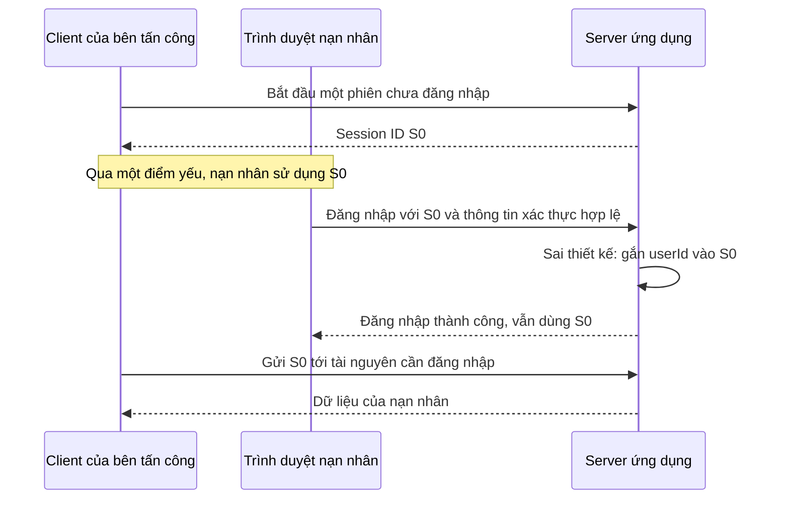

# Session fixation

## 1. Session fixation là gì và vì sao cần đặc tả riêng?

**Session fixation** là tình huống kẻ tấn công khiến nạn nhân sử dụng một định danh phiên mà kẻ tấn công đã biết hoặc có thể sử dụng, sau đó hệ thống gắn kết quả xác thực của nạn nhân vào chính định danh đó. Kẻ tấn công dùng lại định danh đã biết để truy cập phiên đã được xác thực.

Điểm sai trong thiết kế nằm ở việc **mang định danh phiên từ bối cảnh chưa đáng tin sang bối cảnh có quyền cao hơn mà không thay đổi ràng buộc truy cập phù hợp**. Mật khẩu của nạn nhân có thể vẫn bí mật, đăng nhập có thể diễn ra qua HTTPS và người dùng có thể hoàn tất MFA; phiên sau đăng nhập vẫn có thể bị sử dụng bởi người đang nắm ID cũ.

Ví dụ, một website cấp session ID `S0` cho khách chưa đăng nhập để giữ ngôn ngữ và giỏ hàng. Kẻ tấn công có được `S0` và bằng một đường được hệ thống chấp nhận khiến trình duyệt nạn nhân sử dụng nó. Nạn nhân đăng nhập thành công. Nếu server chỉ thêm `userId` vào phiên `S0`, cả nạn nhân và kẻ tấn công đều có thể gửi `S0` để truy cập tài khoản của nạn nhân.

Trong module yêu cầu bảo mật, “chống session fixation” phải được chuyển thành hành vi có thể quan sát: ID thay đổi ở đâu, ID cũ mất quyền gì, dữ liệu nào được giữ lại và bằng chứng nào cho thấy không có đường quay về phiên đã xác thực bằng ID cũ.

### 1.1. Các khái niệm cần phân biệt

| Khái niệm | Ý nghĩa trong bài học |
| --- | --- |
| Session ID | Giá trị mà client gửi để server tìm hoặc xác nhận phiên |
| Session state | Trạng thái phía server hoặc trạng thái được bảo vệ trong cơ chế phiên |
| Authentication context | Danh tính, phương thức xác thực, mức bảo đảm và thời điểm xác thực của phiên |
| Authorization context | Quyền mà hệ thống cho phép phiên thực hiện trên tài nguyên |
| Rotation | Thay định danh/bằng chứng truy cập phiên tại một ranh giới đã xác định |
| Invalidation | Làm cho định danh hoặc phiên không còn được chấp nhận trong phạm vi đã quy định |

Đổi giá trị hiển thị trên trình duyệt không đủ nếu server vẫn chấp nhận ID cũ và ánh xạ nó tới cùng phiên có quyền. Tương tự, xóa cookie ở một trình duyệt không vô hiệu hóa bản sao cookie mà một client khác đang giữ.

### 1.2. Phân biệt với những vấn đề gần nhau

| Vấn đề | Đặc điểm chính | Hướng kiểm soát liên quan |
| --- | --- | --- |
| Session fixation | ID đã được bên tấn công biết/sử dụng trước khi nạn nhân hoàn tất xác thực | Đổi ID tại ranh giới xác thực, không nâng quyền ID cũ và kiểm soát nguồn nhận ID |
| Session hijacking | Bên tấn công chiếm hoặc sử dụng trái phép một phiên, chẳng hạn lấy token sau đăng nhập | Bảo vệ token, chống lộ lọt, thu hồi và kiểm soát sử dụng |
| Dự đoán session ID | ID có thể được đoán do cách sinh yếu | Bộ sinh ngẫu nhiên phù hợp và không dùng dữ liệu dễ đoán |
| CSRF | Trình duyệt gửi yêu cầu không mong muốn cùng thông tin xác thực sẵn có | Cơ chế chống CSRF và xác minh ngữ cảnh yêu cầu |
| Login CSRF | Nạn nhân bị đưa vào phiên đăng nhập với tài khoản do bên tấn công lựa chọn | Bảo vệ luồng đăng nhập và ràng buộc giao dịch xác thực |

Các vấn đề có thể xuất hiện cùng nhau nhưng không dùng một biện pháp để suy ra tất cả đã được xử lý. Session ID ngẫu nhiên mạnh vẫn có thể bị fixation nếu server giữ nguyên một ID hợp lệ mà kẻ tấn công đã biết. Đổi ID sau đăng nhập cũng không tự giải quyết login CSRF.

## 2. Mô hình tấn công: không cần đoán được ID

Để hiểu rủi ro, xét một ứng dụng dùng phiên phía server và cookie `APPSESSION`.



`S0` có thể do server tự sinh hoàn toàn ngẫu nhiên. Bên tấn công chỉ cần sở hữu một phiên trước xác thực rồi làm cho nạn nhân dùng phiên đó; không nhất thiết tự chọn được chuỗi ID tùy ý.

Các điều kiện chính của kịch bản:

1. Bên tấn công biết hoặc sử dụng được một định danh phiên trước khi nạn nhân xác thực.
2. Có đường đưa định danh đó vào luồng sử dụng của nạn nhân và được ứng dụng chấp nhận.
3. Hệ thống nâng phiên thành đã xác thực hoặc tăng quyền mà vẫn để ID cũ sử dụng được quyền mới.
4. Không có ràng buộc khác thực sự ngăn client của bên tấn công sử dụng phiên đó.

Ràng buộc bổ sung như dấu hiệu thiết bị hoặc địa chỉ mạng có thể giúp phát hiện bất thường, nhưng không nên thay thế yêu cầu đổi ID và vô hiệu hóa khả năng truy cập bằng ID cũ. Địa chỉ mạng có thể dùng chung, thay đổi hợp lệ hoặc nằm dưới sự kiểm soát của một hạ tầng trung gian.

## 3. Đường nhận session ID là một phần của yêu cầu bảo mật

### 3.1. Không chấp nhận session ID từ mọi nơi

Ứng dụng có thể nhận ID từ cookie, URL, query string, body, header riêng hoặc cơ chế viết lại URL của framework. Nếu chỉ bảo vệ cookie nhưng vẫn nhận `sessionId` trong URL, một đường nhận khác có thể duy trì khả năng fixation.

Đối với ứng dụng web chọn cookie làm kênh phiên, yêu cầu nên nêu rõ:

> Server chỉ nhận định danh phiên từ cookie đã quy định. Giá trị trùng tên trong URL, query string, body hoặc header không được dùng để chọn hay thay thế phiên.

Nếu một API có thiết kế dùng token trong header, đó là hợp đồng riêng cần được đặc tả. Không tự động cho phép cùng một endpoint nhận nhiều loại bằng chứng phiên chỉ vì thư viện có hỗ trợ.

Nhận session ID qua URL còn có nguy cơ làm lộ ID qua lịch sử trình duyệt, log, liên kết được sao chép hoặc các thành phần xử lý URL. Đưa ID khỏi URL vừa giảm khả năng gieo ID vừa giảm một số đường lộ lọt, nhưng vẫn cần rotation tại ranh giới xác thực.

### 3.2. Chỉ chấp nhận ID được server quản lý

Nếu client gửi một ID không tồn tại, server không nên lấy chính giá trị tùy ý đó làm ID của phiên mới. Server có thể từ chối yêu cầu hoặc tạo một phiên mới với ID do server sinh, tùy hợp đồng của endpoint.

Tuy nhiên, yêu cầu này chỉ xử lý ID do client tự đặt. Nó không chặn hoàn toàn kịch bản bên tấn công dùng một ID hợp lệ đã được server cấp. Vì vậy, cần đồng thời có:

- Kiểm soát việc sinh và chấp nhận session ID.
- Kiểm soát kênh đưa ID vào request.
- Đổi ID khi xác thực hoặc thay đổi bối cảnh quyền theo chính sách.
- Ngăn ID cũ tiếp cận trạng thái hoặc quyền mới.

### 3.3. Phạm vi cookie và việc chèn cookie

Cookie có phạm vi quá rộng có thể làm tăng ảnh hưởng từ các ứng dụng hoặc subdomain có mức độ tin cậy thấp hơn. Hệ thống cần xác định ứng dụng nào có thể đặt cookie liên quan tới phiên và liệu tên cookie có xung đột hay không.

Các thuộc tính thường cần được đặc tả:

| Thuộc tính/cách đặt cookie | Mục đích | Giới hạn cần nhớ |
| --- | --- | --- |
| `Secure` | Chỉ gửi cookie qua kênh HTTPS theo hành vi trình duyệt | Không làm ID cũ tự mất hiệu lực phía server |
| `HttpOnly` | Hạn chế JavaScript truy cập cookie qua API thông thường | Không thay thế phòng chống XSS hay rotation |
| `SameSite` phù hợp | Giới hạn một số ngữ cảnh gửi cookie cross-site | Không phải cơ chế chống fixation tổng quát |
| Không đặt `Domain` khi không cần | Thu hẹp cookie tới host đã đặt nó | Vẫn cần kiểm soát ứng dụng và đường nhận ID tại host đó |
| Tên cookie có tiền tố `__Host-` khi phù hợp | Yêu cầu trình duyệt hỗ trợ áp dụng ràng buộc `Secure`, `Path=/` và không có `Domain` | Cần kiểm tra tính tương thích và toàn bộ luồng thực tế |

`HttpOnly` không phải thuộc tính tự động đi kèm tiền tố `__Host-`; nếu hệ thống cần thì phải cấu hình riêng. `SameSite` cũng cần chọn theo luồng đăng nhập, callback và tích hợp thực tế. Không ghi một giá trị chung rồi giả định mọi luồng SSO vẫn hoạt động.

Nếu request có nhiều cookie cùng tên, server thường không nhận được đầy đủ thuộc tính `Domain`/`Path` gốc trong header `Cookie` để tự phân biệt nguồn. Hợp đồng phải tránh tên/phạm vi xung đột và xử lý tình huống mơ hồ một cách an toàn, thay vì dựa vào giả định “cookie đầu tiên luôn đúng”.

## 4. Yêu cầu cốt lõi: đổi ID và cắt quyền của ID cũ

### 4.1. Rotation phải xảy ra tại ranh giới xác thực

Sau khi thông tin xác thực được xác minh và trước khi phiên được dùng để thực hiện hành động đã xác thực, hệ thống phải chuyển sang định danh mới do server sinh. ID mới phải có tính khó dự đoán phù hợp với cơ chế phiên và không được suy ra trực tiếp từ ID cũ, user ID hoặc thời gian.

Một luồng mong muốn:

```text
S0: phiên chưa đăng nhập
        |
        | xác thực thành công + rotation
        v
S1: phiên đã đăng nhập

S0 không được truy cập quyền/trạng thái đã xác thực của S1.
```

Điều kiện cần kiểm chứng gồm cả `S1 != S0` và việc `S0` không còn dùng được quyền sau xác thực. Chỉ kiểm tra cookie trả về đã đổi là chưa đủ.

Tùy kiến trúc, hệ thống có thể đổi ID của một session record hoặc tạo phiên mới rồi hủy phiên cũ. Cách triển khai khác nhau nhưng kết quả bảo mật phải tương đương: bên đang giữ ID trước xác thực không nhận được quyền của phiên sau xác thực.

### 4.2. Không duy trì alias dẫn từ ID cũ tới phiên mới

Một cách “giữ tương thích” nguy hiểm là lưu ánh xạ `S0 -> S1` rồi tự chuyển mọi request có `S0` sang phiên `S1`. Bên tấn công giữ `S0` sẽ được chuyển sang quyền mới giống nạn nhân.

Nếu cần xử lý request song song của trình duyệt, cơ chế chuyển tiếp không được cấp trạng thái đã xác thực, trả ID mới hoặc cung cấp đường khôi phục phiên mới chỉ dựa vào ID cũ. Tính sẵn sàng cần được giải quyết mà vẫn giữ nguyên ranh giới tin cậy.

ID cũ có thể bị từ chối hoàn toàn hoặc được coi là không có phiên tùy hợp đồng endpoint. Nếu tạo một phiên ẩn danh mới, phiên đó phải độc lập và không mang quyền của tài khoản vừa xác thực. Trong mọi trường hợp, ID cũ không được tiếp tục là một chìa khóa tới phiên đã đăng nhập.

### 4.3. Các ranh giới cần được xác định trong đặc tả

Ngoài đăng nhập ban đầu, hệ thống phải xem xét những thay đổi làm tăng hoặc đổi bối cảnh tin cậy:

- Hoàn tất MFA khi bước này nâng mức bảo đảm xác thực.
- Step-up authentication trước thao tác nhạy cảm.
- Chuyển sang chế độ quản trị hoặc impersonation được cấp phép.
- Đăng nhập thành người khác trong cùng trình duyệt.
- Chuyển bối cảnh tổ chức/tenant nếu thao tác đó thay đổi ràng buộc quyền của phiên theo thiết kế.

Không phải mọi thay đổi dữ liệu người dùng đều đòi cùng một chính sách rotation. Đặc tả cần liệt kê các ranh giới của chính ứng dụng và quy định rõ ID cũ được phép làm gì sau mỗi ranh giới. Đổi ID cũng không thay thế việc kiểm tra quyền tài nguyên hoặc thu hồi quyền đã bị gỡ bỏ.

## 5. Session trước đăng nhập không phải nguồn trạng thái đáng tin

### 5.1. Chuyển trạng thái theo danh sách cho phép

Ứng dụng thường muốn giữ giỏ hàng, ngôn ngữ hoặc tiến trình biểu mẫu sau đăng nhập. Nếu sao chép toàn bộ session cũ sang session mới, nó có thể mang theo thuộc tính do bên tấn công thiết lập trước đó.

Ví dụ một phiên ẩn danh chứa:

```text
locale = vi
cartReference = cart-42
returnUrl = /account
userId = giá trị do một luồng lỗi ghi vào
isAdmin = true
mfaComplete = true
```

Không được coi các thuộc tính xác thực hoặc phân quyền trong phiên ẩn danh là nguồn chuẩn. `userId`, role, tenant có quyền, trạng thái MFA và các dấu hiệu đặc quyền phải được tạo từ kết quả xác thực và quyết định quyền đáng tin.

Ngay cả dữ liệu được phép giữ cũng cần kiểm tra theo nghiệp vụ:

| Trạng thái trước đăng nhập | Cách xử lý cần đặc tả |
| --- | --- |
| Ngôn ngữ/giao diện | Chỉ giữ giá trị thuộc tập hợp hợp lệ |
| Giỏ hàng ẩn danh | Áp dụng quy tắc sở hữu, hợp nhất và kiểm tra nội dung phù hợp |
| URL điều hướng sau đăng nhập | Chỉ dùng đích đã được kiểm tra; không chuyển nguyên văn URL bất kỳ |
| Authentication context | Tạo lại từ kết quả xác thực đáng tin |
| Role/quyền/tenant | Tính lại hoặc kiểm tra theo nguồn quyền chuẩn |
| CSRF token gắn với phiên | Cấp/ràng buộc lại theo thiết kế sau chuyển phiên; không sao chép tùy tiện |

Rotation bảo vệ định danh phiên. Nó không chứng minh dữ liệu mang từ phiên cũ đã an toàn. Một giỏ hàng hoặc giao dịch do bên khác chuẩn bị vẫn cần quy tắc xác nhận nghiệp vụ, kể cả khi phiên sau đăng nhập đã đổi ID đúng cách.

### 5.2. Không nâng phiên khi mới hoàn tất một phần đăng nhập

Trong đăng nhập nhiều bước, trạng thái “đã xác minh mật khẩu nhưng chưa MFA” phải được phân biệt với trạng thái đã xác thực đầy đủ. Các endpoint nhạy cảm không được chỉ kiểm tra `userId != null` rồi cho phép truy cập.

Ví dụ trạng thái:

```text
ANONYMOUS
    -> PASSWORD_VERIFIED_MFA_PENDING
    -> AUTHENTICATED
    -> STEP_UP_VERIFIED
```

Mỗi lần vượt ranh giới được chính sách xác định phải có cách ràng buộc phiên tương ứng. Nếu bên tấn công giữ một ID ở bước trước, ID đó không được sử dụng mức quyền của bước sau. Dữ liệu challenge, số lần thử và thời hạn còn phải được kiểm soát theo thiết kế xác thực; chỉ đổi ID không thay thế các kiểm soát đó.

Đăng nhập thất bại cũng không được để lại authentication context có quyền. Nếu quy trình lỗi sau khi đã xác minh mật khẩu nhưng chưa hoàn tất chuyển phiên, hệ thống phải tránh tạo trạng thái nửa xác thực được endpoint khác chấp nhận.

## 6. Giao dịch chuyển phiên và môi trường nhiều node

### 6.1. Không để ID cũ được nâng quyền dù chỉ trong một bước trung gian

Thứ tự sau có thể tạo cửa sổ truy cập ngoài ý muốn:

```text
1. Gắn userId và role vào S0.
2. Ghi S0 vào session store.
3. Sau đó mới đổi S0 thành S1.
```

Trong khoảng giữa bước 2 và 3, một request đồng thời mang `S0` có thể được xem là đã đăng nhập. Thiết kế cần bảo đảm việc gắn authentication context và cắt khả năng dùng ID cũ là một chuyển đổi nhất quán đối với nơi kiểm tra quyền.

Pseudocode sau mô tả hợp đồng, không phải API của một framework hay mã có thể dùng nguyên trạng:

```text
completeAuthentication(oldId, verifiedAuthentication):
    require verifiedAuthentication đến từ bộ xác thực đáng tin

    atomically in the session system:
        require oldId chưa hoàn tất một lần chuyển đổi xung đột
        oldState = đọc trạng thái trước xác thực nếu còn hợp lệ
        safeState = chọn và kiểm tra các trường được phép giữ
        newId = sinh ID mới khó dự đoán
        tạo phiên newId với safeState và verifiedAuthentication
        vô hiệu hóa oldId đối với quyền/trạng thái sau xác thực
        không tạo alias cho phép oldId truy cập newId

    gửi newId bằng cookie theo hợp đồng đã định
    không ghi oldId/newId nguyên văn vào log
```

“Atomically” là yêu cầu về kết quả quan sát được, không phải lời khẳng định rằng mọi session store đều hỗ trợ cùng một transaction. Cơ chế cụ thể có thể dùng thao tác nguyên tử, version, khóa hoặc mô hình trạng thái phù hợp. Nếu một thư viện chỉ bảo đảm một phần, cần đánh giá phần còn thiếu trong kiến trúc.

### 6.2. Cache và bản sao session phải nhất quán với mục tiêu

Trong hệ thống nhiều node, đổi ID trên node A nhưng node B vẫn chấp nhận trạng thái đã nâng quyền dưới ID cũ sẽ làm yêu cầu chống fixation thất bại.

Đặc tả cần xác định:

- Nguồn chuẩn của trạng thái phiên và tình trạng vô hiệu hóa.
- Thời điểm chuyển phiên được coi là đã hoàn tất.
- Cách node khác nhận biết ID cũ không còn hợp lệ cho quyền mới.
- Hành vi khi session store, cache hoặc kênh đồng bộ gặp lỗi.
- Giới hạn đối với request đang thực thi tại thời điểm chuyển phiên.

Đối với bảo vệ fixation khi đăng nhập, không nên cấp một khoảng grace mà trong đó ID trước đăng nhập vẫn truy cập được quyền của phiên đã đăng nhập. Nếu cơ chế cache không bảo đảm điều này, cần đổi cách thực thi thay vì chỉ ghi “eventual consistency” vào tài liệu.

### 6.3. Request song song và thất bại khi trả cookie

Trình duyệt có thể đồng thời gửi nhiều request hoặc nhiều tab có thể cùng đăng nhập. Cần tránh hai request cùng chuyển `S0` rồi ghi đè kết quả của nhau hoặc khôi phục lại phiên cũ. Một kết quả chuyển phiên thua xung đột phải được xử lý rõ ràng, chẳng hạn yêu cầu bắt đầu lại luồng phù hợp; không được nối ID cũ sang một phiên đã xác thực chỉ để tránh lỗi giao diện.

Nếu server đã chuyển phiên nhưng response chứa cookie mới không đến được client, ứng dụng cần phục hồi theo cách an toàn. Nó có thể yêu cầu đăng nhập lại tùy thiết kế, nhưng không được khôi phục quyền dưới `S0` vì “client chưa nhận được S1”. Việc thu dọn phiên mới không được sử dụng cần nằm trong chính sách vòng đời phiên.

Đối với request đã bắt đầu trước thời điểm chuyển, đặc tả phải chỉ rõ điểm quyết định quyền và hành vi với tác vụ dài. Các request chưa được xác thực không được tự động có quyền vì session object dùng chung vừa được gắn người dùng. Đối với thao tác nhạy cảm, cần tránh thực thi dựa trên một tham chiếu trạng thái đã thay đổi mà không kiểm tra ngữ cảnh phù hợp.

## 7. Áp dụng cho đăng nhập liên kết và token

### 7.1. SSO không thay thế rotation của phiên ứng dụng

Identity Provider xác thực người dùng không có nghĩa phiên local của ứng dụng đã được bảo vệ khỏi fixation. Ứng dụng nhận callback vẫn phải kiểm tra giao dịch đăng nhập theo giao thức sử dụng, xác minh kết quả và tạo/chuyển phiên local phù hợp.

Các giá trị dùng để ràng buộc giao dịch đăng nhập, ví dụ `state` hoặc `nonce` khi giao thức yêu cầu, có mục đích riêng. Không coi chúng là session ID có thể tái sử dụng thay cho phiên ứng dụng. Ngược lại, đổi session ID không thay thế việc kiểm tra các giá trị và ràng buộc của giao thức.

Yêu cầu phải bao phủ mọi đường tạo phiên đã xác thực: form đăng nhập, callback SSO, liên kết đăng nhập, cơ chế khôi phục truy cập hoặc đường đăng nhập tự động nếu hệ thống có hỗ trợ. Một đường đăng nhập chính đã đúng nhưng callback phụ giữ nguyên ID trước xác thực vẫn để lại rủi ro.

### 7.2. Phiên dùng token tự chứa

Không nên diễn đạt biện pháp chỉ là “đổi cookie” nếu ứng dụng còn dùng token trong header hoặc token được gắn với một session record khác. Cần xác định chính xác bằng chứng nào cấp quyền truy cập.

Với mô hình token tự chứa, việc nâng cấp danh tính/quyền cần tạo bằng chứng mới từ nguồn đáng tin. Token trước xác thực không được tiếp tục được diễn giải thành bằng chứng xác thực mạnh hơn chỉ vì server đã thay một mapping liên quan. Nếu có refresh token hoặc token phụ, cần đặc tả vòng đời và ràng buộc của chúng để không tạo đường khôi phục quyền bằng bằng chứng cũ.

Không thể “sửa claim” của một token đã phát hành mà không tạo token mới với bảo vệ toàn vẹn tương ứng. Việc token mới đã được cấp cũng không tự chứng minh token cũ mất quyền. Phải kiểm tra ngữ nghĩa xác thực, phân quyền và thu hồi của chính mô hình đang dùng.

## 8. Bộ yêu cầu có thể kiểm chứng

Giả sử một cổng quản lý tài khoản dùng cookie và session store dùng chung. Các yêu cầu sau minh họa cách nối rủi ro với hành vi và bằng chứng nghiệm thu.

| ID | Yêu cầu | Bằng chứng nghiệm thu |
| --- | --- | --- |
| SF-01 | Server chỉ nhận session ID qua cookie được quy định cho endpoint web | Giá trị trong URL, query, body và header không chọn hoặc thay thế phiên |
| SF-02 | ID không được server cấp/quản lý không được nhận nguyên văn làm ID phiên mới | Gửi ID tự chọn; server từ chối hoặc tạo ID mới độc lập theo hợp đồng |
| SF-03 | Mọi lần chuyển từ phiên ẩn danh sang phiên đã đăng nhập đều cấp ID mới trước khi cấp quyền sau đăng nhập | ID sau xác thực khác ID trước xác thực trên từng luồng đăng nhập trong phạm vi |
| SF-04 | ID trước đăng nhập không truy cập được authentication context, dữ liệu bảo vệ hoặc ID của phiên sau đăng nhập | Client thứ hai dùng ID cũ bị từ chối và không nhận đường nâng cấp tới phiên mới |
| SF-05 | MFA/step-up và các ranh giới quyền đã liệt kê phải không cấp quyền mới cho bằng chứng phiên ở bước trước | ID trước mỗi ranh giới không thực hiện được hành động thuộc mức quyền mới |
| SF-06 | Chỉ các thuộc tính trước đăng nhập nằm trong danh sách cho phép và đã kiểm tra mới được chuyển sang phiên mới | Trạng thái giao diện hợp lệ được giữ; thuộc tính principal/role/MFA do phía chưa tin cậy đặt bị bỏ qua |
| SF-07 | Kết quả rotation phải có hiệu lực tại mọi node phục vụ endpoint bảo vệ, không có grace cấp quyền mới cho ID cũ | Dùng ID cũ gọi qua các node sau thời điểm chuyển hoàn tất đều không nhận quyền mới |
| SF-08 | Cookie phiên được đặt với tên, phạm vi và thuộc tính theo chính sách đã chốt; cookie mơ hồ được xử lý an toàn | Kiểm tra response và hành vi với cookie trùng tên trong các luồng thuộc phạm vi |
| SF-09 | Lỗi chuyển phiên không được trả kết quả đăng nhập hoàn tất trong khi ID cũ còn dùng quyền mới | Mô phỏng lỗi store, xung đột và lỗi response; không quan sát thấy ID cũ có quyền sau xác thực |
| SF-10 | Audit nhận diện được sự kiện chuyển phiên và kết quả mà không lưu raw session ID | Sự kiện có loại chuyển đổi, thời điểm, kết quả và correlation ID theo chính sách log |

“Mọi luồng” cần được cụ thể hóa thành danh sách endpoint/flow trong phạm vi dự án. Cụm từ đó không thay thế việc kiểm kê form login, callback SSO, MFA, step-up và những đường tạo phiên khác mà ứng dụng thực sự cung cấp.

## 9. Thiết kế kịch bản nghiệm thu bằng hai client độc lập

### 9.1. Ca chính: dùng một ID hợp lệ do server cấp

Phép kiểm tra nên dùng hai cookie jar độc lập trong môi trường được phép kiểm thử. Nếu hai tab dùng cùng cookie jar, cookie mới có thể tự cập nhật ở cả hai và làm mất khả năng kiểm tra ID cũ.

```text
Client A: bắt đầu phiên ẩn danh, nhận S0 và giữ bản sao S0.
Client B: trong thiết lập kiểm thử có kiểm soát, sử dụng S0 trước đăng nhập.
Client B: đăng nhập bằng tài khoản kiểm thử hợp lệ.
Client B: nhận S1, xác nhận S1 khác S0.
Client B: dùng S1, truy cập được tài nguyên đúng quyền.
Client A: vẫn dùng đúng S0, gọi tài nguyên cần đăng nhập.
Kỳ vọng: A không nhận dữ liệu/quyền của B và không nhận S1 từ S0.
```

Thiết lập cookie có kiểm soát trong kiểm thử không tự chứng minh một đường gieo cookie tồn tại ngoài đời. Nó kiểm tra tính an toàn của **ranh giới chuyển phiên** khi ID trước đăng nhập đã bị biết. Kiểm tra đường gieo ID là phần kiểm thử riêng dựa trên bề mặt thực tế của ứng dụng.

### 9.2. Các ca cần bổ sung

| Ca kiểm tra | Mục tiêu |
| --- | --- |
| ID tùy ý chưa từng được cấp | Phát hiện việc server nhận ID do client chọn |
| ID ẩn danh hợp lệ đã được cấp | Kiểm tra fixation mà không phụ thuộc khả năng đoán ID |
| Đăng nhập thất bại | Không để phiên cũ có authentication context dùng được |
| Hoàn tất MFA hoặc step-up | ID ở mức thấp không dùng được quyền mức cao |
| Callback SSO | Luồng liên kết tuân thủ cùng ranh giới phiên local |
| Gửi ID qua URL/query/body | Không có kênh nhận ID ngoài hợp đồng |
| Request song song ở nhiều node | Không có cửa sổ nâng quyền ID cũ hoặc khôi phục trạng thái cũ |
| Lỗi session store lúc chuyển phiên | Lỗi không làm bỏ qua rotation hoặc nâng quyền phiên cũ |
| Cookie trùng tên/phạm vi | Không chọn nhầm cookie dựa trên giả định thứ tự không được bảo đảm |
| Chuyển các thuộc tính phiên | Không mang theo role, principal hay MFA flag từ trạng thái chưa tin cậy |

Một bộ kiểm tra chỉ gửi chuỗi ID tự chọn rồi thấy server tạo ID khác có thể bỏ sót lỗi cốt lõi: server từ chối ID lạ nhưng vẫn nâng quyền một ID ẩn danh hợp lệ mà bên tấn công đã nắm.

### 9.3. Viết tiêu chí Given–When–Then

```gherkin
Feature: Không nâng quyền bằng session ID trước đăng nhập

  Scenario: Một client khác giữ ID ẩn danh trước khi nạn nhân đăng nhập
    Given A giữ session ID S0 hợp lệ do ứng dụng cấp cho phiên ẩn danh
    And B sử dụng S0 trong một thiết lập kiểm thử được kiểm soát
    When B hoàn tất luồng xác thực được yêu cầu
    Then B nhận session ID S1 khác S0
    And S1 chỉ có quyền của danh tính đã được xác thực
    And A dùng S0 không truy cập được tài nguyên yêu cầu đăng nhập
    And A không lấy được S1 hoặc authentication context của S1 chỉ bằng S0
    And kết quả này giữ nguyên tại các node phục vụ trong phạm vi kiểm tra
```

Cần phân biệt mã HTTP và kết quả bảo mật. Một endpoint có thể redirect tới trang đăng nhập hoặc trả `401` tùy thiết kế; tiêu chí quan trọng là không trả dữ liệu bảo vệ, không thực thi hành động có quyền và không tiết lộ đường tới phiên mới. Không kết luận thành công chỉ từ một mã lỗi nếu tác dụng phụ nghiệp vụ đã xảy ra.

## 10. Audit, theo dõi và xử lý sự cố

Sự kiện rotation có thể ghi loại chuyển đổi, kết quả, thời điểm, mức xác thực trước/sau và ID tương quan do hệ thống quản lý. Nếu cần theo dõi quan hệ giữa các phiên, sử dụng cơ chế tham chiếu phù hợp với mô hình log và quyền truy cập; không đưa raw session ID vào log chỉ để dễ đối chiếu.

Ví dụ sự kiện không chứa credential phiên:

```json
{
  "eventType": "session.authentication_transition",
  "transition": "anonymous_to_authenticated",
  "outcome": "SUCCESS",
  "oldSessionAccess": "NO_AUTHENTICATED_ACCESS",
  "correlationId": "auth-flow-b784",
  "principalRef": "account-582",
  "nodeId": "web-node-2"
}
```

`oldSessionAccess` trong log chỉ là thông tin hệ thống ghi nhận, không thay thế kiểm tra hành vi bằng ID cũ. Dữ liệu principal và lịch sử đăng nhập cũng cần được bảo vệ theo chính sách truy cập và lưu giữ phù hợp.

Những tín hiệu đáng xem xét gồm nhiều lần sử dụng ID đã bị thay, thất bại chuyển phiên tăng đột biến hoặc đăng nhập thành công nhưng có nhiều nguồn tiếp tục thử dùng ID cũ. Tuy nhiên, request cũ do nhiều tab hoặc mạng chậm cũng có thể tạo tín hiệu tương tự. Cần đối chiếu bối cảnh, không mặc định mọi request cũ đều là tấn công.

Khi xác nhận lỗi fixation, xử lý không chỉ là sửa một response `Set-Cookie`. Cần khắc phục đường chuyển phiên, đánh giá phiên đã phát hành có thể bị ảnh hưởng, thu hồi theo phạm vi sự cố và xác nhận các luồng đăng nhập khác không giữ cùng lỗi thiết kế. Các hành động này phải theo quy trình ứng phó của hệ thống thực tế.

## 11. Những kết luận sai cần tránh

- **“Session ID ngẫu nhiên nên không bị fixation.”** Bên tấn công có thể dùng ID hợp lệ do server cấp rồi khiến nạn nhân sử dụng nó.
- **“Có HTTPS và HttpOnly là đủ.”** Chúng bảo vệ những đường lộ lọt nhất định, không tự cắt quyền của một ID đã biết trước xác thực.
- **“Cookie mới khác cookie cũ nghĩa là đã an toàn.”** Server có thể vẫn duy trì alias hoặc node khác vẫn nhận ID cũ với quyền mới.
- **“Giữ ID cũ vài giây để tránh lỗi là vô hại.”** Nếu khoảng chuyển tiếp cấp quyền sau xác thực, nó vẫn cho bên giữ ID cũ cơ hội truy cập.
- **“MFA chặn mọi trường hợp dùng chung phiên.”** Nếu ID bước trước được nâng trực tiếp thành phiên hoàn tất MFA, người giữ ID vẫn có thể hưởng trạng thái mới.
- **“Sao chép toàn bộ session là cách giữ trải nghiệm.”** Trạng thái chưa tin cậy có thể chứa thuộc tính hoặc tham chiếu nghiệp vụ không nên chuyển nguyên vẹn.
- **“Framework đã bật mặc định nên không cần yêu cầu.”** Cần biết chính xác framework xử lý những luồng nào, cấu hình nào đang dùng và ứng dụng có đường đăng nhập riêng nào bỏ qua cơ chế đó hay không.

## 12. Câu hỏi tự kiểm tra

1. Vì sao một session ID khó đoán nhưng đã được cấp hợp lệ vẫn có thể tham gia tấn công fixation?
2. Sau đăng nhập, làm thế nào chứng minh ID cũ không còn là đường tới phiên mới ngoài việc so sánh hai cookie?
3. Những thuộc tính nào trong phiên ẩn danh được phép giữ, và nguồn nào tạo lại principal, role, tenant và trạng thái MFA?
4. Nếu ứng dụng có nhiều node hoặc cache phiên, đâu là điểm chuyển đổi nhất quán và request cũ được xử lý thế nào?
5. Luồng SSO, MFA và step-up có đi qua cùng cơ chế chuyển phiên an toàn với form login hay không?
6. Nếu client không nhận được cookie mới, cơ chế khôi phục có vô tình cấp lại quyền cho ID trước đăng nhập không?
7. Phép kiểm tra có dùng hai client độc lập và một ID ẩn danh thật do server cấp không?

Yêu cầu chống session fixation phải bảo đảm rằng người giữ bằng chứng phiên trước xác thực không được hưởng danh tính hoặc quyền hình thành sau xác thực. Rotation, vô hiệu hóa ID cũ, kiểm soát trạng thái chuyển tiếp và nghiệm thu trên toàn bộ luồng tạo phiên cùng tạo nên bằng chứng cho điều đó.
