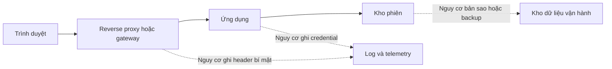

# Session hijacking

## 1. Session hijacking là gì?

**Session hijacking, hay chiếm đoạt phiên**, là việc một bên trái phép sử dụng hoặc kiểm soát phiên đã được xác thực để thực hiện hành động dưới danh nghĩa người dùng hợp lệ.

Trong mô hình phiên dùng bearer credential, hệ thống thường chấp nhận ai xuất trình đúng cookie phiên hoặc token còn hợp lệ. Nếu kẻ tấn công lấy được credential này, họ có thể không cần biết mật khẩu và không cần thực hiện lại bước MFA đã dùng khi đăng nhập.

Ví dụ, nhân viên đăng nhập cổng quản trị bằng MFA. Sau đó cookie phiên bị lộ qua một công cụ ghi log. Kẻ tấn công gửi cookie đó tới ứng dụng và được nhận diện như nhân viên. Bước MFA ban đầu vẫn đã hoạt động đúng, nhưng phiên sau xác thực bị chiếm đoạt.

Bài học này tập trung chuyển rủi ro đó thành yêu cầu bảo mật: bảo vệ credential phiên, giới hạn khả năng sử dụng lại, phát hiện dấu hiệu bất thường, thu hồi truy cập và kiểm chứng hiệu quả. Các con số trong ví dụ là lựa chọn cho một hệ thống giả định, cần được quyết định lại theo mức rủi ro thực tế.

## 2. Phân biệt các tình huống dễ nhầm

| Tình huống | Bản chất | Quan hệ với chiếm đoạt phiên |
|---|---|---|
| Đánh cắp mật khẩu | Lấy credential dùng để xác thực | Có thể tạo phiên mới; khác việc lấy phiên đã tồn tại |
| Session hijacking bằng credential bị lộ | Dùng credential của một phiên hợp lệ | Trọng tâm của kiểm soát bí mật và chống phát lại phiên |
| Session fixation | Làm nạn nhân dùng định danh phiên mà kẻ tấn công đã biết hoặc kiểm soát trước khi xác thực | Có thể dẫn tới chiếm phiên nếu đăng nhập không đổi định danh và vô hiệu hóa liên kết cũ |
| CSRF | Khiến trình duyệt nạn nhân gửi yêu cầu ngoài ý muốn với credential đang có | Không nhất thiết cần đọc hoặc đánh cắp cookie |
| XSS | Chạy mã trái phép trong ngữ cảnh ứng dụng | Có thể lấy token mà script đọc được hoặc dùng phiên ngay trong trình duyệt |
| Lỗi phân quyền | Người đã xác thực truy cập tài nguyên vượt quyền | Có thể làm tăng thiệt hại sau khi chiếm phiên, nhưng là một vấn đề độc lập |

Sự phân biệt ảnh hưởng trực tiếp tới yêu cầu. `HttpOnly` giúp hạn chế script đọc cookie, nhưng không ngăn script độc hại trong cùng ứng dụng gửi yêu cầu kèm cookie đó. `SameSite` giúp hạn chế một số yêu cầu cross-site, nhưng không biến credential bị đánh cắp thành không thể dùng lại.

Đổi session ID khi đăng nhập giải quyết rủi ro fixation ở ranh giới xác thực. Nó không bảo vệ được một session ID mới bị đánh cắp sau đó.

## 3. Mô hình đe dọa của phiên

### 3.1. Tài sản và điểm phơi lộ

Credential phiên có thể đi qua nhiều thành phần:



Cần xác định nơi credential được tạo, lưu, truyền, kiểm tra và hủy. Bảo vệ cookie trong trình duyệt không đủ nếu proxy ghi toàn bộ header Cookie vào log hoặc một endpoint debug trả lại session ID.

Các nguồn rủi ro thường gặp gồm:

- Kênh truyền không được bảo vệ hoặc cấu hình TLS kết thúc không đúng ranh giới tin cậy.
- XSS, script bên thứ ba hoặc thành phần phía client bị xâm phạm.
- Session ID xuất hiện trong URL, lịch sử, log, thông báo lỗi hoặc bản ghi hỗ trợ.
- Kho phiên, bản sao dữ liệu hoặc công cụ quan sát bị truy cập trái phép.
- Cookie có phạm vi rộng hơn cần thiết, làm tăng ảnh hưởng khi host liên quan bị xâm phạm.
- Định danh có thể đoán, chấp nhận định danh do client tùy ý chọn hoặc quản lý vòng đời sai.
- Thu hồi chỉ có tác dụng ở một node trong khi node khác vẫn chấp nhận phiên.

Trình duyệt hoặc thiết bị bị chiếm toàn quyền là một ranh giới nghiêm trọng: cookie flags không thể bảo đảm bí mật trước mọi phần mềm độc hại hoặc thành phần có đặc quyền trên thiết bị.

### 3.2. Chuỗi lạm dụng minh họa

1. Người dùng xác thực và được cấp credential phiên.
2. Credential bị lộ qua một điểm phơi lộ.
3. Kẻ tấn công dùng nó từ một môi trường khác.
4. Ứng dụng chỉ kiểm tra credential còn hợp lệ và cho phép truy cập.
5. Kẻ tấn công đọc dữ liệu hoặc thực hiện thao tác nhạy cảm.
6. Người dùng đăng xuất, nhưng phiên hoặc credential liên quan chưa bị thu hồi đầy đủ.

Yêu cầu bảo mật cần cắt chuỗi ở nhiều điểm: giảm khả năng lộ, giới hạn cửa sổ lạm dụng, yêu cầu bảo đảm bổ sung cho thao tác nhạy cảm và chấm dứt truy cập có thể kiểm chứng.

Không phải hệ thống nào cũng phát hiện được bước 3 ngay lập tức. Nếu credential là bearer và không có ràng buộc bổ sung, request của kẻ tấn công có thể rất giống request hợp lệ.

## 4. Yêu cầu về cấp và nhận credential phiên

### 4.1. Không thể đoán và không mang ý nghĩa nghiệp vụ

Một thiết kế phiên opaque có thể đặt yêu cầu:

> Session secret phải được tạo bằng bộ sinh số ngẫu nhiên mật mã, có ít nhất 128 bit entropy thực, không chứa dữ liệu định danh hoặc quyền dưới dạng mà client có thể sửa để quyết định trạng thái phiên.

Độ dài chuỗi không tương đương entropy. Ghép timestamp, user ID và một giá trị nhỏ có thể tạo chuỗi dài nhưng vẫn đoán được. Mã hóa một giá trị tuần tự cũng không tự biến thiết kế thành cơ chế cấp phiên an toàn.

Ưu tiên cơ chế phiên của framework được cấu hình phù hợp; nếu tự thiết kế, cần nêu rõ nguồn ngẫu nhiên, cách biểu diễn và kiểm tra tính duy nhất. Hướng dẫn về các thuộc tính session ID có trong [OWASP Session Management Cheat Sheet](https://cheatsheetseries.owasp.org/cheatsheets/Session_Management_Cheat_Sheet.html#session-id-properties).

Đối với token tự chứa như JWT, chữ ký bảo vệ tính toàn vẹn theo profile. Nó không tự ngăn người đã lấy được token phát lại token đó.

### 4.2. Chỉ nhận credential qua kênh được thiết kế

Một yêu cầu mẫu cho ứng dụng web:

> Ứng dụng chỉ nhận credential phiên qua cookie đã chỉ định; không nhận session ID từ query string, path parameter hoặc form field như một cơ chế thay thế.

Nếu hỗ trợ nhiều loại client, phải mô tả profile riêng. API dùng Authorization header không có nghĩa trình duyệt cũng phải lưu bearer token ở nơi script đọc được.

Không chấp nhận một session ID chưa từng được máy chủ cấp rồi gắn nó vào tài khoản sau đăng nhập. Khi gặp credential không hợp lệ, hệ thống không được suy ra identity từ một trường do client tự khai.

### 4.3. Bảo vệ kho phiên

Kho phiên và bản sao của nó là tài sản bảo mật. Cần giới hạn quyền đọc, quyền sửa, truy cập mạng và thời gian lưu.

Nếu mô hình đe dọa bao gồm rò rỉ chỉ đọc của kho phiên, có thể chọn lưu một chiều phần secret dùng để xác minh thay vì lưu credential có thể phát lại trực tiếp. Đây là một quyết định thiết kế cần tương thích với framework và cơ chế tra cứu.

Lưu một chiều không bảo vệ trước việc credential bị lấy từ trình duyệt, cũng không chống được bên có quyền sửa trạng thái phiên hoặc kiểm soát ứng dụng. Không ghi secret gốc bên cạnh giá trị xác minh của nó.

## 5. Bảo vệ trên đường truyền và trong trình duyệt

### 5.1. Bảo vệ toàn bộ vòng đời bằng TLS

Yêu cầu TLS phải bao phủ các request mang credential và nội dung nhạy cảm, không chỉ trang đăng nhập.

> Credential phiên không được truyền trên kết nối không được bảo vệ. Cookie phiên phải có Secure; các điểm kết thúc TLS và kết nối phía sau phải được bảo vệ theo ranh giới triển khai đã xác định.

Nếu gateway kết thúc TLS, cần chỉ rõ đoạn gateway–ứng dụng có được mã hóa không, ai có thể truy cập đoạn mạng đó và cách bảo vệ header định danh do proxy thêm.

Không tin một header “đã dùng HTTPS” do client tùy ý gửi. Ứng dụng chỉ được dùng thông tin chuyển tiếp từ proxy được tin cậy.

HSTS có thể bổ trợ việc dùng HTTPS theo chính sách triển khai, nhưng không thay thế cấu hình kênh truyền và cookie.

### 5.2. Cookie phiên với phạm vi rõ ràng

Ví dụ cấu hình cho một ứng dụng web chạy tại một host:

```http
Set-Cookie: __Host-session=<opaque-random-secret>; Secure; HttpOnly; Path=/; SameSite=Lax
Cache-Control: no-store
```

Giá trị trong dấu ngoặc là placeholder, không phải credential mẫu để đưa vào hệ thống.

Các thuộc tính có mục đích riêng:

- `Secure`: giới hạn gửi cookie trên kênh HTTPS theo cơ chế trình duyệt.
- `HttpOnly`: hạn chế truy cập cookie từ API script như document.cookie.
- Không có `Domain`: giới hạn cookie cho host đã cấp.
- `Path=/`: đáp ứng điều kiện của tiền tố trong ví dụ; Path không phải ranh giới cô lập ứng dụng đáng tin.
- `SameSite=Lax`: lựa chọn của ví dụ cho một số luồng điều hướng; mức phù hợp phải được đánh giá theo nghiệp vụ.

Trình duyệt hỗ trợ tiền tố `__Host-` yêu cầu cookie có Secure, Path=/ và không có Domain. Chi tiết thuộc tính và tiền tố nằm tại [MDN — Set-Cookie](https://developer.mozilla.org/en-US/docs/Web/HTTP/Reference/Headers/Set-Cookie).

Nếu cần SSO hoặc luồng cross-site, phải kiểm thử callback và chính sách cookie tương ứng. Không mở rộng phạm vi cookie cho mọi subdomain chỉ để sửa nhanh một luồng đăng nhập.

Các ứng dụng không cùng mức tin cậy nên được cô lập theo host và kiến trúc phù hợp, thay vì dựa vào khác biệt Path.

### 5.3. Cookie flags không giải quyết toàn bộ XSS và CSRF

Script độc hại chạy trong ngữ cảnh ứng dụng vẫn có thể gửi yêu cầu với cookie HttpOnly. Vì vậy cần phòng XSS bằng API an toàn, encoding đúng ngữ cảnh và sanitization khi thực sự cho phép HTML do người dùng cung cấp. CSP là một lớp bổ trợ, không thay thế việc xử lý nội dung an toàn. Xem [OWASP — XSS Prevention](https://cheatsheetseries.owasp.org/cheatsheets/Cross_Site_Scripting_Prevention_Cheat_Sheet.html).

Với request thay đổi trạng thái dùng cookie, cần cơ chế chống CSRF theo thiết kế: token chống giả mạo, kiểm tra nguồn hoặc biện pháp phù hợp cho profile. SameSite là một lớp hỗ trợ; “same-site” không đồng nghĩa “same-origin”, và host liên quan có thể không cùng mức tin cậy.

Trong profile web dùng cookie phiên của bài này, không sao chép credential phiên vào localStorage, sessionStorage hoặc biến cấu hình JavaScript chỉ để tiện gọi API. Những nơi script đọc được làm thay đổi rõ rệt mô hình phơi lộ credential.

## 6. Ngăn fixation và quản lý thay đổi phiên

### 6.1. Đổi định danh tại ranh giới bảo mật

Một yêu cầu mẫu:

> Sau xác thực thành công, ứng dụng phải cấp credential phiên mới và làm cho định danh trước xác thực không thể truy cập trạng thái đã xác thực. Việc chuyển dữ liệu từ phiên cũ chỉ được thực hiện cho các trường đã được cho phép.

Không sao chép quyền, identity, mức xác thực hoặc một cờ “đã MFA” từ trạng thái trước xác thực do client có thể ảnh hưởng.

Các ranh giới khác cần đánh giá gồm nâng đặc quyền, xác thực lại, đổi người dùng và chuyển ngữ cảnh bảo mật. Việc đổi tenant phải luôn kiểm tra membership; tạo ID mới không thay thế kiểm tra quyền.

### 6.2. Xử lý request đồng thời

Đổi định danh có thể gặp request đang chạy từ nhiều tab. Đặc tả phải nêu credential cũ bị từ chối từ thời điểm nào, cách chuyển trạng thái và phản hồi cho request cũ.

Đối với cổng quản trị giả định:

> Không có khoảng gia hạn cho credential trước xác thực truy cập phiên đã xác thực. Request dùng credential cũ phải được xử lý như chưa xác thực, kể cả khi cùng lúc có request đăng nhập hoàn tất.

Nếu framework dùng một cơ chế tương thích khác, phải chứng minh vẫn giữ bất biến này. Không giữ alias vô thời hạn từ ID cũ sang phiên mới.

### 6.3. Rotation không chữa được mọi vụ chiếm phiên

Nếu kẻ tấn công có credential hiện tại và chính credential đó đủ để đổi sang credential tiếp theo, họ có thể tiếp tục phiên. Rotation định kỳ đơn thuần không chứng minh người đang sử dụng là chủ tài khoản.

Đối với refresh token trong OAuth, cần chọn cơ chế phù hợp với loại client. RFC 9700 quy định refresh token của public client phải được sender-constrained hoặc sử dụng rotation nhằm hỗ trợ phát hiện replay. Xem [RFC 9700, mục 2.2.2](https://www.rfc-editor.org/rfc/rfc9700.html#section-2.2.2).

Nếu hệ thống dùng rotation, phải đặc tả quan hệ giữa các token, tiêu thụ nguyên tử, phản ứng khi dùng lại token cũ và hành vi khi request đồng thời. Không biến mọi token cũ thành alias hợp lệ lâu dài để tránh lỗi vận hành.

## 7. Giới hạn thời gian và tác động của phiên bị lộ

### 7.1. Idle timeout và absolute timeout

Hai giới hạn có ý nghĩa khác nhau:

- **Idle timeout:** hết hiệu lực sau một khoảng không có hoạt động được chính sách coi là hợp lệ.
- **Absolute timeout:** hết hiệu lực sau thời gian tối đa tính từ mốc phiên được định nghĩa, dù vẫn có hoạt động.

Ví dụ cho cổng quản trị:

```yaml
sessionPolicy:
  idleTimeoutMinutes: 15
  absoluteLifetimeHours: 8
  sensitiveActionAuthenticationAgeMinutes: 5
  browserCookiePersistence: SESSION
```

Đây là mô tả chính sách minh họa, không phải schema của framework.

Các giới hạn phải được thực thi ở phía máy chủ. Thời hạn cookie hoặc bộ đếm JavaScript không thể làm nguồn chuẩn cho hiệu lực phiên.

Cần xác định hoạt động nào làm mới idle timeout. Một heartbeat hoặc polling nền không nên mặc định giữ phiên sống mãi. Absolute timeout phải có mốc ổn định; nếu mọi lần refresh đều đặt lại mốc mà không cần xác thực phù hợp, giới hạn tuyệt đối mất ý nghĩa.

Cookie không có thời hạn lưu bền vững cũng không chứng minh mọi phiên kết thúc ngay khi đóng cửa sổ: trình duyệt có thể có cơ chế khôi phục phiên. Hiệu lực phía máy chủ vẫn cần được kiểm soát.

### 7.2. Xác thực bổ sung cho thao tác nhạy cảm

Các hành động như thêm phương thức xác thực, thay địa chỉ khôi phục, xuất dữ liệu nhạy cảm hoặc thay quyền quản trị cần yêu cầu bảo đảm phù hợp.

Một yêu cầu mẫu:

> Trước khi thay đổi phương thức khôi phục tài khoản, ứng dụng phải yêu cầu xác thực bổ sung còn mới và phù hợp với mức rủi ro; kết quả chấp thuận phải được ràng buộc với hành động và dữ liệu đang được xác nhận.

Không chỉ kiểm tra “phiên này từng MFA lúc đăng nhập” nếu mục tiêu là chống kẻ đang giữ phiên bị đánh cắp. Cần quyết định bằng chứng bổ sung nào không thể đạt được chỉ bằng credential phiên đó.

Một phiên có rủi ro cao cũng không nên được dùng đơn phương để gỡ yếu tố xác thực bảo vệ tài khoản hoặc đăng ký yếu tố mới mà không có kiểm soát bổ sung.

Step-up giúp hạn chế một số hành động nhưng không chống được mọi dạng thiết bị bị kiểm soát, lừa người dùng xác nhận hoặc chiếm cả phương thức xác thực.

## 8. Thu hồi phải có tác dụng tại nơi truy cập xảy ra

### 8.1. Xóa cookie khác với vô hiệu hóa phiên

Đăng xuất cần xử lý cả trạng thái phía máy chủ và credential phía client.

> Khi đăng xuất, ứng dụng phải vô hiệu hóa phiên theo chính sách và gửi chỉ thị xóa cookie với tên và phạm vi phù hợp. Credential cũ không được tiếp tục được chấp nhận chỉ vì client chưa xóa cookie.

Ví dụ cho cookie trước đó:

```http
Set-Cookie: __Host-session=; Max-Age=0; Secure; HttpOnly; Path=/; SameSite=Lax
```

Chỉ trả header xóa cookie không thu hồi bản sao mà kẻ tấn công đã giữ. Ngược lại, khi đã thu hồi đúng phía máy chủ, request phát lại credential cũ phải thất bại kể cả trình duyệt vẫn gửi nó.

Đổi mật khẩu, báo cáo mất thiết bị, khóa tài khoản và sự cố bảo mật cần có quy tắc thu hồi riêng. Không giả định mọi framework tự thu hồi mọi phiên sau các sự kiện đó.

### 8.2. Nhiều node, cache và mốc thời gian

Một yêu cầu có thể đo được:

> Sau khi thao tác thu hồi được ghi bền vững tại nguồn trạng thái có thẩm quyền, mọi node HTTP phải ngừng chấp nhận credential phiên đó trong tối đa 5 giây.

Yêu cầu này cần chỉ rõ cách đo và phạm vi. Nếu API còn chấp nhận access token liên quan trong tối đa 2 phút, phải ghi đó là một ngân sách riêng, không tuyên bố “thu hồi toàn bộ truy cập trong 5 giây”.

Thiết kế có thể dùng kho trạng thái tập trung, phiên bản thu hồi theo tài khoản, sự kiện vô hiệu hóa cache hoặc cơ chế phù hợp khác. Một cờ revoked trong database không có tác dụng nếu node vẫn tin cache cũ trong một giờ.

Khi không xác minh được trạng thái bắt buộc do kho phiên lỗi, request bảo vệ đặc quyền phải bị từ chối theo chính sách. Không coi “không có câu trả lời” là “phiên còn tốt”.

### 8.3. Request đang chạy và kết nối dài

Request đã vượt qua kiểm tra trước thời điểm thu hồi có thể đang thực hiện nghiệp vụ. Cần xác định giới hạn của việc thu hồi đối với thao tác đang chạy.

Đối với hành động không thể đảo ngược hoặc có tác động cao, thiết kế cần một điểm quyết định cuối có thẩm quyền, phối hợp kiểm tra hiệu lực phiên và ghi nhận hành động sao cho đáp ứng bất biến đã chọn. Chỉ thêm một lần đọc trạng thái rời rạc trước ghi dữ liệu không tự loại bỏ race condition.

Tương tự, WebSocket hoặc stream đã mở có thể sống sau khi cookie hết hiệu lực. Đặc tả phải nêu cách kiểm tra lại, ngắt kết nối và chặn thông điệp mới sau thu hồi; chỉ kiểm tra lúc handshake là chưa đủ nếu mục tiêu đòi hỏi chấm dứt truy cập nhanh.

## 9. Phát hiện dấu hiệu bất thường

Các tín hiệu có thể hỗ trợ phát hiện gồm:

- Sử dụng cùng phiên từ các ngữ cảnh không tương thích trong thời gian ngắn.
- Chuỗi thao tác nhạy cảm khác thường.
- Dùng lại credential đã bị thu hồi hoặc token cũ trong một cơ chế rotation.
- Thay đổi mạnh môi trường thiết bị kết hợp với hành vi bất thường.
- Nhiều lần thất bại kiểm tra credential hoặc thử định danh không hợp lệ.

Không dùng một tín hiệu đơn lẻ như bằng chứng tuyệt đối. Đổi IP có thể do mạng di động, NAT, VPN hoặc thay điểm truy cập. User-Agent có thể bị giả mạo; dấu vân tay thiết bị cũng có giới hạn và tác động riêng tư.

Một chính sách phản ứng có thể phân tầng:

| Mức đánh giá | Phản ứng minh họa |
|---|---|
| Thay đổi ngữ cảnh nhẹ, chưa có hành vi nhạy cảm | Ghi tín hiệu và tiếp tục theo chính sách |
| Rủi ro tăng khi thực hiện hành động nhạy cảm | Yêu cầu xác thực bổ sung hoặc chặn hành động |
| Bằng chứng credential đã bị phát lại trái phép | Thu hồi phạm vi liên quan, cảnh báo và bắt đầu phục hồi |
| Dấu hiệu chiếm quyền trên diện rộng | Đình chỉ phiên hoặc tài khoản theo quy trình sự cố |

Cần kiểm thử cả phát hiện đúng và tác động khi nhận diện nhầm. Một quy tắc khóa mọi lần đổi IP có thể gây gián đoạn lớn mà không ngăn được kẻ tấn công cùng mạng hoặc có khả năng giả ngữ cảnh.

Nếu dùng ràng buộc credential với khóa của client để hạn chế phát lại, phải xác định giao thức và mức bảo vệ khóa. Không coi việc lưu một device ID do client tự khai là chứng minh sở hữu thiết bị.

## 10. Bằng chứng và ứng phó sự cố

### 10.1. Log được sự kiện, không log credential

Sự kiện cần hỗ trợ trả lời: phiên nào theo định danh kiểm toán đã xảy ra chuyện gì, liên quan identity nào, tại đâu, theo chính sách nào và hệ thống đã phản ứng ra sao.

Ví dụ:

```yaml
eventType: SESSION_REVOKED
auditSessionId: audit-session-483
principalId: person-17
reasonCode: USER_REPORTED_COMPROMISE
scope: ALL_ACCOUNT_SESSIONS
policyVersion: 6
correlationId: incident-915
outcome: SUCCESS
```

`auditSessionId` trong ví dụ là định danh quan sát riêng, không phải secret dùng để xác thực.

Không ghi raw cookie, Authorization header đầy đủ, refresh token hoặc URL có credential vào log. Phải áp dụng bảo vệ này cả ở ứng dụng, gateway, APM, trace, báo cáo lỗi và công cụ hỗ trợ.

Các dữ liệu như IP, thiết bị và thời điểm sử dụng cần có mục đích, thời hạn lưu và giới hạn người xem rõ ràng. Thu thập thêm không tự làm phát hiện chính xác hơn.

### 10.2. Phục hồi không chỉ là cấp phiên mới

Khi xác nhận phiên bị chiếm, quy trình có thể bao gồm:

1. Xác định các phiên và credential liên quan cần thu hồi.
2. Ghi nhận thu hồi bền vững và xác minh có tác dụng trên các điểm truy cập.
3. Ngăn cơ chế nhớ đăng nhập hoặc refresh tạo lại quyền truy cập trái phép.
4. Yêu cầu người dùng xác thực lại bằng phương thức phù hợp và thông báo qua kênh đã xác minh.
5. Rà soát thay đổi nhạy cảm trong khoảng bị ảnh hưởng: quyền, yếu tố xác thực, địa chỉ khôi phục và tích hợp mới.
6. Khắc phục nguồn lộ credential và giữ bằng chứng cần thiết.

Không xóa mọi log hoặc hồ sơ phiên ngay lập tức chỉ để “dọn sạch”; có thể giữ bản ghi đã thu hồi theo chính sách điều tra, nhưng không để nó tiếp tục xác thực.

Nếu nguồn lộ vẫn tồn tại, cấp cookie mới rồi yêu cầu người dùng thử lại có thể chỉ tạo thêm credential để bị lấy tiếp.

## 11. Bộ yêu cầu bảo mật mẫu

| ID | Yêu cầu | Bằng chứng nghiệm thu |
|---|---|---|
| SH-01 | Credential phiên phải khó đoán và chỉ được nhận qua kênh được phê duyệt | Thiết kế nguồn ngẫu nhiên, cấu hình framework và kiểm thử kênh nhận |
| SH-02 | Credential không được truyền qua HTTP hoặc xuất hiện trong URL và log | Quan sát HTTP, kiểm tra gateway, log và trace |
| SH-03 | Cookie web phải có thuộc tính và phạm vi đã định nghĩa | Header thực tế và hành vi trên trình duyệt hỗ trợ |
| SH-04 | Xác thực thành công phải tạo credential mới; ID trước xác thực không truy cập được phiên đã xác thực | Test fixation và request đồng thời |
| SH-05 | Hiệu lực phiên phải được kiểm tra phía máy chủ, gồm timeout, trạng thái tài khoản và thu hồi | Request phát lại sau từng sự kiện |
| SH-06 | Hành động nhạy cảm phải đáp ứng mức xác thực và độ mới theo chính sách | Test với phiên bị sao chép nhưng thiếu bằng chứng bổ sung |
| SH-07 | Thu hồi phải có ngân sách thời gian theo HTTP, API và kết nối dài | Đo từ mốc có thẩm quyền tới lần chấp nhận cuối |
| SH-08 | Dấu hiệu chiếm phiên phải có quy tắc phản ứng và audit | Sự kiện mô phỏng, quyết định và hồ sơ phản ứng |
| SH-09 | Khi nguồn trạng thái bắt buộc không khả dụng, request đặc quyền không được bỏ kiểm tra | Test lỗi kho phiên và cache |
| SH-10 | Phục hồi phải thu hồi đường tái cấp quyền và xử lý nguồn rò rỉ | Kiểm thử refresh, remember-me và phiên liên quan |

Các yêu cầu này phải được cụ thể hóa cho từng loại client. Một cấu hình cookie web không thay được profile cho ứng dụng native hoặc service-to-service.

## 12. Kiểm thử tình huống có thể gây chiếm phiên

Các ca thử dưới đây là tiêu chí cho quá trình triển khai và nghiệm thu; việc viết chúng không có nghĩa hệ thống đã được kiểm thử.

| Tình huống kiểm thử | Kết quả mong đợi |
|---|---|
| Gửi một ID phiên chưa từng được cấp | Không được xác thực hoặc gắn ID đó với tài khoản sau đăng nhập |
| Giữ ID trước xác thực, đăng nhập rồi phát lại ID cũ | ID cũ không dùng được quyền của phiên đã xác thực |
| Đọc cookie phiên bằng API script thông thường | Không đọc được cookie HttpOnly |
| Mã trái phép trong trang cố gửi request bằng phiên | Kiểm tra rõ giới hạn của HttpOnly; các lớp phòng XSS và hành động nhạy cảm phải được đánh giá riêng |
| Gửi request cross-site làm đổi trạng thái | Bị xử lý theo chính sách chống CSRF đã chọn |
| Gọi HTTP thay cho HTTPS | Không phát lộ credential phiên qua kênh không bảo vệ |
| Truyền session ID qua URL thay vì cookie | Không được nhận như credential phiên của profile web |
| Gửi cookie đã sao chép trước khi thu hồi | Có thể còn được chấp nhận với bearer session; đây là rủi ro cần kiểm soát, không phải mặc định có chống replay |
| Đăng xuất rồi phát lại credential từ môi trường khác | Bị từ chối trong ngân sách thu hồi |
| Đổi mật khẩu hoặc khóa tài khoản | Các phiên bị ảnh hưởng được xử lý đúng chính sách đã công bố |
| Thu hồi tại node A, tiếp tục gọi node B | Không vượt giới hạn độ trễ thu hồi |
| Kho phiên không khả dụng nhưng cache đã quá tuổi cho phép | Không tiếp tục request đặc quyền bằng trạng thái chưa được xác minh |
| Gửi polling nền trong suốt nhiều giờ | Không vượt absolute timeout hoặc chính sách hoạt động được định nghĩa |
| Mở WebSocket rồi thu hồi phiên | Kết nối và thông điệp sau đó được xử lý trong giới hạn đã cam kết |
| Dùng lại refresh token cũ trong profile có rotation | Hành vi phát hiện, từ chối và thu hồi đúng đặc tả |
| Kiểm tra log sau ca thành công, lỗi và sự cố | Có dữ liệu truy vết nhưng không có credential phát lại được |

Các phép thử sao chép credential chỉ thực hiện với tài khoản và môi trường kiểm thử được phép. Phải kiểm tra tác động thực ở endpoint được bảo vệ, không chỉ quan sát thông báo “đã đăng xuất” trên UI.

### Ví dụ đo độ trễ thu hồi

Với ngân sách HTTP 5 giây của hệ thống giả định:

- T0: thao tác thu hồi được ghi bền vững tại nguồn có thẩm quyền.
- T1: node cuối cùng ngừng chấp nhận credential.
- Điều kiện đạt: T1 − T0 không vượt 5 giây.

Cần thử nhiều node, cache còn dữ liệu cũ và đường truy cập có kết nối dài. Nếu kiểm tra không thể quan sát liên tục, báo cả độ phân giải đo; không khẳng định chính xác tuyệt đối chỉ từ vài request thưa.

Đối với request bắt đầu trước T0, đánh giá theo quy tắc request đang chạy đã được đặc tả, không trộn với request mới sau thu hồi.

## 13. Những kết luận thiết kế cần giữ

Session hijacking cho thấy ranh giới bảo mật không kết thúc ở bước đăng nhập. Credential của phiên đang hoạt động có thể là chìa khóa đủ để sử dụng danh tính của người dùng.

Một thiết kế có thể kiểm chứng phải làm rõ credential được bảo vệ thế nào, phiên hết hiệu lực lúc nào, cách chấm dứt truy cập trên mọi đường liên quan và yêu cầu bổ sung cho hành động nhạy cảm. Cookie flags, MFA, rotation, timeout và phát hiện bất thường mỗi biện pháp xử lý một phần rủi ro; hiệu quả của toàn bộ cơ chế phụ thuộc vào cách chúng phối hợp và được thực thi tại điểm truy cập thực tế.

