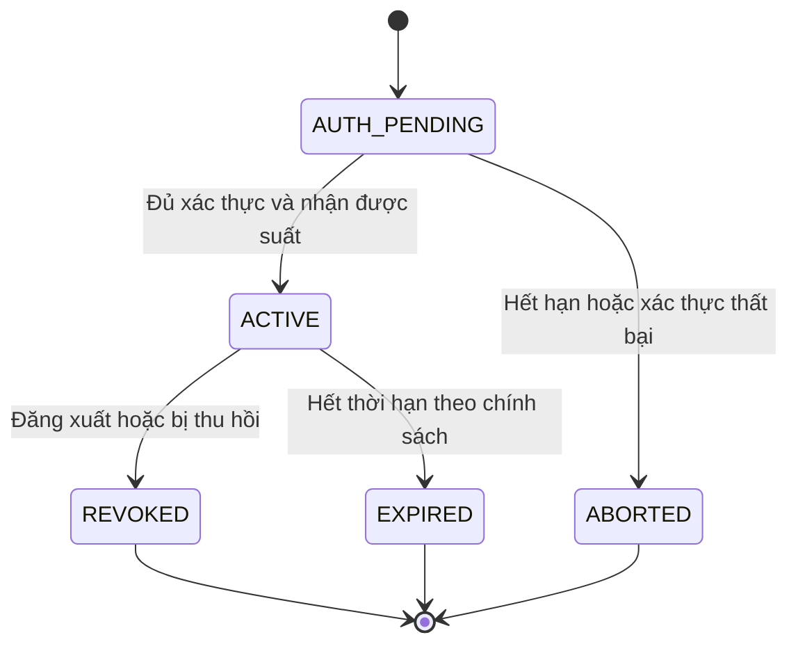

# Concurrent session policy

## 1. Chính sách phiên đồng thời giải quyết vấn đề gì?

**Concurrent session policy** là tập quy tắc xác định một chủ thể được duy trì bao nhiêu phiên truy cập cùng lúc, những phiên nào được tính vào giới hạn và hệ thống làm gì khi phát sinh yêu cầu vượt giới hạn. Chính sách còn phải quy định cách chấm dứt phiên, thời điểm quyền truy cập thực sự mất hiệu lực và cách xử lý các thao tác cạnh tranh trong hệ thống phân tán.

Ví dụ, một người dùng có thể đăng nhập vào cổng dịch vụ bằng trình duyệt tại công ty, trình duyệt tại nhà và ứng dụng di động. Với tài khoản thông thường, ba phiên có thể là nhu cầu hợp lệ. Với tài khoản vận hành đặc quyền, tổ chức có thể chọn một phiên quản trị duy nhất tại một thời điểm. Không có một con số phù hợp cho mọi loại tài khoản và mọi hệ thống.

Trong đặc tả yêu cầu bảo mật, câu “chỉ cho phép một thiết bị đăng nhập” thường chưa đủ rõ. Cần trả lời:

- Một phiên, một thiết bị, một trình duyệt và một token khác nhau thế nào?
- Giới hạn được áp dụng theo tài khoản, tenant, ứng dụng hay nhóm ứng dụng?
- Khi đủ số phiên, từ chối phiên mới, thay phiên cũ hay yêu cầu người dùng lựa chọn?
- Sau khi một phiên bị thu hồi, token hoặc kết nối đang tồn tại còn dùng được bao lâu?
- Hai node cùng chấp nhận đăng nhập mới có thể làm vượt giới hạn không?

Mục tiêu là chuyển lựa chọn sản phẩm và rủi ro thành hành vi có thể đo, kiểm thử và giải thích khi vận hành.

### 1.1. Giới hạn phiên không chứng minh tài khoản chưa bị xâm nhập

Giới hạn số phiên có thể giảm số điểm truy cập độc lập, hỗ trợ người dùng quản lý lần đăng nhập và làm rõ quy trình thu hồi. Tuy nhiên, nó không thay thế xác thực mạnh, phân quyền, phát hiện bất thường hoặc bảo vệ credential.

Nếu kẻ tấn công sao chép được cookie của một phiên hợp lệ, hai bên có thể cùng sử dụng **một** phiên logic. Bộ đếm vẫn là một. Nếu dùng chính sách “đăng nhập mới đẩy phiên cũ ra”, người nắm credential bị lộ còn có thể liên tục đăng nhập để làm gián đoạn người dùng hợp pháp.

Do đó, cần diễn đạt đúng mục tiêu: kiểm soát số phiên theo định nghĩa đã chốt, thay vì tuyên bố rằng giới hạn đó ngăn mọi trường hợp chia sẻ tài khoản hoặc chiếm phiên.

## 2. Định nghĩa đơn vị đếm trước khi chọn giới hạn

### 2.1. Phiên logic, token, tab và thiết bị

| Đối tượng | Có nhất thiết là một phiên riêng không? | Điều cần làm rõ |
| --- | --- | --- |
| Hai tab dùng chung cookie jar | Thường cùng một phiên web | Mở tab không nên tự chiếm thêm suất nếu vẫn dùng cùng phiên |
| Hai browser profile độc lập | Có thể tạo hai phiên | Phụ thuộc việc mỗi profile hoàn tất một lần cấp phiên riêng |
| Nhiều access token được cấp từ cùng một phiên | Không nhất thiết | Không đếm mỗi lần refresh thành một phiên mới nếu chúng thuộc cùng grant/phiên logic |
| Một refresh-token family | Có thể đại diện một phiên ứng dụng | Cần xác định liên kết giữa family, session record và quyền thu hồi |
| Một điện thoại | Có thể chứa nhiều phiên hoặc tài khoản | Thiết bị vật lý không tự tương đương một session record |
| Một phiên tại Identity Provider | Có thể tạo nhiều phiên ứng dụng | Giới hạn ở IdP không tự đồng nghĩa với giới hạn của từng ứng dụng |
| Một cookie bị sao chép sang client khác | Vẫn có thể là cùng phiên logic | Không dùng số phiên để suy ra số client thực tế đang nắm cookie |

Một chính sách dễ thực thi và kiểm chứng thường chọn **phiên logic do server quản lý** làm đơn vị. Phiên có ID quản trị ổn định trong suốt vòng đời, trong khi cookie hoặc token truy cập có thể được rotation nhiều lần.

Ví dụ:

```text
Phiên logic L1 của browser profile A
    -> cookie phiên trước rotation
    -> cookie phiên sau rotation
    -> cùng một suất theo chính sách

Phiên logic L2 của ứng dụng di động
    -> refresh-token family F2
    -> access token T1, T2, T3 được cấp lần lượt
    -> cùng một suất nếu hợp đồng định nghĩa như vậy
```

ID quản trị phiên không nhất thiết là bearer token mà client dùng để truy cập. Nếu ID hiển thị trong trang “Phiên đang hoạt động” cũng là credential có thể dùng để đăng nhập, trang quản lý phiên sẽ tạo thêm đường lộ credential.

### 2.2. Không dùng dấu vết thiết bị làm nguồn đếm duy nhất

IP, User-Agent, tên thiết bị và browser fingerprint có thể hỗ trợ hiển thị hoặc đánh giá rủi ro, nhưng không phải bằng chứng chắc chắn về một thiết bị vật lý. Nhiều người dùng có thể chung IP; một người có thể đổi IP; client có thể tự khai báo một số thuộc tính.

Nếu sản phẩm thật sự yêu cầu giới hạn thiết bị đã đăng ký, phải có mô hình đăng ký, chứng minh và thu hồi thiết bị riêng. Không đổi tên bộ đếm session thành “device limit” rồi coi như đã đạt yêu cầu đó.

### 2.3. Chốt khóa áp dụng chính sách

Khóa giới hạn phải định danh chủ thể bằng nguồn ổn định, tránh dùng tên hiển thị hoặc email có thể thay đổi. Nếu có nhiều nguồn identity, phải tránh nhầm hai subject khác nhau có cùng chuỗi ID.

Một biểu diễn khái niệm:

```text
policyKey = (identityIssuer, subjectId, applicationGroup, sessionClass)
```

Nếu chính sách tính riêng theo tenant, bổ sung tenant theo ngữ nghĩa đã xác định. Cần biết việc chuyển tenant là đổi bối cảnh trong cùng phiên hay tạo phiên mới. Không được vô tình tạo một giới hạn riêng cho mỗi tenant trong khi yêu cầu nghiệp vụ muốn giới hạn toàn tài khoản.

Tương tự, nếu web và mobile cùng thuộc một giới hạn, chúng phải dùng cùng phạm vi đếm. Nếu mỗi kênh có quota riêng, điều đó cần được nêu rõ để người dùng và người kiểm thử không hiểu “tối đa ba phiên” là tổng của cả hai.

## 3. Chọn hành vi khi đạt giới hạn

### 3.1. Ba lựa chọn phổ biến

| Lựa chọn | Hành vi khi đã đủ phiên | Lợi ích | Rủi ro hoặc đánh đổi |
| --- | --- | --- | --- |
| Từ chối phiên mới | Giữ các phiên hiện có; không cấp phiên mới | Tránh tự động làm gián đoạn người đang dùng | Người dùng có thể bị kẹt nếu không có đường đóng phiên cũ an toàn |
| Thay một phiên cũ | Chọn phiên theo quy tắc, thu hồi rồi cấp phiên mới | Thuận tiện khi chuyển máy | Người nắm credential có thể đẩy người dùng thật ra; cần kiểm soát thu hồi thực tế |
| Cho người dùng chọn | Sau khi xác minh phù hợp, yêu cầu chọn phiên để kết thúc | Quyết định rõ ràng và ít bất ngờ hơn | Cần một luồng giới hạn quyền để quản lý phiên trước khi được cấp phiên ứng dụng mới |

Không nên để hành vi phụ thuộc ngẫu nhiên vào node xử lý hoặc vào thư viện nào được gọi. Đặc tả phải chọn rõ hành vi cho từng nhóm tài khoản và nêu điều kiện ngoại lệ.

Đối với chính sách thay phiên cũ, phải định nghĩa “cũ”:

- Phiên tạo sớm nhất theo thứ tự do hệ thống quản lý.
- Phiên có hoạt động hợp lệ gần nhất xa nhất.
- Phiên do người dùng chỉ định.

Nếu dùng hoạt động gần nhất, cần xác định hoạt động nào được tính và độ trễ cập nhật. Một heartbeat nền không nhất thiết phản ánh người dùng còn hiện diện. Client không được gửi một timestamp tùy ý rồi làm cho phiên của mình luôn được coi là mới nhất.

Thứ tự lựa chọn cũng cần có cách xử lý hòa, chẳng hạn thứ tự tạo được session store cấp hoặc ID phụ dùng để sắp xếp ổn định. Không dựa hoàn toàn vào đồng hồ client hay giả định đồng hồ mọi node giống hệt nhau.

### 3.2. Không cho một yêu cầu chưa được xác thực đẩy người khác ra

Luồng kiểm tra mật khẩu hoặc MFA chưa hoàn tất không nên tự thu hồi phiên hợp lệ chỉ vì có người nhập đúng tên tài khoản. Nếu làm vậy, bên ngoài có thể gây từ chối dịch vụ bằng cách gửi nhiều yêu cầu đăng nhập.

Điểm cho phép thay phiên phải được đặc tả sau mức xác minh phù hợp với tài khoản và rủi ro. Với tài khoản yêu cầu MFA, chỉ xác minh mật khẩu chưa đủ để coi người gọi đã được quyền giành suất phiên quản trị.

Nếu cho người dùng lựa chọn phiên sau khi đăng nhập đầy đủ nhưng trước khi có suất mới, cần tạo **giao dịch xác thực có quyền hạn chế**, không phải phiên ứng dụng có toàn bộ quyền. Giao dịch đó chỉ được xem hoặc kết thúc các phiên được phép trong mục đích đã xác định, có thời hạn và ràng buộc chống lạm dụng phù hợp.

### 3.3. Ví dụ chính sách theo mức rủi ro

| Nhóm phiên | Giới hạn minh họa | Khi đạt giới hạn | Phạm vi |
| --- | --- | --- | --- |
| Người dùng thông thường | Ba phiên logic đang hoạt động | Từ chối phiên mới; cho chọn kết thúc phiên sau xác minh đầy đủ | Tổng web và mobile trong một nhóm ứng dụng |
| Quản trị đặc quyền | Một phiên quản trị | Yêu cầu xác thực mạnh và quyết định thay phiên theo quy trình | Phạm vi quản trị được định danh rõ |
| Truy cập hỗ trợ khẩn cấp | Theo quy trình ngoại lệ có thời hạn | Không dùng ngoại lệ tự động từ yêu cầu đăng nhập thường | Tài khoản, phạm vi và người phê duyệt đã được chốt |

Những con số trên là ví dụ thiết kế, không phải giá trị chuẩn bắt buộc. Cần cân nhắc nhu cầu sử dụng, khả năng khôi phục, mức ảnh hưởng và cơ chế thực thi của hệ thống.

## 4. Định nghĩa thế nào là phiên “đang hoạt động”

### 4.1. Trạng thái và điều kiện được tính

Một mô hình trạng thái minh họa:



Chính sách phải định nghĩa trạng thái nào chiếm suất. Ví dụ:

> Một phiên được tính khi trạng thái là `ACTIVE`, chưa hết hạn tuyệt đối, chưa hết idle timeout và chưa có quyết định thu hồi có hiệu lực theo hợp đồng. Các giao dịch xác thực chưa hoàn tất không chiếm suất truy cập, nhưng chịu giới hạn chống lạm dụng riêng.

Đây là một lựa chọn, không phải mô hình duy nhất. Nếu dùng reservation để giữ suất trong lúc hoàn tất giao dịch, cần quy định reservation có được tính vào capacity, thời hạn bao lâu và cách giải phóng. Reservation không được tồn tại vô hạn khi client bỏ dở.

### 4.2. Hết hạn logic không phụ thuộc thời điểm dọn record

Một record có thể vẫn nằm trong database sau khi phiên hết hạn vì tác vụ cleanup chưa chạy. Không nên để độ trễ cleanup làm người dùng mất suất không cần thiết. Phép tính quota phải dựa trên trạng thái và thời hạn có hiệu lực, không chỉ `COUNT(*)` của mọi record còn tồn tại.

Ngược lại, xóa record khỏi danh sách không tự chứng minh token đang lưu ở client đã mất hiệu lực. Quyền truy cập và trạng thái quota phải được nối với cơ chế xác thực thực tế của tài nguyên.

Đối với idle timeout, cần thống nhất hoạt động hợp lệ, thời gian nguồn chuẩn và cách cập nhật. Một request đã bị từ chối hoặc refresh đến sau thu hồi không được tự làm phiên sống lại. Mọi cập nhật kéo dài phiên phải kiểm tra trạng thái/version còn hợp lệ.

### 4.3. Rotation không được vô tình tăng quota

Đổi session ID để chống fixation, đổi token theo chu kỳ hoặc reauthentication trong cùng phiên không nhất thiết tạo một suất mới. Hệ thống cần liên kết các credential kế tiếp với cùng phiên logic theo hợp đồng.

Nếu nâng phiên thường thành phiên quản trị, cần quyết định rõ đó là chuyển lớp của phiên hay tạo một phiên quản trị riêng. Dù chọn cách nào, thao tác phải kiểm tra giới hạn của lớp đích và không tạo đường vượt quota bằng việc liên tục chuyển lớp.

## 5. Đếm phiên đúng nhưng thu hồi sai vẫn không đạt mục tiêu

### 5.1. Phân biệt quota trong registry và phiên còn truy cập được

Có hai đại lượng dễ bị nhầm:

```text
R = số phiên được registry ghi nhận là ACTIVE theo chính sách
E = số phiên thực tế còn được các điểm thực thi chấp nhận truy cập
```

Nếu registry đã đánh dấu phiên A là revoked và cấp phiên D, `R` có thể vẫn đúng giới hạn ba. Nhưng nếu token của A còn được API chấp nhận trong mười phút thì thực tế bốn phiên có thể cùng truy cập trong khoảng đó.

Vì vậy, đặc tả phải nói rõ giới hạn là:

- Giới hạn cứng đối với các phiên thực tế còn được chấp nhận tại điểm quyết định quyền; hoặc
- Giới hạn cấp phát trong registry, kèm giới hạn thời gian chồng lấn do thu hồi chưa lan truyền.

Nếu yêu cầu là giới hạn cứng, không được giải thích một khoảng vượt bằng việc “record đã bị xóa”. Cần có cơ chế kiểm tra thu hồi đủ mạnh hoặc chỉ giải phóng suất thay thế khi phiên cũ đã mất khả năng truy cập theo phạm vi cam kết. Nếu kiến trúc chấp nhận chồng lấn, phải công bố rõ khoảng thời gian và rủi ro được chấp nhận; không gọi đó là giới hạn cứng.

### 5.2. Cookie, access token, refresh token và kết nối dài

| Thành phần | Khi thu hồi một phiên cần kiểm tra điều gì? |
| --- | --- |
| Cookie trỏ tới phiên phía server | Các node có còn tìm/khôi phục được trạng thái xác thực của phiên cũ không? |
| Access token được kiểm tra ngoại tuyến | Token có còn được chấp nhận tới lúc hết hạn không, và có cơ chế chặn sớm không? |
| Refresh token | Phiên đã thu hồi có còn xin được access token mới không? |
| Cache quyết định quyền | Cache có thể tiếp tục cho phép phiên cũ trong bao lâu? |
| WebSocket hoặc stream | Kết nối chỉ kiểm tra lúc mở hay còn được kiểm tra/đóng khi thu hồi? |
| Tác vụ đã được chấp nhận trước thu hồi | Tiếp tục, hủy hoặc kiểm tra lại ở điểm nào theo yêu cầu nghiệp vụ? |

Chặn refresh token mới nhưng để access token cũ hoạt động đến hết hạn có thể là một lựa chọn, nhưng phải tương thích với giới hạn thời gian thu hồi đã đặc tả. Việc client tự xóa token không thay thế thu hồi phía thực thi, vì client bị xâm nhập có thể không tuân thủ.

Không thể thu hồi dữ liệu mà client đã tải về chỉ bằng việc kết thúc phiên. Với tác vụ đã bắt đầu, cũng không nên dùng từ “ngay lập tức” mà không định nghĩa điểm quyết định quyền và hành vi đối với công việc đang chạy.

### 5.3. Một phiên và toàn bộ phiên là hai phạm vi khác nhau

Yêu cầu cần phân biệt:

- Đăng xuất phiên hiện tại.
- Thu hồi một phiên cụ thể từ trang quản lý phiên.
- Thu hồi tất cả phiên của tài khoản.
- Thu hồi một lớp phiên, chẳng hạn toàn bộ phiên quản trị.
- Kết thúc phiên tại một ứng dụng hoặc phối hợp đăng xuất nhiều ứng dụng/IdP.

Kỹ thuật tăng một version/epoch toàn tài khoản có thể hỗ trợ thu hồi toàn bộ phiên nếu các điểm thực thi kiểm tra nó phù hợp. Tuy nhiên, dùng cơ chế đó cho chức năng “đóng một phiên” có thể làm tất cả thiết bị mất truy cập ngoài ý muốn. Ngược lại, thu hồi một session record không mặc nhiên kết thúc phiên ở ứng dụng khác hoặc tại IdP.

## 6. Thực thi quota trong hệ thống nhiều node

### 6.1. Tránh mẫu “đếm rồi thêm” không nguyên tử

Giả sử giới hạn là ba, hiện có hai phiên. Hai node đồng thời xử lý hai lần đăng nhập hợp lệ:

```text
Node A đọc: đang có 2 phiên -> còn một suất.
Node B đọc: đang có 2 phiên -> còn một suất.
Node A thêm phiên C.
Node B thêm phiên D.
Kết quả: 4 phiên được cấp mặc dù giới hạn là 3.
```

Đặt một câu `if count < limit` trong mã không đủ nếu phép đếm và cấp suất không có kiểm soát cạnh tranh theo cùng khóa chính sách.

Hợp đồng mong muốn có thể mô tả như sau. Đây là pseudocode yêu cầu, không phải API hay transaction có sẵn của một sản phẩm:

```text
activateSession(policyKey, authenticationTransaction):
    require authenticationTransaction đã đạt mức xác thực cần thiết
    require giao dịch thuộc đúng chủ thể và chưa bị hủy

    atomically for policyKey:
        đọc phiên bản chính sách đang áp dụng
        xác định các phiên/reservation còn chiếm suất theo thời gian chuẩn
        xử lý kết quả cũ nếu đây là lần thử lại hợp lệ của cùng giao dịch

        if không còn suất:
            thực hiện hành vi vượt giới hạn đã quy định
            không tự cấp phiên ngoài chính sách
        else:
            cấp đúng một phiên logic và ghi nhận suất
            lưu kết quả gắn với giao dịch theo cơ chế bảo vệ phù hợp

    trả kết quả mà không làm lộ credential cho bên không được phép
```

“Atomically” ở đây là tính chất của quyết định quota quan sát được. Hệ thống có thể thực hiện bằng transaction, thao tác điều kiện, version hoặc cơ chế phối hợp phù hợp. Một khóa chỉ nằm trong bộ nhớ của từng process không bảo đảm giới hạn chung giữa nhiều node.

### 6.2. Thay phiên phải phối hợp cấp suất và thu hồi

Nếu chính sách thay phiên cũ, cần quản lý cả hai hành động:

1. Chọn đúng phiên bị thay theo quy tắc và phiên bản chính sách.
2. Chấm dứt khả năng dùng phiên cũ theo hợp đồng thu hồi.
3. Cấp hoặc kích hoạt phiên mới trong giới hạn đã cam kết.

Thao tác chỉ cập nhật registry nguyên tử chưa đủ cho một giới hạn cứng nếu tài nguyên vẫn chấp nhận token cũ từ cache. Thiết kế phải nối được quyết định registry với nơi thực thi quyền, hoặc giữ phiên mới ở trạng thái chờ trong thời gian cần thiết. Không giải quyết bằng cách âm thầm cho cả hai tiếp tục dùng mà vẫn báo đã đạt giới hạn cứng.

### 6.3. Thử lại, crash và giải phóng suất

Network timeout có thể khiến client gửi lại yêu cầu dù lần trước server đã cấp phiên. Nếu mỗi lần thử lại chiếm một suất mới, người dùng có thể tự đạt giới hạn mà chỉ thực hiện một lần đăng nhập.

Yêu cầu idempotency cần ràng buộc với giao dịch xác thực và chủ thể phù hợp, có thời hạn và bảo vệ khỏi sử dụng lại trái phép. Không cho một idempotency key tùy ý trở thành cách lấy credential của phiên đã cấp cho người khác.

Tương tự, logout lặp lại hoặc nhiều node cùng xử lý một sự kiện thu hồi không được giảm bộ đếm nhiều lần. Dùng chuyển trạng thái có điều kiện hoặc nguồn trạng thái chuẩn phù hợp thay vì chỉ thực hiện `counter--` với mỗi request.

Nếu server crash sau khi chiếm suất nhưng trước khi trả cookie/token, cần có chính sách khôi phục kết quả hoặc thu dọn phiên chưa được sử dụng. Không được tái cấp vô hạn mỗi lần retry, cũng không duy trì reservation không có thời hạn. Cơ chế tự hết hạn phải ngăn một phiên/reservation đã kết thúc được cập nhật sống lại bởi request đến muộn.

### 6.4. Khi nguồn kiểm tra quota gặp sự cố

Hệ thống cần chọn trước hành vi khi không xác định được số phiên hoặc tình trạng thu hồi:

- Có chặn cấp phiên mới hay cho phép tạm thời?
- Phiên hiện có được tiếp tục trong bao lâu dựa trên trạng thái cache?
- Nhóm phiên đặc quyền có yêu cầu nghiêm ngặt hơn không?
- Khi phục hồi, phiên vượt giới hạn được xử lý theo thứ tự nào?

Ví dụ, một hệ thống có thể chặn cấp phiên quản trị mới khi không kiểm tra được quota, đồng thời có chính sách riêng cho phiên người dùng thông thường. Nếu cho phép tạm thời vượt, phải ghi đó là ngoại lệ về tính sẵn sàng với phạm vi và giới hạn rõ ràng. Không thể vừa cho phép cấp phát không phối hợp vừa khẳng định luôn giữ một giới hạn cứng toàn hệ thống.

## 7. Quản lý phiên cho người dùng và quản trị viên

### 7.1. Danh sách phiên không được trở thành API truy cập phiên

Giao diện có thể hiển thị loại client, thời điểm tạo, hoạt động gần nhất và thông tin nguồn ở độ chi tiết phù hợp. Tên thiết bị do client khai báo phải được xử lý như dữ liệu không đáng tin, không phải bằng chứng định danh.

Mỗi thao tác xem hoặc kết thúc phiên phải kiểm tra chủ thể có quyền quản lý phiên đó. Việc biết ID phiên quản trị hoặc sửa một tham số trong URL không được cho phép kết thúc phiên của người khác. Quyền của quản trị viên hỗ trợ phải được cấp riêng và audit, không suy ra từ việc họ truy cập được màn hình quản trị.

Không trả raw cookie, access token hoặc refresh token trong API danh sách phiên. Nếu cần gọi thao tác thu hồi, dùng tham chiếu quản trị không tự cấp quyền truy cập phiên và vẫn kiểm tra quyền sở hữu trên server.

### 7.2. Thông báo vượt giới hạn và thay phiên

Thông báo cần giúp người dùng hiểu quyết định: đã đạt giới hạn, cần hoàn tất xác minh để quản lý phiên hay một phiên đã bị kết thúc do chính sách. Không cung cấp danh sách phiên và chi tiết tài khoản cho một bên mới chỉ nhập username.

Nếu đăng nhập mới làm kết thúc phiên cũ, chính sách nên xác định thông báo nào được gửi, tại kênh nào và có thể dẫn tới hành động gì. Thông báo không chứa credential phiên và không thay thế yêu cầu thu hồi thực tế.

Luồng khôi phục phải tránh vòng lặp: nếu mọi thiết bị cũ đều mất, người dùng cần một cách xác minh phù hợp để kết thúc phiên không còn truy cập được. Không dùng một đường khôi phục yếu để vô hiệu hóa toàn bộ kiểm soát ở luồng đăng nhập chính.

### 7.3. Thay đổi chính sách trong khi còn phiên hoạt động

Khi giảm giới hạn từ năm xuống ba, hệ thống phải quyết định xử lý hai phiên dư như thế nào. Các lựa chọn có thể gồm thu hồi theo thứ tự đã chốt hoặc cho các phiên hiện tại tiếp tục nhưng chặn cấp mới đến khi về giới hạn.

Nếu giữ phiên cũ, đó là quy tắc chuyển tiếp có thời hạn/phạm vi, không phải bằng chứng rằng giới hạn mới đã có hiệu lực đầy đủ. Cần ghi phiên bản chính sách, thời điểm hiệu lực và cách giải thích quyết định đối với phiên được cấp trước đó.

## 8. Ví dụ đặc tả yêu cầu có thể kiểm chứng

Giả sử cổng dịch vụ định nghĩa một phiên logic cho mỗi lần cấp quyền truy cập độc lập, dùng chung quota giữa web và mobile. Giới hạn minh họa là ba phiên cho người dùng thường; khi đủ, từ chối phiên mới cho tới khi người dùng kết thúc một phiên bằng luồng đã xác minh.

| ID | Yêu cầu | Bằng chứng nghiệm thu |
| --- | --- | --- |
| CS-01 | Quota áp dụng theo issuer, subject và nhóm ứng dụng đã định; web/mobile dùng cùng phạm vi | Đăng nhập qua nhiều kênh cho cùng chủ thể cùng tiêu thụ một quota; hai subject khác nhau không bị gộp |
| CS-02 | Mỗi phiên logic đang hoạt động chiếm một suất; tab dùng chung phiên, rotation và refresh không tự tăng số suất | Mở tab, đổi ID và cấp token tiếp theo không làm tăng số phiên logic |
| CS-03 | Khi đủ ba phiên, giao dịch đăng nhập mới không được nhận phiên ứng dụng có quyền | Ba phiên cũ tiếp tục hoạt động; lần cấp thứ tư bị từ chối theo hợp đồng |
| CS-04 | Quyết định cấp suất nhất quán khi nhiều node xử lý đăng nhập đồng thời | Với hai phiên đang hoạt động và hai yêu cầu mới cạnh tranh, chỉ một phiên mới được kích hoạt |
| CS-05 | Một lần thử lại hợp lệ của cùng giao dịch không tạo thêm phiên logic | Mô phỏng timeout sau khi cấp phiên; retry không chiếm suất thứ hai |
| CS-06 | Phiên hết hạn hoặc bị thu hồi không được sống lại do refresh/heartbeat đến muộn | Sau chuyển trạng thái, các yêu cầu gia hạn bị từ chối; bộ đếm không tăng lại do cập nhật cũ |
| CS-07 | Thu hồi một phiên chặn phát hành token mới và chặn truy cập bằng token cũ trong giới hạn thời gian đã chốt | Dùng credential cũ tại các điểm thực thi trong phạm vi, đo từ mốc thu hồi có nguồn chuẩn |
| CS-08 | Giải phóng suất và cấp phiên thay thế phải tương thích với cam kết giới hạn cứng hoặc khoảng chồng lấn đã công bố | Đối chiếu registry với truy cập thực tế, không chỉ đếm record `ACTIVE` |
| CS-09 | Chỉ chủ thể được phép mới xem/kết thúc phiên; danh sách phiên không trả bearer credential | Thử truy cập chéo tài khoản bị từ chối; response không chứa cookie/token có thể dùng để đăng nhập |
| CS-10 | Logout hoặc thu hồi lặp lại không làm giải phóng nhiều hơn một suất | Gửi đồng thời nhiều lần thu hồi cùng phiên; trạng thái và quota vẫn đúng |
| CS-11 | Khi không xác minh được quota, hệ thống áp dụng hành vi lỗi đã chốt cho từng lớp phiên | Mô phỏng lỗi kho trạng thái; không tự bật một đường cấp phiên ngoài chính sách |
| CS-12 | Mỗi quyết định cấp, từ chối, thay và thu hồi phiên truy được nguyên nhân cùng phiên bản chính sách | Audit có correlation ID, actor/phạm vi phù hợp, kết quả và reason code, không có raw token |

CS-07 cần được bổ sung một thời gian cụ thể cho dự án. Ví dụ “tối đa mười giây kể từ lúc lệnh thu hồi được nguồn chuẩn ghi nhận thành công” là mục tiêu đo được, nhưng chỉ phù hợp nếu toàn bộ cơ chế kiểm tra token/cache đáp ứng được. Nếu access token còn được chấp nhận trong năm phút, không thể báo đạt mục tiêu mười giây chỉ vì refresh đã bị chặn.

Đối với giới hạn cứng thực tế, còn phải kiểm tra CS-08: không mở suất thay thế trong lúc phiên cũ vẫn dùng được quyền làm tổng số phiên vượt giới hạn. Mục tiêu thời gian thu hồi và mục tiêu không vượt quota là hai yêu cầu liên quan nhưng không đồng nhất.

## 9. Kịch bản nghiệm thu trọng tâm

### 9.1. Đạt giới hạn và từ chối phiên mới

```gherkin
Feature: Giới hạn ba phiên logic cho tài khoản thông thường

  Scenario: Lần đăng nhập thứ tư không được cấp quyền truy cập
    Given tài khoản kiểm thử có ba phiên logic ACTIVE còn hợp lệ
    And ba phiên thuộc cùng khóa chính sách
    When một client độc lập hoàn tất xác thực và đề nghị cấp phiên mới
    Then không cấp phiên ứng dụng có quyền cho client mới
    And ba phiên hiện có không bị thu hồi ngoài chính sách
    And audit ghi SESSION_LIMIT_REACHED cùng phiên bản chính sách
```

Phải kiểm tra request tới tài nguyên được bảo vệ từ client mới, không chỉ kiểm tra thông báo giao diện. Một response báo “vượt giới hạn” nhưng đồng thời trả token có quyền vẫn là thất bại.

### 9.2. Đăng nhập đồng thời tại suất cuối cùng

```text
Chuẩn bị: giới hạn 3, đang có 2 phiên.
Client C và D dùng cookie jar/giao dịch xác thực độc lập.
Cho C và D đồng thời đề nghị kích hoạt phiên qua các node khác nhau.
Kỳ vọng theo chính sách từ chối phiên mới:
    đúng một giao dịch nhận được suất còn lại;
    giao dịch còn lại không có quyền truy cập của một phiên mới;
    tổng số phiên có hiệu lực không vượt cam kết;
    audit đủ để đối chiếu hai quyết định cạnh tranh.
```

Thử nghiệm cần tạo cạnh tranh ở thao tác cấp suất, không chỉ gửi hai request tuần tự hoặc đăng nhập một client hai lần dùng chung phiên. Bằng chứng phải gồm trạng thái nguồn chuẩn và hành vi truy cập, vì số record đơn thuần không cho biết token nào còn được chấp nhận.

### 9.3. Thu hồi và giải phóng suất

Kiểm tra bằng token/cookie đã được cấp **trước** thu hồi. Sau mốc thu hồi, thử truy cập tài nguyên, refresh, kết nối dài nếu nằm trong phạm vi và đăng nhập để nhận suất thay thế. Xác nhận phiên không bị khôi phục bởi cache hoặc request gia hạn đến muộn.

Nếu phép đo có giới hạn thời gian, cần ghi rõ T0, nguồn đồng hồ, các node/điểm thực thi và điều kiện cache. Một mẫu đạt trung bình hoặc p99 không tự chứng minh một yêu cầu được viết là “tối đa trong mọi trường hợp thuộc phạm vi”. Yêu cầu và loại bằng chứng phải dùng cùng ngữ nghĩa.

### 9.4. Các ca biên có giá trị

- Hai yêu cầu logout cùng thu hồi một phiên trong khi có đăng nhập mới.
- Phiên đã hết hạn nhưng record chưa được cleanup.
- Đổi session ID để chống fixation khi tài khoản đã đủ quota.
- Refresh token trong cùng phiên không chiếm thêm suất.
- Server crash sau khi giữ suất nhưng trước khi trả kết quả.
- Thử lại giao dịch đăng nhập qua node khác.
- Chuyển từ phiên thường sang phiên quản trị có quota riêng.
- Giảm giới hạn khi số phiên hiện tại đã lớn hơn mức mới.
- Gián đoạn kho kiểm tra quota hoặc kênh đồng bộ thu hồi.
- Một tài khoản cố xem hoặc kết thúc phiên của tài khoản khác.

Những kịch bản này là tiêu chí cho hệ thống được thiết kế, không phải kết quả kiểm thử đã thực hiện khi soạn tài liệu.

## 10. Audit và chỉ số vận hành

Audit cần giúp giải thích vì sao một phiên được nhận, bị từ chối hoặc bị kết thúc. Một sự kiện quyết định có thể gồm:

```json
{
  "eventType": "session.admission_decision",
  "principalRef": "subject-28",
  "applicationGroup": "customer-portal",
  "sessionClass": "regular",
  "policyVersion": "concurrency-v4",
  "limit": 3,
  "countAtDecision": 3,
  "decision": "DENY",
  "reason": "SESSION_LIMIT_REACHED",
  "correlationId": "login-flow-6c21"
}
```

Nếu thay phiên, cần thêm tham chiếu quản trị tới phiên bị thay, actor và nguyên nhân theo quyền truy cập log. Không ghi raw cookie, access token hoặc refresh token. Dữ liệu IP, đặc điểm thiết bị và lịch sử phiên cũng cần phạm vi lưu giữ và quyền truy cập thích hợp.

Các chỉ số hữu ích gồm số lần chạm giới hạn, tỷ lệ từ chối cấp phiên, số reservation quá hạn, độ trễ thu hồi thực tế và số lần registry khác với truy cập quan sát được. Số lượng phiên trên dashboard không đủ để khẳng định cơ chế thu hồi đã đạt yêu cầu.

Cảnh báo phải có người tiếp nhận và quy trình xử lý. Ví dụ, số lần thay phiên tăng đột biến có thể là người dùng chuyển thiết bị, credential bị lộ hoặc lỗi retry tạo phiên trùng; cần đối chiếu trước khi kết luận.

## 11. Những lỗi đặc tả thường gặp

**“Một tài khoản, một thiết bị.”** Yêu cầu chưa định nghĩa thiết bị và cách chứng minh nó. Nếu thực tế chỉ đếm session record, phải ghi đúng là giới hạn phiên logic.

**“Đếm số access token để biết số phiên.”** Một phiên có thể có nhiều token kế tiếp hoặc token dành cho nhiều tài nguyên. Cần định nghĩa phép ánh xạ token về phiên/grant thuộc quota.

**“Đẩy phiên cũ bằng cách xóa cookie.”** Chỉ thay đổi một client không ngăn client khác tiếp tục dùng bản sao token. Thu hồi phải có hiệu lực ở nơi quyết định truy cập.

**“Registry còn ba record nên không có bốn phiên.”** Token của record đã thu hồi có thể vẫn được chấp nhận. Cần kiểm tra quota cấp phát và hiệu lực truy cập riêng rồi nối chúng theo cam kết.

**“Đếm rồi thêm đã có kiểm tra điều kiện.”** Không có kiểm soát cạnh tranh thì hai node có thể cùng sử dụng suất cuối.

**“Retry là đăng nhập mới.”** Thiếu idempotency có thể làm một thao tác người dùng tạo nhiều phiên, chiếm hết quota hoặc đẩy các phiên hợp lệ ra liên tục.

**“Mọi yêu cầu giữ chỗ đều đáng tin.”** Reservation trước xác thực có thể bị lạm dụng để chiếm capacity. Cần thời hạn, giới hạn chống lạm dụng và điểm cấp quyền phù hợp.

**“Hệ thống luôn đúng giới hạn kể cả khi cho cấp phiên offline.”** Không có cơ chế phối hợp phù hợp thì không thể đảm bảo giới hạn chung. Ngoại lệ tính sẵn sàng phải được mô tả và chấp nhận rõ.

## 12. Câu hỏi tự kiểm tra

1. Trong hệ thống đang thiết kế, một suất là phiên logic, thiết bị đã đăng ký hay grant? Rotation và refresh có thay đổi số suất không?
2. Web, mobile, các tenant và các ứng dụng dùng chung hay tách riêng quota? Khóa chủ thể có tránh nhầm giữa các nguồn identity không?
3. Khi đạt giới hạn, ai được quyền kết thúc phiên cũ và phải hoàn tất mức xác minh nào trước đó?
4. Token cũ còn truy cập được sau khi registry đánh dấu thu hồi không? Điều đó ảnh hưởng thế nào tới cam kết giới hạn cứng?
5. Hai node đồng thời cấp suất cuối được phối hợp ra sao? Retry và logout lặp lại có làm sai quota không?
6. Khi cache hoặc session store lỗi, hệ thống chọn hành vi nào cho phiên mới và phiên hiện có?
7. Người dùng mất toàn bộ thiết bị cũ có thể khôi phục quyền quản lý phiên bằng cách nào mà không tạo đường bỏ qua xác thực?

Một concurrent session policy có thể kiểm chứng phải nối được **đơn vị đếm, phạm vi áp dụng, quyết định cấp suất, thu hồi thực tế và hành vi khi cạnh tranh hoặc lỗi**. Chỉ đặt một con số giới hạn trong cấu hình chưa đủ để chứng minh những hành vi đó.
