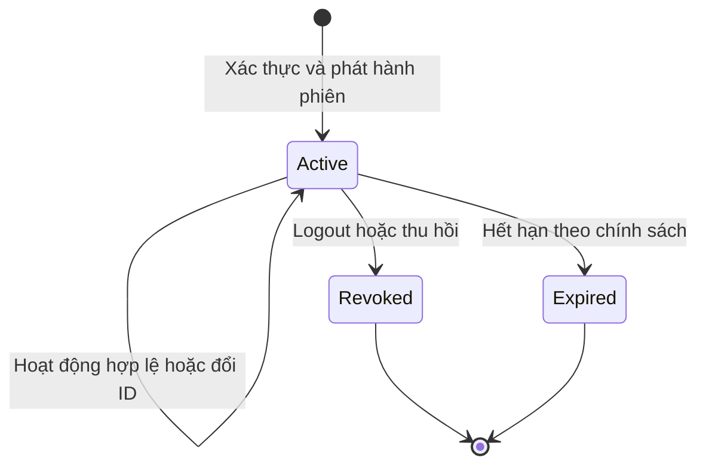

# Logout và session invalidation

## 1. Logout phải làm mất hiệu lực phiên, không chỉ đổi giao diện

Người dùng nhấn “Đăng xuất”, giao diện trở về trang đăng nhập và cookie biến mất. Những dấu hiệu đó chưa đủ chứng minh phiên đã chấm dứt. Nếu một bản sao session ID cũ vẫn được API chấp nhận, bên giữ bản sao đó vẫn có thể sử dụng phiên.

Trong thiết kế yêu cầu bảo mật, cần phân biệt hai hành động:

- **Logout** là quy trình do người dùng hoặc một chủ thể được ủy quyền khởi tạo để kết thúc một phạm vi đăng nhập.
- **Session invalidation** là việc hệ thống làm cho trạng thái hoặc bằng chứng của phiên không còn được chấp nhận để xác thực, tiếp tục hoặc làm mới phiên đó.

Logout thường bao gồm invalidation ở phía máy chủ và dọn trạng thái ở phía client. Invalidation còn có thể xuất phát từ hết hạn, khóa tài khoản, thay đổi chính sách, quản trị viên chấm dứt phiên hoặc phát hiện rủi ro.

Mục tiêu bảo mật có thể viết thành bất biến:

> Sau thời điểm chấm dứt có hiệu lực, mọi định danh và thông tin làm mới thuộc phạm vi phiên đã chấm dứt không được tạo ra một quyết định truy cập mới dựa trên phiên đó, kể cả khi chúng được gửi lại từ client khác.

OWASP yêu cầu vô hiệu hóa phiên ít nhất ở phía máy chủ khi logout; hướng dẫn cũng xét các session ID thuộc cùng phiên logic, bao gồm ID được tạo qua các lần đổi ID. Xem [OWASP Session Management — Logout Button](https://cheatsheetseries.owasp.org/cheatsheets/Session_Management_Cheat_Sheet.html#logout-button).

## 2. Xác định phạm vi trước khi viết yêu cầu

“Đăng xuất” có nhiều nghĩa. Nếu không đặt tên phạm vi rõ ràng, frontend, backend và hệ thống danh tính có thể thực hiện các việc khác nhau nhưng đều báo thành công.

| Phạm vi | Đối tượng cần chấm dứt | Điều không được tự suy ra |
|---|---|---|
| Phiên hiện tại của ứng dụng | Phiên logic đang được dùng và các credential liên quan theo chính sách | Các thiết bị đăng nhập độc lập cũng bị đăng xuất |
| Một phiên được chọn | Phiên thuộc danh sách phiên mà người thao tác có quyền quản lý | Người gọi được chấm dứt mọi session ID biết được |
| Mọi phiên của tài khoản trong ứng dụng | Các phiên thuộc tài khoản, ứng dụng và tenant đã xác định | Phiên ở mọi ứng dụng bên ngoài cũng kết thúc |
| Mọi thiết bị thuộc phạm vi quản lý | Các phiên và đường tự đăng nhập của những thiết bị đó | Mọi cơ chế tin cậy thiết bị đều đã bị thu hồi nếu chính sách chưa quy định |
| Đăng xuất liên kết danh tính | Các phiên tại ứng dụng và nhà cung cấp danh tính theo giao thức, cấu hình và chính sách | Một lần redirect bảo đảm mọi ứng dụng khác đã kết thúc phiên |

Một phiên logic có thể có nhiều định danh do rotation hoặc do cơ chế tương thích tạm thời. Đăng xuất phiên hiện tại không nên chỉ xóa đúng ID xuất hiện trên request rồi bỏ sót những ID khác vẫn đại diện cùng phiên.

Các tab trình duyệt thường chia sẻ cookie trong cùng phạm vi. Đăng xuất một phiên dùng cookie có thể ảnh hưởng đồng thời các tab đó. Đây là hệ quả của việc dùng chung phiên, khác với đăng xuất một thiết bị có phiên được xác thực độc lập.

### Ví dụ yêu cầu rõ phạm vi

> Nút “Đăng xuất trên thiết bị này” phải kết thúc phiên ứng dụng hiện tại và mọi credential làm mới hoặc tự khôi phục thuộc phiên đó. Các phiên được xác thực độc lập trên thiết bị khác không bị chấm dứt bởi thao tác này.

> Chức năng “Đăng xuất mọi phiên của tôi” phải chấm dứt mọi phiên đã tồn tại của tài khoản trong ứng dụng và tenant hiện tại tại mốc thu hồi được xác định. Phiên mới được tạo bởi một lần xác thực hợp lệ sau mốc đó tuân theo chính sách đăng nhập mới.

Hai yêu cầu này không đồng nghĩa. Giao diện phải thể hiện được sự khác biệt để người dùng hiểu tác động của lựa chọn.

## 3. Liệt kê toàn bộ trạng thái có thể duy trì đăng nhập

Một phiên ứng dụng có thể được duy trì bởi nhiều thành phần:

```text
Trình duyệt hoặc ứng dụng client
    ├── cookie hoặc bearer token của phiên
    ├── credential remember-me
    └── trạng thái giao diện, dữ liệu đã tải

Máy chủ ứng dụng
    ├── bản ghi phiên và trạng thái thu hồi
    ├── cache xác thực tại từng node
    └── kết nối hoặc công việc gắn với phiên

Hệ thống danh tính / authorization server
    ├── refresh token và quan hệ token
    ├── phiên SSO
    └── trạng thái grant theo giao thức được dùng
```

Không phải kiến trúc nào cũng có đủ các thành phần trên. Cần kiểm kê những thành phần thực sự tồn tại và xác định thành phần nào nằm trong phạm vi logout.

### 3.1. Session ID phía client

Xóa cookie hoặc token khỏi client giảm khả năng tiếp tục sử dụng phiên trên client đó. Nhưng bản sao bị đánh cắp trước đó không tự biến mất. Máy chủ phải kiểm tra được rằng phiên đã bị chấm dứt.

Ngược lại, vô hiệu hóa ở máy chủ nhưng để nguyên dữ liệu nhạy cảm trên màn hình có thể làm lộ thông tin trên máy dùng chung. Bảo mật phiên và bảo vệ dữ liệu còn hiển thị cần cả hai phía cùng xử lý.

### 3.2. Credential tự khôi phục phiên

Nếu chỉ xóa session ID nhưng giữ remember-me credential còn hiệu lực, ứng dụng có thể tự đăng nhập lại ngay ở request tiếp theo. Một thông báo “đã đăng xuất” khi đó không phù hợp với kỳ vọng của người dùng.

Yêu cầu cần chỉ rõ logout có thu hồi remember-me credential của phiên hoặc thiết bị hiện tại không. Với logout mọi phiên, phải xét mọi đường tự khôi phục trong phạm vi đã hứa hẹn.

Credential “tin cậy thiết bị để giảm bước xác thực” có thể có mục đích khác remember-me. Không coi hai loại này là một đối tượng nếu thiết kế tách biệt chúng. Những sự kiện như nghi ngờ mất thiết bị có thể yêu cầu thu hồi cả hai theo chính sách riêng.

### 3.3. Access token và refresh token

Refresh token cho phép nhận token mới theo giao thức đang dùng. Access token đã phát hành có thể tiếp tục được resource server chấp nhận nếu resource server chỉ kiểm tra chữ ký và thời hạn.

Do đó, “thu hồi refresh token” không tự chứng minh “mọi access token liên quan bị từ chối ngay”. Đặc tả phải xác định quan hệ giữa các token, khả năng thu hồi lan truyền và cách resource server biết quyết định thu hồi.

RFC 7009 định nghĩa cơ chế thu hồi OAuth token và cho phép chính sách tác động đến token hoặc grant liên quan; không nên giả định mọi triển khai đều có cùng hành vi lan truyền. Xem [RFC 7009 — Token Revocation](https://www.rfc-editor.org/rfc/rfc7009.html#section-2).

## 4. Mô hình trạng thái và bất biến chấm dứt

Một mô hình đơn giản cho phiên có trạng thái ở máy chủ:



Trong mô hình này, `Revoked` và `Expired` là trạng thái kết thúc của phiên logic. Một lần xác thực mới tạo phiên mới; request cũ không được đưa phiên đã kết thúc trở lại `Active`.

Những bất biến cần xác định gồm:

1. Phiên bị chấm dứt không được dùng để xác thực request mới sau thời điểm hiệu lực.
2. Không ID cũ, ID mới do rotation hoặc credential làm mới trong cùng phạm vi được khôi phục phiên đã chấm dứt.
3. Một thao tác lưu phiên bắt đầu trước logout không được ghi lại trạng thái hoạt động sau logout.
4. Retry logout không làm phiên hoạt động trở lại và không mở rộng quyền tác động.
5. Chấm dứt một phiên không được làm thay đổi chủ thể của phiên khác hoặc vượt phạm vi tenant.

Đây là những thuộc tính hệ thống cần giữ. Chọn cách xóa bản ghi, đánh dấu trạng thái, lưu tombstone hoặc tăng phiên bản là quyết định triển khai; mỗi cách phải đáp ứng cùng bất biến đã được đặc tả.

### Giữ bằng chứng thu hồi bao lâu?

Nếu sử dụng denylist hoặc tombstone để nhận diện token đã bị thu hồi, không được xóa thông tin này khi token cũ vẫn có thể được chấp nhận ở một đường thực thi. Thời gian giữ cần xét thời hạn token, độ lệch đồng hồ cho phép và các khoảng chấp nhận cũ đã cấu hình.

Việc dọn dữ liệu phải khác với việc phục hồi quyền. Dọn một bản ghi thu hồi chỉ được an toàn khi mọi bằng chứng cũ tương ứng đã không còn khả năng hợp lệ theo thiết kế.

## 5. Định nghĩa thời điểm hoàn tất và độ trễ thu hồi

“Đăng xuất ngay lập tức” không phải một yêu cầu đủ rõ cho kiến trúc có nhiều node và cache.

Cần xác định ít nhất các mốc:

```text
T_request   : hệ thống nhận yêu cầu logout hợp lệ
T0          : quyết định thu hồi được commit tại nguồn có thẩm quyền
T_effective : thời điểm giới hạn mà mọi điểm thực thi trong phạm vi phải từ chối
T_complete  : thời điểm hệ thống được phép công bố logout hoàn tất
```

### 5.1. Ví dụ hợp đồng thời gian

Giả sử ứng dụng chọn giới hạn minh họa `delta = 5 giây`:

> Sau khi quyết định logout được commit tại `T0`, mọi quyết định xác thực mới tại các API và node thuộc phạm vi phải từ chối credential của phiên đã kết thúc muộn nhất tại `T0 + 5 giây`. Trong khoảng truyền quyết định, trạng thái trả cho client phải phân biệt đã nhận yêu cầu với đã hoàn tất nếu hệ thống chưa bảo đảm hiệu lực toàn phạm vi.

Con số năm giây là lựa chọn của ví dụ, không phải một ngưỡng chung. Một hệ thống có yêu cầu chặt hơn có thể đòi mọi quyết định bắt đầu sau commit đều bị từ chối, khiến cách kiểm tra trạng thái và sử dụng cache phải khác.

Nếu hệ thống hứa “logout hoàn tất” đồng nghĩa đã vô hiệu hóa toàn phạm vi, chỉ được trả kết quả hoàn tất sau khi có cơ chế bảo đảm điều đó. Cơ chế có thể dựa vào xác nhận của các điểm thực thi hoặc một bảo đảm nhất quán và giới hạn thời gian đã được thiết kế. Chỉ gửi sự kiện rồi giả định mọi nơi đã nhận không đủ.

### 5.2. Phải tính cả cache và replica

Một node có thể giữ cache `session=active` trong 60 giây. Nếu hệ thống hứa ngừng chấp nhận trong năm giây nhưng không có cách vô hiệu hóa cache sớm, hai quyết định thiết kế đang mâu thuẫn.

Cần kiểm tra cả:

- Cache trong tiến trình và cache dùng chung.
- Replica có độ trễ và vùng triển khai khác.
- Gateway có ghi nhớ kết quả xác thực.
- Resource server tự kiểm tra token mà không gọi về nguồn trạng thái.
- Đường fallback khi nguồn thu hồi không truy cập được.

TTL chỉ là một thành phần của ngân sách trễ. Không được dùng thời gian phát sự kiện thay cho thời điểm dịch vụ thực sự ngừng chấp nhận credential.

## 6. Opaque session và token tự chứa cần cơ chế khác nhau

| Kiến trúc | Cách thể hiện việc phiên không còn hợp lệ | Điểm cần chứng minh |
|---|---|---|
| Opaque ID tra cứu kho phiên | Xóa hoặc đổi trạng thái phiên bằng thao tác nhất quán | Cache và replica không tiếp tục cấp quyền vượt giới hạn |
| Token tự chứa có kiểm tra trạng thái | Kiểm tra denylist, trạng thái phiên hoặc phiên bản đã thu hồi | Mọi resource server thực hiện kiểm tra và áp dụng chính sách độ cũ |
| Token tự chứa chỉ kiểm tra offline | Chờ hết hạn hoặc thay đổi cơ chế kiểm tra | Không thể hứa thu hồi riêng token tức thời chỉ bằng xóa dữ liệu ở client |
| Refresh token với access token ngắn hạn | Thu hồi đường cấp mới và xử lý token đã phát theo chính sách | Khoảng chấp nhận access token còn lại được nêu và chấp thuận rõ |

Chữ ký hợp lệ chỉ chứng minh token được phát hành theo khóa và thuật toán được kiểm tra, không chứng minh phiên hiện vẫn được phép tồn tại.

Xoay khóa ký để đăng xuất một phiên thường có phạm vi tác động rộng hơn phiên đó. Không dùng cách này như giải pháp mặc định cho thu hồi từng phiên nếu không có thiết kế quản lý khóa và tác động phù hợp.

Nếu yêu cầu cho phép token còn được chấp nhận đến khi hết hạn, giao diện và đặc tả phải nói đúng giới hạn đó. Không đặt tên “đã thu hồi mọi truy cập ngay” cho một cơ chế chỉ ngừng phát token mới.

## 7. Logout đồng thời với refresh và lưu phiên

### 7.1. Cuộc đua có thể làm phiên sống lại

Xét một tình huống:

```text
Request R đọc phiên S đang Active
Logout L chuyển S sang Revoked và commit
Request R hoàn tất, lưu lại bản sao cũ của S với trạng thái Active
Token của S tiếp tục truy cập được
```

Nếu tầng lưu cho phép ghi bản sao cũ vô điều kiện, việc invalidation đã bị đảo ngược. Một cuộc đua tương tự xảy ra khi refresh kiểm tra token trước logout rồi phát hành credential mới sau logout.

Đặc tả cần yêu cầu thao tác kiểm tra và cập nhật có bảo đảm chống trạng thái cũ ghi đè trạng thái kết thúc. Các lựa chọn như kiểm soát phiên bản, giao dịch, khóa hoặc so sánh điều kiện khi ghi phải được đánh giá tại đúng ranh giới lưu trữ.

### 7.2. Rotation không được thoát khỏi phạm vi logout

Giả sử cùng phiên logic có ID A, sau rotation có ID B. Trong khoảng chuyển tiếp, cả A và B còn được chấp nhận. Nếu logout chỉ chặn B, người giữ A vẫn có thể truy cập hoặc nhận ID C.

Vì vậy cần một định danh hoặc quan hệ ổn định để nhận biết các credential cùng phiên logic. Quy trình chấm dứt phải tác động đến quan hệ đó, không chỉ một chuỗi token ngẫu nhiên tại thời điểm nhận request.

Một bất biến hữu ích là:

```text
Nếu logicalSession.state là terminal:
    không xác thực bằng credential của phiên đó;
    không phát hành credential tiếp tục phiên đó;
    không lưu lại bản sao Active của phiên đó.
```

Đây là mã giả của yêu cầu, không phải đoạn triển khai có thể chạy độc lập. Bảo đảm thực tế phụ thuộc cách kiểm tra và commit được phối hợp giữa các thành phần.

### 7.3. Cookie đến muộn không được phục hồi phiên

Một phản hồi refresh có thể đến trình duyệt sau phản hồi logout và ghi lại cookie cũ hoặc mới. Giao diện nên xử lý thứ tự phản hồi để tránh trải nghiệm khó hiểu, nhưng hàng rào bảo mật vẫn là máy chủ từ chối credential thuộc phiên đã chấm dứt.

Không thể dựa hoàn toàn vào thao tác xóa cookie cuối cùng ở trình duyệt để giải quyết mọi thứ tự request cạnh tranh.

## 8. Logout mọi phiên và phiên bản tài khoản

Một thiết kế có thể dùng `sessionEpoch` hoặc một giá trị tương tự gắn với tài khoản trong phạm vi ứng dụng và tenant:

```text
Account hiện tại: epoch = 8
Phiên được phát hành: accountEpoch = 8

Logout mọi phiên:
    tăng epoch từ 8 lên 9 tại nguồn có thẩm quyền

Quy tắc kiểm tra:
    phiên chỉ hợp lệ nếu epoch của phiên khớp epoch được phép hiện tại
```

Đây là một cách biểu diễn việc thu hồi hàng loạt, không phải phép thay thế cho mọi kiểm tra phiên. Cần xét:

- Resource server có thực sự đọc và áp dụng epoch hay chỉ tin claim cũ trong token?
- Cache epoch được làm mới trong bao lâu?
- Refresh token và remember-me credential có cùng chịu ràng buộc này không?
- Tài khoản cùng định danh hiển thị ở tenant khác có bị tác động nhầm không?
- Lần đăng nhập đang dở trước khi tăng epoch được xử lý như thế nào?

Một request đăng nhập bắt đầu trước mốc thu hồi có thể đã đọc epoch cũ. Khi phát hành và commit phiên, nó phải thỏa chính sách chống tạo lại quyền từ trạng thái đã thu hồi. Không nên giải quyết bằng việc mù quáng gắn epoch mới vào kết quả xác thực cũ nếu chính sách yêu cầu người dùng xác thực lại sau sự kiện rủi ro.

Yêu cầu cần nói rõ logout mọi phiên áp dụng cho tập phiên đã tồn tại tại mốc nào và điều kiện tạo phiên mới sau mốc đó. Nó không nhất thiết là khóa tài khoản; khóa tài khoản là một trạng thái có phạm vi khác và cần quyền quản trị tương ứng.

## 9. Request đang chạy, hàng đợi và kết nối dài

Thu hồi phiên không tự hoàn tác tác động đã xảy ra. Cần phân biệt quyết định truy cập mới với công việc được chấp nhận trước khi logout.

| Loại hoạt động | Câu hỏi yêu cầu cần trả lời |
|---|---|
| HTTP request đã vượt kiểm tra xác thực | Được hoàn tất hay cần kiểm tra lại trước bước nhạy cảm? |
| Công việc đang chờ trong hàng đợi | Khi bắt đầu thực thi có phải kiểm tra lại phiên hoặc quyền không? |
| Tải tệp dài | Tiếp tục truyền, dừng ngay hay dừng tại điểm kiểm tra tiếp theo? |
| WebSocket hoặc luồng sự kiện | Khi phiên hết hiệu lực có đóng kết nối, ngừng gửi dữ liệu và ngừng nhận lệnh không? |
| Giao dịch đã commit | Có cơ chế nghiệp vụ hủy hoặc bù trừ riêng không? |

Ví dụ, một yêu cầu xuất dữ liệu được đưa vào hàng đợi trước logout. Nếu chính sách quy định job chỉ chạy khi phiên và quyền vẫn hợp lệ tại thời điểm thực hiện, worker phải kiểm tra lại trước xuất dữ liệu. Nếu job được coi là một ủy quyền độc lập sau khi được chấp nhận, đặc tả phải nêu rõ và kiểm soát ủy quyền đó riêng.

Không thể chỉ kiểm tra WebSocket lúc handshake rồi hứa logout sẽ ngừng mọi truy cập trên kết nối. Cần cơ chế nhận biết thu hồi hoặc đánh giá lại quyền cho hành động và dữ liệu trong suốt vòng đời kết nối theo giới hạn đã chọn.

## 10. Xử lý phía client và dữ liệu còn lại

### 10.1. Xóa đúng cookie

Ví dụ phản hồi cho một cookie host-only đã được cấp với `Path=/`:

```http
Set-Cookie: __Host-session=; Path=/; Max-Age=0; Secure; HttpOnly; SameSite=Lax
Cache-Control: no-store
```

Đây là ví dụ cho cookie đã có đúng tên và phạm vi đó. Khi xóa cookie khác, phải khớp tên, domain scope và path tương ứng. Không thêm `Domain` vào cookie có tiền tố `__Host-`. Nếu ứng dụng từng cấp nhiều cookie ở các phạm vi khác nhau, cần xử lý những cookie thực sự thuộc phạm vi logout.

Cookie bị xóa chỉ là một phần dọn client. Máy chủ vẫn phải từ chối giá trị cũ nếu nó được gửi lại thủ công.

### 10.2. Dữ liệu giao diện và cache

Sau logout, ứng dụng cần xóa trạng thái chứa thông tin của người dùng khỏi bộ nhớ giao diện và những nơi lưu client được quản lý theo thiết kế. Với máy dùng chung, cần xem hành vi khi nhấn Back, mở tab khác, khôi phục trang hoặc chuyển tài khoản.

Chính sách `Cache-Control: no-store` cho phản hồi nhạy cảm giúp hạn chế lưu trữ trong HTTP cache, nhưng không phải cam kết thu hồi mọi bản sao dữ liệu. Xem [OWASP — Web Content Caching and Clear-Site-Data](https://cheatsheetseries.owasp.org/cheatsheets/Session_Management_Cheat_Sheet.html#web-content-caching-and-clear-site-data).

Nếu dùng `Clear-Site-Data`, cần đánh giá đúng hỗ trợ client và phạm vi dữ liệu bị xóa; một origin có thể chứa nhiều phần ứng dụng. Không xóa rộng các dữ liệu khác chỉ vì cùng chạy trên trình duyệt mà chưa có quyết định sản phẩm phù hợp.

Logout không thể lấy lại tệp đã tải, ảnh chụp màn hình hoặc thông tin mà người dùng đã sao chép. Yêu cầu bảo vệ dữ liệu phải phân biệt việc ngăn truy cập mới với việc xóa các bản sao ngoài kiểm soát của ứng dụng.

### 10.3. Đóng trình duyệt hoặc gỡ ứng dụng không phải giao thức thu hồi

Sự kiện đóng tab có thể không được gửi, trình duyệt có thể khôi phục phiên và ứng dụng native có thể bị hệ điều hành dừng đột ngột. Không dựa vào một callback phía client để thực hiện thu hồi bắt buộc.

Timeout phía máy chủ và các sự kiện quản trị vẫn phải hoạt động khi client mất mạng hoặc không gửi logout. Nếu người dùng xóa dữ liệu ứng dụng trên thiết bị, đó cũng không tự chứng minh bản sao token ở nơi khác đã mất hiệu lực.

## 11. Bảo vệ chính thao tác logout

### 11.1. Đúng chủ thể và đúng phạm vi

Endpoint chấm dứt một phiên được chọn phải kiểm tra người gọi có quyền quản lý phiên đó trong tenant tương ứng. Biết `sessionId` không tự tạo quyền chấm dứt phiên người khác.

Với thao tác quản trị, cần ghi nhận chủ thể thực hiện, chủ thể bị tác động, phạm vi, lý do và kết quả. Không nhận `userId` do client gửi rồi thu hồi mọi phiên mà thiếu kiểm tra ủy quyền.

### 11.2. CSRF và điều hướng sau logout

Đối với endpoint logout của ứng dụng dựa trên cookie, cần thiết kế thao tác thay đổi trạng thái có bảo vệ chống yêu cầu giả mạo phù hợp, chẳng hạn dùng POST và kiểm tra CSRF theo cơ chế của ứng dụng. Chỉ chuyển từ GET sang POST không tự hoàn thành bảo vệ CSRF.

Luồng logout của giao thức liên kết danh tính có quy tắc và cách điều hướng riêng; không thay thế việc kiểm tra thông điệp giao thức bằng một quy tắc HTTP chung chung.

Địa chỉ điều hướng sau logout phải thuộc tập cho phép hoặc được ràng buộc theo giao thức. Không nhận một URL tùy ý từ query rồi redirect, vì điều đó có thể tạo open redirect và hỗ trợ lừa đảo.

### 11.3. Retry và phản hồi

Thao tác logout nên có tính lặp an toàn về hiệu ứng: gửi lại yêu cầu hợp lệ không làm phục hồi phiên, không chấm dứt thêm các phạm vi ngoài yêu cầu ban đầu và không tạo thay đổi không mong đợi.

Một request có phiên đã kết thúc có thể được xử lý bằng phản hồi thống nhất theo thiết kế mà không tiết lộ phiên từng tồn tại hay không. Tuy nhiên, yêu cầu lặp an toàn không cho phép bỏ qua xác thực hoặc ủy quyền cho các thao tác như logout mọi phiên của một tài khoản khác.

RFC 7009 trả HTTP 200 cả khi token được thu hồi thành công lẫn khi token gửi lên không hợp lệ. Đó là ngữ nghĩa của endpoint thu hồi OAuth, không phải bằng chứng độc lập rằng mọi ứng dụng liên kết đã kết thúc phiên. Xem [RFC 7009 — Revocation Response](https://www.rfc-editor.org/rfc/rfc7009.html#section-2.2).

## 12. Logout liên kết danh tính có nhiều kết quả riêng

Trong một ứng dụng dùng SSO, có thể tồn tại đồng thời phiên cục bộ của ứng dụng và phiên ở identity provider. Kết thúc phiên cục bộ không tự kết thúc phiên identity provider. Nếu người dùng quay lại luồng đăng nhập và identity provider vẫn có phiên, một phiên ứng dụng mới có thể được tạo mà không cần nhập lại mật khẩu.

Điều đó không có nghĩa phiên cũ đã được phục hồi. Đây có thể là một lần đăng nhập mới dựa trên phiên SSO còn hợp lệ. Vấn đề là phạm vi được hứa với người dùng có phù hợp với hành vi đó không.

OpenID Connect RP-Initiated Logout định nghĩa cơ chế để ứng dụng yêu cầu OpenID Provider đăng xuất người dùng; địa chỉ chuyển hướng sau logout phải được đăng ký theo quy tắc của đặc tả. Xem [OpenID Connect RP-Initiated Logout 1.0](https://openid.net/specs/openid-connect-rpinitiated-1_0.html).

Một quy trình có thể cần báo các kết quả độc lập:

```text
Phiên ứng dụng hiện tại: đã chấm dứt
Credential làm mới trong phạm vi: đã thu hồi / đang xử lý / lỗi
Phiên nhà cung cấp danh tính: đã xác nhận kết thúc / chưa xác nhận
Các ứng dụng liên kết khác: theo phạm vi và khả năng của giao thức
```

Nếu identity provider không truy cập được, không nên làm sống lại phiên cục bộ chỉ để khôi phục trải nghiệm cũ. Hệ thống cần giữ kết quả thu hồi đã đạt được, xử lý phần còn thiếu và hiển thị giới hạn chính xác.

Với thông điệp logout nhận từ hệ thống khác, phải xác thực nguồn và các ràng buộc của thông điệp theo đúng giao thức được triển khai, đồng thời ánh xạ chính xác phiên hoặc chủ thể bị tác động. Không tin một payload tự khai `userId` hoặc `sessionId` rồi thực hiện thu hồi.

## 13. Khi thu hồi gặp lỗi

Các bước logout có thể thất bại riêng lẻ. Đặc tả nên phân biệt ít nhất:

| Tình trạng | Kết quả bảo mật và phản hồi cần xác định |
|---|---|
| Chưa commit được quyết định thu hồi | Không tuyên bố máy chủ đã vô hiệu hóa phiên; xử lý retry và thông báo phù hợp |
| Đã commit nhưng truyền đến một số node bị chậm | Duy trì giới hạn độ cũ, theo dõi phần chưa hội tụ và không báo hoàn tất vượt hợp đồng |
| Đã vô hiệu hóa máy chủ nhưng client chưa xóa cookie | Cookie cũ không được phục hồi quyền; tiếp tục dọn client khi có thể |
| Đã chấm dứt cục bộ nhưng logout identity provider lỗi | Giữ phiên cục bộ đã kết thúc và báo đúng phần SSO chưa xác nhận |
| Nguồn trạng thái thu hồi không truy cập được khi xử lý request | Áp dụng chính sách độ cũ và từ chối cho thao tác nhạy cảm khi không còn cơ sở xác nhận phiên hợp lệ |

Nếu client xóa credential cục bộ dù chưa thu hồi được ở máy chủ để bảo vệ thiết bị hiện tại, thông báo vẫn phải phản ánh đúng giới hạn. Bản sao token bên ngoài client có thể còn dùng được; dọn cục bộ không phải bằng chứng thu hồi thành công.

Đối với audit, có thể cần ghi sự kiện chờ phát cùng giao dịch thu hồi rồi chuyển sang hệ thống log bằng cơ chế phục hồi được. Không để một lỗi gửi log sau commit làm hệ thống mất hoàn toàn bằng chứng về việc chấm dứt phiên.

## 14. Bộ yêu cầu có thể kiểm chứng

Ví dụ dưới đây giả định ứng dụng có opaque session, refresh credential, nhiều node và một tùy chọn logout mọi phiên. Mốc năm giây chỉ là chính sách minh họa của ứng dụng đó.

| ID | Yêu cầu | Tiêu chí chấp nhận |
|---|---|---|
| LSI-01 | Logout phiên hiện tại phải chấm dứt phiên logic và mọi ID được chấp nhận cho phiên đó | Gửi lại ID trước và sau rotation từ client riêng đều không xác thực được sau mốc hiệu lực |
| LSI-02 | Credential làm mới và remember-me thuộc phạm vi logout không được tái tạo phiên đã chấm dứt | Sau logout, gọi refresh và luồng tự đăng nhập bằng credential cũ đều thất bại theo chính sách |
| LSI-03 | Mọi node và API trong phạm vi phải từ chối quyết định xác thực mới của phiên đã chấm dứt muộn nhất năm giây sau `T0` | Đo replay trên các node, replica và cache đã được làm nóng trước logout |
| LSI-04 | Request lưu phiên hoặc refresh đang chạy không được đảo ngược trạng thái chấm dứt | Điều khiển thứ tự đọc–logout–ghi; phiên không trở lại hoạt động và token mới từ phiên đó không được chấp nhận |
| LSI-05 | Logout phiên hiện tại không ảnh hưởng phiên được xác thực độc lập trên thiết bị khác, trừ chính sách đã công bố | Kiểm tra song song hai phiên và đối chiếu đúng phạm vi |
| LSI-06 | Logout mọi phiên phải thu hồi đúng tập phiên tại mốc đã đặc tả trong đúng tài khoản, ứng dụng và tenant | Kiểm tra nhiều thiết bị, refresh đồng thời và tài khoản ở tenant khác |
| LSI-07 | Chỉ chủ thể có thẩm quyền được chấm dứt phiên được chọn hoặc mọi phiên của tài khoản mục tiêu | Thay ID phiên, ID tài khoản và tenant trong request không vượt được kiểm tra ủy quyền |
| LSI-08 | Endpoint logout dựa trên cookie của ứng dụng phải chống yêu cầu giả mạo theo thiết kế | Request không có bằng chứng CSRF cần thiết không gây chấm dứt ngoài ý muốn |
| LSI-09 | Phản hồi logout phải dọn đúng credential client đã cấp và xóa trạng thái giao diện nhạy cảm theo phạm vi | Kiểm tra cookie scope, tab dùng chung, chuyển tài khoản và đường quay lại trang |
| LSI-10 | Không báo logout toàn phạm vi hoàn tất khi mới chỉ nhận yêu cầu hoặc một hệ thống bắt buộc còn lỗi | Tiêm lỗi kho phiên, truyền sự kiện và identity provider; phản hồi phân biệt được trạng thái |
| LSI-11 | Kết nối dài và job gắn với phiên phải tuân thủ chính sách chấm dứt được chỉ rõ | Logout trong lúc WebSocket đang mở và job đang chờ; không có hành động sau mốc bị cấm |
| LSI-12 | Thao tác logout được gửi lại không được khôi phục phiên hoặc mở rộng phạm vi thu hồi | Gửi lặp khi mất phản hồi và sau khi phiên đã bị chấm dứt |
| LSI-13 | Audit phải truy vết được chủ thể, phiên logic, phạm vi, lý do, thời điểm và kết quả mà không lưu raw token | Đối chiếu sự kiện với quyết định thu hồi và kiểm tra dữ liệu log/tracing |
| LSI-14 | Redirect sau logout chỉ được đến đích hợp lệ theo chính sách ứng dụng hoặc giao thức | URL ngoài tập cho phép bị từ chối, không dùng làm open redirect |

Mỗi yêu cầu cần ánh xạ đến thành phần chịu trách nhiệm. Ví dụ, LSI-03 không chỉ thuộc endpoint logout; nó còn phụ thuộc cách mọi nơi kiểm tra phiên và độ cũ dữ liệu được chấp nhận.

## 15. Kịch bản kiểm thử quan trọng

### Kịch bản A — Replay sau khi xóa cookie

Lấy một bản sao credential của phiên kiểm thử trước logout. Thực hiện logout bình thường, sau đó gửi credential cũ từ một client khác không chịu ảnh hưởng bởi thao tác xóa cookie.

Quan sát kết quả xác thực tại mọi điểm thực thi trong phạm vi. Redirect về trang đăng nhập trên trình duyệt gốc không phải kết quả duy nhất cần kiểm tra.

### Kịch bản B — Refresh đi qua đúng thời điểm logout

Dừng refresh sau khi đã đọc phiên nhưng trước khi commit credential mới. Thực hiện logout và cho refresh tiếp tục. Kiểm tra cả token được trả về, bản ghi phiên và khả năng gọi API bằng token đó.

Kết quả hợp lệ phải giữ bất biến chấm dứt. Không kết luận thành công chỉ vì endpoint logout trả mã HTTP dự kiến trong khi refresh đã tạo một đường tiếp tục phiên.

### Kịch bản C — Cache đã biết phiên trước khi bị thu hồi

Làm nóng cache tại node A và B, logout qua node A rồi replay qua node B. Tiếp tục kiểm tra qua giới hạn thời gian đã chọn, đồng thời quan sát độ trễ truyền quyết định.

Nếu chỉ kiểm tra trên node nhận logout hoặc một node chưa có cache, có thể bỏ sót đường chấp nhận trạng thái cũ.

### Kịch bản D — Logout mọi phiên trong lúc đăng nhập mới

Tạo nhiều phiên, giữ một luồng đăng nhập hoặc refresh đang dở rồi thực hiện logout mọi phiên. Sau đó cho các luồng đang dở hoàn tất theo những thứ tự khác nhau.

Đối chiếu chính xác tập phiên bị thu hồi và điều kiện của lần xác thực mới sau mốc thu hồi. Không dùng một tiêu chí mơ hồ như “cuối cùng mọi thiết bị đều về trang login” thay cho kiểm tra quyền thực tế.

### Kịch bản E — Identity provider không phản hồi

Chặn kết nối đến identity provider trong môi trường kiểm thử, thực hiện quy trình logout có SSO rồi kiểm tra riêng trạng thái phiên cục bộ và phần logout bên ngoài.

Phiên cục bộ đã thu hồi không được hoạt động lại. Giao diện không được khẳng định mọi phiên liên kết đã kết thúc nếu hệ thống không xác nhận hoặc không bảo đảm điều đó.

### Kịch bản F — Dữ liệu và kết nối còn lại

Trong lúc đang mở trang chứa dữ liệu nhạy cảm, tab thứ hai, WebSocket và một job chờ, thực hiện logout. Kiểm tra việc ngừng request mới, ngừng nhận dữ liệu, trạng thái giao diện và hành vi của job theo chính sách.

Những kiểm tra này xác minh các ranh giới khác nhau. Thành công ở một ranh giới không thay cho các ranh giới còn lại.

Logout được đặc tả đầy đủ khi biết rõ đang kết thúc phiên nào, credential nào bị tác động, quyết định có hiệu lực ở đâu và trong bao lâu, các thao tác cạnh tranh được xử lý thế nào và bằng chứng nào chứng minh credential cũ không còn tiếp tục được phiên. Một trang “đã đăng xuất” chỉ là phần hiển thị của kết quả đó.
