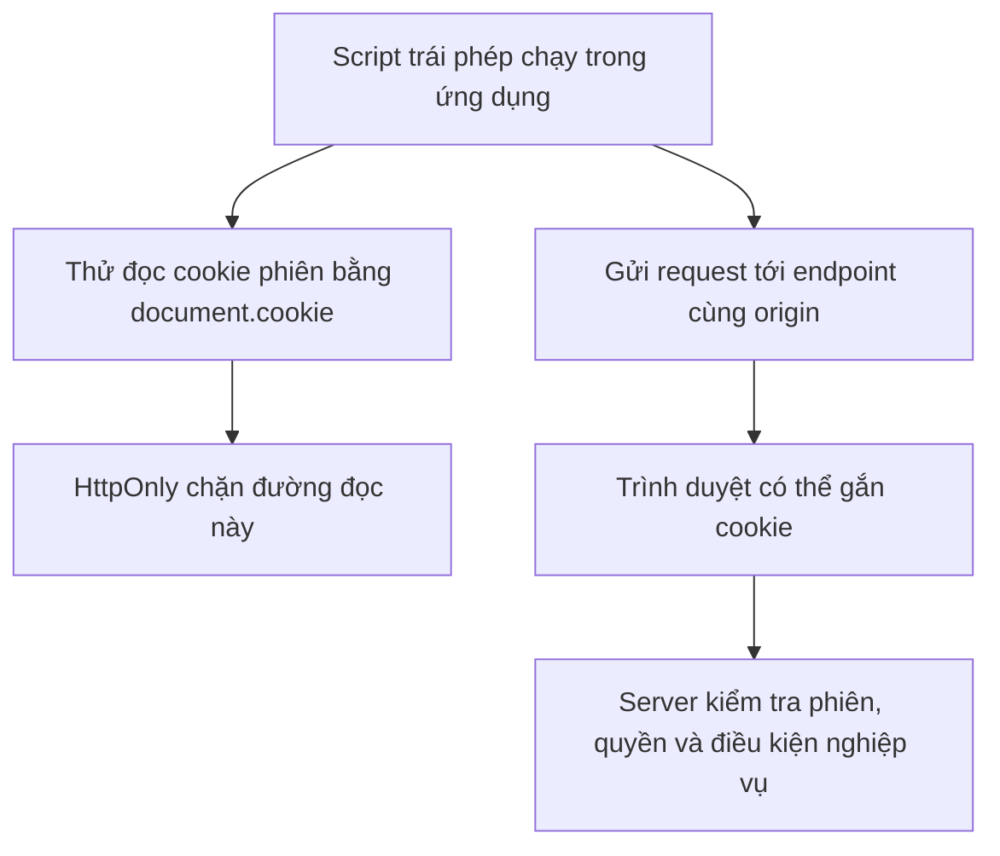

# Cookie HttpOnly

## 1. HttpOnly bảo vệ điều gì?

**HttpOnly** là một thuộc tính của cookie, yêu cầu trình duyệt không cung cấp cookie đó qua các API dành cho script như `document.cookie`. Thuộc tính được máy chủ gửi trong header `Set-Cookie`.

Ví dụ:

```http
Set-Cookie: __Host-session=<opaque-session-secret>; HttpOnly; Secure; Path=/; SameSite=Lax
```

Giá trị trong dấu ngoặc là placeholder. Một credential thật phải được tạo bằng cơ chế an toàn và không được đưa vào tài liệu, log hoặc mã nguồn.

Mục tiêu chính của HttpOnly trong quản trị phiên là **giảm khả năng mã JavaScript đọc và lấy credential phiên ra khỏi trình duyệt**. Nếu một lỗ hổng XSS cho phép chạy script trong trang, cookie HttpOnly không xuất hiện qua document.cookie như cookie thông thường.

Tuy nhiên, trình duyệt vẫn có thể tự đính cookie vào request phù hợp. Vì vậy:

> Script không đọc được credential không đồng nghĩa script không thể sử dụng phiên của người dùng.

Đây là ranh giới quan trọng khi chuyển HttpOnly thành yêu cầu bảo mật. Yêu cầu không nên chỉ ghi “bật HttpOnly để chống XSS”, mà phải chỉ rõ tài sản được bảo vệ, đường cấp cookie, giới hạn cơ chế và các kiểm soát bổ sung.

Các yêu cầu và cấu hình dưới đây là ví dụ thiết kế cho ứng dụng web dùng cookie phiên. Chúng không tự áp dụng nguyên xi cho mọi loại client hoặc mô hình xác thực.

## 2. Cơ chế trao đổi cookie

### 2.1. Set-Cookie khác Cookie

Máy chủ cấp cookie qua response:

```http
HTTP/1.1 200 OK
Set-Cookie: __Host-session=<opaque-session-secret>; HttpOnly; Secure; Path=/; SameSite=Lax
Cache-Control: no-store
Content-Type: application/json

{"authenticated":true}
```

Sau khi trình duyệt lưu cookie và các điều kiện gửi được đáp ứng, một request có thể chứa:

```http
GET /api/profile HTTP/1.1
Host: portal.example
Cookie: __Host-session=<opaque-session-secret>
```

Các thuộc tính như HttpOnly, Secure và SameSite không được gửi lại trong header Cookie. Máy chủ nhận tên và giá trị cookie, không nhận một chứng nhận từ trình duyệt rằng cookie đã được lưu với các thuộc tính đó.

Vì vậy, server không thể nhìn một request có Cookie rồi kết luận “HttpOnly đang bật”. Bằng chứng cấu hình phải được kiểm tra ở đường phát hành Set-Cookie và hành vi của trình duyệt.

Ngữ nghĩa cơ bản của HttpOnly và Cookie được mô tả trong [RFC 6265, mục 4.1.2.6 và 4.2](https://www.rfc-editor.org/rfc/rfc6265.html#section-4.1.2.6).

### 2.2. Ba khả năng cần phân biệt

| Khả năng | Cookie có HttpOnly |
|---|---|
| Script trong trang đọc giá trị bằng document.cookie | Bị trình duyệt ngăn theo cơ chế HttpOnly |
| Trình duyệt gửi cookie trong request đủ điều kiện | Vẫn có thể xảy ra |
| Máy chủ đọc giá trị trong request Cookie | Vẫn xảy ra để xác minh phiên |

HttpOnly không làm cookie vô hình với máy chủ hoặc công cụ kiểm tra trình duyệt có thẩm quyền. Nó giới hạn cách script thông thường truy cập cookie.

Frontend cũng không thể tạo một cookie HttpOnly chỉ bằng cách thêm thuộc tính vào document.cookie. Cookie bí mật của profile này phải được cấp qua HTTP response từ thành phần có thẩm quyền.

### 2.3. Set-Cookie không phải header frontend được tự do đọc

Trong Fetch, Set-Cookie là một response header bị lọc khỏi bề mặt truy cập của JavaScript. Việc `response.headers.get("set-cookie")` không trả giá trị không chứng minh cookie có HttpOnly; đây là một hạn chế riêng của API trình duyệt.

Không thiết kế luồng đăng nhập dựa trên việc frontend đọc Set-Cookie rồi tự lưu session secret. Xem [MDN — Set-Cookie](https://developer.mozilla.org/en-US/docs/Web/HTTP/Reference/Headers/Set-Cookie).

## 3. Mô hình đe dọa: ngăn đọc khác với ngăn hành động

Giả sử trang có một lỗi XSS làm script trái phép chạy trong origin của ứng dụng.

### 3.1. Cookie không có HttpOnly

Nếu phạm vi cookie cho phép script truy cập, script có thể đọc credential qua document.cookie. Khi credential bị lấy ra ngoài và vẫn còn hiệu lực, kẻ tấn công có thể thử phát lại nó từ môi trường khác.

### 3.2. Cookie có HttpOnly

Script không đọc được cookie qua API này. Nhưng nó vẫn có thể gọi endpoint của ứng dụng trong ngữ cảnh người dùng, đọc dữ liệu mà origin được phép đọc hoặc thay đổi giao diện để lừa người dùng.



HttpOnly giảm một đường đánh cắp credential; không sửa nguyên nhân XSS và không buộc server từ chối mọi request do script trái phép tạo.

### 3.3. Những rủi ro nằm ngoài khả năng của HttpOnly

| Rủi ro | HttpOnly tự xử lý được không? |
|---|---|
| Script đọc cookie qua document.cookie | Có, đối với cookie được bảo vệ trong trình duyệt tuân thủ |
| XSS gửi request bằng phiên đang hoạt động | Không |
| CSRF khiến trình duyệt gửi yêu cầu ngoài ý muốn | Không |
| Cookie bị truyền trên kênh không bảo vệ | Không; cần bảo vệ kênh và Secure |
| Proxy hoặc ứng dụng ghi credential vào log | Không |
| Endpoint trả lại credential trong JSON hoặc HTML | Không |
| Credential đã bị lấy từ một nguồn khác rồi được phát lại | Không |
| Lỗi phân quyền cho phép phiên truy cập quá mức | Không |
| Phần mềm hoặc thành phần có đặc quyền trên thiết bị bị xâm phạm | Không thể coi HttpOnly là bảo đảm cho ranh giới này |

Kết luận thiết kế phải đúng mức: HttpOnly bảo vệ một bề mặt truy cập cookie trong trình duyệt, không phải một cơ chế xác minh người điều khiển mọi request.

## 4. Phối hợp với Secure, SameSite và phạm vi cookie

Mỗi thuộc tính giải quyết một vấn đề riêng.

| Thành phần | Câu hỏi bảo mật |
|---|---|
| HttpOnly | Script thông thường có đọc được credential qua API cookie không? |
| Secure | Cookie có bị gửi qua kết nối không dùng HTTPS không? |
| SameSite | Cookie có được gửi trong các ngữ cảnh cross-site tương ứng không? |
| Domain | Host nào có thể nằm trong phạm vi gửi cookie? |
| Path | Đường dẫn request nào nằm trong phạm vi gửi? |
| Max-Age / Expires | Trình duyệt giữ cookie đến khi nào theo chỉ thị lưu trữ? |
| Chính sách phía server | Credential còn hiệu lực và được phép thực hiện hành động nào? |

### 4.1. HttpOnly không thay thế Secure

Một cookie có HttpOnly nhưng không được bảo vệ kênh vẫn có thể bị phơi lộ theo những đường mà HttpOnly không kiểm soát.

Yêu cầu nên tách rõ:

> Cookie dùng làm credential phiên phải có HttpOnly và Secure. Các request mang credential phải đi qua kênh truyền được bảo vệ theo kiến trúc triển khai.

TLS kết thúc tại reverse proxy cần được đánh giá cùng đoạn kết nối tới backend. Việc browser thấy HTTPS không tự chứng minh mọi đoạn phía sau đều được bảo vệ.

### 4.2. HttpOnly không thay thế SameSite hoặc chống CSRF

HttpOnly không ngăn trình duyệt tự gửi cookie. Với request thay đổi trạng thái dùng cookie, cần cơ chế chống CSRF được lựa chọn cho ứng dụng.

SameSite có thể bổ trợ nhưng không phải cơ chế phân quyền. Same-site cũng không đồng nghĩa same-origin; một subdomain liên quan có thể không cùng mức tin cậy.

Cơ chế token chống CSRF, kiểm tra nguồn hoặc các biện pháp tương ứng cần được đặc tả và kiểm chứng theo profile, thay vì suy từ việc cookie đã có HttpOnly. Xem [OWASP — CSRF Prevention](https://cheatsheetseries.owasp.org/cheatsheets/Cross-Site_Request_Forgery_Prevention_Cheat_Sheet.html).

### 4.3. Giới hạn Domain và hiểu đúng Path

Nếu chỉ một host cần cookie phiên, không đặt Domain rộng để chia sẻ cho cả nhóm subdomain mà không có nhu cầu rõ ràng.

Path điều khiển phạm vi gửi cookie, không phải ranh giới cô lập đáng tin giữa các ứng dụng không cùng mức tin cậy trên một host. Script trong origin có thể tương tác với các đường dẫn khác theo quyền của origin đó.

Đối với kiến trúc có nhiều ứng dụng với mức tin cậy khác nhau, cần xem xét cách ly host hoặc origin thích hợp.

### 4.4. Tiền tố __Host- không tự bao gồm HttpOnly

Trong trình duyệt hỗ trợ tiền tố này, cookie tên bắt đầu bằng `__Host-` phải được cấp với Secure, Path=/ và không có Domain.

Điều đó không có nghĩa tiền tố tự thêm HttpOnly. Nếu cookie là credential phiên, vẫn phải ghi HttpOnly rõ ràng:

```http
Set-Cookie: __Host-session=<opaque-session-secret>; Secure; HttpOnly; Path=/; SameSite=Lax
```

Việc dùng Lax ở đây là lựa chọn của ví dụ, cần đối chiếu với luồng đăng nhập, SSO và tương tác cross-site thực tế. Không tự đổi mọi cookie sang một cấu hình khác để xử lý lỗi callback mà chưa xác định nguyên nhân.

## 5. Phân loại cookie theo vai trò bảo mật

Không nên áp cùng một chính sách máy móc cho mọi cookie. Cần phân loại trước.

| Loại dữ liệu | Chính sách minh họa |
|---|---|
| Session secret dùng để xác thực | Bắt buộc HttpOnly trong profile web này |
| Refresh credential được thiết kế lưu bằng cookie | Bắt buộc HttpOnly, kèm chính sách scope, CSRF, rotation và thu hồi riêng |
| Credential nhớ đăng nhập | Xem như bí mật xác thực; cần HttpOnly và vòng đời riêng |
| Ngôn ngữ hoặc giao diện | Có thể cho script đọc nếu cần, không chứa quyền hoặc bí mật |
| Token chống CSRF mà thiết kế cần JavaScript đọc | Có thể không có HttpOnly theo cơ chế đã chọn; không được đồng nhất với session secret |
| Dữ liệu quyền dùng để hiển thị UI | Có thể lấy từ API thích hợp; server vẫn phải tự phân quyền |

Một cookie chỉ cần khác tên chưa đủ để khác mức độ nhạy cảm. Nếu `remember-me` có thể đổi thành phiên mới, nó vẫn là credential cần bảo vệ.

Ngoại lệ cho token chống CSRF phải gắn với một thiết kế cụ thể. Một cookie script đọc được không được trở thành cơ chế đăng nhập thay thế; token chống CSRF cũng không làm một trang có XSS trở nên an toàn.

Không đưa vai trò có thẩm quyền vào cookie script sửa được rồi tin trực tiếp nó ở server. Nếu client cần biết quyền để dựng UI, đó là dữ liệu hiển thị, không phải nguồn quyết định cuối.

## 6. Tổ chức frontend mà không đọc session secret

### 6.1. Trình duyệt tự quản lý cookie

Với ứng dụng cùng origin, frontend có thể gọi API mà không lấy credential phiên ra khỏi cookie.

Ví dụ đọc ngữ cảnh người dùng:

```javascript
async function loadSessionContext() {
  const response = await fetch("/api/session/context", {
    method: "GET",
    credentials: "same-origin",
    cache: "no-store"
  });

  if (response.status === 401) {
    return { authenticated: false };
  }

  if (!response.ok) {
    throw new Error("Không tải được ngữ cảnh phiên");
  }

  return response.json();
}
```

Endpoint chỉ nên trả thông tin cần thiết như trạng thái xác thực và dữ liệu hiển thị được phép. Không trả session secret, refresh credential hoặc một bản sao của cookie.

Mã này minh họa cách frontend sử dụng phiên, không phải một triển khai đăng nhập đầy đủ. Những request thay đổi trạng thái vẫn cần kiểm soát CSRF và phân quyền riêng.

Cách Fetch gửi credential phụ thuộc tùy chọn credentials và các quy tắc khác của trình duyệt. Xem [MDN — Using Fetch, Including credentials](https://developer.mozilla.org/en-US/docs/Web/API/Fetch_API/Using_Fetch#including_credentials).

### 6.2. Không phá ranh giới bằng cách sao chép bí mật

Một thiết kế tự triệt tiêu HttpOnly nếu:

1. Server cấp session cookie có HttpOnly.
2. Cùng response trả secret trong JSON.
3. Frontend lưu secret vào localStorage để tiện gọi API.

Cookie vẫn được gắn đúng flag nhưng credential đã có đường đọc khác. Vì vậy yêu cầu phải bao phủ mọi bản sao có thể dùng để xác thực.

Những đường rò rỉ tương tự gồm hidden input, bootstrap JSON trong HTML, endpoint debug, mã lỗi và công cụ hỗ trợ.

### 6.3. Cấu hình cross-origin không phải chỉ thêm include

Nếu frontend và API khác origin, `credentials: "include"` chỉ là một phần của cơ chế. Việc gửi, lưu và đọc response còn phụ thuộc CORS, SameSite, phạm vi cookie và chính sách trình duyệt.

Cần chỉ rõ danh sách origin được phép và quan hệ tin cậy. Không phản chiếu Origin tùy ý cùng quyền truy cập có credential.

CORS chủ yếu kiểm soát việc script đọc response và các điều kiện của request theo cơ chế trình duyệt. Với một số loại request, server vẫn có thể nhận yêu cầu dù script không được đọc response. Vì vậy “không cho đọc response qua CORS” không phải bảo đảm tổng quát rằng không thể có CSRF.

## 7. Phát hành cookie phải nhất quán trên mọi đường đi

Một cờ đúng tại endpoint đăng nhập chưa đủ nếu endpoint làm mới phiên cấp lại cùng cookie mà thiếu HttpOnly.

Với cookie cùng tên và phạm vi, một response HTTP phát hành lại có thể thay đổi thuộc tính của bản lưu. Không dựa vào việc cookie trước đó từng có HttpOnly.

### 7.1. Những đường cần kiểm kê

- Đăng nhập bằng mật khẩu.
- Callback đăng nhập liên kết.
- Làm mới hoặc gia hạn phiên.
- Xác thực lại và nâng mức bảo đảm.
- Đổi ngữ cảnh bảo mật nếu có cấp lại cookie.
- Khôi phục tài khoản hoặc luồng nhớ đăng nhập.
- Response redirect trung gian.
- Response lỗi vẫn có tác dụng phát hành hoặc thay thế cookie.
- Đăng xuất và xóa cookie.

Các đường này cần dùng cấu hình phát hành được quản lý thống nhất hoặc có bằng chứng tương đương.

### 7.2. Gateway có thể làm thay đổi kết quả

Ứng dụng có thể phát đúng header nhưng reverse proxy hoặc gateway sửa, xóa hoặc phát thêm cookie khác.

Yêu cầu nên nhắm tới response thực tế mà trình duyệt nhận:

> Sau mọi lớp proxy và gateway, mỗi Set-Cookie mang credential trong danh mục phải giữ các thuộc tính bắt buộc. Không được có đường cấp lại làm giảm chính sách bảo vệ.

Một response có thể có nhiều header Set-Cookie. Khi kiểm tra tự động, cần dùng cách đọc header đa giá trị phù hợp; không tùy ý tách mọi dấu phẩy vì thuộc tính ngày tháng có thể chứa dấu phẩy.

### 7.3. Cookie trùng tên và phạm vi khác nhau

Hai cookie cùng tên nhưng khác Domain hoặc Path có thể cùng tồn tại. Đừng giả định tên cookie là định danh duy nhất của một bản lưu.

Cần tránh phát credential cùng tên ở nhiều phạm vi gây nhập nhằng. Nếu server nhận các giá trị trùng tên theo cách không mong đợi, phải xử lý theo chính sách rõ ràng thay vì vô tình chọn một giá trị có lợi cho kẻ tấn công.

HttpOnly không thay thế quản lý phạm vi và phân tích cookie đầu vào. Tiền tố có điều kiện bảo mật được hỗ trợ có thể giảm một số cấu hình sai, nhưng vẫn cần kiểm chứng hành vi ở các client được hỗ trợ.

## 8. Hết hạn, đăng xuất và thu hồi

HttpOnly không quyết định thời hạn phiên.

Một cookie còn trong trình duyệt có thể không còn đại diện cho phiên hợp lệ. Ngược lại, xóa cookie trên một trình duyệt không làm mất bản sao của credential đã bị lấy ở nơi khác.

### 8.1. Xóa đúng bản lưu

Ví dụ xóa cookie host-only của profile này:

```http
Set-Cookie: __Host-session=; Max-Age=0; Secure; HttpOnly; Path=/; SameSite=Lax
```

Tên và phạm vi phải khớp cookie được cấp trước đó. Nếu hệ thống từng có cookie ở Domain hoặc Path khác, phải có kế hoạch xử lý đúng các bản lưu cũ thay vì chỉ xóa một tên ở phạm vi mới.

Các thuộc tính bảo vệ được giữ trong header xóa để chính sách phát hành nhất quán; việc nhận diện bản lưu không chỉ dựa vào HttpOnly.

### 8.2. Thu hồi phía server là yêu cầu độc lập

Một yêu cầu mẫu:

> Khi người dùng đăng xuất, server phải vô hiệu hóa phiên theo phạm vi đã xác định và xóa cookie phía client. Credential cũ bị phát lại không được tiếp tục truy cập sau giới hạn thu hồi đã công bố.

Đối với nhiều node hoặc access token liên quan, cần ngân sách thời gian riêng và cách đo. HttpOnly không giúp lan truyền trạng thái thu hồi giữa các node.

Không dùng cookie hết hạn làm cơ chế duy nhất để chấm dứt phiên nhạy cảm. Idle timeout, absolute timeout, khóa tài khoản và sự kiện sự cố cần được kiểm tra theo chính sách phía server.

## 9. Chuyển thành yêu cầu bảo mật cụ thể

### HTTPONLY-01 — Danh mục cookie bí mật

> Hệ thống phải duy trì danh mục cookie có thể trực tiếp xác thực hoặc tái tạo quyền truy cập. Trong profile trình duyệt dùng cookie, mọi cookie thuộc danh mục phải được cấp với HttpOnly.

Danh mục phải bao gồm các tên cũ còn được chấp nhận và cơ chế nhớ đăng nhập, không chỉ cookie của luồng đăng nhập phổ biến nhất.

### HTTPONLY-02 — Bao phủ mọi lần phát hành

> Mọi response tạo hoặc thay thế cookie trong danh mục phải có HttpOnly, bao gồm đăng nhập, callback, renewal, reauthentication và luồng lỗi có phát hành cookie.

Tiêu chí đạt không phải “cấu hình source có true”, mà là header cuối cùng và hành vi cookie đúng trên từng đường được hỗ trợ.

### HTTPONLY-03 — Không có bản sao đọc được bởi script

> Hệ thống không được trả cùng credential qua JSON, HTML, URL, JavaScript hoặc kho lưu trữ phía client mà script đọc được. Các endpoint ngữ cảnh phiên chỉ được trả dữ liệu không thể dùng thay credential.

Nếu một loại client khác cần token riêng, phải có profile riêng; không tự mở một endpoint xuất secret của cookie web.

### HTTPONLY-04 — Cơ chế bảo vệ phối hợp

> Cookie bí mật phải có Secure và phạm vi theo chính sách. HttpOnly không được dùng làm lý do bỏ phòng XSS, chống CSRF, phân quyền, timeout hoặc thu hồi.

Đây là yêu cầu tránh diễn giải sai, không có nghĩa mọi cookie cùng dùng một giá trị SameSite hay một thời hạn.

### HTTPONLY-05 — Bằng chứng không làm lộ bí mật

> Kết quả kiểm tra được phép ghi tên cookie, thuộc tính và đường phát hành, nhưng không được lưu giá trị credential thô vào báo cáo hoặc telemetry thông thường.

Ví dụ bản ghi cấu hình an toàn:

```yaml
eventType: SESSION_COOKIE_POLICY_CHECK
cookieName: __Host-session
routeCategory: FEDERATED_LOGIN_CALLBACK
httpOnlyPresent: true
securePresent: true
path: /
domainAttributePresent: false
sameSite: Lax
outcome: PASS
```

Đây là mô tả bằng chứng kiểm tra, không phải header thực tế của một response.

## 10. Kiểm chứng đúng điều đã yêu cầu

### 10.1. Kiểm tra header

Thu thập response ở điểm gần trình duyệt sau gateway, bằng tài khoản và môi trường kiểm thử được phép.

Cần kiểm tra từng Set-Cookie theo tên và phạm vi, gồm response redirect trung gian. Chỉ nhìn response cuối trang chủ có thể bỏ sót nơi cookie được tạo.

Một công cụ HTTP có thể chứng minh server phát header, nhưng không thay thế phép thử hành vi của trình duyệt. Công cụ đó không nhất thiết thực thi đầy đủ quy tắc cookie như browser.

### 10.2. Kiểm tra hành vi script mà không in secret

Sau khi đã xác nhận cookie thực sự được lưu, có thể kiểm tra tên cookie có lộ qua document.cookie không:

```javascript
const sessionCookieVisible = document.cookie
  .split(";")
  .some((entry) => entry.trim().startsWith("__Host-session="));

if (sessionCookieVisible) {
  throw new Error("Cookie phiên bị lộ qua document.cookie");
}
```

Đoạn này chỉ đánh giá dấu hiệu hiển thị theo tên, không in giá trị cookie.

Kết quả false tự nó chưa đủ chứng minh thành công: cookie có thể chưa được tạo, bị browser từ chối hoặc không thuộc phạm vi đang quan sát. Phải kết hợp bằng chứng cookie tồn tại, có HttpOnly và được dùng đúng trong request.

Không xem việc công cụ tự động hóa hoặc DevTools đọc được giá trị cookie bằng quyền kiểm tra trình duyệt là thất bại của HttpOnly. Ranh giới cần kiểm tra là API script của trang.

### 10.3. Chứng minh phiên vẫn hoạt động theo thiết kế

Sau khi cookie được cấp:

- Script không đọc được session cookie qua API đã nêu.
- Request hợp lệ vẫn được trình duyệt gửi theo chính sách.
- Server xác thực và phân quyền đúng.
- Request không có phiên hoặc có phiên đã bị thu hồi không được hưởng quyền.

Phép thử “cookie không hiện trong document.cookie” nhưng ứng dụng không đăng nhập được chỉ chứng minh luồng đang hỏng, chưa chứng minh thiết kế an toàn.

## 11. Ma trận tiêu chí nghiệm thu

| Tình huống | Kết quả mong đợi |
|---|---|
| Đăng nhập thông thường | Cookie bí mật có HttpOnly trong header cuối và bản lưu browser |
| Callback federation cấp phiên | Cùng chính sách bảo vệ được áp dụng |
| Renewal hoặc reauthentication | Không có lần cấp lại làm mất HttpOnly |
| Redirect trung gian phát cookie | Được kiểm tra như các response khác |
| Response lỗi phát cookie | Không tạo credential thiếu chính sách |
| Script đọc document.cookie khi cookie tồn tại | Không thấy cookie phiên cần bảo vệ |
| Frontend đọc response.headers.get("set-cookie") | Không dùng kết quả này làm bằng chứng riêng về HttpOnly |
| Request API cùng origin với phiên hợp lệ | Phiên hoạt động mà frontend không cần đọc secret |
| Endpoint ngữ cảnh phiên hoặc debug | Không trả credential hoặc bản sao dùng để xác thực |
| Lưu trữ localStorage và sessionStorage | Không có session secret của profile web |
| Request thay đổi trạng thái ngoài ý muốn | Được kiểm soát bởi cơ chế CSRF và nghiệp vụ, không suy từ HttpOnly |
| Cookie trùng tên khác phạm vi | Không tạo cách chọn credential nhập nhằng ngoài chính sách |
| Logout | Xóa đúng cookie và thu hồi phiên phía server |
| Proxy sửa hoặc phát lại Set-Cookie | Không làm mất thuộc tính bắt buộc |
| Báo cáo kiểm thử và log | Không chứa credential phát lại được |

Những ca thử này là tiêu chí thiết kế để thực hiện trong vòng triển khai và nghiệm thu. Việc soạn bài chưa phải bằng chứng hệ thống cụ thể đã vượt qua các ca thử.

## 12. Các kết luận cần giữ khi đặc tả

HttpOnly là một kiểm soát hữu ích vì nó giữ credential cookie ngoài một bề mặt truy cập quan trọng của JavaScript. Giá trị của nó phụ thuộc vào việc mọi lần phát hành đều đúng và không có đường khác trả lại cùng secret.

Một yêu cầu tốt phải phân biệt được **đọc credential**, **trình duyệt gửi credential** và **server chấp nhận credential**. Từ đó mới đặt đúng kỳ vọng: bảo vệ cookie bằng HttpOnly, bảo vệ kênh bằng TLS và Secure, kiểm soát request ngoài ý muốn, thực thi quyền phía server và thu hồi phiên khi cần.

Bật một flag là thao tác cấu hình. Chứng minh flag bảo vệ đúng tài sản trên toàn bộ vòng đời phiên mới là mục tiêu của đặc tả bảo mật.

