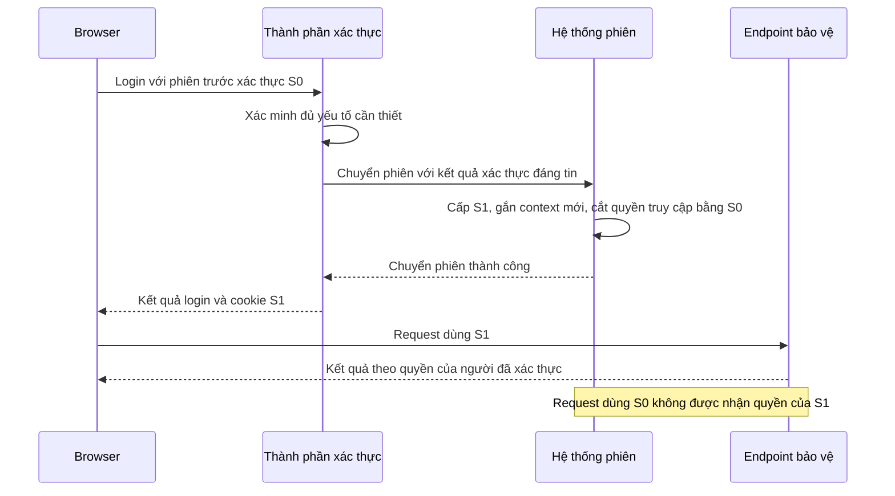

# Session rotation sau login

## 1. Rotation sau login phải tạo ra thay đổi bảo mật nào?

**Session rotation sau login** là việc thay định danh hoặc bằng chứng truy cập phiên tại thời điểm chuyển từ trạng thái trước đăng nhập sang trạng thái đã xác thực. Trong ứng dụng web dùng phiên phía server, hành vi thường thấy là server cấp một session ID mới và đặt lại cookie phiên sau khi xác minh người dùng thành công.

Mục tiêu không chỉ là làm cookie trông khác đi. Người đang giữ session ID trước đăng nhập không được dùng ID đó để hưởng danh tính, mức xác thực hoặc quyền được cấp sau đăng nhập.

Ví dụ:

```text
Trước login:
    cookie APPSESSION=S0
    phiên chưa xác thực, chỉ có ngôn ngữ và giỏ hàng ẩn danh

Sau login thành công:
    cookie APPSESSION=S1
    phiên gắn với danh tính đã được xác minh

Yêu cầu:
    S1 khác S0, do server sinh và khó dự đoán;
    S0 không còn là bằng chứng truy cập phiên đã xác thực;
    không có ánh xạ tự động cho phép người giữ S0 nhận S1 hoặc quyền của S1.
```

Nếu server chỉ thêm `userId` vào phiên `S0` mà không đổi ràng buộc truy cập, một bên đã biết `S0` trước đó có thể sử dụng phiên sau đăng nhập. Đây là rủi ro session fixation. Rotation còn giúp tách rõ bối cảnh tin cậy trước và sau xác thực, nhưng không thay thế bảo vệ cookie, chống CSRF, phân quyền hoặc thu hồi phiên khi có sự cố.

Trong đặc tả yêu cầu bảo mật, cần mô tả đầy đủ **điểm chuyển đổi, nguồn tạo ID, trạng thái được chuyển, hiệu lực của ID cũ và kết quả khi chuyển đổi thất bại**. Chỉ ghi “regenerate session after login” chưa đủ để thiết kế hoặc nghiệm thu một hệ thống nhiều luồng xác thực và nhiều node.

## 2. Phân biệt rotation với những thao tác dễ bị nhầm

| Thao tác | Thay đổi gì? | Có đủ để chứng minh rotation an toàn sau login không? |
| --- | --- | --- |
| Gửi lại cookie cùng giá trị | Có thể thay hạn dùng hoặc thuộc tính cookie | Không, ID cũ vẫn được sử dụng |
| Đổi session ID | Thay bằng chứng tìm/truy cập phiên | Chưa đủ nếu ID cũ vẫn dẫn tới quyền mới |
| Tạo session record mới | Thay nơi lưu trạng thái | Chưa đủ nếu session cũ vẫn có authentication context hoặc alias sang phiên mới |
| Xóa cookie ở trình duyệt | Xóa một bản sao phía client | Không vô hiệu hóa bản sao ID ở client khác |
| Refresh access token | Cấp token tiếp theo theo mô hình token | Phải kiểm tra quyền, liên kết phiên và hiệu lực token trước đó |
| Đổi CSRF token | Thay bằng chứng chống yêu cầu giả mạo theo thiết kế | Không thay thế session rotation |
| Đổi mật khẩu | Thay credential dài hạn của người dùng | Không tự chứng minh các session ID cũ đã mất hiệu lực |

Một hệ thống có thể giữ **ID quản trị của phiên logic** để theo dõi audit hoặc số suất đăng nhập, trong khi thay **session ID dùng làm bearer credential**. Hai loại ID cần được phân biệt để tránh vừa rotation đúng vừa vô tình tạo thêm phiên đồng thời hoặc làm mất lịch sử quản trị.

Rotation cũng không nhất thiết kéo dài toàn bộ vòng đời phiên. Ví dụ, đổi ID để chống fixation hoặc đổi ID định kỳ không được tự động làm idle timeout và absolute timeout mất ý nghĩa. Điểm bắt đầu tính thời hạn phải theo chính sách phiên đã được chốt, thay vì luôn lấy thời điểm vừa tạo ID mới.

## 3. Chốt ranh giới xác thực và các đường login thuộc phạm vi

### 3.1. Khi nào được coi là login hoàn tất?

Một ứng dụng có thể yêu cầu mật khẩu, MFA, kiểm tra rủi ro và chấp thuận bổ sung. “Xác minh mật khẩu thành công” không luôn bằng “đã hoàn tất đăng nhập”. Đặc tả phải xác định mức xác thực nào đủ để cấp phiên ứng dụng có quyền.

Luồng minh họa:

```text
ANONYMOUS
    -> PRIMARY_FACTOR_VERIFIED
    -> MFA_PENDING
    -> AUTHENTICATED
```

Nếu có trạng thái trung gian, nó chỉ được truy cập chức năng cần thiết cho bước đó. Endpoint bảo vệ không được kiểm tra mỗi việc đã có `userId` rồi coi như MFA hoàn tất. Khi vượt một ranh giới nâng mức bảo đảm, bằng chứng phiên ở bước trước không được tự trở thành chìa khóa cho mức mới.

Rotation sau login trong bài này tập trung vào lần chuyển sang `AUTHENTICATED`. Hệ thống còn có thể yêu cầu rotation ở các ranh giới như hoàn tất MFA hoặc step-up; các ranh giới đó cần được liệt kê riêng để không bỏ sót ID đã được cấp ở bước trung gian.

### 3.2. Không chỉ kiểm tra form đăng nhập chính

Phạm vi phải bao phủ mọi đường thực sự tạo phiên đã xác thực của ứng dụng, chẳng hạn:

- Form username/password.
- Callback đăng nhập liên kết/SSO.
- Luồng đăng nhập bằng liên kết hoặc cơ chế không mật khẩu được hỗ trợ.
- Đăng nhập tự động từ một credential dài hạn nếu ứng dụng có chức năng này.
- Luồng khôi phục tài khoản có khả năng cấp phiên đăng nhập.
- Chuyển tài khoản trong cùng trình duyệt.

Các đường này không nhất thiết dùng cùng giao thức, nhưng cần đạt cùng hậu điều kiện của phiên local. Identity Provider đã xác thực người dùng không chứng minh ứng dụng đã đổi ID local hoặc vô hiệu hóa đường truy cập bằng ID trước xác thực.

Không được đưa một đường khôi phục hoặc callback vào danh sách ngoại lệ chỉ vì nó không gọi handler của form login. Cách tổ chức mã không làm thay đổi ranh giới tin cậy mà yêu cầu bảo mật phải bảo vệ.

## 4. Trình tự chuyển phiên đúng về mặt yêu cầu

### 4.1. Tách xác minh credential khỏi cấp phiên

Một quy trình có thể chia thành những bước có trách nhiệm rõ ràng:

1. Kiểm tra giao dịch đăng nhập, dữ liệu đầu vào và cơ chế chống giả mạo yêu cầu theo thiết kế.
2. Xác minh credential và hoàn tất những yếu tố xác thực cần thiết.
3. Tạo kết quả xác thực đáng tin ở phía server: danh tính chuẩn, mức bảo đảm và dữ liệu cần thiết cho quyết định quyền.
4. Chuyển phiên, tạo ID mới và bảo đảm ID cũ không tiếp cận được quyền sau login.
5. Gửi cookie/bằng chứng phiên mới qua kênh đã quy định.
6. Chỉ báo đăng nhập hoàn tất khi các điều kiện cấp phiên đã thành công theo hợp đồng.

Kết quả xác thực ở bước 3 không phải đối tượng `userId`, `role` hay `mfaComplete` do client tự gửi. Nó phải xuất phát từ quá trình xác minh và nguồn identity đáng tin của hệ thống.



### 4.2. Không lưu authentication context có quyền vào ID cũ trước

Trình tự sau có thể tạo một cửa sổ sai:

```text
Gắn principal và quyền vào S0.
Lưu S0 như phiên đã đăng nhập.
Sau đó mới đổi S0 thành S1.
```

Một request song song giữ `S0` có thể lọt vào giữa các bước và được xử lý như request đã xác thực. Vấn đề không biến mất chỉ vì khoảng thời gian đó ngắn.

Yêu cầu cần nói rõ rằng việc gắn authentication context mới và cắt khả năng dùng ID cũ tạo thành một chuyển đổi nhất quán ở nơi quyết định quyền. Trong triển khai cụ thể, có thể dùng thao tác thay ID an toàn của nền tảng hoặc tạo phiên mới rồi vô hiệu hóa phiên cũ; cần kiểm tra hợp đồng thực tế thay vì chỉ dựa vào tên API.

### 4.3. Hậu điều kiện của một lần chuyển phiên thành công

Một lần login được coi là hoàn tất về mặt quản lý phiên khi:

- ID mới được server cấp bằng cơ chế sinh khó dự đoán phù hợp và không trùng phiên khác.
- Authentication context của phiên mới thuộc đúng giao dịch và đúng danh tính đã được xác minh.
- ID cũ không được các điểm thực thi trong phạm vi chấp nhận để dùng quyền hoặc lấy context của phiên mới.
- Không có alias, redirect hay endpoint khôi phục cấp phiên mới chỉ dựa vào ID cũ.
- Dữ liệu giữ lại từ trước login đã đi qua quy tắc chuyển trạng thái được duyệt.
- Các thuộc tính cookie/token và chính sách thời hạn được áp dụng đúng.

Việc đăng nhập thành công không tự yêu cầu thu hồi mọi phiên khác của tài khoản. Rotation thường nhắm vào phiên trước xác thực đang được chuyển. Nếu chính sách muốn kết thúc phiên trên thiết bị khác, đó là yêu cầu thu hồi/concurrent session riêng phải được mô tả rõ.

## 5. Giữ dữ liệu cần thiết mà không giữ trạng thái chưa đáng tin

### 5.1. Danh sách cho phép thay vì sao chép toàn bộ

Phiên ẩn danh có thể chứa dữ liệu mà người dùng mong muốn giữ: ngôn ngữ, giao diện, giỏ hàng hoặc bước đang làm của một biểu mẫu. Bảo toàn trải nghiệm không có nghĩa sao chép nguyên mọi thuộc tính session.

| Dữ liệu trước login | Cách xử lý yêu cầu |
| --- | --- |
| Ngôn ngữ, giao diện | Chỉ giữ giá trị thuộc tập hợp hợp lệ |
| Tham chiếu giỏ hàng | Kiểm tra quyền/sở hữu và quy tắc hợp nhất trước khi gắn với tài khoản |
| Tiến trình biểu mẫu | Chỉ giữ phần dữ liệu được phép, vẫn kiểm tra nghiệp vụ khi sử dụng |
| Đích điều hướng sau login | Kiểm tra theo chính sách redirect, không dùng nguyên URL bất kỳ |
| Principal hoặc user ID | Tạo từ kết quả xác thực chuẩn, không tin giá trị trong phiên ẩn danh |
| Role, quyền và tenant được phép | Tính/kiểm tra lại theo nguồn quyền đáng tin |
| Trạng thái MFA hoặc step-up | Tạo từ giao dịch xác thực đã hoàn tất tương ứng |
| CSRF state gắn với phiên | Cấp/ràng buộc lại theo thiết kế sau khi chuyển phiên |

Một cách diễn đạt yêu cầu:

> Hệ thống chỉ chuyển các thuộc tính được liệt kê trong hợp đồng chuyển phiên. Mỗi thuộc tính phải có quy tắc kiểm tra và nguồn sở hữu rõ ràng. Những thuộc tính quyết định danh tính hoặc quyền không được lấy từ trạng thái trước xác thực do client có thể tác động.

Ngay cả khi session store nằm trên server, dữ liệu bên trong vẫn có thể bắt nguồn từ input chưa đáng tin. “Đã lưu phía server” không làm một giá trị `isAdmin=true` trở thành quyết định quyền hợp lệ.

### 5.2. CSRF và giao dịch xác thực có vòng đời riêng

Session ID mới và CSRF token phục vụ hai mục đích khác nhau. Nếu CSRF token được ràng buộc với phiên cũ, cần quy định rõ khi nào tạo lại, cách frontend nhận giá trị mới và hành vi khi tab cũ gửi token trước login.

Không cấp ID phiên mới cho người đang giữ ID cũ chỉ để họ lấy lại CSRF token. Một client đã có phiên mới hợp lệ có thể lấy CSRF state mới qua luồng được bảo vệ tương ứng; ID cũ không được trở thành vé đổi sang phiên mới.

Đối với SSO, các giá trị ràng buộc giao dịch như `state` hoặc `nonce` phải được xử lý theo giao thức và thiết kế thực tế. Rotation local không thay thế kiểm tra callback, và việc kiểm tra callback thành công cũng không thay thế rotation local.

## 6. Cấp cookie mới đúng cách

### 6.1. Đổi đúng cookie và đúng phạm vi

Response login có thể minh họa như sau; đây không phải cấu hình bắt buộc cho mọi ứng dụng:

```http
HTTP/1.1 200 OK
Set-Cookie: APPSESSION=<new-opaque-session-id>; Path=/; Secure; HttpOnly; SameSite=Lax
Cache-Control: no-store
Content-Type: application/json

{"authenticated":true}
```

Giá trị `SameSite`, tên cookie, phạm vi và thời hạn phải được chốt theo luồng thực tế, đặc biệt khi có SSO/callback. Không dùng một ví dụ cấu hình để suy ra mọi ứng dụng đều tương thích.

Cookie mới phải thay thế cookie phiên mà các request sau sẽ gửi. Nếu cookie trước đó dùng `Path` hoặc `Domain` khác, việc đặt một cookie cùng tên ở phạm vi mới có thể để lại nhiều cookie trùng tên thay vì thay thế đúng cookie cũ. Cần kiểm kê các phạm vi ứng dụng thực sự dùng và xử lý chúng theo hợp đồng.

Xóa cookie cũ khi cần cũng phải chỉ đúng tên và phạm vi liên quan. Tuy nhiên, xóa phía browser chỉ là phần làm sạch client; ID cũ vẫn phải mất khả năng truy cập phiên đã xác thực ở phía thực thi.

### 6.2. Thuộc tính cookie không thay thế vô hiệu hóa ID cũ

`Secure` hạn chế việc gửi cookie qua kênh không an toàn theo hành vi browser, còn `HttpOnly` hạn chế truy cập cookie qua JavaScript thông thường. `SameSite` giới hạn một số ngữ cảnh gửi cookie. Các thuộc tính này bảo vệ những đường rủi ro khác nhau, nhưng không tự làm mất hiệu lực một ID đã bị biết trước login.

Nếu chọn cookie tiền tố `__Host-`, cần đáp ứng ràng buộc của tiền tố ở browser hỗ trợ: `Secure`, `Path=/` và không có `Domain`. `HttpOnly` vẫn là thuộc tính cần đặt riêng theo chính sách. Việc dùng tiền tố cũng không thay thế kiểm tra server rằng ID cũ không dẫn tới quyền mới.

### 6.3. Không phát tán ID mới qua kênh phụ

Đối với ứng dụng chọn cookie làm kênh phiên, không trả thêm session ID trong URL redirect, HTML, dữ liệu analytics hoặc một JSON field chỉ để tiện frontend. Mỗi bản sao tạo thêm một đường có thể bị log hoặc chia sẻ.

Response đăng nhập chứa trạng thái nhạy cảm không được dùng như nội dung cache chung cho nhiều người. Cần kiểm soát cấu hình proxy/cache, log request/response và công cụ theo dõi để không thu thập raw cookie hoặc header `Set-Cookie`. Bằng chứng kiểm thử chứa token thật cũng phải được xử lý như dữ liệu nhạy cảm.

## 7. Request đồng thời, nhiều tab và nhiều node

### 7.1. Một ID cũ không được làm cửa khôi phục tự động

Một cơ chế chuyển tiếp như sau phá vỡ mục tiêu rotation:

```text
Nhận S0 sau login -> tra bảng S0:S1 -> trả S1 hoặc xử lý như S1.
```

Nó cho bất kỳ bên nào giữ `S0` khả năng tiếp cận phiên mới. Nếu cần hỗ trợ nhiều tab, tab có cookie mới trong cùng browser profile sẽ sử dụng nó theo hành vi browser; request cũ đang bay có thể bị yêu cầu gửi lại hoặc bắt đầu luồng phù hợp. Không được giữ quyền mới cho ID cũ chỉ để mọi request cũ đều thành công.

Nếu nhiều response đặt cookie đến không đúng thứ tự, browser có thể giữ một giá trị không còn hợp lệ. Thiết kế phải kiểm soát nơi phát hành cookie, nhận diện request thuộc trạng thái cũ và có cách phục hồi an toàn. Không sửa lỗi trải nghiệm bằng cách bật lại authentication context dưới ID cũ.

### 7.2. Hai lần hoàn tất login cạnh tranh

Hai request có thể đồng thời hoàn tất cùng một giao dịch đăng nhập do người dùng bấm lại, timeout hoặc retry. Nếu mỗi request tự chuyển phiên độc lập, chúng có thể tạo nhiều phiên, ghi đè cookie hoặc vô tình khôi phục trạng thái đã kết thúc.

Yêu cầu cần có chính sách xử lý giao dịch lặp/xung đột:

- Ràng buộc kết quả chuyển phiên với giao dịch xác thực và chủ thể tương ứng.
- Chỉ cho phép kết quả hợp lệ theo mô hình cấp phiên đã chốt.
- Không cho một khóa retry tùy ý lấy credential của người khác.
- Kết quả thua xung đột không được làm ID cũ có quyền hoặc ghi lại trạng thái lỗi thời.

Không nhất thiết mọi ứng dụng phải trả lại cùng credential khi retry. Có thể yêu cầu khởi động lại login một cách an toàn. Điều cần bảo đảm là retry không tạo đường bỏ qua ranh giới xác thực hoặc làm sai chính sách phiên đồng thời.

### 7.3. Session store và cache phải cùng thực thi hậu điều kiện

Nếu node A đã đổi sang `S1` nhưng node B vẫn chấp nhận `S0` với principal mới, rotation chưa đạt yêu cầu. Cần xác định nguồn chuẩn, thời điểm commit và hành vi của cache/bản sao khi nhận ID cũ.

Đối với ranh giới login, không nên có khoảng grace mà ID trước xác thực vẫn được dùng quyền sau xác thực. Nếu kiến trúc chưa bảo đảm điều này, cần thay cách thực thi hoặc đặc tả lại khả năng của hệ thống; không thể chỉ so sánh cookie ở node A rồi coi toàn bộ luồng đã an toàn.

Khóa trong bộ nhớ một process không tự bảo vệ được giao dịch qua nhiều node. Cơ chế cụ thể có thể dựa trên thao tác nguyên tử, version hoặc phối hợp phù hợp của session store. Tính chất cần chứng minh là kết quả quan sát ở nơi quyết định quyền, không phải chỉ tên cơ chế được sử dụng.

### 7.4. Login cạnh tranh với logout hoặc thu hồi toàn tài khoản

Trong lúc login đang hoàn tất, có thể xảy ra logout, đổi credential hoặc quyết định thu hồi phiên. Nếu một kết quả xác thực cũ vẫn được ghi nhận sau quyết định thu hồi, nó có thể tạo lại quyền truy cập trái với chính sách.

Hệ thống cần quy định thứ tự có hiệu lực và phiên bản/trạng thái nào phải được kiểm tra khi commit chuyển phiên. Ví dụ, nếu chính sách yêu cầu một lệnh thu hồi ngăn cả giao dịch login cũ đang chờ, bước cấp phiên phải nhận biết điều kiện đó. Không giả định rằng một kết quả kiểm tra credential từ trước luôn còn đủ để cấp phiên ở thời điểm sau.

## 8. Xử lý lỗi mà không quay về ID cũ đã được nâng quyền

| Tình huống lỗi | Kết quả bảo mật cần giữ |
| --- | --- |
| Xác thực thất bại hoặc chưa đủ MFA | Không có phiên có quyền đầy đủ; trạng thái trước login không được nâng quyền |
| Không tạo được ID/record mới | Không báo login hoàn tất với phiên cũ được dùng quyền mới |
| Không bảo đảm cắt quyền của ID cũ | Không chốt kết quả chuyển phiên thành công cho đến khi bảo đảm hậu điều kiện |
| Lỗi khi ghi authentication context | Không cấp phiên có context thiếu hoặc thuộc sai chủ thể |
| Response chứa cookie mới bị mất | Không khôi phục quyền dưới ID cũ; cho khôi phục/đăng nhập lại theo luồng an toàn |
| Request cũ đến sau khi chuyển phiên | Không cập nhật sống lại ID cũ hoặc sao chép quyền từ phiên mới |
| Store/cache không cung cấp trạng thái đáng tin | Áp dụng hành vi lỗi đã được chốt, không tự bỏ qua kiểm soát rotation |

Cần tách sự kiện “credential được xác minh” khỏi “phiên ứng dụng được cấp thành công”. Nếu audit ghi login thành công ngay sau kiểm tra mật khẩu, trong khi chuyển phiên thất bại, dữ liệu vận hành sẽ mô tả sai kết quả mà client thực sự nhận được.

Một phiên mới được tạo nhưng chưa được client sử dụng cần được thu dọn theo chính sách vòng đời. Phần phục hồi cũng phải tính đến số suất phiên và retry, tránh để một mạng lỗi tạo hàng loạt phiên mồ côi. Không cần duy trì khả năng truy cập bằng ID cũ để giải quyết vấn đề này.

## 9. Mô tả hợp đồng bằng pseudocode

Ví dụ sau thể hiện thứ tự và ràng buộc. Đây không phải API framework, không phải mã đã chạy và không thể thay thế việc kiểm tra hợp đồng session store thực tế.

```text
finishLogin(authenticationTransaction, oldSessionId):
    authentication = verifyRequiredAuthentication(authenticationTransaction)
    require authentication hoàn tất và thuộc giao dịch đáng tin

    atomically with respect to session authorization:
        require giao dịch còn hợp lệ và không bị thu hồi/xung đột
        oldState = đọc trạng thái trước xác thực được phép sử dụng
        carriedState = validateAllowlistedState(oldState, authentication.subject)
        newSessionId = generateUnpredictableUniqueId()

        tạo phiên mới với:
            principal từ authentication
            assurance từ authentication
            quyền từ nguồn quyền đáng tin
            carriedState đã kiểm tra
            thời hạn theo chính sách, không reset tùy tiện mọi mốc thời gian

        ngăn oldSessionId truy cập context/quyền của phiên mới
        không tạo alias cho phép đổi oldSessionId lấy newSessionId
        ghi nhận kết quả chuyển đổi của giao dịch

    gửi newSessionId qua kênh phiên đã quy định
    ghi audit không chứa raw session ID
    trả kết quả login hoàn tất
```

Nếu không có phiên ẩn danh trước đó, hệ thống vẫn cần tạo một phiên mới từ kết quả xác thực đáng tin; không lấy một ID client tự chọn làm ID của phiên đã xác thực. Nếu framework giữ nguyên các thuộc tính khi đổi ID, ứng dụng vẫn phải đáp ứng yêu cầu kiểm tra trạng thái mang theo.

## 10. Bộ yêu cầu và bằng chứng nghiệm thu

| ID | Yêu cầu | Bằng chứng cần thu thập |
| --- | --- | --- |
| LR-01 | Mọi đường cấp phiên local sau login trong phạm vi phải đi qua ranh giới chuyển phiên an toàn | Danh sách flow/endpoint và kết quả kiểm tra từng flow, gồm callback nếu có |
| LR-02 | ID sau login do server sinh, khác ID trước login và không được nhận nguyên văn từ client | So sánh ID trong kiểm thử; thử ID client tự đặt; xem cơ chế cấp ID phù hợp |
| LR-03 | ID trước login không thực hiện được request có quyền hoặc lấy được context/ID của phiên sau login | Hai client độc lập, một client giữ ID cũ và thử lại sau login |
| LR-04 | Không công bố login hoàn tất khi thao tác chuyển phiên chưa bảo đảm các hậu điều kiện | Mô phỏng lỗi tạo phiên, lưu context và vô hiệu hóa; không cấp quyền dưới ID cũ |
| LR-05 | Trạng thái mang theo thuộc danh sách cho phép; dữ liệu principal/quyền/MFA lấy từ nguồn đáng tin | Chèn thuộc tính trước login; kết quả không ảnh hưởng principal hoặc quyền phiên mới |
| LR-06 | Cookie mới có đúng tên, phạm vi, thuộc tính và không làm phát sinh kênh lộ ID phụ | Kiểm tra response, cookie jar, redirect và dữ liệu log trong các flow thuộc phạm vi |
| LR-07 | Hậu điều kiện ID cũ mất quyền được thực thi qua mọi node/cache phục vụ endpoint bảo vệ | Dùng ID cũ tại các điểm thực thi sau thời điểm chuyển hoàn tất |
| LR-08 | Request lặp/đồng thời không khôi phục phiên cũ hoặc cấp context sai giao dịch | Ca cạnh tranh nhiều request, retry qua node khác và response sai thứ tự |
| LR-09 | Rotation tuân thủ chính sách phiên logic, quota và timeout đã chốt | Không tăng suất hoặc đặt lại mốc tuyệt đối trái chính sách chỉ vì đổi ID |
| LR-10 | Audit phân biệt xác minh credential với cấp phiên thành công và không ghi raw credential phiên | Sự kiện mẫu có kết quả, loại chuyển đổi và correlation ID nhưng không có token/cookie thô |

Yêu cầu “ID cũ mất quyền” cần kiểm tra tại thời điểm chuyển đã hoàn tất theo hợp đồng. Không chỉ kiểm tra một node thuận tiện hoặc một request may mắn không trúng cache. Nếu cần mô tả request đang thực thi, phải chỉ rõ điểm quyết định quyền và tác vụ nào phải kiểm tra lại; không dùng từ “ngay” để che đi ngữ nghĩa chưa được chốt.

## 11. Kịch bản nghiệm thu có thể thực hiện

### 11.1. Hai client giữ riêng ID trước và sau login

Sử dụng hai cookie jar độc lập trong môi trường được phép kiểm thử:

```text
1. Client A tạo phiên ẩn danh hợp lệ và giữ bản sao S0.
2. Trong thiết lập kiểm thử, client B sử dụng S0 để bắt đầu login.
3. B hoàn tất đủ yếu tố xác thực; nhận S1.
4. Xác nhận S1 khác S0.
5. B dùng S1 truy cập được tài nguyên đúng quyền.
6. A tiếp tục dùng S0 gọi cùng tài nguyên.
7. A không nhận dữ liệu, không thực hiện được hành động có quyền,
   không lấy được S1 và không được tự chuyển sang phiên đã xác thực.
```

Đây là kiểm tra ranh giới chuyển phiên khi ID trước login đã bị biết. Việc cài đặt ID có kiểm soát trong môi trường kiểm thử không tự chứng minh một đường gieo ID đang tồn tại trong production; đó là câu hỏi của mô hình đe dọa và kiểm tra bề mặt ứng dụng riêng.

Không dùng hai tab chung cookie jar làm bằng chứng duy nhất: cookie mới có thể tự được dùng ở cả hai tab, khiến client kiểm thử vô tình gửi `S1` khi muốn kiểm tra `S0`.

### 11.2. Ca đăng nhập nhiều bước

```gherkin
Feature: Phiên sau login không kế thừa quyền từ ID ở bước trước

  Scenario: Hoàn tất MFA và chuyển sang phiên có quyền đầy đủ
    Given giao dịch login mới chỉ hoàn tất yếu tố xác thực đầu tiên
    And client kiểm thử giữ ID của trạng thái trước khi MFA hoàn tất
    When người dùng hoàn tất MFA và hệ thống cấp phiên đã xác thực
    Then phiên mới có authentication context đúng với kết quả đã xác minh
    And ID ở bước trước không được dùng quyền đầy đủ của phiên mới
    And các thuộc tính MFA do client tự đặt không quyết định kết quả
```

Ca này phải được điều chỉnh theo trạng thái thực tế của ứng dụng, thay vì mặc định mọi hệ thống có cùng số lần rotation. Điều cần chứng minh là bằng chứng ở mức tin cậy thấp hơn không được giữ lại quyền truy cập ở mức cao hơn.

### 11.3. Các ca biên quan trọng

- Không có phiên ẩn danh trước login: vẫn cấp ID mới từ server.
- ID client tự chọn hoặc không tồn tại: không được nhận nguyên văn làm ID đã xác thực.
- Login thất bại: ID cũ không chứa authentication context đầy đủ.
- Trạng thái ẩn danh chứa `role=admin`, tenant hoặc MFA flag giả: không được kế thừa làm quyền.
- Giỏ hàng và locale hợp lệ: được giữ đúng quy tắc mà không giữ toàn bộ session tùy tiện.
- Hai request hoàn tất cùng giao dịch tại hai node: không ghi đè context hoặc khôi phục ID cũ.
- Login callback, login chính và khôi phục truy cập: cùng đạt hậu điều kiện local đã chốt.
- Request cũ chạy song song với login: không nhận quyền chỉ vì session object bị cập nhật.
- Response cookie mới thất lạc hoặc đến sau một response cũ: phục hồi an toàn, không bật lại ID cũ.
- Logout/thu hồi cạnh tranh với commit login: tuân thủ thứ tự có hiệu lực của chính sách.

Mã HTTP chỉ là một phần bằng chứng. ID cũ có thể nhận `401`, redirect về login hoặc được coi là không có phiên tùy hợp đồng. Điều cần kiểm tra là dữ liệu không bị lộ, hành động có quyền không xảy ra và không có đường tự lấy phiên mới bằng ID cũ.

Các kịch bản trên là tiêu chí để nghiệm thu hệ thống được thiết kế; chúng không phải kết quả kiểm thử sản phẩm đã được thực hiện khi soạn bài học.

## 12. Audit và lỗi đặc tả thường gặp

Một sự kiện chuyển phiên có thể ghi loại login, kết quả, mức xác thực và ID tương quan không phải credential. Ví dụ:

```json
{
  "eventType": "session.login_rotation",
  "loginFlow": "primary_login_with_mfa",
  "outcome": "SUCCESS",
  "principalRef": "account-734",
  "authenticationLevel": "mfa_complete",
  "oldCredentialAccess": "NO_AUTHENTICATED_ACCESS",
  "correlationId": "login-flow-c93a"
}
```

Giá trị trong log chỉ là mô tả hệ thống ghi nhận, không thay thế bằng chứng request bằng ID cũ đã bị từ chối. Audit và dữ liệu nhận diện người dùng phải được bảo vệ theo phạm vi truy cập/lưu giữ phù hợp.

Các lỗi đặc tả dễ gặp:

- **Chỉ yêu cầu cookie đổi giá trị:** bỏ sót alias, cache và hiệu lực ID cũ.
- **Đổi ID sau khi đã lưu quyền vào phiên cũ:** tạo cửa sổ nâng quyền ngoài ý muốn.
- **Giữ ID cũ dùng được vài giây để hỗ trợ nhiều tab:** cho người giữ ID cũ cùng hưởng quyền mới.
- **Sao chép toàn bộ thuộc tính session:** mang trạng thái chưa đáng tin sang bối cảnh đã xác thực.
- **Chỉ kiểm tra form login:** bỏ sót callback hoặc đường cấp phiên phụ.
- **Reset mọi thời hạn khi đổi ID:** biến rotation thành cách kéo dài phiên ngoài chính sách.
- **Ghi raw ID trước/sau vào log:** tạo nguồn credential mới cho người có quyền đọc log.
- **Cho rằng gọi một API framework là đủ bằng chứng:** bỏ qua cấu hình, handler riêng và hành vi của store/cache trong ứng dụng thực tế.

## 13. Câu hỏi tự kiểm tra

1. Hệ thống định nghĩa login hoàn tất ở bước nào và những flow nào có thể tạo phiên local đã xác thực?
2. Điều gì bảo đảm request giữ ID trước login không được hưởng quyền mới, kể cả trong khoảng chuyển đổi?
3. Những thuộc tính nào được chuyển, ai kiểm tra chúng và dữ liệu xác thực nào phải được tạo lại từ nguồn đáng tin?
4. Cookie mới có thay đúng cookie cũ theo phạm vi không? Có response hoặc kênh phụ nào phát hành lại ID cũ không?
5. Nhiều node, request lặp, response thất lạc và logout cạnh tranh được xử lý thế nào?
6. Rotation có làm tăng số phiên logic hoặc đặt lại timeout trái chính sách không?
7. Bằng chứng nghiệm thu có dùng hai client độc lập và kiểm tra quyền truy cập thực tế bằng ID cũ không?

Session rotation sau login đạt mục tiêu khi phiên đã xác thực có bằng chứng truy cập mới, authentication context đáng tin và ranh giới rõ ràng với trạng thái trước login. Yêu cầu phải mô tả cả đường thành công lẫn lỗi để ID cũ không trở thành đường quay lại quyền mới.
