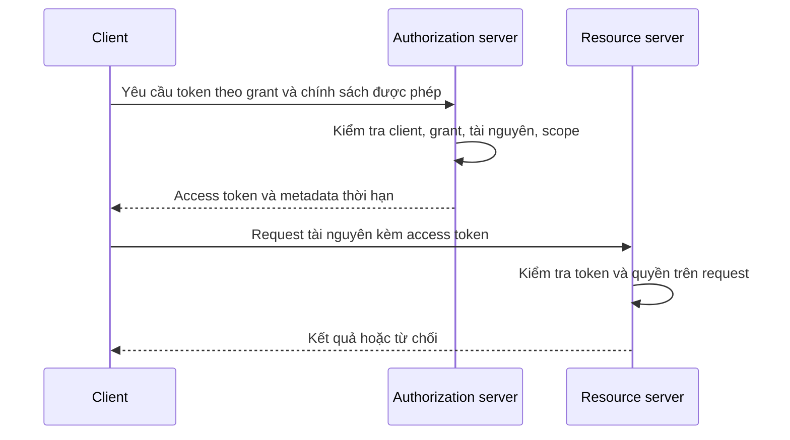

# Access token

## 1. Access token đại diện cho quyền truy cập đã được cấp

Access token là credential mà client xuất trình để truy cập tài nguyên được bảo vệ. Trong OAuth, authorization server phát hành token dựa trên một cơ sở cấp quyền; resource server kiểm tra token và quyết định có cho phép request truy cập tài nguyên hay không. Đây là vai trò được định nghĩa trong [RFC 6749 — Access Token](https://www.rfc-editor.org/rfc/rfc6749.html#section-1.4).

Ví dụ, người dùng cho phép ứng dụng quản lý đơn hàng đọc đơn của mình. Ứng dụng nhận access token dành cho Orders API với phạm vi `orders:read`. Token đó không mặc nhiên cho phép sửa đơn hàng, đọc đơn của người khác hoặc gọi Payments API.

Một cách nhìn hữu ích trong thiết kế yêu cầu bảo mật là:

```text
Access token trả lời một phần câu hỏi:
    Credential này được phát hành bởi ai,
    dành cho tài nguyên nào,
    đại diện cho chủ thể hoặc quan hệ ủy quyền nào,
    với những giới hạn nào?

Resource server vẫn phải quyết định:
    Request cụ thể này có được phép thực hiện ngay bây giờ không?
```

Đăng nhập thành công và sở hữu access token không phải quyền truy cập không giới hạn. Token có thể đúng chữ ký nhưng sai audience, hết hạn, thiếu scope, đã bị thu hồi hoặc không được phép truy cập đối tượng nghiệp vụ được yêu cầu.

Mục tiêu của việc đặc tả access token là chuyển câu “API chỉ nhận người có quyền” thành các điều kiện cấp, kiểm tra, sử dụng, hết hạn và thu hồi có thể quan sát và kiểm chứng.

## 2. Phân biệt access token với các credential khác

| Thành phần | Mục đích chính | Nơi sử dụng theo thiết kế thông thường |
|---|---|---|
| Access token | Truy cập tài nguyên được bảo vệ trong phạm vi được cấp | Resource server hoặc API đích |
| Refresh token | Yêu cầu access token mới theo grant đang được duy trì | Authorization server, không phải API nghiệp vụ |
| ID token | Cung cấp thông tin về sự kiện xác thực cho client theo OpenID Connect | Client nhận ID token và kiểm tra theo giao thức |
| Client credential | Chứng minh danh tính hoặc quyền của client với hệ thống liên quan | Chẳng hạn token endpoint với phương thức xác thực đã đăng ký |
| Session ID | Tham chiếu đến phiên trong cơ chế quản lý phiên của ứng dụng | Thành phần tiếp nhận và kiểm tra phiên |
| API key | Credential có ngữ nghĩa do API quy định | API hoặc gateway có chính sách tương ứng |

Không được thay thế các loại credential chỉ vì chúng đều là chuỗi ký tự hoặc đều có định dạng JWT. Resource server phải nhận đúng loại token theo contract của mình.

Một lỗi điển hình là API chấp nhận ID token vì token đó có cùng issuer và chữ ký hợp lệ. Nhưng ID token thường được phát hành cho client, không phải bằng chứng cấp quyền gọi API đó. Cần tách rõ các quy tắc tiếp nhận để tránh nhầm loại token.

API key cũng không tự mang đầy đủ ý nghĩa OAuth access token. Nếu một hệ thống sử dụng API key, phải đặc tả riêng chủ thể, scope, thời hạn, cách thu hồi và khả năng giới hạn phạm vi của loại credential đó.

### Chủ thể người dùng và chủ thể ứng dụng

Access token có thể xuất hiện trong hai bối cảnh khác nhau:

- Client truy cập theo một quan hệ ủy quyền liên quan đến người dùng.
- Client truy cập bằng quyền của chính ứng dụng hoặc workload.

Resource server cần biết loại chủ thể mà contract cho phép. Không được mặc định mọi `sub` đều là một nhân viên hoặc người dùng cuối. Nếu cùng một không gian định danh chứa cả ứng dụng và người dùng, phải ngăn việc nhầm một client thành người dùng đặc quyền.

Các quy tắc như “chỉ người dùng đã hoàn thành xác thực bổ sung mới được phê duyệt giao dịch” không thể áp dụng cho token ứng dụng chỉ bằng cách kiểm tra trường `sub` có tồn tại.

## 3. Luồng trách nhiệm giữa các thành phần



Sơ đồ này không mô tả đầy đủ một grant cụ thể. Các bước xác thực người dùng, consent hoặc chứng minh danh tính workload phụ thuộc giao thức và kiến trúc được chọn.

Trách nhiệm cần được xác định rõ:

| Thành phần | Trách nhiệm bảo mật chính |
|---|---|
| Authorization server | Chỉ cấp token trên cơ sở hợp lệ; giới hạn tài nguyên, quyền, thời hạn và đối tượng nhận |
| Client | Bảo vệ token; chỉ gửi đến dịch vụ được phép; không tự suy ra quyền để bỏ qua quyết định của server |
| Resource server | Kiểm tra token theo contract; áp dụng authorization cho hành động và đối tượng cụ thể |
| Nền tảng vận hành | Bảo vệ kênh truyền, cấu hình tin cậy, khóa, credential, log và cơ chế thu hồi |

Client yêu cầu một scope không có nghĩa authorization server phải cấp scope đó. Quyền được phát hành phải nằm trong giới hạn của client, grant, chủ thể và chính sách hiện hành.

Nếu request yêu cầu scope ngoài quyền được phép, hệ thống phải xử lý theo contract của giao thức và ứng dụng: từ chối hoặc cấp tập quyền hẹp hơn với metadata đúng. Không âm thầm phát hành quyền rộng hơn chỉ để client hoạt động được.

## 4. Định dạng token và cách sử dụng là hai chiều khác nhau

### 4.1. Opaque token và token tự chứa

| Đặc điểm | Opaque token | Token tự chứa, chẳng hạn JWT được ký |
|---|---|---|
| Cách nhận metadata ở API | Tra cứu hoặc introspection theo thiết kế | Đọc và kiểm tra các claim theo profile |
| Khả năng kiểm tra cục bộ | Thường cần dữ liệu trạng thái hoặc cache | Có thể kiểm tra mật mã cục bộ với khóa và cấu hình tin cậy |
| Tác động khi thay đổi quyền | Phụ thuộc nguồn trạng thái và cache | Claim cũ không tự thay đổi sau khi token được phát hành |
| Thu hồi trước hết hạn | Cần bảo đảm mọi nơi biết trạng thái mới | Cần cơ chế kiểm tra trạng thái hoặc chấp nhận giới hạn chờ hết hạn |
| Dữ liệu lộ cho bên giữ token | Có thể chỉ là một giá trị tham chiếu | JWT chỉ ký có thể cho phép đọc payload |

Không có kết luận chung rằng opaque token luôn an toàn hơn JWT hoặc JWT luôn nhanh và phù hợp hơn. Lựa chọn phải phục vụ yêu cầu về trạng thái, độ trễ, ranh giới tin cậy, riêng tư và khả năng vận hành.

Client nên sử dụng token theo contract và metadata được trả về, không phụ thuộc việc tự giải mã access token để điều khiển nghiệp vụ. Một hệ thống có thể đổi định dạng token mà không thay vai trò của nó.

### 4.2. Bearer token và token ràng buộc bên gửi

Bearer token cho phép bên sở hữu token sử dụng nó mà không cần chứng minh một khóa mật mã gắn với token. Vì vậy, token phải được bảo vệ khi lưu và truyền. Xem [RFC 6750 — Bearer Token Usage](https://www.rfc-editor.org/rfc/rfc6750.html#section-1).

Token ràng buộc bên gửi yêu cầu thêm bằng chứng liên quan đến một khóa hoặc cơ chế đã được xác định. Lấy được riêng chuỗi token có thể chưa đủ để sử dụng nó, nếu resource server thực hiện đầy đủ kiểm tra ràng buộc đó.

Hai chiều này độc lập:

```text
Định dạng:       opaque hoặc tự chứa
Cách sử dụng:    bearer hoặc ràng buộc bên gửi theo giao thức
```

Một JWT không tự trở thành token chống replay chỉ vì có chữ ký. Chữ ký của issuer không phải bằng chứng rằng người đang gửi request là client ban đầu.

RFC 9700 đề cập hạn chế đặc quyền và các biện pháp hạn chế replay, bao gồm audience restriction và sender-constrained token. Việc áp dụng phải dựa trên kiến trúc và giao thức được triển khai. Xem [RFC 9700 — Token Replay Prevention](https://www.rfc-editor.org/rfc/rfc9700.html#section-2.2).

## 5. Những ràng buộc cần có trong contract của access token

Các thuộc tính dưới đây có thể nằm trực tiếp trong token hoặc là metadata được nguồn có thẩm quyền liên kết với opaque token.

| Ràng buộc | Câu hỏi cần trả lời | Lỗi nếu bỏ qua |
|---|---|---|
| Issuer | Ai có thẩm quyền phát hành token này? | Nhận token từ một nguồn không được tin cậy |
| Audience hoặc tài nguyên đích | Token được phép sử dụng ở dịch vụ nào? | Token của dịch vụ A bị dùng tại dịch vụ B |
| Chủ thể và client | Ai hoặc ứng dụng nào liên quan đến quyền đã cấp? | Nhầm người dùng, workload hoặc quan hệ ủy quyền |
| Scope và các giới hạn quyền | Token cho phép những nhóm thao tác nào? | Quyền rộng hơn mục đích đã cấp |
| Thời gian | Token bắt đầu và ngừng được chấp nhận khi nào? | Token chưa có hiệu lực hoặc đã hết hạn vẫn sử dụng được |
| Trạng thái thu hồi | Có quyết định vô hiệu hóa trước hết hạn không? | Credential bị lộ vẫn tiếp tục được chấp nhận |
| Tenant hoặc miền nghiệp vụ | Quyền được sử dụng trong phạm vi tổ chức nào? | Truy cập chéo tenant |
| Ràng buộc bên gửi, nếu có | Người gửi có đáp ứng bằng chứng bổ sung không? | Token bị sao chép có thể bị dùng sai bên gửi |

### 5.1. Issuer và audience không thay thế nhau

Token từ issuer tin cậy nhưng dành cho một API khác vẫn phải bị từ chối ở API hiện tại. Ngược lại, có claim audience giống tên API không làm một issuer không tin cậy trở nên hợp lệ.

Ví dụ:

```text
Issuer được phép: https://identity.example.test/
Orders API nhận audience: orders-api
Payments API nhận audience: payments-api

Token aud = orders-api:
    có thể đi tiếp qua kiểm tra audience của Orders API;
    không được chấp nhận tại Payments API chỉ vì cùng issuer.
```

Audience phải được so sánh theo contract chính xác, không dùng khớp tiền tố hoặc chuỗi con tùy tiện. `orders-api-admin` không mặc nhiên tương đương `orders-api`.

Nếu có nhiều audience, thiết kế phải ngăn ngữ nghĩa scope trở nên mơ hồ giữa các tài nguyên. Không cấp một token rộng cho mọi dịch vụ chỉ vì các dịch vụ cùng thuộc một tổ chức.

### 5.2. Scope không phải toàn bộ authorization

Giả sử token có scope `orders:read`. Đây có thể là điều kiện cần để đọc đơn, nhưng chưa chứng minh người dùng được đọc đơn `order-9001`.

Resource server còn phải kiểm tra quan hệ với tài nguyên: đơn đó thuộc tenant nào, chủ thể có quyền trong tenant đó không, quyền sở hữu hoặc ủy quyền có phù hợp không và trạng thái nghiệp vụ có cho phép hành động không.

```text
Cho phép đọc một đơn hàng =
    token hợp lệ cho Orders API
    AND có scope orders:read
    AND loại chủ thể được endpoint cho phép
    AND chủ thể có quyền trên chính đơn hàng
    AND ràng buộc tenant và chính sách hiện hành đạt
```

Thay `orderId` trong URL là một ca kiểm thử authorization, ngay cả khi token giữ nguyên và hoàn toàn hợp lệ.

### 5.3. Thời hạn phải có số đo và giả định rõ ràng

“Access token sống ngắn” không phải yêu cầu có thể nghiệm thu. Cần quy định thời lượng tối đa, nguồn thời gian, biên kiểm tra và độ lệch đồng hồ được chấp nhận.

Ví dụ, một hệ thống có thể chọn thời lượng phát hành tối đa 300 giây và độ lệch đồng hồ cho phép tối đa 30 giây. Các con số này là chính sách minh họa. Nếu resource server cho phép thời gian lệch sau `exp`, khoảng chấp nhận thực tế có thể dài hơn thời lượng phát hành và phải được tính vào đánh giá rủi ro.

Không cập nhật `exp` phía client, không coi hoạt động liên tục là lý do tự gia hạn cùng token và không lấy timestamp do client tự khai làm thời điểm hiện tại có thẩm quyền.

## 6. Ví dụ JWT access token và giới hạn của ví dụ

Giả sử hệ thống chọn profile JWT access token theo RFC 9068. Header minh họa:

```json
{
  "typ": "at+jwt",
  "alg": "RS256",
  "kid": "issuer-key-01"
}
```

Payload minh họa:

```json
{
  "iss": "https://identity.example.test/",
  "sub": "user-2048",
  "aud": "orders-api",
  "client_id": "order-portal",
  "scope": "orders:read",
  "tenant_id": "tenant-17",
  "iat": 1800000000,
  "exp": 1800000300,
  "jti": "token-record-7012"
}
```

Đây chỉ là cấu trúc giải thích. Nó không có chữ ký và không phải token hợp lệ để dùng thật. `tenant_id` là claim riêng của ứng dụng, cần schema và ngữ nghĩa được thỏa thuận; không phải cứ có claim cùng tên là đáng tin.

`jti` có thể giúp định danh token trong cơ chế theo dõi hoặc thu hồi. Sự tồn tại của `jti` không tự biến token thành credential dùng một lần. Nếu muốn giới hạn số lần sử dụng, hệ thống phải thực thi trạng thái hoặc giao thức tương ứng.

Với profile RFC 9068, resource server phải kiểm tra loại token, issuer, audience, chữ ký và thời hạn theo quy tắc của profile. Chỉ giải mã payload không phải xác minh token. Xem [RFC 9068 — Validating JWT Access Tokens](https://www.rfc-editor.org/rfc/rfc9068.html#section-4).

Một JWT chỉ ký không bảo mật nội dung bằng mã hóa. Không đặt mật khẩu, client secret hoặc dữ liệu cá nhân không cần thiết trong payload. Các claim được đưa vào phải có mục đích rõ ràng cho dịch vụ nhận token và đáp ứng yêu cầu riêng tư của hệ thống.

## 7. Resource server phải kiểm tra theo một chuỗi đầy đủ

Một chuỗi kiểm tra khái niệm có thể được mô tả bằng mã giả:

```text
handleProtectedRequest(request):
    credential = extractTokenUsingAllowedMechanism(request)
    trustedPolicy = selectConfiguredTokenPolicy(request.target)

    tokenContext = validateWithTrustedMechanism(credential, trustedPolicy)
    require tokenContext.type is allowed for this API
    require tokenContext.issuer is trusted
    require tokenContext.audience includes this resource
    require tokenContext.timeConstraints pass
    require tokenContext.revocationAndFreshnessConstraints pass
    require senderBinding passes when policy requires it

    principal = mapVerifiedSubjectAndClient(tokenContext)
    require actionAndObjectAuthorization(principal, request, tokenContext)

    executeBusinessOperation()
```

Đây không phải hướng dẫn tự viết thư viện kiểm tra token. Các thao tác mật mã và giao thức phải do thành phần phù hợp thực hiện. Mã giả chỉ thể hiện những ràng buộc không được bỏ sót trước khi gọi logic nghiệp vụ.

### 7.1. Không để token tự chọn chính sách tin cậy

Header và payload nhận từ mạng chưa đáng tin trước khi được kiểm tra. Giá trị như `alg`, `kid`, `iss` hoặc địa chỉ tìm khóa không được làm ứng dụng tự động tin một thuật toán, khóa hoặc máy chủ mới.

Ví dụ, một yêu cầu có issuer lạ không được khiến API tự tải khóa từ một URL bất kỳ rồi chấp nhận token bằng khóa vừa tải. Nếu cần dùng issuer chưa kiểm tra để định tuyến bước xác minh, chỉ được ánh xạ vào các cấu hình tin cậy đã được cho phép; sau đó vẫn phải xác minh token theo cấu hình được chọn.

`kid` chỉ là dữ liệu chọn khóa trong cơ chế được kiểm soát. Không dùng trực tiếp nó làm đường dẫn tệp, lệnh truy vấn không an toàn hoặc cách bỏ qua kiểm tra khi không tìm thấy khóa.

### 7.2. Không bỏ qua kiểm tra khi khóa hoặc metadata gặp lỗi

Khóa lạ, chữ ký sai hoặc thuật toán ngoài chính sách phải làm token bị từ chối. Không chuyển sang chế độ “chỉ decode” khi hệ thống danh tính không phản hồi.

Nếu sử dụng khóa đã cache và còn trong giới hạn tin cậy, cách tiếp tục kiểm tra phải tuân thủ chính sách vận hành đã đặc tả. Không đồng nhất việc nguồn metadata tạm lỗi với việc mọi token đều không kiểm tra được; cũng không coi lỗi đó là quyền bỏ qua xác minh.

### 7.3. Opaque token và introspection

Với opaque token, API có thể tra cứu nguồn nội bộ hoặc dùng introspection được bảo vệ. RFC 7662 mô tả introspection để lấy trạng thái hoạt động và metadata phục vụ quyết định truy cập. Xem [RFC 7662 — OAuth 2.0 Token Introspection](https://www.rfc-editor.org/rfc/rfc7662.html#section-2).

Kết quả `active: true` chưa thay thế kiểm tra audience, scope và quyền trên đối tượng. Dữ liệu phải đến từ endpoint có thẩm quyền qua kênh được xác thực, với caller được phép truy vấn.

Nếu cache kết quả introspection, TTL và giới hạn độ cũ phải khớp thời hạn token cùng yêu cầu thu hồi. Khi không còn dữ liệu đủ mới cho một thao tác nhạy cảm, hệ thống phải xử lý theo chính sách đã chọn, không tự chuyển sang cho phép.

## 8. Truyền và lưu token theo đúng ranh giới tin cậy

Một request bearer token thường có dạng:

```http
GET /orders/order-9001 HTTP/1.1
Host: orders.example.test
Authorization: Bearer <access-token>
```

Ký hiệu `<access-token>` là chỗ giữ chỗ, không phải giá trị credential. Request thực phải được truyền qua kênh bảo mật và chỉ đến máy chủ được phép nhận token.

### 8.1. Không để token trở thành dữ liệu chẩn đoán thông thường

Token có thể đi qua gateway, reverse proxy, ứng dụng, tracing, bộ thu lỗi và hệ thống hỗ trợ khách hàng. Yêu cầu che dữ liệu chỉ ở một lớp không bảo đảm các lớp còn lại không lưu token.

Một chính sách có thể quy định:

> Access token thô không được xuất hiện trong URL, log, tracing attribute, thông báo lỗi, analytics hoặc tài liệu hỗ trợ được tạo tự động. Các thành phần phải có cấu hình loại bỏ hoặc che credential trước khi phát dữ liệu ra ngoài ranh giới xử lý được phép.

Đây là chính sách của hệ thống ví dụ, cần thực thi cả ở những công cụ thu request tự động. Không để cơ chế debug bật trong production vô hiệu hóa yêu cầu này.

Không dùng token thật trong README, ảnh chụp màn hình hoặc dữ liệu test được chia sẻ. Nếu cần nhận diện token trong điều tra, dùng định danh được thiết kế cho audit hoặc một cơ chế fingerprint được kiểm soát; không mặc định log toàn bộ token để tiện đối chiếu.

### 8.2. Không gửi token tới mọi dịch vụ downstream

Một dịch vụ nhận token của Orders API không mặc nhiên được chuyển tiếp nguyên token đó đến Payments API, dịch vụ phân tích hoặc một URL do người dùng cung cấp.

Trước khi chuyển tiếp cần kiểm tra:

- Dịch vụ đích có được phép nhận credential đó không?
- Audience của token có phù hợp không?
- Có cần một credential khác với scope hẹp hơn hoặc quan hệ ủy quyền rõ hơn không?
- Người gọi ban đầu và ứng dụng trung gian được ghi nhận, phân biệt như thế nào?

Không dùng một token quản trị chung cho mọi lời gọi giữa dịch vụ chỉ để tránh thiết kế quyền. Cách làm đó làm mất khả năng giới hạn tác động và quy trách nhiệm cho từng quan hệ truy cập.

### 8.3. Nơi giữ token phụ thuộc loại client

Client chạy ở máy chủ có thể giữ token phía server trong ranh giới được kiểm soát. Ứng dụng native có cơ chế lưu bí mật của nền tảng nhưng vẫn phải tính đến mất thiết bị hoặc client bị xâm nhập. JavaScript chạy trong trình duyệt có rủi ro bị mã cùng origin truy cập vào dữ liệu mà nó có quyền đọc.

Vì vậy cần chọn kiến trúc lưu token theo mô hình đe dọa. Nếu dùng backend giữ token thay cho trình duyệt, phải bảo vệ cả phiên giữa trình duyệt và backend. Nếu credential được gửi tự động bằng cookie, phải đánh giá CSRF; nếu token được mã JavaScript đọc, phải đánh giá khả năng lộ token khi có XSS. Không có một lựa chọn lưu trữ tự loại bỏ mọi rủi ro.

Cookie `HttpOnly` hạn chế JavaScript đọc giá trị cookie, nhưng không chứng minh ứng dụng đã miễn nhiễm XSS hoặc CSRF. Phải tách yêu cầu chống đánh cắp credential khỏi yêu cầu ngăn thực hiện hành động trái phép qua một client đang có phiên.

## 9. Vòng đời, thay đổi quyền và thu hồi

Access token cần được xem như một phần của vòng đời cấp quyền:

```text
Grant và chính sách cho phép
    → phát hành token có giới hạn
    → resource server kiểm tra trên request
    → hết hạn hoặc thu hồi theo sự kiện
    → chỉ phát hành token mới khi cơ sở cấp quyền vẫn hợp lệ
```

### 9.1. Hết hạn không phải cùng một cơ chế với thu hồi

Hết hạn dựa trên giới hạn thời gian của token. Thu hồi là quyết định ngừng chấp nhận token hoặc quan hệ cấp quyền trước giới hạn đó.

Nếu JWT được resource server kiểm tra hoàn toàn offline, xóa token khỏi client hoặc thu hồi refresh token không làm chữ ký của access token đã phát hành mất hiệu lực. Muốn ngừng chấp nhận trước hạn cần cơ chế phù hợp như kiểm tra trạng thái hoặc một quyết định kiến trúc khác có hiệu lực tại resource server.

Tuổi thọ ngắn giảm thời gian credential có thể bị lạm dụng sau rò rỉ, nhưng không tự đáp ứng một yêu cầu thu hồi nhanh hơn tuổi thọ còn lại.

### 9.2. Quyền trong token có thể đã cũ

Một token được cấp lúc 09:00 có role `payment_approver`. Đến 09:01, người dùng bị gỡ role. Nếu resource server chỉ đọc claim đã ký mà không có cơ chế cập nhật trạng thái, token có thể vẫn mang role đó đến khi hết hạn.

Thiết kế phải chọn rõ:

- Cho phép sử dụng quyền chụp tại thời điểm phát hành trong một khoảng đã chấp thuận.
- Kiểm tra chính sách hoặc entitlement hiện hành tại thời điểm xử lý.
- Thu hồi token hoặc phiên liên quan khi có sự kiện thay đổi quyền.
- Kết hợp các cơ chế, với giới hạn độ cũ đo được.

Không thể đồng thời hứa “thay đổi quyền có hiệu lực trong năm giây” và dùng token quyền cũ trong nhiều phút mà không có cách kiểm tra bổ sung.

### 9.3. Viết rõ phạm vi và thời hạn thu hồi

Một yêu cầu minh họa:

> Từ thời điểm `T0` mà quyết định thu hồi quyền được commit tại nguồn có thẩm quyền, mọi quyết định authorization mới của các API thuộc phạm vi phải từ chối quyền chỉ đến từ grant bị thu hồi muộn nhất tại `T0 + 5 giây`. Kiểm tra phải bao gồm token và cache được tạo trước `T0`.

Con số năm giây là chính sách của ví dụ. Cần phân biệt thời điểm nhận yêu cầu, commit thu hồi, ngừng cấp token mới và thời điểm API thực sự từ chối token đã có.

Nếu chỉ thu hồi một token, các token khác từ cùng grant có còn hợp lệ không? Nếu khóa tài khoản, token ứng dụng độc lập có bị tác động không? Nếu logout một thiết bị, các phiên khác có giữ nguyên không? Những câu hỏi này phải được trả lời ở contract vòng đời thay vì để từng API tự suy đoán.

### 9.4. Công việc đã bắt đầu cần chính sách riêng

Thu hồi access token không tự hoàn tác giao dịch đã commit hoặc dữ liệu đã tải. Với công việc dài, hàng đợi và kết nối liên tục, cần quy định các điểm kiểm tra lại quyền và hành vi khi token hết hạn hoặc grant bị thu hồi.

Ví dụ, một job xuất dữ liệu được tạo bằng token hợp lệ nhưng chưa chạy. Hệ thống phải biết job đại diện một ủy quyền độc lập sau khi được chấp nhận hay phải kiểm tra lại quyền lúc thực hiện. Không sao chép token vào message rồi coi đó là đủ cho một công việc chạy nhiều giờ sau.

## 10. Phản hồi lỗi và quan sát vận hành

Phản hồi cần giúp client xử lý đúng mà không tiết lộ credential hoặc chi tiết nhạy cảm của chính sách.

Trong cơ chế bearer token, RFC 6750 phân biệt token không hợp lệ với quyền scope không đủ; các trường hợp tương ứng thường sử dụng HTTP 401 và 403 cùng ngữ nghĩa challenge được đặc tả. Xem [RFC 6750 — Error Codes](https://www.rfc-editor.org/rfc/rfc6750.html#section-3.1).

Ví dụ token đã hết hạn hoặc không hợp lệ:

```http
HTTP/1.1 401 Unauthorized
WWW-Authenticate: Bearer error="invalid_token"
Cache-Control: no-store
```

Ví dụ token hợp lệ nhưng thiếu scope theo contract của endpoint:

```http
HTTP/1.1 403 Forbidden
WWW-Authenticate: Bearer error="insufficient_scope"
Cache-Control: no-store
```

Đây là các ví dụ có credential được gửi và được xử lý trong cơ chế bearer. Khi request hoàn toàn không có credential hoặc sai cấu trúc, phải áp dụng quy tắc của giao thức cho đúng trường hợp, không sao chép cùng một payload lỗi vào mọi tình huống.

Một lỗi truy cập đối tượng cũng có thể cần quy tắc phản hồi riêng để không lộ sự tồn tại của tài nguyên. Không buộc mọi từ chối nghiệp vụ phải khai báo thiếu scope nếu scope thực ra đã đủ.

Phía vận hành cần phân biệt được các nhóm nguyên nhân như sai issuer, sai audience, hết hạn, chữ ký sai, trạng thái thu hồi, thiếu scope và lỗi nguồn kiểm tra. Thông tin chi tiết được bảo vệ trong hệ thống quan sát, không phản chiếu raw token hoặc mọi cấu hình nội bộ về client.

Client không nên lặp vô hạn việc lấy token mới khi lỗi thực chất là sai audience hoặc thiếu quyền. Mọi vòng retry phải có giới hạn và xử lý riêng các lỗi không thể giải quyết bằng refresh.

## 11. Ví dụ đặc tả cho Orders API

Giả sử hệ thống có Orders API và Payments API tách biệt. Orders API tiếp nhận access token từ issuer đã cấu hình, chỉ cho đọc đơn trong tenant mà chủ thể được cấp quyền.

Các lựa chọn minh họa:

- Audience của Orders API là `orders-api`.
- Scope đọc đơn là `orders:read`.
- Token người dùng và token workload được phân biệt theo contract của issuer.
- Thời lượng phát hành access token tối đa 300 giây.
- Độ lệch đồng hồ cho phép tối đa 30 giây, được tính vào thời gian chấp nhận.
- Quyền bị thu hồi phải ngừng được dùng tại quyết định mới trong tối đa năm giây từ commit thu hồi.

Điều cuối buộc thiết kế phải có cơ chế thu hồi hoặc kiểm tra quyền hiện hành phù hợp; chỉ dựa vào token 300 giây không đáp ứng yêu cầu đó.

| ID | Yêu cầu | Tiêu chí chấp nhận |
|---|---|---|
| AT-01 | Orders API chỉ chấp nhận access token theo loại và profile đã cấu hình | ID token, refresh token và client credential không được dùng thay access token dù có cấu trúc tương tự |
| AT-02 | Issuer phải thuộc cấu hình tin cậy và metadata xác minh phải đến từ nguồn được phép | Token tự ký hoặc token từ issuer lạ bị từ chối; không tự tải khóa từ URL tùy ý trong token |
| AT-03 | Audience phải chứa đúng `orders-api` theo contract | Token dành cho `payments-api` hoặc giá trị chỉ giống tiền tố không được truy cập Orders API |
| AT-04 | JWT phải được xác minh chữ ký với thuật toán và khóa được phép trước khi tin claim | Sửa payload, chữ ký sai, `alg=none`, thuật toán ngoài chính sách hoặc khóa không được tin đều bị từ chối |
| AT-05 | Token phải thỏa thời hạn và độ lệch đồng hồ đã đặc tả | Kiểm thử trước, đúng và sau các biên thời gian; không chấp nhận sai khác ngoài giới hạn |
| AT-06 | Endpoint đọc đơn cần `orders:read` cùng quyền trên đơn được yêu cầu | Token đủ scope nhưng truy cập đơn ngoài quyền hoặc khác tenant vẫn bị từ chối |
| AT-07 | Loại chủ thể và quan hệ với client phải phù hợp endpoint | Token workload không được diễn giải thành người dùng chỉ vì `sub` trùng một chuỗi định danh |
| AT-08 | Authorization server không phát hành scope hoặc tài nguyên vượt quyền được phép của client và grant | Sửa yêu cầu token để xin quyền cao hơn không làm xuất hiện quyền ngoài chính sách |
| AT-09 | Mọi điểm thực thi phải ngừng dùng quyền bị thu hồi trong tối đa năm giây từ `T0` | Replay token cũ qua các node và cache đã có trước thu hồi không vượt giới hạn |
| AT-10 | Nguồn kiểm tra gặp lỗi không được khiến API bỏ qua xác minh hoặc dùng dữ liệu quá cũ cho thao tác nhạy cảm | Tiêm lỗi metadata/introspection; API tuân thủ chính sách độ cũ và không chuyển sang chỉ decode |
| AT-11 | Token thô không được xuất hiện trong các kênh quan sát thuộc phạm vi | Token canary trong môi trường kiểm thử không xuất hiện nguyên dạng ở gateway log, tracing, lỗi và analytics |
| AT-12 | Credential chỉ được gửi qua cơ chế và đến dịch vụ được phép | Query parameter mang token hoặc chuyển tiếp sang đích ngoài chính sách không trở thành đường truy cập hợp lệ |
| AT-13 | Phản hồi lỗi phải đúng ngữ nghĩa giao thức và không làm lộ credential | Token lỗi và scope thiếu được xử lý phân biệt; thông báo không chứa raw token |
| AT-14 | Việc đổi khóa và cấu hình token phải giữ các quy tắc tin cậy và thu hồi | Khóa mới được tiếp nhận qua nguồn đã cấu hình; khóa bị loại bỏ không được chấp nhận vượt chính sách |

Tập yêu cầu này kết nối rủi ro với thành phần chịu trách nhiệm. AT-08 thuộc quá trình cấp token, AT-04 thuộc kiểm tra mật mã, AT-06 thuộc authorization nghiệp vụ và AT-11 cần nhiều lớp vận hành cùng thực hiện.

### Ma trận kết quả cho một endpoint đọc đơn

| Token | Quyền trên đơn | Kết quả mong đợi |
|---|---|---|
| Hợp lệ, đúng audience, có `orders:read` | Có quyền trong tenant phù hợp | Có thể xử lý request nếu các điều kiện nghiệp vụ khác đạt |
| Hợp lệ về chữ ký nhưng sai audience | Bất kỳ | Từ chối ở bước kiểm tra token |
| Hợp lệ, đúng audience nhưng thiếu scope | Có quyền trên đối tượng | Từ chối theo yêu cầu scope |
| Hợp lệ và đủ scope | Không có quyền trên đối tượng | Từ chối authorization trên đối tượng |
| Đã bị thu hồi theo cơ chế đang áp dụng | Có quyền trước đó | Từ chối sau mốc hiệu lực thu hồi |
| Là ID token thay vì access token | Có thông tin định danh đúng | Từ chối sai loại credential |

Ma trận giúp tránh một phép kiểm tra duy nhất kiểu “token valid” che khuất nhiều điều kiện có kết quả khác nhau.

## 12. Các tình huống kiểm thử từ góc nhìn lạm dụng

### Tình huống A — Dùng token giữa hai API

Lấy token hợp lệ dành cho Orders API và gửi đến Payments API. Giữ nguyên issuer và chữ ký để chứng minh lỗi không nằm ở việc sửa token.

Kết quả mong đợi là Payments API từ chối vì token không dành cho tài nguyên đó. Nếu API chỉ kiểm tra chữ ký, bài kiểm thử sẽ phát hiện ranh giới audience chưa được thực thi.

### Tình huống B — Thay đổi đối tượng nhưng giữ token

Đăng nhập bằng một tài khoản có quyền đọc đơn A, sau đó thay `orderId` thành đơn B thuộc người dùng hoặc tenant khác.

Token có thể vượt toàn bộ kiểm tra mật mã và scope. Resource server vẫn phải từ chối nếu chủ thể không có quyền trên đơn B. Đây là bằng chứng kiểm tra token và kiểm tra quyền đối tượng đã được tách đúng trách nhiệm.

### Tình huống C — Đưa ID token vào header gọi API

Gửi một ID token được phát hành hợp lệ từ cùng hệ thống danh tính đến endpoint nhận access token.

API phải từ chối theo contract của access token. Kiểm thử cần tránh kết luận chỉ dựa vào cùng khóa ký hoặc sự tồn tại của `sub`; những điều đó không đủ phân biệt mục đích credential.

### Tình huống D — Thu hồi trong lúc cache còn nóng

Gọi nhiều node để chúng có token hoặc kết quả introspection trong cache. Thu hồi grant hoặc quyền theo phạm vi kiểm thử rồi tiếp tục dùng token cũ qua từng node.

Đo từ mốc commit thu hồi đến quyết định từ chối thực tế. Một phản hồi thành công từ endpoint thu hồi không thay thế kết quả quan sát tại resource server.

### Tình huống E — Không tìm thấy khóa hoặc nguồn kiểm tra lỗi

Gửi token có `kid` không biết, hoặc làm nguồn metadata/introspection không truy cập được trong môi trường kiểm thử.

Ứng dụng không được bỏ qua chữ ký, tin claim chưa xác minh hoặc dùng dữ liệu quá cũ ngoài chính sách. Đồng thời cần quan sát khả năng kiểm soát số lần tải metadata để request độc hại không gây khuếch đại chi phí.

### Tình huống F — Credential rò rỉ qua tầng trung gian

Sử dụng token canary chỉ dành cho môi trường kiểm thử, gửi request qua gateway và các đường lỗi đã xác định. Tìm giá trị canary trong các kênh quan sát được cấp quyền kiểm tra.

Kết quả không được chỉ dựa vào log ứng dụng chính. Proxy, tracing và bộ thu lỗi tự động cũng có thể nhận bản sao header. Dữ liệu kiểm thử có chứa credential phải được quản lý và dọn theo quy trình của môi trường.

## 13. Những cách đặc tả cần tránh

| Cách viết mơ hồ hoặc sai | Điều cần làm rõ |
|---|---|
| API chỉ cần JWT hợp lệ | Loại token, issuer, audience, thuật toán, thời gian, trạng thái và authorization |
| Có chữ ký thì token được mã hóa | Phân biệt tính toàn vẹn với tính bí mật của payload |
| Có scope đọc là đọc được mọi bản ghi | Kiểm tra quyền trên hành động, đối tượng và tenant |
| Token sống ngắn | Thời lượng tối đa, độ lệch đồng hồ và ngân sách rủi ro |
| Logout xong thì mọi access token hết hiệu lực | Phạm vi, cơ chế truyền thu hồi và thời hạn tại resource server |
| Gỡ role có hiệu lực ngay | Cách xử lý claim cũ, cache và kiểm tra quyền hiện hành |
| Dùng một token cho mọi microservice | Audience, scope và quan hệ ủy quyền cần thiết cho từng đích |
| Không log token ở backend là đủ | Kiểm tra cả gateway, proxy, tracing, lỗi và công cụ hỗ trợ |
| `jti` làm token không thể dùng lại | Nêu cơ chế thực thi nếu cần chống replay hoặc giới hạn sử dụng |

Access token chỉ trở thành một kiểm soát bảo mật có thể kiểm chứng khi cả bên phát hành, client và resource server cùng tuân thủ một contract rõ ràng. Contract đó phải chỉ ra quyền được cấp, giới hạn tài nguyên và thời gian, cách xác minh, cách thay đổi hoặc chấm dứt quyền, rồi liên kết từng điều kiện với bằng chứng kiểm thử cụ thể.
