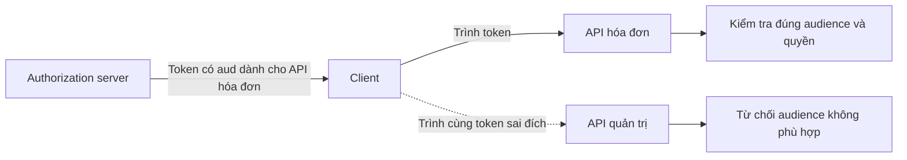

# Token audience

## 1. Audience trả lời câu hỏi nào?

**Token audience** xác định bên nhận mà token được phát hành để sử dụng. Trong JWT, thông tin này thường được biểu diễn bằng claim `aud`.

Một token có chữ ký hợp lệ chỉ chứng minh được tính toàn vẹn và nguồn phát hành theo cơ chế đã được kiểm tra. Nó chưa chứng minh token được phép dùng tại API đang nhận request.

Ví dụ, cùng một authorization server phát hành token cho:

- API hóa đơn.
- API quản trị người dùng.
- Một ứng dụng web dùng đăng nhập OpenID Connect.

Nếu API quản trị chỉ kiểm tra chữ ký và thời hạn, nó có thể chấp nhận token vốn dành cho API hóa đơn hoặc token đăng nhập của ứng dụng web. Audience là một phần của ranh giới giúp ngăn việc dùng token sai nơi.

Trong đặc tả yêu cầu bảo mật, câu hỏi cần trả lời là:

> Bên nhận này chấp nhận token dành cho định danh tài nguyên nào, từ issuer nào, theo profile nào, và từ chối ra sao khi không chứng minh được đúng đích?

Audience không thay thế phân quyền nghiệp vụ, kiểm tra tenant hoặc bảo vệ bearer token khỏi bị đánh cắp. Nó giới hạn **nơi token được chấp nhận**, trong hợp đồng mà bên phát hành và bên nhận cùng thực thi.

## 2. Phân biệt audience với các thông tin liên quan

| Thông tin | Câu hỏi chính | Ví dụ |
|---|---|---|
| Issuer — iss | Ai phát hành token? | Authorization server của hệ thống |
| Audience — aud | Token được dành cho bên nhận nào? | API hóa đơn production |
| Subject — sub | Token nói về principal nào? | Một người dùng hoặc một ứng dụng theo grant/profile |
| Client ID | Ứng dụng client nào tham gia luồng cấp token? | Portal hoặc ứng dụng tích hợp |
| Scope | Những phạm vi truy cập nào được cấp theo mô hình? | invoices:read |
| Tenant / organization | Ngữ cảnh tổ chức nào được liên kết theo hợp đồng? | tenant-a |
| Token type / profile | Bằng chứng này dùng cho mục đích và bộ kiểm tra nào? | JWT access token, ID token |

Hai API có thể cùng hiểu một scope tên `read`. Có scope đó không chứng minh token dành cho cả hai API.

Tương tự, một người dùng hợp lệ có thể có token dành cho API A nhưng không có token dành cho API B. Subject đúng không thay thế audience đúng.

Client ID và audience cũng không có một quan hệ bằng nhau mặc định. Với ID token của OIDC, audience gắn với client nhận kết quả đăng nhập. Với access token dành cho một API, audience thường gắn với tài nguyên theo profile. Phải xét loại token, không chỉ tên claim.

## 3. Audience trong JWT: kiểu dữ liệu và hợp đồng

### 3.1. Chuỗi hoặc mảng chuỗi

JWT cho phép audience biểu diễn bằng một chuỗi khi có một bên nhận, hoặc mảng chuỗi:

```json
{
  "aud": "urn:example:api:billing:prod"
}
```

```json
{
  "aud": [
    "urn:example:api:billing:prod",
    "urn:example:api:reporting:prod"
  ]
}
```

Các giá trị audience được so sánh có phân biệt hoa thường theo ngữ nghĩa claim. Không tự thay phép kiểm tra bằng tìm chuỗi con, wildcard hoặc chuẩn hóa URL tùy ý. Xem [RFC 7519, mục 4.1.3](https://www.rfc-editor.org/rfc/rfc7519.html#section-4.1.3).

Một validator phải kiểm tra kiểu dữ liệu trước khi dùng. Đối với profile của hệ thống, cần xác định cách xử lý chuỗi rỗng, mảng rỗng, phần tử không phải chuỗi và dữ liệu trùng lặp.

Ví dụ, không chuyển một object hoặc số thành chuỗi rồi so với cấu hình audience chỉ để “dễ tương thích”.

### 3.2. Tùy chọn trong định dạng chung không có nghĩa được bỏ trong API

Định dạng JWT chung không bắt buộc mọi ứng dụng phải dùng cùng một tập claim. Một profile cụ thể có thể yêu cầu audience.

JWT access token theo RFC 9068 yêu cầu aud và yêu cầu resource server kiểm tra token có audience tương ứng với định danh mà nó mong đợi cho chính mình. Xem [RFC 9068, mục 2.2 và 4](https://www.rfc-editor.org/rfc/rfc9068.html#section-4).

Do đó, đối với API đã chọn một profile yêu cầu audience:

> Thiếu aud phải dẫn đến từ chối, không được diễn giải thành token dùng được ở mọi nơi.

Không áp suy luận từ tính tùy chọn của JWT tổng quát để bỏ kiểm tra của profile đang triển khai.

### 3.3. Audience là định danh, không mặc định là địa chỉ mạng

Audience có thể là một định danh logic theo hợp đồng. Một URI trong aud cũng không có nghĩa server phải gọi tới URI đó hoặc token tự được gửi tới địa chỉ đó.

Ví dụ `urn:example:api:billing:prod` là một định danh tài nguyên, không phải URL để tải khóa.

Nếu dùng cơ chế resource indicators của OAuth, định danh cần đáp ứng quy tắc của cơ chế đó. Không mặc định mọi giá trị audience hợp lệ theo định dạng JWT đều có thể dùng nguyên dạng làm mọi tham số giao thức khác.

## 4. Mô hình đe dọa: token đúng chữ ký nhưng sai nơi

Giả sử hệ thống có hai API cùng tin authorization server AS:



### 4.1. Rủi ro dùng token chéo tài nguyên

Nếu API B kiểm tra khóa ký chung nhưng không kiểm tra audience, token của API A có thể được chấp nhận ở API B. Thiệt hại tăng nếu hai API dùng các tên scope hoặc role trùng nhau nhưng mang nghĩa khác.

Một API ít nhạy cảm cũng có thể là nơi token bị phơi lộ. Audience hẹp giúp hạn chế việc dùng token đó ở tài nguyên khác, miễn là mọi bên nhận đều kiểm tra đúng.

### 4.2. Rủi ro confused deputy

Một dịch vụ nhận yêu cầu của client rồi dùng đặc quyền riêng gọi dịch vụ khác có thể trở thành bên đại diện bị lợi dụng.

Kiểm tra audience ở đầu vào là cần thiết nhưng chưa đủ. Dịch vụ còn phải xác định nó có được phép thực hiện hành động downstream đó thay principal này hay không.

Ví dụ, nhận một token hợp lệ cho dịch vụ báo cáo không mặc định cho phép dịch vụ dùng credential quản trị để xuất mọi dữ liệu khách hàng.

### 4.3. Audience không chống mọi replay

Một bearer token đúng audience bị lấy cắp vẫn có thể được phát lại tại chính API dành cho token đó nếu các điều kiện khác còn hợp lệ.

Cần các kiểm soát riêng cho bí mật token, thời hạn, thu hồi và ràng buộc người gửi khi profile yêu cầu. Không mô tả audience như bằng chứng bên xuất trình token là client ban đầu.

## 5. Định danh tài nguyên và cấu hình phía máy chủ

### 5.1. Chọn audience theo ranh giới bảo mật

Một danh mục minh họa:

| Tài nguyên | Audience | Issuer được tin cậy |
|---|---|---|
| API hóa đơn production | urn:example:api:billing:prod | Authorization server production |
| API báo cáo production | urn:example:api:reporting:prod | Authorization server production |
| API quản trị production | urn:example:api:administration:prod | Authorization server được phê duyệt cho quản trị |
| API hóa đơn test | urn:example:api:billing:test | Authorization server test |

Không dùng audience chung `all-services` cho mọi API nếu mục tiêu là ngăn token đi chéo ranh giới này.

Audience không nhất thiết tương ứng từng endpoint hoặc từng instance. Nhiều instance của cùng một tài nguyên logic có thể chia sẻ audience nếu cùng thuộc ranh giới tin cậy đã định.

Ngược lại, gán chung audience cho hai hệ thống không cùng mức tin cậy làm giảm khả năng cách ly. Phải xem đó là một quyết định thiết kế có tác động, không chỉ là đặt tên.

### 5.2. Giá trị mong đợi phải do bên nhận quyết định

API phải lấy expected audience từ cấu hình được quản trị, gắn với tài nguyên hoặc route đã được xác định theo kiến trúc.

Không lấy expected audience từ:

- Chính aud do token khai báo.
- Query parameter như `expectedAudience`.
- Header tùy ý do client gửi.
- Host hoặc forwarded header chưa được kiểm soát.
- Một URL mà token yêu cầu server truy cập.

Sai lầm dạng vòng tròn:

```text
expectedAudience = decodedToken.aud
validateAudience(token, expectedAudience)
```

Cách này chỉ so token với chính nó, không chứng minh token dành cho API.

### 5.3. Cấu hình mẫu

```yaml
resourcePolicy:
  resourceId: billing-production
  trustedIssuer: https://authorization.example/production
  tokenProfile: RFC9068
  acceptedHeaderTypes:
    - at+jwt
    - application/at+jwt
  expectedAudience: urn:example:api:billing:prod
  audienceRequired: true
  audienceMatching: EXACT
  audienceCardinalityPolicy: SINGLE_RESOURCE
```

Đây là mô tả chính sách minh họa, không phải schema của một framework.

SINGLE_RESOURCE trong ví dụ chấp nhận một audience tương ứng tài nguyên này, biểu diễn bằng chuỗi hoặc mảng một phần tử, và từ chối token nhiều tài nguyên. Đó là chính sách thu hẹp của hệ thống giả định, không phải tuyên bố mọi profile JWT đều cấm nhiều audience.

Thiếu cấu hình bắt buộc phải làm đường truy cập bảo vệ không thể hoạt động theo chế độ bỏ qua audience. Có thể chặn khởi động hoặc vô hiệu hóa route theo kiến trúc, nhưng không tự chuyển sang wildcard.

## 6. Kiểm tra audience trong một bộ xác minh hoàn chỉnh

### 6.1. Không chỉ decode claim

Một payload minh họa:

```json
{
  "iss": "https://authorization.example/production",
  "sub": "person-17",
  "aud": "urn:example:api:billing:prod",
  "client_id": "finance-portal",
  "scope": "invoices:read",
  "iat": 1900000000,
  "exp": 1900000300,
  "jti": "example-token-731"
}
```

Đây chỉ là dữ liệu minh họa, không phải token đã ký và không phải credential thực. Các timestamp dùng để giải thích cấu trúc; ca kiểm thử cần đồng hồ được kiểm soát.

Đọc được aud trong JSON không khiến nó đáng tin. Bộ xác minh phải kiểm tra nguồn phát hành, khóa, thuật toán, loại token, thời gian và các điều kiện của profile trước khi dùng claim làm căn cứ cấp quyền.

Thông tin chưa xác minh có thể được dùng như một gợi ý giới hạn để chọn cấu hình trong danh sách cho phép, nhưng không được tự tạo quan hệ tin cậy, tải khóa tùy ý hoặc tạo principal đã xác thực.

### 6.2. Luồng quyết định minh họa

```text
authorizeRequest(request, protectedResourcePolicy):
    require protectedResourcePolicy is configured

    token = extractTokenUsingApprovedMechanism(request)

    verifiedClaims = trustedTokenValidator.validate(
        token,
        issuer = protectedResourcePolicy.trustedIssuer,
        profile = protectedResourcePolicy.tokenProfile,
        allowedAlgorithms = approvedAlgorithmPolicy,
        requiredAudience = protectedResourcePolicy.expectedAudience,
        audiencePolicy = protectedResourcePolicy.audienceCardinalityPolicy,
        timePolicy = approvedTimePolicy
    )

    principal = resolvePrincipal(verifiedClaims)
    require principal is allowed in requested tenant
    require granted scope permits requested operation
    require object-level policy permits target resource

    execute authorized operation
```

Đây là mã giả mô tả trách nhiệm, không phải API của thư viện. Dùng thư viện hỗ trợ đúng profile; không ghép vài thao tác decode và so chuỗi thành bộ xác minh mật mã tự chế.

Các bước của bộ xác minh có thể có thứ tự nội bộ khác nhau, nhưng không được có quyết định cấp quyền hoặc tác động nghiệp vụ trước khi các điều kiện bắt buộc đều đạt.

### 6.3. So khớp phải chính xác

Với expected audience:

```text
urn:example:api:billing:prod
```

Không chấp nhận một cách tùy ý:

```text
urn:example:api:billing:prod:extra
urn:example:api:billing
URN:EXAMPLE:API:BILLING:PROD
```

Tương tự, nếu hợp đồng dùng URI dạng HTTPS, không tự bỏ dấu slash, đổi chữ hoa thường hay giải mã rồi so theo một cách khác với profile và cấu hình đã chốt.

Nếu cần hỗ trợ alias, phải đăng ký rõ từng giá trị chính xác và giới hạn thời gian sử dụng. Prefix matching và wildcard không phải cách thay thế an toàn cho một kế hoạch chuyển đổi audience.

## 7. Nhiều audience: phải định nghĩa chính sách rõ ràng

Định dạng JWT cho phép mảng audience nhưng không quyết định thay ứng dụng mọi điều kiện chấp nhận.

Một policy có thể cho phép token nhiều tài nguyên khi:

- API hiện tại có định danh trong mảng.
- Issuer được phép phát token theo profile đó.
- Các tài nguyên còn lại thuộc tập đã được phê duyệt.
- Quyền và scope không bị diễn giải nhập nhằng giữa các tài nguyên.
- Mô hình rủi ro chấp nhận việc token có thể dùng ở nhiều nơi.

Ví dụ:

```json
{
  "aud": [
    "urn:example:api:billing:prod",
    "urn:example:api:reporting:prod"
  ],
  "scope": "read"
}
```

Cần làm rõ read nghĩa là gì đối với từng tài nguyên. Nếu không xác định được quyền áp dụng, không tự chọn cách diễn giải rộng nhất.

Có hệ thống chỉ yêu cầu audience hiện tại nằm trong tập theo profile; có hệ thống áp chính sách hẹp hơn như SINGLE_RESOURCE của ví dụ. Đặc tả phải phân biệt yêu cầu giao thức với chính sách bổ sung, tránh kiểm thử theo hai cách hiểu khác nhau.

Token nhiều audience cũng có thể làm tăng số nơi nhận cùng credential. Không mặc định đó là lựa chọn tối ưu chỉ vì giảm số lần xin token.

## 8. Access token, ID token và opaque token

### 8.1. ID token của OIDC

Với OIDC, ID token cung cấp kết quả xác thực cho relying party. Client phải kiểm tra audience có client ID phù hợp theo quy tắc của OIDC; trường hợp nhiều audience còn có các điều kiện liên quan authorized party.

Không dùng quy tắc của một API access token để suy rằng mọi ID token phải có audience là URL API. Xem [OpenID Connect Core, mục ID Token Validation](https://openid.net/specs/openid-connect-core-1_0.html#IDTokenValidation).

API cũng không được nhận ID token thay access token chỉ vì:

- Cùng issuer.
- Cùng định dạng JWT.
- Cùng có sub và exp.
- Chữ ký vẫn hợp lệ.

Cần bộ quy tắc phân biệt mục đích token, không chỉ audience. Với profile RFC 9068, kiểm tra loại JWT theo profile là một phần của việc phân biệt đó.

### 8.2. Opaque access token

Opaque token không nhất thiết chứa aud mà API có thể tự đọc. Đích nhận có thể được xác định qua introspection hoặc metadata có thẩm quyền.

Một response minh họa:

```json
{
  "active": true,
  "aud": "urn:example:api:billing:prod",
  "scope": "invoices:read",
  "client_id": "finance-portal"
}
```

RFC 7662 định nghĩa metadata introspection, trong đó aud là trường tùy chọn ở giao thức chung. Xem [RFC 7662, mục 2.2](https://www.rfc-editor.org/rfc/rfc7662.html#section-2.2).

Vì vậy, nếu profile nội bộ yêu cầu aud trong response, thiếu trường này phải dẫn đến từ chối. Nếu một mô hình khác dựa vào quyết định introspection được giới hạn cho từng resource server, hợp đồng phải mô tả rõ bằng chứng rằng token dùng được cho chính tài nguyên đang hỏi.

Không mặc định `active=true` trên một dịch vụ kiểm tra chung là đủ cho mọi API.

Endpoint introspection, cơ chế xác thực bên gọi và giới hạn độ cũ của cache phải được cấu hình tin cậy. Không chọn endpoint theo URL mà token hoặc request chưa xác minh tự cung cấp.

## 9. Phát hành token cho đúng tài nguyên

Kiểm tra tại resource server chỉ là một nửa hợp đồng. Authorization server cũng cần có chính sách phát hành.

### 9.1. Client yêu cầu tài nguyên không có nghĩa được cấp

Client có thể yêu cầu token cho tài nguyên cụ thể, nhưng authorization server phải kiểm tra client, grant, quyền được chấp thuận và tài nguyên mục tiêu.

Một yêu cầu mẫu:

> Authorization server chỉ được phát token có audience thuộc tập tài nguyên mà client và grant hiện tại được phép sử dụng. Yêu cầu audience không được hỗ trợ hoặc vượt quyền phải bị từ chối.

Không cho client tự chọn audience bất kỳ rồi ký mọi giá trị mà không đánh giá chính sách.

### 9.2. Resource indicators và tham số đặc thù

RFC 8707 định nghĩa tham số resource để client chỉ ra tài nguyên muốn truy cập. Tên tham số tùy biến audience của một sản phẩm không tự trở thành tham số tiêu chuẩn cho mọi OAuth server.

Khi dùng resource indicators, phải đáp ứng cú pháp và quy tắc của RFC, rồi kiểm tra giá trị token thực sự được cấp theo profile. Xem [RFC 8707 — Resource Indicators](https://www.rfc-editor.org/rfc/rfc8707.html).

Scope và tài nguyên cần được đánh giá cùng nhau. Không cho phép yêu cầu token đúng audience nhưng chứa một scope quản trị không thuộc quyền của client hoặc người dùng.

Client nên sử dụng token theo hợp đồng cấp phát, không phụ thuộc vào việc tự giải mã access token để quyết định toàn bộ luồng; một thay đổi sang opaque token không nên làm mất ranh giới bảo mật phía server.

## 10. Gateway và lời gọi giữa các dịch vụ

### 10.1. Gateway không tự làm token hợp lệ cho mọi downstream

Giả sử token dành cho API gateway và gateway gọi dịch vụ hóa đơn. Có các thiết kế khác nhau:

- Gateway và dịch vụ cùng thuộc một tài nguyên logic đã được định nghĩa, dùng chung audience và có đường truyền identity được bảo vệ.
- Gateway nhận token cho đầu vào của mình rồi lấy token downstream dành riêng cho dịch vụ hóa đơn.
- Gateway thực thi kiểm soát tập trung; downstream chỉ nhận yêu cầu qua một kênh đã xác thực và hợp đồng identity nội bộ rõ ràng.

Không được trộn ba mô hình bằng cách chuyển tiếp tùy ý token và tắt audience validation ở downstream.

Nếu tin header identity do gateway thêm, phải chặn đường đi trực tiếp không qua gateway và không cho client giả mạo header có thẩm quyền. Đây là một ranh giới xác thực khác cần được đặc tả.

### 10.2. Token downstream cần quyền tối thiểu

Một thiết kế có token exchange cần chỉ rõ:

- Dịch vụ nào được phép yêu cầu đổi token.
- Identity người dùng, actor hoặc delegation được biểu diễn ra sao.
- Audience downstream nào được phép.
- Scope và thời hạn nào được giữ hoặc thu hẹp theo chính sách.
- Điều kiện thu hồi và audit.

Giao thức token exchange được mô tả tại [RFC 8693](https://www.rfc-editor.org/rfc/rfc8693.html). Việc hỗ trợ giao thức không tự quyết định mọi chính sách delegation.

Không dùng token service-to-service có đặc quyền rộng để thực hiện mọi yêu cầu của người dùng mà bỏ kiểm tra quyền của người dùng đó. Audience đúng vẫn không giải quyết được confused deputy nếu nghiệp vụ đại diện sai.

## 11. Audience không phải ranh giới tenant hoặc môi trường tự động

Một API có thể dùng chung audience cho nhiều tenant. Khi đó token đúng audience vẫn cần được kiểm tra membership và quyền trên tenant đích.

Ví dụ:

> Token dành cho API hóa đơn production chỉ được dùng để truy cập hóa đơn trong tenant mà principal được phép truy cập. Audience đúng không cho phép thay tenant ID tùy ý để đọc dữ liệu khác.

Với môi trường test và production, cần định nghĩa issuer, khóa và audience theo ranh giới mong muốn. Nếu cùng issuer và cùng audience đều được chấp nhận ở cả hai môi trường, không được tuyên bố audience đang cung cấp cách ly môi trường.

Một region mới có thể chia sẻ audience với region hiện tại nếu chúng là cùng tài nguyên logic và cùng chính sách tin cậy. Nếu không, phải chọn định danh và hợp đồng riêng. Không suy sự cách ly chỉ từ tên region trong URL.

## 12. Bộ yêu cầu có thể kiểm chứng

| ID | Yêu cầu | Điều kiện quan sát |
|---|---|---|
| AUD-01 | Mỗi resource server phải có issuer, profile và expected audience được cấu hình phía máy chủ | Thiếu cấu hình không dẫn đến bỏ kiểm tra |
| AUD-02 | Audience phải được kiểm tra chính xác theo kiểu dữ liệu và policy đã chọn | Sai đích, thiếu hoặc sai kiểu đều bị xử lý đúng đặc tả |
| AUD-03 | Claim chỉ được dùng cấp quyền sau khi token vượt toàn bộ xác minh bắt buộc | Không có tác động nghiệp vụ từ token chưa xác minh |
| AUD-04 | Scope, tenant và quyền đối tượng phải được kiểm tra độc lập với audience | Token đúng đích nhưng thiếu quyền không truy cập được |
| AUD-05 | API phải phân biệt access token với bằng chứng dành cho mục đích khác | ID token không được dùng thay access token |
| AUD-06 | Mọi đường truy cập bảo vệ phải áp cùng hợp đồng hoặc hợp đồng tương đương đã duyệt | Không có endpoint hoặc đường nội bộ bỏ qua kiểm tra |
| AUD-07 | Phát hành và chuyển đổi token phải giới hạn tài nguyên mục tiêu theo chính sách | Client không tự chọn audience vượt quyền |
| AUD-08 | Thay đổi audience hoặc alias phải có thời hạn, phiên bản và kế hoạch kết thúc | Alias cũ bị loại bỏ đúng thời điểm |
| AUD-09 | Lỗi xác minh phải từ chối truy cập và tạo bằng chứng không lộ token | Có reason code, không ghi credential thô |

Yêu cầu AUD-08 đặc biệt quan trọng khi migration. Nếu tạm chấp nhận audience cũ và mới, phải xác định tập nào, trong bao lâu và những bên nào còn dùng audience cũ. Không để danh sách tương thích mở rộng mãi.

## 13. Kiểm thử đúng lớp audience

### 13.1. Token sai audience phải vẫn đúng các điều kiện còn lại

Một ca kiểm thử có ý nghĩa cần token được ký hợp lệ bởi issuer kiểm thử tin cậy, còn hạn, đúng profile nhưng dành cho tài nguyên khác.

Nếu chỉ sửa aud trong payload mà không ký lại, hệ thống có thể từ chối vì chữ ký sai. Kết quả đó chưa chứng minh audience validation đang hoạt động.

Tương tự, token đã hết hạn không phải bằng chứng tốt cho một ca chỉ muốn kiểm tra sai audience.

Dùng issuer và khóa của môi trường kiểm thử được phép, không lấy hoặc giả mạo credential production.

### 13.2. Ma trận nghiệm thu

| Tình huống | Kết quả mong đợi |
|---|---|
| Token đúng issuer, chữ ký, profile, thời hạn và audience; đủ quyền | Cho phép hành động trong giới hạn nghiệp vụ |
| Cùng mọi điều kiện nhưng audience của API khác | Từ chối do sai đích |
| Thiếu aud trong profile yêu cầu aud | Từ chối |
| aud là số, object hoặc mảng chứa phần tử sai kiểu | Từ chối theo policy |
| Audience chỉ chứa expected audience như một chuỗi con | Từ chối |
| Khác hoa thường hoặc khác dấu slash ngoài alias đã đăng ký | Từ chối |
| Token có nhiều audience trong policy SINGLE_RESOURCE | Từ chối theo chính sách bổ sung |
| Token nhiều audience trong profile cho phép | Chỉ chấp nhận nếu đầy đủ điều kiện của policy đó |
| Token đúng aud nhưng issuer không được tin | Từ chối |
| Token đúng aud nhưng chữ ký sai hoặc thuật toán không được phép | Từ chối |
| ID token có chữ ký hợp lệ được gửi tới API access token | Từ chối theo profile |
| Token đúng aud nhưng thiếu scope | Không cho hành động yêu cầu scope đó |
| Token đúng aud và scope nhưng sai tenant | Không truy cập dữ liệu tenant đích |
| Client sửa header hoặc query để chọn expected audience khác | Không thay đổi cấu hình tin cậy |
| Introspection active=true nhưng thiếu bằng chứng đích nhận bắt buộc | Từ chối theo hợp đồng |
| Gọi trực tiếp downstream bằng token chỉ dành cho gateway | Không vượt ranh giới đã thiết kế |
| Alias audience hết giai đoạn chuyển đổi | Không còn được chấp nhận |
| Validator hoặc cấu hình bị lỗi | Không tự chuyển sang bỏ qua audience |

Các ca này là tiêu chí cho triển khai và nghiệm thu; việc soạn tài liệu chưa chứng minh một hệ thống cụ thể đã đạt.

### 13.3. Bằng chứng và phản hồi lỗi

Audit có thể ghi:

```yaml
eventType: TOKEN_VALIDATION_DENIED
resourceId: billing-production
reasonCode: AUDIENCE_MISMATCH
validationProfile: RFC9068
policyVersion: 4
correlationId: request-915
```

Không ghi raw token hoặc Authorization header đầy đủ. Audience nhận được cũng là dữ liệu chưa tin cậy nếu token chưa xác minh; nếu cần ghi để điều tra phải giới hạn kích thước, xử lý an toàn và tránh rò rỉ metadata không cần thiết.

Phản hồi bên ngoài dùng cơ chế lỗi của giao thức đã chọn; không cần công khai toàn bộ danh sách audience nội bộ hoặc chi tiết khóa. Bằng chứng nội bộ nên đủ để phân biệt audience mismatch với chữ ký, thời hạn hoặc scope để tránh khắc phục sai bằng cách tắt validator.

## 14. Kết luận thiết kế

Audience đưa một điều kiện quan trọng vào hợp đồng token: bằng chứng này được dành cho bên nhận nào. Điều kiện chỉ có giá trị khi issuer phát hành đúng phạm vi, API biết định danh của chính mình và mọi đường vào đều thực thi kiểm tra.

Một token được chấp nhận phải đồng thời đúng nguồn, đúng loại, đúng đích, còn hiệu lực và đủ quyền cho thao tác cụ thể. Chữ ký hợp lệ hoặc scope phù hợp không thể thay thế bất kỳ điều kiện nào trong số đó.

