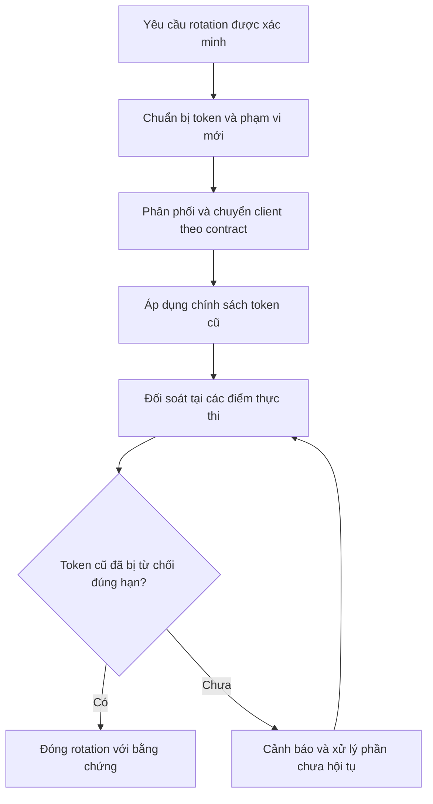

# Token rotation

## 1. Token rotation thay đổi điều gì?

Token rotation là quá trình thay một token bằng token mới theo chính sách có kiểm soát, đồng thời xác định rõ trạng thái và thời hạn được chấp nhận của token cũ. Mục tiêu thường là giới hạn thời gian sử dụng một bí mật, hỗ trợ phát hiện phát lại, chuyển đổi thông tin xác thực hoặc xử lý nguy cơ lộ token.

Việc tạo một chuỗi khác không đủ để kết luận rotation đã hoàn tất. Nếu token cũ vẫn được mọi API chấp nhận vô thời hạn, hệ thống chỉ bổ sung thêm một thông tin xác thực chứ chưa thực hiện đầy đủ chính sách thay thế.

Ví dụ, một dịch vụ tích hợp đang dùng token `T1`. Hệ thống cấp `T2`, dịch vụ chuyển sang sử dụng `T2`, sau đó các điểm thực thi phải từ chối `T1` theo thời hạn đã chốt. Nếu một node vẫn chấp nhận `T1` do cache cũ, rotation chưa đạt yêu cầu tại node đó dù màn hình quản trị đã hiển thị thành công.

Trong đặc tả yêu cầu bảo mật, cần trả lời: token loại nào được thay, ai được yêu cầu thay, điều gì kích hoạt, có cho chồng lấn hay không, token mới mang quyền gì và bằng chứng nào xác nhận token cũ đã hết hiệu lực.

## 2. Phân biệt rotation, gia hạn, thu hồi và thay khóa

| Hoạt động | Nội dung chính | Điều không được suy ra |
|---|---|---|
| Cấp thêm token | Tạo một thông tin truy cập khác | Token cũ đã mất hiệu lực |
| Gia hạn | Cho phép tiếp tục một vòng đời theo chính sách | Bí mật đã thay đổi hoặc hạn tuyệt đối được đặt lại |
| Rotation | Chuyển từ token cũ sang token mới với quy tắc thay thế | Mọi loại token phải áp dụng cùng cách chuyển đổi |
| Thu hồi | Ngừng chấp nhận một token hoặc tập token | Client đã có thông tin thay thế hợp lệ |
| Hết hạn | Token không còn hợp lệ khi đạt mốc thời gian | Đã phát hiện hoặc xử lý việc token bị đánh cắp trước đó |
| Rotation khóa ký | Thay khóa dùng để phát hành hoặc xác minh token có chữ ký | Mỗi token cũ tự mất hiệu lực ngay |

Token có chữ ký và khóa ký token là hai đối tượng khác nhau. Khi khóa mới được dùng để phát hành nhưng khóa cũ vẫn được bên nhận tin cậy, token ký bằng khóa cũ có thể tiếp tục hợp lệ đến hạn theo chính sách. Ngược lại, loại bỏ khóa cũ khỏi tập tin cậy có thể ảnh hưởng đồng thời nhiều token, không chỉ một token cần thay.

Vì vậy, không dùng rotation khóa ký như cách thay thế tùy tiện cho thu hồi một phiên hoặc một token cụ thể. Hai quá trình cần phạm vi, kế hoạch chuyển đổi và bằng chứng riêng.

Rotation cũng không sửa được mọi hậu quả của một sự cố. Nếu kẻ tấn công còn quyền đọc kho bí mật hoặc điều khiển client, token mới có thể tiếp tục bị lấy. Quy trình sự cố cần xử lý nguồn lộ và căn cứ cấp token mới, không chỉ lặp lại thao tác tạo bí mật.

## 3. Chọn chính sách theo loại token

### 3.1. Access token

Hệ thống có thể cấp access token mới trong khi token trước vẫn chưa hết hạn. Đây có thể là hành vi hợp lệ nếu chính sách cho phép nhiều token truy cập tồn tại đồng thời. Cần nêu rõ liệu việc phát hành mới có thu hồi token trước hay chỉ tạo thêm một token trong giới hạn vòng đời.

Với token được kiểm tra độc lập tại API tài nguyên, việc cấp token mới ở dịch vụ phát hành không tự thông báo trạng thái mới đến mọi API. Nếu yêu cầu token cũ phải ngừng được chấp nhận sớm, cần cơ chế thực thi tương ứng như kiểm tra trạng thái, phiên bản quyền hoặc cơ chế thu hồi được bên nhận áp dụng.

### 3.2. Refresh token

Trong mô hình refresh token rotation một lần sử dụng, mỗi lần làm mới hợp lệ tiêu thụ token hiện hành và tạo token kế tiếp. Token cũ có thể được giữ lại dưới dạng bản ghi trạng thái phục vụ phát hiện dùng lại, chứ không tiếp tục có quyền tạo chuỗi mới.

Các token liên quan thường cần một liên kết chuỗi để xác định phạm vi xử lý khi phát hiện dùng lại. Tuy nhiên, một cửa sổ chồng lấn dùng cho token tích hợp máy không được tự áp dụng cho refresh token một lần sử dụng. Chính sách cần xử lý cụ thể thử lại, mất phản hồi và cạnh tranh.

### 3.3. Token tích hợp và thông tin xác thực máy

Với dịch vụ máy, đổi token có thể liên quan nhiều instance, lịch tác vụ, kho bí mật và quy trình triển khai. Một khoảng chuyển tiếp cho phép cả token cũ và mới có thể hỗ trợ thay đổi có kiểm soát, nhưng phải có hạn và chỉ áp dụng khi rủi ro cho phép.

Không phải mọi API key hay thông tin xác thực máy đều có cùng ngữ nghĩa. Đặc tả phải nêu loại bí mật thực tế, cách bên nhận kiểm tra và đơn vị được rotation. Cùng một tên “token” không đủ để quyết định có thể sử dụng một lần, dùng đồng thời hay thu hồi theo thế hệ.

## 4. Từ rủi ro đến chính sách thay thế

| Tình huống | Mục tiêu | Quy tắc cần làm rõ |
|---|---|---|
| Rotation theo lịch | Giới hạn tuổi của bí mật đang sử dụng | Chu kỳ, hạn tuyệt đối và thời gian chuyển tiếp |
| Sử dụng một lần | Hạn chế khả năng phát lại thông tin làm mới | Tiêu thụ nguyên tử và xử lý token cũ xuất hiện lại |
| Thay đổi thiết bị hoặc triển khai | Chuyển quyền truy cập sang ngữ cảnh hợp lệ mới | Ràng buộc client, phạm vi và xác nhận cài đặt |
| Đổi quyền hoặc phạm vi tài nguyên | Không để token cũ giữ quyền ngoài chính sách | Token nào phải thu hồi và nơi thực thi kiểm tra thay đổi |
| Nghi ngờ hoặc xác nhận lộ token | Chấm dứt khả năng sử dụng thông tin đã lộ | Hạn vô hiệu hóa, có cấm chồng lấn không và căn cứ cấp mới |
| Chủ sở hữu nghỉ việc hoặc tích hợp kết thúc | Dừng quyền truy cập không còn hợp lệ | Thu hồi thay vì tự động cấp token thay thế |

Sự kiện lộ token không nhất thiết được xử lý giống rotation định kỳ. Nếu token cũ đã được xác nhận không còn tin cậy, giữ nó hoạt động thêm một khoảng dài để giảm gián đoạn có thể trái với mục tiêu ứng phó sự cố.

Tương tự, việc chủ sở hữu nghỉ việc không phải lý do tự cấp token mới cùng quyền cho một chủ sở hữu khác. Thay đổi trách nhiệm và điều kiện cấp quyền cần được xác minh theo quy trình của identity và tài nguyên liên quan.

## 5. Bất biến bảo mật qua các thế hệ token

Rotation phải bảo toàn những ràng buộc cần thiết hoặc thu hẹp chúng theo chính sách, không tự mở rộng quyền. Các bất biến thường gồm:

- Identity và client được đại diện phải đúng với căn cứ cấp quyền đã phê duyệt.
- Tenant, audience, tài nguyên và scope không được mở rộng chỉ vì token được thay.
- Hạn tuyệt đối của phiên hoặc grant phải được giữ nếu chính sách quy định vòng đời chung.
- Dữ liệu về thời điểm và mức bảo đảm xác thực phải phản ánh lần xác thực thật, không được làm mới giả tạo chỉ vì phát hành token mới.
- Token cũ đã thu hồi, tiêu thụ hoặc hết hạn không được trở lại hoạt động do retry, đồng bộ chậm hoặc khôi phục cấu hình cũ.
- Hoạt động rotation phải truy vết được bằng định danh không phải bí mật của token, grant và chuỗi liên quan.

Một giá trị mới cần được tạo bằng cơ chế phù hợp với loại token. Đổi cách biểu diễn, thêm một tiền tố hoặc mã hóa Base64 giá trị cũ không tự tạo bí mật độc lập. Với token có cấu trúc và chữ ký, cần định nghĩa đủ dữ liệu và quy tắc phát hành để các thế hệ được phân biệt đúng; chuỗi khác nhau vẫn không thay thế kiểm tra trạng thái.

Yêu cầu cấp token mới phải được xác thực và phân quyền. Trong rotation thông thường, token cũ có thể tham gia chứng minh quyền theo contract. Khi xử lý một token đã xác nhận bị lộ, chỉ trình lại chính token đó không nên tự trở thành bằng chứng đủ để nhận bí mật thay thế tiếp tục cùng quyền; cần căn cứ tin cậy theo quy trình khôi phục đã chọn.

## 6. Mô hình trạng thái và khoảng chồng lấn

### 6.1. Ví dụ mô hình cho token tích hợp máy

Một mô hình có thể sử dụng các trạng thái sau. Đây là lựa chọn minh họa, không phải schema bắt buộc cho mọi hệ thống:

| Trạng thái | Ý nghĩa | Điều kiện được chấp nhận |
|---|---|---|
| `PREPARED` | Đã tạo bản ghi token mới, chờ điều kiện kích hoạt | Chưa được dùng ở API tài nguyên nếu chính sách chưa cho phép |
| `ACTIVE` | Token hiện hành | Được dùng trong phạm vi, thời hạn và điều kiện được cấp |
| `GRACE` | Token cũ chỉ còn được dùng trong giai đoạn chuyển tiếp | Chưa quá hạn gốc và chưa quá hạn chồng lấn |
| `REVOKED` | Đã thu hồi | Không được chấp nhận |
| `EXPIRED` | Đã hết hạn | Không được chấp nhận dù bản ghi chưa bị xóa |

Trong mô hình refresh token một lần sử dụng, trạng thái `CONSUMED` thể hiện token đã được sử dụng để chuyển sang thế hệ kế tiếp. Không được coi `CONSUMED` là `GRACE` nếu contract không cho phép dùng lại.

Khi token cũ được chuyển sang `GRACE`, thời điểm kết thúc phải được xác định từ sự kiện chuyển đổi đã chốt. Mỗi lần token cũ được dùng không được đẩy hạn chồng lấn thêm một lần nữa. Thời hạn hiệu lực của nó cũng không được vượt hạn gốc chỉ vì tham gia rotation.

Ví dụ:

```text
oldTokenAcceptUntil = min(oldTokenOriginalExpiry, rotationGraceDeadline)

Token cũ chỉ được chấp nhận khi:
    trạng thái cho phép sử dụng
    và thời điểm đánh giá < oldTokenAcceptUntil
    và mọi điều kiện cấp quyền khác vẫn hợp lệ
```

Nếu sự cố yêu cầu thu hồi ngay theo giới hạn đã cam kết, đường chuyển trạng thái có thể đi thẳng từ `ACTIVE` hoặc `GRACE` sang `REVOKED`. Không được tiếp tục giữ chồng lấn chỉ vì lịch rotation thông thường chưa kết thúc.

### 6.2. Chuyển đổi không được để lại bí mật vô chủ

Các token `PREPARED` chưa bao giờ được kích hoạt cần có hạn và quy tắc dọn bỏ phù hợp. Một yêu cầu rotation bỏ dở không được tích lũy nhiều token có thể hoạt động mà chủ sở hữu không biết.

Nếu cho phép nhiều token đang chuyển tiếp, cần giới hạn số lượng và mối liên hệ giữa các thế hệ. Một vòng lặp yêu cầu rotation không được trở thành cách tạo số lượng thông tin xác thực hợp lệ không giới hạn.

## 7. Luồng rotation có thể vận hành được

Với token tích hợp máy có giai đoạn chuyển tiếp, quy trình có thể gồm:

1. Xác minh người hoặc dịch vụ yêu cầu rotation có thẩm quyền đối với đúng identity và tài nguyên.
2. Tạo token mới với phạm vi, hạn và liên kết thế hệ đúng chính sách; bảo vệ đường phân phối bí mật.
3. Cài đặt token mới vào nơi lưu trữ của client và xác nhận bằng một kiểm tra phù hợp, tránh tạo tác động nghiệp vụ ngoài ý định.
4. Kích hoạt chuyển đổi theo contract; đánh dấu rõ thời điểm bắt đầu và kết thúc chồng lấn nếu có.
5. Theo dõi từng consumer hoặc instance còn sử dụng token cũ trong phạm vi quan sát được.
6. Vô hiệu hóa token cũ không muộn hơn deadline, đối soát tại các điểm thực thi và ghi nhận kết quả.

Thứ tự kích hoạt và cài đặt phụ thuộc khả năng của nền tảng. Nếu hệ thống chỉ cho kiểm tra token khi đã hoạt động, cần mô tả rõ cửa sổ token mới có hiệu lực, thay vì giả định mọi giai đoạn đều tách biệt nguyên tử.



Đối với refresh token một lần sử dụng, quá trình thay thế diễn ra ngay trong một yêu cầu làm mới thay vì một chiến dịch triển khai nhiều bước. Dù vậy, vẫn phải kiểm soát cập nhật trạng thái và chỉ trả kết quả phù hợp với dữ liệu đã được lưu bền vững.

## 8. Cạnh tranh, mất phản hồi và khả năng khôi phục

### 8.1. Hai yêu cầu cùng thay một token

Nếu hai request cùng đọc token hiện hành rồi tự ghi token mới, có thể xuất hiện hai thế hệ cùng được coi là kế tiếp. Hệ thống cần một thứ tự có hiệu lực, bằng cơ chế như giao dịch, cập nhật có điều kiện hoặc điều phối tương đương.

Điều kiện cập nhật phải bao gồm trạng thái và phiên bản cần thiết. Một request chậm không được ghi đè thế hệ mới hoặc làm mất quyết định thu hồi vừa xảy ra. Trong hệ thống nhiều vùng, không được giả định bản sao chưa đồng bộ có thể tự đưa ra cùng kết luận về token hiện hành.

Khóa chống xử lý lặp có thể giúp nhận diện một yêu cầu rotation được gửi lại, nhưng nó phải gắn với chủ thể, phạm vi và nội dung yêu cầu đã được xác minh. Biết một mã request không được tự cho phép nhận token bí mật của người khác.

### 8.2. Mất phản hồi sau khi commit

Server có thể đã thay token nhưng client không nhận được phản hồi. Nếu client thử lại token cũ, hệ thống cần hành vi xác định: xử lý lặp có kiểm soát, yêu cầu lấy lại qua một kênh được phép hoặc yêu cầu xác thực mới.

Không thể tự phục hồi giá trị token nguyên vẹn từ một bản băm không đảo ngược. Nếu contract yêu cầu trả lại đúng token đã cấp, kiến trúc cần một cơ chế bổ sung được bảo vệ, chẳng hạn giữ kết quả có thể phục hồi trong thời gian giới hạn. Việc này phải được mô tả cùng quyền truy cập và hạn dọn dữ liệu.

Không mở cửa sổ retry vô hạn chỉ để tránh yêu cầu đăng nhập lại. Với token một lần sử dụng, một lần thử lại của client và một lần phát lại của đối thủ có thể rất giống nhau. Cần chốt đánh đổi và cơ chế chứng minh phù hợp thay vì mặc định phân biệt được bằng địa chỉ IP hoặc tên thiết bị.

### 8.3. Khôi phục triển khai không được hồi sinh token cũ

Rollback phiên bản ứng dụng hoặc khôi phục một cấu hình cũ không được làm token đã thu hồi trở lại hợp lệ. Trạng thái vòng đời cần được bảo toàn độc lập với bản phát hành hoặc được khôi phục theo quy trình không phá vỡ quyết định bảo mật.

Nếu token mới chưa được phân phối thành công, có thể phải tạm dừng chuyển đổi hoặc cấp lại theo quy trình được phép. Tuy nhiên, một token đã xác nhận bị lộ không nên được kích hoạt lại làm phương án phục hồi thông thường.

Với rotation theo sự cố, điều kiện hoàn tất không chỉ là client đã dùng token mới. Cần xác nhận nguồn lộ đã được xử lý trong phạm vi quy trình và thông tin đã lộ không còn được các điểm thực thi chấp nhận theo giới hạn đã chốt.

## 9. Tính hiệu lực trong hệ thống phân tán

### 9.1. Cấp token mới không tự thay trạng thái tại mọi nơi

Token opaque có thể được kiểm tra bằng kho trạng thái hoặc dịch vụ kiểm tra tập trung. Token có chữ ký có thể được xác minh tại từng dịch vụ mà không đọc trạng thái mỗi lần. Cả hai mô hình đều có những cửa sổ độ trễ và điểm lỗi cần đặc tả.

Nếu một API chỉ kiểm tra chữ ký và thời hạn của access token, việc tạo token thay thế không tự làm nó từ chối token cũ. Để cam kết thời hạn vô hiệu hóa sớm, thiết kế phải cung cấp đủ thông tin và cơ chế thực thi tại API đó.

Ví dụ, access token có thời hạn còn lại 5 phút không thể được tuyên bố đã thu hồi ở mọi API trong 30 giây nếu các API chỉ chờ token hết hạn và không kiểm tra trạng thái bổ sung. Cần đổi cơ chế hoặc chốt một giới hạn khác phù hợp rủi ro.

### 9.2. Cache và sự kiện thay đổi

Cache dương có thể làm token cũ tiếp tục được chấp nhận; cache âm có thể làm token mới bị từ chối trong thời gian chuyển đổi. Cần xác định thời hạn, phiên bản và cách làm mới tương ứng.

Nếu dùng sự kiện rotation hoặc thu hồi, kênh sự kiện cần được bảo vệ và có cách xử lý lặp, đến muộn hoặc sai thứ tự. Sự kiện cũ không được chuyển token từ thu hồi về hoạt động. Chỉ phát thông điệp thành công chưa chứng minh các consumer đã áp dụng.

Đối soát cần bao phủ những điểm chấp nhận token thuộc phạm vi: gateway, API trực tiếp, dịch vụ nội bộ có thể truy cập, các vùng triển khai và kết nối dài nếu có. Một token bị chặn ở gateway nhưng còn được chấp nhận qua đường trực tiếp chưa đáp ứng yêu cầu toàn phạm vi đó.

### 9.3. Lỗi trạng thái không có nghĩa token hợp lệ

Khi không đọc được trạng thái rotation hoặc thu hồi cần thiết, hành vi phải được chốt theo rủi ro. Với thao tác nhạy cảm yêu cầu trạng thái hiện tại, không được tự coi token còn hợp lệ chỉ để tiếp tục phục vụ.

Cần tách lỗi tạm thời khỏi kết luận token sai hoặc hết hạn ở mức phù hợp cho client, đồng thời không tiết lộ bí mật nội bộ. Các chiến lược thử lại hoặc chuyển tuyến không được bỏ qua cơ chế kiểm soát vòng đời.

## 10. Chuyển thành yêu cầu có thể kiểm chứng

Các mốc thời gian dưới đây chỉ là ví dụ của một hệ thống giả định. Khi áp dụng phải lựa chọn lại theo loại token, mô hình triển khai và rủi ro cụ thể.

| ID | Yêu cầu mẫu | Bằng chứng hoặc tình huống kiểm chứng dự kiến |
|---|---|---|
| TR-01 | Hệ thống phải kiểm kê các loại token được quản lý, chủ sở hữu, phạm vi tài nguyên, điều kiện rotation và đơn vị thu hồi. | Đối chiếu một token phiên, một refresh token và một token tích hợp với chính sách tương ứng. |
| TR-02 | Token mới không được mở rộng identity, client, tenant, audience hoặc scope vượt căn cứ cấp quyền; hạn tuyệt đối chung phải được giữ nếu chính sách yêu cầu. | Thử yêu cầu rotation có thay đổi phạm vi và thực hiện nhiều thế hệ liên tiếp. |
| TR-03 | Trong mô hình một token kế tiếp, hai request cạnh tranh không được tạo hai nhánh hợp lệ ngoài chính sách; việc trả thành công phải gắn với trạng thái đã lưu bền vững. | Gửi request đồng thời tới nhiều node và gây lỗi tại các điểm commit. |
| TR-04 | Token tích hợp đang chuyển tiếp chỉ được chồng lấn tối đa 15 phút và không vượt hạn gốc; sử dụng token cũ không được gia hạn cửa sổ. | Dùng token cũ nhiều lần trước và sau deadline chuyển tiếp. |
| TR-05 | Khi token được xác nhận bị lộ, hệ thống phải áp dụng chính sách sự cố và từ chối token cũ tại các điểm thực thi thuộc phạm vi trong tối đa 30 giây kể từ khi quyết định thu hồi được ghi nhận. | Phát lại token thử nghiệm qua gateway, API trực tiếp và các vùng trong phạm vi. |
| TR-06 | Trong refresh token rotation một lần sử dụng, token đã tiêu thụ không được tạo thêm thế hệ ngoài contract thử lại; dùng lại đã xác minh phải được xử lý theo chính sách chuỗi. | Phát lại token cũ trong và ngoài cơ chế thử lại đã định. |
| TR-07 | Mọi rotation phải có hành vi xác định khi phản hồi bị mất; cơ chế nhận diện yêu cầu lặp không được cho phép một client nhận bí mật của client khác. | Mất phản hồi sau commit, gửi lại đúng và sai ràng buộc chủ thể. |
| TR-08 | Token đã thu hồi không được trở lại hoạt động do sự kiện cũ, rollback ứng dụng hoặc phục hồi cache. | Đảo thứ tự sự kiện và triển khai lại phiên bản trước sau một lần thu hồi. |
| TR-09 | Trạng thái hoàn tất phải dựa trên bằng chứng token mới sử dụng được trong phạm vi cần thiết và token cũ bị từ chối đúng chính sách. | Đối soát kết quả tại từng điểm thực thi thay vì chỉ kiểm tra bản ghi phát hành. |
| TR-10 | Log, trace, báo cáo và thông điệp vận hành không được chứa token nguyên vẹn; đường phân phối token mới phải được giới hạn quyền. | Quan sát các kênh bằng token thử nghiệm nhận diện được và kiểm tra quyền truy cập. |
| TR-11 | Khi không đọc được trạng thái bắt buộc để xác định tính hợp lệ cho thao tác quản trị, hệ thống không được mặc định chấp nhận token cũ. | Ngắt kho trạng thái hoặc dịch vụ kiểm tra và thử thao tác qua các đường truy cập. |

TR-04 là chính sách chuyển tiếp thông thường, còn TR-05 áp dụng cho tình huống sự cố đã xác nhận. Hai đường xử lý phải được phân biệt rõ để cửa sổ thông thường không vô tình kéo dài quyền của token bị lộ.

Các yêu cầu thời gian cần mốc bắt đầu, điểm kết thúc, giới hạn sai lệch đồng hồ và phạm vi quan sát cụ thể. Nếu có cache hoặc thành phần xác minh độc lập không thể đáp ứng 30 giây, không được đánh dấu đạt chỉ vì dịch vụ phát hành đã đổi trạng thái.

## 11. Ví dụ: rotation token cho dịch vụ đồng bộ đơn hàng

Một dịch vụ máy dùng token `T1` để đọc đơn hàng của tenant A. Nhiều instance lấy bí mật từ kho cấu hình được bảo vệ. Chính sách cho phép rotation định kỳ có tối đa 15 phút chồng lấn; khi xác nhận lộ token thì dùng đường thu hồi khẩn cấp với giới hạn riêng.

| Thời điểm minh họa | Sự kiện | Kết quả cần quan sát |
|---|---|---|
| 02:00 | Yêu cầu rotation định kỳ được phê duyệt | Có hồ sơ gắn với đúng dịch vụ, tenant và phạm vi đọc |
| 02:01 | `T2` được phân phối và chuyển sang hoạt động theo contract | Client nhận đúng bí mật, không thay đổi sang quyền ghi |
| 02:01 | `T1` vào giai đoạn chuyển tiếp | Deadline chồng lấn là 02:16 hoặc hạn gốc nếu sớm hơn |
| 02:05 | Phần lớn instance dùng `T2` | Còn theo dõi rõ instance hoặc tác vụ dùng `T1` |
| 02:16 | Kết thúc chồng lấn | Mọi điểm thuộc phạm vi từ chối `T1` theo yêu cầu |
| 02:17 | Một instance cũ thử `T1` | Bị từ chối và được xử lý vận hành, không tự gia hạn token cũ |

Nếu lúc 02:07 có bằng chứng `T1` bị lộ, hệ thống phải đi theo chính sách sự cố từ thời điểm quyết định thu hồi, không tiếp tục chờ đến 02:16 chỉ vì đã có lịch chuyển tiếp.

Một hồ sơ rotation có thể mô tả như sau. Đây là dữ liệu minh họa, không phải schema bắt buộc của sản phẩm:

```yaml
rotationId: rotation-042
subjectId: order-sync-service
clientId: integration-a
tenantId: tenant-a
grantId: grant-7831
oldTokenRecordId: credential-record-17
newTokenRecordId: credential-record-18
allowedScopes:
  - orders:read
mode: SCHEDULED
activatedAt: '2026-11-27T02:01:00Z'
graceEndsAt: '2026-11-27T02:16:00Z'
oldTokenState: GRACE
newTokenState: ACTIVE
verificationState: PENDING
```

Các ID bản ghi không phải giá trị token. `newTokenState: ACTIVE` đi cùng `verificationState: PENDING` thể hiện đã kích hoạt nhưng chưa đủ bằng chứng đóng rotation. Không nên đưa token mới nguyên vẹn vào hồ sơ chỉ để thuận tiện kiểm tra.

Với một tác vụ đã được chấp nhận trước khi token cũ mất hiệu lực, cần chốt riêng việc tác vụ có được tiếp tục và điều kiện lấy kết quả. Từ chối request mới không tự quyết định vòng đời của công việc đang chạy.

## 12. Tình huống nghiệm thu và bằng chứng vận hành

Những tình huống sau là đầu vào để triển khai và kiểm chứng sau này, không phải kết quả kiểm thử đã thực hiện.

**Token mới cùng phạm vi:** Yêu cầu thay token đọc đơn hàng. Token mới không được truy cập tenant khác hoặc tự có quyền ghi, kể cả khi chủ thể có quyền khác trong một grant riêng.

**Request cạnh tranh:** Hai node nhận yêu cầu thay cùng thế hệ. Trạng thái cuối phải theo contract, không tạo nhánh ngầm hoặc để request chậm ghi đè thế hệ hiện hành.

**Mất phản hồi:** Token mới đã được lưu nhưng client không nhận được. Cách thử lại hoặc khôi phục phải giữ đúng ràng buộc và không làm token cũ sống lại ngoài chính sách.

**Client chưa chuyển hết:** Một instance vẫn dùng bí mật cũ khi hết chồng lấn. Hệ thống phải từ chối đúng hạn, phát tín hiệu vận hành và hỗ trợ xử lý instance đó, thay vì tự mở rộng cửa sổ cho toàn bộ hệ thống.

**Sự kiện sai thứ tự:** Thông điệp kích hoạt cũ đến sau thông điệp thu hồi mới. Token không được trở lại `ACTIVE`; phiên bản và thứ tự có thẩm quyền phải được áp dụng.

**Cache hoặc đường đi bỏ sót:** Token cũ bị chặn tại một gateway nhưng còn hợp lệ qua API trực tiếp. Kết quả phải được ghi nhận là chưa đạt phạm vi thu hồi, không coi gateway là bằng chứng đại diện cho mọi đường truy cập.

**Rollback sau thu hồi:** Triển khai lại ứng dụng hoặc phục hồi cấu hình trước rotation. Token đã thu hồi vẫn phải bị từ chối; cấu hình cũ không được khôi phục quyền trái phép.

**Phát hiện dùng lại:** Token một lần sử dụng xuất hiện lại ngoài cơ chế thử lại. Quyết định xử lý chuỗi phải được lưu bền vững dù endpoint trả lỗi; một exception không được rollback mất quyết định bảo mật bắt buộc.

Bằng chứng nên liên kết sự kiện yêu cầu, người hoặc dịch vụ phê duyệt, ID bản ghi token cũ và mới, phiên bản chính sách, deadline, kết quả từng điểm thực thi và lỗi còn chờ. Không ghi giá trị token nguyên vẹn, header xác thực hoặc bí mật liên quan vào log.

Chỉ số hữu ích gồm số rotation quá hạn, tuổi token đang hoạt động, số consumer còn dùng token cũ, độ trễ vô hiệu hóa, tỷ lệ lỗi phân phối và số lần phát lại đã xác minh. Trạng thái không quan sát được một điểm thực thi phải được hiển thị rõ, không tính như đã xác nhận từ chối.

Một đặc tả token rotation đầy đủ phải kiểm soát cả việc cấp bí mật mới và việc chấm dứt quyền của bí mật cũ. Ranh giới giữa hai việc đó, cùng hành vi khi cạnh tranh hoặc lỗi, quyết định rotation có giới hạn được rủi ro hay chỉ làm tăng số token đang tồn tại.
