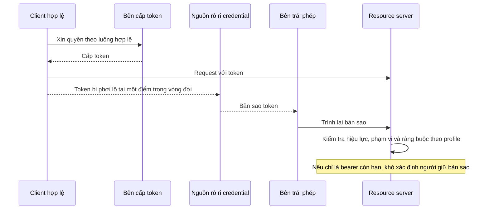

# Token replay

## 1. Token replay là gì?

**Token replay** là việc lấy một token hoặc bằng chứng đã được tạo trước đó rồi trình lại để đạt một quyền truy cập hoặc tác động không được phép.

Ví dụ, một access token bị lộ qua log. Kẻ tấn công dùng bản sao token đó gọi API trong lúc token vẫn còn hiệu lực. Chữ ký của token có thể hoàn toàn hợp lệ vì kẻ tấn công không cần sửa nội dung token.

Điểm cần phân biệt:

> Một token còn hạn, đúng chữ ký và đúng audience chưa chắc đang được trình bởi bên được phép sử dụng nó.

Không phải mọi lần dùng lại token đều là tấn công. Access token thường được thiết kế để dùng cho nhiều request. Ngược lại, authorization code, token đặt lại mật khẩu hoặc bằng chứng cho một thao tác duy nhất có thể cần tính chất dùng một lần.

Yêu cầu bảo mật phải xác định rõ **đối tượng nào được dùng lại, đối tượng nào không được dùng lại, trong ngữ cảnh nào và server chứng minh điều đó bằng cách nào**. Câu “mọi token phải chống replay” chưa đủ để triển khai hoặc nghiệm thu.

Bài học tập trung chuyển các rủi ro này thành yêu cầu về vòng đời credential, ràng buộc người gửi, trạng thái tiêu thụ, tính nhất quán và bằng chứng kiểm thử. Các thời hạn và quy mô trong ví dụ là lựa chọn của một hệ thống giả định.

## 2. Phân loại trước khi chọn biện pháp

| Đối tượng | Cách sử dụng hợp lệ minh họa | Rủi ro cần kiểm soát |
|---|---|---|
| Bearer access token | Dùng cho nhiều request trong phạm vi được cấp | Bản sao bị bên trái phép dùng ở API dành cho token |
| Authorization code | Được đổi token một lần trong luồng đã liên kết | Đổi lại code hoặc đổi từ client/ngữ cảnh không phù hợp |
| Refresh token có rotation | Dùng token hiện tại để nhận token kế tiếp | Token cũ bị dùng lại, chuỗi cấp mới bị chiếm |
| Token đặt lại mật khẩu | Hoàn tất một hành động khôi phục đã định | Dùng lại sau khi đã hoàn tất hoặc dùng sai tài khoản |
| Proof theo request | Chứng minh việc sở hữu khóa cho request cụ thể | Phát lại cùng proof hoặc chuyển proof sang request khác |
| Mã xác nhận hành động | Chấp thuận đúng thao tác đã trình bày | Dùng cùng chấp thuận để thực hiện thao tác khác |
| Idempotency key | Liên kết các lần gửi lại cùng một thao tác theo hợp đồng | Tạo tác động nghiệp vụ lặp; không tự giải quyết trộm token |

Không nên đánh dấu access token “đã dùng” ngay sau request đầu nếu contract cho phép nhiều request. Ngược lại, chỉ kiểm tra hạn của token đặt lại mật khẩu mà không kiểm tra đã tiêu thụ sẽ không đạt yêu cầu dùng một lần.

Phải phân biệt credential có giá trị dài hơn với proof ngắn hạn đi kèm từng request. Cùng một access token có thể được dùng hợp lệ nhiều lần, mỗi lần có một proof khác nhau.

## 3. Vì sao chữ ký, TLS và thời hạn chưa đủ?

### 3.1. Chữ ký không chứng minh độ mới của lần trình token

Chữ ký xác nhận tính toàn vẹn và nguồn theo cơ chế xác minh. Một bản sao nguyên vẹn vẫn có chữ ký đúng.

JWT có claim jti duy nhất cũng chưa tự chống replay. Nếu server không nhớ trạng thái cần thiết hoặc không có một cơ chế tương đương theo giao thức, nó không biết jti đã từng được chấp nhận hay chưa.

Một mã định danh là dữ liệu. **Quy tắc tiêu thụ và thực thi quy tắc** mới tạo ra tính chất dùng một lần.

### 3.2. TLS bảo vệ kênh, không sửa credential đã bị lộ

TLS giảm nguy cơ lấy token trên đường truyền được bảo vệ. Token vẫn có thể bị lộ ở client, server, proxy, công cụ quan sát hoặc bản sao dữ liệu.

Bearer token cho phép bên đang giữ token truy cập tài nguyên mà không cần chứng minh sở hữu một khóa mật mã riêng. Vì vậy phải bảo vệ token trong cả lưu trữ và truyền tải. Xem [RFC 6750 — Bearer Token Usage](https://www.rfc-editor.org/rfc/rfc6750.html).

### 3.3. Thời hạn ngắn thu hẹp cửa sổ, không loại bỏ replay

Giả sử access token còn hiệu lực 5 phút. Nếu bị lấy ngay sau khi cấp, kẻ tấn công vẫn có thể có một khoảng đáng kể để dùng nó.

Độ lệch đồng hồ được cho phép và độ cũ của trạng thái thu hồi có thể ảnh hưởng tới thời gian hệ thống tiếp tục chấp nhận. Cần đo ở resource server thực tế, không chỉ nhìn trường exp trong token.

Với token có thể dùng nhiều lần, thời hạn ngắn là giới hạn thiệt hại. Nó không cung cấp bằng chứng rằng lần sử dụng thứ hai là hợp lệ hay trái phép.

### 3.4. Audience giới hạn nơi dùng, không xác minh người giữ

Audience đúng ngăn một số trường hợp chuyển token sang tài nguyên khác. Bản sao token vẫn có thể được dùng tại chính tài nguyên dành cho token nếu những điều kiện còn lại đều đạt.

Scope hẹp giới hạn hành động có thể thực hiện, nhưng cũng không phân biệt người dùng thật với kẻ đang giữ bản sao bearer token.

## 4. Mô hình đe dọa và ranh giới kiểm soát

Một chuỗi lạm dụng điển hình:



Nguồn phơi lộ cần xem xét gồm URL, log header, trace, crash report, bộ nhớ hoặc lưu trữ client, kho credential và endpoint debug.

Ngoài token, phải đánh giá khóa liên quan. Một thiết kế proof-of-possession chỉ hữu ích khi kẻ lấy token không đồng thời có khả năng dùng khóa riêng tương ứng.

Dữ liệu IP, User-Agent hoặc device ID do client tự khai có thể là tín hiệu. Chúng không phải bằng chứng mật mã về người gửi và không nên được mô tả như cơ chế chống replay chắc chắn.

## 5. Token dùng một lần: phải có tiêu thụ nguyên tử

### 5.1. Các điều kiện trước khi chấp nhận

Với token xác nhận hành động một lần, server cần kiểm tra:

- Token do nguồn có thẩm quyền phát hành và còn hiệu lực.
- Token gắn với đúng mục đích, principal, tenant và đối tượng.
- Nếu cần, token gắn với đúng phiên bản dữ liệu hành động.
- Token chưa bị thu hồi hoặc tiêu thụ.
- Người thực hiện đáp ứng các điều kiện bổ sung của quy trình.
- Việc tiêu thụ và tác động nghiệp vụ được phối hợp để không tạo lỗ hổng cạnh tranh.

Ví dụ, token cho phép xác nhận đổi địa chỉ khôi phục sang địa chỉ A không được dùng để xác nhận địa chỉ B.

Chỉ đọc một cờ used=false rồi cập nhật thành true bằng thao tác riêng là không đủ nếu hai request có thể đồng thời vượt qua kiểm tra.

### 5.2. Bất biến cần giữ

> Một token xác nhận chỉ được tạo tối đa một lần chuyển trạng thái nghiệp vụ được phép, kể cả khi nhiều request cùng dùng nó tới các node khác nhau.

Mã giả cho trường hợp trạng thái token và dữ liệu nghiệp vụ nằm trong cùng một phạm vi transaction:

```text
confirmAction(rawToken, requestedAction):
    begin transaction

    record = findTokenRecordWithConcurrencyProtection(rawToken)
    require record exists
    require tokenSecretMatches(rawToken, record)
    require record.state == ISSUED
    require currentTime < record.expiresAt
    require record.purpose == requestedAction.purpose
    require record.subject == requestedAction.subject
    require record.tenant == requestedAction.tenant
    require record.boundActionVersion == requestedAction.version

    apply authorized state transition
    change record.state from ISSUED to CONSUMED
    record durable audit evidence

    commit
```

Đây là mã giả về tính nhất quán, không phải triển khai hoàn chỉnh. Cách tra cứu, lưu secret và xác minh phải được thiết kế riêng; không mặc định lưu token thô trong database hoặc log.

Nếu hiệu ứng thực tế xảy ra ở dịch vụ ngoài transaction, phải có cơ chế phối hợp như trạng thái xử lý bền vững và idempotency tại bên thực hiện. Không tuyên bố “exactly once” chỉ vì đã đổi cờ trong database cục bộ.

### 5.3. Hết hạn khác với đã tiêu thụ

Một token còn hạn nhưng đã tiêu thụ phải bị xử lý theo chính sách dùng một lần. Một token chưa tiêu thụ nhưng đã hết hạn cũng không được chấp nhận.

Không xóa hồ sơ tiêu thụ quá sớm nếu token còn có thể được coi là hợp lệ theo cửa sổ thời gian của các node. Nếu là token tự chứa có chữ ký, việc mất hồ sơ tiêu thụ có thể làm token cũ trở lại trạng thái “chưa thấy”.

### 5.4. Authorization code

Authorization code trong OAuth phải được dùng theo hợp đồng dùng một lần và gắn với client cùng các điều kiện của luồng. PKCE bổ sung ràng buộc với code verifier cho profile sử dụng nó, không thay thế việc thực thi dùng một lần.

Xem [RFC 6749, mục 4.1.2](https://www.rfc-editor.org/rfc/rfc6749.html#section-4.1.2). Các yêu cầu bảo vệ luồng đầy đủ còn phải xét profile OAuth đang được triển khai.

## 6. Refresh token rotation và phát hiện dùng lại

### 6.1. Theo dõi chuỗi cấp phát

Trong một thiết kế rotation:

```text
RT-1 --refresh thành công--> RT-2 --refresh thành công--> RT-3
  đã tiêu thụ                  đã tiêu thụ                 đang hiệu lực
```

Mỗi lần refresh thành công làm token trước không còn được chấp nhận như token hiện tại, đồng thời giữ quan hệ đủ để phát hiện và xử lý dùng lại.

Nếu RT-1 xuất hiện sau đó, server cần phân biệt đây không phải một refresh mới bằng token hiện tại. Quan hệ với grant hoặc token family giúp xác định phạm vi xử lý.

RFC 9700 yêu cầu public client có refresh token dùng cơ chế sender-constrained hoặc rotation để phát hiện replay. Với rotation, việc phát hiện dùng lại có thể dẫn đến thu hồi refresh token đang hoạt động vì server không chắc bên nào là người dùng hợp lệ. Xem [RFC 9700, mục 4.14](https://www.rfc-editor.org/rfc/rfc9700.html#section-4.14).

### 6.2. Không bỏ qua cạnh tranh và retry

Hai tab hoặc hai request có thể cùng dùng RT-2 do client chưa phối hợp. Một request thắng, request còn lại trông giống dùng lại token cũ.

Đặc tả phải quyết định cách xử lý mà vẫn giữ mục tiêu chống replay:

- Client phối hợp để không refresh cạnh tranh ngoài ý muốn.
- Server tiêu thụ token hiện tại một cách nguyên tử.
- Chính sách retry được xác định, gồm cách chứng minh một retry thuộc cùng thao tác hợp lệ nếu có cơ chế đó.
- Mọi khoảng tương thích hoặc grace, nếu chọn, phải có giới hạn và phân tích tác động.

Không giữ token cũ dùng được vô thời hạn chỉ để tránh lỗi mạng. Một grace rộng có thể cho kẻ tấn công tiếp tục lấy token mới cùng người dùng.

### 6.3. Mất response sau khi refresh đã commit

Client có thể không nhận được RT-3 dù server đã hoàn tất thay RT-2. Nếu client gửi lại RT-2, server sẽ thấy token đã tiêu thụ.

Đây là tình huống vận hành cần thiết kế, không phải lý do để bỏ rotation. Chính sách có thể yêu cầu đăng nhập lại hoặc có cơ chế khôi phục retry được ràng buộc chặt theo mô hình rủi ro.

Không trả token kế tiếp cho bất kỳ ai đưa token cũ chỉ vì cùng nằm trong một family. Nếu token cũ bị lấy cắp, cách đó có thể trao luôn credential hiện tại cho kẻ tấn công.

### 6.4. Thu hồi family chưa chắc thu hồi mọi access token

Refresh token đã bị vô hiệu không nhất thiết làm access token được cấp trước đó mất hiệu lực ngay.

Yêu cầu cần nêu riêng thời gian chấm dứt cấp access token mới và thời gian resource server ngừng nhận access token cũ. Nếu kiểm tra access token ngoại tuyến, phải có thiết kế thu hồi phù hợp hoặc chấp nhận rõ giới hạn đến khi hết hạn.

## 7. Sender-constrained token: phải chứng minh sở hữu khóa

Bearer token chỉ cần được xuất trình. **Sender-constrained token** bổ sung ràng buộc với một khóa hoặc chứng nhận mà bên gửi phải chứng minh có quyền sử dụng.

Mục tiêu là: lấy được token đơn thuần chưa đủ để dùng nó từ môi trường khác.

### 7.1. DPoP ở mức ứng dụng

DPoP dùng proof được ký bởi khóa của client và ràng buộc token với khóa tương ứng. Bên nhận phải kiểm tra cả access token, proof và mối liên hệ giữa chúng.

Các nhóm kiểm tra gồm:

- Loại proof và thuật toán được profile cho phép.
- Chữ ký proof.
- Method và URI theo quy tắc giao thức.
- Độ mới và định danh proof để xử lý replay.
- Nonce do server cung cấp khi cơ chế yêu cầu.
- Ràng buộc proof với access token và khóa mà token xác nhận.

Không coi bất kỳ JWT ký bởi một khóa do client gửi là proof đủ điều kiện. Khóa đó phải khớp ràng buộc của token.

DPoP không mặc định bảo vệ toàn bộ body và mọi header. URI trong proof cũng có quy tắc riêng, không bao gồm query và fragment. Không suy rằng đã DPoP thì mọi trường nghiệp vụ đều được ký. Xem [RFC 9449, mục 4.3 và 11.7](https://www.rfc-editor.org/rfc/rfc9449.html#section-4.3).

Nếu yêu cầu bảo vệ nội dung một hành động, cần cơ chế ràng buộc dữ liệu nghiệp vụ phù hợp ngoài những gì profile DPoP đã cung cấp.

### 7.2. Không cho phép hạ cấp về bearer

Một yêu cầu mẫu:

> API yêu cầu DPoP phải từ chối token bị trình thiếu proof, sai khóa, sai ràng buộc hoặc sai profile. Không được thử lại như bearer để làm request đi qua.

Nếu cùng API hỗ trợ nhiều profile, phải xác định route, client và điều kiện áp dụng. Cơ chế tự động “proof lỗi thì bỏ proof” làm mất mục tiêu bảo vệ.

Proof cũng có thể bị phát lại nếu server không thực thi các điều kiện độ mới và chống dùng lại đã chọn. Token sender-constrained không có nghĩa mọi proof đi kèm đều được dùng vô hạn.

### 7.3. Certificate-bound token với mTLS

Một lựa chọn khác là ràng buộc token với chứng nhận client và kiểm tra client thực sự chứng minh sở hữu khóa trong kết nối phù hợp. Chỉ xác thực client ở token endpoint không tự chứng minh resource server đã kiểm tra ràng buộc của access token.

Xem [RFC 8705 — Mutual-TLS và Certificate-Bound Access Tokens](https://www.rfc-editor.org/rfc/rfc8705.html).

Nếu TLS kết thúc ở proxy, cần hợp đồng bảo vệ việc truyền thông tin chứng nhận và đường tới backend. Không tin một header chứa fingerprint do client tự gửi như bằng chứng mTLS.

### 7.4. Giới hạn của ràng buộc khóa

Nếu mã độc có thể điều khiển client và gọi thao tác ký bằng khóa hợp lệ, không lấy được raw private key vẫn chưa chắc ngăn được lạm dụng.

Vì vậy cần phân biệt:

- Token bị lấy riêng.
- Token và proof cũ bị lấy.
- Khóa riêng bị lấy.
- Client bị điều khiển và có thể tạo proof mới.

Mỗi mô hình đe dọa cần kỳ vọng bảo vệ khác nhau.

## 8. Nonce, timestamp và replay cache

### 8.1. Timestamp chỉ giới hạn khoảng chấp nhận

Một request mang timestamp trong cửa sổ hợp lệ có thể được gửi lại nhiều lần trong cửa sổ đó. Chỉ kiểm tra “không quá cũ” chưa chứng minh request chưa được dùng.

Cần đặc tả cả giới hạn quá khứ, giới hạn tương lai, độ lệch đồng hồ và hành vi khi đồng hồ bất thường. Cho phép timestamp tương lai tùy ý có thể tạo proof được dùng trong thời gian dài hơn dự định.

### 8.2. Nonce phải được ràng buộc đúng ngữ cảnh

Một nonce có ích khi bên nhận kiểm tra nó theo quy tắc giao thức hoặc thiết kế. Chỉ thêm trường nonce ngẫu nhiên mà không kiểm tra không chống được replay.

Đối với challenge xác nhận hành động dùng một lần, có thể yêu cầu nonce gắn với:

- Principal hoặc phiên đã được xác định.
- Mục đích.
- Tài nguyên và tenant.
- Phiên bản nội dung hành động.
- Thời hạn.
- Trạng thái tiêu thụ.

Không khẳng định mọi nonce của mọi giao thức đều bắt buộc tiêu thụ đúng một lần. Một server nonce có thể có cách dùng khác theo profile; cần giữ ngữ nghĩa của giao thức đang triển khai.

### 8.3. Replay cache phải bao phủ cả cụm

Nếu profile của hệ thống yêu cầu một proof ID chỉ được chấp nhận một lần trong ngữ cảnh xác minh, phép ghi nhận phải nguyên tử và nhất quán trên các node có thể nhận cùng proof.

```text
Sai:
    if proofId chưa có trong cache:
        thực hiện hành động
        ghi proofId

Bất biến cần đạt:
    chỉ một request giành được quyền tiêu thụ proofId
    trong đúng ngữ cảnh và toàn bộ cửa sổ chấp nhận
```

Khóa cache cần có namespace đủ để tránh nhầm giữa issuer, client key, loại proof hoặc miền xác minh theo thiết kế. Không dùng một ID do người gửi tùy ý chọn làm cơ sở gây đụng độ toàn hệ thống.

Phải kiểm tra bằng chứng trước khi cho dữ liệu tùy ý chiếm replay cache, hoặc áp dụng giới hạn phù hợp; nếu không, attacker có thể dùng cache như mục tiêu cạn tài nguyên.

### 8.4. TTL và mất trạng thái

Không xóa dấu vết proof trước khi proof chắc chắn không còn được chấp nhận ở bất kỳ node nào trong phạm vi. Cần tính tới cửa sổ độ mới, độ lệch đồng hồ và chính sách nonce của profile.

Ví dụ, nếu proof có thể được chấp nhận đến mốc T, ghi nhận chống dùng lại không được biến mất trước T chỉ vì một TTL mặc định ngắn hơn.

Restart, eviction hoặc failover làm mất cache có thể khiến proof cũ được nhận lại. Nếu yêu cầu đòi hỏi chống replay trong tình huống đó, phải có trạng thái bền vững, cơ chế tương đương hoặc từ chối xác minh khi không bảo toàn được điều kiện.

Không tự chuyển sang chấp nhận mọi proof khi cache lỗi.

## 9. Chống replay khác với idempotency nghiệp vụ

Một client hợp lệ có thể gửi lại request vì timeout. Server có thể đã xử lý request đầu nhưng response bị mất.

**Idempotency** giúp kiểm soát tác động của các lần gửi lại cùng một thao tác. Nó không thay thế xác thực, phân quyền hoặc ràng buộc người gửi.

Ví dụ một lệnh chi tiền cần:

- Credential hợp lệ, đúng đích và đủ quyền.
- Bằng chứng bổ sung nếu policy yêu cầu.
- Idempotency key gắn với principal, thao tác và dữ liệu đã xác nhận.
- Kết quả được ghi bền vững để các lần gửi lại không tạo khoản chi thứ hai.

Nếu cùng key nhưng nội dung khác, phải xử lý theo hợp đồng, thường là từ chối xung đột thay vì thực thi nội dung mới.

Với proof dùng một lần, retry có thể cần proof mới nhưng giữ cùng idempotency key. Đây là hai định danh khác mục đích: proof bảo vệ lần trình bằng chứng; idempotency key liên kết một ý định nghiệp vụ.

Một kẻ giữ bearer token bị đánh cắp có thể tự tạo idempotency key mới. Vì vậy idempotency không tự ngăn kẻ đó thực hiện hành động trái phép lần đầu.

## 10. Thiết kế ngân sách thời gian và thu hồi

Cần tách các mốc:

| Mốc | Ý nghĩa |
|---|---|
| Phát hiện | Hệ thống nhận được bằng chứng hoặc nghi ngờ replay |
| Ghi thu hồi | Nguồn có thẩm quyền xác nhận token, family hoặc grant bị vô hiệu |
| Ngừng cấp mới | Token endpoint không còn cấp credential kế tiếp |
| Ngừng nhận truy cập | Resource server cuối cùng không còn chấp nhận token liên quan |
| Kết thúc tác động | Các hành động đang chạy được xử lý theo chính sách đã định |

Ví dụ yêu cầu cho hệ thống giả định:

> Sau khi quyết định thu hồi family được ghi bền vững, token endpoint phải từ chối refresh mới của family trong tối đa 2 giây. Resource server phải ngừng nhận access token bị ảnh hưởng trong tối đa 60 giây nếu policy yêu cầu thu hồi trực tuyến.

Các con số phải có cơ chế thực thi tương ứng. Nếu access token chỉ được kiểm tra chữ ký ngoại tuyến và có hạn 10 phút, không thể cam kết thu hồi 60 giây mà không có một kênh trạng thái hoặc ràng buộc bổ sung.

Request đang chạy và kết nối dài cần quy tắc riêng. Từ chối request mới không tự hủy mọi tác động đã bắt đầu trước thu hồi.

## 11. Bộ yêu cầu bảo mật mẫu

### REPLAY-01 — Hợp đồng tái sử dụng

> Mỗi loại token hoặc proof phải được phân loại là dùng nhiều lần, dùng một lần hoặc dùng có rotation. Phải định nghĩa phạm vi, thời hạn, ngữ cảnh và cách xử lý khi dùng lại.

### REPLAY-02 — Tiêu thụ một lần có tính nhất quán

> Với token xác nhận hành động, hệ thống phải bảo đảm tối đa một chuyển trạng thái được phép, kể cả request cạnh tranh và nhiều node. Việc tiêu thụ phải được phối hợp với tác động nghiệp vụ theo ranh giới transaction hoặc giao thức đã đặc tả.

### REPLAY-03 — Không bỏ qua sender constraint

> Với route bắt buộc ràng buộc người gửi, hệ thống phải kiểm tra bằng chứng sở hữu và liên kết của nó với token. Thiếu, sai hoặc không thể xác minh bằng chứng phải dẫn đến từ chối; không fallback về bearer.

### REPLAY-04 — Bảo toàn trạng thái chống dùng lại

> Replay cache hoặc hồ sơ tiêu thụ phải được giữ trong toàn bộ thời gian đối tượng có thể được chấp nhận. Hành vi khi mất trạng thái, failover hoặc dịch vụ phụ thuộc lỗi phải không phá vỡ bất biến đã công bố.

### REPLAY-05 — Refresh và ứng phó reuse

> Rotation phải tiêu thụ token hiện tại nguyên tử, lưu quan hệ cấp phát đủ để xử lý reuse, xác định retry và có chính sách thu hồi phạm vi liên quan khi phát hiện dùng lại trái phép.

### REPLAY-06 — Giảm phơi lộ và phạm vi thiệt hại

> Token phải được bảo vệ trên đường truyền và trong lưu trữ; không ghi credential thô vào log hoặc URL. Audience, scope, thời hạn và điều kiện thu hồi phải phù hợp với mức rủi ro.

### REPLAY-07 — Bằng chứng có thể điều tra

> Quyết định từ chối replay hoặc thu hồi phải ghi loại đối tượng, mã lý do, định danh kiểm toán, phạm vi xử lý, thời điểm và correlation ID, nhưng không ghi raw token, proof có thể phát lại hoặc khóa bí mật.

Các yêu cầu phải được gắn với tài nguyên và luồng cụ thể. Không suy rằng toàn bộ hệ thống đã chống replay chỉ vì một endpoint có nonce.

## 12. Kiểm thử để chứng minh đúng thuộc tính

### 12.1. Tách lỗi replay khỏi lỗi xác minh khác

Ca thử replay cần một bằng chứng đã từng hợp lệ và còn nằm trong điều kiện mà nếu chưa dùng thì có thể được chấp nhận.

Nếu token đã hết hạn, chữ ký sai hoặc sai audience, việc bị từ chối chưa chứng minh cơ chế phát hiện dùng lại hoạt động.

Với token bearer được thiết kế dùng nhiều lần, gọi hai lần thành công có thể là hành vi đúng. Muốn kiểm thử sender constraint phải thử bản sao token không có khóa hoặc proof tương ứng theo profile.

### 12.2. Ma trận nghiệm thu

| Tình huống | Kết quả mong đợi |
|---|---|
| Dùng access token nhiều lần theo contract cho phép | Không bị đánh dấu replay chỉ vì token lặp |
| Dùng token xác nhận hợp lệ lần đầu | Tạo đúng một chuyển trạng thái |
| Dùng lại token xác nhận còn hạn sau khi đã tiêu thụ | Không tạo tác động thứ hai |
| Hai request cùng token tới hai node đồng thời | Bất biến tối đa một lần vẫn giữ |
| Dùng token cho principal, mục đích hoặc dữ liệu hành động khác | Từ chối |
| JWT có jti nhưng server không có trạng thái tiêu thụ theo yêu cầu | Không được coi là đáp ứng tính chất dùng một lần |
| Refresh token hiện tại được dùng thành công rồi token cũ xuất hiện | Kích hoạt chính sách reuse và thu hồi đã định |
| Response refresh bị mất rồi client retry | Hành vi đúng chính sách, không tự tạo nhiều nhánh hợp lệ |
| DPoP-bound token không có proof hoặc proof sai khóa | Từ chối |
| Dùng cùng proof lần nữa trong cửa sổ còn hợp lệ | Bị xử lý theo cơ chế chống replay của profile triển khai |
| Proof được chuyển sang method hoặc URI không khớp quy tắc | Từ chối |
| Dùng proof cùng token khác khi profile yêu cầu ràng buộc token | Từ chối |
| Nonce bắt buộc bị thiếu hoặc không khớp | Từ chối theo giao thức |
| Certificate-bound token đi qua kết nối không chứng minh đúng khóa | Từ chối |
| Token sender-constrained bị trình như bearer | Không vượt qua bằng fallback |
| Replay cache lỗi, mất dữ liệu hoặc failover | Không phá vỡ bảo đảm đã đặc tả |
| Request mới sau mốc thu hồi và ngân sách lan truyền | Không còn được chấp nhận |
| Retry nghiệp vụ với proof mới và cùng idempotency key | Không tạo tác động lặp nếu hợp đồng yêu cầu |
| Kiểm tra log của luồng thành công, lỗi và reuse | Có bằng chứng nhưng không có credential phát lại được |

Các ca thử được thực hiện trong môi trường và tài khoản kiểm thử có thẩm quyền. Đây là tiêu chí cho triển khai và nghiệm thu, chưa phải kết quả kiểm thử của một hệ thống cụ thể.

### 12.3. Đo kết quả thay vì chỉ đếm HTTP status

Với một token dùng một lần gửi cạnh tranh, không chỉ đếm số response thành công. Cần đếm chuyển trạng thái hoặc tác động thực tế ở nguồn dữ liệu có thẩm quyền.

Một request timeout có thể đã commit. Hai response khác nhau cũng có thể che giấu hai lần gọi dịch vụ ngoài. Bằng chứng phải bao phủ nơi tác động thực sự xảy ra.

Với replay cache, cần thử cùng proof qua các node khác nhau, trước và sau restart, cũng như sát biên thời gian. Một test chỉ chạy trên một node không chứng minh bảo đảm toàn cụm.

## 13. Vận hành và phản ứng khi phát hiện replay

Một sự kiện minh họa:

```yaml
eventType: TOKEN_REUSE_DETECTED
credentialType: ROTATING_REFRESH_TOKEN
auditGrantId: grant-731
auditTokenFamilyId: family-48
reasonCode: PREVIOUS_TOKEN_PRESENTED
responseAction: REVOKE_ACTIVE_REFRESH_TOKEN
policyVersion: 5
correlationId: incident-915
```

Các ID kiểm toán không phải raw credential. Dữ liệu được lưu phải có giới hạn truy cập và thời hạn phù hợp.

Phản ứng cần xem xét:

- Thu hồi đúng phạm vi và kiểm tra hiệu lực thực tế.
- Yêu cầu cấp quyền hoặc xác thực lại khi cần.
- Xử lý access token đã phát hành theo policy riêng.
- Điều tra nguồn rò rỉ và thay đổi bất thường trong giai đoạn bị ảnh hưởng.
- Thông báo cho chủ thể qua kênh tin cậy theo quy trình.
- Phân biệt retry hợp lệ, lỗi đồng thời và dấu hiệu xâm phạm dựa trên bằng chứng.

Rate limiting và phân tích hành vi có thể hỗ trợ, nhưng không thay thế tiêu thụ nguyên tử hoặc xác minh proof. Một kẻ tấn công chỉ cần một lần replay thành công cho hành động nhạy cảm.

## 14. Kết luận thiết kế

Chống token replay không phải chỉ thêm exp, nonce hoặc jti. Mỗi trường chỉ có ý nghĩa khi được ràng buộc với đúng ngữ cảnh và có quy tắc thực thi ở phía nhận.

Yêu cầu tốt phân biệt token dùng nhiều lần với bằng chứng dùng một lần, tách chống replay khỏi idempotency nghiệp vụ và xác định rõ điều gì được bảo đảm khi nhiều request cạnh tranh hoặc hệ thống phụ thuộc gặp lỗi. Từ đó mới có thể kiểm chứng rằng một bản sao cũ không tạo thêm quyền hoặc tác động vượt hợp đồng đã cấp.

