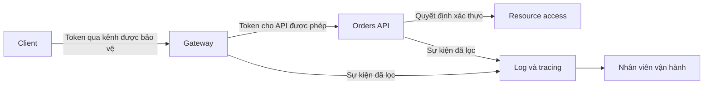

# Bearer token leakage

## 1. Mục tiêu của yêu cầu bảo mật

Bearer token leakage là sự cố token mang quyền truy cập xuất hiện ở nơi hoặc với chủ thể không được phép giữ nó. Khi đặc tả yêu cầu bảo mật, mục tiêu không chỉ là “mã hóa token” mà phải xác định được:

- Token nào cần bảo vệ và những thành phần nào thực sự cần tiếp xúc với token.
- Những đường đi nào có thể làm token rời khỏi phạm vi tin cậy.
- Hành động nào người giữ token bị lộ có thể thực hiện.
- Hệ thống có thể giới hạn, phát hiện và chấm dứt khả năng sử dụng đó như thế nào.
- Bằng chứng nào chứng minh yêu cầu đã được triển khai tại từng lớp.

Bài học đặt vấn đề trong một hệ thống bán hàng giả định. Người dùng đăng nhập, ứng dụng nhận access token và gọi API đơn hàng qua gateway. Gateway, ứng dụng Java, hệ thống theo dõi lỗi và nền tảng log đều có khả năng nhìn thấy một phần request. Người hỗ trợ vận hành được xem log nhưng không được quyền dùng danh tính của khách hàng.

Yêu cầu cần bảo đảm rằng quyền xem log không vô tình trở thành quyền gọi API của khách hàng. Toàn bộ mã định danh yêu cầu, ngưỡng và dữ liệu trong ví dụ dưới đây được xây dựng cho tình huống học tập; chúng không phải cấu hình bắt buộc của mọi sản phẩm.

## 2. Vì sao việc lộ bearer token nguy hiểm?

### 2.1. Quyền sử dụng gắn với việc nắm giữ token

Bearer token cho phép bên nắm giữ nó truy cập tài nguyên mà không phải chứng minh thêm quyền sở hữu một khóa mật mã. Do đó, token cần được bảo vệ cả lúc truyền và khi lưu. Với HTTP API sử dụng cơ chế Bearer, một dạng request là:

```http
GET /orders HTTP/1.1
Host: orders.example.test
Authorization: Bearer <ACCESS_TOKEN_PLACEHOLDER>
```

Placeholder trên không phải token thật. Trong môi trường kiểm thử, chỉ dùng credential được cấp riêng cho môi trường cô lập. Cơ chế truyền qua header và yêu cầu bảo vệ đường truyền được quy định trong [RFC 6750, mục 2.1 và 5.2](https://www.rfc-editor.org/rfc/rfc6750.html).

Một token hợp lệ bị đánh cắp thường không cần bị sửa đổi. Kẻ sử dụng có thể gửi lại nguyên token tới API. Vì vậy, kiểm tra chữ ký thành công chưa phải bằng chứng request xuất phát từ ứng dụng hoặc người dùng ban đầu.

### 2.2. Định dạng token không quyết định khả năng bị dùng lại

Cần phân biệt hai trục độc lập:

| Trục | Câu hỏi cần trả lời |
| --- | --- |
| Định dạng | Token là chuỗi opaque hay chứa claims theo JWT? |
| Điều kiện sử dụng | Chỉ cần token hay phải có thêm bằng chứng sở hữu khóa? |

JWT có thể được ký, mã hóa hoặc kết hợp các cơ chế này. JWT chỉ được ký không tự che giấu payload; cấu trúc JWT được mô tả trong [RFC 7519, mục 3](https://www.rfc-editor.org/rfc/rfc7519.html#section-3). Vì vậy, không đặt mật khẩu, khóa riêng hoặc dữ liệu cá nhân không cần thiết vào claims.

Mã hóa nội dung token cũng không tự ngăn người giữ nguyên chuỗi token gửi lại nó. Muốn hạn chế việc đó, cần một điều kiện sử dụng bổ sung được phía nhận thực thi. Tương tự, opaque token tránh để lộ claims trực tiếp nhưng vẫn có thể bị sử dụng nếu là bearer token còn hiệu lực.

### 2.3. Phân biệt access token, refresh token và khóa ký

Trong thiết kế của hệ thống ví dụ:

- Access token dùng để gọi API đơn hàng trong thời gian ngắn.
- Refresh token dùng tại authorization server để xin access token mới; API đơn hàng không nhận nó làm credential.
- Khóa ký thuộc hạ tầng phát hành hoặc xác minh token, không phải dữ liệu được gửi kèm mỗi request của người dùng.

Mỗi loại cần một kịch bản sự cố riêng. Access token lộ không tự chứng minh khóa ký đã lộ. Ngược lại, nếu refresh token và quyền sử dụng nó cùng bị chiếm, chỉ đợi access token hiện tại hết hạn có thể không chấm dứt được sự cố. Không dùng một thao tác “đổi secret” chung cho cả ba tình huống.

## 3. Xác định tài sản và ranh giới tin cậy

Trước khi viết requirement, lập bản đồ nơi token xuất hiện. Một sơ đồ tối thiểu cho tình huống ví dụ là:



Hai mũi tên tới hệ thống log là luồng dữ liệu đã loại credential, không phải bản sao đầy đủ của request. Nếu APM tự bắt request trước điểm lọc của ứng dụng, sơ đồ thực tế có thêm một đường rò rỉ cần xử lý.

Với mỗi điểm, ghi rõ:

| Thành phần | Nhu cầu sử dụng token | Câu hỏi yêu cầu cần giải quyết |
| --- | --- | --- |
| Client | Giữ token để gọi API | Thành phần nào được đọc, token tồn tại bao lâu? |
| Gateway | Xác thực hoặc chuyển tới đúng API | Header có bị lưu, phản chiếu hay gửi sang đích khác? |
| Orders API | Xác minh và đánh giá quyền | Token có đi vào exception, audit hoặc hàng đợi? |
| Authorization server | Phát hành và quản lý hiệu lực | Thu hồi tác động tới token và grant nào? |
| Log, tracing, APM | Quan sát quyết định và lỗi | Có thể quan sát mà không giữ credential không? |
| Support và công cụ quản trị | Điều tra theo mã sự kiện | Có cần xem token hay chỉ cần mã tham chiếu? |

“Internal” không phải một quyền truy cập cụ thể. Một nhân viên được đọc dashboard, một exporter gửi dữ liệu ra nhà cung cấp và một service được phép xử lý đơn hàng là ba chủ thể có quyền khác nhau.

## 4. Mô hình đe dọa theo đường rò rỉ

### 4.1. Các đường đi cần xem xét

| Đường rò rỉ | Tình huống trong hệ thống ví dụ | Tác động cần chặn |
| --- | --- | --- |
| URL | Frontend gắn token vào link tải đơn hàng | Credential đi vào lịch sử, log URL hoặc công cụ phân tích |
| Header capture | Gateway hoặc HTTP client ghi toàn bộ headers | Người đọc log lấy được credential còn hiệu lực |
| Error capture | Thư viện đưa request context vào exception | APM hoặc ticket nhận một bản sao token |
| Bộ nhớ client | Script không được tin cậy đọc token | Token hoặc hành động có quyền bị chiếm |
| Chuyển tiếp sai đích | HTTP client giữ Authorization khi đổi đích | Dịch vụ ngoài phạm vi nhận token |
| Công cụ hỗ trợ | Người dùng gửi ảnh DevTools hoặc lệnh cURL | Ticket và chat trở thành kho credential |
| Cache hoặc bản dump | Response phát hành token bị lưu lại | Token tồn tại ngoài vòng đời và quyền truy cập dự kiến |
| CI và thử nghiệm | Credential thật bị dán vào fixture hoặc output | Người có quyền đọc artifact nhận quyền API |

RFC 9700 cấm client truyền access token bằng URI query theo cơ chế query bearer trước đây, đồng thời khuyến nghị giới hạn audience và quyền để giảm tác động khi token lộ. Xem [RFC 9700, mục 4.3.2 và 2.3](https://www.rfc-editor.org/rfc/rfc9700.html#section-4.3.2).

Với URL, khả năng rò qua Referer phụ thuộc vị trí dữ liệu trong URL, chính sách trình duyệt và đích điều hướng; không được giả định mọi URL luôn truyền toàn bộ credential. Tuy nhiên, việc ngăn đưa token vào URL ngay từ thiết kế giúp loại bỏ một nhóm tình huống cần xử lý.

### 4.2. Một abuse case cụ thể

**AC-BTL-01 — Dùng token từ hệ thống log**

1. Người dùng hợp lệ gửi request tới API đơn hàng.
2. Một middleware bật chế độ ghi toàn bộ headers khi request lỗi.
3. Log chứa Authorization được chuyển tới hệ thống quan sát.
4. Một tài khoản chỉ có quyền đọc log lấy được token.
5. Tài khoản đó thử gọi API đơn hàng bằng credential đã lấy.

Điểm thất bại là credential vượt từ luồng xử lý request sang luồng quan sát có tập người đọc rộng hơn. TLS trên đường truyền của người dùng không loại bỏ bản sao đã xuất hiện tại điểm cuối.

Abuse case cần được truy vết tới ít nhất ba nhóm requirement: ngăn log credential, giới hạn quyền của token, và chấm dứt hiệu lực khi có sự cố.

## 5. Bộ yêu cầu bảo mật minh họa

Các từ **phải** và **không được** trong phần này là hợp đồng của hệ thống bán hàng ví dụ. Mỗi yêu cầu cần có owner và bằng chứng kiểm chứng; một câu như “token phải an toàn” không đủ để nghiệm thu.

### BTL-01 — Chỉ nhận access token tại vị trí đã công bố

API đơn hàng phải sử dụng Authorization header cho access token; không nhận cùng credential từ query, đường dẫn hoặc một trường body tùy ý. Nếu request đưa credential vào nhiều vị trí, API phải từ chối trước xử lý nghiệp vụ thay vì chọn một giá trị theo thứ tự ngầm định.

Các endpoint có mục đích khác, chẳng hạn endpoint phát hành hoặc thu hồi token, phải có contract riêng. Quy định trên không có nghĩa mọi endpoint OAuth đều dùng cùng một cấu trúc body.

**Owner:** API team và gateway team.

**Bằng chứng:** Request có token hợp lệ trong query không được xác thực thành công; hệ thống không phản chiếu giá trị query nhạy cảm vào thông báo lỗi.

### BTL-02 — Bảo vệ mọi chặng có mang credential

Client chỉ được gửi token tới HTTPS origin đã cấu hình. Gateway tới API phải có kênh được bảo vệ theo mô hình triển khai đã phê duyệt. HTTP client phải xác minh danh tính phía nhận; không dùng cấu hình bỏ qua kiểm tra chứng thư trong môi trường vận hành.

Nếu một URL được chuyển hướng sang origin khác, client không được tự mang Authorization sang đó. “Origin khác” phải xét scheme, host và port, không chỉ so sánh một đoạn tên miền.

**Owner:** Platform team và nhóm quản lý HTTP client.

**Bằng chứng:** Đích ngoài danh sách không nhận được header; request không hoàn tất nếu xác minh chứng thư thất bại. Client không gửi token lên HTTP rồi kỳ vọng server chuyển hướng sang HTTPS để bảo vệ ngược lại.

### BTL-03 — Credential không đi vào luồng quan sát thông thường

Gateway, ứng dụng, tracing, APM và bộ xuất telemetry phải loại Authorization, refresh token và cookie phiên có giá trị xác thực trước khi ghi hoặc xuất dữ liệu. Áp dụng cho cả request thành công, bị từ chối, timeout và exception.

Thiết kế ưu tiên danh sách trường được phép ghi. Danh sách cấm tên header chỉ là một lớp bổ sung vì credential có thể xuất hiện trong request body hoặc chuỗi lỗi.

OWASP liệt kê access token và các bí mật xác thực trong nhóm dữ liệu không nên ghi trực tiếp; xem [Logging Cheat Sheet, phần Data to exclude](https://cheatsheetseries.owasp.org/cheatsheets/Logging_Cheat_Sheet.html#data-to-exclude). Trong ví dụ này, chính sách được chọn là loại bỏ giá trị credential khỏi telemetry thông thường.

**Owner:** Observability team cùng từng service owner.

**Bằng chứng:** Dùng credential kiểm thử có dấu nhận diện riêng và kiểm tra tất cả sink đã khai báo. Chỉ kiểm tra log do ứng dụng tự ghi là chưa đủ bằng chứng cho toàn đường đi.

### BTL-04 — Công bố chiến lược giữ token ở client

Đặc tả client phải nêu rõ loại client, nơi giữ token, bên được đọc và điều kiện xóa. Với web app giả định sử dụng backend-for-frontend, access token nằm tại backend; trình duyệt sử dụng cookie phiên theo contract riêng.

Đây là một lựa chọn kiến trúc của ví dụ, không phải kết luận rằng mọi ứng dụng bắt buộc dùng backend-for-frontend. Nếu SPA trực tiếp giữ token, nhóm thiết kế phải ghi nhận rủi ro từ JavaScript cùng origin và quyết định riêng về lưu bền.

Cookie HttpOnly hạn chế JavaScript đọc trực tiếp cookie; nó không bảo đảm script độc hại không thể phát request trong phiên. Khi browser tự gửi cookie, thiết kế cũng cần kiểm soát CSRF và chính sách cookie phù hợp. Chuyển token từ localStorage sang cookie không kết thúc toàn bộ phân tích.

**Owner:** Frontend và backend-for-frontend team.

**Bằng chứng:** Sơ đồ dữ liệu thể hiện đúng nơi giữ token; logout dọn trạng thái client theo hợp đồng và không để token trong analytics hoặc state được lưu bền ngoài dự kiến.

### BTL-05 — Giới hạn quyền và audience

Authorization server của ví dụ phải phát token chỉ cho tài nguyên cần dùng. Orders API phải xác minh token được cấp cho mình và đánh giá quyền trên hành động, đối tượng, tenant ở mỗi request.

Ví dụ, token đọc đơn hàng không được dùng để sửa địa chỉ giao hàng. Token thuộc tenant A không được đọc đơn tenant B dù cả hai đi qua cùng một endpoint. Scope không thay thế kiểm tra quyền trên từng đối tượng.

**Owner:** Identity team và API team.

**Bằng chứng:** Các request sai audience, sai hành động hoặc sai tenant bị từ chối. Khi kiểm tra sai tenant, phải dùng tài nguyên thực sự tồn tại ở tenant còn lại để tránh nhầm “không tìm thấy” với kiểm soát quyền đã hoạt động.

### BTL-06 — Công bố giới hạn thời gian sử dụng

Trong ví dụ, access token có thời gian sống tối đa 300 giây. Các resource server chỉ được dung sai đồng hồ tối đa 15 giây theo chính sách chung. Đây là các giá trị minh họa do nhóm thiết kế chọn, không phải thời lượng chuẩn OAuth.

Yêu cầu phải phân biệt tuổi thọ token, phiên đăng nhập và thời hạn refresh token. Một phiên dài không đòi hỏi mỗi access token phải sống dài tương ứng.

**Owner:** Identity team và platform team.

**Bằng chứng:** Xác minh biên hết hạn trên các node đại diện, bao gồm biên dung sai. Báo cáo thời hạn hiệu lực thực tế của deployment, không chỉ đọc giá trị cấu hình ở nơi phát hành.

### BTL-07 — Thu hồi có phạm vi và giới hạn lan truyền rõ ràng

Với thao tác quản trị nhạy cảm trong ví dụ, sau khi sự kiện thu hồi được hệ thống có thẩm quyền chấp nhận, mọi resource server trong phạm vi phải từ chối token bị thu hồi trong tối đa 45 giây.

Thiết kế phải chỉ ra cơ chế thực thi: kiểm tra trạng thái trực tuyến, danh sách thu hồi được phân phối hoặc một giải pháp tương đương. JWT chỉ kiểm tra chữ ký và thời hạn tại chỗ không tự đáp ứng yêu cầu thu hồi sớm này.

RFC 7009 định nghĩa giao thức thu hồi và lưu ý có thể tồn tại độ trễ lan truyền. Vì vậy, response từ revocation endpoint không thay cho bằng chứng mọi API đã áp dụng thay đổi; xem [RFC 7009, mục 2.1](https://www.rfc-editor.org/rfc/rfc7009.html#section-2.1).

**Owner:** Identity team, API team và vận hành.

**Bằng chứng:** Đo từ mốc chấp nhận thu hồi tới lúc token bị từ chối ở node cuối cùng trong tập kiểm tra; có cả trường hợp cache còn dữ liệu và một node nhận sự kiện trễ.

Nếu hạ tầng chỉ có thể đợi token hết hạn, yêu cầu phải ghi đúng giới hạn đó. Không mô tả nút logout là “vô hiệu hóa ngay mọi token” nếu server chưa thực thi được.

### BTL-08 — Quy định hành vi khi không kiểm tra được trạng thái

Với API quản trị trong ví dụ, resource server phải từ chối request khi trạng thái thu hồi đã quá cũ so với ngưỡng được duyệt và không thể cập nhật. Không tự chuyển sang chấp nhận vô hạn để giữ availability.

Những API ít rủi ro hơn có thể có quyết định khác, nhưng phải ghi rõ thời gian cho phép dùng dữ liệu cũ và người chịu trách nhiệm chấp nhận rủi ro. Hành vi này phải thống nhất với giới hạn 45 giây nếu vẫn tuyên bố đáp ứng BTL-07.

**Owner:** API owner và người phê duyệt rủi ro nghiệp vụ.

**Bằng chứng:** Khi ngắt luồng cập nhật trạng thái trong môi trường cô lập, các API hành xử đúng hợp đồng và phát cảnh báo mà không ghi token.

### BTL-09 — Giảm khả năng dùng lại khi chỉ token bị lộ

Với luồng quản trị rủi ro cao, thiết kế ví dụ lựa chọn sender-constrained token. Nếu chọn DPoP, resource server phải kiểm tra bằng chứng và liên kết token với khóa theo profile đã triển khai; không chỉ kiểm tra sự tồn tại của một header.

DPoP cung cấp cơ chế chứng minh quyền sở hữu khóa ở tầng ứng dụng. Biện pháp này có giới hạn khi môi trường client bị chiếm và kẻ tấn công sử dụng được cả khóa hoặc chức năng ký. Xem [RFC 9449, mục 11](https://www.rfc-editor.org/rfc/rfc9449.html#section-11).

**Owner:** Identity team và API quản trị.

**Bằng chứng:** Token bị sao chép sang một client không có khóa tương ứng không đủ để truy cập; proof sai hoặc được phát lại bị xử lý theo profile. Đây là thay đổi điều kiện sử dụng token, không còn là bearer-only thuần túy.

### BTL-10 — Hạn chế bản sao và phản chiếu

Response lỗi của Orders API không được trả lại credential, toàn bộ request headers hoặc bản dump request. Công cụ hỗ trợ chỉ nhận request ID và thông tin đã lọc.

Tại endpoint phát hành token, response chứa token phải mang chính sách chống lưu cache theo giao thức. OAuth quy định các header như `Cache-Control: no-store` và `Pragma: no-cache` cho response chứa dữ liệu nhạy cảm này; xem [RFC 6749, mục 5.1](https://www.rfc-editor.org/rfc/rfc6749.html#section-5.1).

**Owner:** API team, identity team và nhóm hỗ trợ.

**Bằng chứng:** Kiểm tra response thành công và lỗi tại đúng endpoint; không suy từ cấu hình cache của một route sang tất cả route khác. Header chống cache không thay cho việc loại token khỏi log của proxy.

### BTL-11 — Điều tra được mà không đòi token gốc

Audit phải đủ dữ liệu để nối một quyết định xác thực với request và thao tác nghiệp vụ. Dữ liệu có thể gồm thời gian server, request ID do server quản lý, route ID, kết quả xác thực, mã lý do và định danh chủ thể sau khi đã xác minh.

Không ghi token thô, token đã giải mã toàn bộ hoặc một vài đoạn token theo thói quen. Nếu thực sự cần một mã tương quan theo token, phải có thiết kế riêng về thuật toán, khóa, quyền đọc và retention; mã tương quan đó vẫn có thể là dữ liệu nhạy cảm.

**Owner:** Security engineering và observability team.

**Bằng chứng:** Người điều tra tái dựng được chuỗi sự kiện từ mã tham chiếu mà không cần sao chép credential từ log sang công cụ khác.

### BTL-12 — Có hành động sự cố gắn với owner

Khi xác nhận token bị lộ, quy trình phải chỉ định ai có quyền thu hồi token hoặc grant, ai chặn đường rò, ai đánh giá phạm vi và ai thông báo tới bên liên quan.

Credential của hệ thống này không được gửi tới một dịch vụ kiểm tra token công khai để “xem còn sống không”. Việc kiểm tra phải dùng hạ tầng được phép và không tạo thêm bản sao ngoài phạm vi.

**Owner:** Incident commander cùng identity và service owner.

**Bằng chứng:** Một diễn tập bằng credential thử nghiệm chỉ ra được các bước, quyền thực hiện, mốc thời gian và nguồn dữ liệu điều tra.

## 6. Ước lượng cửa sổ rủi ro thay vì chỉ nói “TTL ngắn”

Giả sử token bị lộ tại thời điểm `t_leak`. Các mốc của mô hình ví dụ:

- `t_exp`: thời điểm token hết hạn.
- `s`: dung sai hết hạn tối đa mà resource server thực sự áp dụng.
- `t_detect`: thời điểm sự cố được phát hiện và bắt đầu xử lý.
- `d_contain`: tổng thời gian từ phát hiện tới khi biện pháp chặn có hiệu lực trên toàn phạm vi đang xét.

Nếu cả kiểm tra hết hạn và cơ chế chặn đều hoạt động như mô hình, cửa sổ còn có thể lạm dụng sau khi lộ được ước lượng:

```text
W = max(0, min(t_exp + s, t_detect + d_contain) - t_leak)
```

Công thức này là mô hình phân tích của bài học, không phải công thức chuẩn giao thức. Nó không tính trường hợp kẻ tấn công xin thêm token mới, tài nguyên đã bị sao chép trước khi chặn hoặc những API nằm ngoài phạm vi thu hồi.

Ví dụ dùng giây tính từ lúc phát hành:

```text
Phát hành:                  0
Token lộ:                120
Phát hiện và nhận thu hồi:180
Thu hồi có hiệu lực:      225
Hết hạn danh nghĩa:       300
Hết dung sai hết hạn:     315

Có thu hồi đạt 45 giây:   W = 225 - 120 = 105 giây
Chỉ đợi hết hạn:          W = 315 - 120 = 195 giây
```

Nếu phát hiện lúc 180 nhưng cần thêm 30 giây mới chấp nhận yêu cầu thu hồi, tổng thời gian tới khi chặn không còn là 45 giây tính từ phát hiện. Requirement phải ghi đúng điểm bắt đầu của từng phép đo.

Tương tự, nếu refresh token còn bị sử dụng để cấp token mới, thời điểm hết hạn của một access token không phải giới hạn trên của toàn sự cố. Phạm vi containment phải bao gồm khả năng phát hành tiếp.

## 7. Ví dụ đặc tả có thể chuyển thành công việc triển khai

Một yêu cầu đầy đủ có thể được ghi như sau:

```yaml
id: BTL-03
title: Credential không xuất hiện trong telemetry
risk: Người đọc telemetry dùng credential của khách hàng để gọi API
scope:
  - edge gateway
  - orders-api
  - tracing collector
  - error reporting agent
trigger:
  - request thành công
  - request bị từ chối
  - exception trước và sau xác thực
required_behavior:
  - Loại credential trước khi ghi hoặc export
  - Chỉ ghi các trường nằm trong audit schema được duyệt
  - Không cho chế độ debug bỏ qua quy tắc lọc
verification:
  credential_type: Chỉ dùng token kiểm thử trong môi trường cô lập
  evidence:
    - Cấu hình capture của từng thành phần
    - Kết quả tìm dấu nhận diện trên từng sink
    - Response mẫu của các nhánh lỗi
owner: Observability team và service owner
failure_condition: Một sink trong phạm vi chứa credential nguyên vẹn
```

Đây là mẫu nội dung requirement, không phải cấu hình thực thi của một thư viện. Nó giúp tránh việc ticket “mask token trong Java logger” bị đóng trong khi gateway hoặc agent vẫn xuất token.

Một audit event minh họa:

```json
{
  "event": "access_decision",
  "request_id": "request-example-042",
  "route_id": "orders.list",
  "outcome": "denied",
  "reason": "token_inactive",
  "service": "orders-api"
}
```

Event không cần chứa credential để cho biết API từ chối vì token không còn hoạt động. Một `subject_id` chỉ được thêm theo chính sách dữ liệu và từ kết quả xác minh tin cậy; không lấy claim chưa xác minh rồi ghi như danh tính đã được xác thực.

Ở phía Java, cần tránh các đường ghi gián tiếp như `request.toString()`, DTO có credential nhưng tự sinh `toString()`, interceptor HTTP và exception chứa thông tin trao đổi. Việc logger của nghiệp vụ chỉ ghi trường an toàn không chứng minh những đường này đã được kiểm soát.

## 8. Tiêu chí kiểm chứng và bằng chứng dự kiến

Phần này thiết kế các tình huống kiểm chứng cho requirement; không phải báo cáo rằng hệ thống nào đã chạy và đạt kiểm thử.

| Mã | Điều kiện và hành động | Kết quả yêu cầu | Bằng chứng cần thu |
| --- | --- | --- | --- |
| V-01 | Gọi API bằng token thử nghiệm đúng vị trí | Request đi theo quyền đã cấp | Response và audit đã lọc |
| V-02 | Đưa token vào query của Orders API | Không xác thực bằng query | Response và log URL không chứa credential |
| V-03 | Đồng thời gửi credential trong header và query | Không xử lý nghiệp vụ theo một credential được chọn ngầm | Mã lỗi và dấu vết quyết định |
| V-04 | Tạo exception trước và sau bước xác thực | Credential không xuất hiện ở các sink đã khai báo | Log gateway, ứng dụng, APM và collector |
| V-05 | Cho client gặp chuyển hướng sang origin kiểm thử khác | Origin đích không nhận Authorization | Bản capture phía nhận dùng dữ liệu giả |
| V-06 | Token đúng chữ ký nhưng sai audience hoặc tenant | Không truy cập tài nguyên ngoài quyền | Response và sự kiện từ chối |
| V-07 | Gửi request sát biên hết hạn và dung sai | Quyết định đúng biên đã công bố | Thời gian server và kết quả tại từng node |
| V-08 | Thu hồi khi một node còn cache trạng thái cũ | Mọi node trong phạm vi chặn trong giới hạn | Các mốc chấp nhận và từ chối cuối cùng |
| V-09 | Cắt luồng cập nhật trạng thái thu hồi | Áp dụng chính sách dữ liệu cũ đã duyệt | Quyết định truy cập và cảnh báo |
| V-10 | Với profile DPoP, sao chép token nhưng không có khóa | Không truy cập chỉ bằng token | Mã từ chối và dấu vết xác minh proof |
| V-11 | Xem response phát hành token và response lỗi API | Không cache token sai hợp đồng; không phản chiếu credential | Headers và body đã làm sạch |
| V-12 | Thực hiện logout rồi thử token cũ từ client kiểm thử khác | Kết quả đúng phạm vi và độ trễ logout đã công bố | Mốc logout, thu hồi và quyết định tại API |

Phải phân biệt hai loại kết quả: “bị từ chối do token không hợp lệ” và “bị từ chối do không đủ quyền”. Nếu mọi ca âm đều chỉ dùng token sai cú pháp, chưa có bằng chứng audience, tenant hoặc thu hồi được thực thi.

Khi tìm dấu nhận diện, cần xét định dạng export thực tế như JSON escape, nén và encoding. Không giả định một phép tìm nguyên chuỗi trên một file duy nhất bao phủ tất cả bản sao. Ngược lại, không đưa token thật lên dashboard tìm kiếm chỉ để tạo bằng chứng.

## 9. Xử lý khi đã phát hiện rò rỉ

Trình tự cụ thể tùy sự cố, nhưng kế hoạch của hệ thống ví dụ gồm các nhóm hành động sau:

1. **Khoanh phạm vi:** token nào, loại nào, cấp cho ai, audience nào, dữ liệu đã xuất hiện ở đâu và ai có quyền đọc. Không gửi credential gốc trong kênh thông báo.
2. **Chặn đường rò:** tắt nhánh capture hoặc sửa cấu hình xuất dữ liệu; đồng thời bảo đảm vẫn có audit cần thiết cho điều tra.
3. **Chấm dứt khả năng dùng:** thu hồi token, phiên hoặc grant theo phạm vi đã xác định; kiểm tra khả năng xin token mới nếu refresh token bị ảnh hưởng.
4. **Xác nhận tại nơi sử dụng:** resource server thực sự từ chối token, không chỉ có màn hình quản trị báo “revoked”.
5. **Đánh giá hậu quả:** truy cập nào đã xảy ra, tài nguyên nào bị đọc hoặc sửa, có hành động vượt tenant hay không.
6. **Kiểm soát bản sao:** giới hạn quyền đọc log, ticket và artifact bị ảnh hưởng; xử lý retention, bảo toàn chứng cứ và xóa theo chính sách được phê duyệt.
7. **Bổ sung requirement còn thiếu:** giao owner cho đường rò và kiểm chứng lại bằng credential thử nghiệm.

Không xóa toàn bộ log ngay khi phát hiện token vì có thể mất dấu vết điều tra. Cũng không tiếp tục phát tán bản sao chưa lọc chỉ để “giữ chứng cứ”; kho chứng cứ phải có quyền truy cập và quy trình riêng.

Đổi khóa ký là biện pháp dành cho một số tình huống có phạm vi khác, có thể ảnh hưởng nhiều token. Nếu nguyên nhân chỉ là middleware ghi Authorization, đổi khóa mà giữ nguyên middleware sẽ tạo lại đường rò cho token mới.

## 10. Những kết luận cần tránh trong thiết kế

| Kết luận thiếu chính xác | Cách viết yêu cầu có thể kiểm chứng |
| --- | --- |
| “Đã dùng HTTPS nên token không thể lộ” | Chỉ rõ mọi chặng truyền và mọi điểm cuối được phép xử lý credential |
| “JWT có chữ ký nên token bị lấy cũng vô dụng” | Đánh giá việc dùng lại token còn hợp lệ và điều kiện sở hữu khóa nếu có |
| “Logout xóa token ở client là đủ” | Công bố hiệu lực của bản sao token còn nằm ở nơi khác |
| “CORS chặn client khác dùng token” | Resource server kiểm soát credential và quyền; CORS không phải rào chắn cho HTTP client tùy ý |
| “Đã bật MFA nên token bị lộ sẽ bị chặn” | Xác định thao tác nào thực sự yêu cầu xác thực lại hoặc xác nhận bổ sung |
| “Mask bốn ký tự cuối là an toàn” | Loại giá trị credential khỏi sink thông thường, dùng mã tương quan được thiết kế riêng khi cần |
| “TTL ngắn nên không cần phản ứng sự cố” | Đo cửa sổ lạm dụng, khả năng cấp token mới và phạm vi dữ liệu đã bị truy cập |
| “Đã nhận 200 từ endpoint thu hồi là chặn xong” | Đo thời gian và kiểm chứng tại resource server trong toàn phạm vi cam kết |

Một đặc tả tốt kết nối được tài sản, đường rò, hành vi bắt buộc, owner và bằng chứng. Với bearer token leakage, thành công là giảm số nơi giữ credential, giới hạn quyền nếu credential bị lộ và mô tả đúng khả năng chấm dứt hiệu lực. Không được biến những giả định như “log nội bộ”, “JWT an toàn” hoặc “đã logout” thành bảo đảm bảo mật chưa được chứng minh.

