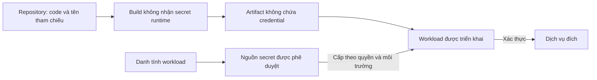

# Credential không nằm trong source code

## 1. Từ một nguyên tắc ngắn đến một yêu cầu có thể kiểm chứng

“Không hardcode password” là một nguyên tắc đúng nhưng chưa đủ để đội phát triển, vận hành và kiểm thử thống nhất cách thực hiện. Password có thể đã được chuyển khỏi lớp Java nhưng vẫn nằm trong `application-prod.yml`, Docker image, một file `.env` được commit, báo cáo test hoặc lịch sử Git. Khi đó rủi ro vẫn còn nguyên.

Trong thiết kế yêu cầu bảo mật, mục tiêu là tách **nội dung định nghĩa phần mềm** khỏi **vật liệu xác thực mà phần mềm sử dụng**. Source code mô tả cách lấy và dùng credential; giá trị credential được cấp qua một kênh được kiểm soát, theo danh tính và môi trường chạy.

Một phát biểu đủ rõ có thể là:

> Mã nguồn và các thành phần phát hành của dịch vụ không được chứa giá trị secret có thể dùng để xác thực. Dịch vụ phải nhận secret tại thời điểm chạy từ nguồn được phê duyệt; quyền đọc secret gắn với danh tính của workload, môi trường và mục đích sử dụng. Nếu không nhận được credential bắt buộc, dịch vụ không được dùng credential mặc định hoặc bỏ qua xác thực.

Phát biểu này liên kết trực tiếp với các rủi ro cần giảm:

- Người có quyền đọc repository lấy được credential sản xuất.
- Một bản fork, gói source hoặc Docker image mang theo secret ra khỏi phạm vi kiểm soát.
- Credential dùng chung bị lộ nhưng không thể thu hồi riêng cho một dịch vụ.
- Một lần xoay vòng credential buộc phải sửa source, build lại và phát hành toàn bộ ứng dụng.
- Log, pipeline hoặc công cụ hỗ trợ kỹ thuật vô tình tạo thêm bản sao credential.

Bài học tập trung vào cách đặc tả và chứng minh yêu cầu này trong vòng đời phát triển. Việc chọn sản phẩm quản lý secret cụ thể là quyết định kiến trúc tiếp theo, không thay thế cho yêu cầu bảo mật.

## 2. Xác định đúng thứ cần bảo vệ

### 2.1. Credential và secret có quan hệ nhưng không đồng nghĩa

Credential là thông tin hoặc bằng chứng được dùng trong một cơ chế xác thực. Secret là dữ liệu cần giữ bí mật. Một credential có thể gồm cả phần công khai lẫn phần bí mật, chẳng hạn username và password, hoặc client ID và client secret.

| Dữ liệu | Có cần giữ bí mật không? | Cách thể hiện trong source |
|---|---|---|
| Username của tài khoản dịch vụ | Tùy phân loại và bối cảnh | Có thể là cấu hình, nhưng vẫn cần tránh làm lộ thông tin nội bộ không cần thiết |
| Password của tài khoản dịch vụ | Có | Chỉ chứa tên tham chiếu; không chứa giá trị |
| API key có khả năng cấp quyền gọi dịch vụ | Có | Không commit giá trị thật |
| Access token hoặc refresh token còn hiệu lực | Có | Không dùng làm fixture, ví dụ hoặc dữ liệu debug |
| OAuth client ID của ứng dụng công khai | Thường không phải secret | Có thể xuất hiện nếu đúng thiết kế của cơ chế xác thực |
| OAuth client secret | Có | Chỉ cấp cho thành phần có khả năng bảo vệ secret |
| Public key hoặc chứng thư chỉ chứa public key | Không phải secret theo tính chất mật mã | Có thể được phân phối, nhưng tính toàn vẹn và tính xác thực vẫn phải được bảo vệ |
| Private key, khóa ký hoặc mật khẩu mở kho khóa | Có | Không đặt trong source, kể cả dưới dạng mã hóa có thể giải mã bằng khóa đi kèm |
| Tên hoặc đường dẫn logic của secret | Không phải giá trị secret | Có thể cấu hình nếu phù hợp với phân loại metadata |

Không nên cấm mọi chuỗi trông giống token mà không hiểu ý nghĩa; cũng không nên mặc định mọi tên gọi “key” đều công khai. Một key được nhúng trong ứng dụng trình duyệt có thể là mã định danh được thiết kế để công khai, hoặc có thể là một lỗi làm lộ quyền truy cập. Phân loại phải dựa trên khả năng cấp quyền và mô hình đe dọa.

### 2.2. Phạm vi không dừng ở file `.java`

Yêu cầu cần bao phủ các nơi mà credential thường xuất hiện:

- Source, resource, file cấu hình theo profile và các script chạy ứng dụng.
- Test fixture, notebook, tài liệu hướng dẫn, ví dụ request và file collection của công cụ gọi API.
- Git commit, tag, branch, lịch sử đã xóa khỏi nhánh hiện tại và các bản sao có thể truy cập.
- Build script, file cấu hình pipeline và tham số được ghi vào báo cáo build.
- File cấu hình triển khai, manifest, chart và các biến được ghi trực tiếp trong template.
- JAR, WAR, gói source, container image, layer của image và cache build được phân phối.

Các đầu ra như log, trace, báo cáo test, heap dump, crash dump và bản chụp hỗ trợ kỹ thuật cần có yêu cầu kiểm soát riêng trong cùng thiết kế, vì credential có thể đi từ runtime sang những nơi này dù source ban đầu sạch.

Một file đã bị xóa ở commit mới vẫn có thể tồn tại trong lịch sử. Tương tự, xóa secret khỏi thư mục cuối cùng trong container không bảo đảm secret chưa từng được ghi vào layer trước đó. Kiểm soát phải bám theo đường đi của dữ liệu, không chỉ trạng thái hiển thị của thư mục hiện tại.

## 3. Những cách “đưa ra ngoài code” vẫn để lại cùng rủi ro

### 3.1. Chuyển password từ Java sang file được commit

Ví dụ dưới đây vẫn vi phạm nếu giá trị thay cho placeholder là credential thật:

```yaml
# Ví dụ minh họa một cấu hình không được phép commit với giá trị thật.
partner:
  username: service-account
  password: <REAL_PASSWORD_WOULD_BE_A_VIOLATION>
```

File YAML vẫn thuộc source. Việc file đó chỉ dành cho môi trường test không tự làm nó an toàn: credential test có thể mở dữ liệu nhạy cảm, bị dùng lại ở môi trường khác hoặc giúp kẻ tấn công đi tiếp trong hạ tầng.

### 3.2. Base64, chia nhỏ chuỗi hoặc giấu trong tên biến

Base64 là biểu diễn dữ liệu, không phải biện pháp giữ bí mật. Ghép các đoạn chuỗi, mã hóa URL hoặc đổi tên biến không tạo ra ranh giới truy cập. Người có source vẫn có thể khôi phục giá trị.

Mã hóa file secret chỉ có ý nghĩa khi khóa giải mã được bảo vệ độc lập. Nếu ciphertext và khóa giải mã hoặc cách lấy khóa không cần xác thực cùng nằm trong repository, người đọc repository vẫn có thể lấy secret.

Một cơ chế secret mã hóa trong Git có thể được tổ chức phê duyệt, nhưng cần một hợp đồng riêng: quản lý khóa ngoài Git, phân quyền giải mã, bảo vệ nội dung sau giải mã, xoay vòng và theo dõi truy cập. Nó không phải ngoại lệ tự động chỉ vì file có đuôi `.enc`.

### 3.3. Thêm `.gitignore` sau khi đã commit

`.gitignore` hỗ trợ tránh thêm một số file chưa được theo dõi. Nó không làm Git ngừng theo dõi file đã được commit, không xóa lịch sử và không thu hồi credential đã lộ.

Do đó, `.env` có trong `.gitignore` là một biện pháp hỗ trợ cho môi trường local, không phải bằng chứng duy nhất rằng repository không chứa secret.

### 3.4. Chuyển secret sang biến môi trường rồi coi như hoàn tất

Biến môi trường có thể tách secret khỏi source, nhưng vẫn có thể lộ qua cấu hình deployment, công cụ quản trị tiến trình, thao tác debug hoặc mã in toàn bộ environment. Khả năng quan sát phụ thuộc hệ điều hành, runtime và quyền của người truy cập.

File secret được mount cũng cần quyền đọc, vị trí mount, vòng đời và kiểm soát backup. Một dịch vụ quản lý secret cũng cần chính sách truy cập đúng. **Kênh cấp secret và quyền truy cập kênh đó là một phần của yêu cầu**, không chỉ là chi tiết cài đặt.

## 4. Mô hình cấp credential ngoài source

Luồng mong muốn có thể mô tả như sau:



Sơ đồ phân biệt hai nhu cầu thường bị trộn lẫn:

1. **Credential của quá trình build:** ví dụ quyền đọc dependency riêng hoặc ký artifact. Chúng có vòng đời và quyền riêng; không được đóng gói vào đầu ra.
2. **Credential của ứng dụng khi chạy:** ví dụ quyền truy cập database hoặc gọi API đối tác. Chúng không cần xuất hiện trong source hay trong quá trình build thông thường.

Việc pipeline có quyền triển khai không có nghĩa mọi bước test, mọi pull request hoặc mọi dependency build đều cần nhận credential sản xuất.

### 4.1. Ưu tiên danh tính và credential có vòng đời ngắn khi phù hợp

Nếu nền tảng cho phép workload xác thực bằng danh tính được cấp sẵn và nhận credential ngắn hạn, ứng dụng có thể giảm nhu cầu giữ một secret gốc dài hạn. Tuy nhiên, thiết kế vẫn phải nêu rõ:

- Danh tính nào được cấp quyền; có tách giữa dịch vụ và môi trường không.
- Quyền yêu cầu credential được giới hạn đến tài nguyên và thao tác nào.
- Credential hết hạn khi nào và được gia hạn như thế nào.
- Điều gì xảy ra khi nền tảng danh tính hoặc nguồn secret không sẵn sàng.
- Có ghi nhận được việc cấp, đọc, thu hồi và thất bại truy cập hay không.

Không giải quyết bài toán khởi tạo bằng cách commit một “master token” để ứng dụng dùng token đó lấy mọi secret còn lại. Secret khởi tạo cũng phải có nguồn cấp và ranh giới bảo vệ được xác định.

### 4.2. Tách môi trường và thu hẹp ảnh hưởng

Ứng dụng local không được tự động nhận secret sản xuất. Một dịch vụ đọc dữ liệu không cần cùng credential với tiến trình migration có quyền sửa schema. Credential cho hai dịch vụ khác nhau nên có khả năng thu hồi riêng theo thiết kế truy cập của hệ thống đích.

Phân tách này giúp trả lời câu hỏi kiểm chứng: nếu credential của dịch vụ A bị lộ, những tài nguyên nào vẫn nằm ngoài phạm vi mà credential đó có thể truy cập?

## 5. Viết yêu cầu bảo mật rõ phạm vi và cách nghiệm thu

Không phải hệ thống nào cũng cần cùng công nghệ, thời hạn xoay vòng hoặc mức sẵn sàng. Các con số dưới đây là **ví dụ quyết định của một hệ thống giả định**, không phải ngưỡng bắt buộc cho mọi sản phẩm.

| Mã | Yêu cầu minh họa | Bằng chứng nghiệm thu |
|---|---|---|
| CRED-SRC-01 | Repository và đầu ra phát hành không chứa giá trị credential thật, kể cả credential của môi trường phi sản xuất | Báo cáo kiểm tra phạm vi đã định nghĩa; rà soát cấu hình và kiểm tra artifact đại diện |
| CRED-SRC-02 | Source chỉ giữ tên cấu hình hoặc tham chiếu secret; không có secret mặc định hay đường fallback chứa credential | Kiểm tra cấu hình và kiểm thử thiếu secret |
| CRED-SRC-03 | Mỗi workload chỉ đọc các secret được cấp cho đúng dịch vụ, môi trường và mục đích | Chính sách quyền; thử đọc một secret ngoài phạm vi phải thất bại |
| CRED-SRC-04 | Credential runtime được cấp qua nguồn đã phê duyệt và không được truyền qua tham số dòng lệnh trong triển khai chuẩn | Cấu hình triển khai; kiểm tra cách khởi chạy và nguồn cấp |
| CRED-SRC-05 | Khi không có credential bắt buộc, ứng dụng không phục vụ nghiệp vụ cần credential đó và không bỏ qua xác thực | Kiểm thử khởi động hoặc readiness theo kiến trúc; kết quả từ chối rõ ràng |
| CRED-SRC-06 | Pipeline chặn secret được phát hiện trong thay đổi mới; ngoại lệ phải có chủ sở hữu, lý do và thời hạn | Kiểm thử bằng mẫu sentinel vô hiệu; bằng chứng gate chặn merge hoặc phát hành |
| CRED-SRC-07 | Log, trace, báo cáo lỗi và báo cáo test không chứa giá trị secret; bản dump có thể chứa secret phải được kiểm soát truy cập và lưu giữ | Kiểm tra đầu ra trong các nhánh thành công, thất bại và debug được hỗ trợ |
| CRED-SRC-08 | Có thể thay credential runtime mà không sửa hoặc build lại source | Diễn tập thay secret; artifact và source giữ nguyên phiên bản |
| CRED-SRC-09 | Hệ thống có quy trình thu hồi credential bị lộ và xác nhận credential cũ không còn được chấp nhận | Diễn tập thu hồi; kết quả xác thực bằng credential cũ thất bại |
| CRED-SRC-10 | Có kiểm kê owner, môi trường, mục đích, tài nguyên đích và chính sách vòng đời cho từng loại credential | Danh mục metadata, không chứa giá trị secret |

Yêu cầu CRED-SRC-01 không thể được chứng minh chỉ bằng một báo cáo scanner “không có phát hiện”. Scanner có giới hạn; cần ghi rõ nó đã kiểm tra gì, bằng quy tắc nào và phần nào cần kiểm soát bổ sung. Báo cáo không có phát hiện chỉ là một bằng chứng trong tập bằng chứng.

Mỗi yêu cầu nên có chủ sở hữu triển khai và chủ sở hữu xác minh. Ví dụ, đội ứng dụng chịu trách nhiệm bỏ fallback trong Java; đội nền tảng chịu trách nhiệm cấp secret theo workload; đội kiểm thử xác minh hành vi khi thiếu credential và khi bị từ chối quyền.

## 6. Ví dụ Java: lấy secret tại runtime và dừng khi thiếu

Giả sử một dịch vụ thanh toán cần token để gọi đối tác. Source biết tên biến cấu hình `PAYMENTS_API_TOKEN`, nhưng không biết giá trị token.

```java
public final class RequiredSecrets {

    private RequiredSecrets() {
    }

    public static String paymentsApiToken() {
        return requiredEnvironmentSecret("PAYMENTS_API_TOKEN");
    }

    private static String requiredEnvironmentSecret(String variableName) {
        String value = System.getenv(variableName);

        if (value == null || value.isBlank()) {
            // Chỉ nêu tên cấu hình, không đưa giá trị vào lỗi.
            throw new IllegalStateException(
                "Missing required runtime secret: " + variableName
            );
        }

        // Không trim hoặc thay đổi nội dung credential.
        return value;
    }
}
```

Đoạn mã minh họa sử dụng API của Java 11 trở lên. Nguồn secret trong ví dụ là biến môi trường; việc biến đó được cấp bằng cách nào thuộc cấu hình chạy ngoài source. Không đặt giá trị thật trong script khởi chạy đã commit để “đáp ứng” ví dụ này.

Khi tích hợp với thư viện gọi API, token được chuyển trực tiếp đến thành phần có trách nhiệm xác thực. Không in token để chứng minh đã tải thành công; không đưa token vào URL, message lỗi hoặc một đối tượng có `toString()` tự động liệt kê toàn bộ field.

Các quyết định quan trọng trong ví dụ:

- Không có giá trị mặc định như `dev-token`, password local dùng chung hoặc token “tạm”.
- Trường hợp thiếu và trường hợp rỗng đều được coi là cấu hình không hợp lệ theo hợp đồng của ứng dụng.
- Giá trị không bị chuẩn hóa bằng `trim()`, vì đó có thể làm thay đổi credential mà bên cấp đã tạo.
- Message lỗi cung cấp đủ tín hiệu vận hành mà không in giá trị secret.

Ví dụ không tự giải quyết phân quyền của nguồn secret, thời gian lưu trong bộ nhớ hay xoay vòng động. Nếu thư viện chỉ nhận `String`, không nên tuyên bố có thể xóa chắc chắn secret khỏi heap Java: `String` là bất biến và có thể có bản sao ngoài tầm kiểm soát của mã ứng dụng. Giảm số nơi giữ tham chiếu, tránh sao chép không cần thiết và kiểm soát khả năng lấy dump là các yêu cầu bổ sung phù hợp.

### 6.1. Không để đường fallback phá vỡ yêu cầu

Một cấu hình kiểu sau tạo ra rủi ro dù môi trường sản xuất bình thường đã cấp secret đúng:

```text
token = runtimeValue exists ? runtimeValue : sharedDevelopmentToken
```

Khi deployment quên cấp biến, ứng dụng có thể chạy bằng credential dùng chung. Điều này vừa che lỗi cấu hình vừa làm hành vi xác thực khác với thiết kế.

Nếu chế độ local cần một dịch vụ giả lập không yêu cầu credential, hãy đặc tả nó thành profile hoặc cấu hình rõ ràng, giới hạn môi trường và điểm đến. Không dùng credential thật làm cầu nối ngầm giữa local và production.

### 6.2. Phân biệt yêu cầu fail closed và yêu cầu sẵn sàng

Fail closed ở đây nghĩa là không thực hiện thao tác cần xác thực bằng một quyền không hợp lệ hoặc bằng cách bỏ qua xác thực. Nó không bắt buộc mọi ứng dụng phải tắt toàn bộ tiến trình ngay khi nguồn secret tạm thời lỗi.

Ví dụ, hệ thống có thể cho phép dùng credential đã lấy trước đó nếu credential vẫn còn hiệu lực và chính sách cache cho phép. Thiết kế phải quy định giới hạn cache, thời hạn, cách xử lý thu hồi và những endpoint được phép phục vụ. Nếu chưa có credential hợp lệ từ đầu, không được coi “nguồn secret đang lỗi” là lý do để chuyển sang chế độ không xác thực.

Đối với workload được quản lý bằng readiness, có thể giữ tiến trình sống để chẩn đoán nhưng không đánh dấu sẵn sàng cho nghiệp vụ phụ thuộc credential. Các endpoint chẩn đoán cũng cần giới hạn thông tin và quyền truy cập.

## 7. Kiểm soát trên máy phát triển và pipeline

### 7.1. Môi trường phát triển

Repository có thể chứa file mẫu như `.env.example` với tên biến và placeholder rõ ràng. File mẫu không được chứa một token đang hoạt động hoặc một password dùng chung mà ai cũng có thể dùng để vào môi trường thực.

Mỗi lập trình viên nên nhận quyền theo danh tính của mình hoặc credential dành riêng cho môi trường phát triển. Nếu cần file local, phải quy định nơi lưu, quyền truy cập, cách tránh đồng bộ ngoài ý muốn và cách thu hồi khi máy bị mất.

Một giá trị giả phục vụ test phải thực sự không có khả năng cấp quyền. Không lấy token sản xuất rồi thay vài ký tự để làm ví dụ: cách đó có thể làm lộ cấu trúc hoặc một phần dữ liệu thật, đồng thời tạo thói quen sao chép secret vào fixture.

### 7.2. Trước commit và tại điểm kiểm soát tập trung

Hook trên máy phát triển giúp phản hồi sớm, nhưng có thể bị bỏ qua. Vì vậy, thiết kế nên có điểm kiểm soát tập trung ở nơi merge, tiếp nhận thay đổi hoặc phát hành, tùy quy trình của tổ chức.

Phạm vi quét cần được ghi cụ thể, chẳng hạn:

- Khi tiếp nhận repository: quét lịch sử có thể truy cập trong phạm vi đã thống nhất, không chỉ cây file mới nhất.
- Với thay đổi mới: kiểm tra nội dung và các commit được đưa vào điểm tích hợp, tránh bỏ sót secret đã thêm rồi xóa trước commit cuối.
- Khi phát hành: kiểm tra cấu hình đóng gói và các loại artifact có khả năng mang secret.
- Sau thay đổi quy tắc hoặc sự cố: thực hiện lượt quét bổ sung theo phạm vi ảnh hưởng.

Scanner có thể phát hiện mẫu nhận dạng của nhà cung cấp, tên trường nhạy cảm, private key hoặc chuỗi có đặc điểm đáng ngờ. Nó vẫn có thể bỏ sót credential tùy biến và báo nhầm dữ liệu vô hại. Quy trình xử lý phát hiện phải phân biệt “false positive đã chứng minh” với “credential thật nhưng đội phát triển muốn bỏ qua”.

Không đưa một credential thật vào danh sách bỏ qua chỉ để pipeline xanh. Một baseline cho phát hiện cũ cần có chủ sở hữu và kế hoạch xử lý; nó không biến credential còn hiệu lực thành dữ liệu được phép công khai.

### 7.3. Credential của CI/CD

Pipeline là một workload riêng. Quyền của nó phải được phân theo job, repository, môi trường và sự kiện kích hoạt. Một job chạy mã chưa tin cậy từ pull request không nên nhận secret phát hành chỉ vì nó nằm trong cùng hệ thống CI.

Các yêu cầu thường cần nêu:

- Job chỉ được nhận secret trong khoảng công việc thực sự cần nó.
- Không truyền secret trong tham số dòng lệnh hoặc bật shell tracing cho lệnh chứa secret.
- Không ghi secret vào file cấu hình sẽ được upload làm artifact hoặc cache.
- Chức năng che log là lớp giảm rò rỉ, không phải bảo đảm mọi dạng mã hóa, chia chuỗi hoặc biến đổi đều được che.
- Credential dùng cho build được cung cấp qua cơ chế phù hợp để không xuất hiện trong lịch sử image, layer hoặc đầu ra build.

Đừng chỉ kiểm tra rằng log đã hiện `***`. Cần xác minh dữ liệu chưa đi sang một đường khác như báo cáo test, request dump hoặc file cấu hình được đính kèm.

## 8. Xoay vòng và xử lý khi credential đã lọt vào Git

### 8.1. Xoay vòng không phụ thuộc thay source

Một tiêu chí thiết kế tốt là có thể thay credential bằng nguồn cấp runtime mà không đổi source hay build lại artifact. Điều đó không đồng nghĩa mọi ứng dụng phải cập nhật secret tức thời trong bộ nhớ.

Hợp đồng vận hành cần chọn rõ một trong các cách phù hợp: nạp lại có kiểm soát, nhận credential mới khi kết nối lại hoặc khởi động lại workload theo quy trình triển khai. Phải tính đến connection pool và client đã khởi tạo bằng credential cũ.

Nếu hệ thống đích hỗ trợ khoảng chuyển tiếp hai credential, có thể cấp credential mới, chuyển ứng dụng, xác minh rồi thu hồi credential cũ. Nếu không hỗ trợ, cần phương án chuyển đổi và khả năng gián đoạn được chấp nhận. Không kéo dài vô hạn khoảng chuyển tiếp chỉ để tránh xử lý client chưa cập nhật.

Các thời hạn như thời gian hoàn tất thay credential, độ trễ nhận thay đổi và thời gian thu hồi khi lộ phải được chọn theo rủi ro. Yêu cầu “xoay vòng định kỳ” mà không chỉ rõ owner, trigger và cách chứng minh sẽ rất khó nghiệm thu.

### 8.2. Khi phát hiện secret đã được commit

Trình tự xử lý cần ưu tiên vô hiệu hóa khả năng sử dụng credential:

1. Ghi nhận sự cố và xác định loại credential, owner, môi trường, quyền và phạm vi có thể bị truy cập. Không sao chép giá trị secret vào ticket hoặc chat để làm bằng chứng.
2. Thu hồi hoặc thay credential theo mức khẩn cấp của hệ thống; nếu cần chuyển đổi để bảo đảm dịch vụ, thực hiện với ranh giới thời gian và quyền rõ ràng.
3. Xác minh credential cũ không còn được chấp nhận và kiểm tra dấu hiệu sử dụng bất thường trong khoảng có thể đã lộ.
4. Loại giá trị khỏi source hiện tại, fixture, cấu hình, artifact và các vị trí phát tán đã xác định.
5. Đánh giá việc làm sạch lịch sử và bản sao theo quy trình phối hợp của tổ chức, vì thao tác này có thể ảnh hưởng người dùng repository và các hệ thống phụ thuộc.
6. Bổ sung kiểm soát cho nguyên nhân gốc và lưu bằng chứng đã xử lý bằng metadata an toàn.

Repository riêng tư không loại bỏ nhu cầu thu hồi: người dùng, integration, máy phát triển và bản backup vẫn có thể đã đọc secret. Xóa commit hoặc viết lại lịch sử không bảo đảm mọi bản clone đã mất dữ liệu, và không làm token bị lộ tự mất hiệu lực.

Một ticket phù hợp có thể lưu mã loại credential, owner, thời điểm thu hồi và kết quả kiểm chứng. Không nên lưu token, password, một phần token hoặc checksum của password vào báo cáo như một cách mặc định để nhận diện. Khi cần đối chiếu, dùng định danh quản lý do hệ thống cấp hoặc cơ chế tương quan đã được phê duyệt.

## 9. Thiết kế kịch bản nghiệm thu có ý nghĩa

Các kịch bản sau minh họa cách biến yêu cầu thành quan sát cụ thể; chúng là hướng dẫn cho vòng xác minh của dự án, không phải tuyên bố rằng hệ thống đã được kiểm thử.

| Kịch bản | Thực hiện trong môi trường kiểm thử | Kết quả cần quan sát |
|---|---|---|
| Thiếu secret | Khởi chạy ứng dụng mà không cấp credential bắt buộc | Không dùng mặc định; nghiệp vụ phụ thuộc không sẵn sàng; lỗi không in secret |
| Secret không hợp lệ | Cấp credential giả không có quyền | Thao tác bị từ chối; không thử credential hardcode khác; log không lộ giá trị |
| Đọc ngoài phạm vi | Cho workload A yêu cầu secret của workload B | Bị nguồn secret từ chối; có sự kiện truy cập phù hợp |
| Phát hiện ở điểm tích hợp | Thêm một mẫu sentinel vô hiệu được rule kiểm thử nhận diện | Gate chặn thay đổi; báo vị trí an toàn và hướng xử lý |
| Credential xuất hiện rồi bị xóa trong nhánh | Tạo dữ liệu sentinel trong commit trung gian, sau đó xóa ở commit cuối | Cách quét được thiết kế phải phát hiện trong phạm vi commit tiếp nhận đã cam kết |
| Kiểm tra đóng gói | Build bằng dữ liệu kiểm thử và kiểm tra các đầu ra trong phạm vi | Không có secret runtime trong package hoặc image; secret build không bị mang sang đầu ra |
| Xoay vòng | Thay credential ở nguồn cấp và cập nhật workload theo thiết kế | Dịch vụ chuyển sang credential mới trong thời hạn đã định nghĩa; source và artifact không cần đổi |
| Thu hồi | Vô hiệu hóa credential cũ rồi thử xác thực lại | Hệ thống đích từ chối credential cũ trong giới hạn đã cam kết |
| Đầu ra chẩn đoán | Kích hoạt lỗi, timeout và chế độ log được phép bằng sentinel | Log, trace và báo cáo không chứa sentinel; đường lỗi vẫn đủ thông tin điều tra |

Sentinel phải là dữ liệu kiểm thử không có khả năng xác thực, được thiết kế phù hợp với rule cần kiểm tra. Việc một sentinel bị bắt không chứng minh scanner bắt được mọi secret; nó chứng minh một hành vi kiểm soát cụ thể hoạt động trên mẫu đó.

Không dùng credential sản xuất để thử scanner hoặc cố tình phát tán vào log nhằm kiểm tra che dữ liệu. Bản thân thao tác nghiệm thu không được tạo một sự cố mới.

## 10. Một ví dụ đặc tả hoàn chỉnh

Giả sử dịch vụ đối soát đơn hàng cần đọc dữ liệu từ database và gọi một API thanh toán. Đội dự án có thể ghi yêu cầu như sau:

```text
Tài sản cần bảo vệ:
  Credential đọc database đối soát và token gọi API thanh toán.

Rủi ro:
  Người đọc source hoặc artifact lấy được quyền truy cập dữ liệu
  và sử dụng API ngoài phạm vi công việc được cấp.

Yêu cầu:
  1. Source, cấu hình được commit, fixture và artifact không chứa
     giá trị credential thật.
  2. Hai credential được cấp tại runtime từ nguồn đã phê duyệt,
     bằng danh tính của dịch vụ trong đúng môi trường.
  3. Quyền database giới hạn theo nghiệp vụ đọc dữ liệu đã xác định;
     credential migration được quản lý riêng.
  4. Thiếu credential bắt buộc thì dịch vụ không được đánh dấu
     sẵn sàng cho nghiệp vụ đối soát và không dùng giá trị mặc định.
  5. Việc thay credential không yêu cầu sửa source hoặc build lại.
  6. Log và báo cáo không chứa giá trị credential trong cả đường lỗi.
  7. Có owner và quy trình thu hồi, kiểm chứng credential cũ bị từ chối.

Bằng chứng:
  Cấu hình nguồn cấp và quyền, kết quả kiểm tra repository/artifact,
  kết quả kịch bản thiếu secret, quyền ngoài phạm vi, xoay vòng,
  thu hồi và kiểm tra đầu ra chẩn đoán.
```

Trong đặc tả thực tế, cần bổ sung các tham số theo rủi ro của dịch vụ: giới hạn thời gian chuyển đổi, hành vi khi nguồn secret lỗi, phạm vi quét, thời gian lưu audit và người xử lý phát hiện. Không để các tham số đó thành những giá trị ngầm mà mỗi đội tự hiểu khác nhau.

## 11. Những điểm cần ghi nhớ

Credential không nằm trong source code là yêu cầu về **ranh giới truy cập và vòng đời**, không chỉ về cú pháp khai báo biến. Đưa giá trị sang một file khác vẫn chưa đủ nếu file đó được commit hoặc đóng gói cùng ứng dụng.

Một thiết kế có thể kiểm chứng cần xác định được: dữ liệu nào là secret, nơi nào không được chứa secret, runtime lấy secret từ đâu, danh tính nào được đọc, hành vi khi thiếu hoặc bị thu hồi và bằng chứng nào chứng minh các điều kiện đó.

Kết quả mong muốn là source và artifact có thể được quản lý mà không phát tán quyền xác thực; credential có thể được cấp, giới hạn, thay thế và thu hồi theo vòng đời riêng của nó.
