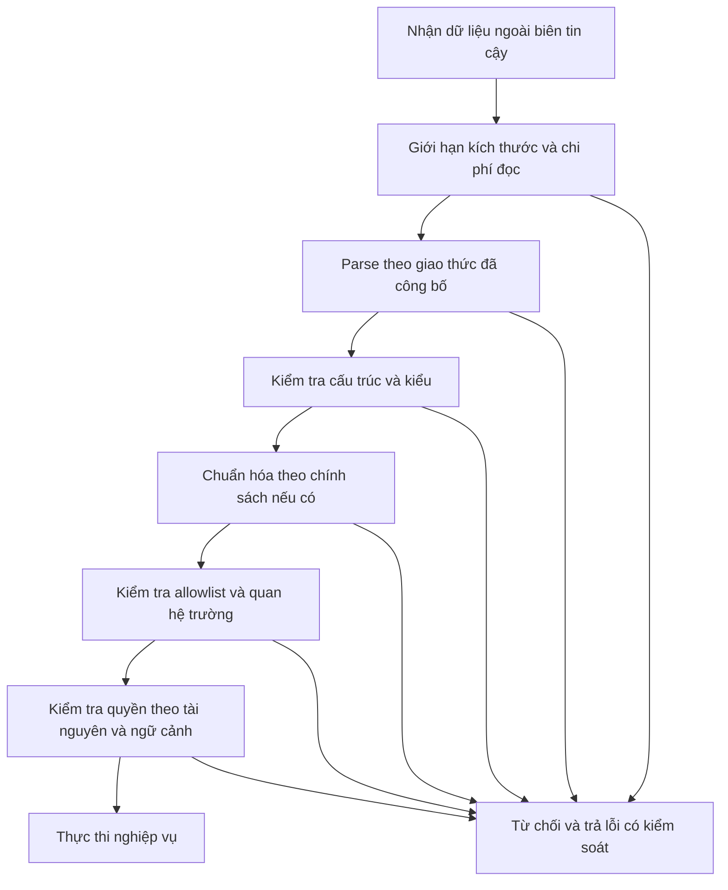

# Allowlist validation

## 1. Từ “lọc dữ liệu nguy hiểm” đến định nghĩa dữ liệu được chấp nhận

Allowlist validation là cách kiểm tra đầu vào bằng cách mô tả rõ miền giá trị được phép, sau đó từ chối giá trị nằm ngoài miền đó. Miền hợp lệ có thể là một tập hữu hạn như `CSV`, `JSON`; một cấu trúc có quy tắc như mã đơn hàng; hoặc một tập điều kiện kết hợp về kiểu, độ dài, khoảng giá trị và quan hệ nghiệp vụ.

Trong thiết kế yêu cầu bảo mật, mục tiêu không chỉ là chọn một biểu thức chính quy. Cần chuyển rủi ro tại biên tin cậy thành một hợp đồng có thể triển khai và kiểm chứng: hệ thống nhận dữ liệu nào, hiểu dữ liệu đó theo cách nào, ai được quyết định các giá trị hợp lệ và điều gì xảy ra khi đầu vào không đạt yêu cầu.

Ví dụ, câu “kiểm tra định dạng xuất báo cáo” chưa đủ rõ. Một đặc tả tốt hơn là:

> API xuất báo cáo chỉ chấp nhận trường `format` có kiểu JSON string, với giá trị chính xác là `CSV` hoặc `JSON`. Trường này bắt buộc, phân biệt chữ hoa và chữ thường; không tự cắt khoảng trắng hay chuyển đổi kiểu. Giá trị khác làm request bị từ chối trước khi tạo job xuất báo cáo.

Đặc tả này tạo ra được cả nhánh xử lý và bằng chứng kiểm thử. `CSV` được chấp nhận, còn `csv`, ` CSV`, `null`, số `1` và chuỗi rỗng đều có kết quả xác định.

Sau bài học, người học cần có thể xác định miền hợp lệ của một đầu vào, phân biệt các lớp kiểm tra, viết yêu cầu allowlist đo được và chỉ ra giới hạn của cơ chế này trong kiến trúc bảo mật.

## 2. Allowlist thực sự kiểm tra điều gì?

### 2.1. Mô hình miền hợp lệ

Gọi `x` là giá trị đã được parser chuyển thành biểu diễn nội bộ và `c` là ngữ cảnh xử lý. Quy tắc chấp nhận có thể được diễn đạt như sau:

```text
Accept(x, c) =
    đúng kiểu
    AND đúng cấu trúc
    AND nằm trong giới hạn tài nguyên
    AND đúng cú pháp
    AND đúng ngữ nghĩa của trường
    AND thỏa quan hệ giữa các trường
    AND phù hợp chính sách áp dụng cho ngữ cảnh c
```

Không phải trường nào cũng cần mọi điều kiện. Với `format`, tập hai giá trị là đủ cho quy tắc của trường. Với khoảng thời gian báo cáo, từng ngày phải hợp lệ và quan hệ giữa hai ngày cũng phải hợp lệ.

Ngữ cảnh `c` phải đến từ nguồn đáng tin cậy. Nếu allowlist phụ thuộc tenant, hệ thống phải lấy tenant từ danh tính đã xác thực và dữ liệu phân quyền phía máy chủ, thay vì tin vào `tenantId` do request tự khai báo.

### 2.2. Tập hữu hạn và miền có cấu trúc

| Loại đầu vào | Cách mô tả allowlist | Ví dụ yêu cầu |
| --- | --- | --- |
| Lựa chọn hữu hạn | Danh sách giá trị chính xác | `sortDirection` chỉ nhận `ASC` hoặc `DESC` |
| Mã định danh do hệ thống quy định | Bảng chữ cái, độ dài, cấu trúc | Mã kho gồm 3 chữ ASCII hoa, dấu `-` và 4 chữ số ASCII |
| Số lượng | Kiểu số và khoảng cho phép | `pageSize` là số nguyên từ 1 đến 100 |
| Ngày tháng | Cú pháp và parser lịch | Ngày theo `yyyy-MM-dd`, phải tồn tại trong lịch |
| Danh sách | Kiểu phần tử, miền giá trị, giới hạn và quan hệ | Tối đa 10 cột, không trùng, mỗi cột thuộc tập cột của báo cáo |
| Văn bản tự do | Miền văn bản cùng các ràng buộc phù hợp | Nội dung phản hồi có giới hạn kích thước, chính sách Unicode và quy tắc lưu trữ rõ ràng |

“Allowlist” không đồng nghĩa với “chỉ cho chữ và số”. Chính sách cho một mã máy có thể rất hẹp, trong khi chính sách cho tên người phải hỗ trợ dấu, khoảng trắng và nhiều hệ chữ theo nhu cầu sản phẩm.

### 2.3. Quan hệ với denylist

Denylist liệt kê các giá trị hoặc mẫu cần từ chối. Allowlist mô tả các giá trị được chấp nhận. Khi miền hợp lệ nhỏ và rõ, allowlist thường giúp đặc tả dễ kiểm chứng hơn vì giá trị chưa biết mặc định không được nhận.

Ví dụ, chỉ chặn dấu `;` trong `sortBy` không định nghĩa được một trường sắp xếp hợp lệ. Yêu cầu “chỉ nhận `createdAt`, `amount`, `status`” xác định được đầy đủ lựa chọn mà API hỗ trợ.

Denylist vẫn có vai trò bổ sung, chẳng hạn chặn một tài khoản đã xác định là bị lạm dụng. Nó không thay thế cho hợp đồng dữ liệu đầu vào, cũng như allowlist cú pháp không thay thế cho kiểm soát lạm dụng.

## 3. Đặt kiểm tra tại đúng biên tin cậy

Đầu vào không chỉ đến từ biểu mẫu trình duyệt. Một dịch vụ có thể nhận dữ liệu qua API, message broker, webhook, file import, command-line, tác vụ định kỳ hoặc cơ sở dữ liệu đã chứa dữ liệu do bên khác tạo.

Yêu cầu cần chỉ rõ biên mà tại đó dữ liệu bắt đầu được coi là dữ liệu ứng dụng đã hợp lệ. Kiểm tra ở giao diện giúp người dùng sửa lỗi nhanh, nhưng phía máy chủ phải tự thực thi hợp đồng. Client, script hoặc dịch vụ tích hợp đều có thể bỏ qua giao diện.

Một luồng xử lý điển hình là:



Sơ đồ thể hiện các trách nhiệm, không bắt buộc mọi hệ thống có đúng thứ tự vật lý này. Chẳng hạn, xác thực và giới hạn tần suất có thể diễn ra trước khi đọc toàn bộ body; quyền truy cập sơ bộ có thể được kiểm tra trước khi parse nghiệp vụ. Điều phải bảo đảm là dữ liệu không đạt hợp đồng không được dùng để gây tác động nghiệp vụ.

Nếu có giải nén hoặc xử lý file, giới hạn phải áp dụng cả cho dữ liệu sau giải nén và các giai đoạn xử lý tốn tài nguyên. Chỉ giới hạn độ dài chuỗi sau khi đã đọc, giải nén và parse toàn bộ request là quá muộn để bảo vệ các bước đó.

## 4. Viết yêu cầu allowlist có thể kiểm chứng

Một yêu cầu cho từng trường nên trả lời đủ các câu hỏi sau:

1. Trường xuất hiện ở đâu: path, query, header, body, file hay message?
2. Kiểu dữ liệu chính xác là gì? Có cho phép ép kiểu không?
3. Trường bắt buộc hay tùy chọn? Phân biệt thiếu, `null` và rỗng như thế nào?
4. Miền giá trị gồm những gì? Có phân biệt hoa thường, khoảng trắng và Unicode không?
5. Giới hạn kích thước tính bằng byte, code point hay đơn vị khác?
6. Có bước chuẩn hóa nào trước khi so sánh? Biểu diễn nào được lưu và sử dụng tiếp?
7. Có quan hệ với trường khác, tài nguyên, tenant hoặc trạng thái nghiệp vụ không?
8. Khi lỗi, hệ thống trả mã gì, ghi nhận gì và bảo đảm chưa tạo tác động nào?

Ví dụ một yêu cầu hoàn chỉnh cho trường sắp xếp:

```text
ID: SEC-VAL-SORT-01
Nguồn: query parameter sortBy của API danh sách giao dịch.
Kiểu: đúng một giá trị chuỗi; lặp tham số bị từ chối.
Miền hợp lệ: createdAt, amount, status; so sánh chính xác.
Giá trị thiếu: sử dụng createdAt theo hợp đồng API.
Giá trị rỗng hoặc null biểu diễn bằng chuỗi: bị từ chối.
Chuẩn hóa: không trim, không đổi hoa thường, không decode lần hai.
Thực thi: ánh xạ khóa hợp lệ sang biểu thức truy vấn do máy chủ định nghĩa.
Lỗi: trả mã INVALID_SORT_FIELD; không gửi truy vấn danh sách xuống kho dữ liệu.
Bằng chứng: kiểm thử từng giá trị hợp lệ và các trường hợp ngoài miền.
```

Phần ánh xạ là một quyết định kiến trúc quan trọng. Sau khi nhận `createdAt`, hệ thống chọn một biểu thức sắp xếp được định nghĩa sẵn. Nó không biến việc kiểm tra chuỗi thành lý do để nối nguyên chuỗi người dùng vào câu lệnh tùy ý.

Giá trị mặc định chỉ áp dụng cho trường hợp được đặc tả, ví dụ thiếu trường. Đầu vào sai không nên âm thầm biến thành lựa chọn mặc định vì cách đó che giấu lỗi tích hợp và có thể khiến hệ thống thực hiện thao tác khác với ý định của người gọi.

## 5. Các lớp kiểm tra thường bị bỏ sót

### 5.1. Cấu trúc request

Allowlist có thể áp dụng cho cả tên thuộc tính. Một API tạo yêu cầu xuất báo cáo có thể chỉ cho phép năm field đã công bố. Các field như `isAdmin`, `ownerId`, `approved` hoặc `tenantId` không được tự động gán vào entity chỉ vì bộ chuyển đổi có setter tương ứng.

Đặc tả phải quyết định rõ xử lý field không biết: từ chối, hoặc bỏ qua theo một hợp đồng tương thích đã được đánh giá. Với endpoint có tác động nhạy cảm, từ chối field ngoài schema thường làm lỗi tích hợp và ý đồ gửi thừa thuộc tính dễ phát hiện hơn.

Nếu chính sách từ chối JSON key trùng, nó phải được thực thi khi parse. Sau khi JSON đã bị chuyển thành một map giữ một giá trị cho mỗi key, thông tin về key trùng có thể đã mất. Tương tự, chính sách cho query parameter lặp phải nhất quán giữa gateway, framework và ứng dụng.

### 5.2. Kiểu dữ liệu

Các biểu diễn `1`, `"1"`, `1.0`, `true`, `null` không mặc nhiên tương đương. Framework có thể tự ép kiểu nếu được cấu hình rộng. Yêu cầu bảo mật phải chỉ rõ có cho phép các chuyển đổi đó hay không và kiểm tra tại nơi còn giữ được kiểu của dữ liệu nguồn.

Với trường số nguyên, cần xác định miền giá trị và cách xử lý tràn số. Không chuyển một số quá lớn sang kiểu nhỏ rồi mới kiểm tra khoảng. Với số tiền, phải xác định đơn vị, số chữ số thập phân và quy tắc làm tròn theo nghiệp vụ; một regex ký tự đơn thuần không thể thay thế cho đặc tả đó.

### 5.3. Cú pháp và ngữ nghĩa

Chuỗi `2026-02-31` có thể khớp mẫu bốn chữ số, dấu gạch ngang, hai chữ số, dấu gạch ngang, hai chữ số. Nó vẫn không phải một ngày hợp lệ.

Tương tự, hai ngày đều hợp lệ riêng lẻ nhưng khoảng `[from, to)` có thể âm, rỗng hoặc vượt quá thời gian truy vấn cho phép. Cần kiểm tra cấu trúc bằng công cụ phù hợp và kiểm tra quan hệ bằng quy tắc nghiệp vụ rõ ràng.

### 5.4. Quyền và trạng thái tài nguyên

Một ID có hình thức hợp lệ không chứng minh người gọi được phép truy cập tài nguyên mang ID đó. Allowlist cột báo cáo cũng không chứng minh người dùng được xuất dữ liệu của mọi tenant.

Nếu yêu cầu phụ thuộc trạng thái có thể thay đổi, như mã khuyến mại đang hoạt động hoặc danh sách đích được phép, cần quy định thời điểm kiểm tra và sự nhất quán khi sử dụng. Một job chạy sau vài giờ có thể cần kiểm tra lại quyền và chính sách nhạy cảm trước khi đọc dữ liệu, thay vì dựa hoàn toàn vào kết quả lúc tạo job.

## 6. Chuẩn hóa, Unicode và đơn vị độ dài

### 6.1. Chuẩn hóa phải có mục đích cụ thể

Trim khoảng trắng, chuyển hoa thường và chuẩn hóa Unicode đều làm thay đổi cách hệ thống nhận diện giá trị. Có thể cho phép chúng, nhưng phải ghi rõ trong hợp đồng.

Ví dụ, nếu mã trạng thái chỉ nhận token ASCII chính xác, `CSV`, `csv` và `ＣＳＶ` là ba chuỗi khác nhau. Việc tự chuyển đổi token có thể mở rộng miền hợp lệ ngoài điều mà nhà thiết kế dự định.

Với tên hiển thị tiếng Việt, chính sách Unicode khác là hợp lý. Một ký tự có dấu có thể được biểu diễn bằng một code point hoặc bằng nhiều code point kết hợp. Nếu sản phẩm chọn chuẩn hóa NFC, cần chỉ rõ bước chuẩn hóa, giới hạn trước và sau chuẩn hóa, cũng như biểu diễn nào được lưu, so sánh và dùng để kiểm tra trùng.

Không có một chính sách chuẩn hóa đúng cho mọi field. Mật khẩu, token ký số, mã xác thực và dữ liệu định danh có thể có yêu cầu bảo toàn khác hẳn tên hiển thị. Không áp dụng một hàm “làm sạch chung” cho toàn bộ request.

### 6.2. Không kiểm tra một biểu diễn rồi dùng biểu diễn khác

Một lỗi thiết kế là kiểm tra chuỗi ban đầu, sau đó tiếp tục decode hoặc biến đổi và dùng kết quả mới trong thao tác nhạy cảm. Giá trị đã được chấp nhận lúc đầu không bảo đảm giá trị sau biến đổi vẫn thuộc miền hợp lệ.

Đối với từng giao thức, cần quy định thành phần nào decode, decode bao nhiêu lần và thành phần nào chịu trách nhiệm xác định biểu diễn cuối cùng. Không tự URL-decode lần nữa một giá trị mà framework đã decode chỉ vì trong chuỗi còn có ký tự `%`.

Nguyên tắc thực thi là: kiểm tra biểu diễn mà nghiệp vụ sẽ sử dụng, đồng thời chặn chi phí và kích thước từ các giai đoạn trước. Nếu nghiệp vụ tiếp tục chuyển đổi sang một cấu trúc khác, cấu trúc đó cần hợp đồng phù hợp riêng.

### 6.3. “Tối đa 100 ký tự” chưa đủ rõ

Trong Java, `String.length()` đếm UTF-16 code unit. Nó không luôn bằng số Unicode code point, số byte UTF-8 hoặc số ký tự mà người dùng nhìn thấy.

Một đặc tả có thể tách các giới hạn:

- Body truyền vào tối đa một số byte được quy định ở tầng HTTP.
- Tên hiển thị sau chuẩn hóa tối đa một số code point theo chính sách sản phẩm.
- Mã máy chỉ dùng ASCII nên số byte UTF-8 và số code unit trùng nhau trong miền hợp lệ.
- Cột lưu trữ phải hỗ trợ biểu diễn được chấp nhận và có giới hạn tương thích.

Các con số phải đến từ yêu cầu thực tế. Không chọn giới hạn quá hẹp cho tên người chỉ vì nó thuận tiện để viết regex, cũng không coi giới hạn cột dữ liệu là thay thế cho giới hạn tài nguyên đầu vào.

## 7. Ví dụ đặc tả: API yêu cầu xuất báo cáo

Giả sử dịch vụ cho phép người dùng yêu cầu báo cáo hoạt động tài khoản hoặc tổng hợp thanh toán. Rủi ro gồm gửi lựa chọn chưa hỗ trợ, yêu cầu khoảng dữ liệu quá lớn, chọn cột không thuộc loại báo cáo và cố gán thuộc tính máy chủ quản lý.

Các giá trị trong ví dụ dưới đây là quyết định minh họa của sản phẩm, không phải giới hạn áp dụng chung cho mọi hệ thống.

### 7.1. Hợp đồng đầu vào

```json
{
  "reportType": "ACCOUNT_ACTIVITY",
  "from": "2026-11-01",
  "to": "2026-11-08",
  "format": "CSV",
  "columns": ["EVENT_TIME", "ACTION"]
}
```

| Thành phần | Miền hợp lệ và chính sách |
| --- | --- |
| Body | JSON object; đúng năm thuộc tính trên; không có key trùng |
| `reportType` | String chính xác: `ACCOUNT_ACTIVITY` hoặc `PAYMENT_SUMMARY` |
| `from`, `to` | String ASCII đúng `yyyy-MM-dd`, ngày lịch hợp lệ; chỉ nhận năm bốn chữ số từ `0001` đến `9999` |
| Khoảng thời gian | `[from, to)` theo ngày UTC, có từ 1 đến 31 ngày |
| `format` | String chính xác: `CSV` hoặc `JSON` |
| `columns` | JSON array từ 1 đến 10 phần tử string; không trùng |
| Cột cho `ACCOUNT_ACTIVITY` | `EVENT_TIME`, `ACTION`, `ACTOR_ID` |
| Cột cho `PAYMENT_SUMMARY` | `PAYMENT_DATE`, `CURRENCY`, `TOTAL_AMOUNT` |
| Trường bắt buộc | Cả năm trường; không nhận `null` |
| Chuẩn hóa token | Không trim, không đổi hoa thường, không ép kiểu |
| Thuộc tính máy chủ quản lý | Chủ sở hữu, tenant và trạng thái job được lấy từ ngữ cảnh tin cậy hoặc tạo phía máy chủ |

Quy tắc khoảng ngày UTC cần được triển khai thống nhất khi chuyển sang thời điểm truy vấn. Hai mốc ngày tương ứng các thời điểm bắt đầu ngày UTC; mốc `to` không nằm trong kết quả. Nếu sản phẩm cần múi giờ nghiệp vụ khác, phải sửa hợp đồng và cách chuyển đổi đồng thời.

### 7.2. Yêu cầu bảo mật dẫn xuất từ rủi ro

```text
SEC-EXP-01: Backend thực thi schema và allowlist trước khi tạo job.
SEC-EXP-02: Không gán trực tiếp request vào entity lưu trữ.
SEC-EXP-03: Loại báo cáo, định dạng và cột ngoài miền đều bị từ chối.
SEC-EXP-04: Khoảng báo cáo phải có 1..31 ngày theo khoảng nửa mở đã đặc tả.
SEC-EXP-05: Cột hợp lệ phải thuộc chính loại báo cáo đang được yêu cầu.
SEC-EXP-06: Tenant và chủ sở hữu không được lấy từ thuộc tính client tự khai báo.
SEC-EXP-07: Request lỗi không tạo job, không phát message yêu cầu xuất dữ liệu.
SEC-EXP-08: Dữ liệu đầu vào lỗi không được phản chiếu nguyên vẹn vào lỗi công khai.
```

Các yêu cầu này cần được liên kết với thành phần chịu trách nhiệm: HTTP adapter kiểm soát body và parser, validator kiểm tra miền nghiệp vụ, authorization service kiểm tra quyền, application service điều phối tạo job. Một annotation trên DTO không tự bao phủ toàn bộ các trách nhiệm đó.

## 8. Minh họa Java: chuyển dữ liệu thô thành command hợp lệ

Ví dụ sau minh họa phần kiểm tra giá trị sau khi JSON adapter đã thực thi kiểu dữ liệu nguồn, tên thuộc tính, key trùng và giới hạn body. Record thô không giữ được tất cả thông tin của JSON ban đầu; do đó không thể dùng riêng đoạn mã này để chứng minh các yêu cầu ở tầng parser đã được đáp ứng.

```java
import java.time.LocalDate;
import java.time.format.DateTimeFormatter;
import java.time.format.DateTimeParseException;
import java.time.temporal.ChronoUnit;
import java.util.ArrayList;
import java.util.HashSet;
import java.util.List;
import java.util.Set;
import java.util.regex.Pattern;

public final class ExportRequestValidator {
    private static final Pattern DATE_TEXT =
            Pattern.compile("[0-9]{4}-[0-9]{2}-[0-9]{2}");

    private static final Set<String> ACTIVITY_COLUMNS =
            Set.of("EVENT_TIME", "ACTION", "ACTOR_ID");

    private static final Set<String> PAYMENT_COLUMNS =
            Set.of("PAYMENT_DATE", "CURRENCY", "TOTAL_AMOUNT");

    public enum ReportType {
        ACCOUNT_ACTIVITY, PAYMENT_SUMMARY
    }

    public enum OutputFormat {
        CSV, JSON
    }

    public record RawRequest(
            String reportType,
            String from,
            String to,
            String format,
            List<String> columns) {
    }

    public record ExportCommand(
            ReportType reportType,
            LocalDate fromInclusive,
            LocalDate toExclusive,
            OutputFormat format,
            List<String> columns) {
        public ExportCommand {
            columns = List.copyOf(columns);
        }
    }

    public static final class InvalidInput extends RuntimeException {
        private final String code;

        public InvalidInput(String code) {
            super(code);
            this.code = code;
        }

        public String code() {
            return code;
        }
    }

    public ExportCommand validate(RawRequest raw) {
        if (raw == null) {
            throw new InvalidInput("INVALID_BODY");
        }

        ReportType reportType = parseReportType(raw.reportType());
        OutputFormat format = parseFormat(raw.format());
        LocalDate from = parseDate(raw.from());
        LocalDate to = parseDate(raw.to());

        long days = ChronoUnit.DAYS.between(from, to);
        if (days < 1 || days > 31) {
            throw new InvalidInput("INVALID_DATE_RANGE");
        }

        Set<String> allowedColumns = switch (reportType) {
            case ACCOUNT_ACTIVITY -> ACTIVITY_COLUMNS;
            case PAYMENT_SUMMARY -> PAYMENT_COLUMNS;
        };

        List<String> columns = raw.columns();
        if (columns == null || columns.isEmpty() || columns.size() > 10) {
            throw new InvalidInput("INVALID_COLUMNS");
        }

        Set<String> seen = new HashSet<>();
        List<String> accepted = new ArrayList<>(columns.size());
        for (String column : columns) {
            if (column == null
                    || !allowedColumns.contains(column)
                    || !seen.add(column)) {
                throw new InvalidInput("INVALID_COLUMNS");
            }
            accepted.add(column);
        }

        return new ExportCommand(reportType, from, to, format, accepted);
    }

    private ReportType parseReportType(String value) {
        if (value == null) {
            throw new InvalidInput("INVALID_REPORT_TYPE");
        }
        return switch (value) {
            case "ACCOUNT_ACTIVITY" -> ReportType.ACCOUNT_ACTIVITY;
            case "PAYMENT_SUMMARY" -> ReportType.PAYMENT_SUMMARY;
            default -> throw new InvalidInput("INVALID_REPORT_TYPE");
        };
    }

    private OutputFormat parseFormat(String value) {
        if (value == null) {
            throw new InvalidInput("INVALID_FORMAT");
        }
        return switch (value) {
            case "CSV" -> OutputFormat.CSV;
            case "JSON" -> OutputFormat.JSON;
            default -> throw new InvalidInput("INVALID_FORMAT");
        };
    }

    private LocalDate parseDate(String value) {
        if (value == null
                || value.length() != 10
                || !DATE_TEXT.matcher(value).matches()) {
            throw new InvalidInput("INVALID_DATE");
        }

        try {
            LocalDate date = LocalDate.parse(
                    value, DateTimeFormatter.ISO_LOCAL_DATE);
            if (date.getYear() < 1 || date.getYear() > 9999) {
                throw new InvalidInput("INVALID_DATE");
            }
            return date;
        } catch (DateTimeParseException ex) {
            throw new InvalidInput("INVALID_DATE");
        }
    }
}
```

Các quyết định bảo mật trong ví dụ nằm ở những điểm cụ thể:

- Dùng lựa chọn chính xác cho token, không nhận tùy ý mọi tên enum xuất hiện về sau.
- Dùng `matches()` để kiểm tra toàn bộ chuỗi ngày, rồi dùng parser lịch để kiểm tra ngày tồn tại.
- Chặn độ dài ngày trước khi chạy pattern; pattern cố định và đơn giản.
- Chọn allowlist cột theo loại báo cáo, thay vì dùng hợp của mọi cột trong hệ thống.
- Từ chối phần tử trùng thay vì âm thầm xóa trùng.
- Sao chép danh sách để command không chia sẻ danh sách khả biến với request.
- Dùng mã lỗi ổn định và không nhét nguyên giá trị lỗi vào exception.

`ExportCommand` là biểu diễn tiện cho luồng ứng dụng, không phải một bằng chứng phân quyền. Constructor public cũng không tự ngăn một đường gọi nội bộ tạo command bỏ qua validator. Kiến trúc phải kiểm soát các đường vào application service và thực thi các bất biến tại lớp phù hợp, kể cả đối với consumer và batch job.

Nếu danh sách cột do HTTP adapter tạo có thể bị sửa đồng thời, cần có chính sách snapshot hoặc ownership rõ ràng tại adapter. Đoạn minh họa giả định dữ liệu request thuộc một luồng xử lý trong thời gian validation.

## 9. Allowlist không thay thế các kiểm soát ở điểm sử dụng

Đầu vào hợp lệ trong miền nghiệp vụ vẫn có thể cần xử lý an toàn khi đi vào một ngữ cảnh kỹ thuật khác.

| Điểm sử dụng | Kiểm soát cần giữ |
| --- | --- |
| Truy vấn cơ sở dữ liệu | Bind tham số cho giá trị; ánh xạ lựa chọn động như cột sắp xếp sang biểu thức định nghĩa sẵn |
| Hiển thị HTML | Encode đầu ra theo ngữ cảnh; nếu hỗ trợ HTML chủ động thì cần chính sách sanitization phù hợp |
| Tạo file CSV | Quy tắc serialization và xử lý dữ liệu có thể bị bảng tính diễn giải thành công thức |
| Truy cập file | Kiểm soát vùng lưu trữ, ánh xạ ID sang tài nguyên, quyền và hành vi của filesystem |
| Gọi URL từ máy chủ | Chính sách đích, DNS/IP, redirect, kết nối và kiểm soát mạng phù hợp |
| Truy cập tài nguyên theo ID | Xác thực và kiểm tra quyền trên tài nguyên cụ thể |

Ví dụ, tên khách hàng hợp lệ có thể chứa dấu nháy đơn. Không cần cấm tên đó để tránh SQL injection nếu lớp truy vấn dùng bind parameter đúng cách. Tương tự, cho phép một hostname về mặt cú pháp chưa đủ để chứng minh mọi kết nối phát sinh từ hostname đó đều phù hợp chính sách mạng.

Điểm cần đặc tả là trách nhiệm của từng lớp. Allowlist giới hạn dữ liệu ứng dụng chấp nhận; các kiểm soát tại điểm sử dụng bảo đảm dữ liệu không bị diễn giải thành chỉ thị ngoài ý muốn.

## 10. Thiết kế tiêu chí kiểm thử từ hợp đồng

Phần này mô tả bằng chứng mà yêu cầu cần có, không thay cho việc triển khai và thực thi bộ kiểm thử của dự án.

### 10.1. Kiểm thử miền hợp lệ và các biên

| Tình huống của API báo cáo | Kết quả mong đợi |
| --- | --- |
| Loại `ACCOUNT_ACTIVITY`, cột `EVENT_TIME`, khoảng 7 ngày | Đạt validation giá trị; tiếp tục kiểm tra quyền |
| `format = "csv"` hoặc `"CSV "` | Từ chối với `INVALID_FORMAT` |
| `format` là số thay vì string | Từ chối ở tầng schema/parser; không ép thành string |
| `from = "2026-02-31"` | Từ chối với `INVALID_DATE` |
| `from = "0000-01-01"` | Từ chối vì ngoài miền năm đã đặc tả |
| `from = to` | Từ chối với `INVALID_DATE_RANGE` |
| Khoảng đúng 31 ngày | Đạt quy tắc độ dài khoảng |
| Khoảng 32 ngày | Từ chối với `INVALID_DATE_RANGE` |
| Danh sách cột rỗng hoặc có `null` | Từ chối với `INVALID_COLUMNS` |
| Cùng cột xuất hiện hai lần | Từ chối với `INVALID_COLUMNS` |
| Cột `TOTAL_AMOUNT` cho `ACCOUNT_ACTIVITY` | Từ chối dù cột tồn tại ở loại báo cáo khác |
| Body có thêm `tenantId` hoặc `approved` | Từ chối do ngoài schema của endpoint |
| Body lặp hai key `format` | Từ chối tại parser theo chính sách key trùng |
| Request hợp lệ của tenant A yêu cầu tài nguyên tenant B | Từ chối ở kiểm soát quyền; validation cú pháp không quyết định quyền |

Với allowlist hữu hạn, có thể bao phủ từng giá trị được phép. Với miền lớn, chọn các lớp tương đương và biên: ngay dưới, đúng và ngay trên giới hạn; ký tự khác hệ chữ; biểu diễn Unicode khác; trường thiếu, rỗng và `null`; tổ hợp trường hợp lệ riêng lẻ nhưng sai quan hệ.

Trong ví dụ, mỗi loại báo cáo chỉ có ba cột hợp lệ và không cho trùng, nên danh sách bốn cột đã không thể hợp lệ. Giới hạn 10 phần tử vẫn là trần bảo vệ và một phần hợp đồng dùng chung, nhưng không tạo ra thêm bảy cột có thể dùng. Kiểm thử cần phản ánh cả giới hạn cấu trúc và miền giá trị thực tế.

### 10.2. Kiểm thử các đường đi và tác động

Đừng chỉ kiểm tra hàm validator trả exception. Cần chứng minh cùng chính sách được thực thi qua từng đường vào thực tế và request bị từ chối không để lại tác động ngoài hợp đồng.

Đối với ví dụ báo cáo, tiêu chí tích hợp có thể là: không có job mới, không có message được phát, không có truy vấn xuất dữ liệu được thực hiện. Nếu endpoint có lưu sự kiện từ chối phục vụ quan sát, đó là tác động được phép và phải được đặc tả riêng.

Đối với giới hạn tài nguyên, bằng chứng phải đặt ở nơi kiểm soát thực sự hoạt động. Một kiểm thử validator với chuỗi dài không chứng minh reverse proxy, HTTP server hay parser đã giới hạn kích thước body và độ sâu JSON.

### 10.3. Tính chất có thể kiểm chứng tự động

Với tập token đóng, một tính chất hữu ích là mọi giá trị được chấp nhận đều thuộc đúng tập đã công bố. Với khoảng ngày, mọi command được tạo ra phải có số ngày trong `[1, 31]`. Với danh sách cột, tập cột phải là tập con của allowlist ứng với loại báo cáo và không có phần tử trùng.

Kiểm thử sinh dữ liệu có thể hỗ trợ tìm trường hợp ngoài dự kiến, nhưng vẫn cần các ví dụ hợp lệ, giá trị biên và trường hợp hồi quy cụ thể để bảo vệ hợp đồng sản phẩm.

## 11. Quản trị thay đổi allowlist và xử lý lỗi

### 11.1. Ai được mở rộng miền hợp lệ?

Thêm một giá trị không luôn là thay đổi thuần dữ liệu. Thêm loại báo cáo có thể mở đường tới dữ liệu nhạy cảm hơn; thêm cột có thể thay đổi phạm vi tiết lộ; thêm đích tích hợp có thể mở một đường kết nối mới.

Nếu allowlist nằm trong cấu hình, cần xác định chủ sở hữu, quyền sửa, kiểm tra cấu hình trước khi kích hoạt và cách theo dõi phiên bản. Không cho phép request tự cung cấp tập giá trị được phép rồi dùng chính tập đó để xác minh request.

Nếu nguồn chính sách không tải được, hành vi lỗi phải được xác định. Với thao tác nhạy cảm, hệ thống không được mặc định chấp nhận mọi giá trị. Có thể từ chối, hoặc dùng một bản chính sách đã xác minh còn hiệu lực nếu kiến trúc đã quy định rõ thời hạn và phạm vi sử dụng.

### 11.2. Tương thích giữa các thành phần

Allowlist tại client, gateway và backend có thể khác phiên bản trong lúc triển khai. Backend vẫn là nơi thực thi hợp đồng của chính nó; client chỉ công bố lựa chọn mà backend hỗ trợ. Giá trị mới cần được triển khai theo một kế hoạch tương thích, thay vì đổi validator thành “nhận mọi token tương lai”.

Nếu message có version, miền giá trị phải gắn với version tương ứng. Không tự động chấp nhận token chưa biết chỉ để consumer không phát sinh lỗi, vì consumer có thể không hiểu ý nghĩa nghiệp vụ của token đó.

### 11.3. Lỗi và quan sát

Phản hồi lỗi nên có mã ổn định, trường liên quan nếu phù hợp và thông tin đủ để người gọi sửa request. Không trả stack trace hoặc phản chiếu toàn bộ dữ liệu nguồn, đặc biệt với token, thông tin cá nhân hoặc chuỗi rất dài.

Sự kiện quan sát có thể ghi route, mã quy tắc, mã lỗi, correlation ID và các thông tin đã được phép thu thập. Cần giới hạn kích thước, tránh dữ liệu điều khiển làm sai cấu trúc log và quản lý số lượng sự kiện để request lỗi không trở thành một cách làm đầy hệ thống logging.

Tỷ lệ bị từ chối tăng đột biến có thể đến từ tấn công, lỗi client hoặc một lần thay đổi hợp đồng. Mã quy tắc và phiên bản chính sách giúp phân biệt các nguyên nhân mà không cần lưu nguyên văn mọi đầu vào.

## 12. Những sai lầm cần nhận diện khi đọc yêu cầu

“Chỉ nhận ký tự an toàn” không xác định được bảng chữ cái, Unicode, độ dài hay ngữ cảnh sử dụng. “Chặn ký tự đặc biệt” có thể phá dữ liệu hợp lệ mà vẫn không giải quyết được việc diễn giải dữ liệu tại điểm sử dụng.

“Frontend đã có dropdown” bỏ qua các client khác. “DTO chỉ có các field cần thiết” chưa chứng minh parser từ chối field lạ hoặc key trùng. “Regex đã đúng” chưa chứng minh ngày tồn tại, quyền tài nguyên hợp lệ hoặc chi phí xử lý đã được chặn.

“Dữ liệu đã nằm trong database” cũng không chứng minh dữ liệu còn phù hợp chính sách hiện hành. Nguồn lưu trữ có thể chứa dữ liệu từ phiên bản cũ hoặc từ một đường nhập khác. Cần xác định lại hợp đồng tại nơi dữ liệu đi vào một ngữ cảnh tin cậy mới.

Một đặc tả allowlist tốt thể hiện rõ miền hợp lệ, biểu diễn được so sánh, nơi thực thi, hành vi khi lỗi và bằng chứng cần thu được. Khi các phần này được nối với rủi ro và luồng xử lý cụ thể, yêu cầu bảo mật mới có thể đi xuyên suốt từ thiết kế đến triển khai và kiểm thử.
