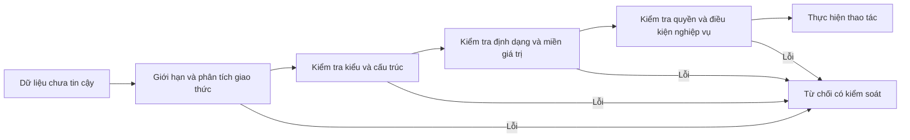

# Type validation

## 1. Vì sao kiểm tra kiểu là một yêu cầu bảo mật?

Một API yêu cầu `quantity` là số nguyên nhưng nhận chuỗi `"2"`. Một thành phần tự chuyển chuỗi thành số, thành phần khác giữ nguyên chuỗi để ký request, còn một service phía sau hiểu giá trị theo quy tắc riêng. Nếu hệ thống không quy định rõ kiểu đầu vào và cách chuyển đổi, cùng một thông điệp có thể mang nhiều cách hiểu.

Type validation là việc xác minh rằng dữ liệu nhận vào có kiểu và cấu trúc kiểu đúng với hợp đồng của điểm tiếp nhận. Nó bao gồm kiểu của giá trị đơn, kiểu của từng phần tử trong tập hợp, cấu trúc đối tượng lồng nhau và khả năng biểu diễn chính xác trong kiểu đích.

Trong thiết kế yêu cầu bảo mật, mục tiêu không chỉ là tránh một `ClassCastException`. Mục tiêu là bảo đảm dữ liệu không đáng tin được diễn giải nhất quán trước khi tham gia quyết định cấp quyền, tính tiền, chọn tài nguyên hoặc thay đổi trạng thái.

Một yêu cầu có thể kiểm chứng cần nêu rõ:

- Kiểu nào được chấp nhận trên giao thức và kiểu nào được dùng trong ứng dụng.
- Field bắt buộc hay tùy chọn; thiếu field và giá trị `null` có ý nghĩa gì.
- Có cho phép chuyển đổi kiểu hay không, và chuyển đổi nào được coi là hợp lệ.
- Khi số vượt khả năng biểu diễn, có phần lẻ hoặc có dạng không được hỗ trợ thì xử lý thế nào.
- Dữ liệu lồng nhau được kiểm tra đến đâu, với giới hạn tài nguyên nào.
- Lỗi được trả về trước thao tác nghiệp vụ nào, và bằng chứng nào chứng minh điều đó.

Type validation là một lớp kiểm soát đầu vào. Nó cần phối hợp với kiểm tra định dạng, miền giá trị, quy tắc nghiệp vụ và phân quyền; không thay thế các lớp đó.

## 2. Phân biệt các câu hỏi dễ bị gọi chung là “validate”

Giả sử một API tạo đơn hàng nhận:

```json
{
  "productId": "SKU-0042",
  "quantity": 2,
  "giftWrap": false,
  "labels": ["fragile", "gift"]
}
```

Các lớp kiểm tra trả lời những câu hỏi khác nhau:

| Lớp kiểm tra | Câu hỏi | Ví dụ bị từ chối |
|---|---|---|
| Cú pháp | Thông điệp có phân tích được theo giao thức không? | JSON thiếu dấu ngoặc hoặc dấu phân cách |
| Kiểu và cấu trúc kiểu | Giá trị có đúng loại mà hợp đồng yêu cầu không? | `quantity` là `"2"`, `giftWrap` là `1`, `labels` chứa object |
| Khả năng biểu diễn | Giá trị có được chuyển sang kiểu đích mà không mất thông tin không? | Số nguyên vượt giới hạn `int` |
| Định dạng | Chuỗi đúng ngữ pháp của loại dữ liệu nghiệp vụ không? | `productId` chứa ký tự ngoài định dạng đã quy định |
| Miền giá trị | Giá trị nằm trong giới hạn được phép không? | `quantity` bằng `-1` hoặc vượt số lượng tối đa |
| Quy tắc nghiệp vụ | Giá trị hợp lệ trong trạng thái hiện tại không? | Sản phẩm đã ngừng bán hoặc không đủ tồn kho |
| Phân quyền | Chủ thể được phép thao tác với tài nguyên đó không? | Người dùng sửa đơn hàng thuộc tài khoản khác |

Số `-1` có thể đúng kiểu số nguyên nhưng sai miền nghiệp vụ. Chuỗi `"order-123"` có thể đúng kiểu và định dạng nhưng trỏ đến tài nguyên người gọi không được phép truy cập. Không nên dùng một nhãn “input valid” để che mất các điều kiện độc lập này.

Với ngày giờ, giao thức JSON thường mang dữ liệu dưới dạng chuỗi; việc biến chuỗi đó thành một kiểu thời gian cần thêm hợp đồng định dạng, múi giờ và tính hợp lệ. Chỉ kiểm tra `instanceof String` chưa chứng minh đó là ngày giờ hợp lệ.

## 3. Ranh giới tin cậy và nơi phải thực thi

Kiểu được khai báo trong JavaScript, TypeScript, Java hoặc tài liệu API không tự chứng minh dữ liệu từ bên ngoài tuân theo khai báo đó. Một người gọi có thể bỏ qua giao diện và gửi trực tiếp request tùy ý.

Kiểm tra ở phía trình duyệt có ích cho trải nghiệm, nhưng điểm tiếp nhận phía server vẫn phải thực thi hợp đồng. Quy tắc này áp dụng cả cho dữ liệu từ message broker, file import, webhook và lời gọi giữa các dịch vụ. “Đến từ service nội bộ” chỉ là một thuộc tính của luồng dữ liệu, không phải bằng chứng rằng kiểu luôn đúng.

Luồng xử lý phù hợp có thể mô tả như sau:



Sơ đồ thể hiện các trách nhiệm kiểm soát; thứ tự thực tế có thể cần điều chỉnh. Chẳng hạn, xác thực người gọi và áp dụng hạn mức request có thể diễn ra trước khi đọc toàn bộ body. Điều kiện cốt lõi là dữ liệu chưa đạt các kiểm tra cần thiết không được tạo tác động nghiệp vụ.

Không cần ép mọi lớp kiểm tra vào cùng một hàm. Tuy nhiên, phải xác định lớp nào sở hữu mỗi điều kiện và chứng minh không có đường gọi đi vòng qua nó.

## 4. Đặc tả kiểu trên giao thức trước khi chọn kiểu Java

Một bảng hợp đồng rõ ràng giúp tránh việc thư viện binding tự quyết định thay cho đội thiết kế:

| Field | Kiểu trên JSON | Kiểu đích minh họa | Quy tắc thiếu và `null` | Chính sách chuyển đổi |
|---|---|---|---|---|
| `productId` | String | `String` hoặc value object | Bắt buộc; không nhận `null` | Không chuyển number thành string |
| `quantity` | Number có giá trị nguyên | `int` | Bắt buộc; không nhận `null` | Chuyển chính xác, không cắt phần lẻ hoặc làm tròn |
| `giftWrap` | Boolean | `boolean` | Tùy chọn; thiếu nghĩa là `false`; `null` bị từ chối | Không nhận `0`, `1`, `"true"`, `"false"` |
| `labels` | Array của string | `List<String>` | Tùy chọn; thiếu nghĩa là danh sách rỗng; `null` bị từ chối | Không biến một string thành mảng một phần tử |

Bảng này là một lựa chọn minh họa của endpoint, không phải quy tắc bắt buộc cho mọi API. Một API khác có thể cho phép `null`, dùng số dưới dạng chuỗi hoặc chấp nhận một số cách chuyển đổi để tương thích. Điều quan trọng là hành vi được đặc tả, giới hạn và kiểm thử, thay vì phụ thuộc vào mặc định không được ghi nhận.

### 4.1. Thiếu field không giống `null`

Hai request sau không nhất thiết có cùng ý nghĩa:

```json
{}
```

```json
{"giftWrap": null}
```

Trong hợp đồng minh họa, request thứ nhất được áp dụng mặc định `false` cho `giftWrap`; request thứ hai bị từ chối. Một API cập nhật từng phần còn có thể phân biệt “giữ nguyên giá trị” với “xóa giá trị”. Nếu binding làm cả hai thành `null`, thông tin phân biệt đã bị mất.

Khi dùng kiểu nguyên thủy như `int` hoặc `boolean` trong một DTO, cần kiểm chứng cách binder xử lý field thiếu và `null`. Việc đối tượng Java đã có giá trị `0` hoặc `false` không tự chứng minh người gọi đã gửi đúng field. Có thể cần theo dõi sự hiện diện hoặc dùng mô hình đầu vào phù hợp trước khi tạo đối tượng nghiệp vụ.

### 4.2. Field không biết và field trùng tên

Hợp đồng cần quyết định có chấp nhận field không được khai báo hay không. Nếu chấp nhận để tương thích, không được tự động bind field đó vào thuộc tính nhạy cảm hoặc sử dụng nó ở một lớp khác mà không có kiểm soát.

Field trùng tên trong cùng object cần được xử lý theo chính sách rõ ràng tại lớp parser. Một parser lấy giá trị đầu và một parser lấy giá trị cuối có thể hiểu cùng request khác nhau. Nếu dữ liệu đã được đưa vào `Map`, dấu vết field trùng có thể đã mất; validator chạy sau đó không thể suy lại thông điệp ban đầu.

Đối với API cần diễn giải duy nhất, từ chối field trùng ngay khi phân tích là một lựa chọn dễ kiểm chứng. Đây là yêu cầu bổ trợ cho tính nhất quán của hợp đồng, không phải điều mà một phép ép kiểu Java tự giải quyết.

## 5. Chính sách chuyển đổi: tránh thuận tiện nhưng mơ hồ

Nhiều framework hỗ trợ chuyển đổi tự động. Một số hành vi có ích cho form hoặc query parameter, nhưng có thể gây bất ngờ nếu áp dụng ngầm cho JSON.

| Đầu vào | Kiểu yêu cầu | Hành vi trong hợp đồng nghiêm ngặt minh họa |
|---|---|---|
| `"2"` | Number có giá trị nguyên | Từ chối vì kiểu JSON là string |
| `2.5` | Number có giá trị nguyên | Từ chối vì không thể chuyển chính xác thành số nguyên |
| `2.0` | Number có giá trị nguyên | Chấp nhận nếu hợp đồng dựa trên giá trị nguyên |
| `2e0` | Number có giá trị nguyên | Chấp nhận theo cùng chính sách giá trị nguyên |
| `true` | Number | Từ chối, không đổi thành `1` |
| `"false"` | Boolean | Từ chối, không tự phân tích chuỗi |
| `"fragile"` | Array của string | Từ chối, không tự bọc thành mảng |
| `["fragile", 7]` | Array của string | Từ chối toàn bộ đầu vào, không bỏ riêng phần tử lỗi |

Điểm cần đặc tả riêng là **giá trị số** và **cách viết số**. Nếu endpoint yêu cầu giá trị nguyên, `2.0` và `2e0` có thể được chấp nhận vì đều biểu diễn số nguyên. Nếu nghiệp vụ yêu cầu dạng chữ số không có dấu thập phân hoặc số mũ, cần quy tắc về biểu diễn và một parser còn giữ được thông tin đó. Sau khi chỉ giữ giá trị số, có thể không còn đủ thông tin để kiểm tra cách viết ban đầu.

Không được quảng cáo “chỉ nhận kiểu chính xác” rồi vẫn để cấu hình binder chấp nhận các biến thể ở bảng trên. Tiêu chí phải đi cùng cấu hình và phiên bản triển khai được kiểm chứng.

### 5.1. Không thay lỗi bằng một giá trị có vẻ hợp lệ

Các cách xử lý sau dễ tạo dữ liệu sai:

- Parse số lỗi thì dùng `0`.
- Boolean không hiểu thì dùng `false`.
- Phần tử sai kiểu thì bỏ qua và xử lý phần còn lại.
- Giá trị quá lớn thì ép về kiểu nhỏ hơn hoặc ghim về giới hạn tối đa.
- Chuỗi không hợp lệ thì tự đổi thành một enum mặc định có quyền thực thi.

Nếu nghiệp vụ thực sự cần giá trị mặc định, điều kiện áp dụng phải được ghi rõ. Mặc định cho field tùy chọn bị thiếu không đồng nghĩa mặc định cho field đã được gửi nhưng sai kiểu.

## 6. Số học: đúng loại “number” vẫn có thể mất dữ liệu

### 6.1. Kiểm tra phần lẻ và tràn số độc lập

Một JSON number có thể vượt miền biểu diễn của `int` hoặc `long` trong Java. Việc gọi một phép chuyển đổi làm mất thông tin rồi mới kiểm tra không thể khôi phục giá trị ban đầu.

Yêu cầu nên nêu:

> Số phải được chuyển sang kiểu đích bằng phép chuyển đổi chính xác; giá trị có phần lẻ không được phép hoặc nằm ngoài miền biểu diễn phải bị từ chối trước khi sử dụng trong nghiệp vụ.

Trong Java, khi dữ liệu còn được biểu diễn bằng `BigDecimal`, các phương thức như `intValueExact()` hoặc `longValueExact()` phù hợp với yêu cầu chuyển đổi chính xác. Các phương thức không có hậu tố `Exact` có thể làm mất thông tin; không nên dùng chúng để chứng minh đầu vào nằm trong miền kiểu đích.

Sau bước này vẫn cần kiểm tra miền nghiệp vụ. Một số vừa với `int` chưa chắc là số lượng hợp lệ của đơn hàng.

### 6.2. Không để mất chính xác trước validator

Nếu parser đã biến một số thập phân thành `double` với sai số, validator chạy sau đó không thể khôi phục biểu diễn chính xác ban đầu. Nếu trình duyệt đã làm tròn một số nguyên lớn trước khi gửi request, server chỉ nhìn thấy giá trị đã gửi, không biết ý định ban đầu của người dùng.

Với định danh dài, số tài khoản hoặc mã có số `0` ở đầu, kiểu string thường phù hợp hơn number: chúng là định danh chứ không phải đại lượng cần tính toán. Với tiền, cần đặc tả đơn vị và biểu diễn thập phân hoặc số nguyên đơn vị nhỏ nhất, thay vì chọn kiểu chỉ vì nó dễ bind.

Một yêu cầu như “ID phải là `long`” còn thiếu nếu phía gửi dùng kiểu số không biểu diễn chính xác mọi giá trị `long`. Hợp đồng cần nhất quán trên cả hai phía và các thành phần trung gian.

### 6.3. Giới hạn tài nguyên của chính con số

Chọn `BigDecimal` hoặc `BigInteger` không có nghĩa được nhận một chuỗi số dài tùy ý. Parser và validator vẫn cần giới hạn kích thước body, độ dài token số, độ sâu cấu trúc và thời gian xử lý theo khả năng nền tảng.

Giới hạn biểu diễn của kiểu đích và giới hạn tài nguyên là hai điều kiện khác nhau. Không nên đợi cấp phát hoặc tính toán rất lớn rồi mới kết luận số không vừa với `int`.

## 7. Tập hợp, đối tượng lồng và kiểu đa hình

### 7.1. Kiểm tra từng phần tử

Biết một giá trị là `List<?>` chỉ chứng minh đó là danh sách trong mô hình đã parse. Nó chưa chứng minh tất cả phần tử là string, chưa chứng minh phần tử không phải `null` và chưa chứng minh độ dài phù hợp.

Với JSON:

```json
{"labels": ["fragile", null, {"name": "gift"}]}
```

Hợp đồng `array<string>` không cho phép `null` hoặc object nếu không khai báo ngoại lệ. Cần báo lỗi ở vị trí có ý nghĩa như `labels[1]`, đồng thời bảo đảm không xử lý trước phần tử hợp lệ rồi mới dừng giữa chừng.

Java generics hỗ trợ kiểm tra ở thời điểm biên dịch, nhưng một phép cast không kiểm tra như `(List<String>) raw` không xác minh kiểu của từng phần tử tại runtime. Validator ở biên phải kiểm tra cấu trúc thực tế hoặc dùng cơ chế binding đã được cấu hình và kiểm chứng tương đương.

### 7.2. Xác định giới hạn cho cấu trúc lồng

Hợp đồng nên nêu các giới hạn liên quan: số phần tử, số thuộc tính, độ sâu lồng, chiều dài chuỗi và tổng kích thước request. Đơn vị phải rõ ràng; byte trên đường truyền, số đơn vị UTF-16 trong Java và số ký tự người dùng nhìn thấy không phải cùng một thước đo.

Không tự giả định parser đã có giới hạn phù hợp. Đội thiết kế cần xác định giới hạn được thực thi ở gateway, parser hay validator, và điều gì xảy ra khi một lớp bị bỏ qua trong một luồng nhập khác.

### 7.3. Không cho đầu vào chọn tùy ý lớp thực thi

Một số giao thức dùng discriminator như `"kind": "card"` để chọn một nhánh schema. Cách này cần tập giá trị và ánh xạ kiểu được cho phép rõ ràng.

Không nên để field do người dùng gửi chỉ định tùy ý tên lớp Java rồi yêu cầu thư viện khởi tạo lớp đó. Một yêu cầu phù hợp là chỉ cho phép những biến thể nghiệp vụ đã khai báo và từ chối discriminator không biết. Mỗi biến thể vẫn phải được kiểm tra field, kiểu và quyền tương ứng.

Type validation không làm cho mọi cơ chế deserialize object trở nên an toàn. Lựa chọn định dạng, cấu hình deserialization và danh sách kiểu được phép là những quyết định thiết kế cần kiểm soát riêng.

## 8. Ví dụ Java: tạo đối tượng có kiểu sau khi kiểm tra tại biên

Ví dụ sau dùng Java 17, không phụ thuộc framework. Nó nhận một cây dữ liệu đã parse và tạo một đối tượng đầu vào có kiểu. Hợp đồng của **parser phía trước** là:

- JSON object được biểu diễn bằng `Map<?, ?>`, array bằng `List<?>`.
- JSON number được giữ bằng `BigDecimal`, không đi qua `double`.
- Giới hạn kích thước, độ sâu và độ dài token đã được áp dụng khi parse.
- Field trùng tên bị từ chối trước khi tạo `Map`.

Các giả định này phải được cấu hình và kiểm chứng khi tích hợp parser thực tế; lớp bên dưới không tự thực hiện việc parse JSON.

```java
import java.math.BigDecimal;
import java.util.ArrayList;
import java.util.List;
import java.util.Map;
import java.util.Set;

public final class OrderInputTypes {

    private static final Set<String> FIELDS = Set.of(
        "productId", "quantity", "giftWrap", "labels"
    );

    private OrderInputTypes() {
    }

    public record Input(
        String productId,
        int quantity,
        boolean giftWrap,
        List<String> labels
    ) {
    }

    public static Input read(Object parsed) {
        if (!(parsed instanceof Map<?, ?> object)) {
            throw error("$", "object");
        }

        for (Object key : object.keySet()) {
            if (!(key instanceof String name) || !FIELDS.contains(name)) {
                // Không đưa tên field tùy ý của người gọi vào message.
                throw error("$", "declared fields only");
            }
        }

        String productId = string(object.get("productId"), "productId");
        int quantity = exactInt(object.get("quantity"), "quantity");

        boolean giftWrap = object.containsKey("giftWrap")
            ? bool(object.get("giftWrap"), "giftWrap")
            : false;

        List<String> labels = object.containsKey("labels")
            ? stringList(object.get("labels"), "labels")
            : List.of();

        return new Input(productId, quantity, giftWrap, labels);
    }

    private static String string(Object value, String path) {
        if (!(value instanceof String result)) {
            throw error(path, "string");
        }
        return result;
    }

    private static boolean bool(Object value, String path) {
        if (!(value instanceof Boolean result)) {
            throw error(path, "boolean");
        }
        return result;
    }

    private static int exactInt(Object value, String path) {
        if (!(value instanceof BigDecimal number)) {
            throw error(path, "number with an exact int value");
        }
        try {
            return number.intValueExact();
        } catch (ArithmeticException exception) {
            throw error(path, "number with an exact int value");
        }
    }

    private static List<String> stringList(Object value, String path) {
        if (!(value instanceof List<?> values)) {
            throw error(path, "array of strings");
        }
        if (values.size() > 8) {
            throw error(path, "array with at most 8 items");
        }

        List<String> result = new ArrayList<>(values.size());
        for (int index = 0; index < values.size(); index++) {
            result.add(string(values.get(index), path + "[" + index + "]"));
        }
        return List.copyOf(result);
    }

    private static IllegalArgumentException error(String path, String expected) {
        return new IllegalArgumentException(
            "INVALID_INPUT at " + path + "; expected " + expected
        );
    }
}
```

Giới hạn 8 nhãn là quyết định minh họa của endpoint. Khi áp dụng, cần bổ sung giới hạn chiều dài chuỗi và các điều kiện nghiệp vụ ở lớp sở hữu phù hợp, không coi ví dụ là bộ kiểm soát hoàn chỉnh cho ứng dụng sản xuất.

Một số điểm cần hiểu đúng:

- `read` từ chối root là array, string, number hoặc `null`.
- `productId` và `quantity` bắt buộc. Thiếu hoặc `null` đều không thỏa điều kiện, dù ví dụ gộp chúng trong cùng mã lỗi.
- `giftWrap` thiếu được mặc định; `giftWrap: null` không được mặc định.
- `quantity: "2"` bị từ chối; `quantity: 2.5` không được cắt thành `2`.
- `quantity: 2.0` có thể chuyển chính xác thành `2`, phù hợp với hợp đồng theo giá trị nguyên đã chọn.
- Mỗi phần tử của `labels` đều được kiểm tra; không có unchecked cast sang `List<String>`.
- Hàm không gọi database, gửi message hoặc thực hiện một phần đơn hàng trước khi xác nhận cấu trúc.

Một giá trị `quantity` âm vẫn có thể vượt qua lớp kiểm tra kiểu này. Lớp kiểm tra miền phải từ chối nó trước khi thực hiện nghiệp vụ. Tương tự, string rỗng có đúng kiểu string nhưng có thể không phải `productId` hợp lệ.

Record trong ví dụ phù hợp cho dữ liệu minh họa không chứa secret. Không dùng việc in toàn bộ DTO như cách debug mặc định, vì một endpoint khác có thể mang credential hoặc dữ liệu nhạy cảm; thiết kế log phải có chính sách độc lập.

## 9. Chuyển nội dung thành yêu cầu bảo mật có thể nghiệm thu

| Mã | Yêu cầu minh họa | Cách xác minh |
|---|---|---|
| TYPE-01 | Mỗi điểm tiếp nhận có schema kiểu, sự hiện diện và chính sách `null` cho toàn bộ field được xử lý | Đối chiếu hợp đồng với các luồng request, message và import trong phạm vi |
| TYPE-02 | Kiểu được kiểm tra ở phía xử lý đáng tin; không phụ thuộc kiểm tra của client | Gửi trực tiếp dữ liệu sai kiểu, bỏ qua giao diện |
| TYPE-03 | Chỉ cho phép các chuyển đổi được liệt kê; không tự làm tròn, cắt phần lẻ hoặc dùng mặc định khi lỗi | Kiểm tra ma trận đầu vào và cấu hình binding |
| TYPE-04 | Chuyển số sang kiểu đích phải chính xác và kiểm tra giới hạn biểu diễn | Thử phần lẻ, giới hạn kiểu và giá trị vượt giới hạn |
| TYPE-05 | Mọi phần tử và nhánh đối tượng lồng đều được kiểm tra theo schema, kèm giới hạn tài nguyên | Thử mảng hỗn hợp, `null` lồng, cấu trúc sâu và kích thước vượt hạn mức |
| TYPE-06 | Các lớp diễn giải cùng dữ liệu phải thống nhất quy tắc field trùng, kiểu số và discriminator | Kiểm tra tích hợp qua gateway, parser và service liên quan |
| TYPE-07 | Lỗi kiểu không tạo tác động nghiệp vụ; lỗi trả về không chứa payload thô hoặc thông tin nội bộ không cần thiết | Theo dõi side effect và đầu ra lỗi trong kịch bản thất bại |
| TYPE-08 | Thay đổi schema hoặc cấu hình chuyển đổi phải được kiểm tra tương thích và cập nhật bằng chứng | Rà soát thay đổi và thực thi lại các kịch bản liên quan |

Các yêu cầu nên gắn với owner cụ thể. Đội API sở hữu hợp đồng; đội ứng dụng sở hữu điểm thực thi; đội nền tảng có thể sở hữu giới hạn ở gateway và parser dùng chung; đội kiểm thử sở hữu bằng chứng hành vi xuyên các lớp.

Nếu cùng một dữ liệu có nhiều đường nhập, phải kiểm kê đủ các đường đó. Việc endpoint HTTP đã chặn string thay number không chứng minh consumer xử lý message hoặc tác vụ import có cùng hành vi.

## 10. Ma trận nghiệm thu cho endpoint minh họa

Ma trận dưới đây là thiết kế kiểm thử cho dự án áp dụng, không phải tuyên bố rằng các kiểm thử đã được thực thi trong bài học.

| Dữ liệu hoặc điều kiện | Kết quả mong đợi của lớp kiểm tra kiểu |
|---|---|
| Root là `[]` hoặc `null` | Từ chối, vì root phải là object |
| `quantity` thiếu hoặc `null` | Từ chối, không thay bằng `0` |
| `quantity: "2"` | Từ chối string thay number |
| `quantity: 2.5` | Từ chối vì chuyển sang số nguyên sẽ mất thông tin |
| `quantity: 2.0` và `quantity: 2e0` | Chấp nhận theo hợp đồng giá trị nguyên |
| `quantity` bằng giá trị lớn nhất của `int` | Đúng miền kiểu; lớp nghiệp vụ tiếp tục kiểm tra giới hạn số lượng |
| `quantity` lớn hơn giá trị lớn nhất của `int` | Từ chối, không wrap, không cắt hoặc ghim giá trị |
| `quantity: -1` | Đúng kiểu; phải bị lớp kiểm tra miền của endpoint từ chối |
| `giftWrap` thiếu | Áp dụng mặc định `false` đã được khai báo |
| `giftWrap: null`, `"false"` hoặc `0` | Từ chối theo chính sách kiểu và `null` |
| `labels: "gift"` | Từ chối, không tự bọc thành array |
| `labels: ["gift", 1]` hoặc `["gift", null]` | Từ chối, không bỏ riêng phần tử lỗi |
| `labels` có nhiều hơn 8 phần tử | Từ chối theo giới hạn minh họa |
| Một field không khai báo | Từ chối theo chính sách field của ví dụ |
| Hai field `quantity` trong cùng object | Parser từ chối theo hợp đồng trước khi tạo `Map` |

Ngoài ví dụ đơn lẻ, cần có kiểm tra quanh ranh giới: ngay dưới, đúng bằng và ngay trên giới hạn biểu diễn hoặc giới hạn tài nguyên. Với cấu trúc lồng, kiểm tra lỗi ở phần tử đầu, giữa và cuối giúp phát hiện hành vi chỉ kiểm tra một phần.

Bằng chứng “request bị trả lỗi” chưa đủ cho TYPE-07. Cần quan sát không có bản ghi nghiệp vụ được tạo, không có sự kiện nghiệp vụ được phát và không có thao tác tính tiền phát sinh. Việc ghi một sự kiện từ chối an toàn để phục vụ vận hành có thể vẫn được phép nếu đó là hành vi đã thiết kế.

Đối với luồng xử lý theo lô, hợp đồng phải chọn rõ tính nguyên tử của toàn lô hay phản hồi kết quả theo từng phần tử. Không được tự suy rằng bỏ qua phần tử sai là an toàn. Nếu cho phép thành công một phần, cấu trúc phản hồi và giới hạn side effect phải được đặc tả riêng.

## 11. Phản hồi lỗi và khả năng quan sát

Một phản hồi có cấu trúc có thể là:

```json
{
  "code": "INVALID_INPUT",
  "errors": [
    {
      "path": "quantity",
      "reason": "EXPECTED_EXACT_INTEGER"
    }
  ],
  "requestId": "req-example-004"
}
```

Phản hồi cho biết field và quy tắc bị vi phạm mà không lặp lại giá trị đầu vào. Đường dẫn field cũng cần được tạo có kiểm soát; nếu một giao thức cho phép tên key tùy ý, không đưa trực tiếp mọi key vào log hoặc thông báo lỗi mà không giới hạn.

HTTP API cần thống nhất cách ánh xạ lỗi cú pháp, lỗi kiểu, lỗi miền và lỗi kích thước sang mã trạng thái trong hợp đồng. Không có một lựa chọn `400` hay `422` duy nhất phù hợp cho mọi API; điều cần nghiệm thu là hành vi nhất quán và có tài liệu. Lỗi phân quyền có chính sách phản hồi riêng, không nên bị gộp thành lỗi kiểu chỉ để đơn giản triển khai.

Log có thể ghi mã lỗi, route chuẩn hóa, loại nguồn vào và request ID theo chính sách dữ liệu. Không log toàn bộ body chỉ vì parse thất bại: request lỗi vẫn có thể chứa password, token hoặc dữ liệu cá nhân.

Số lỗi được trả và tổng kích thước phản hồi cần có giới hạn. Một request cố tình tạo hàng nghìn lỗi không nên khiến server cấp phát và trả một danh sách thông báo không giới hạn. Hệ thống có thể dừng ở lỗi đầu hoặc thu thập một số lỗi tối đa đã định nghĩa.

## 12. Những ngộ nhận cần tránh khi rà soát thiết kế

| Ngộ nhận | Vấn đề | Yêu cầu cần làm rõ |
|---|---|---|
| “DTO đã khai báo `int`, nên đầu vào chắc chắn đúng” | Binder có thể chuyển đổi hoặc dùng giá trị mặc định | Kiểu giao thức, chính sách chuyển đổi và sự hiện diện |
| “Client có TypeScript nên không gửi sai kiểu” | Người gọi có thể bỏ qua client | Thực thi tại ranh giới phía server |
| “Không lỗi parse nghĩa là dữ liệu hợp lệ” | JSON hợp lệ vẫn có thể sai schema hoặc miền | Tách cú pháp, kiểu, miền và nghiệp vụ |
| “Ép `double` sang `int` là kiểm tra số nguyên” | Có thể mất phần lẻ hoặc thông tin trước khi kiểm tra | Chuyển đổi chính xác từ biểu diễn phù hợp |
| “Cast sang `List<String>` là đủ” | Cast không kiểm tra từng phần tử | Kiểm tra toàn bộ cấu trúc phần tử |
| “Đã kiểm tra kiểu thì không còn injection” | Chuỗi đúng kiểu vẫn có thể nguy hiểm ở sink | Tham số hóa truy vấn, encoding đầu ra và kiểm soát theo ngữ cảnh |
| “Đúng ID là được truy cập” | Kiểu và định dạng không chứng minh quyền | Kiểm tra quyền với tài nguyên cụ thể |
| “Service nội bộ luôn gửi đúng” | Lỗi phiên bản hoặc thành phần bị chiếm quyền vẫn có thể tạo dữ liệu sai | Kiểm tra theo hợp đồng ở từng biên cần thiết |

Type validation không phải lý do bỏ tham số hóa SQL, bỏ kiểm tra đường dẫn hoặc bỏ encoding khi hiển thị HTML. Mỗi biện pháp kiểm soát có mục tiêu riêng và phải được liên kết với rủi ro tương ứng.

## 13. Bài tập chuyển rủi ro thành yêu cầu

Một API hoàn tiền nhận `transactionId`, `amount` và `notifyCustomer`. Client đang gửi `transactionId` dưới dạng number, gateway ký request dựa trên body, còn ứng dụng tự chuyển `notifyCustomer: "false"` thành boolean. Một consumer khác đọc cùng thông điệp từ broker bằng một thư viện parse riêng.

Hãy xác định:

1. Field nào là định danh, field nào là đại lượng và kiểu biểu diễn nào bảo toàn được ý nghĩa của nó.
2. Các bên phải thống nhất gì về kiểu số, độ chính xác, giá trị thiếu và `null`.
3. Chuyển đổi nào được phép, chuyển đổi nào phải bị từ chối.
4. Cần kiểm tra những gì khi cùng dữ liệu đi qua HTTP và message broker.
5. Điều kiện nào phải được kiểm tra ngoài kiểu trước khi thực hiện hoàn tiền.
6. Bằng chứng nào cho thấy request sai kiểu không tạo ra một khoản hoàn tiền hoặc sự kiện nghiệp vụ tương ứng.

Kết quả nên là một bảng hợp đồng field, một tập yêu cầu có owner và một ma trận nghiệm thu. Câu trả lời “đổi DTO sang đúng kiểu” chưa giải quyết cách parser hiểu dữ liệu, độ chính xác đã mất ở phía gửi và sự khác nhau giữa các luồng nhập.

Type validation có giá trị bảo mật khi nó tạo ra một cách diễn giải dữ liệu rõ ràng tại biên, giữ nguyên thông tin cần thiết và từ chối sai lệch trước tác động nghiệp vụ. Khai báo kiểu trong code là một phần triển khai; hợp đồng và bằng chứng thực thi mới cho thấy yêu cầu đã được đáp ứng.
