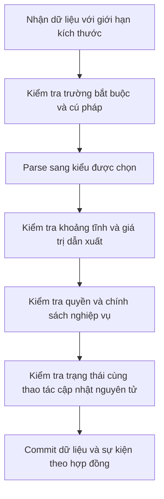

# Range validation

## 1. Từ “giá trị hợp lệ” đến một yêu cầu đo được

Range validation là kiểm tra giá trị nằm trong một miền cho phép. Miền đó có thể là khoảng số, khoảng ngày, giới hạn tài nguyên hoặc khoảng phụ thuộc trạng thái nghiệp vụ.

Ví dụ, câu “số lượng phải hợp lệ” chưa đủ để triển khai. Một yêu cầu rõ hơn là:

> Mỗi dòng báo giá phải có số lượng nguyên từ 1 đến 1.000, bao gồm cả hai biên. Server phải từ chối giá trị ngoài khoảng trước khi lưu dòng báo giá hoặc phát sự kiện nghiệp vụ.

Câu này xác định trường dữ liệu, kiểu giá trị, biên, nơi thực thi và thời điểm kiểm tra. Để trở thành một hợp đồng hoàn chỉnh, vẫn cần quy định định dạng đầu vào, cách xử lý thiếu dữ liệu, mã lỗi, đơn vị và các giới hạn sau tính toán.

Trong module đặc tả yêu cầu bảo mật, range validation gắn trực tiếp với ba mục tiêu:

- Bảo vệ tính toàn vẹn: số âm, tỷ lệ vượt mức hoặc phép tính sai không làm thay đổi nghiệp vụ.
- Bảo vệ tính sẵn sàng: một giá trị rất lớn không tạo công việc hoặc cấp phát tài nguyên ngoài khả năng thiết kế.
- Bảo đảm kiểm soát có thể kiểm chứng: có thể chỉ ra giá trị nào được nhận, giá trị nào bị từ chối và điều gì không được xảy ra khi từ chối.

Các giá trị giới hạn trong bài là ví dụ thiết kế cho một API báo giá giả định, không phải ngưỡng bắt buộc của mọi hệ thống.

## 2. Các lớp kiểm tra cần phân biệt

Một chuỗi nhìn giống số chưa chắc biểu diễn giá trị được phép; một số nằm trong khoảng cũng chưa chắc được người gửi quyền sử dụng.

| Lớp kiểm tra | Câu hỏi | Ví dụ |
| --- | --- | --- |
| Sự hiện diện | Trường có bắt buộc không? | Thiếu quantity phải bị từ chối |
| Cú pháp và kiểu | Dữ liệu có biểu diễn đúng loại giá trị không? | quantity không nhận chuỗi số thập phân |
| Miền giá trị | Giá trị có nằm trong khoảng không? | quantity phải thuộc [1, 1000] |
| Quan hệ giữa trường | Các trường có nhất quán không? | from phải nhỏ hơn to |
| Giá trị dẫn xuất | Kết quả tính có trong giới hạn không? | quantity × unitPrice không vượt trần |
| Trạng thái nghiệp vụ | Điều kiện còn đúng khi thực hiện không? | available phải đủ cho lượng xuất kho |
| Phân quyền | Chủ thể có được thực hiện hành động không? | Có quyền nhập giá cho tenant này |

OWASP đề xuất phân tích input validation theo cả cấu trúc và ý nghĩa nghiệp vụ, thực hiện kiểm tra tại phía server và không dựa vào kiểm tra ở client. Đây là cơ sở để đặt range validation vào một chuỗi xử lý có hợp đồng rõ ràng; xem [OWASP Input Validation Cheat Sheet](https://cheatsheetseries.owasp.org/cheatsheets/Input_Validation_Cheat_Sheet.html).

Ví dụ, `"1001"` có thể là số nguyên đúng cú pháp nhưng vượt khoảng cho phép. `"10.5"` không phải số lượng nguyên theo hợp đồng. Một giá trị `10` hợp lệ về khoảng cũng không cho phép người gửi lấy hàng của tenant khác.

Không dùng kết quả “đã qua validation” làm một quyền truy cập tổng quát.

## 3. Đặc tả chính xác miền giá trị

### 3.1. Biên đóng, biên mở và miền rời rạc

Với biên dưới `L`, biên trên `U`:

| Miền | Điều kiện |
| --- | --- |
| [L, U] | L ≤ x ≤ U |
| (L, U) | L < x < U |
| [L, U) | L ≤ x < U |
| (L, U] | L < x ≤ U |

Không chỉ ghi “từ L đến U” nếu người triển khai và người kiểm chứng có thể hiểu khác nhau về biên.

Số lượng sản phẩm là miền rời rạc: trong ví dụ, chỉ các số nguyên từ 1 đến 1.000 được chấp nhận. Đơn giá được biểu diễn theo đơn vị tiền thử nghiệm CU, với bước nhỏ nhất 0,01 CU. Vì thế, `0.001` không trở thành giá trị hợp lệ chỉ vì nó lớn hơn 0.

Một điều kiện khoảng thường cần đi cùng điều kiện về tập giá trị:

```text
quantity là số nguyên
AND 1 <= quantity <= 1000

unitPrice có tối đa hai chữ số thập phân
AND 0.01 <= unitPrice <= 100000.00
```

Với tỷ lệ, cần quy định rõ `0.15` là 15% hay 0,15%. Không đặt client và server vào tình huống cùng nhận một số nhưng áp dụng hai đơn vị khác nhau.

### 3.2. Miền nghiệp vụ khác miền biểu diễn

Kiểu Java `int` nhận được nhiều giá trị hơn khoảng số lượng của API. “Parse thành int thành công” chỉ chứng minh giá trị biểu diễn được bằng kiểu này; nó không chứng minh giá trị hợp lệ cho nghiệp vụ.

Tương tự:

- Một timestamp biểu diễn được không đồng nghĩa nằm trong thời gian đặt chỗ cho phép.
- Một giá trị phân trang biểu diễn được không đồng nghĩa truy vấn tương ứng có chi phí chấp nhận được.
- Một mức giảm giá có thể lưu trong database không đồng nghĩa người dùng được phép áp dụng mức đó.

Đặc tả phải ghi miền nghiệp vụ riêng, không lấy giới hạn kiểu dữ liệu hoặc kích thước cột làm giới hạn mặc định.

### 3.3. Đơn vị và độ chính xác là một phần của hợp đồng

Một yêu cầu timeout chỉ ghi `max = 300` có thể bị hiểu là mili giây hoặc giây. Một yêu cầu kích thước `10 MB` có thể bị hiểu theo hai hệ đơn vị khác nhau.

Viết rõ, chẳng hạn:

```text
timeoutMillis:
  kiểu: số nguyên
  đơn vị: millisecond
  khoảng: [100, 30000]
  quy tắc ngoài khoảng: từ chối, không tự tăng hoặc giảm

unitPrice:
  đơn vị: CU cho một sản phẩm
  độ chia nhỏ nhất: 0.01 CU
  khoảng: [0.01, 100000.00]
  làm tròn đầu vào: không cho phép
```

Trong ví dụ đơn giá, từ chối `1.999` thay vì làm tròn thành `2.00`. Một sản phẩm khác có thể cho phép làm tròn, nhưng phải công bố thời điểm, chế độ làm tròn và việc áp dụng giới hạn trước hay sau làm tròn.

## 4. Định dạng đầu vào và chuyển đổi giá trị

### 4.1. Những chuỗi có thể gây hiểu khác nhau

Cùng một giá trị toán học có nhiều cách biểu diễn:

```text
100
0100
+100
1e2
100.00
 100
```

Không nhất thiết mọi API phải cấm tất cả các dạng này. Điều bắt buộc là hợp đồng quy định dạng nào được nhận và mọi thành phần áp dụng cùng cách hiểu.

API báo giá trong bài chọn một hợp đồng đơn giản:

- `quantity` là chuỗi gồm chữ số ASCII, không dấu, không khoảng trắng, không số 0 ở đầu.
- `unitPrice` là chuỗi thập phân cơ số 10, dấu chấm phân cách, không ký hiệu số mũ, không dấu phân nhóm.
- `unitPrice` có thể không có phần thập phân hoặc có một, hai chữ số sau dấu chấm.
- Chuỗi có số 0 đầu phần nguyên bị từ chối, ngoại trừ phần nguyên chính là `0`.
- Không tự trim, bỏ ký tự hoặc đổi dấu phân cách để cứu một giá trị sai hợp đồng.

Việc dùng chuỗi trong payload là một lựa chọn của ví dụ nhằm thể hiện chính xác định dạng đầu vào. API dùng JSON number cần một hợp đồng binding khác và phải phân tích các bước chuyển đổi trước khi validator được gọi.

### 4.2. Thiếu, null, rỗng và số không

Bốn trường hợp sau không mặc nhiên tương đương:

| Dữ liệu | Ý nghĩa cần đặc tả |
| --- | --- |
| Không có trường | Chưa cung cấp giá trị |
| null | Có trường nhưng không có giá trị |
| Chuỗi rỗng | Có giá trị chuỗi nhưng không biểu diễn số |
| 0 | Có giá trị số cụ thể |

Trong API tạo báo giá, `quantity` và `unitPrice` đều bắt buộc. Không chuyển thiếu dữ liệu thành 0 rồi chỉ dựa vào một kiểm tra khoảng để giải thích mọi lỗi.

Với PATCH, thiếu trường có thể mang nghĩa giữ nguyên giá trị cũ, còn null có thể mang nghĩa xóa hoặc bị cấm. Quy tắc này phải nằm trong hợp đồng PATCH, không được kế thừa vô tình từ DTO của thao tác tạo mới.

### 4.3. Giới hạn trước khi parse

Một chuỗi hàng triệu chữ số không nên được đưa thẳng vào bộ chuyển đổi số tùy ý rồi mới kiểm tra xem nó có vượt trần nghiệp vụ hay không.

Ở API ví dụ:

- Body có giới hạn kích thước ở tầng tiếp nhận.
- quantity có tối đa 4 ký tự theo hợp đồng đã chọn.
- unitPrice có tối đa 9 ký tự.
- Cú pháp được kiểm tra trước khi parse.
- Sau parse vẫn kiểm tra khoảng số.

Giới hạn 9 ký tự đến từ tối đa 6 chữ số phần nguyên, một dấu chấm và 2 chữ số phần thập phân. Nó không thay thế kiểm tra trần 100.000 CU: `999999.99` vẫn đúng kích thước và cú pháp nhưng vượt khoảng.

## 5. Giá trị sau tính toán cũng phải được kiểm tra

### 5.1. Từng trường hợp lệ không bảo đảm kết quả hợp lệ

Trong hệ thống báo giá:

```text
1 <= quantity <= 1000
0.01 <= unitPrice <= 100000.00
lineTotal = quantity × unitPrice
lineTotal <= 1000000.00
```

Hai trường đầu vào có thể đều hợp lệ nhưng tổng tiền dòng vượt trần:

```text
quantity = 11
unitPrice = 100000.00

lineTotal = 1100000.00
=> từ chối vì vượt trần dòng báo giá
```

Nếu một báo giá có nhiều dòng, giới hạn trên từng dòng cũng không chứng minh tổng báo giá trong hạn mức. Cần thêm giới hạn số dòng, tổng tiền và chi phí xử lý theo đúng rủi ro của thao tác.

Giá trị dẫn xuất phải được tính tại server từ dữ liệu được phép dùng. Một trường `lineTotal` do client gửi không được tin làm kết quả chính thức. Tương tự, endpoint đặt mua phải lấy giá theo chính sách giá có thẩm quyền; việc API nhập báo giá cho phép nhập đơn giá không cấp cùng quyền cho mọi khách hàng.

### 5.2. Tràn số có thể làm sai quyết định khoảng

Một mẫu nguy hiểm là tính bằng kiểu quá hẹp rồi mới kiểm tra:

```java
// Phản ví dụ: phép nhân đã diễn ra bằng int.
int total = quantity * unitPriceMinor;
if (total > MAX_TOTAL_MINOR) {
    throw new IllegalArgumentException("TOTAL_TOO_LARGE");
}
```

Nếu kết quả toán học vượt miền biểu diễn, giá trị được so sánh có thể không còn là kết quả mong muốn. CWE-190 mô tả rủi ro integer overflow hoặc wraparound và tác động tới các quyết định bảo mật; xem [CWE-190](https://cwe.mitre.org/data/definitions/190.html).

Ngay cả `long total = a * b` vẫn thực hiện phép nhân bằng int nếu a và b đều là int. Trong trường hợp đó, cần chuyển một toán hạng sang long trước phép tính, đồng thời vẫn bảo đảm kết quả nằm trong miền long.

Với số nguyên có giới hạn, có thể dùng các hàm kiểm tra tràn như `Math.multiplyExact` và `Math.addExact`, sau đó xử lý lỗi có kiểm soát; xem [Java SE 17 Math](https://docs.oracle.com/en/java/javase/17/docs/api/java.base/java/lang/Math.html). Các hàm này kiểm tra khả năng biểu diễn, không tự kiểm tra trần nghiệp vụ.

### 5.3. Số thập phân và giá trị đặc biệt

Với tiền thập phân trong ví dụ, dùng `BigDecimal` tạo từ chuỗi đã được kiểm tra. So sánh khoảng bằng `compareTo`; không dùng `equals` để thay cho so sánh số học vì scale cũng ảnh hưởng tới `equals`. Xem [Java SE 17 BigDecimal](https://docs.oracle.com/en/java/javase/17/docs/api/java.base/java/math/BigDecimal.html).

Nếu một miền dữ liệu thực sự sử dụng double, cần quy định việc nhận NaN và vô cực. Một điều kiện chỉ gồm `value < min || value > max` có thể bỏ sót NaN. Có thể kiểm tra tính hữu hạn trước:

```java
if (!Double.isFinite(value) || value < min || value > max) {
    throw new IllegalArgumentException("VALUE_OUT_OF_RANGE");
}
```

`Double.isFinite` được mô tả tại [Java SE 17 Double](https://docs.oracle.com/en/java/javase/17/docs/api/java.base/java/lang/Double.html#isFinite(double)). Điều này áp dụng khi tầng nhập dữ liệu hoặc phép tính có thể sinh những giá trị đó; không có nghĩa mọi định dạng trao đổi đều cho phép chúng.

## 6. Luồng thực thi và nơi đặt kiểm soát

Một luồng xử lý cho yêu cầu có thay đổi dữ liệu:



Sơ đồ thể hiện quan hệ phụ thuộc giữa các kiểm tra. Một hệ thống có thể xác thực hoặc kiểm tra quyền sơ bộ sớm hơn để tránh lộ thông tin; không bắt buộc trì hoãn mọi kiểm tra quyền tới bước E.

Các vị trí kiểm soát có vai trò khác nhau:

| Vị trí | Vai trò |
| --- | --- |
| Client | Hỗ trợ người dùng nhập đúng, hiển thị giới hạn |
| Gateway hoặc parser | Giới hạn request, định dạng và chi phí tiếp nhận |
| Application service | Thực thi miền giá trị và chính sách có thẩm quyền |
| Database | Giữ các bất biến dữ liệu phù hợp, hỗ trợ cập nhật nguyên tử |
| Worker xử lý nền | Áp dụng cùng quy tắc nếu nhận dữ liệu qua queue hoặc import |

Không cho một đường import hoặc job nền bỏ qua toàn bộ khoảng chỉ vì nó không đi qua controller. Với dữ liệu nội bộ, cần xác định nguồn nào thực sự được tin cậy và bất biến nào vẫn phải được bảo vệ tại điểm cập nhật.

## 7. Giới hạn phụ thuộc trạng thái và cập nhật đồng thời

### 7.1. Giá trị đúng lúc kiểm tra có thể sai lúc sử dụng

Giả sử kho còn 10 sản phẩm. Hai request cùng xin 8 sản phẩm và cùng đọc thấy số tồn 10:

```text
Request A đọc available = 10
Request B đọc available = 10
A kiểm tra 8 <= 10: đúng
B kiểm tra 8 <= 10: đúng
```

Nếu mỗi request cập nhật mà không bảo vệ bất biến, cả hai có thể cùng được chấp nhận dù tổng yêu cầu là 16. Kiểm tra range trên DTO không giải quyết được vấn đề này.

Requirement cần nói tới thời điểm quyết định có hiệu lực:

> Lượng xuất phải thuộc [1, 1000] và không vượt số lượng còn khả dụng tại thời điểm cập nhật có hiệu lực. Hệ thống phải bảo đảm tồn kho không âm dưới các request đồng thời.

Một phương án minh họa là cập nhật có điều kiện:

```sql
UPDATE inventory
SET available = available - :requested
WHERE tenant_id = :tenantId
  AND sku_id = :skuId
  AND :requested BETWEEN 1 AND 1000
  AND available >= :requested;
```

Đây là SQL minh họa sử dụng tham số bind; cú pháp binding cụ thể phụ thuộc công cụ. Ứng dụng phải kiểm tra số dòng được cập nhật và phối hợp giao dịch cho dữ liệu liên quan. Kiểm tra quyền trên tenant và sản phẩm vẫn là yêu cầu riêng.

### 7.2. Hạn mức động cần nguồn và phiên bản rõ ràng

Những giới hạn như hạn mức rút tiền, quota theo tenant hoặc số tác vụ đồng thời có thể thay đổi theo chính sách.

Cần đặc tả:

- Nguồn nào quyết định giới hạn.
- Giới hạn áp dụng cho một request, một người dùng, một tenant hay toàn hệ thống.
- Cửa sổ thời gian nếu có cộng dồn.
- Mốc thời gian và cơ chế bảo vệ cập nhật đồng thời.
- Hành vi khi cấu hình hoặc nguồn trạng thái không khả dụng.
- Phiên bản chính sách dùng để giải thích một quyết định.

Trong hệ thống ví dụ, không lấy `maxAllowed` do client gửi làm hạn mức thật. Nếu không lấy được giới hạn bắt buộc cho một thao tác nhạy cảm, hệ thống từ chối có kiểm soát thay vì tự hiểu là không có giới hạn.

## 8. Khoảng ngày và khoảng thời gian

Range validation không chỉ dành cho số tiền. Một API xuất báo cáo giả định có thể quy định:

```text
fromDate: ngày bắt đầu, bao gồm
toDate: ngày kết thúc, không bao gồm

fromDate < toDate
Số ngày lịch giữa fromDate và toDate <= 31
```

Khoảng `[fromDate, toDate)` giúp mô tả các cửa sổ liên tiếp không trùng biên. Nếu sản phẩm muốn ngày kết thúc được bao gồm, phải chọn hợp đồng khác và xác định cách tính số ngày tương ứng.

Cần phân biệt:

- Ngày lịch với thời điểm trên trục thời gian.
- Số ngày lịch với số giây.
- Múi giờ hiển thị với múi giờ dùng để xác định ranh giới nghiệp vụ.
- Giới hạn cố định với điều kiện phụ thuộc thời gian server.

Không so sánh chuỗi ngày tùy ý trước khi parse sang kiểu đã quy định. Không lấy thời gian do client tự khai làm nguồn chuẩn cho điều kiện như “chỉ được sửa trong 15 phút sau khi tạo”.

Với hai trường, kiểm tra từng trường riêng vẫn chưa đủ. Hai ngày đều hợp lệ về định dạng nhưng `fromDate > toDate` phải bị từ chối. Khoảng rỗng có được phép hay không cũng cần quyết định rõ.

## 9. Ví dụ Java: kiểm tra khoảng cho một dòng báo giá

Ví dụ sau dùng API Java 17 và chỉ minh họa hợp đồng đã chọn trong bài. Các tham số đầu vào là chuỗi lấy từ payload của endpoint nhập báo giá được phân quyền.

```java
import java.math.BigDecimal;
import java.math.RoundingMode;
import java.util.regex.Pattern;

public final class QuoteRangeValidator {
    private static final Pattern QUANTITY_FORMAT =
            Pattern.compile("[1-9][0-9]{0,3}");

    private static final Pattern PRICE_FORMAT =
            Pattern.compile("(?:0|[1-9][0-9]{0,5})(?:\\.[0-9]{1,2})?");

    private static final BigDecimal MIN_PRICE =
            new BigDecimal("0.01");

    private static final BigDecimal MAX_PRICE =
            new BigDecimal("100000.00");

    private static final BigDecimal MAX_LINE_TOTAL =
            new BigDecimal("1000000.00");

    private QuoteRangeValidator() {
    }

    public static BigDecimal validatedLineTotal(
            String quantityText,
            String unitPriceText
    ) {
        if (quantityText == null) {
            throw invalid("QUANTITY_REQUIRED");
        }
        if (quantityText.length() > 4
                || !QUANTITY_FORMAT.matcher(quantityText).matches()) {
            throw invalid("QUANTITY_FORMAT");
        }

        int quantity = Integer.parseInt(quantityText);
        if (quantity < 1 || quantity > 1000) {
            throw invalid("QUANTITY_RANGE");
        }

        if (unitPriceText == null) {
            throw invalid("UNIT_PRICE_REQUIRED");
        }
        if (unitPriceText.length() > 9
                || !PRICE_FORMAT.matcher(unitPriceText).matches()) {
            throw invalid("UNIT_PRICE_FORMAT");
        }

        BigDecimal unitPrice = new BigDecimal(unitPriceText);
        if (unitPrice.compareTo(MIN_PRICE) < 0
                || unitPrice.compareTo(MAX_PRICE) > 0) {
            throw invalid("UNIT_PRICE_RANGE");
        }

        BigDecimal lineTotal =
                unitPrice.multiply(BigDecimal.valueOf(quantity));

        if (lineTotal.compareTo(MAX_LINE_TOTAL) > 0) {
            throw invalid("LINE_TOTAL_RANGE");
        }

        return lineTotal.setScale(2, RoundingMode.UNNECESSARY);
    }

    private static IllegalArgumentException invalid(String code) {
        return new IllegalArgumentException(code);
    }
}
```

Những điểm cần đọc từ ví dụ:

- Độ dài và cú pháp được kiểm tra trước khi parse; các giới hạn này làm cho quantity biểu diễn được bằng int.
- quantity bằng 0 bị chặn ngay bởi cú pháp đã chọn; quantity bằng 1001 đi tới kiểm tra khoảng và bị từ chối ở đó.
- unitPrice bằng `0.00` đúng cú pháp nhưng không đạt biên dưới.
- `100000.01` đúng cú pháp nhưng vượt biên trên.
- `1e2`, `1,00`, `+1`, chuỗi có khoảng trắng và `1.001` không thuộc hợp đồng định dạng.
- Phép nhân được thực hiện bằng số thập phân từ các giá trị đã kiểm tra.
- Kết quả có hai chữ số thập phân mà không làm tròn đầu vào.
- Hàm không ghi dữ liệu, giữ hàng hoặc phát sự kiện trước khi quyết định hợp lệ.

Ứng dụng cần ánh xạ exception sang response theo hợp đồng API; không mặc định rằng ném `IllegalArgumentException` tự tạo response phù hợp. Cũng cần đặt giới hạn body trước khi tạo các chuỗi này. Ví dụ không triển khai phân quyền, tồn kho hoặc tổng báo giá nhiều dòng.

### Sử dụng Bean Validation có thay thế toàn bộ quy tắc không?

Với DTO đã được binding sang kiểu số, có thể biểu diễn một phần giới hạn bằng annotation:

```java
import jakarta.validation.constraints.DecimalMax;
import jakarta.validation.constraints.DecimalMin;
import jakarta.validation.constraints.Digits;
import jakarta.validation.constraints.Max;
import jakarta.validation.constraints.Min;
import jakarta.validation.constraints.NotNull;
import java.math.BigDecimal;

public record QuoteLineDto(
        @NotNull
        @Min(1)
        @Max(1000)
        Integer quantity,

        @NotNull
        @DecimalMin(value = "0.01", inclusive = true)
        @DecimalMax(value = "100000.00", inclusive = true)
        @Digits(integer = 6, fraction = 2)
        BigDecimal unitPrice
) {
}
```

Theo [Jakarta Bean Validation 3.0, các constraint dựng sẵn](https://jakarta.ee/specifications/bean-validation/3.0/jakarta-bean-validation-spec-3.0.html#builtinconstraints), `@Min`, `@Max`, `@DecimalMin`, `@DecimalMax` và `@Digits` cho phép null; trường bắt buộc cần ràng buộc riêng như `@NotNull`.

Đây là một biểu diễn DTO khác với payload chuỗi của ví dụ trước. Nó không tự khẳng định client đã dùng đúng dạng ký tự ban đầu. Các annotation cũng không tự kiểm tra tích hai trường, hạn mức động hoặc cập nhật đồng thời. Nhóm triển khai phải bảo đảm cơ chế validation thực sự được gọi tại đường vào tương ứng.

## 10. Bộ yêu cầu bảo mật có owner và bằng chứng

| ID | Yêu cầu của hệ thống ví dụ | Owner | Bằng chứng nghiệm thu dự kiến |
| --- | --- | --- | --- |
| RV-01 | Server áp dụng quantity nguyên thuộc [1, 1000], không phụ thuộc client | API team | Request trực tiếp vượt biên bị từ chối |
| RV-02 | Server áp dụng đơn giá CU thuộc [0.01, 100000.00], tối đa hai chữ số thập phân | API team | Các ca biên và sai độ chính xác |
| RV-03 | Mọi biểu diễn ngoài hợp đồng bị từ chối trước xử lý nghiệp vụ | API và integration team | Các dạng số mũ, dấu và khoảng trắng |
| RV-04 | lineTotal do server tính và không vượt 1000000.00 CU | Domain team | Hai trường hợp lệ nhưng tích vượt trần bị từ chối |
| RV-05 | Giới hạn áp dụng trên mọi đường tạo dữ liệu tương đương | Service owner | API, import và queue dùng cùng chính sách |
| RV-06 | Lỗi không tạo dòng báo giá, giữ hàng hoặc phát sự kiện thành công | Domain team | Quan sát trạng thái trước và sau ca bị từ chối |
| RV-07 | Phép tính không âm thầm tràn, thu hẹp kiểu hoặc làm tròn để vượt kiểm tra | Backend team | Ca lớn và cấu hình kiểu dữ liệu được đối chiếu |
| RV-08 | Kiểm tra tồn kho và cập nhật bảo vệ cùng một bất biến khi có cạnh tranh | Persistence team | Tình huống request đồng thời không làm tồn âm |
| RV-09 | Giới hạn động lấy từ nguồn có thẩm quyền; có hành vi khi nguồn lỗi | Policy owner | Mất nguồn hoặc cấu hình sai bị xử lý đúng hợp đồng |
| RV-10 | Mã lỗi ổn định, không phản chiếu payload nhạy cảm hoặc lỗi nội bộ | API và observability team | Response và audit của các ca âm |

Không cần mọi yêu cầu đều có cùng owner. Nhưng không nên để yêu cầu liên lớp như RV-06 hoặc RV-08 chỉ được giao cho người viết DTO, vì phần thực thi nằm ở service và cơ chế lưu dữ liệu.

Một cách diễn đạt chi tiết cho RV-04:

```yaml
id: RV-04
title: Giới hạn giá trị dẫn xuất của dòng báo giá
scope: Endpoint nhập báo giá được phân quyền
inputs:
  quantity:
    type: integer
    minimum: 1
    maximum: 1000
    bounds: inclusive
  unitPrice:
    unit: CU
    minimum: "0.01"
    maximum: "100000.00"
    fractionDigits: 2
derived:
  lineTotal:
    expression: quantity * unitPrice
    maximum: "1000000.00"
    upperBound: inclusive
requiredBehavior:
  - Tính tại server từ giá trị đã kiểm tra
  - Từ chối khi vượt trần
  - Không tự giảm số lượng hoặc làm tròn đơn giá để chấp nhận
  - Không tạo side effect nghiệp vụ khi từ chối
evidence:
  - Ca bằng trần được chấp nhận nếu các điều kiện khác đạt
  - Ca vượt trần bị từ chối dù từng trường riêng đạt
owner: Domain team
```

Đoạn YAML là nội dung đặc tả minh họa, không phải cấu hình tự động thực thi.

## 11. Thiết kế tiêu chí kiểm chứng theo biên

Không chỉ chọn vài số ngẫu nhiên. Với mỗi biên, xác định giá trị ngay dưới, đúng tại và ngay trên theo độ chia nhỏ nhất của miền.

Bảng sau dùng hợp đồng của ví dụ. Kết quả “được nhận” chỉ nói về range và format, giả định các điều kiện phân quyền cùng nghiệp vụ khác đã đạt.

| Dữ liệu | Kết quả dự kiến | Lý do |
| --- | --- | --- |
| quantity = "1" | Được nhận | Đúng biên dưới |
| quantity = "1000" | Được nhận | Đúng biên trên |
| quantity = "0" | Từ chối | Không thuộc định dạng số lượng đã chọn |
| quantity = "1001" | Từ chối | Vượt biên trên |
| quantity = "-1" | Từ chối | Không cho số âm |
| quantity = "1.5" | Từ chối | Không phải số nguyên theo hợp đồng |
| quantity = "01" | Từ chối | Không cho số 0 ở đầu |
| quantity thiếu hoặc null | Từ chối | Trường bắt buộc |
| unitPrice = "0.01" | Được nhận | Đúng biên dưới |
| unitPrice = "100000.00" | Được nhận khi quantity phù hợp | Đúng biên trên của đơn giá |
| unitPrice = "0.00" | Từ chối | Dưới biên dưới |
| unitPrice = "100000.01" | Từ chối | Trên biên trên |
| unitPrice = "1.001" | Từ chối | Vượt hai chữ số thập phân |
| unitPrice = "1e2" | Từ chối | Không cho số mũ |
| unitPrice = "1,00" | Từ chối | Không cho dấu phẩy thập phân |
| quantity = "10", unitPrice = "100000.00" | Được nhận | Tổng đúng 1000000.00 |
| quantity = "11", unitPrice = "100000.00" | Từ chối | Tổng vượt trần |
| Chuỗi số quá dài | Từ chối sớm | Vượt giới hạn biểu diễn đầu vào |

Với một ca âm, bằng chứng phải gồm cả quyết định từ chối và việc không phát sinh side effect. Một response lỗi không chứng minh database hoặc queue chưa bị thay đổi trước đó.

Các nhóm kiểm chứng bổ sung cần được thiết kế cho toàn hệ thống:

1. **Bỏ qua client:** gửi request trực tiếp để chứng minh server áp dụng cùng khoảng.
2. **Đường vào khác:** nhập cùng dữ liệu qua batch, queue hoặc công cụ quản trị trong phạm vi.
3. **Cạnh tranh:** cho nhiều thao tác cùng dùng một hạn mức hoặc lượng tồn.
4. **Cấu hình thay đổi:** xác định phiên bản chính sách và thời điểm hiệu lực.
5. **Lỗi nguồn chính sách:** kiểm tra hành vi thay vì tự rơi về vô hạn.
6. **Khoảng thời gian:** kiểm tra thứ tự đầu cuối, khoảng rỗng, biên số ngày và nguồn thời gian.
7. **Tài nguyên:** kiểm tra dữ liệu lớn bị chặn trước parse hoặc cấp phát nặng.

Đây là kế hoạch kiểm chứng để chuyển requirement thành công việc triển khai. Nó không phải tuyên bố rằng một sản phẩm cụ thể đã chạy và đạt các ca này.

## 12. Phản hồi lỗi và quan sát vận hành

API có thể trả lỗi với cấu trúc ổn định như:

```json
{
  "code": "VALIDATION_FAILED",
  "errors": [
    {
      "field": "quantity",
      "reason": "OUT_OF_RANGE",
      "minimum": 1,
      "maximum": 1000
    }
  ],
  "requestId": "range-example-017"
}
```

Việc công bố min/max phù hợp với giới hạn nhập liệu công khai. Không mặc định đưa hạn mức riêng tư, tồn kho của tenant khác hoặc dữ liệu chính sách nhạy cảm vào response.

Hợp đồng API phải chọn và dùng nhất quán mã HTTP cho lỗi định dạng, lỗi miền giá trị và xung đột trạng thái. Một lỗi có thể được phát hiện ở nhiều lớp nhưng không nên khiến các client phải đoán ngẫu nhiên ý nghĩa.

Audit có thể ghi route, trường lỗi, mã lý do và phiên bản chính sách. Không cần giữ nguyên payload để đếm số lần vượt khoảng. Thống kê theo nguyên nhân giúp phát hiện một client gửi sai đơn vị hoặc một đợt cố tình tạo công việc lớn.

## 13. Những sai lầm thường gặp khi đặc tả

| Cách viết hoặc triển khai | Vấn đề | Cách làm rõ |
| --- | --- | --- |
| “Giá trị dương” | Có thể vẫn cực lớn | Ghi biên dưới và biên trên |
| “Từ 0 đến 100” | Chưa rõ hai biên và đơn vị | Ghi [0, 100] và đơn vị |
| Chỉ có HTML min/max | Client có thể bị bỏ qua | Có yêu cầu thực thi phía server |
| Chỉ parse sang kiểu số | Chưa kiểm tra miền nghiệp vụ | Kiểm tra khoảng sau parse |
| Kiểm tra rồi ép về kiểu nhỏ hơn | Giá trị dùng có thể khác giá trị kiểm tra | Xác định kiểu và kiểm tra chuyển đổi |
| So tổng sau khi phép nhân đã tràn | Quyết định dựa trên kết quả sai | Chọn phép tính và kiểu phù hợp |
| Tự kẹp số tiền vào biên | Thay đổi ý nghĩa yêu cầu | Từ chối hoặc công bố chính sách chuyển đổi riêng |
| Hai trường đều có min/max | Quan hệ giữa chúng có thể sai | Thêm invariant liên trường |
| Kiểm tra tồn rồi cập nhật tách rời | Dễ mất đúng đắn khi cạnh tranh | Bảo vệ bất biến lúc cập nhật |
| Cho 0 mang nghĩa “không giới hạn” | Có thể vô tình mở quota | Tách chế độ đặc biệt và phân quyền rõ |
| Dùng giới hạn do client gửi | Chủ thể tự quyết định chính sách | Lấy giới hạn từ nguồn có thẩm quyền |

Một yêu cầu range validation hoàn chỉnh phải trả lời được: kiểm tra giá trị nào, theo kiểu và đơn vị nào, trong miền nào, tại thời điểm nào, bằng nguồn chính sách nào và với hậu quả gì khi không đạt. Khi các yếu tố này được ghi rõ, kiểm soát có thể đi từ mô hình rủi ro tới thiết kế, triển khai và bằng chứng kiểm chứng mà không phụ thuộc vào giả định ngầm.
