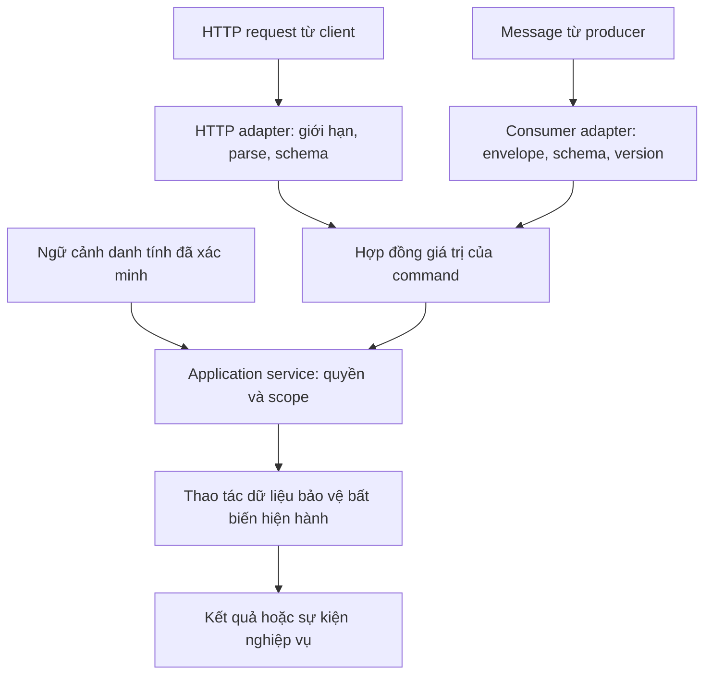

# Validation ở boundary đáng tin

## 1. Xác định nơi dữ liệu bắt đầu được ứng dụng sử dụng

Validation ở boundary đáng tin là việc thực thi hợp đồng dữ liệu tại thành phần mà hệ thống kiểm soát, trước khi dữ liệu từ một miền khác được dùng để đưa ra quyết định hoặc tạo tác động nghiệp vụ.

Điểm quan trọng không phải là gắn nhãn một mạng, một dịch vụ hay một DTO là “đáng tin”. Cần chỉ rõ thành phần nào chịu trách nhiệm kiểm tra, dữ liệu nào đi qua nó, kết quả kiểm tra bảo đảm điều gì và đường xử lý nào có thể bỏ qua nó.

Ví dụ, giao diện chỉ cho chọn số lượng từ 1 đến 1.000 không chứng minh API đã thực thi giới hạn đó. Một client khác có thể gửi request trực tiếp. API phải tự xác nhận kiểu, miền giá trị và các điều kiện nghiệp vụ mà nó chịu trách nhiệm bảo vệ.

Tương tự, một request đã xác thực chỉ chứng minh những thuộc tính mà cơ chế xác thực bảo đảm. Nó không tự chứng minh số lượng hợp lệ, tài nguyên thuộc đúng tenant hoặc người gọi có quyền thực hiện thao tác.

Trong thiết kế yêu cầu bảo mật, boundary cần được mô tả bằng các bảo đảm cụ thể. Thay cho câu “backend kiểm tra input”, nên xác định: HTTP adapter kiểm tra giới hạn và schema; lớp chuyển đổi tạo command đúng miền giá trị; application service kiểm tra quyền; tầng cập nhật dữ liệu bảo vệ bất biến có thể thay đổi trong điều kiện cạnh tranh.

## 2. Trust boundary không phải là một công tắc tin hoặc không tin

### 2.1. Tin vào điều gì và dựa trên bằng chứng nào?

Một dữ liệu có thể đáng tin về nguồn gốc nhưng chưa hợp lệ về nội dung. Message có chữ ký đúng có thể được tạo bởi một producer lỗi. Một dòng dữ liệu trong database có thể được nhập từ phiên bản phần mềm cũ. Một quản trị viên được phép sửa cấu hình vẫn có thể nhập sai kiểu hoặc sai phạm vi.

| Nguồn dữ liệu | Có thể đã được bảo đảm | Vẫn cần xác định |
| --- | --- | --- |
| Browser hoặc mobile client | Có thể đã có UX validation | Kiểu, schema, miền giá trị và quyền tại server |
| Request đã xác thực | Danh tính hoặc credential được xác minh theo giao thức | Quyền trên tài nguyên, dữ liệu nghiệp vụ và trạng thái hiện tại |
| Dịch vụ nội bộ | Kênh truyền hoặc danh tính service có thể đã xác minh | Contract, version, scope và quyền được ủy nhiệm |
| Message broker | Có thể biết producer hoặc topic nhận | Schema, ý nghĩa sự kiện, tính hợp lệ của thao tác và xử lý lặp |
| Database | Giá trị đã được lưu ở một thời điểm | Nguồn nhập, bất biến hiện hành và cách dùng trong ngữ cảnh mới |
| File import | Có thể biết người tải lên | Encoding, cấu trúc, giới hạn tài nguyên và quy tắc của từng dòng |

Không nên diễn đạt “đã ở mạng nội bộ nên không cần validation”. Mạng chỉ là một phần của bối cảnh. Quyết định tin cậy phải gắn với danh tính, phạm vi được phép và hợp đồng mà thành phần nhận có thể thực thi.

### 2.2. Boundary theo trách nhiệm, không chỉ theo máy chủ

Một trust boundary có thể nằm giữa client và API, giữa hai dịch vụ, giữa consumer và domain service, hoặc giữa dữ liệu lưu trữ với một thành phần xuất file. Nó không nhất thiết tương ứng với một máy vật lý khác.

Ngay trong cùng một tiến trình, chuyển một chuỗi không kiểm soát thành tên cột truy vấn, đường dẫn file hay lệnh thực thi là một thay đổi ngữ cảnh cần hợp đồng riêng. Dữ liệu hợp lệ cho mục đích hiển thị không tự trở thành chỉ thị hợp lệ cho một interpreter.

Ngược lại, cũng không cần lặp lại cùng một phép decode hoặc cùng một kiểm tra cú pháp ở mọi method nội bộ. Khi một lớp đã tạo đối tượng bất biến với bảo đảm rõ ràng và các đường gọi bị kiểm soát, lớp tiếp theo có thể dựa trên đúng bảo đảm đó. Các điều kiện động và điều kiện theo ngữ cảnh vẫn phải được kiểm tra tại nơi chịu trách nhiệm.

## 3. Theo dõi dữ liệu từ nguồn đến tác động

Một cách tìm boundary hiệu quả là bắt đầu từ tác động cần bảo vệ rồi truy ngược nguồn dữ liệu. Với thao tác đặt giữ hàng, các dữ liệu ảnh hưởng quyết định có thể gồm kho, SKU, số lượng, tenant, người gọi và khóa chống xử lý lặp.



Sơ đồ cho thấy hai đường vào có thể dùng chung hợp đồng giá trị, nhưng mỗi adapter vẫn có trách nhiệm riêng với giao thức của nó. Consumer không thể dùng HTTP validation như bằng chứng cho message nếu message không đi qua HTTP adapter.

Ở mỗi mũi tên, cần hỏi:

- Dữ liệu được chuyển ở dạng byte, cấu trúc đã parse hay đối tượng nghiệp vụ?
- Nguồn nào có thể điều khiển từng trường?
- Kiểm tra nào đã thực hiện và bảo đảm nào còn hiệu lực?
- Thành phần nhận có tiếp tục decode hoặc biến đổi dữ liệu không?
- Có tác động nào xảy ra trước khi các điều kiện bắt buộc được xác nhận không?

Việc truy vết này giúp phát hiện các đường bỏ qua như API quản trị, batch job, consumer hoặc script import cùng gọi một thao tác tạo dữ liệu nhưng không đi qua cùng hợp đồng.

## 4. Viết hợp đồng cho một boundary

Một hợp đồng boundary nên mô tả ít nhất năm phần: đầu vào, cách diễn giải, điều kiện chấp nhận, bảo đảm của đầu ra và hành vi khi thất bại.

```text
Boundary: HTTP adapter tạo yêu cầu đặt giữ hàng.
Nguồn không tin cậy: body, path và header do client gửi.
Ngữ cảnh tin cậy: danh tính và tenant từ cơ chế xác thực phía server.
Diễn giải: parse theo media type đã công bố; không decode bổ sung ngoài giao thức.
Giới hạn: body, độ sâu cấu trúc, độ dài field và số phần tử có trần rõ ràng.
Schema: chỉ nhận các trường đã công bố, không nhận thuộc tính server quản lý.
Điều kiện giá trị: mã kho, SKU, số lượng và khóa request đạt hợp đồng riêng.
Đầu ra: command bất biến có giá trị đúng kiểu và đúng miền đã kiểm tra.
Chưa bảo đảm: quyền trên kho, tồn kho còn đủ hoặc request chưa được xử lý trước đó.
Khi lỗi: trả mã lỗi ổn định; chưa tạo bản ghi giữ hàng hoặc sự kiện tạo giữ hàng.
```

Phần “chưa bảo đảm” giúp ngăn lớp sau suy diễn vượt quá kết quả validation. Một command đúng kiểu có thể vẫn yêu cầu một kho không tồn tại hoặc không thuộc phạm vi người gọi được phép sử dụng.

Giới hạn cần có đơn vị và nơi thực thi. Ví dụ, giới hạn body bằng byte phải được áp dụng trong quá trình đọc, không chỉ đo String sau khi đã cấp phát toàn bộ dữ liệu. Nếu hỗ trợ giải nén, giới hạn sau giải nén cũng cần được xác định.

## 5. Phân trách nhiệm giữa các lớp

### 5.1. Client và gateway

Validation ở client cung cấp phản hồi sớm và giảm lỗi thao tác. Nó hữu ích nhưng không thể là kiểm soát bắt buộc duy nhất cho một quy tắc bảo mật của server.

Gateway có thể giới hạn kích thước, tần suất, loại nội dung hoặc kiểm tra một phần schema. Backend vẫn cần bảo vệ hợp đồng mà nó chịu trách nhiệm, đặc biệt nếu còn đường vào không đi qua gateway hoặc gateway không có đủ ngữ cảnh nghiệp vụ.

Đối với các lớp cùng kiểm tra một yếu tố như body limit, có thể chủ động đặt nhiều mức bảo vệ. Điều cần tránh là hai lớp diễn giải giao thức khác nhau hoặc mỗi lớp dùng một định nghĩa giá trị hợp lệ không tương thích.

### 5.2. Adapter giao thức

Adapter chịu trách nhiệm về dạng dữ liệu đi vào ứng dụng: byte, encoding, parser, schema, kiểu dữ liệu nguồn và các quy tắc của giao thức. Nó cũng là nơi cần phát hiện những thông tin có thể mất sau parse, như key JSON bị lặp nếu hợp đồng yêu cầu từ chối key trùng.

Nếu framework tự ép số thành String hoặc tự chọn một giá trị khi tham số lặp, lớp domain có thể không còn biết request gốc vi phạm hợp đồng. Vì vậy, yêu cầu phải được gắn với nơi còn giữ được thông tin cần kiểm tra.

Adapter không nên gán trực tiếp request vào entity có các field như tenant, chủ sở hữu, trạng thái phê duyệt hoặc quyền quản trị. Nên chuyển một schema đầu vào giới hạn thành command có chủ đích.

### 5.3. Hợp đồng giá trị và domain

Các quy tắc ổn định như “số lượng là số nguyên từ 1 đến 1.000” hoặc “SKU thuộc cấu trúc đã công bố” có thể được đóng gói trong factory hoặc value object để các đường vào cùng sử dụng.

Một annotation trên DTO chỉ có hiệu lực nếu cơ chế gọi thực sự kích hoạt validation. Một lời gọi nội bộ trực tiếp có thể không đi qua cơ chế đó. Yêu cầu không nên dựa vào sự hiện diện của annotation như bằng chứng duy nhất.

Domain bảo vệ những bất biến của nghiệp vụ tại lớp phù hợp. Không cần gộp tất cả chúng thành một validator khổng lồ; cần thể hiện rõ bất biến nào được bảo vệ ở lúc tạo giá trị, lúc thực thi use case và lúc ghi dữ liệu.

### 5.4. Application service và authorization

Application service liên kết command với ngữ cảnh người gọi và tài nguyên thực tế. Nó cần xác định quyền thực hiện thao tác và scope tài nguyên từ nguồn có thẩm quyền.

Ví dụ, `warehouseCode` có cú pháp hợp lệ chưa chứng minh người gọi được đặt giữ hàng tại kho đó. Nếu tenant được lấy từ body, một request có thể cố chọn scope khác. Tenant có thẩm quyền phải đến từ ngữ cảnh xác thực hoặc cơ chế ủy nhiệm đã được thiết kế.

Một đối tượng được đặt tên `TrustedContext` hoặc `VerifiedCaller` không tự chứng minh danh tính đã được xác minh. Kiến trúc phải kiểm soát nơi tạo và truyền đối tượng đó; không deserialize nó từ request rồi coi tên class là một bảo đảm.

### 5.5. Tầng dữ liệu và điểm tạo tác động

Một số điều kiện có thể thay đổi giữa lúc kiểm tra và lúc sử dụng. Với tồn kho, đọc “còn đủ hàng” rồi ghi giảm ở một thao tác riêng có thể không giữ được bất biến khi nhiều request cùng chạy.

Yêu cầu cần bảo vệ điều kiện tại thao tác cập nhật, bằng cơ chế giao dịch, cập nhật có điều kiện, ràng buộc hoặc cơ chế nhất quán phù hợp với kiến trúc. Không coi một lần kiểm tra ở HTTP boundary là đã giải quyết mọi điều kiện cạnh tranh.

Tương tự, tính duy nhất của mã hoặc khóa xử lý lặp cần được bảo vệ ở nơi có thể điều phối các request cạnh tranh. Một phép kiểm tra “chưa tồn tại” trước khi insert không tự tạo ra tính duy nhất.

## 6. Ví dụ yêu cầu: đặt giữ hàng trong kho

Giả sử hệ thống cho phép người dùng đặt giữ hàng với request:

```json
{
  "warehouseCode": "WH_HCM",
  "sku": "BOOK_JAVA_01",
  "quantity": 3,
  "requestId": "REQ_2026_A001"
}
```

Các giới hạn sau là quyết định minh họa của sản phẩm, không phải quy tắc chung cho mọi kho hàng.

| Dữ liệu hoặc điều kiện | Hợp đồng | Thành phần chịu trách nhiệm |
| --- | --- | --- |
| Body | JSON object theo schema, không nhận field lạ hoặc key trùng | HTTP adapter |
| `warehouseCode`, `sku` | String ASCII, dài 3..32; bắt đầu bằng chữ hoa hoặc chữ số, phần còn lại thêm `_` và `-` | Adapter và factory giá trị |
| `quantity` | JSON integer, không ép kiểu, giá trị 1..1.000 | Adapter và factory giá trị |
| `requestId` | String ASCII dài 8..64; chỉ chữ, số, `_`, `-` | Factory giá trị |
| Tenant, người gọi | Từ ngữ cảnh danh tính đã xác minh | Cơ chế xác thực và application service |
| Quyền trên kho | Người gọi được đặt giữ hàng trên kho trong tenant có thẩm quyền | Authorization tại use case |
| Tồn kho | Không tạo giữ hàng làm số lượng khả dụng âm | Thao tác dữ liệu có kiểm soát cạnh tranh |
| Xử lý lặp | Cùng scope và request ID không tạo nhiều lần giữ hàng | Application service và cơ chế lưu trạng thái |

Không có field `tenantId`, `approved`, `availableStock` hoặc `ownerId` do client được phép quyết định trong schema này. Nếu client gửi chúng, adapter xử lý theo chính sách field lạ đã công bố, ở ví dụ này là từ chối.

### 6.1. Yêu cầu có thể truy vết

```text
SEC-BND-01: Mọi đường vào tạo giữ hàng phải thực thi hợp đồng giá trị tương ứng.
SEC-BND-02: HTTP adapter từ chối kiểu nguồn sai, key trùng và field ngoài schema.
SEC-BND-03: Tenant có thẩm quyền không được lấy từ body của yêu cầu đặt giữ hàng.
SEC-BND-04: Đạt validation giá trị chưa cho phép bỏ qua authorization trên kho.
SEC-BND-05: Số lượng khả dụng không được âm dưới các request cạnh tranh hợp lệ.
SEC-BND-06: Request bị từ chối trước nghiệp vụ không tạo giữ hàng hoặc sự kiện tạo giữ hàng.
SEC-BND-07: Request ID được scope theo chủ thể, tenant và thao tác đã quy định.
SEC-BND-08: Cùng khóa xử lý lặp nhưng payload khác bị xử lý theo hợp đồng xung đột.
SEC-BND-09: Consumer và batch không được dựa vào việc HTTP adapter từng chạy.
```

Mỗi yêu cầu cần được nối với rủi ro, thành phần triển khai và loại bằng chứng. Ví dụ, SEC-BND-05 cần kiểm thử cạnh tranh hoặc bằng chứng tương đương cho cơ chế cập nhật; kiểm thử một factory với số lượng âm chưa đủ để chứng minh bất biến tồn kho.

## 7. Minh họa Java: tạo command có bảo đảm hẹp và rõ

Ví dụ dưới đây tập trung vào việc tạo đối tượng bất biến từ dữ liệu đã được adapter parse. Constructor private giúp các đường gọi thông thường phải đi qua factory để tạo đối tượng, nhưng đây không phải một cơ chế cô lập trước mã tùy ý chạy trong cùng tiến trình.

```java
import java.util.regex.Pattern;

public final class ReservationInput {
    private static final Pattern ITEM_CODE =
            Pattern.compile("[A-Z0-9][A-Z0-9_-]{2,31}");

    private static final Pattern REQUEST_ID =
            Pattern.compile("[A-Za-z0-9_-]{8,64}");

    private final String warehouseCode;
    private final String sku;
    private final int quantity;
    private final String requestId;

    private ReservationInput(
            String warehouseCode,
            String sku,
            int quantity,
            String requestId) {
        this.warehouseCode = warehouseCode;
        this.sku = sku;
        this.quantity = quantity;
        this.requestId = requestId;
    }

    public static ReservationInput from(RawRequest raw) {
        if (raw == null) {
            throw new InvalidInput("INVALID_BODY");
        }

        String warehouse = requireItemCode(
                raw.warehouseCode(), "INVALID_WAREHOUSE_CODE");
        String sku = requireItemCode(raw.sku(), "INVALID_SKU");

        Integer quantity = raw.quantity();
        if (quantity == null || quantity < 1 || quantity > 1_000) {
            throw new InvalidInput("INVALID_QUANTITY");
        }

        String requestId = raw.requestId();
        if (requestId == null
                || requestId.length() < 8
                || requestId.length() > 64
                || !REQUEST_ID.matcher(requestId).matches()) {
            throw new InvalidInput("INVALID_REQUEST_ID");
        }

        return new ReservationInput(warehouse, sku, quantity, requestId);
    }

    private static String requireItemCode(String value, String errorCode) {
        if (value == null
                || value.length() < 3
                || value.length() > 32
                || !ITEM_CODE.matcher(value).matches()) {
            throw new InvalidInput(errorCode);
        }
        return value;
    }

    public String warehouseCode() {
        return warehouseCode;
    }

    public String sku() {
        return sku;
    }

    public int quantity() {
        return quantity;
    }

    public String requestId() {
        return requestId;
    }

    public record RawRequest(
            String warehouseCode,
            String sku,
            Integer quantity,
            String requestId) {
    }

    public static final class InvalidInput extends RuntimeException {
        public InvalidInput(String code) {
            super(code);
        }
    }
}
```

Factory này bảo đảm bốn giá trị có miền đã công bố. Nó không tự biết kho có tồn tại không, SKU có thuộc kho không, người gọi có quyền không hoặc hàng còn đủ không.

`RawRequest.quantity` là `Integer`, nhưng điều đó không tự chứng minh JSON gốc là integer. Adapter phải cấu hình parser và binding để từ chối các kiểu hoặc phép ép kiểu ngoài hợp đồng trước khi tạo `RawRequest`.

Đối tượng kết quả không có setter và chỉ giữ String cùng giá trị primitive. Nếu command có collection hoặc đối tượng khả biến, cần sao chép hoặc có chính sách ownership để đầu vào không bị thay đổi sau validation.

### 7.1. Luồng ứng dụng sau factory

Luồng xử lý nghiệp vụ có thể được mô tả bằng pseudocode:

```text
1. Lấy caller và tenant từ ngữ cảnh đã xác minh theo cơ chế của hệ thống.
2. Tạo ReservationInput từ request đã parse và đạt schema.
3. Tìm kho trong scope có thẩm quyền và kiểm tra quyền đặt giữ hàng.
4. Xác định khóa xử lý lặp theo tenant, chủ thể và loại thao tác.
5. Thực thi thao tác dữ liệu giữ bất biến tồn kho và trạng thái xử lý lặp.
6. Ghi kết quả, phát sự kiện theo cơ chế nhất quán đã chọn.
7. Trả kết quả phù hợp; không diễn giải lỗi hạ tầng thành thành công validation.
```

Thứ tự triển khai vật lý có thể khác. Một kiểm tra quyền sơ bộ nên diễn ra sớm nếu giúp tránh công việc không cần thiết; các giới hạn tài nguyên phải được áp dụng trước những bước tốn kém. Điểm bắt buộc là không tạo tác động mà chưa có đủ các điều kiện tương ứng.

Khi quyền hoặc chính sách có thể thay đổi trong lúc xử lý, hệ thống phải quy định thời điểm quyền được coi là có hiệu lực và cơ chế nhất quán phù hợp với rủi ro. Không mặc định một lần kiểm tra từ nhiều giờ trước vẫn đủ cho một tác vụ đang chạy hiện tại.

## 8. Consumer, batch và các đường vào thay thế

### 8.1. Message không tự trở thành command hợp lệ

Producer có thể đã validation trước khi gửi, nhưng consumer vẫn cần kiểm tra hợp đồng mà nó nhận và các điều kiện thuộc trách nhiệm của nó. Các nguyên nhân gồm producer khác phiên bản, lỗi serialization, message cũ được phát lại hoặc một producer được cấp quyền gửi nhưng không được phép thực hiện mọi thao tác.

Nếu message là sự kiện đã xảy ra, consumer phải hiểu đúng ý nghĩa sự kiện, không tùy tiện coi nó là yêu cầu được ủy quyền để tạo một tác động mới. Nếu message là command, cần xác định danh tính, quyền hoặc cơ chế ủy nhiệm tương ứng.

Validation của consumer có thể dùng chung factory giá trị với API nếu chúng thật sự cùng hợp đồng. Envelope, schema version, xác minh nguồn và chính sách retry vẫn là trách nhiệm riêng của consumer.

### 8.2. Phân loại lỗi để không retry vô hạn

Message sai schema hoặc có số lượng ngoài miền thường không tự trở nên đúng sau một lần retry. Lỗi hạ tầng tạm thời có thể phù hợp với retry có giới hạn. Việc phân loại phải dựa trên hợp đồng, tránh biến mọi lỗi thành một vòng xử lý không kết thúc.

Yêu cầu nên chỉ rõ số lần thử, hành vi cách ly hoặc dead-letter, thông tin được phép ghi và cơ chế xử lý lại có kiểm soát. Không ghi nguyên payload nhạy cảm vào log chỉ vì consumer báo lỗi validation.

Xử lý lặp cũng cần được thiết kế: message có thể được giao lại theo đặc tính hệ thống. Một request ID có định dạng đúng chưa chứng minh tác động chỉ xảy ra một lần. Cần bảo vệ việc nhận diện và ghi kết quả trong phạm vi nhất quán thích hợp.

### 8.3. Batch và import

Batch job do hệ thống chạy vẫn có thể đọc dữ liệu từ file, đối tác hoặc bảng staging chưa đạt hợp đồng. Cần đặt boundary tại bước dữ liệu được chuyển thành thao tác nghiệp vụ, không chỉ tại giao diện tải file.

Quy tắc ghi một phần hay toàn bộ phải rõ. Nếu một dòng lỗi, hệ thống dừng cả lô, bỏ qua dòng hay tạo báo cáo cần xử lý? Kết quả phải cho biết phần nào đã có tác động, đồng thời giữ bất biến và quyền truy cập của từng thao tác.

Không tái sử dụng một tài khoản hệ thống quá rộng để thay cho việc xác định scope của từng bản ghi. Nguồn dữ liệu do ai cung cấp và tài nguyên nào được phép ảnh hưởng vẫn phải có bằng chứng.

## 9. Trạng thái thay đổi và khoảng cách giữa kiểm tra với sử dụng

Một số kiểm tra bảo vệ thuộc tính ổn định của giá trị, chẳng hạn cấu trúc SKU. Một số kiểm tra chỉ đúng tại thời điểm xét, chẳng hạn tồn kho, quyền thành viên, hạn mức hoặc trạng thái tài nguyên.

Đặc tả nên tách hai nhóm để tránh một đối tượng “đã validate” mang theo lời hứa không còn đúng:

| Loại điều kiện | Ví dụ | Nơi cần bảo vệ |
| --- | --- | --- |
| Bất biến của giá trị | Số lượng trong 1..1.000 | Factory hoặc lớp giá trị dùng chung |
| Quan hệ theo tài nguyên | SKU thuộc kho trong scope được phép | Use case và truy vấn có scope |
| Điều kiện thay đổi khi có cạnh tranh | Còn đủ hàng hoặc chưa vượt hạn mức | Thao tác cập nhật có cơ chế nhất quán |
| Quyền có thể thay đổi | Thành viên vừa bị thu hồi quyền | Thời điểm kiểm tra và thực thi theo chính sách |
| Tính duy nhất | Cùng request ID không tạo tác động mới | Cơ chế lưu trạng thái và ràng buộc cạnh tranh |

Đối với job trì hoãn, cần quyết định điều kiện nào được chốt lúc tiếp nhận và điều kiện nào phải kiểm tra lại lúc chạy. Không có câu trả lời chung cho mọi use case; yêu cầu phải mô tả lựa chọn và hệ quả.

Một kiểm tra quyền thành công không thể thay thế cho một thao tác dữ liệu có điều kiện đúng, và một ràng buộc dữ liệu thành công cũng không chứng minh người gọi đã có quyền. Các bảo đảm phải được kết hợp theo trách nhiệm.

## 10. Giữ cùng cách diễn giải giữa các thành phần

Boundary chỉ có ý nghĩa nếu thành phần kiểm tra và thành phần sử dụng hiểu cùng giá trị. Cần xác định nơi decode, normalize và chuyển đổi kiểu, đồng thời kiểm tra các trường hợp mà thông tin nguồn có thể bị mất.

Ví dụ, gateway và backend có thể chọn giá trị khác nhau khi một tham số bị lặp. Một field được kiểm tra trước normalization có thể khác giá trị sau normalization. Một bộ lọc áp dụng trên chuỗi raw không tự chứng minh cấu trúc mà parser tạo ra đã hợp lệ.

Yêu cầu nên quy định biểu diễn nội bộ dùng để kiểm tra và sử dụng tiếp. Không validate một bản sao rồi thực thi bằng dữ liệu raw chưa kiểm tra. Với các giao thức có chữ ký, thứ tự xác minh và biến đổi phải tuân theo hợp đồng chữ ký; không tự chuẩn hóa dữ liệu làm thay đổi nội dung cần xác minh.

Khi dữ liệu đi vào một ngữ cảnh kỹ thuật mới, giữ kiểm soát tại điểm sử dụng: bind parameter cho giá trị truy vấn, ánh xạ tên cột động qua tập lựa chọn được phép, encode đầu ra theo ngữ cảnh và kiểm soát tài nguyên khi truy cập file hoặc gọi mạng. Đạt validation ở API không thay thế những kiểm soát đó.

## 11. Bằng chứng kiểm thử theo từng boundary

Phần này mô tả tiêu chí kiểm chứng yêu cầu, không phải một vòng thực thi QA nội dung hoặc chạy kiểm thử của dự án.

### 11.1. Kiểm thử giá trị và giao thức

Cần các trường hợp hợp lệ, thiếu trường, null, sai kiểu, vượt biên, ký tự ngoài miền, field lạ và key trùng theo chính sách của adapter. Mỗi trường hợp phải có điểm từ chối và mã lỗi dự kiến.

Với ví dụ đặt giữ hàng, số lượng `0`, `1`, `1.000`, `1.001` giúp chứng minh biên giá trị. Chuỗi `"3"` và số thập phân cần được xét ở adapter để chứng minh chính sách không ép kiểu, không chỉ kiểm thử trực tiếp factory với một `Integer`.

### 11.2. Kiểm thử quyền và scope

| Tình huống | Bằng chứng cần có |
| --- | --- |
| Người dùng hợp lệ, kho được phép | Tiếp tục đến kiểm tra nghiệp vụ |
| Mã kho đúng cú pháp nhưng thuộc tenant khác | Không tạo giữ hàng ngoài scope có thẩm quyền |
| Client gửi thêm `tenantId` hoặc `approved` | Không dùng thuộc tính đó làm nguồn quyết định; từ chối theo schema minh họa |
| Service nội bộ gửi yêu cầu vượt quyền ủy nhiệm | Bị chặn tại kiểm soát quyền tương ứng |
| Người gọi mất quyền trước tác vụ trì hoãn | Kết quả đúng chính sách thời điểm kiểm tra đã công bố |

Chi tiết lỗi công khai phải tuân theo chính sách tiết lộ thông tin. Chẳng hạn, hệ thống có thể cần tránh giúp người gọi phân biệt tài nguyên không tồn tại với tài nguyên tồn tại nhưng ngoài quyền, trong khi log nội bộ vẫn giữ mã nguyên nhân có kiểm soát.

### 11.3. Kiểm thử đường bỏ qua và cạnh tranh

Gửi dữ liệu qua API, consumer và batch để xác nhận mỗi đường thực thi hợp đồng cần thiết. Không kết luận tất cả đường đã an toàn chỉ từ một integration test cho HTTP controller.

Cần trường hợp nhiều request hợp lệ cùng đặt giữ hàng để chứng minh tồn kho không âm, cùng request ID được xử lý lại và cùng khóa nhưng payload khác. Các kiểm thử này chứng minh những thuộc tính mà factory giá trị không thể bảo vệ một mình.

### 11.4. Kiểm thử tác động khi lỗi

Xác nhận request lỗi không tạo bản ghi hoặc sự kiện nghiệp vụ ngoài hợp đồng. Nếu có ghi sự kiện từ chối, nội dung, giới hạn và quyền truy cập sự kiện phải được quy định.

Đối với lỗi hạ tầng khi đang kiểm tra quyền hoặc tải chính sách bắt buộc, cần kiểm thử chế độ lỗi đã chốt. Không diễn giải “không kiểm tra được” thành “đã đạt”. Việc dùng snapshot cũ, từ chối hay tiếp tục một chức năng hạn chế phải có điều kiện rõ ràng.

## 12. Vận hành và quản lý thay đổi

Mỗi boundary cần có chủ sở hữu contract và quy trình thay đổi tương thích. Tăng giới hạn, thêm field hoặc mở rộng miền giá trị có thể ảnh hưởng parser, consumer, storage và các điểm sử dụng phía sau.

Cấu hình validation phải được kiểm tra trước khi kích hoạt. Nếu một chính sách bắt buộc tải lỗi, hệ thống cần hành vi đã được thiết kế, thay vì âm thầm bỏ kiểm tra. Các log nên có mã quy tắc, đường vào và correlation ID khi phù hợp, không ghi nguyên dữ liệu nhạy cảm hoặc payload không giới hạn.

Đo lường số lần bị từ chối theo loại lỗi giúp phân biệt client sai hợp đồng, triển khai lệch phiên bản và hành vi lạm dụng. Tuy nhiên, số request không bị từ chối không phải bằng chứng mọi quyền và bất biến nghiệp vụ đã đúng.

Trong review kiến trúc, cần tìm các đường gọi mới có thể tạo tác động mà không đi qua boundary dự kiến. Thêm một consumer hoặc API quản trị là thay đổi tập đường vào, nên phải cập nhật cả ownership validation và bằng chứng kiểm thử.

Một boundary đáng tin là nơi hệ thống thực thi được những bảo đảm đã công bố. Thiết kế tốt chỉ rõ đầu vào nào đi qua nó, kết quả nào được phép tin, điều kiện nào còn phải kiểm tra và cơ chế nào bảo vệ tác động cuối cùng khi trạng thái hoặc quyền thay đổi.
