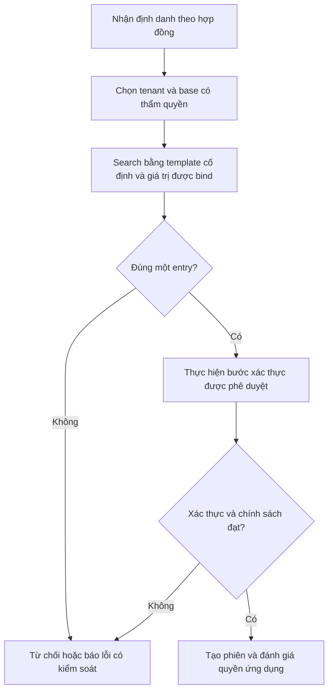

# LDAP injection

## 1. Từ dữ liệu tra cứu tới điều kiện truy vấn

LDAP injection xảy ra khi dữ liệu không tin cậy được đưa vào một biểu thức LDAP theo cách cho phép nó thay đổi ý nghĩa truy vấn. Vấn đề không nằm ở việc LDAP nhận chuỗi, mà ở việc ứng dụng không giữ được ranh giới giữa cấu trúc do hệ thống quyết định và giá trị do người dùng cung cấp.

Một ứng dụng có thể dùng LDAP để:

- Tra cứu tài khoản theo username.
- Tìm nhóm hoặc thuộc tính phục vụ phân quyền.
- Tra cứu nhân sự trong danh bạ.
- Xác định distinguished name trước một bước xác thực.
- Đồng bộ hoặc quản trị entry theo quyền đã cấp.

Một lỗi tại điểm tạo filter có thể làm truy vấn trả về nhiều tài khoản hơn dự kiến, chọn sai entry hoặc làm sai quyết định truy cập. Đây là nhóm lỗi được mô tả tại [CWE-90](https://cwe.mitre.org/data/definitions/90.html).

Trong module đặc tả yêu cầu bảo mật, mục tiêu là biến rủi ro đó thành các yêu cầu có thể thực thi và kiểm chứng: ai kiểm soát cấu trúc filter, giá trị được mã hóa theo ngữ cảnh nào, phạm vi tìm kiếm đến đâu và kết quả nào mới được coi là đủ cho bước tiếp theo.

Bài học dùng một cổng nhân sự giả định có nhiều tenant. Ứng dụng Java dùng tài khoản dịch vụ chỉ đọc để tìm đúng một entry người dùng trong vùng của tenant đã được xác định có thẩm quyền. Tra cứu thành công không tự đồng nghĩa người dùng đã được xác thực.

## 2. Hiểu ba khái niệm trước khi viết requirement

### 2.1. Search filter

Filter mô tả điều kiện để chọn entry. Ví dụ:

```text
(&(objectClass=inetOrgPerson)(uid=alice))
```

Trong filter này, các tên thuộc tính, phép kết hợp và phép so sánh là cấu trúc. Giá trị username là dữ liệu đầu vào.

Một filter khác:

```text
(uid=*)
```

có ý nghĩa kiểm tra sự hiện diện của thuộc tính uid, không phải tìm username có một dấu sao. Cú pháp và cách biểu diễn filter được quy định trong [RFC 4515](https://www.rfc-editor.org/rfc/rfc4515.html).

Khi endpoint có hợp đồng “tìm theo username”, dấu sao người dùng nhập phải được xử lý như dữ liệu hoặc bị từ chối theo contract; không được tự biến endpoint đó thành tìm kiếm wildcard.

### 2.2. Distinguished name và relative distinguished name

Distinguished name, thường viết tắt DN, xác định entry trong cây thư mục. Ví dụ:

```text
uid=alice,ou=people,dc=example,dc=test
```

Relative distinguished name, hay RDN, là một thành phần của DN. DN và search filter có cú pháp khác nhau. RFC 4514 mô tả biểu diễn chuỗi của DN và không định nghĩa một chuỗi canonical duy nhất để so sánh mọi DN; xem [RFC 4514](https://www.rfc-editor.org/rfc/rfc4514.html).

Do đó, không dùng cùng một hàm escape cho mọi chuỗi liên quan LDAP. Cũng không kiểm tra “DN nằm dưới base” chỉ bằng một phép tìm chuỗi con hoặc so sánh hậu tố văn bản chưa parse.

### 2.3. Search base và search scope

Search base quyết định điểm bắt đầu tìm kiếm; scope quyết định vùng được xét từ điểm đó. Hai tham số này không phải phần giá trị username.

Ví dụ, ứng dụng có thể giới hạn một tenant vào:

```text
ou=tenant-a,ou=people,dc=example,dc=test
```

Nếu client được tự thay search base hoặc scope, một filter được escape đúng vẫn có thể chạy trong vùng không được phép.

Yêu cầu chống injection phải bao phủ các tham số điều khiển truy vấn, không chỉ một ô username trên giao diện.

## 3. Một lỗi điển hình và nguyên nhân

Xét đoạn Java phản ví dụ:

```java
String filter =
        "(&(objectClass=inetOrgPerson)(uid=" + username + "))";
```

Ứng dụng dự định username là giá trị của phép so sánh uid. Nhưng phép nối chuỗi không thể hiện ranh giới đó cho parser. Một số ký tự trong username có thể bị diễn giải như cú pháp.

Ngay cả khi không chèn thêm một nhánh logic, input `*` đã đủ cho thấy thay đổi ý nghĩa:

```text
Mục tiêu: so sánh uid với giá trị người dùng đã nhập.
Kết quả nối trực tiếp khi username là "*":
(&(objectClass=inetOrgPerson)(uid=*))
```

Đây không còn là tra cứu một username cụ thể. Nếu code tiếp tục lấy entry đầu tiên và coi đó là người đang đăng nhập, lỗi tạo filter kết hợp với lỗi xử lý kết quả sẽ làm tăng tác động.

Ví dụ này minh họa ranh giới dữ liệu và cú pháp trong môi trường học tập. Không cần xây dựng một chuỗi khai thác phức tạp để xác định requirement bị vi phạm.

Các kiểu xử lý sau cũng không tự tạo ra bảo đảm:

- Dùng String.format thay cho phép cộng chuỗi.
- Dùng MessageFormat mà không có cơ chế LDAP encoding.
- Xóa vài ký tự bị cho là nguy hiểm.
- URL-encode hoặc HTML-encode username.
- Gọi escape ở giao diện nhưng endpoint khác không đi qua giao diện đó.
- Giả định dữ liệu đã lưu trong database luôn đáng tin khi được dùng lại.

Điểm cần kiểm soát là nơi dữ liệu đi vào ngữ cảnh LDAP cuối cùng.

## 4. Phân biệt escape theo filter và theo DN

### 4.1. Assertion value trong filter

RFC 4515 mô tả cách biểu diễn các octet đặc biệt trong giá trị filter bằng dấu gạch chéo ngược và hai chữ số hex. Với các ký tự ASCII tương ứng:

| Giá trị cần biểu diễn như dữ liệu | Biểu diễn trong filter string |
| --- | --- |
| Dấu sao * | \2a |
| Dấu mở ngoặc ( | \28 |
| Dấu đóng ngoặc ) | \29 |
| Dấu gạch chéo ngược | \5c |
| Octet NUL | \00 |

Cần phân biệt giá trị thật với cách viết trong một ngôn ngữ lập trình. Ví dụ, để mã Java chứa một dấu gạch chéo ngược, literal Java thường cần thêm một lớp escape.

Mã hóa filter xử lý octet và Unicode theo quy tắc của filter. Không tự viết một vòng thay thế ký tự rồi tuyên bố đã bao phủ dữ liệu UTF-8 không hợp lệ hoặc mọi kiểu thuộc tính nhị phân.

### 4.2. Thành phần DN

Một dấu phẩy trong giá trị tên người có vai trò khác dấu phẩy phân tách các thành phần DN. Tương tự, vị trí của dấu cách hoặc một số ký tự có thể ảnh hưởng cách biểu diễn giá trị RDN.

Trong Java, có thể xây dựng RDN bằng đối tượng thay vì tự ghép giá trị vào chuỗi:

```java
import javax.naming.ldap.LdapName;
import javax.naming.ldap.Rdn;

LdapName target = new LdapName(
        "ou=people,dc=example,dc=test"
);
target.add(new Rdn("cn", "Nguyen, An"));
```

Đây là ví dụ tạo tên từ một base cố định và một giá trị RDN. Tên thuộc tính cn do hệ thống chọn; giá trị có dấu phẩy được truyền như dữ liệu.

API Rdn và cách biểu diễn giá trị của nó được mô tả tại [Java SE 17 Rdn](https://docs.oracle.com/en/java/javase/17/docs/api/java.naming/javax/naming/ldap/Rdn.html). Việc tạo được một đối tượng tên không chứng minh người gọi có quyền thao tác entry đó; schema và ACL vẫn là kiểm soát riêng.

### 4.3. Quy tắc lựa chọn cơ chế

| Ngữ cảnh đầu ra | Cơ chế cần chọn | Không thay bằng |
| --- | --- | --- |
| Giá trị trong search filter | API bind giá trị hoặc filter encoder phù hợp | DN escape |
| Giá trị của một RDN | RDN/DN API phù hợp | Filter escape |
| Tên thuộc tính, operator | Hằng số hoặc mapping được duyệt | Escape một chuỗi tùy ý |
| Search base | Mapping cấu hình có thẩm quyền | Giá trị request tự khai |
| LDAP server URL | Cấu hình được quản lý | URL do người dùng chọn |

OWASP nhấn mạnh việc chọn đúng encoding theo filter hoặc DN, kết hợp validation và quyền tối thiểu; xem [LDAP Injection Prevention Cheat Sheet](https://cheatsheetseries.owasp.org/cheatsheets/LDAP_Injection_Prevention_Cheat_Sheet.html).

Không đặt mục tiêu “escape toàn bộ truy vấn”. Cấu trúc hợp lệ và giá trị dữ liệu cần được xử lý bằng hai cơ chế tương ứng.

## 5. Đặc tả cấu trúc truy vấn và nguồn tin cậy

Trong cổng nhân sự ví dụ, một yêu cầu tra cứu được phân chia như sau:

| Thành phần | Nguồn quyết định | Yêu cầu |
| --- | --- | --- |
| LDAP server và kết nối | Cấu hình vận hành | Không nhận từ request |
| Tài khoản tra cứu | Secret được quản lý | Chỉ đọc các thuộc tính cần thiết |
| Tenant search base | Mapping đã được cấp quyền | Không tin tenant tự khai mà chưa đối chiếu |
| Scope | Cấu hình của use case | Không cho client mở rộng |
| objectClass và uid | Template do ứng dụng quản lý | Không cho thay tên thuộc tính hoặc operator |
| Username | Input không tin cậy | Kiểm tra contract và bind như giá trị |
| Returning attributes | Danh sách được duyệt | Không trả mọi thuộc tính theo mặc định |
| Count/time limit | Chính sách tài nguyên | Không nhận giá trị vô hạn từ client |

Nếu sản phẩm cho tìm theo nhiều trường, API có thể nhận một khóa như `username` hoặc `email`. Server phải ánh xạ nó tới một tập tên thuộc tính đã biết. Không dùng nguyên chuỗi tên field do client gửi để tạo biểu thức LDAP.

Tương tự, tính năng “tìm theo tiền tố” phải có template riêng. Phần wildcard do hệ thống thêm được tách khỏi giá trị đã được mã hóa; không bật wildcard tùy ý trên endpoint xác định danh tính.

Các tùy chọn tìm kiếm nâng cao, nếu thực sự cần, phải được thiết kế như một ngôn ngữ truy vấn có quyền và giới hạn riêng. Không ngầm cho phép người dùng gửi filter LDAP thô qua một trường có tên chung như query.

## 6. Ví dụ Java: template cố định và tham số giá trị

JNDI cung cấp overload search nhận filter expression và mảng filter arguments. Với đối số chuỗi, ký tự có ý nghĩa đặc biệt trong filter được xử lý khi thay vào biến; xem [Java SE 17 DirContext.search](https://docs.oracle.com/en/java/javase/17/docs/api/java.naming/javax/naming/directory/DirContext.html).

Đây là cơ chế thay tham số theo ngữ cảnh LDAP của API, không phải khẳng định LDAP có cùng kiểu prepared statement phía server như một hệ quản trị SQL.

Ví dụ dưới đây chỉ tra cứu DN. Nó không xác thực mật khẩu, không tạo session và không cấp quyền.

```java
import java.util.Objects;
import java.util.Optional;
import javax.naming.NamingEnumeration;
import javax.naming.NamingException;
import javax.naming.directory.DirContext;
import javax.naming.directory.SearchControls;
import javax.naming.directory.SearchResult;
import javax.naming.ldap.LdapName;

public final class TenantUserLookup {
    private static final String FILTER =
            "(&(objectClass=inetOrgPerson)(uid={0}))";

    private final DirContext directory;
    private final LdapName searchBase;

    public TenantUserLookup(
            DirContext directory,
            String configuredTenantBase
    ) throws NamingException {
        this.directory = Objects.requireNonNull(
                directory, "directory"
        );
        this.searchBase = new LdapName(
                Objects.requireNonNull(
                        configuredTenantBase, "configuredTenantBase"
                )
        );
    }

    public Optional<String> findUniqueUserDn(
            String username
    ) throws NamingException {
        if (username == null
                || username.isBlank()
                || username.codePointCount(0, username.length()) > 128
                || username.indexOf(0) >= 0) {
            throw new IllegalArgumentException(
                    "USERNAME_INVALID"
            );
        }

        SearchControls controls = new SearchControls();
        controls.setSearchScope(SearchControls.SUBTREE_SCOPE);
        controls.setCountLimit(2);
        controls.setTimeLimit(1000);
        controls.setReturningAttributes(new String[] {"uid"});
        controls.setReturningObjFlag(false);

        NamingEnumeration<SearchResult> results =
                directory.search(
                        searchBase,
                        FILTER,
                        new Object[] {username},
                        controls
                );

        try {
            if (!results.hasMore()) {
                return Optional.empty();
            }

            SearchResult selected = results.next();

            if (results.hasMore()) {
                throw new NamingException(
                        "AMBIGUOUS_USER_LOOKUP"
                );
            }

            return Optional.of(
                    selected.getNameInNamespace()
            );
        } finally {
            results.close();
        }
    }
}
```

### Những giả định bắt buộc của ví dụ

- configuredTenantBase đến từ cấu hình hoặc mapping tenant đã được xác định quyền, không lấy trực tiếp từ request.
- DirContext đã kết nối tới server được phép qua kênh được bảo vệ; referral và timeout kết nối được cấu hình riêng.
- Lớp tiếp nhận đã xử lý encoding đầu vào theo hợp đồng; không tự đoán hoặc thay thế dữ liệu lỗi.
- Đối tượng dùng cho một tenant/use case đã biết, không đổi trạng thái bind theo từng người dùng trên context dùng chung.
- Việc chia sẻ context giữa các luồng phải tuân theo thiết kế và contract của provider.
- Exception không được chuyển thành đăng nhập thành công hoặc một filter dự phòng rộng hơn.

Giới hạn 128 code point và 1.000 ms là lựa chọn minh họa. Code không trim hoặc đổi username; nếu sản phẩm có quy tắc chuẩn hóa tên tài khoản, cần định nghĩa quy tắc đó trước và áp dụng nhất quán với directory.

### Vì sao giới hạn hai kết quả?

Use case cần đúng một entry. Giới hạn một kết quả có thể che giấu việc có nhiều entry cùng đáp ứng điều kiện. Lấy tối đa hai cho phép phát hiện trường hợp mơ hồ mà không cần tải toàn bộ danh sách.

Nếu server hoặc provider phát sinh lỗi giới hạn trước khi xác nhận tính duy nhất, exception phải đi theo nhánh lỗi. Không coi kết quả đầu tiên đã nhận là đủ để tiếp tục xác thực.

SearchControls cung cấp scope, số kết quả, thuộc tính trả về và time limit; xem [Java SE 17 SearchControls](https://docs.oracle.com/en/java/javase/17/docs/api/java.naming/javax/naming/directory/SearchControls.html). Time limit của search không tự thay thế timeout kết nối, đọc mạng hoặc deadline đầu cuối của request.

### Điều ví dụ không chứng minh

Code minh họa không tự chứng minh cấu hình TLS, ACL, referral hay tenant mapping của một deployment đã an toàn. Nó cũng không kiểm tra việc người dùng kiểm soát một entry có được tự sửa thuộc tính nhóm dùng để cấp quyền hay không.

Tách dữ liệu khỏi filter ngăn một nhóm thay đổi cú pháp. Tính đúng đắn của danh tính và quyền vẫn cần các bất biến riêng.

## 7. Tránh escape thiếu, escape lặp và thay đổi ngữ nghĩa

### 7.1. Không trộn hai cơ chế mà không có contract

Nếu API đã xử lý giá trị filter, thông thường cần truyền giá trị gốc vào vị trí giá trị. Tự escape trước rồi đưa chuỗi đó vào cơ chế lại escape có thể làm directory tìm một giá trị khác.

Quy tắc của hệ thống ví dụ:

```text
Input đã qua kiểm tra hợp đồng
        ↓
Giá trị nghiệp vụ gốc
        ↓
API bind giá trị tại đúng ngữ cảnh
        ↓
Filter cuối cùng
```

Không lưu username ở dạng “LDAP-escaped” như biểu diễn chuẩn dùng cho mọi nơi. Một biểu diễn dành cho filter không nên bị dùng lại làm tên hiển thị, một phần DN hoặc tham số ở ngữ cảnh khác.

### 7.2. Validation không thay thế encoding

Nếu doanh nghiệp quy định username chỉ gồm một tập ký tự nhỏ, allowlist là một lớp kiểm soát có ích. Nhưng requirement không nên nói “đã có regex nên mọi thao tác LDAP được phép nối chuỗi”.

Một đường đồng bộ, import hoặc chức năng tìm người theo tên hiển thị có thể có tập ký tự khác. Cơ chế dựng filter vẫn phải bảo đảm dữ liệu không trở thành cấu trúc.

Ngược lại, encoding đúng không có nghĩa phải chấp nhận mọi giá trị. Username quá dài, rỗng hoặc chứa NUL có thể bị contract API từ chối dù encoder có thể biểu diễn chúng.

### 7.3. Equality tuân theo schema của directory

Một phép so sánh uid không nhất thiết là so sánh từng byte như ứng dụng tưởng tượng. Matching rule của thuộc tính ảnh hưởng tới cách directory đánh giá giá trị.

Do đó, không áp đặt một quy tắc đổi hoa thường hoặc Unicode tùy ý rồi giả định directory coi đó là một danh tính duy nhất. Cần có contract tạo tài khoản, tra cứu và kiểm tra uniqueness thống nhất với schema thực tế.

## 8. Luồng xác thực phải tránh chọn sai entry

Một luồng có bước search trước khi xác thực cần phân biệt rõ:



Những bất biến cần ghi vào requirement:

- Không đăng nhập chỉ vì search tìm thấy một entry.
- Không dùng `userPassword` trong một filter do ứng dụng tự dựng để kiểm tra mật khẩu.
- Không lấy entry đầu tiên khi có nhiều kết quả.
- Không bỏ điều kiện tenant để thử lại khi lần đầu không có kết quả.
- Không chuyển lỗi directory thành anonymous hoặc local fallback có quyền rộng hơn.
- Không tự mang credential tới một server khác theo URL hoặc referral chưa được duyệt.

Với simple bind, mật khẩu rỗng có thể liên quan cơ chế unauthenticated bind, không phải bằng chứng mật khẩu đúng. Luồng dùng password authentication phải xử lý input rỗng theo contract và không nhầm trạng thái bind; xem [RFC 4513, mục 5.1](https://www.rfc-editor.org/rfc/rfc4513.html#section-5.1).

TLS bảo vệ kênh truyền nhưng không làm một filter nối chuỗi trở nên an toàn. Tương tự, chống injection không thay thế việc bảo vệ credential trên kết nối.

## 9. Bộ yêu cầu bảo mật minh họa

| ID | Yêu cầu của cổng nhân sự | Owner | Bằng chứng cần có |
| --- | --- | --- | --- |
| LI-01 | Dữ liệu ngoài hệ thống chỉ đi vào vị trí giá trị của template được duyệt | Application team | Danh sách sink và cách dựng từng filter |
| LI-02 | Filter và DN dùng cơ chế biểu diễn đúng ngữ cảnh | Application team | Ca ký tự đặc biệt tại từng sink |
| LI-03 | Attribute, operator, base và scope không lấy tùy ý từ request | Identity team | Mapping và kiểm tra quyền trên lựa chọn |
| LI-04 | Tenant được chọn từ context có thẩm quyền | Identity và domain team | Tra cứu không vượt vùng tenant |
| LI-05 | Luồng xác định người dùng đòi đúng một kết quả | Authentication team | 0, 1, nhiều kết quả và lỗi giới hạn |
| LI-06 | Tài khoản tra cứu có ACL tối thiểu, tách quyền ghi quản trị | Directory administrator | ACL và dữ liệu thực tế có thể đọc |
| LI-07 | Có giới hạn đầu vào, search, kết nối và request đầu cuối | Platform team | Cấu hình cùng ca timeout có kiểm soát |
| LI-08 | Không tự theo referral hoặc đích kết nối ngoài policy | Platform và network team | Quan sát đích kết nối và dữ liệu gửi |
| LI-09 | Lỗi không trả filter nội bộ, DN nhạy cảm hoặc credential | API và observability team | Response, log, tracing |
| LI-10 | Lỗi truy vấn hoặc hạ tầng không mở rộng quyền qua fallback | Service owner | Các nhánh lỗi và quyết định truy cập |
| LI-11 | Mọi đường vào tương đương áp dụng cùng chính sách dựng truy vấn | Integration team | API, import, batch và đồng bộ |
| LI-12 | Thuộc tính dùng cấp quyền có nguồn và quyền sửa được kiểm soát | Authorization owner | Mapping quyền và ACL thuộc tính |

Mỗi requirement cần phạm vi use case. Endpoint tìm danh bạ có thể trả nhiều người theo quyền đã cấp; nó không được nhầm với endpoint xác định đúng một tài khoản để xác thực.

Nếu một công cụ quản trị thực sự cho phép filter nâng cao, phải đặc tả nó như chức năng đặc quyền riêng với phạm vi và audit tương ứng. Không dùng ngoại lệ đó để hợp thức hóa filter thô tại luồng đăng nhập.

## 10. Ví dụ requirement có thể giao triển khai

```yaml
id: LI-01
title: Username không thay đổi cấu trúc LDAP filter
scope:
  useCase: Tra cứu DN trước bước xác thực
  entryPoints:
    - API đăng nhập
    - Luồng tra cứu tương đương được phê duyệt
trustedStructure:
  template: "(&(objectClass=inetOrgPerson)(uid={0}))"
  searchBase: Mapping tenant phía server
  scope: Subtree trong base đã cấp quyền
untrustedValue:
  name: username
  maximumCodePoints: 128
  emptyAllowed: false
  nulAllowed: false
requiredBehavior:
  - Bind username như giá trị bằng API đã được kiểm chứng
  - Không nối username vào filter expression
  - Không nhận attribute hoặc operator từ username
  - Không bỏ điều kiện để tìm lại khi không có kết quả
  - Không tạo session từ kết quả search đơn thuần
evidence:
  - Dấu sao không trở thành phép tìm hiện diện
  - Ngoặc và gạch chéo ngược không thêm nhánh filter
  - Kết quả vẫn nằm trong tenant đã chọn
  - Lỗi không làm luồng chuyển sang chấp nhận
owner: Authentication team
```

Đoạn YAML là đặc tả minh họa trong bài, không phải cấu hình tự thực thi. Nó cần được ánh xạ tới API và provider LDAP thực tế.

Điều kiện nghiệm thu không chỉ là “không còn exception”. Một filter bị thay đổi cú pháp có thể vẫn chạy thành công nhưng trả về tập entry sai. Phải kiểm chứng cả ý nghĩa truy vấn và quyết định ứng dụng.

## 11. Thiết kế dữ liệu và tiêu chí kiểm chứng

Chuẩn bị directory thử nghiệm cô lập với tối thiểu:

- Một tài khoản hợp lệ trong tenant A.
- Một tài khoản ở tenant B để phát hiện truy vấn vượt phạm vi.
- Các entry thử nghiệm có giá trị chứa ký tự đặc biệt, nếu schema và contract cho phép.
- Một tình huống dữ liệu mơ hồ để kiểm tra xử lý nhiều kết quả.
- Một tài khoản dịch vụ có ACL giống vai trò tra cứu dự kiến.

Không dùng directory sản xuất để thử các filter có thể làm thay đổi phạm vi tìm kiếm hoặc tạo tải lớn.

| Mã | Tình huống | Kết quả yêu cầu | Bằng chứng |
| --- | --- | --- | --- |
| V-01 | Username thông thường, đúng tenant | Chỉ chọn đúng entry | DN và quyết định đã được lọc khi báo cáo |
| V-02 | Username không tồn tại | Không chọn entry khác | Không tạo phiên; lỗi theo contract |
| V-03 | Username là dấu sao | Không biến thành presence search | Không trả toàn danh sách |
| V-04 | Giá trị chứa ngoặc hoặc gạch chéo ngược | Được xử lý như dữ liệu hoặc bị contract từ chối | Không thêm điều kiện filter |
| V-05 | Giá trị chứa dấu phẩy tại thao tác tạo RDN | Không tạo thêm thành phần DN ngoài dự kiến | Cấu trúc tên sau parse |
| V-06 | Chuỗi trông như một escape sequence | Không bị escape lặp hoặc giải mã ngoài contract | Giá trị thực sự được đối chiếu |
| V-07 | Username Unicode hợp lệ theo chính sách | Hành vi nhất quán với schema | Entry dự kiến và uniqueness |
| V-08 | Input rỗng, NUL hoặc vượt giới hạn | Bị từ chối trước truy vấn theo contract | Không có truy vấn không cần thiết |
| V-09 | Client thử chọn base hoặc attribute ngoài mapping | Không mở rộng truy vấn | Base, scope và template dùng thực tế |
| V-10 | Username tồn tại ở tenant B nhưng context thuộc A | Không chọn entry B | Bằng chứng ranh giới tenant |
| V-11 | Có nhiều entry phù hợp | Không chọn entry đầu để xác thực | Nhánh lỗi mơ hồ |
| V-12 | Timeout hoặc size-limit exception | Không dùng kết quả dở để chấp nhận | Quyết định thất bại và cleanup |
| V-13 | Directory trả referral ngoài policy | Không chuyển credential tới đích chưa duyệt | Quan sát đích kết nối |
| V-14 | Search thấy entry nhưng bước xác thực thất bại | Không tạo session | Dấu vết chuyển trạng thái |
| V-15 | Mật khẩu rỗng ở luồng password authentication | Không nhầm với xác thực thành công | Quyết định trước bind hoặc trạng thái được kiểm tra |
| V-16 | Input từ dữ liệu đồng bộ đã lưu trước đó | Vẫn đi qua cơ chế dựng filter an toàn | Sink LDAP ở đường xử lý nền |

Khi một input bị allowlist của API chặn sớm, ca đó chỉ chứng minh validation đầu vào hoạt động. Muốn chứng minh encoder hoặc API bind đúng, cần có kiểm chứng tại lớp dựng truy vấn với giá trị được contract của lớp đó cho phép.

Không tạo một kết luận chung từ một LDAP server duy nhất nếu sản phẩm hỗ trợ nhiều provider hoặc schema. Các khác biệt về matching rule, Unicode, size limit và referral cần được ghi nhận theo phạm vi hỗ trợ.

Bảng trên là kế hoạch kiểm chứng, không phải tuyên bố rằng một deployment cụ thể đã chạy và đạt những ca này.

## 12. Quyền tối thiểu và giới hạn tác động

Chống injection là lớp kiểm soát cấu trúc. Nếu nó bị bỏ qua tại một sink chưa được phát hiện, quyền tối thiểu giúp giảm tác động nhưng không làm lỗi biến mất.

Với cổng nhân sự ví dụ:

- Tài khoản search không có quyền sửa entry hoặc membership.
- Chỉ đọc các thuộc tính cần cho use case.
- Không dùng directory administrator cho tra cứu thường ngày.
- Tách credential của chức năng provisioning khỏi credential tra cứu.
- Quyền đọc vùng tenant và thuộc tính nhạy cảm được đánh giá riêng.
- Credential được quản lý, xoay vòng và không lưu trong mã nguồn hoặc thông báo lỗi.

Các giới hạn search không phải cơ chế phân quyền. Một truy vấn chỉ trả tối đa hai entry vẫn có thể chọn sai tenant nếu search base quá rộng.

Tương tự, không trả password hoặc mọi thuộc tính rồi dựa vào controller lọc sau để coi đó là tối thiểu. Nên giảm dữ liệu ngay tại lớp yêu cầu truy vấn và xác minh quyền thực tế trên directory.

## 13. Logging, lỗi và xử lý sự cố

Thông báo lỗi cho client cần phân biệt đủ để vận hành nhưng không lộ cấu trúc thư mục, filter nội bộ hoặc credential. Ở luồng đăng nhập, mức tiết lộ tài khoản tồn tại hay không phải theo policy chống enumeration của sản phẩm.

Một audit event minh họa:

```json
{
  "event": "directory_lookup",
  "request_id": "ldap-example-031",
  "template_id": "tenant-user-by-uid",
  "outcome": "rejected",
  "reason": "ambiguous_result",
  "policy_version": "directory-policy-example-2"
}
```

Không cần ghi toàn bộ filter đã chứa dữ liệu cá nhân để biết template nào đang lỗi. Nếu điều tra cần thông tin chi tiết hơn, phải có nơi lưu, quyền truy cập và retention phù hợp, không bật log credential đại trà.

Khi phát hiện một sink nối chuỗi:

1. Xác định đường vào và quyết định nghiệp vụ chịu ảnh hưởng.
2. Tạm giới hạn hoặc chặn chức năng trong phạm vi cần thiết nếu có nguy cơ hiện hữu.
3. Thay cơ chế dựng filter hoặc DN theo đúng ngữ cảnh.
4. Kiểm tra lại base, scope, quyền tài khoản và xử lý kết quả.
5. Đánh giá các lần truy vấn hoặc truy cập bất thường bằng dữ liệu điều tra được phép.
6. Xoay credential khi có bằng chứng hoặc rủi ro credential bị lộ, không coi đó là cách sửa filter.
7. Bổ sung tiêu chí kiểm chứng cho cả đường API và xử lý nền có cùng sink.

Không cần biến mỗi lỗi cú pháp thành khẳng định đã có tấn công. Nhưng lỗi hoặc một mẫu input đáng ngờ cũng không được làm ứng dụng tự mở rộng truy vấn để “thử tìm lại cho người dùng”.

## 14. Những kết luận cần tránh

| Kết luận thiếu chính xác | Yêu cầu còn cần làm rõ |
| --- | --- |
| “Có regex nên nối chuỗi được” | Cơ chế tại sink vẫn phải giữ ranh giới dữ liệu và cú pháp |
| “Escape LDAP một lần dùng khắp nơi” | Filter và DN là hai ngữ cảnh khác nhau |
| “Dùng API search là tự an toàn” | Overload và cách tạo filter phải đúng |
| “Dùng placeholder rồi cho client chọn attribute” | Thành phần cấu trúc vẫn cần mapping được duyệt |
| “Chỉ lấy kết quả đầu để tránh tải” | Có thể chọn sai danh tính khi truy vấn mơ hồ |
| “Search thấy user là đăng nhập thành công” | Chưa có bước xác thực |
| “LDAPS ngăn injection” | Kênh bảo vệ không tách cú pháp khỏi dữ liệu |
| “Đã lưu trong database thì đáng tin” | Dữ liệu có thể gây injection ở lần dùng sau |
| “Count limit bảo đảm không vượt quyền” | Giới hạn số lượng không phải ranh giới tenant hoặc ACL |
| “Không có exception là đã an toàn” | Truy vấn có thể chạy thành công với ý nghĩa sai |

Một đặc tả chống LDAP injection tốt xác định template có thẩm quyền, vị trí giá trị, ngữ cảnh biểu diễn, phạm vi directory và điều kiện để sử dụng kết quả. Khi các yếu tố này được nối với owner và bằng chứng cụ thể, yêu cầu có thể đi từ mô hình đe dọa tới triển khai mà không dựa vào giả định rằng một chuỗi “trông giống username” luôn là dữ liệu vô hại.
