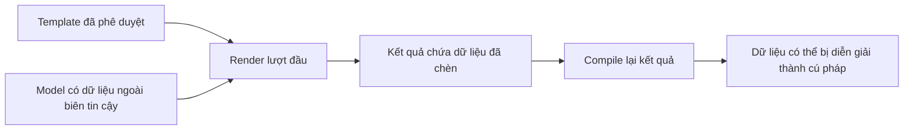

# Template injection

## 1. Khi dữ liệu trở thành chỉ thị cho template engine

Template injection xuất hiện khi dữ liệu mà bên ngoài có thể tác động được đưa vào vai trò cú pháp template hoặc biểu thức, khiến engine diễn giải dữ liệu đó như chỉ thị thay vì giữ nó ở vai trò dữ liệu.

Một hệ thống render thường kết hợp ba thành phần:

```text
Template source do ứng dụng lựa chọn
    + Model chứa dữ liệu
    + Cấu hình và khả năng của engine
    -> Kết quả render
```

Ranh giới cần bảo vệ nằm giữa template source và model. Ví dụ, tên hiển thị của người dùng có thể là một giá trị trong model. Nếu ứng dụng nối tên đó vào source rồi mới compile, người dùng đã có cơ hội tác động đến ngôn ngữ mà engine sẽ phân tích.

Trong thiết kế yêu cầu bảo mật, câu hỏi không chỉ là “đầu vào có ký tự đặc biệt không?”. Cần xác định ai được tạo source, ai được chọn template, dữ liệu nào engine có thể truy cập, có render nhiều lượt không và quyền thực tế của môi trường render là gì.

Một yêu cầu nền tảng có thể viết như sau:

> Dữ liệu request, nội dung hồ sơ và dữ liệu đối tác chỉ được truyền vào model của template đã được phê duyệt. Chúng không được dùng để tạo hoặc compile template source, tên biểu thức, macro hay một lượt render bổ sung.

Yêu cầu này cần được kiểm chứng tại từng đường render, bao gồm email, báo cáo, trang preview, tác vụ nền và các tích hợp có dùng template engine.

## 2. Phân biệt các loại rủi ro liên quan

### 2.1. Server-side template injection

Server-side template injection, thường gọi là SSTI, xảy ra khi template hoặc biểu thức bị diễn giải tại phía server. Hệ quả phụ thuộc engine, cấu hình, đối tượng được đưa vào model và quyền của tiến trình.

Các hệ quả có thể gồm thay đổi kết quả render, đọc dữ liệu ngoài phạm vi, gọi chức năng ngoài dự kiến hoặc tiêu thụ tài nguyên. Một số môi trường có khả năng dẫn đến thực thi hành động nguy hiểm hơn, nhưng không nên khẳng định mọi lỗi SSTI đều tự động có cùng mức tác động.

Yêu cầu cần liên kết đường injection với tài sản thực tế: dữ liệu khách hàng, credential của dịch vụ, file cấu hình, khả năng gọi mạng hoặc tác vụ nghiệp vụ mà môi trường render có thể chạm tới.

### 2.2. Template injection phía client và XSS

Nếu một framework phía client compile nội dung mà người dùng kiểm soát như template, rủi ro có thể nằm trong quá trình xử lý phía browser. Đây là một ranh giới khác với engine chạy trên server.

Cross-site scripting liên quan đến việc browser diễn giải dữ liệu thành nội dung có khả năng thực thi ngoài ý muốn. Template injection và XSS có thể liên quan trong một luồng, nhưng không phải cùng một thuộc tính an toàn.

| Tình huống | Câu hỏi bảo mật chính | Kiểm soát cần xác định |
| --- | --- | --- |
| Dữ liệu trở thành source của server engine | Ai điều khiển ngôn ngữ mà server diễn giải? | Tách source và model, kiểm soát khả năng của engine |
| Dữ liệu trở thành source của client engine | Browser có compile dữ liệu thành template không? | Chỉ compile source được kiểm soát, dùng cơ chế binding phù hợp |
| Dữ liệu xuất vào HTML | Browser hiểu dữ liệu theo ngữ cảnh nào? | Output encoding hoặc sanitization phù hợp với chức năng |
| Người dùng chọn một template có sẵn | Người đó có quyền dùng template cụ thể không? | Ánh xạ ID và kiểm tra quyền, scope, phiên bản |

HTML escaping không chứng minh đã ngăn SSTI. Nếu engine diễn giải source trước khi tạo HTML, việc escape kết quả sau đó không ngăn engine thực hiện hành động ở bước trước. Ngược lại, tách source và model đúng cũng chưa chứng minh đầu ra HTML đã được encode đúng ngữ cảnh.

## 3. Những đường dữ liệu dễ biến thành template source

### 3.1. Nối chuỗi trước khi compile

Pseudocode sau thể hiện một ranh giới không được bảo vệ:

```text
source = "Xin chào " + request.displayName
compiled = engine.compile(source)
output = compiled.render(model)
```

Vấn đề là `displayName` được đưa vào source. Nó không được giải quyết chỉ bằng việc đổi tên biến thành `safeName` hoặc thực hiện một số phép xóa ký tự không có hợp đồng với engine.

Mẫu kiến trúc cần hướng tới là:

```text
compiled = approvedCatalog.get(WELCOME_TEMPLATE)
output = compiled.render({ displayName: request.displayName })
```

Ở mẫu thứ hai, catalog và cách render phải thật sự bảo đảm source được kiểm soát. Nếu `render()` âm thầm nối model vào source rồi compile lại thì hình thức API không tạo ra bảo đảm mong muốn.

### 3.2. Render lần hai

Một luồng có thể render template cố định đúng ở lượt đầu, sau đó lấy kết quả làm source cho lượt tiếp theo. Dữ liệu của người dùng đã đi vào kết quả lượt đầu có thể trở thành cú pháp ở lượt sau.



Yêu cầu phải kiểm tra toàn bộ chuỗi biến đổi, không chỉ một lời gọi render riêng lẻ. Các bước “thay biến bổ sung”, “xử lý biểu thức còn lại” hoặc “render layout lần cuối” đều cần được xem xét theo ranh giới source và data.

### 3.3. Dữ liệu đã lưu trong database

Một trường mô tả, bản nháp email hoặc nội dung CMS có thể được lưu trước rồi mới dùng làm source trong một job phía sau. Việc đã lưu dữ liệu không đổi nguồn gốc tin cậy của nó.

Đây là một ví dụ của rủi ro injection qua dữ liệu được lưu: tác động không nhất thiết xảy ra tại endpoint nhận dữ liệu. Nó có thể xuất hiện khi một nhân viên mở preview, khi scheduler gửi email hoặc khi dịch vụ khác đọc nội dung đó.

Nếu sản phẩm chỉ cho phép dữ liệu văn bản, database không nên trở thành một đường đưa source tùy ý tới engine. Nếu sản phẩm chủ động cho phép tác giả soạn template, đó phải là một chức năng có mô hình quyền và mức cô lập riêng.

### 3.4. Chọn template hoặc biểu thức bằng chuỗi tùy ý

Một request có thể không trực tiếp chứa source nhưng lại điều khiển tên template, đường dẫn loader, include, layout hoặc tên biểu thức. Điều đó có thể mở rộng tập template hoặc tài nguyên mà người gọi truy cập được.

Yêu cầu nên ánh xạ ID nghiệp vụ sang các template đã được phép. Không dùng tên file hay URL do request gửi làm template location nếu chức năng không có nhu cầu và cơ chế kiểm soát tương ứng.

Ngay cả template ID có hình thức hợp lệ cũng cần kiểm tra quyền sử dụng. Người dùng tenant A không được render template riêng của tenant B chỉ vì đoán đúng ID.

## 4. Mô hình đe dọa cho một luồng render

Trước khi viết yêu cầu, cần xác định ít nhất các yếu tố sau:

1. Nguồn tạo source: repository, cấu hình, CMS, đối tác hoặc người dùng.
2. Chủ thể có thể chọn source, sửa source hoặc phát hành phiên bản mới.
3. Nguồn của từng giá trị model và khả năng thay đổi chúng sau khi lưu.
4. Nơi engine compile và render, gồm preview và job nền.
5. Các đối tượng, biến toàn cục, hàm mở rộng và tài nguyên engine nhìn thấy.
6. Loader có thể truy cập file, mạng hoặc namespace nào.
7. Quyền của tiến trình, khả năng gọi mạng và credential trong môi trường.
8. Những sink nhận kết quả: HTML, email, PDF, văn bản, file hoặc một engine khác.

Một template được kiểm soát trong repository và một template do khách hàng tự soạn không có cùng mức tin cậy. Không nên dùng cùng một cấu hình engine có đầy đủ khả năng cho cả hai chỉ vì chúng có cùng phần mở rộng file.

Mối đe dọa cũng không chỉ đến từ người dùng ẩn danh. Tài khoản được phép chỉnh nội dung, đối tác tích hợp hoặc một dịch vụ có quyền ghi vào bảng template vẫn có thể tạo source sai hoặc vượt phạm vi được cấp.

## 5. Chuyển rủi ro thành yêu cầu bảo mật

### 5.1. Nguồn template và lựa chọn template

```text
SEC-TPL-01: Luồng gửi thông báo chỉ compile source từ catalog do ứng dụng quản lý.
SEC-TPL-02: Request chỉ được chọn khóa nghiệp vụ trong tập template đã công bố.
SEC-TPL-03: Không dùng dữ liệu request, hồ sơ hoặc đối tác làm source hoặc expression.
SEC-TPL-04: Không compile lại kết quả render hoặc dữ liệu lấy từ model.
SEC-TPL-05: Mỗi lựa chọn template phải được kiểm tra scope, quyền và phiên bản nếu áp dụng.
```

Catalog không chỉ là một map tên file. Nó phải có nguồn dữ liệu được quản lý, ownership rõ và cách nạp phù hợp. Nếu một endpoint khác có thể ghi đè tài nguyên mà catalog compile thì ranh giới tin cậy vẫn bị phá vỡ.

Với catalog đa tenant, cần xác định khóa đầy đủ để lookup và cache. Cache chỉ theo một tên template trong khi nội dung phụ thuộc tenant có thể làm sử dụng nhầm source hoặc dữ liệu giữa các tenant.

### 5.2. Model và khả năng của engine

```text
SEC-TPL-06: Model chỉ chứa dữ liệu tối thiểu cần cho thông báo.
SEC-TPL-07: Không đưa service, repository, request context hoặc đối tượng đặc quyền vào model.
SEC-TPL-08: Các hàm mở rộng và khả năng truy cập thành viên phải được giới hạn theo chính sách.
SEC-TPL-09: Loader chỉ truy cập các tài nguyên đã được phép cho loại template đó.
SEC-TPL-10: Lỗi render không trả stack trace, cấu hình hoặc bí mật cho người gọi.
```

Đưa một entity hoặc một object graph lớn vào model có thể mở rộng dữ liệu nhìn thấy và làm phát sinh hành vi từ getter, lazy loading hoặc phương thức mà engine cho phép gọi. Một view model hẹp giúp giảm bề mặt này.

Model chỉ có String vẫn không phải bảo đảm đầy đủ nếu engine tự cung cấp biến toàn cục, helper hoặc khả năng truy cập runtime. Cần kiểm tra cấu hình thực tế, không suy ra quyền của engine chỉ từ map được truyền vào.

### 5.3. Giới hạn tài nguyên và đầu ra

```text
SEC-TPL-11: Luồng render có giới hạn model, source, kích thước đầu ra và chi phí thực thi.
SEC-TPL-12: Engine không được có quyền tài nguyên vượt nhu cầu của luồng render.
SEC-TPL-13: Đầu ra được xử lý an toàn theo ngữ cảnh nhận, độc lập với bảo vệ source.
SEC-TPL-14: Job render thất bại không được báo là đã gửi thông báo thành công.
```

Các ngưỡng cụ thể phải được chọn theo nhu cầu và kiểm thử tải. Một vòng lặp hoặc thao tác mở rộng có thể tạo ra đầu ra rất lớn dù model nhỏ. Chỉ giới hạn kích thước input không đủ để bảo vệ tài nguyên render.

Nếu một khả năng của engine không thể bị dừng đáng tin cậy trong cùng thread, đặt một timeout ở Future không tự chứng minh công việc đã dừng. Kiến trúc có thể cần mức cô lập và cơ chế giới hạn tài nguyên khác phù hợp với việc có chấp nhận source không tin cậy hay không.

## 6. Minh họa Java: facade chỉ chọn template đã phê duyệt

Ví dụ dưới đây thể hiện một ranh giới API cho luồng gửi thông báo. Nó không phụ thuộc một thư viện template cụ thể và không phải một engine hoàn chỉnh.

Source được ánh xạ bằng enum do code quản lý. Người gọi facade chỉ cung cấp dữ liệu hiển thị; không có tham số source, expression hoặc template path tùy ý.

```java
import java.util.Map;
import java.util.Objects;
import java.util.regex.Pattern;

public final class NotificationTemplates {
    private static final Pattern ORDER_REFERENCE =
            Pattern.compile("[A-Z0-9-]{3,32}");

    private final ApprovedRenderer renderer;

    public NotificationTemplates(ApprovedRenderer renderer) {
        this.renderer = Objects.requireNonNull(renderer);
    }

    public String welcome(String displayName) {
        String name = requireDisplayName(displayName);
        return renderer.render(
                TemplateId.WELCOME,
                Map.of("displayName", name));
    }

    public String orderReady(String displayName, String orderReference) {
        String name = requireDisplayName(displayName);
        if (orderReference == null
                || orderReference.length() < 3
                || orderReference.length() > 32
                || !ORDER_REFERENCE.matcher(orderReference).matches()) {
            throw new IllegalArgumentException("INVALID_ORDER_REFERENCE");
        }

        return renderer.render(
                TemplateId.ORDER_READY,
                Map.of(
                        "displayName", name,
                        "orderReference", orderReference));
    }

    private static String requireDisplayName(String value) {
        if (value == null || value.isBlank() || value.length() > 256) {
            throw new IllegalArgumentException("INVALID_DISPLAY_NAME");
        }
        return value;
    }

    public enum TemplateId {
        WELCOME("mail/welcome.html"),
        ORDER_READY("mail/order-ready.html");

        private final String resource;

        TemplateId(String resource) {
            this.resource = resource;
        }

        public String resource() {
            return resource;
        }
    }

    public interface ApprovedRenderer {
        String render(TemplateId template, Map<String, String> model);
    }
}
```

Hợp đồng của implementation `ApprovedRenderer` phải được nêu riêng:

- Nạp source từ catalog kiểm soát được, theo `TemplateId` và tài nguyên cố định.
- Không nối giá trị model vào source và không compile model thành biểu thức.
- Không compile lại kết quả render.
- Giới hạn loader, biến toàn cục và extension theo chính sách.
- Dùng cách xuất dữ liệu phù hợp với ngữ cảnh HTML của template.
- Áp dụng giới hạn tài nguyên và xử lý lỗi đã công bố.

Enum và interface tạo ra một API hẹp nhưng không tự thực thi toàn bộ các yêu cầu này. Một implementation sai vẫn có thể biến model thành source. Bằng chứng phải bao gồm implementation và kiểm thử với engine thật.

Giới hạn `displayName.length() <= 256` trong ví dụ là giới hạn theo UTF-16 code unit của Java, không phải một chính sách tên người đầy đủ. Những điều kiện Unicode và độ dài nghiệp vụ khác phải được đặc tả tại boundary dữ liệu phù hợp.

Nếu `displayName` chứa văn bản giống cú pháp template, ví dụ `{{ 7 * 7 }}`, facade không cần biến nó thành biểu thức hoặc cố đoán ý nghĩa. Nó vẫn là dữ liệu của model. Kết quả đầu ra cần giữ nó ở vai trò dữ liệu, với output encoding phù hợp ngữ cảnh.

## 7. Vì sao lọc ký tự hoặc HTML escaping không đủ?

### 7.1. Ngôn ngữ template không chỉ có một cặp dấu

Một engine có thể có expression, directive, macro, include và extension riêng. Danh sách chặn một số dấu ngoặc hoặc từ khóa không định nghĩa được đầy đủ những chương trình template mà parser có thể diễn giải.

Đặc tả “xóa các dấu nguy hiểm rồi compile nội dung” vẫn đặt nội dung ngoài biên tin cậy vào vị trí source. Nó còn có thể làm hỏng dữ liệu hợp lệ hoặc bỏ sót cú pháp khác của engine.

Với một field thật sự cần miền ký tự hẹp, allowlist của field vẫn có ích. Nhưng mục tiêu là bảo vệ hợp đồng nghiệp vụ của field, không dùng nó làm bằng chứng thay thế cho việc tách source và model ở mọi luồng render.

### 7.2. HTML escaping bảo vệ một lớp diễn giải khác

Template engine chạy trước khi browser nhận HTML. Nếu source đã có biểu thức được engine thực thi, escape HTML sau render không đảo ngược tác động phía server.

Ngược lại, model được truyền đúng vẫn có thể xuất vào HTML sai ngữ cảnh. Dữ liệu trong text node, thuộc tính, URL hoặc vùng script có các yêu cầu khác nhau. Template đã được phê duyệt cũng phải được thiết kế để xuất dữ liệu đúng ngữ cảnh và tránh vị trí không phù hợp cho nội dung không tin cậy.

Đối với chức năng cho phép người dùng soạn rich text, cần phân biệt nội dung HTML được phép với source của template engine. Chính sách sanitization HTML không mặc nhiên cấp quyền viết template server.

### 7.3. Sandbox là một kiểm soát có giới hạn

Một sandbox của engine có thể giới hạn một số thao tác, nhưng mức bảo vệ phụ thuộc tính năng, cấu hình, extension và phiên bản thực tế. Không nên coi nhãn “sandbox enabled” là bằng chứng source tùy ý đã trở nên vô hại.

Ngay cả khi chặn được truy cập chức năng đặc quyền, source vẫn có thể tiêu thụ CPU, bộ nhớ hoặc tạo đầu ra quá lớn. Việc cấp quyền soạn template cần được thiết kế theo mô hình rủi ro tổng thể và kiểm chứng trên engine đang dùng.

## 8. Khi sản phẩm chủ động cho người dùng soạn template

Một số sản phẩm cần cho khách hàng tạo mẫu email hoặc báo cáo. Đây là một yêu cầu chức năng khác với việc chỉ cho nhập dữ liệu model. Không nên đưa nó vào cùng luồng đặc quyền như các template do ứng dụng phát hành.

### 8.1. Chọn ngôn ngữ và khả năng cần thiết

Trước tiên cần xác định người dùng thật sự cần gì: thay một số biến định trước, điều kiện đơn giản, lặp qua danh sách giới hạn hay một ngôn ngữ có khả năng gọi chức năng rộng.

Nếu chỉ cần các placeholder hữu hạn, một cơ chế có ngữ nghĩa giới hạn và không hỗ trợ đánh giá biểu thức tùy ý có thể phù hợp hơn. Tuy nhiên, implementation vẫn phải có hợp đồng parser và cách xuất dữ liệu rõ ràng; không tự xây một bộ xử lý có ngôn ngữ ngầm mà không đánh giá nó.

Nếu cần ngôn ngữ mạnh hơn, phải xác định tập tính năng cho phép, đối tượng được nhìn thấy và các giới hạn tài nguyên. Khả năng tạo template không đồng nghĩa với quyền truy cập tất cả dữ liệu hoặc dịch vụ mà tiến trình ứng dụng có.

### 8.2. Tách scope dữ liệu và quyền thực thi

Môi trường render template do khách hàng soạn cần model được chọn theo tenant và quyền cụ thể. Không đưa credential, đối tượng request, service hoặc repository vào model để tác giả tự quyết định sẽ đọc gì.

Nếu áp dụng cô lập ở mức tiến trình hoặc một môi trường riêng, cần giới hạn quyền file, mạng, credential và tài nguyên theo thiết kế. Cô lập không thay thế validation source và dữ liệu, nhưng có thể giảm phạm vi ảnh hưởng của hành vi không mong muốn.

Một biến toàn cục hoặc helper được thêm cho tiện ích có thể mở rộng quyền của mọi template trong môi trường đó. Thay đổi extension phải được xem như thay đổi bề mặt bảo mật, không chỉ là một tiện ích trình bày.

### 8.3. Preview phải dùng cùng mức bảo vệ

Preview không phải một đường ít rủi ro chỉ vì chưa gửi email hoặc chưa xuất bản. Nó vẫn có thể compile và thực thi source trên server, đọc model và tiêu thụ tài nguyên.

Các yêu cầu cho preview nên xác định danh tính người xem, template và phiên bản được phép, dữ liệu mẫu hoặc dữ liệu thật được phép dùng, mức cô lập và giới hạn thực thi. Không dùng một tài khoản đặc quyền rộng để preview dữ liệu cho mọi tenant.

### 8.4. Vòng đời template

Một template do người dùng soạn có thể có trạng thái draft, được phê duyệt, đang hoạt động và bị thu hồi. Cần quản lý ai được chuyển trạng thái, phiên bản nào được render và cách khôi phục khi một phiên bản gây lỗi.

Việc phê duyệt không chỉ kiểm tra nội dung nhìn đẹp hoặc đúng chính tả. Nếu source có khả năng điều khiển engine, quy trình phải đánh giá cả tính năng sử dụng, dữ liệu truy cập và chi phí thực thi theo hợp đồng.

Cache phải gắn với identity và phiên bản phù hợp. Vô hiệu hóa hoặc thay thế template cần có hành vi rõ để các worker render không tiếp tục dùng một bản đã bị thu hồi vượt quá thời gian được phép.

## 9. Loader, include, cache và môi trường render

### 9.1. Loader là một phần của ranh giới bảo mật

Template source có thể tham chiếu tài nguyên khác qua include, layout hoặc cơ chế tương tự. Chỉ kiểm soát template gốc là chưa đủ nếu tài nguyên phụ có thể được chọn hoặc sửa từ nguồn ngoài phạm vi.

Yêu cầu cần xác định namespace được phép, cách resolve tài nguyên, xử lý đường dẫn và quyền đọc. Với luồng chỉ dùng template ứng dụng, có thể giới hạn vào catalog đóng và không hỗ trợ URL hoặc đường dẫn tùy ý từ request.

### 9.2. Compile cache không thay đổi mức tin cậy

Một template đã compile và được cache vẫn có cùng nguồn gốc tin cậy như source ban đầu. Cache không biến source không tin cậy thành source được phê duyệt.

Khóa cache cần bao gồm các yếu tố làm thay đổi source hoặc chính sách compile, chẳng hạn tenant, template identity và version theo kiến trúc thực tế. Các thay đổi cấu hình ảnh hưởng khả năng engine cũng cần được xử lý khi quản lý vòng đời compiled template.

### 9.3. Quyền tiến trình và dữ liệu có thể nhìn thấy

Một engine không được đưa trực tiếp service vào model vẫn có thể chịu ảnh hưởng từ cấu hình hoặc extension có sẵn. Cần kiểm kê các khả năng thực tế, không chỉ các field của DTO.

Quyền tối thiểu của môi trường render giúp giới hạn hậu quả khi một kiểm soát thất bại. Điều này đặc biệt cần thiết khi hệ thống chủ động nhận source do một chủ thể khác soạn. Không cấp quyền đọc toàn bộ filesystem hoặc gọi mọi đích mạng chỉ vì renderer nằm trong cùng ứng dụng.

## 10. Thiết kế bằng chứng kiểm thử

Phần này mô tả bằng chứng cần có cho các yêu cầu, không phải một vòng thực thi QA nội dung hoặc chạy bộ kiểm thử của dự án.

### 10.1. Kiểm thử ranh giới source và model

Chọn các chuỗi sentinel theo ngôn ngữ của engine đang dùng, với tác dụng vô hại như biểu thức số học hoặc placeholder giả. Truyền chúng qua các field dữ liệu và xác nhận chúng không trở thành cú pháp được đánh giá.

Ví dụ, nếu tên hiển thị là `{{ 7 * 7 }}`, đầu ra mong đợi là văn bản tương ứng trong vị trí dữ liệu, có encoding theo ngữ cảnh. Không được biến thành kết quả tính toán do tên bị compile lại.

Một sentinel không có hiệu ứng không chứng minh engine an toàn với mọi cú pháp. Nó chỉ kiểm tra đường xử lý và trường hợp cụ thể. Bằng chứng mạnh hơn kết hợp kiểm thử với việc xác định source compile, model và cấu hình engine thực tế.

| Tình huống | Kết quả mong đợi |
| --- | --- |
| Field dữ liệu có chuỗi giống expression | Được giữ ở vai trò dữ liệu; không đánh giá expression từ field |
| Dữ liệu được lưu rồi dùng trong job | Vẫn đi vào model, không trở thành source do đã nằm trong database |
| Kết quả render chứa cú pháp giống template | Không bị đưa vào một vòng compile tiếp theo |
| Request gửi template ID ngoài tập công bố | Bị từ chối trước khi loader tìm tài nguyên tùy ý |
| Người dùng chọn template của tenant khác | Không render source hoặc dữ liệu ngoài scope |
| Preview nhận source chưa được phép | Không thực thi bằng môi trường đặc quyền của template ứng dụng |

### 10.2. Kiểm thử khả năng của engine

Xác minh các khả năng bị cấm theo cấu hình thực tế: truy cập đối tượng ngoài model, gọi helper ngoài phạm vi hoặc resolve tài nguyên ngoài namespace cho phép. Thử nghiệm cần được thực hiện trong môi trường kiểm soát, dùng tài nguyên giả và không dựa vào dữ liệu nhạy cảm thật.

Kiểm thử một facade bằng mock renderer chỉ chứng minh facade gọi một API. Nó không chứng minh implementation không compile dữ liệu hoặc engine không có khả năng ngoài dự kiến. Cần có kiểm thử tích hợp với đúng cấu hình được triển khai.

### 10.3. Kiểm thử tài nguyên và lỗi

Cần kiểm tra model lớn, template có cấu trúc gây nhiều công việc trong phạm vi chức năng được phép, đầu ra vượt trần và hành vi khi hết ngân sách xử lý. Các trường hợp này phải có điểm dừng và kết quả được quy định, không chỉ một cảnh báo sau khi tài nguyên đã bị tiêu thụ.

Xác nhận lỗi compile hoặc render không trả stack trace, đường dẫn nội bộ, source nhạy cảm hoặc credential cho người gọi. Với luồng gửi thông báo, việc render thất bại không được ghi trạng thái đã gửi thành công hoặc phát nội dung chưa được kiểm soát.

### 10.4. Kiểm thử đầu ra riêng với template injection

Với đầu ra HTML, có bộ trường hợp chứng minh dữ liệu được xuất an toàn theo ngữ cảnh. Khi kiểm tra một chuỗi được giữ ở vai trò dữ liệu, kết quả có thể khác byte đầu vào do HTML encoding; cần so sánh đúng thuộc tính, không đòi nguyên chuỗi raw bằng mọi giá.

Nếu đầu ra đi qua PDF renderer hoặc một bộ chuyển đổi khác, cần kiểm tra các hành vi mà công cụ đó có thể thực hiện, như tải tài nguyên tham chiếu, theo phạm vi chức năng được phép. An toàn tại template engine không tự chứng minh công cụ nhận đầu ra có cùng giới hạn.

## 11. Quan sát và quản lý thay đổi

Sự kiện render nên có template identity, version, kết quả, mã lỗi và correlation ID khi phù hợp. Không ghi toàn bộ model, source do khách hàng soạn hoặc dữ liệu người nhận vào log mặc định.

Những thay đổi sau cần được đánh giá lại về bảo mật: bật extension, thêm biến toàn cục, thay object wrapper, đổi loader, cho phép include mới, thêm preview, bật render lần hai hoặc cho phép nguồn dữ liệu mới làm template.

Theo dõi độ trễ, kích thước đầu ra, tỷ lệ lỗi và các template gây nhiều tài nguyên giúp phát hiện cả lỗi chức năng lẫn lạm dụng. Tuy nhiên, một template render thành công không phải chứng cứ source có mức tin cậy đúng hoặc quyền engine đã được giới hạn.

Nếu một phiên bản template hoặc cấu hình bị thu hồi, cần có cơ chế ngừng sử dụng và readback trạng thái phù hợp với kiến trúc. Với job đã xếp hàng, phải quy định dùng phiên bản đã chốt hay kiểm tra lại phiên bản được phép lúc chạy.

## 12. Những đặc tả cần viết rõ hơn

| Cách viết mơ hồ | Cách đặc tả có thể kiểm chứng |
| --- | --- |
| “Escape mọi input để chống template injection” | Dữ liệu ngoài biên tin cậy chỉ vào model; không compile thành source hoặc expression |
| “Template nằm trong database nên đáng tin” | Xác định quyền tạo, sửa, phê duyệt, nguồn dữ liệu và đường compile |
| “Dùng sandbox là đủ” | Liệt kê khả năng cho phép, mức cô lập, quyền môi trường và giới hạn tài nguyên |
| “Preview không có tác động” | Preview tuân cùng chính sách source, model, scope và thực thi |
| “Cho nhập tên template miễn đúng định dạng” | Ánh xạ khóa được phép và kiểm tra quyền trên template cụ thể |
| “Autoescape đã ngăn mọi injection” | Tách bằng chứng chống diễn giải template khỏi bằng chứng an toàn đầu ra |
| “Đã render một lần nên kết quả an toàn để render tiếp” | Cấm hoặc thiết kế rõ từng bước compile; không biến kết quả có dữ liệu thành source |

Yêu cầu chống template injection tốt bảo vệ được ranh giới giữa chỉ thị và dữ liệu xuyên suốt luồng render. Nó chỉ rõ nguồn nào được phép trở thành template, engine được làm gì và bằng chứng nào cho thấy dữ liệu của người dùng vẫn ở vai trò dữ liệu tại cả preview, tác vụ nền và đầu ra cuối cùng.
