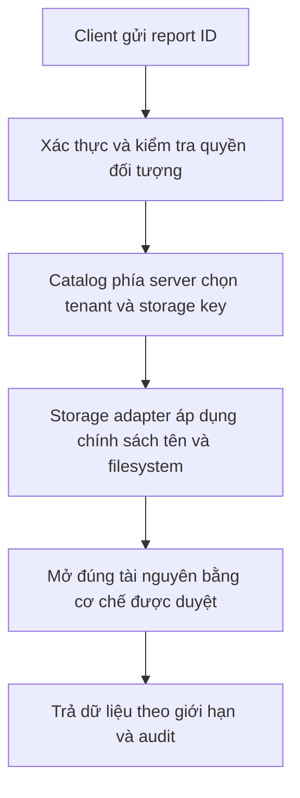

# Path traversal

## 1. Yêu cầu bảo mật cần bảo vệ tài nguyên nào?

Path traversal là việc dữ liệu đầu vào làm thao tác tệp truy cập tới tài nguyên ngoài phạm vi mà chức năng được phép sử dụng. Tác động có thể là đọc dữ liệu, ghi đè, xóa, di chuyển hoặc xử lý một tệp không được cấp quyền.

Điểm cốt lõi không phải chỉ là xuất hiện chuỗi hai dấu chấm. Vấn đề là ai quyết định tài nguyên đích sau khi toàn bộ quá trình giải mã, phân giải đường dẫn và mở tệp hoàn tất.

OWASP mô tả các tình huống traversal qua đường dẫn tương đối, đường dẫn tuyệt đối và những cách biểu diễn khác nhau; xem [OWASP Path Traversal](https://community.owasp.org/attacks/Path_Traversal).

Trong module đặc tả yêu cầu bảo mật, một yêu cầu như “không cho phép ../” chưa đủ. Cần xác định:

- Thao tác nào đang truy cập filesystem.
- Vùng dữ liệu nào được phép dùng cho thao tác đó.
- Người gọi có quyền trên đối tượng nào.
- Đường dẫn được tạo từ nguồn nào.
- Liên kết và thay đổi đồng thời có thể làm đích thực tế khác kết quả kiểm tra không.
- Bằng chứng nào chứng minh tài nguyên ngoài phạm vi không bị đọc, ghi hoặc xóa.

Bài học dùng một dịch vụ báo cáo giả định. Người dùng tải báo cáo bằng mã đối tượng; server ánh xạ mã đó sang tên lưu trữ trong vùng của tenant đã được xác thực. Các đường dẫn, tên tệp và giới hạn trong bài đều phục vụ minh họa.

## 2. Phân biệt traversal với các kiểm soát liên quan

| Vấn đề | Câu hỏi |
| --- | --- |
| Path traversal | Đường dẫn có làm thao tác vượt phạm vi lưu trữ được phép không? |
| Phân quyền đối tượng | Chủ thể có được truy cập báo cáo này không? |
| Link resolution | Tên trong vùng cho phép có trỏ tới tài nguyên khác không? |
| Race condition | Tài nguyên có thay đổi giữa lúc kiểm tra và sử dụng không? |
| Kiểm tra nội dung | Tệp được mở có loại và nội dung được chức năng chấp nhận không? |
| Giới hạn tài nguyên | Kích thước, số tệp hoặc thời gian xử lý có vượt ngân sách không? |

Các kiểm soát này hỗ trợ nhau nhưng không thay thế nhau.

Một đường dẫn nằm trong thư mục gốc không chứng minh người dùng có quyền đọc mọi tệp trong đó. Ngược lại, mã báo cáo hợp lệ về phân quyền không làm một đường dẫn lưu trong metadata tự trở thành an toàn.

Một API dùng object storage cũng vẫn cần phân quyền và kiểm tra namespace. Tuy nhiên, không được tự động áp dụng ngữ nghĩa đường dẫn filesystem cho mọi object key: dịch vụ lưu trữ có contract riêng về key và cách sử dụng.

## 3. Lập bản đồ nguồn dữ liệu và thao tác tệp

Không chỉ endpoint tải tệp có rủi ro. Các nơi cần xác định trong thiết kế gồm:

| Nguồn không tin cậy | Điểm sử dụng | Rủi ro |
| --- | --- | --- |
| Query hoặc path parameter | Mở tệp tải xuống | Đọc ngoài vùng cho phép |
| Filename trong upload | Chọn đích ghi | Ghi đè hoặc ghi sai thư mục |
| Entry name trong archive | Tạo tệp khi giải nén | Thoát staging directory |
| Metadata đã lưu trước đó | Job xử lý nền | Traversal ở lần sử dụng sau |
| Tên template hoặc tài nguyên | Resource loader | Chọn nguồn ngoài hợp đồng |
| Tên tệp xuất báo cáo | Tạo hoặc thay thế output | Ghi sai đích hoặc đè dữ liệu khác |
| Tên do công cụ quản trị gửi | Xóa hoặc di chuyển | Tác động tới tài nguyên vượt quyền |

Với mỗi điểm, phải ghi rõ thao tác là đọc, tạo mới, cập nhật, xóa hay đổi tên. Một yêu cầu “chỉ được đọc trong thư mục” không bao phủ chức năng ghi hoặc cleanup dùng chung cách dựng path.

Sơ đồ cho dịch vụ báo cáo:



Tên hiển thị của tệp là dữ liệu trình bày, không phải vị trí lưu trữ. Client không được thay report ID bằng một path tùy ý rồi kỳ vọng server chỉ thêm tên thư mục phía trước.

## 4. Thiết kế ưu tiên: mã đối tượng thay cho đường dẫn

Một contract phù hợp cho dịch vụ ví dụ:

```http
GET /reports/report-example-042/content
```

Server thực hiện các bước độc lập:

1. Xác định danh tính và tenant từ nguồn có thẩm quyền.
2. Kiểm tra quyền tải report-example-042.
3. Tra catalog để lấy storage key do server quản lý.
4. Kiểm tra storage key theo contract nội bộ.
5. Mở tệp bằng storage adapter tương ứng.
6. Ghi audit theo mã đối tượng, không lộ đường dẫn tuyệt đối.

Đối chiếu với thiết kế nhận nguyên đường dẫn:

```text
download?path=<chuỗi do client chọn>
```

Thiết kế thứ hai đòi hỏi chứng minh nhiều hơn về ngữ nghĩa path và phạm vi sử dụng. Một allowlist mã báo cáo hoặc mapping phía server giúp giảm những phần đường dẫn do người gọi kiểm soát.

Mã khó đoán không thay thế kiểm tra quyền. Nếu người dùng biết report ID của tenant khác, API vẫn phải từ chối theo quyền đối tượng.

Catalog cũng là một ranh giới cần bảo vệ. Nếu một luồng import có thể ghi storage key tùy ý, traversal có thể xuất hiện ở job tải xuống sau đó dù request tải chỉ chứa ID.

## 5. Hiểu đúng normalize, resolve và kiểm tra containment

### 5.1. Đường dẫn là cấu trúc theo filesystem

Các thao tác trên chuỗi không nhất thiết tương đương thao tác trên path.

Ví dụ một vùng cho phép:

```text
/srv/report-store/tenant-a
```

và một vùng khác:

```text
/srv/report-store/tenant-a-backup
```

Chuỗi thứ hai bắt đầu bằng chuỗi thứ nhất, nhưng không nằm trong cây thư mục tenant-a. Do đó, kiểm tra String.startsWith trên tên đường dẫn là không đủ để chứng minh containment.

Trong Java, Path có các thao tác theo thành phần và provider. normalize xử lý thành phần dư thừa mà không truy cập filesystem; resolve có hành vi riêng với path tuyệt đối. Xem [Java SE 17 Path](https://docs.oracle.com/en/java/javase/17/docs/api/java.base/java/nio/file/Path.html).

### 5.2. Normalize không giải quyết symlink

Một kiểm tra lexical thường có dạng khái niệm:

```text
candidate = normalize(resolve(root, relativeInput))
candidate phải thuộc cây root theo thành phần path
```

Điều này có thể phát hiện đường dẫn tương đối thoát root ở mức biểu diễn. Nó không chứng minh target thực tế sau khi filesystem xử lý liên kết vẫn ở trong root.

Ví dụ:

```text
root/
  reports/
  alias -> một thư mục ngoài root
```

Một tên đi qua alias có thể nhìn như nằm dưới root ở mức lexical nhưng được phân giải tới nơi khác.

### 5.3. Real path vẫn có giới hạn thời điểm

Với tệp đã tồn tại, việc lấy real path có thể giúp đánh giá đích sau phân giải liên kết tại thời điểm kiểm tra. Nhưng nếu một chủ thể có thể thay thành phần filesystem trước lúc mở, kết quả kiểm tra và tài nguyên được dùng có thể khác nhau.

Đây là rủi ro time-of-check to time-of-use, được mô tả tại [CWE-367](https://cwe.mitre.org/data/definitions/367.html).

Không viết requirement rằng “toRealPath rồi mở bằng tên là tuyệt đối an toàn” nếu mô hình đe dọa cho phép thay thư mục hoặc liên kết trong khoảng đó.

Với tạo mới, tệp đích chưa tồn tại nên không thể lấy real path của chính tệp theo cùng cách. Cần bảo vệ thư mục cha, cơ chế tạo tệp và quyền sửa cấu trúc thư mục.

## 6. Liên kết, thư mục cha và race condition

### 6.1. Symlink và các dạng liên kết khác

Một tên có thể dẫn tới tài nguyên ngoài dự kiến qua cơ chế liên kết. CWE-59 phân loại rủi ro giải quyết liên kết không đúng trước khi truy cập tệp; xem [CWE-59](https://cwe.mitre.org/data/definitions/59.html).

Requirement cần quyết định:

- Có cho phép symlink trong vùng dữ liệu không.
- Ai được tạo hoặc thay liên kết.
- Cơ chế mở có thể ngăn theo liên kết ở thành phần nào.
- Những thư mục cha nào có thể bị thay đổi.
- Hệ điều hành và filesystem triển khai có cơ chế tương đương nào.

Không giả định NOFOLLOW_LINKS trong một lời gọi bất kỳ tự bảo vệ mọi thành phần cha của một path nhiều cấp. Phạm vi bảo đảm phụ thuộc API và thao tác được dùng.

### 6.2. Directory handle thay cho việc phân giải lại từ đầu

Một hướng thiết kế là mở thư mục được tin cậy rồi thao tác tương đối từ đối tượng đã mở. Java SecureDirectoryStream hỗ trợ các thao tác như vậy khi hệ điều hành và provider cung cấp; xem [Java SE 17 SecureDirectoryStream](https://docs.oracle.com/en/java/javase/17/docs/api/java.base/java/nio/file/SecureDirectoryStream.html).

Nếu provider không hỗ trợ, không được âm thầm đổi sang một chuỗi check-then-open rồi vẫn tuyên bố giữ nguyên bảo đảm chống race. Cần chọn một kiến trúc khác có bằng chứng, chẳng hạn storage broker chuyên dụng hoặc mô hình thư mục mà bên không tin cậy không thể sửa cấu trúc.

### 6.3. Hard link không phải symlink

Ngăn theo symlink không tự loại bỏ mọi tình huống hard link. Nhiều tên có thể tham chiếu cùng một tệp; tên nằm trong root không tự chứng minh nội dung chỉ có một tên trong root.

Trên NTFS, hard link, junction và symbolic link có đặc điểm khác nhau. Microsoft mô tả các cơ chế này tại [Hard Links and Junctions](https://learn.microsoft.com/en-us/windows/win32/fileio/hard-links-and-junctions).

Vì vậy, quyền tạo entry, mount và liên kết là một phần của thiết kế. Một process đọc báo cáo không nên có quyền tùy ý tạo liên kết tới dữ liệu nhạy cảm hoặc sửa cấu trúc kho lưu trữ.

## 7. Khác biệt Windows, Linux và các lớp giải mã

### 7.1. Không dùng bộ lọc của một nền tảng để chứng minh nền tảng khác

Contract về path phải xét môi trường triển khai thực tế. Những nhóm cần xem xét gồm:

| Nhóm | Câu hỏi cần đặc tả |
| --- | --- |
| Dấu phân tách | Có những dạng separator nào được parser và filesystem nhận? |
| Path tuyệt đối | Client có thể thay toàn bộ root hoặc chọn một volume khác không? |
| Drive-relative và namespace đặc biệt | Có cách biểu diễn nào không tuân theo giả định relative thông thường? |
| UNC hoặc network path | Có thể phát sinh truy cập mạng ngoài kho tệp không? |
| Hoa thường và alias | Hai tên khác chuỗi có thể chỉ cùng một tài nguyên không? |
| Tên thiết bị hoặc tên dành riêng | API có thể mở thứ không phải tệp dữ liệu thông thường không? |
| Dấu chấm hoặc khoảng trắng cuối tên | Có lớp nào chuẩn hóa khác lớp khác không? |

Các quy tắc tên, namespace và khác biệt filesystem của Windows được mô tả tại [Microsoft Naming Files, Paths, and Namespaces](https://learn.microsoft.com/en-us/windows/win32/fileio/naming-a-file).

Với NTFS, còn cần xem xét alternate data streams nếu contract cho phép tên có dấu hai chấm; xem [Microsoft File Streams](https://learn.microsoft.com/en-us/windows/win32/fileio/file-streams). Một chính sách chỉ nhìn phần mở rộng không tự kiểm soát được mọi cách chọn stream.

Điều này không có nghĩa mọi dạng đặc biệt đều được Java hoặc mọi API tiếp nhận. Cần kiểm chứng với đúng API, provider, hệ điều hành và filesystem được hỗ trợ.

### 7.2. Giải mã phải có hợp đồng

Một path có thể đi qua URL decoding, parser framework, xử lý archive hoặc một bước biến đổi ứng dụng trước khi tới filesystem.

Ví dụ an toàn để phân tích:

```text
../outside-example.txt
%2e%2e%2foutside-example.txt
```

Nếu một lớp kiểm tra trước giải mã còn lớp sau giải mã rồi mới mở, hai lớp đang đánh giá hai giá trị khác nhau.

Requirement cần nêu:

- Trường nào được giải mã bởi lớp nào.
- Giá trị sau giải mã có được chuyển tiếp nguyên nghĩa không.
- Có bước giải mã lại tại storage adapter hay không.
- Input sai encoding hoặc không thuộc contract bị xử lý thế nào.

Không dùng “decode tới khi không đổi nữa” như một chuẩn hóa tổng quát. Cũng không giả định một chuỗi percent-encoded tự có ngữ nghĩa URL khi được truyền trực tiếp vào mọi filesystem API.

## 8. Ví dụ Java: mở tên lưu trữ phẳng từ thư mục đã neo

Trong dịch vụ ví dụ, storage key không phải tên do client upload. Nó là tên server tạo, gồm 32 ký tự hex viết thường và phần mở rộng bin.

Đoạn code dưới đây minh họa thao tác đọc tương đối từ SecureDirectoryStream đã được mở và kiểm soát. Nó không tự thiết lập thư mục root hoặc kiểm tra quyền đối tượng.

```java
import java.io.IOException;
import java.nio.channels.SeekableByteChannel;
import java.nio.file.LinkOption;
import java.nio.file.OpenOption;
import java.nio.file.Path;
import java.nio.file.SecureDirectoryStream;
import java.nio.file.StandardOpenOption;
import java.util.Objects;
import java.util.Set;
import java.util.regex.Pattern;

public final class StoredReportReader {
    private static final Pattern STORAGE_NAME =
            Pattern.compile("[a-f0-9]{32}\\.bin");

    private StoredReportReader() {
    }

    public static SeekableByteChannel openReadOnly(
            SecureDirectoryStream<Path> trustedTenantDirectory,
            String authorizedStorageName
    ) throws IOException {
        Objects.requireNonNull(
                trustedTenantDirectory, "trustedTenantDirectory"
        );

        if (authorizedStorageName == null
                || authorizedStorageName.length() != 36
                || !STORAGE_NAME.matcher(
                        authorizedStorageName
                ).matches()) {
            throw new IllegalArgumentException(
                    "STORAGE_NAME_INVALID"
            );
        }

        Path leaf = Path.of(authorizedStorageName);

        Set<OpenOption> options = Set.of(
                StandardOpenOption.READ,
                LinkOption.NOFOLLOW_LINKS
        );

        return trustedTenantDirectory.newByteChannel(
                leaf, options
        );
    }
}
```

### Các giả định phải được giữ

- Bước trước đã xác thực và kiểm tra quyền đối tượng.
- authorizedStorageName lấy từ catalog phía server và vẫn được kiểm tra tại adapter.
- trustedTenantDirectory trỏ đúng vùng tenant và được mở từ cấu hình có thẩm quyền.
- Ví dụ sử dụng default filesystem; Path tạo ra phải tương thích provider của stream.
- Thư mục và nội dung chỉ do storage service được phép quản lý.
- Không có actor không tin cậy được tạo hard link, tệp đặc biệt hoặc thay thế cấu trúc kho.
- Provider hỗ trợ cơ chế mở được yêu cầu; lỗi không dẫn tới fallback kém bảo đảm.
- Caller đóng channel sau khi sử dụng và giới hạn lượng dữ liệu được trả.

Tên phẳng giúp loại bỏ thành phần thư mục trung gian từ storage key. NOFOLLOW_LINKS tại thao tác mở này nhằm từ chối một symbolic link ở tên đích, không phải một chứng minh tổng quát rằng mọi kiểu liên kết hoặc mọi tệp trong root đều được cấp quyền.

Đoạn code không xác minh file type sau khi mở và không ngăn một actor có quyền quản trị kho thay tệp bằng hard link hoặc một loại tài nguyên khác. Những rủi ro đó phải được loại trừ hoặc xử lý bằng cơ chế filesystem và quyền vận hành đã nêu; không được triển khai code riêng lẻ rồi bỏ qua các giả định.

### Vì sao không dùng filename upload?

Tên upload phục vụ hiển thị có thể chứa khoảng trắng, Unicode hoặc chuỗi trông như đường dẫn. Nó không cần quyết định storage location.

OWASP khuyến nghị quản lý tên lưu trữ và vị trí tệp, kết hợp quyền filesystem cùng giới hạn upload; xem [File Upload Cheat Sheet](https://cheatsheetseries.owasp.org/cheatsheets/File_Upload_Cheat_Sheet.html).

Một tên hiển thị hợp lệ không tự trở thành path hợp lệ. Khi đưa tên vào Content-Disposition hoặc HTML, còn phải xử lý theo ngữ cảnh đầu ra tương ứng.

## 9. Tạo mới, ghi đè, đổi tên và xóa cần requirement riêng

### 9.1. Tạo mới

Nếu use case chỉ cho tạo tệp mới, phải dùng cơ chế tạo thất bại khi tên đã tồn tại thay vì kiểm tra tồn tại rồi ghi bằng một thao tác khác.

Trong Java, CREATE_NEW có ngữ nghĩa kiểm tra và tạo nguyên tử đối với tên đích theo contract của API; xem [Java SE 17 Files.newByteChannel](https://docs.oracle.com/en/java/javase/17/docs/api/java.base/java/nio/file/Files.html).

Cơ chế này không tự bảo vệ thư mục cha chưa được kiểm soát, không cấp quyền người dùng và không giới hạn dung lượng. Nó là một phần của hợp đồng thao tác ghi, không phải giải pháp traversal độc lập.

### 9.2. Ghi đè hoặc thay thế

Nếu nghiệp vụ cho thay báo cáo, cần xác định:

- Đối tượng và phiên bản nào được phép thay.
- Việc thay thế có thể theo link hay không.
- Quyền tạo tên mới và thay tên cũ thuộc actor nào.
- Có cần publish nguyên tử hay chấp nhận trạng thái trung gian.
- Lỗi giữa chừng giữ lại phiên bản nào.

Không dùng TRUNCATE_EXISTING hoặc một thao tác thay thế rộng chỉ vì client gửi lại cùng filename.

### 9.3. Xóa và cleanup

Lệnh xóa cũng phải dựa trên đối tượng đã được cấp quyền hoặc staging do chính job tạo. Không để chuỗi lỗi, archive entry hoặc tên client trở thành root cho cleanup đệ quy.

Một kiểm soát tải xuống an toàn không bảo vệ được hệ thống nếu nhánh lỗi sau đó xóa một thư mục được dựng từ cùng input chưa tin cậy.

Bằng chứng của use case ghi/xóa cần kiểm tra cả việc không thay đổi tệp nằm ngoài vùng, không chỉ kiểm tra response có báo lỗi hay không.

## 10. Path traversal trong giải nén archive

Tên entry của ZIP hoặc định dạng archive khác là dữ liệu không tin cậy. Một entry có thể yêu cầu vị trí ngoài thư mục giải nén, trùng đích với entry khác hoặc biểu diễn liên kết tùy định dạng và thư viện.

Đặc tả giải nén của hệ thống ví dụ chọn:

1. Tạo staging mới trong vùng riêng do service quản lý.
2. Không cho bên ngoài sửa thư mục staging và các thành phần cha.
3. Giới hạn số entry, độ sâu, độ dài tên và tổng dữ liệu sau giải nén.
4. Từ chối entry tuyệt đối, entry thoát root và dạng tên ngoài contract.
5. Từ chối symlink, hard link hoặc entry đặc biệt nếu định dạng có thể biểu diễn chúng.
6. Không tự sửa entry nguy hiểm thành tên khác rồi tiếp tục mà không có contract rõ ràng.
7. Không ghi đè một entry đã được tạo trước đó.
8. Xử lý collision theo semantics của filesystem đích, kể cả khác biệt hoa thường hoặc alias được hỗ trợ.
9. Theo dõi lượng byte thực tế được giải nén, không chỉ tin kích thước khai báo.
10. Chỉ publish kết quả khi toàn bộ điều kiện đạt; khi lỗi chỉ cleanup staging thuộc job đó.

Nếu cho phép thư mục con, phải bảo vệ từng bước tạo và mở bên dưới root. Kiểm tra một lần bằng normalize rồi mở bằng path không đủ khi một entry trước đó có thể tạo liên kết mà entry sau đi qua.

Một archive không có traversal vẫn có thể tạo tải lớn. Ngược lại, giới hạn tổng kích thước không chứng minh các tệp được ghi đúng vùng. Hai nhóm yêu cầu phải có bằng chứng riêng.

Không chạy giải nén với quyền có thể ghi mã ứng dụng, cấu hình hoặc vùng dữ liệu của tenant khác.

## 11. Bộ yêu cầu bảo mật có thể giao triển khai

| ID | Yêu cầu của dịch vụ báo cáo | Owner | Bằng chứng dự kiến |
| --- | --- | --- | --- |
| PT-01 | Endpoint nhận report ID, không nhận path filesystem tùy ý | API team | Contract và request ngoài grammar |
| PT-02 | Mỗi thao tác kiểm tra quyền trên report và tenant trước truy cập | Authorization team | Report khác tenant bị từ chối |
| PT-03 | Storage key do server quản lý và được kiểm tra tại adapter | Storage team | Metadata lỗi không dẫn tới mở path tùy ý |
| PT-04 | Root lưu trữ lấy từ cấu hình có thẩm quyền | Platform team | Không có nguồn request thay root |
| PT-05 | Cơ chế mở bảo vệ chính sách link và race của use case | Storage và platform team | Ca symlink, thay tên và provider thực tế |
| PT-06 | Tạo mới không ghi đè; thay thế có contract riêng | Storage team | Tên đã tồn tại không bị thay ngoài ý muốn |
| PT-07 | Đường đi giải mã và chuẩn hóa được xác định thống nhất | API và integration team | Dạng encoded không đổi nghĩa ở lớp sau |
| PT-08 | Giải nén giữ mọi thao tác trong staging được kiểm soát | Import team | Entry bất thường không tạo tệp ngoài vùng |
| PT-09 | Process có quyền filesystem tối thiểu | Platform team | Quyền đọc, ghi và mount theo vai trò |
| PT-10 | Lỗi không lộ root tuyệt đối hoặc nội dung tệp ngoài phạm vi | API và observability team | Response, log và tracing đã lọc |
| PT-11 | Các thao tác ghi, xóa, rename và cleanup dùng cùng ranh giới | Service owner | Ca lỗi không làm đổi tệp ngoài vùng |
| PT-12 | Có ngân sách kích thước, số lượng và thời gian xử lý | Platform và domain team | Các ca vượt giới hạn bị chặn có kiểm soát |

Không đóng PT-05 chỉ bằng một unit test chuỗi ../. Requirement đó phụ thuộc quyền thư mục, API mở tệp và filesystem triển khai.

Cũng không đóng PT-02 chỉ vì storage key không có separator. Hai tệp hợp lệ trong cùng root vẫn có thể thuộc hai chủ thể khác nhau.

## 12. Ví dụ đặc tả hoàn chỉnh cho tải báo cáo

```yaml
id: PT-DOWNLOAD-01
title: Chỉ mở báo cáo đã được cấp quyền trong kho tenant
scope: API tải nội dung báo cáo
untrustedInput:
  name: reportId
  meaning: Mã đối tượng, không phải filesystem path
trustedMapping:
  source: Catalog phía server
  fields:
    - tenant
    - storageName
    - objectVersion
requiredBehavior:
  - Kiểm tra quyền trên report và tenant
  - Kiểm tra storageName theo grammar của kho
  - Mở từ thư mục tenant đã được xác định có thẩm quyền
  - Không theo symbolic link tại tên đích theo cơ chế được duyệt
  - Không fallback sang mở path trực tiếp khi cơ chế không hỗ trợ
  - Giới hạn dữ liệu trả và đóng tài nguyên sau sử dụng
  - Không lộ đường dẫn tuyệt đối trong lỗi
environmentInvariants:
  - Actor không tin cậy không được sửa cấu trúc kho
  - Chính sách hard link và tệp đặc biệt được thực thi
evidence:
  - Đúng report được trả cho người có quyền
  - Report khác tenant bị từ chối
  - Metadata lỗi không mở tài nguyên ngoài kho
  - Các ca liên kết và cạnh tranh không vượt ranh giới cam kết
owner: Storage team và authorization team
```

Đoạn YAML là nội dung requirement minh họa. Nó không tự cung cấp một sandbox hoặc cấu hình filesystem.

Điều kiện nghiệm thu phải giữ đúng phạm vi cam kết. Nếu một cơ chế chỉ bảo vệ khi người dùng không có quyền sửa thư mục, giả định đó phải hiện diện trong requirement và có bằng chứng vận hành.

## 13. Thiết kế tiêu chí kiểm chứng

Tạo môi trường thử nghiệm với root riêng, một tệp hợp lệ trong root và một tệp sentinel vô hại ngoài root. Sentinel giúp quan sát việc đọc hoặc thay đổi ngoài phạm vi mà không dùng dữ liệu thật.

| Mã | Tình huống | Kết quả yêu cầu | Bằng chứng |
| --- | --- | --- | --- |
| V-01 | Report hợp lệ và chủ thể có quyền | Trả đúng phiên bản theo contract | Nội dung hoặc digest thử nghiệm |
| V-02 | Report tồn tại nhưng thuộc tenant khác | Từ chối | Không mở file ngoài quyền |
| V-03 | Input trông như path tương đối | Không được dùng làm storage path | Quyết định tại API và adapter |
| V-04 | Input path tuyệt đối hoặc namespace ngoài contract | Từ chối trước thao tác tệp | Không có truy cập ngoài kho |
| V-05 | Dạng encoded và double-encoded | Không có thay đổi nghĩa ở lớp sau | Giá trị qua từng bước giải mã đã khai báo |
| V-06 | Path có tiền tố chuỗi giống root nhưng khác thành phần | Không được chấp nhận bởi kiểm tra chuỗi đơn thuần | Kết quả containment |
| V-07 | Tên đích là symlink tới sentinel | Không đọc sentinel | Kết quả mở và dấu vết đọc |
| V-08 | Một thành phần cha có thể bị thay đổi | Không vượt bảo đảm race đã cam kết | Ca cạnh tranh trong môi trường cô lập |
| V-09 | Provider không hỗ trợ cơ chế mở yêu cầu | Từ chối hoặc dùng giải pháp đã được phê duyệt | Không có fallback âm thầm |
| V-10 | Tên tạo mới đã tồn tại | Không bị ghi đè | Nội dung tệp trước và sau |
| V-11 | Archive entry thoát staging hoặc là liên kết bị cấm | Giải nén thất bại theo contract | Không có tệp ngoài staging |
| V-12 | Hai archive entry collision trên filesystem đích | Không thay thế dữ liệu ngoài policy | Danh sách đích thực tế |
| V-13 | Lỗi giữa lúc ghi hoặc giải nén | Chỉ cleanup vùng job sở hữu | Sentinel và dữ liệu lân cận nguyên vẹn |
| V-14 | Metadata lưu trước chứa storage key sai | Bị adapter chặn khi dùng | Không truy cập ngoài root |
| V-15 | Input quá dài, sai encoding hoặc có NUL | Lỗi có kiểm soát | Không làm crash hoặc lộ stack trace |
| V-16 | Mỗi hệ điều hành/filesystem được hỗ trợ | Hành vi đúng contract tại nền tảng đó | Kết quả theo môi trường |

Không khẳng định một payload thành công trên mọi nền tảng. Một số input bị framework từ chối trước filesystem; ca đó chỉ chứng minh lớp tiếp nhận đã chặn input tương ứng.

Với kiểm tra ghi và xóa, chỉ nhìn response là chưa đủ. Phải đối chiếu trạng thái tệp ngoài vùng trước và sau, kể cả nhánh cleanup khi exception xảy ra.

Với race, một lần không tái hiện không chứng minh không có race. Bằng chứng nên gồm thiết kế cơ chế mở và quyền filesystem, bên cạnh các ca thử có cạnh tranh.

Bảng trên là kế hoạch kiểm chứng của bài học, không phải báo cáo đã chạy kiểm thử trên một deployment cụ thể.

## 14. Quyền tối thiểu, logging và phục hồi

Service đọc báo cáo nên được cấp quyền đọc đúng kho cần thiết. Credential, cấu hình ứng dụng và tệp thực thi cần được tách khỏi vùng người dùng có thể tạo hoặc thay đổi.

Container hoặc một root riêng không tự chứng minh không còn traversal. Cần xem các mount, quyền process và tài nguyên mà process thực sự có thể tiếp cận.

Audit có thể lưu:

```json
{
  "event": "storage_access",
  "request_id": "path-example-064",
  "object_id": "report-example-042",
  "operation": "read",
  "outcome": "denied",
  "reason": "invalid_storage_key",
  "policy_version": "storage-policy-example-4"
}
```

Không cần trả đường dẫn tuyệt đối cho client để họ hiểu rằng yêu cầu không được phép. Không ghi nguyên dữ liệu bí mật đã đọc nhầm vào log trong quá trình xử lý lỗi.

Khi phát hiện một sink có thể traversal:

1. Xác định các thao tác đọc, ghi, xóa và cleanup dùng sink đó.
2. Chặn hoặc giới hạn đường vào trong phạm vi cần thiết.
3. Đánh giá dữ liệu đã bị đọc, tệp có thể đã bị thay và quyền process.
4. Sửa cơ chế mapping, mở tệp và quyền thư mục theo đúng nguyên nhân.
5. Nếu có ghi ngoài vùng, đối chiếu tính toàn vẹn và phục hồi theo nguồn đáng tin cậy.
6. Xử lý credential bị ảnh hưởng khi có rủi ro chúng đã bị đọc hoặc thay.
7. Kiểm chứng lại các đường xử lý nền và nhánh lỗi liên quan.

Thay một regex mà không kiểm tra symlink, metadata và cleanup có thể để lại những đường truy cập cùng bản chất.

## 15. Những kết luận cần tránh

| Kết luận | Điểm còn thiếu |
| --- | --- |
| “Chặn ../ là đủ” | Đường tuyệt đối, giải mã, link và semantics nền tảng |
| “normalize rồi thì chắc chắn trong root” | Normalize không phân giải filesystem |
| “startsWith chuỗi root là containment” | Tiền tố văn bản không phải quan hệ thư mục |
| “toRealPath rồi mở sau là không thể race” | Cấu trúc có thể thay giữa kiểm tra và sử dụng |
| “NOFOLLOW_LINKS chặn mọi kiểu liên kết” | Phạm vi API, thành phần cha và hard link khác nhau |
| “Mã tệp ngẫu nhiên thay kiểm tra quyền” | Người dùng vẫn có thể biết mã đối tượng khác |
| “Filename có đuôi pdf thì chỉ là tệp dữ liệu” | Tên không chứng minh vị trí, loại và nội dung tài nguyên |
| “Archive không quá lớn thì giải nén an toàn” | Tên entry và liên kết vẫn có thể thoát vùng |
| “Chạy trong container thì không cần kiểm tra path” | Mount và quyền process vẫn quyết định tác động |
| “Lỗi tải đã bị chặn nên cleanup chắc an toàn” | Cleanup là thao tác độc lập cần ranh giới riêng |

Một yêu cầu chống path traversal hoàn chỉnh gắn mã đối tượng, quyền truy cập, mapping lưu trữ, ngữ nghĩa filesystem và thao tác mở thực tế vào cùng một hợp đồng. Thành công được chứng minh bằng việc tài nguyên ngoài phạm vi không bị tác động, không chỉ bằng việc một chuỗi đầu vào đáng ngờ bị từ chối.
