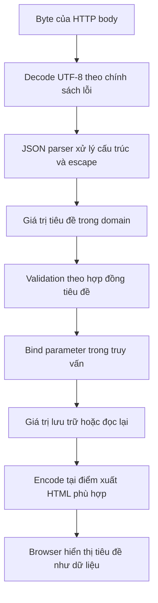

# Input encoding và injection

## 1. Encoding tác động đến cách hệ thống hiểu dữ liệu

Injection xảy ra khi dữ liệu ngoài biên tin cậy được một thành phần diễn giải thành chỉ thị hoặc cấu trúc ngoài ý muốn. Encoding liên quan trực tiếp đến rủi ro này vì một giá trị có thể đi qua nhiều dạng biểu diễn trước khi tới nơi được sử dụng.

Ví dụ, một tên có dấu nháy đơn có thể được gửi trong JSON, lưu trong database rồi hiển thị trên HTML. Cùng giá trị nghiệp vụ đó đi qua các parser và serializer khác nhau. Mỗi lớp phải hiểu đúng vai trò của dữ liệu; không có một phép “encode input” duy nhất làm dữ liệu an toàn cho tất cả các lớp.

Trong thiết kế security requirements, cần trả lời ba câu hỏi tách biệt:

1. Dữ liệu được decode và parse theo hợp đồng nào?
2. Giá trị sau các bước đó có hợp lệ với nghiệp vụ không?
3. Khi giá trị đi vào SQL, HTML, URL hoặc một interpreter khác, cơ chế nào giữ nó ở vai trò dữ liệu?

Một chuỗi UTF-8 hợp lệ vẫn có thể bị nối vào SQL sai cách. Một chuỗi được HTML-encode vẫn không trở thành tên cột truy vấn được phép. Một giá trị đã URL-encode cũng không tự có quyền truy cập tài nguyên mà nó chỉ tới.

Mục tiêu của bài học là mô tả đúng quan hệ giữa input encoding và injection, từ đó viết yêu cầu bảo mật có vị trí thực thi và bằng chứng rõ ràng.

## 2. Phân biệt các hoạt động thường bị gọi chung là “encode input”

| Hoạt động | Mục đích | Ví dụ | Không chứng minh điều gì? |
| --- | --- | --- | --- |
| Decode character encoding | Chuyển byte thành ký tự theo charset | UTF-8 thành String | Không chứng minh giá trị hợp lệ về nghiệp vụ |
| Decode escape của giao thức | Diễn giải biểu diễn trong một cấu trúc | JSON escape hoặc percent-encoding ở thành phần URL | Không cấp quyền hoặc làm dữ liệu an toàn cho mọi sink |
| Unicode normalization | Chọn biểu diễn theo chính sách của field | NFC cho tên hiển thị | Không thay thế bind parameter hoặc output encoding |
| Input validation | Xác định giá trị thuộc miền được chấp nhận | Số lượng 1..1.000, lựa chọn trong enum | Không tự bảo vệ mọi interpreter phía sau |
| Contextual encoding hoặc escaping | Biểu diễn dữ liệu trong ngữ cảnh đích | Xuất text trong HTML | Không có cùng hiệu lực ở một ngữ cảnh khác |
| Parameterization | Tách dữ liệu khỏi cấu trúc lệnh | Bind giá trị trong prepared statement | Không cho phép cấu trúc SQL tùy ý hoặc bỏ qua authorization |
| Sanitization theo định dạng | Loại hoặc điều chỉnh các cấu trúc không được phép trong nội dung chủ động | Một chính sách HTML rich text | Không biến nội dung thành an toàn cho mọi loại interpreter |

Base64 và percent-encoding là các cách biểu diễn, không phải mã hóa bí mật hay chứng minh dữ liệu đáng tin cậy. Một payload sau khi decode vẫn cần hợp đồng tương ứng với loại dữ liệu và mục đích sử dụng.

Không nên đặt tên một hàm là `makeSafe()` mà không nói rõ an toàn cho ngữ cảnh nào. Tên như vậy dễ khiến lớp tiếp theo dùng kết quả ở một sink khác và suy ra bảo đảm chưa từng được thực thi.

## 3. Theo dõi một giá trị qua nhiều lớp

Giả sử API nhận tiêu đề ghi chú có giá trị nghiệp vụ:

```text
O'Connor & Sons
```

Luồng xử lý mong muốn có thể là:



Không cần thay dấu nháy đơn bằng một chuỗi HTML trước khi truy vấn. Cũng không cần tự URL-decode tiêu đề ở repository nếu JSON adapter đã tạo giá trị nghiệp vụ đúng.

Ở mỗi mũi tên cần xác định dữ liệu có thay đổi biểu diễn hay thay đổi ý nghĩa không. Nếu thành phần kiểm tra nhìn một giá trị nhưng thành phần sử dụng nhìn giá trị khác sau decode hoặc normalization, kiểm tra ban đầu có thể không bảo vệ đúng thao tác cuối.

Giá trị lưu trữ thường là giá trị nghiệp vụ sau các bước chuyển đổi mà hợp đồng đã chọn, không nhất thiết là byte HTTP gốc. Việc giữ byte nguồn phục vụ chữ ký hoặc điều tra là một nhu cầu khác, có chính sách dữ liệu riêng.

## 4. Những lỗi thiết kế ở đầu vào có thể hỗ trợ injection

### 4.1. Kiểm tra trước decode rồi sử dụng sau decode

Một gateway có thể kiểm tra chuỗi mã hóa, trong khi backend kiểm tra hoặc dùng chuỗi đã decode. Nếu hợp đồng không thống nhất, hai thành phần có thể đánh giá khác nhau về ký tự và cấu trúc thực sự được xử lý.

Yêu cầu cần chỉ rõ lớp nào decode từng phần của giao thức. Validation nghiệp vụ phải dựa trên biểu diễn mà nghiệp vụ sử dụng. Các giới hạn kích thước và chi phí vẫn phải được áp dụng từ những bước sớm, trước khi tài nguyên bị tiêu thụ quá mức.

### 4.2. Decode lặp không có hợp đồng

Chuỗi `%25` có thể biểu diễn ký tự `%` trong percent-encoding. Nếu hệ thống tiếp tục decode mọi chuỗi còn có dấu `%`, một lượt sau có thể tạo ra giá trị khác với lượt trước.

Không nên đặt quy tắc “decode đến khi không đổi nữa” cho dữ liệu tổng quát. Mỗi lớp biểu diễn phải được xử lý theo giao thức xác định, bởi thành phần có trách nhiệm. Nếu dữ liệu nghiệp vụ thật sự là một chuỗi chứa `%20`, không được tự biến nó thành dấu cách chỉ vì trông giống escape.

Một luồng có thể có nhiều bước decode hợp lệ, ví dụ decode body UTF-8 rồi parse JSON. Điều bị cấm là diễn giải lặp cùng một lớp ngoài hợp đồng, không phải cấm mọi luồng có hơn một phép chuyển đổi.

### 4.3. Dùng decoder sai ngữ cảnh

Một hàm decode form có thể xử lý `+` như dấu cách theo quy tắc form. Điều đó không làm nó trở thành decoder đúng cho mọi path, query component hoặc URL hoàn chỉnh.

Tương tự, HTML entity decoding không phải bước mặc định để chuẩn hóa mọi field API. Nếu field được định nghĩa là plain text, chuỗi `&#39;` có thể chỉ là văn bản mà người dùng muốn lưu. Decode thêm sẽ làm thay đổi giá trị nghiệp vụ.

### 4.4. Byte lỗi bị âm thầm thay thế

Nếu decoder thay byte không hợp lệ bằng ký tự khác, dữ liệu được kiểm tra có thể không còn bảo toàn ý nghĩa của nguồn. Các thành phần khác dùng chính sách decode khác có thể tạo ra giá trị khác nữa.

Với đường vào yêu cầu bảo toàn, hợp đồng cần quy định charset, lỗi byte không hợp lệ và chính sách không đoán fallback tùy ý. Kiểm tra encoding phải diễn ra khi còn có byte nguồn; encode lại một String đã bị sửa không khôi phục được bằng chứng đó.

### 4.5. Chuẩn hóa sau khi đã kiểm tra

Một field có thể được kiểm tra bằng biểu diễn ban đầu nhưng được lưu hoặc dùng sau một bước đổi hoa thường, trim hoặc Unicode normalization. Khi phép biến đổi ảnh hưởng định danh hoặc miền giá trị, cần kiểm tra biểu diễn phù hợp sau biến đổi.

Normalization phải theo từng field. Không tự áp dụng lên token, dữ liệu được ký hoặc dữ liệu mà giao thức yêu cầu bảo toàn. Với chữ ký, thứ tự xác minh và canonicalization phải tuân theo chính giao thức, không được suy từ một quy tắc input chung.

## 5. Vì sao encode ngay khi nhận input thường là hợp đồng sai?

### 5.1. Dữ liệu có nhiều điểm sử dụng

Một tên khách hàng có thể dùng trong truy vấn, email text, trang HTML và file CSV. HTML-encode tên ngay khi nhận không bảo vệ các ngữ cảnh còn lại và có thể làm dữ liệu lưu trữ phụ thuộc vào một cách trình bày.

Ví dụ, lưu `O&#39;Connor` thay vì giá trị tên ban đầu có thể khiến một API text trả entity ra cho người dùng. Một tầng hiển thị khác encode thêm có thể tạo ra biểu diễn lặp. Sau đó, một lập trình viên có thể decode để “sửa hiển thị” và vô tình thay đổi ranh giới an toàn ở nơi khác.

Đặc tả nên giữ giá trị nghiệp vụ theo chính sách lưu trữ đã chọn và áp dụng cơ chế bảo vệ tại điểm sử dụng. Nếu hệ thống lưu một artifact đã được serialize hoặc sanitize, cần ghi rõ loại artifact, provenance và ngữ cảnh được phép dùng, thay vì gọi nó là một String an toàn chung.

### 5.2. Encode sai ngữ cảnh không giữ được ranh giới cú pháp

HTML text encoding không tương đương với encoding cho JavaScript string. Percent-encoding một giá trị không tương đương với bind parameter cho SQL. Thay một dấu nháy bằng escape tự viết cũng không giải quyết được mọi chế độ parser hay cấu trúc lệnh.

Điều cần bảo vệ là ngữ pháp của thành phần đích. Cơ chế ưu tiên thường là API tách dữ liệu khỏi cấu trúc, hoặc serializer và encoder chuyên biệt cho ngữ cảnh mà dữ liệu thực sự đi vào.

### 5.3. Nhiều lớp cần nhiều cơ chế có thứ tự rõ

Nếu một giá trị nằm trong một URL được đặt trong thuộc tính HTML, có ít nhất hai ngữ cảnh: cấu trúc URL và cú pháp thuộc tính HTML. Cần tạo URL bằng cơ chế hiểu thành phần, kiểm tra chính sách scheme và đích nếu liên quan, rồi serialize nó vào thuộc tính bằng cách phù hợp.

Điều đó khác với việc HTML-encode dữ liệu hai lần. Một thiết kế đúng có thể cần nhiều lớp serialization, nhưng mỗi lớp phải gắn với một cấu trúc cụ thể và thứ tự đã xác định.

Nếu dữ liệu sẽ được nhúng vào vùng script, việc chỉ serialize thành JSON chưa tự bảo đảm an toàn khi đặt nguyên văn vào HTML. Nên dùng cơ chế truyền dữ liệu và binding được framework thiết kế cho trường hợp đó, hoặc một kênh dữ liệu riêng với chính sách phù hợp.

## 6. Chọn kiểm soát theo điểm sử dụng

| Điểm sử dụng | Cách giữ dữ liệu đúng vai trò | Yêu cầu còn lại |
| --- | --- | --- |
| Giá trị trong SQL | Bind parameter qua API truy vấn phù hợp | Quyền, scope tenant, giới hạn dữ liệu và logic nghiệp vụ |
| Tên cột hoặc chiều sắp xếp | Ánh xạ lựa chọn trong tập được phép sang cấu trúc do server định nghĩa | Không coi placeholder giá trị là placeholder tên cột |
| HTML text hoặc thuộc tính | Encoder hoặc binding theo ngữ cảnh | Chính sách nội dung chủ động, URL và các vị trí đặc biệt |
| DOM text | API gán dữ liệu như text | Không chuyển dữ liệu thành HTML hoặc script ở bước sau |
| URL component | Builder hoặc serializer theo thành phần URL | Scheme, đích, scope và số lần decode theo giao thức |
| Template engine | Source được kiểm soát, dữ liệu truyền qua model | Quyền engine, loader, giới hạn và đầu ra |
| Lệnh hệ điều hành | Tránh shell khi không cần; dùng chương trình và argument có hợp đồng | Argument injection, quyền tiến trình và tài nguyên vẫn phải kiểm soát |
| Log | Ghi field có cấu trúc, giới hạn và xử lý dữ liệu điều khiển phù hợp | Bí mật, dữ liệu cá nhân, retention và log volume |
| File CSV được mở bằng spreadsheet | Serializer đúng và chính sách với dữ liệu có thể thành công thức | Quy tắc theo công cụ nhận, không chỉ CSV quoting |

Không có một hàm chung điền vào mọi hàng trong bảng. Mỗi điểm sử dụng có parser, quy tắc và quyền khác nhau.

Với DOM, ví dụ gán text bằng một API như `textContent` giữ chuỗi ở vai trò text tại thao tác đó. Nếu sau đó một thành phần lại lấy chuỗi và gán vào một API parse HTML, cần đánh giá bước mới riêng.

Với tiến trình hệ điều hành, tách argument khỏi shell giúp tránh một lớp diễn giải, nhưng một argument bắt đầu bằng tùy chọn vẫn có thể ảnh hưởng hành vi của chương trình đích. Yêu cầu phải mô tả đúng chương trình, lựa chọn được phép và quyền thực thi.

## 7. Minh họa Java: giữ tiêu đề là dữ liệu trong truy vấn

Giả sử API tìm ghi chú theo tiêu đề chính xác. Hợp đồng quy định tiêu đề là plain text, được giữ nguyên giá trị sau parse, có từ 1 đến 200 Unicode code point và đã được kiểm tra tính hợp lệ Unicode tại boundary.

Repository không thực hiện thêm URL decode, HTML decode hoặc normalization. Giá trị tiêu đề được bind vào một câu truy vấn có cấu trúc cố định.

```java
import java.sql.Connection;
import java.sql.PreparedStatement;
import java.sql.ResultSet;
import java.sql.SQLException;
import java.util.ArrayList;
import java.util.List;

public final class NoteRepository {
    private static final String FIND_BY_EXACT_TITLE = """
            SELECT id, title
            FROM note
            WHERE tenant_id = ? AND title = ?
            ORDER BY created_at DESC
            """;

    public List<NoteSummary> findByExactTitle(
            Connection connection,
            long authorizedTenantId,
            String title) throws SQLException {

        requireTitle(title);

        try (PreparedStatement statement =
                     connection.prepareStatement(FIND_BY_EXACT_TITLE)) {
            statement.setLong(1, authorizedTenantId);
            statement.setString(2, title);

            try (ResultSet rows = statement.executeQuery()) {
                List<NoteSummary> result = new ArrayList<>();
                while (rows.next()) {
                    result.add(new NoteSummary(
                            rows.getLong("id"),
                            rows.getString("title")));
                }
                return List.copyOf(result);
            }
        }
    }

    private static void requireTitle(String title) {
        if (title == null || title.length() > 400) {
            throw new IllegalArgumentException("INVALID_TITLE");
        }

        int codePoints = title.codePointCount(0, title.length());
        if (codePoints < 1 || codePoints > 200) {
            throw new IllegalArgumentException("INVALID_TITLE");
        }
    }

    public record NoteSummary(long id, String title) {
    }
}
```

Các bảo đảm và giới hạn của ví dụ cần được hiểu chính xác:

- `setString()` truyền tiêu đề như giá trị, không ghép tiêu đề vào cấu trúc SQL.
- Dấu nháy đơn trong tên hợp lệ không cần bị loại khỏi dữ liệu để bảo vệ truy vấn này.
- Các chuỗi `%27`, `&#39;` hoặc văn bản giống cú pháp được giữ như giá trị mà hợp đồng plain text đã nhận, không bị repository decode thêm.
- Giới hạn 400 UTF-16 code unit là trần sớm tương thích với tối đa 200 code point hợp lệ; kiểm tra surrogate lẻ thuộc boundary đã nêu, không được tự suy ra từ `codePointCount()`.
- `authorizedTenantId` phải đến từ scope có thẩm quyền do application service xác định. Tên tham số không tự chứng minh đã có authorization.
- Ví dụ tập trung vào truyền giá trị truy vấn; một API thực tế còn cần giới hạn số kết quả, thời gian và quyền theo hợp đồng.

Kết quả so sánh tiêu đề còn phụ thuộc collation và chính sách so sánh của database. Nếu sản phẩm cần phân biệt hoa thường hoặc một cách đối chiếu Unicode cụ thể, phải đặc tả và cấu hình riêng. Parameterization bảo vệ ranh giới cấu trúc truy vấn, không tự quyết định ngữ nghĩa đối chiếu.

### 7.1. Trường hợp tìm kiếm có wildcard

Nếu chuyển từ so sánh bằng sang `LIKE`, ký tự wildcard trong giá trị có thể thay đổi kết quả tìm kiếm theo ngữ nghĩa của toán tử. Bind parameter vẫn giữ dữ liệu khỏi cấu trúc SQL, nhưng không tự biến wildcard thành ký tự literal.

Yêu cầu cần xác định người dùng được tìm theo mẫu hay theo văn bản literal. Nếu cần literal, cách xử lý wildcard và escape phải theo dialect, toán tử và cấu hình thực tế. Không đánh đồng “người dùng làm rộng kết quả tìm kiếm” với “đã thoát khỏi cấu trúc câu truy vấn”.

### 7.2. Cấu trúc truy vấn động

Không dùng `ORDER BY ?` rồi coi giá trị bind là tên cột động được kiểm soát. Nếu API hỗ trợ `sortBy`, ứng dụng phải ánh xạ các lựa chọn đã công bố như `createdAt` hoặc `title` sang những biểu thức SQL cố định.

Giá trị dữ liệu và lựa chọn cấu trúc là hai hợp đồng khác nhau. Một đoạn SQL chỉ được đưa vào truy vấn khi nó đến từ cấu trúc do code hoặc một cơ chế xây truy vấn đáng tin kiểm soát, không phải từ chuỗi request chưa được giới hạn.

## 8. Lưu trữ không làm mất nguồn gốc không tin cậy

Một giá trị đi qua validation và được lưu có thể được sử dụng trong ngữ cảnh khác sau này. Nếu một job nối tiêu đề đã lưu vào truy vấn hoặc compile nội dung đó thành template, rủi ro injection có thể xuất hiện ở lần sử dụng sau.

Vì vậy, không nên đánh dấu một cột text là “safe” chỉ vì nó đã được ghi qua API chính. Bảo đảm của dữ liệu cần được mô tả cụ thể: đúng kiểu, đúng giới hạn, đã normalization theo chính sách nào; an toàn tại sink nào còn phụ thuộc cách dùng.

Các đường import, dữ liệu cũ và công cụ quản trị cũng phải được xem xét. Một lớp hiển thị hoặc repository không nên giả định mọi dữ liệu đọc ra đều đã đi qua đúng pipeline của phiên bản hiện tại.

Điều này không có nghĩa phải decode lại dữ liệu database. Cần giữ giá trị đúng vai trò và áp dụng kiểm soát của ngữ cảnh mới, thay vì tạo thêm một vòng diễn giải ngoài hợp đồng.

## 9. Đặc tả các yêu cầu có thể truy vết

Một bộ yêu cầu cho API tiêu đề có thể viết như sau:

```text
SEC-ENC-INJ-01: HTTP adapter xác định charset và từ chối encoding sai theo hợp đồng.
SEC-ENC-INJ-02: Escape JSON được xử lý bởi parser; lớp nghiệp vụ không decode thêm.
SEC-ENC-INJ-03: Title có hợp đồng plain text, đơn vị độ dài và chính sách Unicode rõ ràng.
SEC-ENC-INJ-04: Không HTML-encode title như một bước lưu dữ liệu nghiệp vụ mặc định.
SEC-ENC-INJ-05: Giá trị title vào SQL qua bind parameter, không nối vào câu lệnh.
SEC-ENC-INJ-06: Mọi lựa chọn cấu trúc truy vấn được ánh xạ từ tập khóa đã công bố.
SEC-ENC-INJ-07: Title đọc lại được xuất theo đúng ngữ cảnh nhận của từng luồng.
SEC-ENC-INJ-08: Không render hoặc parse lại title như chỉ thị trong một job phía sau.
SEC-ENC-INJ-09: Scope tenant và quyền được xác định độc lập với encoding của title.
SEC-ENC-INJ-10: Lỗi decode, validation hoặc truy vấn không tiết lộ dữ liệu nội bộ.
SEC-ENC-INJ-11: Giới hạn tài nguyên được thực thi ở từng bước đọc, parse và sử dụng.
SEC-ENC-INJ-12: Các đường HTTP, import và consumer giữ cùng bảo đảm khi dùng title.
```

Mỗi yêu cầu nên có chủ sở hữu và bằng chứng phù hợp. HTTP adapter bảo vệ charset và parser; domain bảo vệ miền giá trị; repository bảo vệ truyền tham số; renderer bảo vệ đầu ra; application service bảo vệ quyền và scope.

Nếu chỉ ghi “input phải được encode trước khi xử lý”, các trách nhiệm này bị gộp lại và không thể xác minh hệ thống đã bảo vệ đúng interpreter nào.

## 10. Thiết kế tiêu chí kiểm thử

Phần này mô tả bằng chứng cần có cho yêu cầu, không phải một vòng thực thi QA nội dung hoặc chạy bộ kiểm thử của dự án.

### 10.1. Kiểm thử đúng lớp biểu diễn

| Tình huống | Thuộc tính cần xác minh |
| --- | --- |
| Tên có dấu, dấu nháy đơn và `&` hợp lệ | Giữ giá trị nghiệp vụ; không làm thay đổi cấu trúc truy vấn |
| Chuỗi literal `%27` trong title | Không tự URL-decode tại repository |
| Chuỗi literal `&#39;` trong title plain text | Không tự HTML-decode trong domain hoặc repository |
| Cùng ký tự qua JSON trực tiếp và escape hợp lệ | Có cùng giá trị sau parse theo hợp đồng |
| Byte UTF-8 sai | Từ chối tại decoder phù hợp, không âm thầm sửa rồi tiếp tục |
| Biểu diễn vượt giới hạn byte hoặc code point | Bị chặn tại lớp và đơn vị đã công bố |
| Giá trị có cú pháp giống template | Không bị compile lại ở các luồng dùng dữ liệu |

Với các escape giống giao thức, kết quả mong đợi phụ thuộc field. Một field chứa URL có hợp đồng khác với title plain text. Kiểm thử phải theo hợp đồng đó, không dùng một kỳ vọng decode cho mọi chuỗi trong hệ thống.

### 10.2. Kiểm thử tách dữ liệu và cấu trúc

Với SQL, cần bằng chứng rằng giá trị được bind và các lựa chọn cấu trúc không đến từ chuỗi tùy ý. Một unit test cho hàm xóa dấu nháy không chứng minh các repository khác đã không nối dữ liệu vào truy vấn.

Các thử nghiệm tích hợp nên dùng dữ liệu kiểm soát và xác minh phạm vi kết quả, không chỉ kiểm tra truy vấn không ném exception. Với endpoint có scope tenant, dữ liệu có ký tự đặc biệt vẫn không được làm lộ ghi chú ngoài scope được phép.

Với output HTML, kiểm tra thuộc tính dữ liệu được hiển thị như text theo ngữ cảnh. Chuỗi đầu ra có thể khác byte dữ liệu nghiệp vụ vì được encode đúng; cần đánh giá hành vi hoặc cấu trúc thích hợp thay vì chỉ so sánh raw String.

### 10.3. Kiểm thử xuyên qua toàn pipeline

Gửi dữ liệu qua gateway và backend thực tế để phát hiện các khác biệt về decode, normalization hoặc tham số lặp. Việc gọi trực tiếp một method bằng String bỏ qua các lớp có thể đã làm thay đổi dữ liệu trước đó.

Kiểm tra cả tác vụ nền, export và preview dùng dữ liệu đã lưu. Đây là những nơi có thể decode hoặc diễn giải lại dữ liệu dù API nhận ban đầu đã xử lý đúng.

Nếu cùng một field có nhiều sink, cần bằng chứng cho từng sink quan trọng. Một kiểm thử SQL injection thành công không chứng minh đầu ra HTML an toàn; một kiểm thử XSS thành công cũng không chứng minh một lệnh hệ điều hành đã tách argument đúng.

### 10.4. Kiểm thử lỗi và giới hạn tài nguyên

Xác nhận dữ liệu lỗi không tạo tác động ngoài hợp đồng, không bị xử lý lại bằng một charset khác và không đi qua một nhánh fallback bỏ kiểm tra. Các lỗi cần có mã ổn định, không phản chiếu nguyên dữ liệu nhạy cảm hoặc stack trace.

Nếu hỗ trợ cấu trúc lồng, giải nén hoặc payload có encoding riêng, cần giới hạn kích thước, độ sâu và chi phí tại từng bước. Không chỉ giới hạn String cuối sau khi toàn bộ công việc đã diễn ra.

## 11. Quan sát và quản trị các phép biến đổi

Một pipeline nên có tài liệu ngắn về đầu vào và đầu ra của từng lớp: byte nào được đọc, parser nào diễn giải, field nào normalize và sink nào serialize. Điều này giúp review thay đổi mà không phải suy đoán từ một chuỗi hàm tiện ích tên giống nhau.

Các thay đổi như thêm URL decode, đổi charset, normalize thêm field, đổi template engine hoặc chuyển nội dung sang một loại đầu ra mới phải được đánh giá theo ranh giới diễn giải. Một thay đổi “sửa hiển thị ký tự” có thể làm thay đổi giá trị nghiệp vụ hoặc mở thêm lượt parse.

Log có thể ghi mã lỗi, lớp từ chối, route, loại sink và correlation ID khi phù hợp. Không nên đưa toàn bộ dữ liệu bị nghi ngờ vào log text không có cấu trúc, vì chính đường quan sát cũng có thể bị dữ liệu điều khiển làm sai định dạng hoặc làm đầy.

Tránh lưu hai cột mang tên mơ hồ như `rawValue` và `safeValue` nếu không mô tả rõ chúng bảo đảm điều gì. Nếu cần lưu một bản trình bày đã serialize, phải ghi nhận loại ngữ cảnh, chính sách và cách tái tạo hoặc vô hiệu hóa khi chính sách thay đổi.

## 12. Những yêu cầu cần viết rõ hơn

| Cách viết mơ hồ | Hướng đặc tả có thể kiểm chứng |
| --- | --- |
| “Encode input để chống injection” | Nêu decoder ở đầu vào, validation giá trị và kiểm soát riêng tại từng sink |
| “Decode nhiều lần để không bỏ sót dữ liệu” | Mỗi lớp biểu diễn có chủ sở hữu và hợp đồng xử lý xác định |
| “Cấm dấu nháy để tránh SQL injection” | Bind giá trị; kiểm soát cấu trúc động; giữ dữ liệu nghiệp vụ hợp lệ |
| “Dữ liệu đã HTML-encode nên dùng ở đâu cũng được” | Gắn encoder với ngữ cảnh đầu ra cụ thể và không suy ra bảo đảm cho sink khác |
| “Dữ liệu từ database là dữ liệu an toàn” | Giữ thông tin bảo đảm của dữ liệu và kiểm soát khi đi vào ngữ cảnh mới |
| “Prepared statement xử lý mọi phần SQL động” | Tách placeholder giá trị khỏi các lựa chọn cấu trúc cần ánh xạ |
| “UTF-8 hợp lệ nghĩa là đầu vào không nguy hiểm” | Tách tính hợp lệ biểu diễn khỏi nghiệp vụ, quyền và cách diễn giải tại sink |

Encoding là một phần của hợp đồng diễn giải dữ liệu. Yêu cầu chống injection có hiệu quả khi dữ liệu được hiểu nhất quán ở đầu vào, giữ đúng giá trị nghiệp vụ và được đưa vào từng điểm sử dụng bằng cơ chế tách dữ liệu khỏi chỉ thị phù hợp với ngữ cảnh đó.
